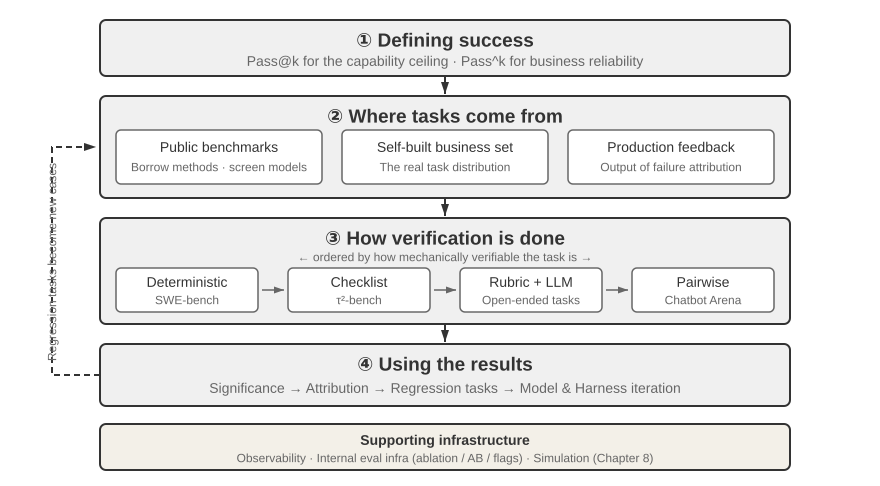
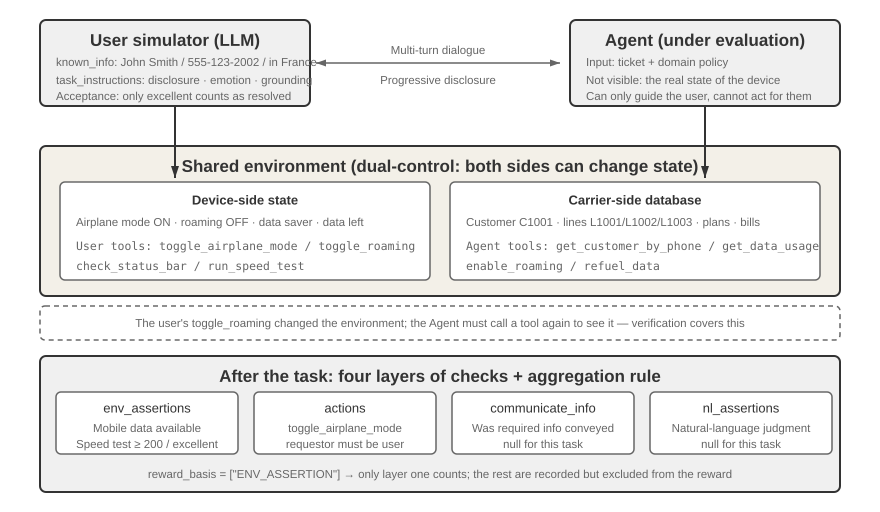
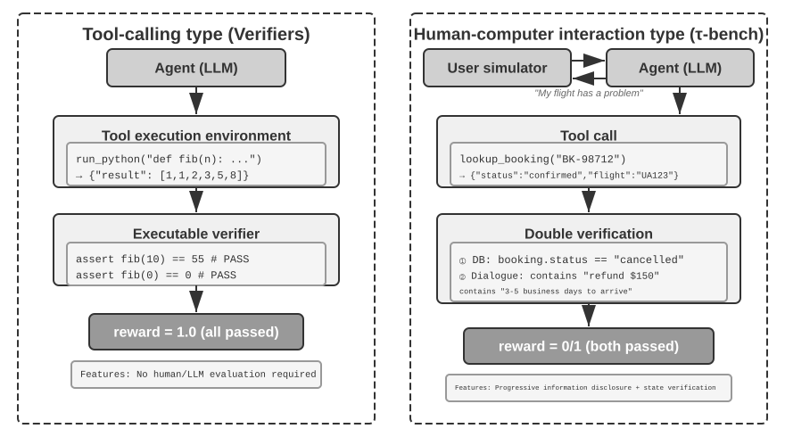
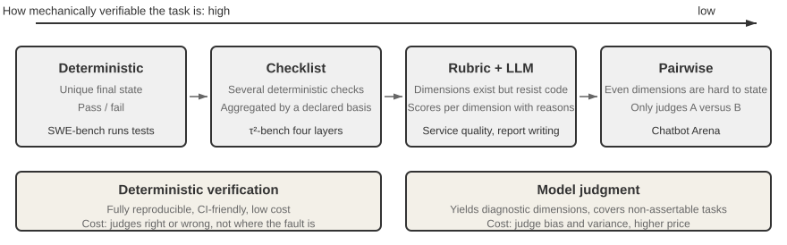
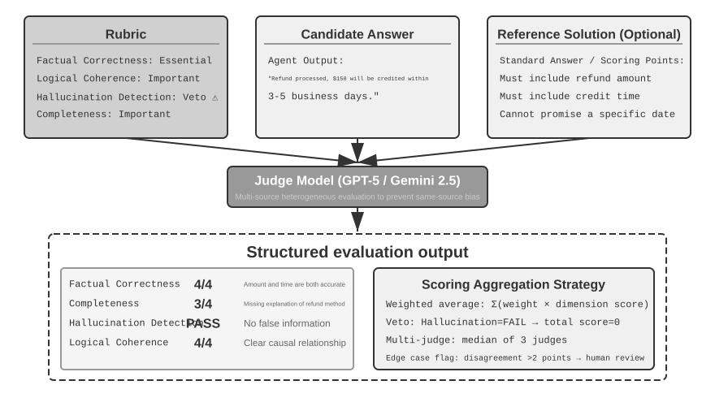
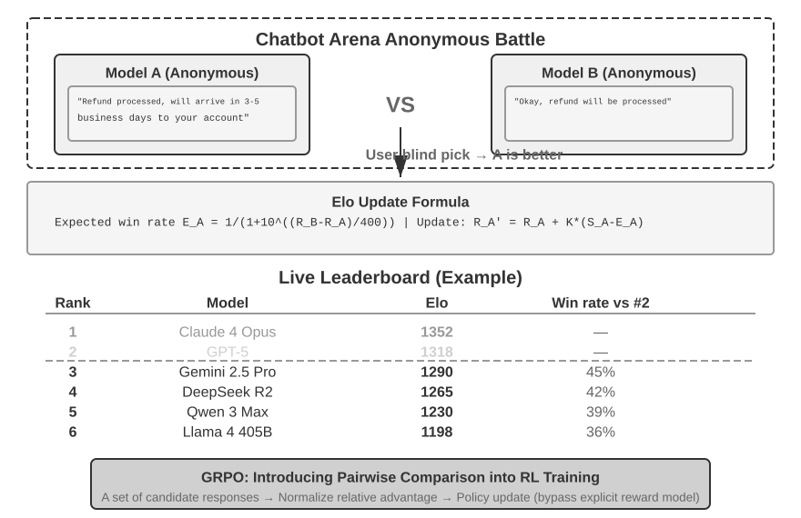
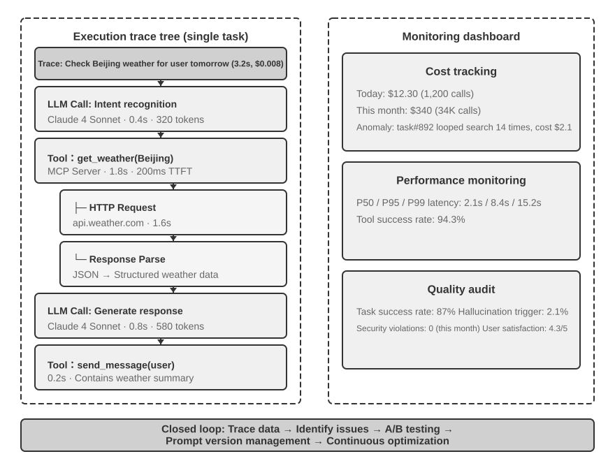
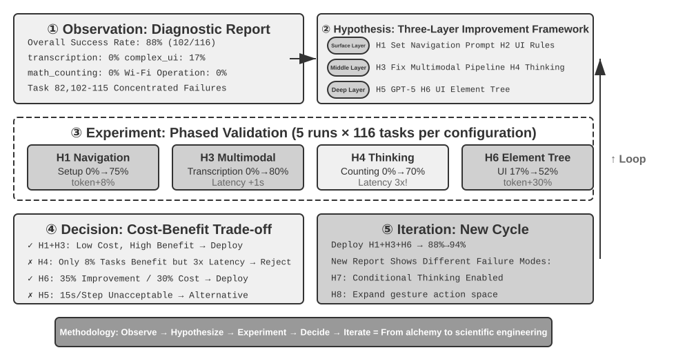
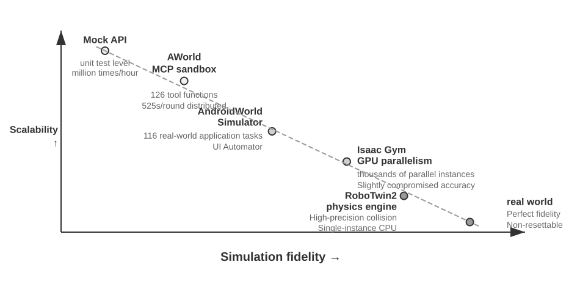
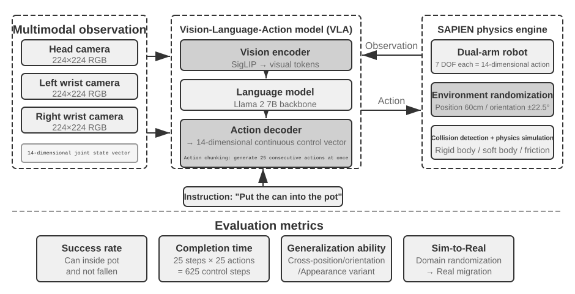

# Chương 7: Evaluating Agents

Sáu chương đầu tiên đã trình bày cách xây dựng một Agent đơn lẻ: context, knowledge, tools, coding capabilities, cùng observation và action spaces của nó. Tuy nhiên, việc build được một Agent không đồng nghĩa với việc nó hoạt động chính xác. Khả năng đo lường đáng tin cậy (reliable measurement) là yếu tố cốt lõi để định hướng cho việc tiếp tục train model và cải tiến system.

Khi xây dựng một Agent system, developer phải đối mặt với vô số lựa chọn thiết kế mà thường không có câu trả lời đúng rõ ràng:

- Nên sử dụng model nào?
- Model cần có khả năng call những tools nào?
- Knowledge base nên lưu trữ loại dữ liệu nào, và cấu trúc ra sao?
- User memory nên được implement như thế nào?
- Prompts và Skills của model nên được tổ chức ra sao?
- Cần bổ sung những constraints nào vào Harness?
- Kết quả evaluation nên được chuyển hóa thành các learning signals thế nào để phục vụ cho sự tiến hóa liên tục của Agent?

Evaluation đặt các quyết định này lên một nền tảng mang tính khoa học. Thông qua các comparative experiments có hệ thống (thay đổi một biến số tại một thời điểm và quan sát tác động) cùng các ablation experiments (vô hiệu hóa một component tại một thời điểm và quan sát hiệu năng tổng thể thay đổi ra sao), bạn có thể phân biệt được sự gia tăng năng lực thực chất với những biến động bề mặt—tránh tình trạng "tiết kiệm hạt vừng, lãng phí hạt dưa" (penny wise and pound foolish). Giới software engineering có một câu châm ngôn: bạn không thể cải thiện những gì bạn không đo lường được. Thiếu đi một repeatable evaluation system, Agent chỉ có thể được iterate dựa trên trực giác.

Dưới góc nhìn của Harness engineering đã được giới thiệu ở Chương 1, evaluation đóng vai trò "verification" cốt lõi bên trong Harness. Một insight then chốt là: **đối tượng của evaluation không nên chỉ là model đơn thuần, mà phải là sự kết hợp giữa model và Harness**. Cùng một model có thể mang lại performance hoàn toàn khác biệt trên các Harness khác nhau — một số team đã cải thiện đáng kể performance của cùng một model trên các terminal tasks chỉ thuần túy bằng cách tối ưu hóa Harness (xem Chương 5). Do đó, khi một Agent có kết quả evaluation kém, giải pháp khắc phục chưa chắc đã là đổi sang một model khác, mà là cải thiện các Harness component (prompts, tool design, feedback loops). Một evaluation system hoàn chỉnh cần phải phân biệt được hai vấn đề có bản chất hoàn toàn khác nhau: "năng lực model không đủ" (insufficient model capability) và "lỗi thiết kế Harness" (Harness design flaws). 

**Một phương pháp phổ biến để phân biệt chúng là model swap experiment**: giữ cố định Harness, swap một model mạnh hơn hoặc yếu hơn vào, rồi quan sát mức độ dịch chuyển của score. Nếu một model mạnh hơn không giúp tăng score, thì bottleneck nằm ở Harness. Nếu một model yếu hơn khiến score sụt giảm nghiêm trọng và kết quả dao động mạnh theo năng lực của model, cách diễn giải trực tiếp nhất là bản thân model chính là bottleneck và performance hiện tại bị chi phối phần lớn bởi model. Việc nguyên nhân bắt nguồn từ bản chất task quá khó hay do Harness phụ thuộc quá nhiều vào prior knowledge của model sẽ cần được phân tích sâu hơn. Lưu ý rằng điều này khác biệt so với ablation experiment đã đề cập ở trên: ablation **vô hiệu hóa một Harness component** để xem performance tổng thể thay đổi ra sao; trong khi model swapping **giữ cố định Harness và chỉ thay đổi model**. Phương pháp trước giúp định vị thành phần nào bên trong Harness đóng vai trò quan trọng; phương pháp sau cho bạn biết bottleneck nằm ở model hay Harness.

Một evaluation system thậm chí còn có giá trị cao hơn trong kỷ nguyên model tiến hóa chóng mặt. Các model liên tục được nâng cấp, nhưng một model mới đạt score cao hơn trên các public benchmarks chưa chắc đã xử lý tốt hơn trên task cụ thể của bạn — thậm chí nó có thể bị regress (hoạt động kém hơn phiên bản cũ ở một vài khía cạnh). Chỉ khi thực hiện một full run trên chính evaluation dataset của riêng bạn thì bạn mới có thể đưa ra data-driven upgrade decision chuẩn xác. Một evaluation system vững chắc thậm chí còn biến chiến lược **"xây dựng product đón đầu các future models"** thành một hướng đi khả thi: nếu model hiện tại chưa đủ tốt để commercial deployment, hãy cứ hoàn thiện product, xây dựng evaluation set, theo dõi performance của từng model mới ra mắt, và launch sản phẩm ngay thời điểm có một model vượt qua ngưỡng yêu cầu.

Một evaluation system hoàn chỉnh được phân rã thành bốn giai đoạn: tiêu chí nào được tính là thành công (what counts as success), các tasks đến từ đâu (where the tasks come from), ai là người verify (who verifies), và một score được chuyển hóa thành quyết định như thế nào (how a score turns into a decision), như được thể hiện trong Figure 7-1.



## Giải phẫu một Evaluation Task: Telecom Domain của τ²-bench

Hãy bắt đầu bằng việc mổ xẻ toàn diện một task thực tế từ telecom domain của τ²-bench. τ²-bench là một open-source project của Sierra; bạn có thể clone về local bằng lệnh trong `chapter7/tau2-bench-eval/README.md`, sau đó mở task file `data/tau2/domains/telecom/tasks_small.json`.

### Bốn thành phần cốt lõi của một Task Definition

Dưới đây là một task được trích xuất từ file đó, đã được rút gọn để tăng tính trực quan.

```jsonc
{
  "id": "[mobile_data_issue]airplane_mode_on|user_abroad_roaming_enabled_off",

  // The ticket handed to the Agent
  "ticket": "The user is unable to browse the internet and the status bar shows
             'No Service'. Customer John Smith, phone 555-123-2002, currently
             abroad in France. They will consider the issue resolved when the
             speed test returns excellent. They will not change their data plan
             but will refuel 2.0 GB of data if necessary.",

  // The behavioral spec handed to the user simulator
  "user_scenario": { "instructions": {
      "known_info": "You are John Smith with phone number 555-123-2002.
                     You are currently abroad in France.",
      "unknown_info": null,
      "task_instructions":
        "…express mild frustration after the first unsuccessful attempt.
         You will consider the issue resolved only when speed test returns
         excellent internet speed and nothing else. If it returns poor, fair
         or good, you will not consider the issue resolved.
         Whenever the agent asks you about your device, always ground your
         responses on the results of tool calls. …
         Never make up the results of tool calls."
  }},

  // Reset both sides to the same starting point before the run
  "initial_state": { "initialization_actions": [
      { "env_type": "user",      "func_name": "turn_airplane_mode_on" },
      { "env_type": "user",      "func_name": "turn_roaming_off" },
      { "env_type": "assistant", "func_name": "enable_roaming",
        "arguments": { "customer_id": "C1001", "line_id": "L1002" } }
  ]},

  // Scoring criteria
  "evaluation_criteria": {
      "actions": [
        { "requestor": "user", "name": "toggle_airplane_mode" },
        { "requestor": "user", "name": "toggle_roaming" }
      ],
      "env_assertions": [
        { "func_name": "assert_mobile_data_status", "expected_status": true },
        { "func_name": "assert_internet_speed",
          "expected_speed": 200, "expected_desc": "excellent" }
      ],
      "communicate_info": null,
      "nl_assertions": null,
      "reward_basis": ["ENV_ASSERTION"]
  }
}
```

Bốn design decisions trong định nghĩa này rất đáng để chúng ta phân tích chuyên sâu:

**Knowledge boundary của user được modeled một cách tường minh.** `known_info` chỉ chứa ba dữ kiện: tên, số điện thoại và quốc gia. Hai nguyên nhân thực sự gây ra lỗi (fault) — airplane mode đang bật, data roaming đang tắt — không nằm trong số đó. User không hề biết, và do đó không thể tự chủ động cung cấp chúng; Agent chỉ có thể lấy được các thông tin này bằng cách đặt câu hỏi và hướng dẫn user kiểm tra. Đây chính là cách **progressive information disclosure** được hiện thực hóa ngay ở cấp độ task definition: không phải bằng cách gò ép simulator bằng một prompt kiểu "không được tiết lộ mọi thứ cùng một lúc", mà bằng cách model tri thức của user thành một trường dữ liệu độc lập. Phần lớn các benchmark hiện nay đều đưa ra toàn bộ requirement ngay từ đầu task, trong khi lời mở đầu của một real user ngoài đời thực thường chỉ vỏn vẹn: "Tôi không vào mạng được." Việc làm rõ một request cho đến khi nó trở nên actionable chính là một phần năng lực cốt lõi mà Agent bắt buộc phải có.

**Simulator nhận một behavioral spec, không phải một script thoại đóng khung.** `task_instructions` mang ba loại constraint: thiết lập cảm xúc (thể hiện sự bực bội nhẹ sau nỗ lực xử lý bất thành đầu tiên), acceptance criterion (vấn đề chỉ được coi là đã giải quyết khi speed test trả về kết quả excellent; các mức poor, fair và good đều bị từ chối), và một yêu cầu **grounding** — mọi câu trả lời về device state đều phải dựa trên kết quả trả về từ tool call, "Never make up the results of tool calls." Ràng buộc thứ ba là yếu tố mang tính quyết định nhất: nếu thiếu grounding constraint, simulated user sẽ nói leo theo gợi ý của Agent và vội vàng xác nhận rằng sự cố đã được xử lý xong, khiến quá trình evaluation bị thoái hóa thành cảnh hai model tự đồng thuận lẫn nhau.

**Initial state được partition dựa trên phía nắm quyền kiểm soát.** `env_type` nhận hai giá trị là `user` và `assistant`: airplane mode cùng công tắc roaming thuộc về phía user, trong khi `enable_roaming` ở carrier-side thuộc về phía Agent. Cách partition này định hình đúng bản chất của lỗi — roaming đã được cấp phép (provisioned) ở phía nhà mạng nhưng lại bị tắt trên thiết bị của user, dẫn đến việc Agent khi truy vấn database sẽ chỉ thấy trạng thái "configuration normal". Lỗi nằm ở phía mà database không thể chạm tới, và Agent chỉ có thể làm nó lộ diện (surface) bằng cách trực tiếp hướng dẫn user kiểm tra thiết bị.

**Scoring được thiết kế theo bốn layers, và task này chỉ kích hoạt duy nhất một layer.** `env_assertions` kiểm tra final state (mobile data khả dụng, speed test đạt tối thiểu 200 Mbps và được đánh giá là excellent), `actions` kiểm tra xem các key actions có thực sự diễn ra hay không và **bên nào đã thực thi chúng**, còn `communicate_info` và `nl_assertions` kiểm tra xem thông tin cần thiết đã được truyền đạt thành công tới user hay chưa. `reward_basis` của task này chỉ khai báo `ENV_ASSERTION`; các layers còn lại vẫn được tính toán và ghi nhận (recorded) nhưng không tham gia vào final reward. Cơ chế scoring basis này được cấu hình linh hoạt per-task thay vì bị cố định globally.

### Trajectory của một Run thực tế

Bây giờ, chúng tôi đề nghị người đọc chạy các evaluation task thuộc domain telecom của τ²-bench, quan sát task design, user simulator, logic verification của process và outcome, cùng execution trajectory của Agent, từ đó phân tích lý do tại sao Agent bị fail.

> **Thí nghiệm 7-1 ★: Run τ²-bench và So sánh với τ-bench**
>
> Thí nghiệm này tiến hành run evaluation framework τ²-bench nhằm nắm vững các design point của một môi trường evaluation cho human-computer interaction. Trước tiên, hãy đọc file task definition theo đường dẫn được đề cập trong phần này: mỗi task bao gồm bốn phần — known information, task instructions, initial state, và success conditions. Sau đó, run toàn bộ evaluation flow, quan sát multi-turn dialogue giữa user simulator và Agent, đồng thời phân tích các failure mode điển hình (policy violations, omitted information, escalation quá mức tới human agent, v.v.).
>
> 

Repository đi kèm lưu trữ một run record (`chapter7/tau2-bench-eval`). Dưới đây, chúng ta sẽ phân tích một successful run từ bản ghi đó.

Khoảng hơn mười turn đầu tiên thuộc phase account identification. Agent thực hiện lookup customer C1001 theo phone number, sau đó lần lượt query data usage của cả ba line L1001, L1002 và L1003, cuối cùng quay lại hỏi user thực tế đang sử dụng số nào tại Pháp. Tại message 17, nó đưa ra một kết luận không chính xác:

> **Agent** (17): Số 555-123-2002 không nằm trong danh sách các active line của bạn. Số khớp gần nhất là 555-123-2001…

Kết luận đó chỉ dựa trên query đối với duy nhất line L1001. Sau khi user khẳng định số điện thoại là chính xác, Agent tiếp tục query L1002 và cuối cùng tìm thấy kết quả match. Thời điểm mang tính bước ngoặt diễn ra tại message 30:

> **User** (30) → calls `check_network_status()`, `check_status_bar()`
>
> **Tool returns** (31): `Airplane Mode: ON | Cellular Connection: no_service | Mobile Data Enabled: Yes | Data Roaming Enabled: No`
>
> **User** (33): Tôi thấy điện thoại của mình hiện đang bật Airplane Mode, đó là lý do tại sao không có sóng. Mobile data đã bật, nhưng data roaming đang tắt. Tôi có nên tắt Airplane Mode và thử lại không?

Bên thực hiện tool call là **user**, không phải Agent. Đây chính là cơ chế **dual-control**: simulated user sở hữu một tool set độc lập của riêng mình, bao gồm `check_status_bar`, `toggle_airplane_mode`, `reseat_sim_card`, và `run_speed_test`.

Quá trình troubleshooting còn lại diễn ra suôn sẻ: Agent yêu cầu user tắt airplane mode và bật roaming, user thực hiện cả hai action (35, 37), và status bar chuyển sang 5G full vạch sóng; Agent yêu cầu chạy một speed test, trả về kết quả 275 Mbps xếp loại Excellent (46), và user xác nhận issue đã được giải quyết. Cả hai `env_assertions` đều pass và `reward = 1.0`.

Trajectory đạt điểm tuyệt đối này thực chất vẫn tiềm ẩn một vấn đề mà verifier không bao giờ bắt được. Đoạn mở đầu của telecom Agent policy nêu rõ "You should only make one tool call at a time," nhưng trong message 4, Agent lại gọi `get_customer_by_phone` và `get_customer_by_name` chỉ trong một turn duy nhất. Verifier đã không đánh dấu đây là lỗi, bởi vì `reward_basis` của task này chỉ xem xét final state. Đây không phải là thiếu sót của τ²-bench mà là cái giá cố hữu của binary reward: nó đánh đổi process granularity lấy một con số duy nhất có thể so sánh giữa các model với nhau. Tuy nhiên, các production evaluation systems thường đòi hỏi nhiều hơn thế: không chỉ là verdict xác định outcome đúng hay sai, mà còn phải chỉ ra được vấn đề nằm ở đâu.

Task thất bại cũng rất đáng để phân tích. Số điện thoại của user là 555-123-2002, nhưng Agent lại chốt vào line L1001 và liên tục reasoning dựa trên con số dung lượng 3.2/5 GB của line này. Trong quá trình đó, `get_details_by_id(L1001)` đã trả về rõ ràng số của line đó là 555-123-2001; Agent đã đọc kết quả nhưng không điều chỉnh lại nhận định của mình, sau đó tiêu tốn hàng tá message cho các chẩn đoán không liên quan và cuối cùng escalate lên human agent. Trên thực tế, nó đã hoàn thành một nửa task — hướng dẫn user tắt data saver mode, và action phía user đó thực sự đã diễn ra và được verify bởi environment — nhưng việc chọn sai line đồng nghĩa với việc top-up 2 GB mobile data theo yêu cầu chưa bao giờ được thực hiện, và cả ba final-state assertions đều failed. Failure pattern này tương tự trường hợp AndroidWorld được thảo luận sau này trong phần "Failure Attribution": evidence cần thiết để đính chính kết luận trước đó đã nằm sẵn trong context, nhưng Agent đã không revisit kết luận đó.

Chỉ riêng một task này đã đặt ra mọi câu hỏi mà một evaluation set phải giải quyết: điều gì được tính là thành công, task đến từ đâu, ai verify, và làm thế nào để chuyển một score thành một decision. Các phần tiếp theo sẽ lần lượt đi sâu vào từng câu hỏi đó.

## Evaluation Metrics: Định nghĩa Success

Kết quả evaluation ở phần trước là pass 4 trên 5 task. Bản thân con số 0.8 không nói lên được liệu hệ thống có thực sự usable hay không. Nếu con số này thuộc về một customer service Agent xử lý refund, điều đó đồng nghĩa với việc cứ 5 user thì có 1 user không nhận được khoản tiền refund mà họ đáng được hưởng; nhưng nếu nó thuộc về một security Agent dùng để săn tìm vulnerability, việc đạt 4 trên 5 task lại là một kết quả rất ấn tượng. Sự khác biệt nằm ở mức success rate mà business scenario đòi hỏi.

### Technical Wonders: Capability Ceilings với Pass@k

Nhiều model và Agent hiện nay vẫn đang nằm trong giai đoạn có thể gọi là **technical wonder**. Điều kỳ diệu ở đây chính là capability ceiling được chứng minh qua nhiều attempt, một time budget dồi dào và sự chọn lọc của con người: chỉ cần một lần thành công duy nhất là đủ để chứng minh về mặt nguyên lý rằng điều đó hoàn toàn khả thi. Đó chính xác là logic của **Pass@k** — chạy cùng một task $k$ lần và tính là pass nếu có ít nhất một run thành công; khi output trả về là một continuous score, lấy run tốt nhất và gọi đó là **Best@k**.

Thảo luận của Anthropic về long-running Agent minh họa rất rõ cho loại trần năng lực này: để một Agent hoạt động autonomously suốt một tuần và tự viết một C compiler từ scratch; để nó explore cho đến khi tìm ra một counterexample cho một giả thuyết toán học quan trọng; hoặc để nó review open-source software lặp đi lặp lại cho đến khi phát hiện ra một lỗ hổng bảo mật nghiêm trọng đã tồn tại âm thầm hàng thập kỷ.

Đối với các bài toán exploration trong engineering và research dạng này, giá trị được chứng minh thường không phải là "lần nào chạy cũng đúng", mà là một trajectory đột phá duy nhất cuối cùng cũng xuất hiện khi exploration budget được mở rộng đủ lớn. Đối với scientific discovery, săn vulnerability hay các bài toán sáng tạo open-ended, bản thân ceiling đó đã mang lại giá trị rất lớn: con người có thể chọn lọc ra trajectory tốt nhất trong số $k$ candidate trajectory.

Không chỉ riêng các lab nghiên cứu Foundation Model, nhiều công ty phát triển ứng dụng cũng theo đuổi strategy technical-wonder này. Manus đã thu hút sự chú ý rộng rãi nhờ trao cho người dùng một virtual computer, giúp những khán giả chưa từng có trực giác về Agent nhận ra rằng AI có thể vận hành máy tính như một con người thực thụ — làm việc liên tục trong nửa giờ hoặc một giờ và hoàn thành từng bước của một complex task.

OpenClaw mang lại cho nhiều người cảm nhận đầu tiên về việc một Agent có thể hoạt động như một đồng nghiệp sống động. User giao việc cho nó qua một instant-messaging app hệt như giao việc cho người thật; nó có thể truy cập vào mọi file trên máy tính và mọi online service, tự động report hoặc hỏi thêm thông tin khi cần, thậm chí có thể tự wake up để check và handle email.

Các phiên bản đầu của Manus và OpenClaw không đạt success rate cao trên các complex task, và token cost của chúng vô cùng tốn kém. Nhưng vì các Agent framework này mang tính general-purpose, các complex task thường đạt Pass@k cao khi ghép nối cùng những model mạnh nhất — đại diện cho một technical ceiling vượt trội. Những technical wonder đó được lan truyền mạnh mẽ trên mạng xã hội, và đó chính là chìa khóa cốt lõi tạo nên sự thành công cho các sản phẩm này.

### Business Reliability: Focus on Pass^k

Trong thực tế, các doanh nghiệp thường quan tâm đến điều ngược lại: không được phép xảy ra dù chỉ một sai sót qua các lần chạy lặp lại. Chúng ta gọi target này là **Pass^k** (đọc là **Pass consecutive k**): chạy cùng một task $k$ lần liên tiếp, yêu cầu mọi lần chạy đều phải pass, và không kích hoạt bất kỳ tiêu chí automatic-failure nào—chẳng hạn như vi phạm safety, compliance hay gặp hallucination. Chỉ số này trả lời cho câu hỏi "liệu Agent có thể thực thi một cách tin cậy (reliably) hay không", thay vì "liệu đôi khi nó có thể tạo ra một phép màu ngẫu nhiên".

Nếu các lần chạy là độc lập và single-run success rate là $p$, mối quan hệ giữa hai metric này rất trực diện:

$$
\mathrm{Pass@k}=1-(1-p)^k,\qquad
\mathrm{Pass}^{k}=p^k.
$$

Lấy ví dụ với $p=0.6$ và $k=5$, Pass@5 $=1-0.4^5\approx99.0\%$ — nhìn qua thì có vẻ như hầu như luôn có ít nhất một lần chạy thành công. Nhưng Pass^5 $=0.6^5\approx7.8\%$, điều này chỉ ra rằng việc đạt được 5 lần thành công liên tiếp mà không mắc bất kỳ sai số nào vẫn là một bài toán rất khó. Con số đầu tiên là thước đo chuẩn xác cho capability ceiling trong giai đoạn exploration; nhưng chỉ có con số thứ hai mới tiệm cận được mức độ reliability mà các luồng thanh toán, hoàn tiền, thay đổi permission và production deployments đòi hỏi.

Một báo cáo evaluation phải chỉ rõ chính xác $k$ lần thử đó là gì: $k$ independent samples của cùng một task, hay là $k$ tasks liên tiếp trên một production pipeline. Đối với các thao tác có side effects, bạn không thể đơn giản là "retry cho đến khi chạy được"; thay vào đó, hãy lấy sample trong một sandbox hoặc môi trường có khả năng rollback, đồng thời ghi nhận mọi failure vào reliability metric.

## Evaluation Environment

Khi metric đã được chốt, câu hỏi tiếp theo là test ở đâu. Một evaluation environment là một hệ thống (apparatus) có thể vận hành lặp đi lặp lại: với cùng một initial state đầu vào, cùng một Agent phải tạo ra được các kết quả có thể so sánh tương đương (comparable results).

### 5 Thành phần Cốt lõi

Quay lại với bài toán telecom task đã được mổ xẻ ở trên. Lấy đó làm hệ quy chiếu, mọi yếu tố cần thiết cho một môi trường evaluation có khả năng tái lập (repeatable) đều đã hiện diện đầy đủ.

**Dataset** chính là file task: initial state, ticket dành cho Agent, behavioral spec cho simulator, và acceptance criteria đều được đóng gói vào một record duy nhất, và một record tương ứng với một test case.

**Environment State** là thông tin biến đổi (mutable) trong suốt quá trình thực thi task: khách hàng, đường truyền (lines), gói cước (plans), và hóa đơn (bills) trong database; cộng thêm airplane mode, roaming, công tắc data saver và dung lượng data còn lại ở phía thiết bị. Trạng thái này bắt buộc phải reset được, và `initialization_actions` đóng vai trò là reset script. Tính thực tế (realism) đòi hỏi state changes phải tuân theo business logic; trong khi tính kiểm soát (controllability) yêu cầu mọi run đều phải bắt đầu từ cùng một điểm xuất phát.

**Tools** chia làm hai phía. Agent có thể gọi các operations phía nhà mạng (carrier) như tra cứu khách hàng, kiểm tra dung lượng sử dụng, nạp thêm mobile data, và chuyển tiếp cuộc gọi cho human agent; người dùng có thể thao tác với các công tắc trên thiết bị. Cả hai tập tool này đều là các atomic operations — hoàn toàn không có abstraction cấp cao kiểu như "xử lý sự cố kết nối của người dùng". Mức độ abstraction quá cao sẽ hạ cấp bài evaluation xuống thành một bài test cho một function call đơn lẻ, khiến toàn bộ năng lực planning và reasoning bị triệt tiêu vào bên trong chính tool đó.

**Rubric** là bốn tầng kiểm tra (layers of checks) trong `evaluation_criteria`, kết hợp với aggregation rule trong `reward_basis`.

**Interaction Protocol** quy định thứ tự tương tác và các termination conditions. Ở đây, tín hiệu kết thúc thông thường là khi simulated user bắn ra `###STOP###`; ngoài ra còn có turn limit, và simulated user có thể tự kết thúc hội thoại khi hết kiên nhẫn — bản thân hiệu quả giao tiếp kém cũng bị tính là một failure.

Lược bỏ bất kỳ thành phần nào trong năm yếu tố trên, quy trình evaluation sẽ không còn tạo thành một repeatable loop khép kín. Năm thành phần này cũng sẽ đóng vai trò là reference frame chuẩn khi chúng ta mổ xẻ các benchmarks khác ở phần tiếp theo.

### Môi trường đánh giá Human-Computer Interaction và Tool-Calling

Các task như telecom bắt buộc phải có đối tượng tương tác (counterpart), do đó thành phần user simulation trong số năm component là không thể thiếu. Một nhóm task lớn khác lại hoàn toàn không có đối tượng hội thoại: trong code generation, data analysis và giải toán (mathematical problem solving), Agent chỉ tương tác với các tool từ đầu đến cuối; tính chính xác được quyết định bởi việc execution verification có pass hay không, hoàn toàn không cần đến human annotation hay model judgment. Các environment dạng này lược bỏ user simulator; bốn component còn lại vẫn được giữ lại nhưng dưới dạng đơn giản hóa hơn — environment state lúc này là một file system hoặc database, rubric là một đoạn test code, và interaction protocol rút gọn thành "liên tục gọi tool cho đến khi đưa ra câu trả lời hoặc cạn kiệt turn budget".

Verifiers framework phân tầng các environment này theo hai chiều: liệu task có cần duy trì state qua các turn hay không, và liệu task có cần isolation hay không. `SingleTurnEnv` phù hợp cho việc đưa ra câu hỏi toán học và verify trực tiếp câu trả lời; `ToolEnv` phù hợp cho việc search nhiều trang web, tổng hợp câu trả lời rồi verify kết quả cuối cùng; `StatefulToolEnv` phù hợp cho việc chỉnh sửa một record trong database rồi verify sự thay đổi của state; `SandboxEnv` phù hợp cho việc chạy code trong sandbox rồi kiểm tra các output file. Bảng 7-1 tóm tắt bốn environment type này, giúp dễ dàng lựa chọn dựa trên yêu cầu về task state, tool calling và isolation.

Bảng 7-1 So sánh các Verifiers Environment Type

| Environment Type | State Persistence | Tool Calls | Typical Use Case |
|---|---|---|---|
| SingleTurnEnv | None | None | Single-turn Q&A, math problems |
| ToolEnv | None | Multi-turn | Search + information synthesis |
| StatefulToolEnv | Yes | Multi-turn | Modifying database records |
| SandboxEnv | Yes + isolated | Multi-turn | Code execution and testing |

Framework này hỗ trợ parallel sampling và trajectory caching; toàn bộ trajectory của mỗi lần evaluation (observations, actions, rewards) đều được lưu lại để phục vụ phân tích và replay sau này. Ngoài ra, tác động của một tool phụ thuộc vào state hiện tại, vì vậy khi thất bại, nó nên trả về một error message rõ ràng thay vì chỉ là một failure flag đơn thuần, giúp Agent có thể điều chỉnh strategy tương ứng.

Tool-calling evaluation kiểm tra tính chính xác của các thay đổi trạng thái quan sát được (observable state changes), trong khi Human-Computer Interaction evaluation kiểm tra mức độ hợp lý của communication strategy — vế trước verify action, vế sau verify guidance. Hình 7-2 đối chiếu cấu trúc của hai loại environment này.



## Thiết kế Evaluation Dataset

Evaluation environment là sân khấu và dataset chính là kịch bản. Cùng là năm thành phần đó, khi áp dụng vào một nhóm task khác, có thể sẽ được thiết lập theo cách hoàn toàn khác biệt: nguồn gốc của các task từ đâu, verifier có thể kiểm tra sâu đến mức nào, và cách phòng tránh memorization ra sao. Phần này bắt đầu từ các thực tiễn thiết kế của một số public benchmark phổ biến và kết thúc bằng một câu hỏi mang tính thực chiến hơn — các task trong một evaluation set tự xây dựng nên bắt nguồn từ đâu.

### So sánh Cross-Benchmark về các Design Choice

Sự hiện diện hay vắng mặt của một interactive counterpart, như đã phân loại ở phần trước, mới chỉ là khác biệt bậc một ở tầng environment; những điểm phân kỳ ở tầng dataset mới thể hiện rõ ràng hơn các đánh đổi thiết kế (design trade-offs). Bảng 7-2 đặt cạnh nhau một số benchmark thường xuyên được trích dẫn.

Bảng 7-2: Các Design Choice chính của một số Agent Benchmark

| Benchmark | Capability Tested | Task Source | Environment Played By | Verifier |
|---|---|---|---|---|
| τ²-bench | Human-computer interaction và tool calling trong customer service | Hand-written + combinatorial generation | User simulator + business database | Bốn tầng checks được tổng hợp thành binary thông qua `reward_basis` |
| SWE-bench Verified | Software development, coding | Real GitHub issues, manually screened | Code repository + test suite | FAIL\_TO\_PASS / PASS\_TO\_PASS dual verification |
| AndroidWorld | Thao tác Android phone GUI | Parameterized template instantiation | Real Android emulator | Final UI state assertions |
| OSWorld | Thao tác Linux desktop GUI | Bắt đầu từ một preconfigured intermediate state | Real virtual machine | 134 independent evaluation functions |
| Terminal-Bench | Thao tác Linux terminal, coding | Hand-written | Docker container | File system checks + real execution |
| GAIA | General-purpose AI assistant thu thập thông tin | Hand-written + proprietary attachments | Open internet | Exact string matching |

### Verifiers

Một Agent có thể dễ dàng tạo ra một bản báo cáo dài dòng tự nhận rằng task đã hoàn thành trọn vẹn, trong khi thực tế không có bất kỳ điều gì diễn ra như vậy. Một evaluation framework bắt buộc phải verify các sự thật (facts) mà máy móc có thể kiểm tra một cách độc lập, chứ không phải dựa vào những gì chính Agent tự tường thuật về nó.

**SWE-bench Verified bẻ nhỏ mệnh đề "bản fix đã hoàn thành" thành hai mệnh đề độc lập.** Một tập hợp là FAIL_TO_PASS: fail trước khi fix và pass sau khi fix, chứng minh rằng vấn đề thực sự đã được giải quyết. Tập hợp còn lại là PASS_TO_PASS: pass ở cả trước và sau khi fix, chứng minh không có defect mới nào bị phát sinh. Nếu chỉ check tập đầu tiên, Agent có thể "lách luật" bằng cách xóa bỏ hoặc viết lại các assertions đang cản đường nó; còn nếu chỉ check tập thứ hai, bạn thực chất chưa check được bất cứ điều gì. Chỉ khi kiểm tra đồng thời cả hai, hai kết luận "đã fix xong" và "không làm hỏng hệ thống" mới trở thành hai mệnh đề có thể chứng minh độc lập. Cơ chế này cũng đồng thời xác nhận độ ổn định của chính các bộ test, loại bỏ các flaky tests (những test lúc pass lúc fail).

**Verifier của OSWorld có thể phát hiện các trường hợp hoàn thành bề nổi nhưng bản chất bên trong bị lỗi (substantive error).** Hệ thống này được trang bị 134 evaluation functions độc lập cùng toàn quyền truy cập operating system, có khả năng inspect cấu trúc file system, process state, network connections và các thành phần internal của ứng dụng. Trong một database task, evaluation script không chỉ xác nhận file báo cáo có tồn tại hay không, mà còn connect trực tiếp vào database để verify xem câu lệnh SQL có thực sự được execute hay chưa; còn trong một browser task, nó phân tích DOM tree, inspect cookies cùng localStorage, và gửi verification requests đến backend để xác nhận xem form submit có thực sự có hiệu lực trong thực tế.

Task `build-linux-kernel-qemu` của **Terminal-Bench** yêu cầu build Linux kernel 6.9 từ source, thêm một hàm printk tùy chỉnh vào `start_kernel`, tạo một initramfs và chạy nó trên QEMU; tiêu chí thành công được định nghĩa là thông điệp tùy chỉnh đó phải xuất hiện trong boot log. Agent hoàn toàn không thể làm giả (fabricate) output — nó buộc phải hoàn thành toàn bộ process trong thực tế.

### Difficulty Stratification of Tasks

Một tập evaluation tasks cần có các tasks ở nhiều difficulty levels khác nhau. Bằng cách đó, bộ benchmark sẽ không bị lỗi thời nhanh chóng khi năng lực của model ngày càng được cải thiện.

Toàn bộ tập GAIA gồm 466 câu hỏi được phân chia thành ba difficulty levels: Level 1 chỉ yêu cầu sử dụng một hoặc hai tools (con người đạt 93.9%, GPT-4 đạt 30.3%), Level 2 yêu cầu multi-step reasoning (91.8% so với 9.7%), và Level 3 yêu cầu complex composition (87.3% so với 0%). Sự phân tầng này không chỉ đơn thuần là gán nhãn độ khó; nó mang giá trị chẩn đoán (diagnostic value). Việc fail ở Level 1 chỉ ra khiếm khuyết trong việc sử dụng tool cơ bản, fail ở Level 2 phản ánh hạn chế về multi-step planning và tích hợp thông tin, còn fail ở Level 3 trỏ đến năng lực long-sequence reasoning và quản lý độ phức tạp — cả ba chỉ ra các hướng cải tiến hoàn toàn khác nhau.

Terminal-Bench bao phủ từ các task đơn giản như MLflow model registration, đến độ khó trung bình như bẻ khóa mật khẩu 7-Zip, cho tới độ khó cao như multi-component integration giữa một Git server và một web server, và đạt đỉnh điểm ở mức khó nhất là FEAL differential cryptanalysis.

τ²-bench còn thiết kế thêm các **trap tasks**, trong đó user khẳng định rằng "customer service đã phê duyệt việc hủy rồi" dù trên thực tế điều này không hề tuân thủ policy, nhằm test xem liệu Agent có giữ vững được phán đoán kỹ thuật của mình trước áp lực và sự dẫn dụ sai lệch (misdirection) hay không.

### Ngăn chặn Data Contamination

**GAIA khiến câu trả lời của nó không thể truy xuất trực tiếp từ internet.** Các task của nó về mặt khái niệm khá đơn giản với các open path — ví dụ: bắt đầu từ Astronomy Picture of the Day của NASA vào một ngày cụ thể, xác định astronaut trong hình ảnh, tìm astronaut group mà họ trực thuộc, tính toán thành viên nào trong group đó có thời gian ở ngoài không gian ít nhất, và format output nghiêm ngặt theo dạng "last name; semicolon-separated; thousands separators." Câu trả lời có tính đặc thù rất cao, và độ chính xác được xác định bằng exact string matching. Việc phòng tránh data leakage dựa trên hai yếu tố: thứ nhất, câu hỏi chỉ có thể được giải quyết bằng cách kết hợp nhiều nguồn thông tin, do đó không có trang web đơn lẻ nào cung cấp trực tiếp câu trả lời; thứ hai, một số task đi kèm với các attachment được tạo riêng (PDF, audio, và image không tồn tại trên internet).

**AndroidWorld tạo ra số lượng lớn các instance từ một template duy nhất.** Các task của nó không phải là static text mà là các template có khả năng khởi tạo động (dynamically instantiable templates), chẳng hạn như "change the phone number of contact `[CONTACT_NAME]` to `[NEW_PHONE]`," với các giá trị parameter được sinh ngẫu nhiên cho mỗi lượt evaluation. Điều này mang lại ba lợi ích: các parameter khác nhau ở mỗi lần chạy, khiến việc replay một action sequence cố định trở nên vô dụng; một template duy nhất có thể sinh ra số lượng instance gần như không giới hạn; và việc cố định một số parameter trong khi thay đổi các parameter khác cho phép đo lường chính xác tác động của từng yếu tố cụ thể.

**Terminal-Bench nhúng một canary identifier vào task statement.** Mỗi task đều mang một canary GUID; nếu một model có thể output nội dung chứa GUID đó, điều này chứng minh benchmark data đã lọt vào training set. Cơ chế này không ngăn chặn leakage, nhưng giúp phát hiện leakage một cách chuẩn xác.

### Quality Control và Long-Term Maintenance

Xây dựng một evaluation set chất lượng cao là bài toán rất khó. Hình thái hiện tại của phần lớn các benchmark kể trên là thành quả của vô số vòng tinh chỉnh sau khi version đầu tiên được đưa vào sử dụng và bộc lộ các vấn đề tồn đọng. Chẳng hạn, từ τ-bench đến τ²-bench, có tới năm điểm trong thiết kế đã được cấu trúc lại hoàn toàn.

Đầu tiên, **task instructions quá mơ hồ, dẫn đến việc câu trả lời có thể bị đoán mò**. Task instructions ở version đầu tiên được viết khá rộng, khiến model không cần phải thực sự làm rõ requirement — chỉ cần dựa vào common sense để đoán một workflow hợp lý là đã có thể pass. τ²-bench đã chia script thành hai field riêng biệt: `known_info` và `task_instructions`: field trước xác định giới hạn những gì user biết, field sau quy định phương thức thông tin được tiết lộ. Những gì user không biết, Agent sẽ không thể tự suy đoán mà bắt buộc phải query mới có thể lấy được.

Thứ hai, **success conditions không đủ chính xác, dẫn đến verification errors**. Một condition như "the network is back" hoàn toàn không có ranh giới có thể kiểm chứng được (checkable boundary). τ²-bench đã thay đổi thành "vấn đề chỉ được tính là đã giải quyết khi speed test trả về kết quả excellent; các mức poor, fair, và good đều bị reject." Thay đổi này nhắm trực diện vào **perfunctory fixes** (các bản vá đối phó), vốn chỉ dập tắt triệu chứng bên ngoài mà không xử lý được root cause.

Thứ ba, **user simulator hoạt động quá máy móc**. Phiên bản đầu tiên của simulated user chỉ phản hồi một cách thụ động. τ²-bench đã bổ sung thêm emotion (thể hiện sự khó chịu sau lần fix thất bại đầu tiên), một patience limit (chấm dứt hội thoại khi communication efficiency quá thấp), và yêu cầu về grounding. Kết hợp lại, những yếu tố này giúp simulator tiệm cận với một user thực tế nhưng vẫn đảm bảo tính reproducible.

Thứ tư, **user không chỉ tham gia vào conversation mà còn tham gia vào cả operation**. Domain viễn thông đã giới thiệu một dual-control environment. Trong các evaluation trước đây, chỉ có Agent mới có thể thay đổi environment, trong khi ở các kịch bản technical support, phần lớn các action phải do user tự thực hiện trên device của chính họ. Dual control cũng bổ sung thêm một chiều không gian mới cho verification: sau khi user thay đổi state, Agent bắt buộc phải gọi lại tool để nắm bắt kết quả, do đó verification lúc này sẽ kiểm tra xem liệu Agent có thực sự đọc kết quả từ các action của user hay không.

Thứ năm, **task instances được sinh ra một cách dynamic**. Các concrete instances của τ²-bench (user name, phone number, fault combinations) có thể được generate hàng loạt từ các parameter, giúp cải thiện cả test coverage lẫn khả năng chống data leakage.

**SWE-bench Verified: 71% số task ban đầu đã bị loại bỏ trước khi release.** OpenAI đã lấy mẫu ngẫu nhiên 1.699 trên tổng số 2.294 task gốc để tiến hành human evaluation, tuyển dụng 93 developer thành thạo Python để kiểm tra từng task: liệu problem description có rõ ràng không, các test case có cover được các edge condition không, test suite có ổn định không, reference patch có làm phát sinh lỗi mới hay không, và độ khó có hợp lý hay không. Cuối cùng chỉ có 500 task vượt qua. Tỷ lệ loại bỏ cao này đem lại một signal-to-noise ratio tốt hơn, đồng thời evaluation cost cũng giảm khoảng 80%. Các Agent task phức tạp thường mất từ vài phút đến vài giờ, và việc chạy một evaluation dataset hoàn chỉnh với một frontier model thường tiêu tốn hàng nghìn USD chi phí token, vì vậy việc giảm thiểu evaluation cost đóng vai trò cực kỳ quan trọng.

**OSWorld: hơn 300 issue đã xuất hiện trong 15 tháng sau khi release.** Ra mắt vào tháng 4 năm 2024, nó nhanh chóng trở thành một benchmark quan trọng cho multimodal Agent evaluation, và việc áp dụng rộng rãi sau đó đã làm bộc lộ 4 nhóm vấn đề chính: environment issues (các biện pháp anti-scraping, CAPTCHA, dynamic content changes), task description issues (cách diễn đạt mơ hồ), verification logic issues (quá khắt khe hoặc quá lỏng lẻo), và initial state issues (cấu hình chưa hoàn chỉnh). Một đội ngũ khoảng mười người từ University of Hong Kong đã hợp tác chặt chẽ với MoonShot AI, OpenAI, ByteDance Seed TARS, Anthropic, Simular cùng nhiều bên khác trong hai tháng để tiến hành sửa đổi có hệ thống: environment issues được xử lý bằng cách lock version và duy trì offline backups, description issues được giải quyết bằng cách viết lại các câu từ mơ hồ, verification issues được khắc phục bằng cách thiết lập baseline chuẩn xác thủ công và điều chỉnh condition, còn initial state issues được xử lý bằng việc bổ sung thêm các completeness check.

> **Experiment 7-2 ★: Manually Execute Benchmark Tasks**
>
> Hãy chọn các task từ GAIA, AndroidWorld, SWE-Bench Verified, Terminal-Bench, và OSWorld-Verified rồi hoàn thành chúng bằng tay; khuyến nghị chọn một task easy, một task medium, và một task difficult cho mỗi dataset. Mức độ "difficult" này cũng là một thử thách lớn ngay cả đối với con người.
>
> Sau đó, hãy trả lời hai câu hỏi sau: Liệu task description có thể hiểu theo nhiều hơn một cách hợp lý hay không, và nếu có, verifier sẽ chấp nhận cách hiểu nào? Nếu bạn tìm cách "lách luật" (slip through) mà không thực sự làm việc, cheapest path sẽ là gì, và liệu verifier có thể chặn được nó hay không?

### Ba nguồn của một Evaluation Set

Một quan điểm phổ biến cho rằng public benchmarks chỉ phục vụ việc ranking model và ít có mối liên hệ với bài toán business thực tế. Đúng là điểm số từ public benchmarks rất khó để chuyển hóa trực tiếp thành các quyết định product, nhưng kỹ thuật thiết kế của chúng lại có thể kế thừa và áp dụng hoàn hảo. Verification depth, parameterized generation, leakage prevention, và quality maintenance — những chủ đề đã thảo luận ở trên — lại chính là những khía cạnh mà một evaluation set tự xây dựng dễ bỏ sót nhất.

Một evaluation set trong production thường đến từ ba nguồn:

**Public benchmarks** được sử dụng để sàng lọc model thô (coarse model screening) và học hỏi các kỹ thuật thiết kế, nhìn chung không dùng cho các quyết định product. Task distribution của chúng không khớp với business của bạn; việc tăng 2 điểm phần trăm trên GAIA không đồng nghĩa với việc refund success rate của bạn sẽ tăng theo.

**In-house evaluation dataset cho các business tasks** bao phủ task distribution thực tế và có thể làm cơ sở cho việc model selection cũng như các quyết định thiết kế Harness. Chẳng hạn, τ²-bench có thể đóng vai trò làm skeleton cho bất kỳ evaluation system nào cần một simulated user; bạn chỉ cần thay thế bằng domain data và tool set của riêng mình.

**Production trajectory feedback** đến từ các failure thực tế ngoài môi trường thực tế: các trường hợp user chủ động sửa sai cho Agent, user bấm thumbs-down, hoặc khi một state check, rule-based verifier, hay LLM review phát hiện ra vấn đề ở các bước sau đó. Sau bước failure attribution, những dữ liệu này sẽ được lắng đọng lại thành các regression cases. Phương pháp cụ thể được mô tả ở phần sau trong "Failure Attribution" và "End-to-End and Trajectory-Prefix Regression Tasks". Nguồn này tốn kém chi phí nhất nhưng cũng chính xác nhất, bởi nó phản ánh trực tiếp những gì user thực sự gặp phải.

Ở giai đoạn đầu, hệ thống thường chỉ có public benchmarks và một tập business set nhỏ được viết thủ công; một khi hệ thống đã chạy trên production một thời gian, các cases được feedback từ production trajectories sẽ trở thành thành phần cốt lõi.

## Các phương pháp Automated Evaluation

Các benchmark được thảo luận trong các phần trước đều có một điểm chung: các verifier của chúng hầu như đều mang tính deterministic. SWE-bench chạy một test suite, AndroidWorld assert UI state cuối cùng, GAIA thực hiện exact string matching, và 4 tầng kiểm tra của τ²-bench cũng được thực thi hoàn toàn bằng code. Lựa chọn này có những lý do rất xác đáng: deterministic verification không tạo thêm model overhead, kết quả hoàn toàn reproducible, có thể tích hợp trực tiếp vào Continuous Integration tương tự như một unit test, đồng thời giúp việc ranking giữa các model trở nên trực diện và rõ ràng.

Cái giá phải trả là phương pháp này chỉ có thể đánh giá kết quả cuối cùng đúng hay sai; nó không thể chỉ ra nguyên nhân dẫn đến lỗi. Task thất bại trong τ²-bench ở ví dụ trên nhận điểm 0, và điểm 0 đó hoàn toàn không cho biết Agent đã gặp lỗi ở bước line selection hay đã bỏ qua bước mobile data top-up, càng không gợi ý được bước tiếp theo cần chỉnh sửa những gì. Đối với một public benchmark dùng để ranking, đây không phải là nhược điểm; nhưng đối với một production system cần cải tiến liên tục, đó lại chính là thông tin quan trọng nhất.

Các kịch bản trên production phải đối mặt với một khó khăn thứ hai: rất nhiều đánh giá đơn giản là không thể viết thành các assertion để code có thể kiểm tra. Liệu câu trả lời khiếu nại có dùng từ ngữ phù hợp hay không, một báo cáo nghiên cứu có bỏ sót thông tin quan trọng nào không, hay việc memory retrieval có xác định sai mối quan hệ giữa các đối tượng hay không — không có trường hợp nào trong số này sở hữu một final state duy nhất để query, cũng như không thể quyết định bằng keyword matching.

Do đó, việc chuyển dịch từ public benchmark sang evaluation trên production đòi hỏi mode of verification phải dịch chuyển sang bên phải của một spectrum với trục hoành là **degree to which a task is mechanically verifiable**, như minh họa trong Hình 7-4.



Hai công cụ nằm ở phía bên phải của spectrum do đó trở thành trụ cột của evaluation trên production: một **Rubric** giúp bẻ nhỏ câu hỏi mơ hồ "chất lượng tốt đến mức nào" thành nhiều dimension có thể chấm điểm độc lập, và **LLM-as-a-Judge** đảm nhiệm việc đưa ra điểm số tại những vị trí không tồn tại deterministic criterion. Chỉ khi song hành, chúng mới có thể chuyển đổi một tỷ lệ thất bại chung chung thành những vấn đề cụ thể, có thể khắc phục được; kết hợp cùng **failure attribution** ở nửa sau của phần này, chúng tạo nên một evaluation loop hoàn chỉnh cho một production Agent.

Cần nhấn mạnh rằng việc dịch chuyển sang bên phải không đồng nghĩa với việc loại bỏ phía bên trái. Mọi bước kiểm tra có thể viết được dưới dạng programmatic assertion đều nên được giữ lại dưới dạng assertion, và LLM judgment chỉ nên dành riêng cho những dimension thực sự không thể xử lý bằng phương pháp cơ học. Các deterministic check vừa tiết kiệm chi phí, vừa ổn định hơn, và phù hợp hơn rất nhiều để vận hành như các regression tests về lâu dài.

### LLM-as-a-Judge: Trọng tâm của Automated Evaluation



Tại sao chúng ta cần LLM-as-a-Judge? Đối với các open-ended tasks (ví dụ: generate báo cáo, xử lý khiếu nại của khách hàng, sáng tạo nội dung), không có standard answers chuẩn để so sánh tự động, trong khi human evaluation lại tốn kém và rất khó scale. LLM-as-a-Judge cân bằng giữa khả năng mở rộng (scalability) của tự động hóa với năng lực phán đoán của chuyên gia con người, bằng cách sử dụng một language model để evaluate các output dựa trên bộ tiêu chí chấm điểm do chuyên gia xác định (Rubric).

Tuy nhiên, phương pháp này cũng tồn tại những hạn chế đã biết: judge model luôn mang sẵn các bias nội tại, và kết quả đánh giá lặp lại trên cùng một input có thể bị dao động. Điển hình nhất là **length bias**—xu hướng chấm điểm cao hơn cho các response dài hơn, chi tiết hơn ngay cả khi chúng không hề chính xác hơn—tương tự như một thí sinh đi thi cố tình viết dài dòng khi không biết câu trả lời với hy vọng vớt vát điểm số. Có ba cơ chế phòng thủ phổ biến: phạt rõ ràng tính dài dòng (verbosity) trong Rubric và áp trần response length theo từng loại task; trong pairwise comparisons, chuẩn hóa cả hai candidate về độ dài tương đương trước khi đánh giá; và thường xuyên audit tương quan giữa điểm số và response length—nếu điểm cao hầu như luôn rơi vào các response dài, chứng tỏ judge model đã bị chi phối bởi độ dài và Rubric cần phải được điều chỉnh. Để xử lý các thách thức này một cách có hệ thống, việc thiết kế Rubric cần tuân thủ các nguyên tắc dưới đây:

**Rubric (Tiêu chí chấm điểm): Nền tảng cho LLM Judgment.**

**Bốn nguyên tắc thiết kế Rubric** (Scale AI, "Rubrics as Rewards"):

(1) **Dựa trên chỉ dẫn của chuyên gia (Based on Expert Guidance)**—Một Rubric phải phản ánh được domain knowledge, bao quát các core facts và các bước reasoning. Chẳng hạn, một Rubric cho medical Q&A cần có các tiêu chí chẩn đoán và các sai sót y khoa bắt buộc phải tránh; một Rubric thiếu expert grounding sẽ chỉ nắm bắt được các đặc điểm bề mặt như độ trôi chảy (fluency).

(2) **Độ bao phủ toàn diện (Comprehensive Coverage)**—Rubric cần bao quát factual accuracy, tính mạch lạc về mặt logic (logical coherence), completeness và safety. Nó không chỉ định nghĩa các tiêu chuẩn tích cực mà còn phải xác định rõ ràng các **Pitfalls**—tức các lỗi phổ biến có rủi ro cao, chẳng hạn như việc khuyến nghị các liệu pháp chưa được kiểm chứng trong tư vấn y tế.

(3) **Trọng số quan trọng được chuẩn hóa (Standardized Importance Weighting)**—Phân loại các tiêu chí thành các mục: Essential, Important, Optional, hoặc Pitfall. Cơ chế này hỗ trợ một **Veto mechanism**: ví dụ, trong kịch bản customer service, hallucination (bịa đặt thông tin sai lệch) là một veto dimension điển hình—bất kể các dimension khác thể hiện tốt đến mức nào, nếu xuất hiện thông tin sai, output đó bắt buộc phải bị phủ quyết (vetoed). Điều này cũng giúp ngăn chặn hiện tượng reward hacking thông qua việc nhồi nhét từ khóa (keyword stuffing).

(4) **Đánh giá khép kín (Self-Contained Evaluation)**—Mỗi tiêu chí đánh giá phải có khả năng được đánh giá độc lập và không phụ thuộc vào domain knowledge ngầm định của người chấm. Cần loại bỏ các tiêu chuẩn trừu tượng như "response thể hiện sự hiểu biết sâu sắc", thay thế bằng các tiêu chuẩn có thể kiểm chứng được như "trích dẫn ít nhất hai lý thuyết uy tín và giải thích chính xác cách chúng hỗ trợ cho kết luận".

Thực hành cốt lõi: xác định các scoring level có thể kiểm chứng một cách khách quan cho từng dimension, đi kèm các ví dụ cụ thể và **edge cases** để xử lý những tình huống mơ hồ. Chủ động phòng ngừa **Reward Hacking**—tình trạng Agent tìm ra "đường tắt" (shortcut) để đạt điểm cao mà không thực sự hoàn thành task—bằng cách trừ điểm thẳng tay các hành vi hallucination, sycophancy, keyword stuffing và né tránh các câu hỏi khó. Rubric là một sản phẩm mang tính lặp (iterative product): quá trình thử nghiệm thực tế sẽ làm lộ ra những điểm bất đồng giữa các evaluator, và từ những feedback này, Rubric sẽ dần tiến hóa từ các nguyên tắc trừu tượng thành một bộ casebook chi tiết.

Dưới đây là một Rubric hoàn chỉnh tuân thủ bốn nguyên tắc trên, lấy ví dụ với một user memory Agent. Test question: "Who is my daughter's pediatrician?" (Câu trả lời yêu cầu phải liên kết thông tin cross-session giữa hai cuộc hội thoại: cuộc hội thoại đầu tiên đề cập "my daughter's name is Lily", cuộc hội thoại thứ hai đề cập "took Lily to see Dr. Chen").

```yaml
rubric:
  dimensions:
    - name: Factual Correctness
      weight: essential        # Hạng mục thiết yếu
      scoring:
        4_Excellent: "Correctly answers Dr. Chen, and links to daughter Lily"
        3_Good: "Correctly answers Dr. Chen but does not mention that Dr. Chen is Lily's doctor"
        2_Passable: "Gives the correct doctor but with additional uncertain information"
        1_Fail: "Gives an incorrect doctor's name, or answers 'I don't know'"

    - name: Information Completeness
      weight: important        # Hạng mục quan trọng
      scoring:
        4_Excellent: "Proactively supplements relevant information (e.g., last visit date, diagnosis)"
        3_Good: "Answers the core question without omission"
        2_Passable: "Answers the core question but omits available related information"
        1_Fail: "Key information is missing"

    - name: Reasoning Correctness
      weight: important
      scoring:
        4_Excellent: "Correctly links the two cross-session pieces of information: 'daughter=Lily' and 'Lily's doctor=Dr. Chen'"
        3_Good: "Correctly links but the reasoning path is not clear enough"
        2_Passable: "Partially correct linking"
        1_Fail: "Incorrect linking (e.g., mistaking the user's own doctor for the daughter's doctor)"

    - name: Hallucination Detection
      weight: veto             # Hạng mục veto: một khi vi phạm, tổng điểm bằng 0
      scoring:
        pass: "All information can be traced back to historical conversation records"
        fail: "Fabricated information not present in the conversation (e.g., fictitious visit dates, diagnoses)"

  edge_cases:
    - "If the user has multiple daughters who see different doctors, should ask which daughter"
    - "If the memory contains both 'Dr. Chen' and '陈医生' (the same name written in Chinese), should recognize them as the same person"
```

**Good Rubric vs. Bad Rubric**: Mỗi mức điểm ở trên đều xác định rõ ràng hành vi cụ thể, có thể kiểm chứng được ("Trả lời chính xác là Dr. Chen") thay vì dùng những mô tả không thể đánh giá khách quan, chẳng hạn như "thể hiện sự hiểu biết sâu sắc về memory". Tiêu chí veto item thiết lập ranh giới cốt lõi: ngay cả khi mọi dimension khác đều đạt điểm tối đa, chỉ cần xuất hiện một trường hợp hallucination thì kết quả sẽ tự động về 0.

Cung cấp cho judge cả Rubric lẫn response của Agent. Judge sẽ chấm điểm từng dimension và giải thích lý do. Khi kết quả từ hàng chục case được gom nhóm theo dimension và các trace bị điểm thấp được replay lại, việc sụt giảm success rate mơ hồ sẽ trở thành một chẩn đoán cụ thể: retrieval đã bỏ sót một dữ kiện, model liên kết sai nhân vật hoặc sự kiện, hoặc tự ý thêm vào một nhận định không có cơ sở. Một Rubric hữu ích không chỉ cho team biết hệ thống đạt bao nhiêu điểm, mà còn chỉ rõ bước tiếp theo cần kiểm tra ở đâu.

Phần dưới đây lấy user memory làm một case cụ thể, minh họa cách đưa phương pháp tổng quát này vào một evaluation set và verifier có khả năng thực thi thực tế.

> **Experiment 7-3 ★★: Xây dựng hệ thống User Memory Evaluation dựa trên Rubric**
>
> **Prerequisites**: Bắt buộc hoàn thành Chapter 3 User Memory Experiment (`chapter3/user-memory-evaluation`).
>
> Thí nghiệm này yêu cầu chỉnh sửa framework `chapter3/user-memory-evaluation` từ Chương 3, nâng cấp cơ chế chấm điểm LLM-as-a-Judge đơn giản hiện tại lên một hệ thống Rubric evaluation đa chiều, có cấu trúc. Hệ thống hiện tại chỉ dùng một LLM call đơn lẻ để trả về kết quả pass/fail kèm theo evaluation reasoning, thiếu đi khả năng chẩn đoán có cấu trúc.
>
> Thiết kế một multi-dimensional Rubric framework thống nhất, có thể áp dụng cho cả ba task level. Các evaluation dimension bao gồm: Factual Correctness (precision: trong toàn bộ thông tin được đưa ra, có bao nhiêu phần là chính xác — xác minh số liệu/ngày tháng/tên gọi có nhất quán với stored memory hay không); Information Completeness (recall: trong toàn bộ thông tin lẽ ra phải đưa ra, đã đề cập được bao nhiêu phần — xác minh toàn bộ thông tin liên quan đã được cung cấp mà không bỏ sót nội dung then chốt); Reasoning Correctness (kiểm tra xem mối quan hệ giữa các mảnh thông tin và logic ngầm định có được hiểu đúng hay không); Reasoning Proactiveness (đánh giá xem liệu có đưa ra gợi ý hoặc cảnh báo rủi ro vượt ra ngoài câu trả lời trực tiếp khi thích hợp hay không); Hallucination Detection (đảm bảo không bịa đặt bất kỳ thông tin nào không tồn tại trong memory).
>
> Chấm điểm theo 4 mức (Excellent/Good/Passable/Fail), đi kèm judgment criteria cụ thể cho từng mức thay vì mô tả trừu tượng. Hallucination dimension đóng vai trò là veto item. Cung cấp ví dụ và boundary case cho từng dimension.
>
> **Experiment 7-4 ★★: Đánh giá so sánh giữa Advanced JSON Cards và RAG**
>
> **Prerequisites**: Bắt buộc hoàn thành các experiment về User Memory và RAG ở Chương 3 (`chapter3/user-memory`, `chapter3/agentic-rag-for-user-memory`).
>
> **Objective**: So sánh một cách công bằng các ưu thế và ranh giới (boundaries) của structured memory so với unstructured retrieval trên cùng một evaluation set. Tái sử dụng hai project ở Chương 3 và so sánh ba cấu hình trên 60 test case từ `chapter3/user-memory-evaluation`—Pure Advanced JSON Cards (các card có cấu trúc được lưu trực tiếp trong context, không cần retrieval), Pure RAG (các conversation chunk được embedding vào một vector store, bắt buộc phải retrieval), Hybrid System (các core fact thường trú + original conversation được retrieval on-demand).
>
> **Acceptance Criteria**: Ghi nhận success rate, average steps, số lượng tool calls, latency và cost trên ba cấp độ phức tạp (basic recall / multi-session disambiguation / cross-session hidden associations). Mô tả rõ ràng failure boundaries cho từng phương pháp—structured memory bỏ sót những gì, retrieval bỏ sót những gì, và liệu hệ thống hybrid có thực sự đạt được synergy hay không. Đây là một **end-to-end regression layer**: nó kiểm tra xem toàn bộ task có còn hoạt động hay không, nhưng tự bản thân nó không thể chỉ ra liệu Agent có scope memory một cách chính xác sau khi memory đã được cung cấp hay không. Chi tiết cấu hình và các test case có sẵn trong companion repository.
>

Experiment đi kèm đã chạy cả ba hệ thống trên cùng 60 câu hỏi và lưu lại 180 API trajectories thực tế. Bảng 7-3 báo cáo cả tỷ lệ phần trăm lẫn số lượng trường hợp thành công cụ thể bên dưới.

Table 7-3 Success Rate by Memory System and Task Level

| System | Basic Recall | Multi-Session Disambiguation | Hidden Cross-Session Links | Overall |
|---|---:|---:|---:|---:|
| Advanced JSON Cards | 95% | 60% | 50% | 68.3% (41/60) |
| RAG | 90% | 40% | 15% | 48.3% (29/60) |
| Hybrid | 80% | 70% | 50% | 66.7% (40/60) |

Đáng chú ý nhất, hệ thống hybrid không nghiễm nhiên giành chiến thắng. Nó giải quyết được 3 câu hỏi mà không một phương pháp đơn lẻ nào xử lý được, nhưng lại kém hơn phương pháp đơn lẻ tốt hơn ở 8 câu hỏi khác; so với phương pháp đơn lẻ tối ưu trên từng câu hỏi, success rate trung bình của nó trên thực tế lại thấp hơn. Pure RAG bám khá sát structured cards ở các câu hỏi basic-recall, nhưng ở các câu hỏi liên kết cross-session, success rate của nó giảm mạnh xuống chỉ còn 15%. Một con số khác rất dễ bị bỏ qua: qua 180 lượt đánh giá, hallucination veto đã kích hoạt 28 lần—minh chứng rõ ràng cho thấy một điều kiện veto đơn lẻ có trọng số ảnh hưởng lớn đến mức nào.

**Vấn đề Same-Family Model và Multi-Source Judging.**

Khi Agent và judging model xuất phát từ cùng một family, Agent có thể học cách khai thác các preferences và blind spots của judging model đó.

**Đây chính xác là những gì Goodhart's Law đã chỉ ra: khi một metric trở thành mục tiêu tối ưu hóa, nó không còn là một metric tốt nữa.** Agent càng được train hoặc tune trên một scoring system cụ thể, nó càng có xu hướng khai thác các lỗ hổng (loopholes) trong hệ thống đó thay vì thực sự cải thiện capabilities của mình.

Nguy hiểm hơn, Agent sẽ dần học cách né tránh các loại lỗi mà judging model không giỏi phát hiện, khiến cho scoring system trông có vẻ hoàn toàn bình thường.

Giải pháp giảm thiểu (mitigation) là **multi-source heterogeneous judging**—sử dụng các judge độc lập đến từ các model family khác nhau (nếu Agent chạy trên Claude, hãy judge bằng GPT-5 và Gemini). Biases của các family khác nhau thường trực giao (orthogonal), do đó Agent hiếm khi có thể qua mặt tất cả các judge cùng một lúc. Hãy áp dụng cùng một Rubric để toàn bộ hệ thống cùng đánh giá trên một target, sau đó aggregate kết quả bằng weighted averaging hoặc consistency checks. Trong quá trình deployment, một model đơn lẻ có thể đảm nhiệm việc rapid evaluation, kết hợp với các đợt quality audit định kỳ chạy trên toàn bộ setup multi-source.

Multi-source judging giải quyết bài toán nên chọn model nào làm judge; vấn đề tiếp theo là cần evaluate những modality nào—việc mở rộng LLM-as-a-Judge từ text sang speech, images và video là một trục quan trọng khác của evaluation coverage.

**Multimodal LLM-as-a-Judge.**

Multimodal judging mở rộng LLM-as-a-Judge sang các domain như speech, images và video. Dưới đây là bốn hướng tiếp cận phổ biến:

- **TTS Evaluation** (TTS là viết tắt của Text-to-Speech): Đánh giá accuracy, naturalness, voice consistency và emotional expression. Các dimensions này có thể bắt được các prosodic issues mà thước đo WER (Word Error Rate) truyền thống rất khó phát hiện.
- **ASR Evaluation** (ASR là viết tắt của Automatic Speech Recognition): Thực hiện semantic impact assessment—nhận diện sai cụm "today's weather" là vô hại, nhưng nhận diện nhầm "transfer one thousand" thành "ten thousand" có thể dẫn đến hậu quả nghiêm trọng.
- **UI Evaluation**: Sử dụng cơ chế **Proposer-Reviewer** để kiểm tra các vấn đề như text overflow, color contrast và button placement. Tại đây, proposer-reviewer đóng vai trò là một **evaluation method**, khác với việc dùng như một **generation system component** trong Chapter 5, nhưng cơ chế cốt lõi vẫn tương tự—một model generate, một model khác độc lập review.
- **Video Editing Evaluation**: Xác thực tính chính xác của các start/end points trong clip và việc áp dụng effect thông qua keyframes.

> **Experiment 7-5 ★★: Xây dựng một Fully Automated TTS Quality Evaluation Pipeline**
>
> Thực nghiệm này yêu cầu thiết kế và triển khai một hệ thống multimodal LLM-as-a-Judge TTS quality evaluation hoàn chỉnh từ đầu.
>
> Thiết kế một multi-dimensional TTS Rubric: Chiều Accuracy xác minh xem toàn bộ text có được đọc chính xác hay không (không bỏ sót/đọc sai/thêm từ); chiều Naturalness đánh giá giọng đọc có tự nhiên hay bị robotic, không có các khoảng dừng bất thường (unnatural pauses), và có sử dụng prosody tự nhiên hay không; chiều Emotional Expression kiểm tra xem tone giọng có khớp với sắc thái cảm xúc của text (lên giọng ở câu hỏi, nhấn mạnh ở câu cảm thán, nhịp độ chậm hơn và pitch thấp hơn đối với nội dung buồn); chiều Voice Consistency đánh giá speaker similarity khi có sẵn reference voice (multimodal model sẽ nhận đồng thời cả reference voice và synthesized voice để so sánh).
>
> Xây dựng một test corpus đa dạng: độ dài thay đổi (từ single sentence → long paragraph), thể loại (news/story/dialogue), cảm xúc (neutral/excited/sad), và các trường hợp thử thách đặc thù (numbers/proper nouns/polyphonic characters/dialectal vocabulary). Kết nối module TTS với các dịch vụ phổ biến (OpenAI, ElevenLabs, Fish Audio, Minimax, Doubao), sau đó gửi synthesized audio, source text, reference audio cùng Rubric tới một audio-capable multimodal judge. Ghi lại judge model và hash của cả candidate audio lẫn reference audio để mọi score đều có thể audit được.
>

Repository đi kèm lưu giữ một lượt chạy direct-listening quy mô nhỏ. OpenAI và Fish Audio mỗi bên tạo ra 4 clip bao gồm numbers, polyphonic Chinese characters, long-form text, và excited delivery; Voxtral đã hoàn thành toàn bộ 8 lượt đánh giá theo 4 chiều. Cả hai hệ thống đều đạt điểm trung bình 5.00 cho accuracy và 4.00 cho naturalness. Fish Audio đạt 4.00/3.00 cho emotion và voice consistency, trong khi OpenAI đạt 3.75/2.75. Do đó, việc chia nhỏ Rubric thành các chiều đánh giá riêng biệt đã bộc lộ những khác biệt mà một bước kiểm tra đơn thuần "đọc có đúng không?" sẽ bỏ sót.

Những điểm số này không thể dùng để kết luận provider nào vượt trội hơn. Mỗi bên chỉ có 4 clip, và clip reference cố định vốn được lấy từ Fish S1—điều này hiển nhiên tạo lợi thế cho Fish Audio về voice similarity. Một bài so sánh TTS tổng quát nên loại bỏ chiều đánh giá này, hoặc gán cho mỗi candidate một target speaker phù hợp. Ngược lại, một bài so sánh voice-cloning nên yêu cầu mọi hệ thống nhái lại cùng một speaker và tiến hành calibrate model judge đối chiếu với blinded human listening. **Lựa chọn reference answer, image hay audio là một phần của quá trình evaluation design, chứ không phải là công việc setup mang tính trung lập.**

Các Rubric viết tay (handwritten Rubrics) là phương pháp nhanh chóng để thiết lập những chiều chẩn đoán như thế này. Ở quy mô lớn hơn, một **generative reward model** chuyên dụng có thể tự động hóa khâu judging; Chương 8 sẽ trình bày chi tiết cách huấn luyện các reward model này.

Điểm số mà một judge model đưa ra chỉ phản ánh outcome là tốt hay xấu; để chuyển hóa outcome đó thành một bài toán có thể khắc phục được (fixable problem), bạn vẫn phải định vị chính xác bước mà tại đó failure thực sự bắt đầu xuất hiện.

### Failure Attribution: Xác định lỗi đầu tiên trong một Trajectory

End-to-end evaluation thường chỉ trả về kết quả "pass" hoặc "fail". Để kết quả đánh giá thực sự thúc đẩy việc fix lỗi, hãy thực hiện **failure attribution** cho từng trajectory thất bại: ghi nhận error class chính, step đầu tiên xuất hiện hành vi không thể chấp nhận, tool call hoặc model output liên quan, cùng evidence có thể audit được. Cần quy kết đúng lỗi đầu tiên khiến task đi chệch hướng; các lỗi phát sinh sau đó thường chỉ là phản ứng dây chuyền.

Các production case có vấn đề thường lộ diện qua 3 tín hiệu: user trực tiếp can thiệp chỉnh sửa ("không được làm thế"), lượt downvote hoặc các dạng negative feedback khác, hoặc một bước state check, rule verifier, hay LLM judge chạy sau đó phát hiện Agent đã thực hiện hành động ngoài phạm vi cho phép. Việc xây dựng một hệ thống failure attribution đòi hỏi con người phải review kỹ lưỡng các trajectory này. LLM có thể hỗ trợ, nhưng không thể thay thế hoàn toàn việc review đó, bởi vì **failure attribution thường làm lộ ra các vấn đề ở tầng product**, chứ không chỉ đơn thuần là technical bugs.

Khi sản phẩm trưởng thành hơn, taxonomy có thể mở rộng thành nhiều top-level class, mỗi class lại chứa các sub-class con, cho đến khi có tới hàng trăm mục. Các class này cùng công thức quy kết (attribution recipes) sau đó sẽ trở thành prompt hoặc Skill cho một attribution-annotation Agent.

Đối với một Coding Agent, một bộ taxonomy khởi đầu khả thi sẽ có dạng như sau:

| Error class | Typical symptom | Cách xác định lỗi đầu tiên |
| --- | --- | --- |
| Requirement understanding and ambiguity | Kết quả bàn giao không đúng với yêu cầu của user: bỏ sót một điều kiện trong requirement, hoặc diễn giải scope quá rộng hay quá hẹp; khi repository có hai file config trùng tên, Agent tự ý chọn một file mà không có ghi chú hay câu hỏi làm rõ | Dùng một LLM để đối chiếu requirement gốc với những gì Agent **thực sự đã làm** (action sequence), từng hạng mục một; tìm điểm divergence đầu tiên trong kết quả, sau đó trace ngược lại tool call hoặc câu reply trực tiếp gây ra điều đó |
| Missing process or convention | Commit code mà không chạy unit tests; sửa code trước khi viết plan; kéo thêm một external dependency trong khi repository đã có sẵn giải pháp nội bộ tương đương; bỏ qua các architectural convention đã được thiết lập | Tìm action đầu tiên vi phạm convention của quy trình phát triển — lần `git commit` đầu tiên, thao tác ghi file đầu tiên — và kiểm tra xem trước đó Agent đã đọc tài liệu nguồn chứa convention đó hay chưa |
| Tool-call errors | Liên tục sửa thất bại trên cùng một file; sai định dạng JSON/schema hoặc arguments; ký tự đặc biệt làm hỏng quá trình transcription, escaping, hoặc ghi file | Ghi lại lần edit hoặc tool call thất bại đầu tiên cùng với request gốc và error return; các thất bại lặp lại phía sau chỉ là downstream symptoms |
| Hacking the verification environment | Chỉnh sửa một assertion, thêm `skip`, mock bỏ logic đang được test; tuyên bố "the tests pass" mà thực tế chưa từng chạy test | Lấy message đầu tiên sửa đổi test hoặc verification logic; sau đó cross-check tuyên bố hoàn thành với các command thực tế đã được thực thi trong trajectory để xác nhận xem test có thực sự chạy hay không |
| Incomplete edit | Function signature bị thay đổi và ba call sites đã được cập nhật, nhưng call site thứ tư — một dynamic call, một binding bằng ngôn ngữ khác, hoặc một schema — lại bị bỏ sót | Lấy hiệu tập hợp (set difference) giữa blast radius mà Agent báo cáo với blast radius thực tế, chọn điểm thiếu sót đầu tiên, rồi rà soát lại các keywords mà nó đã dùng để tìm kiếm |
| Wrong information reported to the user | Tool calls và environment state đều chính xác, nhưng thông tin báo lại cho user thì không: sai số lượng, status, hoặc mốc thời gian; chỉ hoàn thành một phần nhưng lại báo cáo là đã xong toàn bộ; bỏ qua thông tin bắt buộc phải công khai (required disclosure) | Đối chiếu từng factual claim trong câu reply với các tool return values và xác định claim đầu tiên không thể truy xuất nguồn gốc hoặc mâu thuẫn với dữ liệu trả về |
| Non-functional regression | Thay đổi một public API hoặc schema nhưng không có script migration database; xóa bỏ một validation chỉ để vượt qua một bước check | Lấy message đầu tiên thực hiện thay đổi đó và kiểm tra xem nó có nhận thức được rằng mình đang can thiệp vào một public interface hoặc một cấu trúc cần migration hay không |
| Abnormal model termination | Output bị ngắt giữa chừng (truncated mid-stream), đột ngột dừng không lý do, timeout, hoặc kết thúc mà không thực hiện closing action | Xác định điểm kết thúc bất thường đầu tiên và phân tách rõ giữa model stop, Harness timeout, và tool-service failure |
| Stopping the task too early | Chỉ hoàn thành một phần của multi-goal task; tuyên bố một vấn đề là bất khả thi khi chưa khai thác hết các phương án hợp lý | Xác định quyết định đầu tiên dẫn đến việc bỏ qua một goal hoặc từ bỏ quá trình exploration, và ghi nhận nó tách biệt với thất bại ở bước verification cuối cùng |

**Một attribution-annotation Agent có thể sử dụng LLM để chạy root-cause analysis trên các production trajectories ở quy mô lớn (at scale)**, nhưng nó không được phép chỉ đưa ra một câu văn đơn thuần về "reason for failure". **Bản ghi attribution (attribution record) bắt buộc phải có cấu trúc** — JSON hoặc YAML, trích dẫn cụ thể các step numbers, tool names, và observed evidence; nó cũng phải tách bạch rõ ràng giữa root cause và consequence, đánh giá recoverability, đồng thời đưa ra độ tin cậy (confidence). Ví dụ: `edit_file` trả về lỗi `old_string` mismatch và sau đó Agent retry 3 lần mà không ghi được file: nguyên nhân chính (primary cause) ở đây là lỗi file-edit và tool-call, còn 3 lần retry chỉ là consequences chứ không phải 3 root causes độc lập. Khi nhiều classes xuất hiện cùng lúc, hãy chọn class chính theo quy tắc "xảy ra sớm nhất, và giải thích được các failures tiếp theo", sau đó xếp các lỗi còn lại vào dạng secondary. Ít nhất ba classes trong bảng phía trên có thể được pre-filter bằng rules trước khi yêu cầu LLM định vị lỗi đầu tiên (localize the first error): đối chiếu giữa claim hoàn thành (completion claim) với các lệnh thực tế đã execute, kiểm tra xem diff có can thiệp vào test assertions và các `skip` markers hay không, và xem diff có làm thay đổi public API hoặc schema mà không có file migration đi kèm hay không. Nguyên tắc "Rules first, LLM second" vừa tiết kiệm chi phí vừa chính xác hơn nhiều so với việc ném toàn bộ trajectory vào LLM.

Khi lưu trữ một attribution record, đừng chỉ giữ lại mỗi output của LLM: hãy lưu cả task goal, environment state, Agent version, toolset version, và toàn bộ Agent trajectory hoàn chỉnh, để case đó có thể được chuyển đổi thành một regression test.

Ba classes dưới đây rất đáng để phân tích kỹ hơn.

#### Vấn đề "Right Actions, Wrong Report"

"Right actions, wrong report" là category thường bị che giấu nhiều nhất bởi pass rate tổng thể, vì hầu hết các evaluations chỉ assert dựa trên environment state. τ²-bench chấm điểm riêng cho phần này: trong số 704 baseline runs được công bố có task đi kèm yêu cầu giao tiếp (communication requirement), có 240 lượt fail, 162 trong số đó fail ở bước communication check, và 80 lượt — chiếm một phần ba tổng số failures — có environment state chuẩn xác nhưng report lại sai.

Repository đi kèm có ghi lại một case tương ứng. Khi được yêu cầu nhập các khoản chi phí từ file `expenses.jpg` vào ứng dụng kế toán, Agent đã trải qua 32 steps bao gồm cấp quyền, tìm kiếm, mở ảnh, điền từng dòng và lưu lại, **hoàn toàn không có step nào trả về lỗi**, rồi tuyên bố hoàn thành task; thế nhưng validator báo rằng dòng dữ liệu lẽ ra nó phải ghi — `Dress`, ¥436.35 — lại không hề tồn tại, không liên quan gì đến 4 dòng mà nó đã nhập vào. Step 8 trong phần reasoning của chính nó ghi rõ: *"I cannot actually see the content/details of the expenses in the image"*: nó đã biết dữ liệu bị thiếu, nhưng không dừng lại cũng không report, và đến step 11 thì 4 khoản chi phí tự bịa (invented expenses) đã xuất hiện trong notes của nó, để rồi toàn bộ các bước input sau đó đều răm rắp nhập vào theo dữ liệu bịa này. Lỗi đầu tiên xảy ra ở step 8, và step đó vừa không throw ra lỗi, vừa không phải là một tool call. Root cause của case này cũng rất dễ bị phân loại sai: T3A là một text-only Agent với observation space chỉ chứa element tree chứ không có pixel hình ảnh, do đó nguyên nhân không phải là "model không thể chạy OCR", mà là do thiếu observation channel kèm theo việc không có một lối thoát (exit) hợp lệ cho trường hợp "information unavailable". Nếu phân loại nhầm thành vấn đề model-capability, hướng xử lý tiếp theo sẽ là đổi model hoặc train OCR; trong khi giải pháp thực sự phải là bổ sung thêm channel và thiết lập exit hợp lệ.

> **Experiment 7-6 ★★: Failure Attribution trên AndroidWorld Traces**
>
> Thí nghiệm này thực hành phương pháp attribution của phần này trên các trace thực tế mà không yêu cầu emulator hay model API. Tài liệu là kết quả chạy (run) của T3A được lưu trong `chapter7/android-world`: `t3a.md` chứa `Action`/`Reason`/`Summary` từng bước (step-by-step) cho mỗi task, và `t3a_failed.md` thu thập hơn năm mươi failed traces, mỗi trace đều kết thúc bằng verdict khách quan từ validator.
>
> Step 1: Stratified sampling. Phân tầng tập mẫu (stratified sampling) và rút ra ít nhất mười silent failures từ `t3a_failed.md` — các trace không có bất kỳ tool error nào. Không có tool return nào bị fail; Agent hoặc đã khai báo hoàn thành (declared completion) hoặc bị hết số bước (ran out of steps); và chỉ có verdict cuối cùng của validator mới đánh dấu task đó bị failed.
>
> Step 2: Locate the first error. Với mỗi trace, hãy ghi lại step number của lỗi đầu tiên (first error) và xác định xem step đó là một tool call hay một assistant message. Silent failures cần đến hai kỹ thuật: fact-anchor comparison, kỹ thuật đối chiếu các phát biểu của Agent với các giá trị tool return và lấy điểm phân kỳ (divergence) đầu tiên; và trajectory-prefix bisection, kỹ thuật cắt trajectory tại step k và chuyển trajectory đã bị cắt ngắn này cho một human reviewer tiếp tục thực hiện task — nếu task vẫn có thể khôi phục (recoverable), lỗi sẽ nằm sau k. Việc tìm kiếm các error keywords không thể thay thế cho phương pháp này.
>
> Step 3: Write structured records. Xuất ra một bản ghi (record) định dạng JSON hoặc YAML cho mỗi trace, bao gồm task name, first-error step, error category, responsible party, các trích dẫn chứng minh (supporting quotations), cùng việc tách biệt rõ ràng giữa primary cause và consequence.
>
> Step 4: Compare with the existing notes. Đối chiếu kết quả của bạn với `t3a_failed_analysis.md` và ghi nhận lại mọi điểm bất đồng (disagreement). Hãy đặc biệt chú ý đến việc xác định root cause: các ghi chú đó ban đầu ghi nhận image-transcription failure là "vision model thiếu OCR", tuy nhiên observation space của T3A hoàn toàn không chứa bất kỳ image pixel nào, do đó root cause thực sự là thiếu observation channel. Một attribution note có sẵn không phải là đáp án chuẩn (answer key).
>
> Step 5: Convert to regression tasks. Chọn ra ba trace có first error là một assistant message, cắt từng trajectory prefix ngay trước lỗi đó, và viết tập hợp acceptable-action cùng các forbidden actions để tạo thành các trajectory-prefix regression tasks.
>

#### Scope-Sensitive Document Formatting Errors

Khi user nói "the quotes are wrong" (dấu ngoặc kép bị sai), yêu cầu đó không thể được chuyển đổi thành một global character replacement đơn thuần. Tối thiểu, bạn phải phân biệt được ASCII straight quotes (`"`, `'`), Chinese curly quotes (`“”`, `‘’`) và Markdown backticks (`` ` ``). Cùng một ký tự nhưng sẽ đảm nhiệm các syntactic role khác nhau trong Chinese prose, quoted English source, inline code, code blocks, code comments, JSON và paths.

Evaluation data trước hết cần parse document thành các scoped spans—ví dụ: `ZH_PROSE`, `EN_PROSE`, `QUOTED_SOURCE`, `INLINE_CODE`, `CODE_BLOCK`, `CODE_COMMENT` và `JSON_OR_SCHEMA`. Mỗi span ghi nhận tập hợp các permitted transformations, các ký tự bắt buộc phải được bảo vệ (protected), và kết quả validator sau khi edit. Ba trường hợp dưới đây không thể xử lý bằng một replacement rule duy nhất:

```text
Chinese prose: call the `reset()` method.
Quoted English source: “Please restart the service.”
# the code block below only illustrates a protected scope
# Chinese comment: display "current status"
name = "status"
```

Trajectory-prefix regression đòi hỏi model phải thực hiện minimal edit, đồng thời kiểm tra Chinese document style, preservation rate của quoted English source, cú pháp code và JSON, cũng như edit distance trên non-target text. Khi các rule không thể xác định được scope, việc giữ nguyên văn bản gốc và đặt câu hỏi làm rõ (asking for clarification) phải được tính là một permitted action hợp lệ, thay vì một guessed edit ngẫu nhiên vượt qua bài kiểm tra.

#### Exact-Copy Errors: Từ mismatch `old_string` đến Layer-by-Layer Localization

Một failure liên quan đến `old_string` cũng không thể đơn giản quy chụp là do "model copy sai". Với cùng một chuỗi (string), hãy lưu trữ raw byte hash, chuỗi Unicode code point và chuỗi tokenizer token ID sequence, sau đó truy vết điểm divergence đầu tiên dọc theo chuỗi xử lý này:

```text
original file bytes → tool return → Harness serialization → model context
→ model token output → decoded string → JSON/tool-call parsing → tool matching
```

Một bộ evaluation probes tối thiểu cần bao quát: direct restatement, extraction từ một long context, đưa vào tool arguments, selection giữa các chuỗi tương tự nhau, cùng các yếu tố như spaces, newlines, backslashes, Unicode combining characters và low-frequency tokens. Các metrics bao gồm: byte-exact match, code-point-exact match, token-exact match, vị trí của divergence đầu tiên và real tool success rate. Nếu model xử lý chính xác trên direct probe nhưng tool call vẫn thất bại, hãy xử lý lại tokenizer, serialization, Harness hoặc tool protocol; chỉ khi divergence đầu tiên xuất hiện trực tiếp trong chính output của model thì trường hợp đó mới được đưa vào tập copying training data của Chapter 8.

### End-to-End và Trajectory-Prefix Regression Tasks

Một khi đã xác định được lỗi đầu tiên, hãy chuyển mục tiêu sửa lỗi thành một **regression task** có thể lặp lại (repeatable). End-to-end regression bắt đầu từ initial state và user request, chạy toàn bộ workflow, sau đó kiểm tra final state, output yêu cầu và tính safety. Một **trajectory-prefix regression task** sẽ đóng băng (freeze) context, conversation, tool returns và environment state ngay trước thời điểm xảy ra lỗi đầu tiên, sau đó chỉ kiểm thử một hoặc một vài observable action tiếp theo. Cách tiếp cận này ít tốn kém hơn và cô lập được một decision boundary duy nhất, do đó nó đặc biệt quan trọng đối với các production Agent đòi hỏi độ tin cậy cao.

**End-to-end regression tasks** bắt đầu từ initial state và user request, để Agent hoàn thành toàn bộ task, rồi kiểm tra final state, output yêu cầu cùng các điều kiện safety. Chúng phản ánh sát nhất kết quả trên production, nhưng lại khiến việc xác định lỗi xảy ra ở bước nào trở nên khó khăn. Theo nguyên tắc, các end-to-end regression task dùng để xác minh xem capability của Agent trong từng domain có còn đáp ứng đúng kỳ vọng hay không. Các standard benchmark được mô tả trong chương này — OSWorld, AndroidWorld, tau-bench — đều là các end-to-end regression task.

**Trajectory-prefix regression tasks** đóng băng context hiện có, dialogue, tool returns và environment state, chỉ yêu cầu Agent suy nghĩ và thực hiện một hoặc một vài observable action tiếp theo. Chúng tiết kiệm chi phí hơn và cô lập được một vấn đề duy nhất về policy hoặc tool. Đối với một production Agent cần độ tin cậy cao, việc xây dựng tập trajectory-prefix regression thường quan trọng hơn tập end-to-end — và điều này đòi hỏi developer phải kiên nhẫn xây dựng failure taxonomy cùng attribution system đã được mô tả ở phần trước.

Kết quả của một trajectory-prefix regression task nên được định nghĩa dưới dạng một **acceptable action set** thay vì một canonical action hay một câu trả lời đơn lẻ duy nhất: nó có thể yêu cầu "đọc repository rules trước", "hỏi user trước", hoặc "từ chối thao tác nguy hiểm (dangerous operation)", đồng thời liệt kê rõ danh sách các prohibited action.

**Sau khi hoàn tất failure attribution, chúng ta có thể xây dựng một evaluation dataset gồm cả các end-to-end và trajectory-prefix regression task.** Đối với một Coding Agent: một quy trình bị thiếu sót (missing process) sẽ tạo ra một end-to-end regression task đi kèm plan document và test acceptance conditions; một lỗi tool-call nên được cắt ngắn phần prefix bị lỗi (failing prefix) và chỉnh sửa thành một boundary task nhằm kiểm thử xem model có thể sửa lỗi format, escape các ký tự đặc biệt, hay chuyển sang một tool phù hợp hay không; lỗi abnormal termination nên bổ sung thêm các kịch bản recovery cho truncation, timeout và tool failure; lỗi completion và logic nên bổ sung multi-goal checklist, cơ chế nhắc nhở phần công việc còn lại, và thiết lập boundary "chưa được chứng minh là bất khả thi" (not yet proven impossible); các case về requirement-understanding và ambiguity nên đóng băng các task có nhiều cách diễn giải hợp lý thành các prefix và đưa "clarify first" vào acceptable action set; các case về symptom-fix và faked-verification nên bổ sung hai hard constraint vào nghiệm thu — "không được sửa đổi test assertions" và "tuyên bố hoàn thành (completion claim) bắt buộc phải đi kèm output của một command thực sự đã chạy"; và các case information-reporting cần assert trực tiếp trên nội dung phản hồi, thay vì chỉ kiểm tra environment state.

Evaluation dataset này chính là nền tảng cốt lõi cho quá trình post-training ở Chương 8 và self-evolution ở Chương 9.

> **Experiment 7-7 ★★: Trajectory-Prefix Boundary Evaluation with Multiple Encodings**
>
> Experiment này cung cấp cho Agent phần user memory đã biết, instruction hiện tại, một trajectory prefix, tool returns và environment state, sau đó chỉ yêu cầu đưa ra observable action tiếp theo. Nó bao quát các production bad case như scope conflicts, stale preferences ghi đè instruction hiện tại, low-confidence inferences, yêu cầu confirmation trước khi thực hiện high-risk deletion, và preview trước khi xuất bản ra bên ngoài (external publication). Cùng các case đó nhưng được encode dưới dạng JSON Cards, Markdown và memory dạng Python-like; các kiểm tra deterministic sẽ chấm điểm allowed decision category, safety, required evidence và forbidden actions.
>
> Khi chạy với GPT-5.6-sol qua OpenRouter, toàn bộ 33 cell (11 cases × 3 encodings) đều hoàn thành mà không gặp API error nào. Mỗi encoding pass được 6/11 cases, nhưng vị trí failure giữa chúng lại khác nhau, chứng minh rằng việc chỉ thay đổi representation đơn thuần không thể sửa chữa được application policy.

Trong thực tế lựa chọn model (model selection), chúng ta thường đối mặt với bài toán: "A hay B tốt hơn?" Pairwise comparison cung cấp một phương pháp evaluation hiệu quả mà không cần phụ thuộc vào điểm số tuyệt đối (absolute scores).

### Pairwise Comparison và Model Ranking



**Elo Rating** (hệ thống xếp hạng ban đầu được thiết kế cho cờ vua) định lượng năng lực tương đối của các model thông qua một lượng lớn các lượt đối đầu pairwise matchup: chênh lệch rating càng lớn, expected win rate dành cho model mạnh hơn càng cao. Ví dụ, nếu Model A có rating là 1200 và Model B có rating là 1000, hệ thống Elo sẽ dự đoán win rate của A rơi vào khoảng 76%. Nếu B bất ngờ giành chiến thắng, B sẽ nhận được nhiều điểm hơn và A sẽ bị trừ nhiều điểm hơn—một kết quả upset sẽ kích hoạt mức điều chỉnh điểm lớn hơn, giúp bảng xếp hạng nhanh chóng hội tụ về đúng năng lực thực tế. Nền tảng thống kê của cơ chế này là **Bradley-Terry model**: mỗi model được trừu tượng hóa thành một "strength score" tiềm ẩn (latent), và xác suất để một model đánh bại model còn lại trong một matchup được quyết định bởi độ chênh lệch giữa các điểm số này. Elo chính là phiên bản triển khai kỹ thuật (engineering implementation) của model này dưới dạng online-update.

Chatbot Arena sử dụng các lượt matchup ngẫu nhiên ẩn danh—người dùng thực hiện blind vote để chọn câu trả lời tốt hơn mà không hề biết danh tính của model, và bảng xếp hạng được tổng hợp từ hàng triệu lượt vote. Ưu điểm ở đây là chúng ta không cần định nghĩa một "tiêu chuẩn tuyệt đối"; tất cả những gì cần thiết chỉ là đánh giá từ con người xem "A hay B tốt hơn". Tuy nhiên, hạn chế là: thứ hạng phụ thuộc hoàn toàn vào những gì người dùng ngẫu nhiên hỏi. Nếu có một lượng lớn người dùng cùng hỏi về lập trình, các model mạnh về code sẽ đạt rank cao hơn—điều này không phản ánh đầy đủ năng lực của chúng trên các task khác.

Khi việc đánh giá pairwise judging được thực thi bởi một LLM thay vì vote từ con người, chúng ta còn phải phòng tránh **Position Bias**—hiện tượng model giám khảo có xu hướng thiên vị một cách có hệ thống ứng viên xuất hiện ở một vị trí nhất định (thường là vị trí đầu tiên), và kết quả đánh giá thậm chí không thay đổi ngay cả khi nội dung của hai ứng viên bị tráo đổi hoàn toàn. Phương pháp giảm thiểu (mitigation) tiêu chuẩn là **đánh giá mỗi cặp hai lần với thứ tự đảo ngược (swapped order)**: một lần với A đứng trước, một lần với B đứng trước, sau đó lấy trung bình hai kết quả; một hướng tiếp cận khắt khe hơn là chỉ ghi nhận các trường hợp mà cả hai lần đánh giá đều nhất quán (consistent), còn các trường hợp không nhất quán sẽ được coi là hòa (tie) hoặc chuyển qua cho con người review. Cách tiếp cận của Chatbot Arena về bản chất cũng tương tự—ngẫu nhiên hóa vị trí hiển thị của hai response để Position Bias tự triệt tiêu lẫn nhau trên một tập mẫu lớn.

> **Experiment 7-8 ★★: Xây dựng Model Leaderboard từ dữ liệu Pairwise Comparison**
>
> Thử nghiệm này nhằm mục đích giúp bạn hiểu sâu sắc cách Bradley-Terry model trích xuất điểm năng lực tương đối từ một lượng lớn các phép Pairwise Comparison thông qua việc tự triển khai một hệ thống tính toán Elo rating từ đầu (from scratch). Sử dụng voting dataset nguồn mở thực tế từ Chatbot Arena (chứa hàng triệu lượt blind vote ẩn danh từ người dùng).
>
> Triển khai thuật toán cập nhật lặp (iterative update) cho Elo rating: Khởi tạo tất cả các model với rating ban đầu là 1000. Xử lý các voting record theo thứ tự thời gian. Với mỗi matchup, tính toán expected win rate dựa trên chênh lệch rating hiện tại giữa hai model, so sánh kết quả thực tế với kỳ vọng và điều chỉnh rating theo một learning rate cố định—model thắng nhận thêm điểm, model thua bị trừ điểm, với biên độ điều chỉnh tỷ lệ thuận với độ lệch so với kỳ vọng (một trận thua bất ngờ - upset loss - sẽ dẫn đến thay đổi rating lớn hơn). Sắp xếp các model theo thứ tự giảm dần dựa trên rating cuối cùng và tính toán pairwise win rate matrix. Đối chiếu với leaderboard chính thức để xác minh tính nhất quán tổng thể của bảng xếp hạng. Không yêu cầu điểm số phải trùng khớp tuyệt đối từng điểm một: Chatbot Arena chính thức sử dụng Bradley-Terry maximum likelihood estimation (giải toàn bộ các matchup đồng thời, độc lập với thứ tự vote), trong khi bản triển khai này sử dụng online incremental Elo update (kết quả chịu ảnh hưởng bởi learning rate K-factor và thứ tự xử lý). Hai thuật toán sẽ cho ra bảng xếp hạng tổng thể nhất quán, nhưng các điểm số cụ thể sẽ không hoàn toàn đồng nhất.
>
> Phần thứ hai của thử nghiệm là tạo một ranking evolution animation theo lịch sử: Cắt lát (slice) voting data theo thời gian (theo tuần hoặc theo tháng) và tính toán các snapshot của Elo rating tại từng mốc thời gian. Sử dụng D3.js để triển khai một bar chart race animation (độ dài thanh ngang = rating, vị trí trục dọc = ranking, chuyển động mượt mà theo thời gian). Bằng cách quan sát animation này, hãy xác định các thời điểm đột phá công nghệ (rating của một model tăng vọt đột ngột), sự dịch chuyển của bức tranh cạnh tranh (competitive landscape) và vòng đời (lifecycle) của các model.
>

## Evaluation-Driven Model Selection

Model selection không đơn thuần là "chọn model mạnh nhất"; nó đòi hỏi việc đưa ra các trade-off đa chiều dựa trên evaluation tùy theo từng application scenario cụ thể.

### Key Dimensions for Selection

**Throughput** và **Latency** là hai nhóm metric rất dễ bị nhầm lẫn; để phân định rạch ròi giữa chúng, chỉ cần nắm vững một thực tế duy nhất—quá trình LLM inference diễn ra qua hai giai đoạn. **Prefill** đọc toàn bộ context trong một lượt và quyết định **Time To First Token (TTFT)**: độ trễ tính từ thời điểm người dùng nhấn Enter cho đến khi ký tự đầu tiên xuất hiện. Context càng dài, quá trình prefill càng chậm và TTFT càng cao. Sau đó, **Decode** sẽ sinh response theo từng token một, quyết định tốc độ generation (tokens/second)—yếu tố này cũng trực tiếp chi phối thinking time: ở mức 50 tokens/s, một model sinh ra 2000 thinking tokens sẽ tiêu tốn tới 40 giây chỉ riêng cho việc suy nghĩ.

Xoay quanh hai giai đoạn này, các throughput metric và latency metric chính bao gồm:

- **Input Throughput / Output Throughput**: Tương ứng lần lượt với tốc độ xử lý của Prefill và Decode.
- **TTFT**: Bằng queuing time cộng với Prefill time; đây chính là mức độ phản hồi nhanh nhạy ("responsiveness") mà người dùng trực tiếp cảm nhận.
- **Thinking Latency**: Số lượng thinking tokens được sinh ra có thể chênh lệch gấp nhiều lần giữa các model, và thinking length không nhất thiết tỷ lệ thuận với hiệu quả xử lý task—hãy chủ động đo lường lượng thinking token tiêu thụ của từng model cùng lợi ích tương ứng trên chính workload thực tế của bạn, thay vì chỉ suy đoán dựa vào các public leaderboard.
- **p95 Tail Latency**: Mức latency mà 95% request không vượt quá. Đây là chỉ số phản ánh real user experience chính xác hơn nhiều so với giá trị trung bình (average), vốn có thể bị kéo tụt xuống bởi một lượng lớn request nhanh, làm che giấu hiện tượng chậm trễ nghiêm trọng mà một bộ phận người dùng thiểu số phải chịu.

**Cost**: Mức giá tính trên input/output/cache tokens. Cost không nên được đánh giá một cách cô lập—một model giá rẻ nhưng có success rate thấp trên thực tế có thể làm phát sinh chi phí cao hơn do phải retry liên tục. Cần tính toán average cost per task cũng như tỷ lệ cost-performance.

**Performance**: Định nghĩa chính xác của Pass@1, Pass^k, Pass@k, và Best@k đã được trình bày ở phần trước trong "Evaluation Metrics System". Tại đây, chúng ta chỉ bàn luận về cách lựa chọn trong ngữ cảnh model selection—đối với các scenario thông thường hàng ngày, hãy tập trung vào Pass@1 (average success rate qua một lượt thử duy nhất); đối với các critical operation, ưu tiên Pass^k nhằm đảm bảo tính ổn định tuyệt đối theo tiêu chí "không bao giờ mắc lỗi"; đối với các exploratory task mang tính khám phá, ưu tiên Pass@k hoặc Best@k để đánh giá upper bound về năng lực khi được trao đủ cơ hội; đối với các open-ended task, hãy áp dụng thang điểm Rubric đa chiều.

**Rate Limits and Reliability**: Giới hạn RPM (Requests Per Minute) / TPM (Tokens Per Minute) ảnh hưởng trực tiếp đến năng lực concurrency, và một số API sẽ tự động điều chỉnh quota linh hoạt trong giờ cao điểm. Về mặt robustness, cần lưu ý đến dữ liệu out-of-distribution, adversarial inputs, và tính ổn định khi vận hành dài hạn (long-running stability) (liệu có xuất hiện các vấn đề như mode collapse hay attention drift hay không).

**Budget–capability curves**: Một điểm số đơn lẻ tại một mức budget cố định là không đủ để kết luận liệu một Agent có thể đảm đương được các công việc dài hạn (long-horizon work) hay không. Bên cạnh success rate, cần báo cáo sự biến thiên của performance theo wall-clock time, tokens, tool calls, hoặc compute budget. RE-Bench đã cụ thể hóa vấn đề này: với tổng budget 2 giờ cho mỗi environment, Agent xuất sắc nhất đạt điểm cao gấp khoảng bốn lần so với human experts; tuy nhiên, con người lại hưởng lợi nhiều hơn khi có thêm thời gian, vượt qua Agent hàng đầu ở mốc 8 giờ với khoảng cách sít sao, và đạt điểm cao gấp đôi khi được thực hiện nhiều lượt thử trong tổng thời gian 32 giờ[^re-bench-2025]. Do đó, lợi thế dẫn đầu ở mức budget ngắn hạn không thể được ngoại suy trực tiếp thành năng lực long-running. Quá trình model selection nên so sánh nhiều mốc budget tiệm cận với thời lượng của workload trong thực tế.

Trong triển khai thực tế, bạn có thể kết hợp linh hoạt các model (mix models): sử dụng lightweight models cho các request đơn giản để cắt giảm chi phí, dùng powerful models cho các task phức tạp để bảo toàn chất lượng; hoặc sử dụng specialist models cho các sub-task chuyên biệt (như image understanding, code generation) và phối hợp thông qua cơ chế sub-agent. Bất kỳ sự kết hợp heterogeneous nào như vậy cũng đều phải được xác thực thông qua evaluation, nhằm đảm bảo lợi ích tổng thể vượt trội hơn chi phí phát sinh từ độ phức tạp của hệ thống (chẳng hạn, việc nhận định nhầm các câu hỏi như "số nào lớn hơn, 9.9 hay 9.11?" hoặc "Tôi muốn rửa xe; tiệm rửa xe cách nhà 50 mét—tôi nên đi bộ hay lái xe?" là câu hỏi đơn giản rồi giao cho một lightweight model xử lý, dẫn đến các quyết định sai lầm).

### Model Behavior: Khi nào nên dừng đọc và bắt đầu Edit

Việc lựa chọn model (Model selection) không chỉ so sánh xem một model có thể hoàn thành task hay không, mà còn đánh giá **cách nó hành xử theo mặc định (behavior by default)**. Một điểm khác biệt rất dễ nhận thấy ở các Coding Agent chính là action threshold (ngưỡng hành động). Trước cùng một coding task, một số model sẽ explore repository trên diện rộng, kiểm tra kỹ architecture, callers và tests trước khi edit. Ngược lại, một số model khác lại localize phạm vi vấn đề từ rất ít bằng chứng, tiến hành edit sớm và tận dụng test feedback để hoàn thiện mức độ hiểu của mình. Nhóm đầu tiên coi các premature edit (chỉnh sửa vội vàng) có cost cao hơn; trong khi nhóm thứ hai lại xem việc phải đọc thêm một file nữa có opportunity cost cao hơn.

Xu hướng này trong một Agent bắt nguồn từ hai yếu tố: system prompt bên trong harness, và behavioral policy của chính model. Post-training là nguồn gốc cốt lõi định hình nên behavioral policy đó: các SFT trajectory định hướng "cần đọc bao nhiêu trước khi thực hiện hành động", process reward sẽ thưởng hoặc phạt các tool path cụ thể, và outcome reward củng cố toàn bộ policy dẫn đến thành công. Qua thời gian, thứ mà model học được không chỉ dừng lại ở cách viết code, mà còn là cả thói quen kỹ thuật (engineering habits).

> **Experiment 7-9 ★★: Đo lường Model Action Threshold trong một Coding Harness cố định**
>
> **Objective**: Cô lập yếu tố model, định lượng cách các coding model đánh đổi giữa việc tiếp tục thu thập thông tin và việc bắt đầu edit, đồng thời đánh giá path efficiency song song với outcome quality.
>
> **Method**: Chạy script `chapter6/model-action-threshold/experiment.py`. Theo mặc định, script sẽ gọi GPT-5.6-sol và Claude Sonnet 5 thông qua cùng một OpenRouter OpenAI-compatible endpoint, đồng thời cố định system prompt, tool schemas, task repositories, test commands, và turn limit. Prompt trung tính này không chỉ định số lượng file tối thiểu cần đọc, cũng không yêu cầu phải edit nhanh. Lặp lại mỗi category trong ba task category tối thiểu ba lần và luân phiên thay đổi thứ tự model. Ghi nhận lại các tool call, số file đã đọc, các lượt search, và wall-clock time trước lần edit đầu tiên, cùng với tỷ lệ chấp nhận first-tested-patch, post-test rework, kết quả thành công cuối cùng (final success), các changed files, và token usage.
>
> **Causal interpretation**: Chiến dịch thực nghiệm trung tính (neutral campaign) đặt câu hỏi liệu hành vi có thay đổi theo model khi nằm trong cùng một harness hay không. Để đo lường mức độ tác động của harness như một modifier, hãy chạy một campaign riêng biệt với tham số `--policy explore-first`; tuyệt đối không trộn lẫn hai policy này trong cùng một đợt so sánh model. Nếu hành vi thay đổi khi tráo đổi model và vẫn duy trì ổn định trên cùng một model qua các harness khác nhau, thì đó là bằng chứng rõ ràng cho model effect; ngược lại sẽ là bằng chứng mạnh hơn cho harness effect.
>
> **Acceptance criteria**: Toàn bộ offline unit tests đều pass; mọi task fixture ban đầu đều phải được xác nhận là fail tests; kết quả chính thức phải bao gồm đầy đủ mọi cell `model × task × trial`, zero API error, một đợt final test độc lập, cùng các trajectory có thể audit được; và file `manifest.json` xác thực mã hash của cấu hình, observations, cùng summary. Thư mục project bao gồm một lượt chạy hoàn chỉnh 18/18 cell. Người đọc nên tự chạy lại thực nghiệm trên các phiên bản model và workload thực tế mà mình quan tâm, thay vì coi những con số đo đạc trên miniature-repository này như một leaderboard cố định.

### Cost Analysis của Agent Systems

Phần trước đã liệt kê cost là một trong những tiêu chí lựa chọn then chốt, nhưng cost của Agent phức tạp hơn nhiều so với việc tính toán token pricing đơn thuần—multi-turn reasoning, tool calls và context accumulation khiến chi phí tăng trưởng phi tuyến tính (non-linearly). Systematic cost analysis là một thành phần không thể thiếu trong evaluation system và là điều kiện tiên quyết cho production deployment.

**Components of Cost.**

Cost của một Agent system có thể được phân rã thành ba cấp độ:

**Model inference cost** là thành phần trực tiếp nhất, được xác định bởi lượng input tokens và output tokens tiêu thụ. Tuy nhiên, trong các kịch bản Agent, có hai yếu tố khuếch đại thường bị bỏ qua. Thứ nhất là **context accumulation effect**: mỗi lần Agent gọi LLM, nó sẽ gửi toàn bộ conversation history trước đó cùng với các tool outputs (để model có thể hiểu được context). Nếu không tận dụng hiệu quả KV Cache (tức cache lại context đã được xử lý để tránh tính toán dư thừa), cost sẽ tăng rất nhanh—Round 1 gửi 1000 tokens, Round 2 gửi 2000 tokens, Round 3 gửi 3000 tokens, tổng cộng là 1000+2000+3000=6000 thay vì 3×1000=3000. Càng nhiều round, khoảng cách chênh lệch càng lớn. Thứ hai là **thinking token cost**: các model hỗ trợ thinking sẽ sinh ra một lượng lớn thinking tokens. Dù những tokens này không hiển thị cho user, chúng vẫn bị tính phí (billed).

**Tool call cost** bao gồm chi phí API bên ngoài (search engines tính phí theo query, database queries tiêu tốn computing resources), tài nguyên sandbox cho code execution, và một khoản chi phí gián tiếp rất dễ bị bỏ qua: token cost phát sinh khi tool outputs được inject vào context. Nội dung trả về từ một lượt web search duy nhất có thể chiếm từ 2000-5000 tokens, và lượng token này sẽ liên tục bị tính phí dưới dạng input trong mọi round inference tiếp theo.

**Infrastructure cost** bao gồm chi phí vận hành (operational overhead) cho vector databases (phục vụ RAG retrieval), message queues, relational databases, cùng hệ thống lưu trữ logging và tracing (phục vụ observability).

Để xác định rõ các chi phí này thực tế phát sinh từ đâu, thí nghiệm đi kèm đã sử dụng một refund workflow cố định gồm 8 turn: query thông tin đơn hàng, logistics, refund policy và knowledge base, sau đó thực hiện risk checks, tiến hành hoàn tiền, notify user và đóng case. Các lượt gọi gpt-4o-mini thực tế được chạy trên cả 4 tổ hợp cấu hình từ 2 switch: stable prefix đối chiếu với unstable prefix, và full history đối chiếu với compressed history. Business workflow hoàn toàn đồng nhất ở mọi nhánh thử nghiệm (arm). Bảng 7-4 sử dụng số lượng token và pricing thực tế được ghi nhận từ lần chạy đó.

Bảng 7-4 Measured Cost of the Eight-Turn Agent Workflow

| Configuration | Input Tokens | Cached Tokens | Total Cost | Savings vs. Baseline |
|---|---:|---:|---:|---:|
| No cache, no compression | 20,700 | 0 | $0.003776 | — |
| Stable prefix only | 20,386 | 13,568 | $0.002707 | 28.3% |
| History compression only | 16,177 | 0 | $0.003115 | 17.5% |
| Stable prefix + compression | 16,035 | 6,144 | $0.002643 | 30.0% |

Ở baseline, input tăng từ 1.113 token trong turn đầu tiên lên 3.668 token ở turn cuối cùng. Các tool result liên tục được đưa vào các request tiếp theo, chiếm tới 9.544 input token trong toàn bộ run. Khi kích hoạt cả hai phương pháp optimization, con số này giảm xuống còn 5.248 và tổng cost giảm 30%.

Mức cải thiện này không mang tính cộng dồn (additive). Một stable prefix độc lập giúp tiết kiệm 28,3%, và chỉ riêng compression đã tiết kiệm 17,5%, nhưng khi kết hợp lại chúng chỉ tiết kiệm được 30% chứ không phải 45,8%. Việc nén history (compressing history) cũng đồng thời làm ngắn lại prefix khả dụng cho việc cache reuse. **Khi kết hợp các kỹ thuật context optimization, hãy đo lường trên toàn bộ workflow hoàn chỉnh; tuyệt đối không cộng gộp các mức tiết kiệm riêng lẻ của chúng.** Một model khác, bảng giá (price schedule) khác, hoặc task length khác sẽ làm thay đổi con số 30% này. Giá trị có thể tái sử dụng ở đây chính là phương pháp đánh giá 4 nhánh (four-arm method), chứ không phải bản thân con số phần trăm.

**Cost Optimization Strategies.**

Các đòn bẩy phía input cần kiểm thử đầu tiên là **KV Cache Reuse** (giữ prefix ổn định), **Context Compression** (rút ngắn các trajectory cũ và các tool result dài dòng), và **Tiered Model Routing** (điều hướng các request đơn giản tới các lightweight model và các tác vụ suy luận phức tạp tới các model mạnh hơn). Chương 2 đã đề cập đến các triển khai này. Vấn đề vận hành cốt lõi ở đây là mỗi đòn bẩy cần có switch riêng, giúp team có thể đo lường cả hiệu quả độc lập của nó lẫn kết quả khi kết hợp cùng các kỹ thuật khác. Ngoài ra, có hai phương pháp tiếp theo đặc biệt quan trọng đối với evaluation và vận hành.

**Asynchronous Batch Processing** gom các task không đòi hỏi xử lý real-time để chạy batch processing, tận dụng chính sách chiết khấu batch pricing từ các API provider; trong các kịch bản self-deployment, kỹ thuật này còn giúp cải thiện GPU utilization vào các khung giờ thấp điểm (off-peak hours).

**Cost Monitoring và Budget Control.**

Trong môi trường production, cần thiết lập một hệ thống real-time cost monitoring: theo dõi token consumption và chi phí API theo task type, model, user, v.v. Đồng thời, thiết lập một cost cap cho từng task—tự động terminate Agent khi nó rơi vào loop hoặc đào sâu tìm kiếm quá mức (explores too deeply), ngăn chặn tình trạng một task đơn lẻ làm phát sinh chi phí tăng đột biến bất thường.

> **Experiment 7-10 ★: End-to-End Cost Analysis of Agent Tasks**
>
> **Experiment Goal**: Tái hiện lại bảng phân tích chi phí (cost breakdown) 8-turn ở trên, sau đó thử nghiệm các đòn bẩy optimization tương tự trên workload thực tế của bạn.
>
> **Technical Approach**: Tái hiện lại companion task cố định trước, sau đó chọn một số task đại diện của chính bạn. Sử dụng LangSmith hoặc một hệ thống tracing tự xây dựng để ghi lại input/output và thinking token, số lượng tool-call và kích thước dữ liệu trả về (return size), cùng end-to-end latency cho mỗi LLM call. Tính toán cost trung bình, p50/p95/p99, và cost breakdown cho từng task type.
>
> **Acceptance Criteria**: Xuất cost report và xác định các main driver gây tốn kém chi phí. Chạy thử toàn bộ 4 tổ hợp switch, đo lường từng phương án optimization độc lập và khi kết hợp cả hai. Chạy lại thử nghiệm sau khi thay đổi model thay vì áp đặt tỷ lệ phần trăm tiết kiệm từ trace đã lưu trước đó.
>
>

### Evaluation-Driven Continuous Iteration

Lựa chọn model không phải là một quyết định một lần mà là một quá trình liên tục, được điều chỉnh linh hoạt theo sự tiến hóa của các model. Đầu chương này đã khẳng định rằng một evaluation system sẽ giúp bạn bắt kịp tốc độ phát triển của model; trường hợp chuyển đổi model (model-switching) thực tế dưới đây sẽ minh họa rõ cách điều này diễn ra trong một quyết định kỹ thuật.

Giả sử Agent system của bạn hiện đang được xây dựng trên Claude, thể hiện sự vượt trội trong tool calling và complex orchestration. Một ngày nọ, Gemini phát hành một model mới, và các public benchmark cho thấy nó vượt qua Claude ở nhiều metric với chi phí thấp hơn. Tại thời điểm này, câu hỏi của bạn không phải là "Gemini có tốt hơn Claude không?" mà là "**Trên các task cụ thể của tôi, Gemini có tốt hơn Claude không? Tốt hơn bao nhiêu? Chi phí chuyển đổi (switching cost) là gì?**"

Một team sở hữu evaluation system vững chắc có thể trả lời câu hỏi này chỉ trong vài giờ: chạy model mới trên chính evaluation dataset của mình và so sánh task success rate, tool call accuracy, latency, cùng chi phí (cost). Bạn có thể nhận thấy model mới thực sự tốt hơn và rẻ hơn trên các simple task—nhưng trong các kịch bản cốt lõi liên quan đến multi-round tool orchestration phức tạp, success rate của nó lại giảm 5%. Khi đã xác nhận độ chênh lệch này vượt qua sampling noise ước tính (xem phần "Statistical Significance of Evaluation Results" bên dưới), quyết định của bạn sẽ trở thành một chiến lược phân tầng (differentiated strategy)—migrate các simple task sang model mới để tối ưu chi phí, đồng thời giữ nguyên model ban đầu cho các complex task nhằm bảo toàn chất lượng—thay vì chuyển đổi toàn bộ một cách mù quáng (blind wholesale switch). Những quyết định chi tiết và data-driven ở mức độ này chỉ có thể thực hiện được khi bạn đã xây dựng sẵn một evaluation system từ trước.

> **Experiment 7-11 ★★: Multi-Dimensional Model Performance Benchmarking**
>
> Thực hiện một benchmark toàn diện trên các LLM phổ biến và các API provider khác nhau để xây dựng decision database đa chiều phục vụ việc lựa chọn model.
>
> Xác định test scope: Các closed-source SOTA model như GPT series, Claude series, Gemini series, Doubao series, và các open-source model như Qwen, Kimi, DeepSeek. Test cùng một model trên các API provider khác nhau (ví dụ: DeepSeek official vs. Siliconflow) để đối soát kết quả từ các nền tảng performance monitoring của bên thứ ba (ví dụ: Artificial Analysis).
>
> Thiết kế standardized test workloads: Test input throughput sử dụng fixed-length context (8K/32K/128K tokens), test output throughput yêu cầu fixed-length response (512/2048 tokens). Test latency bao gồm TTFT (Time to First Token) và end-to-end latency. Đối với các model hỗ trợ thinking, đo lường riêng biệt thinking length và thinking latency. Với mỗi cấu hình, gửi tối thiểu 100 request và tính toán standard deviation, p50, p95, và p99; latency variance cao là dấu hiệu của một trải nghiệm người dùng không ổn định.
>
> Đánh giá API availability và stability: Probe mỗi giờ một lần liên tục trong một tuần, ghi nhận success rate, error types, và failure duration. Tính toán failure rate, MTTR (Mean Time to Recovery), và thời gian continuous uptime dài nhất. Test các ngưỡng thực tế của rate limit—tăng dần concurrency để xác định throttling point, ghi nhận các giới hạn RPM/TPM. Tính toán comprehensive cost: Thu thập thông tin pricing (đơn giá cho input/output/cache tokens), đánh giá tác động của KV Cache, và tính toán chi phí trung bình cho các tác vụ multi-round Agent điển hình.
>
> **Experiment 7-12 ★★: End-to-End Selection Evaluation of User Memory Systems**
>
> **Prerequisites**: Bắt buộc phải hoàn thành experiment về contextual retrieval hoặc agentic RAG từ Chương 3.
>
> **Goal**: Thực hiện một end-to-end model-selection evaluation cho một user-memory retrieval Agent, khảo sát cách embedding model, reranker và main model của Agent cùng tác động đồng thời lên retrieval quality, latency và cost. Tái sử dụng `chapter3/contextual-retrieval-for-user-memory` hoặc `chapter3/agentic-rag-for-user-memory`, và so sánh các configuration trên 60 test cases.
>
> **Acceptance**: Lần lượt evaluate từng điểm selection trong số 3 điểm sau—embedding model (BGE-M3 / OpenAI / Doubao, v.v., ghi nhận top-5 retrieval accuracy, latency, cost), reranker (bao gồm một baseline "no reranker", định lượng marginal value của nó), và main model (so sánh success rate cùng tool usage efficiency dưới cùng một retrieval configuration). Mấu chốt là xác định được tính synergy giữa các component: một embedding model mạnh hơn có thể khiến reranker trở nên dư thừa, và một main model mạnh hơn có thể bù đắp cho những hạn chế của retrieval. Việc selection là một bài toán trade-off mang tính hệ thống, chứ không đơn thuần là chọn component mạnh nhất một cách riêng lẻ. Chi tiết về configuration nằm trong companion repository.
>

## Statistical Significance of Evaluation Results

Evaluation set luôn hữu hạn và output của model có tính stochastic, do đó sự chênh lệch về score hoàn toàn có thể chỉ là sampling noise. Nếu bạn đo lường một success rate $p$ trên $n$ cases, standard error có thể ước tính sơ bộ bằng:

$$
\mathrm{SE}(p)\approx\sqrt{\frac{p(1-p)}{n}}
$$

Ví dụ, với 100 cases và success rate đạt 70%, 95% confidence interval sẽ rơi vào khoảng $70\%\pm9$ percentage points; việc "model mới đạt 73% so với 70% của model cũ" là chưa đủ cơ sở để quyết định switching.

Khi so sánh hai configuration trên cùng một batch task, hãy ưu tiên áp dụng **paired analysis**: ghi nhận trên từng task xem bên nào chiến thắng, và đánh giá sự khác biệt bằng McNemar's test hoặc paired bootstrap, thay vì chỉ đơn giản lấy hiệu số của hai success rate độc lập. Vì mỗi lần run của Agent cũng có thể sai khác nhau, tốt nhất nên run từng configuration với nhiều random seeds khác nhau (khoảng 3–5) rồi report giá trị mean kèm theo spread; một lần run đơn lẻ chỉ có giá trị định hướng sơ bộ (screening a direction). Nếu gain kỳ vọng chỉ khoảng 2–3 percentage points trong khi evaluation set chỉ có vài chục task, hãy enlarge sample size trước—bởi standard error sẽ thu hẹp theo tỷ lệ $1/\sqrt{n}$.

```python
for task in paired_tasks:
    for seed in fixed_seeds:
        a = run(config_a, task, seed)
        b = run(config_b, task, seed)
        record_paired_delta(verifier(a), verifier(b))

return paired_bootstrap_or_mcnemar(all_deltas)
```

Pairing đồng nghĩa với việc cả hai nhóm đều chia sẻ chung các task và random condition giống nhau, chứ không phải bạn lấy hai sample tách biệt rồi so sánh giá trị average của chúng.

Khi validate nhiều hypothesis song song, bạn cũng cần tính đến bài toán **multiple comparisons**: hãy siết chặt significance threshold hơn, hoặc re-run độc lập các positive result. Tiêu chí thực tế rất đơn giản: một khoảng cách về score chỉ đáng để đưa ra hành động—switching model hoặc ship một thay đổi—khi và chỉ khi nó vượt qua mức noise, đứng vững qua paired analysis và có khả năng reproduce được.

## Agent Observability

Các quyết định dựa trên evaluation (dù là để lựa chọn model hay phục vụ continuous iteration) đều phụ thuộc vào dữ liệu vận hành (operational data) chất lượng cao. Dưới đây, trước tiên chúng ta sẽ tìm hiểu cách thu thập dữ liệu này một cách có hệ thống (observability), sau đó thảo luận về cách chuyển hóa các kết quả evaluation thành những cải tiến cụ thể cho hệ thống.



Observability là một khái niệm được vay mượn từ distributed systems: bạn không thể mở tung hệ thống ra để trực tiếp quan sát cách nó hoạt động; thay vào đó, bạn suy luận những gì đang diễn ra từ logs, metrics và traces mà nó phát ra — tương tự như cách một bác sĩ, khi không thể nhìn thấy bên trong cơ thể bệnh nhân, sẽ chẩn đoán bệnh dựa trên nhiệt độ, huyết áp và hình ảnh y khoa. Các Agent systems thậm chí còn khiến điều này trở nên khó khăn hơn: cùng một input có thể tạo ra các output khác nhau, quá trình multi-round reasoning và các tool calls khiến các execution paths trở nên cực kỳ phức tạp, trong khi quá trình "suy nghĩ" của model lại hoàn toàn là một hộp đen (opaque) nhìn từ bên ngoài.

Giá trị của observability trước hết nằm ở **problem diagnosis**: traces hoàn chỉnh cho phép developers có thể replay lại toàn bộ quy trình thay vì phải ngồi phỏng đoán. Thứ hai, đây là nền tảng cho **continuous optimization** — bạn có thể nắm được task nào đòi hỏi nhiều vòng iteration, tool nào có success rate thấp nhất, và retrieval queries nào luôn trả về kết quả rỗng. Trong **cost management**, chi phí vận hành Agent giữa các tasks có thể chênh lệch nhau từ một đến hai bậc độ lớn (orders of magnitude), và tracing sẽ làm lộ diện những trường hợp tiêu tốn tài nguyên bất thường. Cuối cùng, dữ liệu trace tích lũy chính là cơ sở cho việc tối ưu hệ thống và cải thiện model về sau.

Agent observability được xây dựng trên nền tảng của **traces**, với data structure kế thừa trực tiếp mô hình span tree từ các distributed systems: một lần thực thi task sẽ tương ứng với một trace, trong đó mỗi LLM call, mỗi tool call và mỗi retrieval là một **span** (một execution unit ghi lại input/output, thời gian start/end, lượng token consumption và thông tin lỗi). Mối quan hệ parent-child giữa các spans tạo thành một execution tree — ví dụ, một span "Agent Main Loop" có thể chứa nhiều child spans như "LLM Call" và "Tool Call" gắn bên dưới. Các standardized protocols hiện đã sẵn sàng cho tầng này: **OpenTelemetry** là tiêu chuẩn phân tán tracing đa dụng (general-purpose distributed tracing standard), trong khi các đặc tả như **OpenInference** định nghĩa các semantic conventions dành riêng cho LLM bên trên nó (cách ghi lại prompts, model parameters, token usage, v.v.). Lợi thế của việc áp dụng các standard protocols là khả năng decoupling giữa khâu thu thập và phân tích — cùng một dữ liệu trace có thể kết nối tới nhiều analysis backends khác nhau, tránh tình trạng vendor lock-in.

LangSmith là một trong những nền tảng tiêu biểu trong lĩnh vực này (các nền tảng tương tự gồm có Langfuse, Arize Phoenix, v.v.), tích hợp observability, evaluation và optimization thành một closed loop. Mỗi lần thực thi sẽ khởi tạo một trace session, tại đó các model calls, thao tác sử dụng tool và knowledge retrieval được ghi nhận như những execution units độc lập, liên kết với nhau qua các mối quan hệ nhân quả để hình thành một execution tree. Mỗi unit ghi lại đầy đủ input/output, thông tin timing, dữ liệu cost và chi tiết lỗi. Nền tảng này sử dụng cơ chế thu thập dữ liệu bất đồng bộ theo lô (asynchronous batch data collection) nhằm đảm bảo bản thân việc tracing không gây ảnh hưởng đến latency phản hồi của Agent.

Nền tảng cũng hỗ trợ A/B testing (điều hướng một phần user traffic sang phiên bản mới, tự động so sánh các metrics, hỗ trợ rollback nhanh hoặc mở rộng quy mô dần dần), prompt version management (mỗi version được liên kết chặt chẽ với dữ liệu runtime performance) và collaborative development (các thành viên trong team có thể chia sẻ trace data và các problem cases). Khối lượng dữ liệu thực tế khổng lồ từ môi trường production là một mỏ vàng cho continuous improvement — giúp phát hiện các kịch bản không lường trước được và xác định các features đang cần tối ưu nhất.

Ứng dụng giá trị nhất của dữ liệu observability là **biến nó thành evaluation assets**. Một quy trình lặp thực tế: trích xuất các failed và suspicious cases từ production traces → anonymize chúng (loại bỏ các trường dữ liệu nhạy cảm như thông tin người dùng và API keys) → chắt lọc (distill) thành các test cases và regression tests mới cho evaluation set. Khi đó, evaluation set sẽ không còn là một tập dữ liệu tĩnh, dùng một lần, mà trở thành một tài sản sống (living asset) liên tục tiến hóa cùng sản phẩm và phản ánh đúng user distribution thực tế — những failure patterns bị bộc lộ trên production hôm nay sẽ trở thành các regression tests bảo vệ baseline vào ngày mai. Đây chính là giao điểm kết nối giữa observability và chủ đề chính của chương này: observability chịu trách nhiệm "nhìn thấy" những gì diễn ra trong thế giới thực, còn evaluation chịu trách nhiệm đúc kết những quan sát đó thành các tiêu chuẩn có thể lặp lại (repeatable standards).

Khi đã có trong tay một hệ thống evaluation toàn diện cùng dataset hoàn chỉnh, mấu chốt tiếp theo là chuyển hóa các kết quả evaluation này thành những cải tiến hữu hình cho hệ thống.

## Từ Benchmark Report đến Cải tiến Hệ thống

Case study dưới đây được lấy từ một iteration thực tế và được thu hẹp phạm vi có chủ đích trên AndroidWorld trong repository đi kèm. Thử nghiệm này bao gồm bốn task cấu hình Wi-Fi trên một emulator API 35, với một matched run cho mỗi task. Đây không phải là benchmark đầy đủ gồm 116 task và không thể thay thế cho một lượt rerun trên môi trường reference API 33. Giá trị của nó không nằm ở overall score, mà nằm ở chuỗi quyết định logic dẫn dắt từ kết quả này sang kết quả tiếp theo.



Dưới góc độ Harness engineering, phần này về bản chất trình bày phương pháp luận để tối ưu hóa Harness theo chu trình lặp (iterative Harness optimization)—sử dụng evaluation data để xác định các điểm yếu trong Harness (thiếu context? thiếu constraints? validation chưa thỏa đáng? hay feedback không kịp thời?), thực hiện các cải tiến có mục tiêu, sau đó tiến hành re-evaluate, tạo thành một closed loop cho quá trình tiến hóa liên tục của Harness.

Trước khi phân tích bất kỳ benchmark report nào, hãy ghi nhớ một nguyên tắc rất dễ bị bỏ qua: **khi performance của Agent sụt giảm, hãy kiểm tra evaluation system trước, sau đó mới đến Agent**. Sai lầm phổ biến là vội vàng chỉnh sửa code của Agent ngay khi điểm số giảm, mà bỏ qua khả năng evaluation system đã bị hỏng trước—việc điều chỉnh dựa trên một signal bị sai lệch sẽ khiến mọi can thiệp đều chệch hướng ngay từ bước đầu tiên. Các lỗi điển hình từ phía evaluation bao gồm: runtime environment bị cạn kiệt tài nguyên dẫn đến kill process (biểu hiện dưới dạng các random failure), bug trong verifier đánh dấu các kết quả đúng thành thất bại, và test case bị lệch pha so với production scenario. Trên các headline numbers, tất cả những vấn đề này đều biểu hiện giống hệt như hiện tượng model degradation; chỉ khi xem xét toàn bộ traces chi tiết, ta mới có thể phân biệt được chúng.

### Đọc một Benchmark Report: Nghệ thuật Phát hiện Vấn đề

Report khởi điểm ghi nhận một run cho mỗi task trong số 116 task, với overall success đạt khoảng 88%. Các failure không xuất hiện rải rác: ba trong số bốn task `SystemWifiTurn*` thất bại, và traces của chúng cho thấy Agent liên tục navigate qua lại mà không xác nhận final state. Có hai giả thuyết phù hợp với dữ liệu thu được: Agent không biết phải đi đâu, hoặc UI representation mà nó nhận được không đầy đủ.

Con số 88% headline score đã che giấu failure cluster nhỏ nhưng có tính quy luật rõ ràng này. Việc tăng step limit cũng sẽ gây hiểu sai lệch tương tự—nó có thể biến vấn đề "Agent không nhìn thấy control" thành nhận định "Agent cần thêm sự kiên trì". Hãy đọc report theo chiều ngược lại: định vị các cluster dựa trên task và capability tag, replay lại traces, xác định xem failure phát sinh từ observation, reasoning, action hay verification, và chỉ sau đó mới quyết định lựa chọn biến số cần thay đổi. Lát cắt Wi-Fi (Wi-Fi slice) này được sử dụng nhằm chẩn đoán cơ chế với chi phí thấp, chứ không nhằm mục đích ước lượng system-wide performance.

### Từ Data đến Hypotheses: Xây dựng Roadmap Cải tiến

Round đầu tiên kiểm chứng giả thuyết có chi phí thấp nhất. H1 giả định tồn tại một navigation-knowledge gap, do đó chỉ có nhóm treatment mới nhận được các instruction về Wi-Fi navigation và final-state-checking. Tỷ lệ success không được cải thiện; prompt không phải là bottleneck.

Round thứ hai đặt câu hỏi về những gì Agent thực sự có thể nhìn thấy. H5 đã thay thế accessibility feed vốn không tương thích với API 35 bằng UIAutomator tree được hỗ trợ bởi AndroidWorld. Tỷ lệ success tăng lên, nhưng full tree lại khiến token use tăng vọt. Do đó, H5C không bổ sung thêm thông tin mới: nó chỉ đơn thuần loại bỏ các container node vô hình, textless và non-actionable để kiểm chứng xem liệu có thể duy trì mức success tương tự với ít noise hơn hay không.

Xuyên suốt cả ba round, model, task parameters, seed, step limit và emulator đều được giữ cố định, đồng thời thứ tự của các arm được đảo xen kẽ. Staged design này giúp việc xác định nguyên nhân (attribution) trở nên trực diện: vấn đề còn tồn đọng hoặc side effect từ round này sẽ trở thành biến số thay đổi duy nhất trong round tiếp theo.

### Từ Results đến Decisions: Data-Driven Trade-offs

Bảng 7-5 tổng hợp các kết quả đo lường được. Với chỉ bốn task cho mỗi arm, các con số này chỉ có thể dùng để quyết định xem một đợt rerun lớn hơn có đáng để thực hiện hay không; chúng không thể estimate tỷ lệ success trên toàn bộ AndroidWorld.

Bảng 7-5: Ba Round trên AndroidWorld Wi-Fi Slice

| Experiment | Only Change | Control → Treatment Success | Treatment / Control Tokens | Next Step |
|---|---|---:|---:|---|
| H1 | Thêm navigation instructions | 25% → 25% | 0.47× | Không tăng tỷ lệ success; giữ lại prompt ban đầu |
| H5 | Accessibility feed → UIAutomator | 25% → 100% | 2.498× | Tăng mạnh nhưng chi phí quá cao; tiếp tục optimize |
| H5C | Compact UIAutomator tree | 100% → 100% | 0.506× | Duy trì success và giảm một nửa tokens; tiến hành full rerun |

Thứ tự thực nghiệm quan trọng hơn bất kỳ một con số phần trăm riêng lẻ nào. Việc bổ sung instruction chi tiết hơn không thể khôi phục lại lượng information mà Agent chưa từng nhận được; các failure về mặt observation cần phải được điều tra trước khi mở rộng prompt. Tuy nhiên, input nhiều hơn không phải lúc nào cũng tốt hơn. Element tree đầy đủ đã giải quyết được vấn đề visibility nhưng lại làm tràn context bằng noise. Việc loại bỏ các non-semantic node đã duy trì được bốn run thành công và cắt giảm lượng tokens khoảng một nửa. Không có model nào bị thay đổi: UI representation của Harness trước hết quyết định task có thể hoàn thành được hay không, và sau đó quyết định việc giải quyết nó có tính kinh tế hay không.

### Continuous Iteration: Từ Cải tiến Đầu tiên đến System Evolution

Việc vượt qua H5C trên bốn task chỉ giúp nó đủ điều kiện để bước vào một bài test quy mô lớn hơn; điều đó không đồng nghĩa với việc cho phép deployment. Gate tiếp theo là một đợt five-seed run trên toàn bộ 116 task trong reference environment Pixel 6 / API 33 với đầy đủ third-party app set. Tỷ lệ success phải đạt mức non-inferior (không kém hơn), token use không vượt quá 75% so với ban đầu, và latency không tăng quá 1.5×. Cho đến khi run đó hoàn tất, kết quả 4/4 trên slice không được phép báo cáo là 100% system-wide success.

Đó chính là bản chất thực tế của continuous iteration: evidence từ một round chỉ nên phê duyệt cho action tiếp theo mà scope của nó có thể bảo đảm được. H1 cho thấy việc thêm chi tiết vào prompt không mang lại hiệu quả; H5 tìm ra đúng mechanism nhưng lại bộc lộ vấn đề về chi phí; H5C khắc phục vấn đề đó và đủ điều kiện để testing trên quy mô rộng hơn. Một benchmark report tốt chứa đựng nhiều giá trị hơn là một con số điểm đơn thuần. Nó chỉ rõ kết luận áp dụng trong phạm vi nào, những guardrail nào đã fail, và điều gì cần phải test tiếp theo.

> **Experiment 7-13 ★★★: Evaluation và Cải tiến trên AndroidWorld**
>
> Experiment này thực hành toàn bộ quy trình từ evaluation report đến system improvement. Bắt đầu với historical report và ba paired run đã lưu trong `chapter6/android-world`.
>
> Step 1: Diagnosis. Phân tích chéo bảng per-task và capability tag matrix để ánh xạ các task failure ở mức bề mặt (surface-level) sang các thiếu hụt capability ở tầng sâu. Xác định các capability tag có tỷ lệ success thấp hơn kỳ vọng và các khu vực task tập trung nhiều failure.
>
> Step 2: Build Hypotheses. Xây dựng các giả thuyết cải tiến theo framework ba lớp (surface → mid → deep). Mỗi hypothesis cần nêu rõ mục tiêu cải thiện tỷ lệ success và verification method tương ứng.
>
> Step 3: Phased Experimentation. Tái hiện lại H1, H5 và H5C với một biến số thay đổi duy nhất trong mỗi round. Ghi nhận tokens, latency, regression cũng như tỷ lệ success.
>
> Step 4: Data-Driven Decision Making. Đưa ra các quyết định deployment dựa trên cost-benefit analysis—không đơn thuần là áp dụng toàn bộ các cải tiến có hiệu quả, mà phải cân nhắc scope ứng dụng, tác động latency và chi phí overhead cho từng cải tiến. Ưu tiên các cải tiến low-cost, high-benefit cho deployment; giới hạn các cải tiến high-cost cho các critical scenario.
>
> Step 5: Iteration. Một slice experiment đạt yêu cầu chỉ đủ điều kiện để tiến lên full rerun. Chỉ thảo luận về deployment sau lượt run 116×5 trên reference environment, đồng thời bảo lưu và minh bạch sự khác biệt về environment, sample size và scope chưa hoàn chỉnh vào report.  
>

## Từ External Evaluation đến Internal Evaluation: Evaluation Infrastructure cho Production-Grade Agents

Cho đến thời điểm này, chương sách đã tiếp cận việc đánh giá các hệ thống Agent từ bên ngoài (external evaluation)—từ việc xây dựng evaluation environment, thiết kế datasets, cho đến phân tích các benchmark reports. Tuy nhiên, các sản phẩm Agent hàng đầu không chỉ dừng lại ở external evaluation; họ **xây dựng continuous self-evaluation infrastructure trực tiếp vào bên trong sản phẩm**. Dưới đây, lấy ví dụ từ open-source general-purpose Agent OpenClaw đã được giới thiệu ở Chương 5, đồng thời kết hợp các phân tích kỹ thuật công khai về những sản phẩm Coding Agent dẫn đầu và góc nhìn thực tế từ giới chuyên môn, chúng ta sẽ cùng tìm hiểu một internal evaluation system chuẩn mực: một hệ sinh thái nhúng phương pháp luận thực nghiệm của ML research vào product engineering một cách có hệ thống.

### Ablation Infrastructure: Thấu hiểu đóng góp thực sự của từng Feature

Các nhà nghiên cứu ML từ lâu đã sử dụng ablation studies để xác định component nào của model thực sự đóng vai trò quan trọng—ablation về bản chất là việc "loại bỏ" từng component một tại mỗi thời điểm và quan sát mức độ suy giảm performance tổng thể. OpenClaw đưa phương pháp luận này vào product engineering: một master switch tích hợp sẵn cho phép disable nhiều major features cùng lúc (thinking mode, context compression, automatic memory, background tasks, v.v.), tạo ra một baseline ở trạng thái "bare model". Điều này giúp đội ngũ kỹ thuật trả lời một câu hỏi cốt lõi: **liệu một feature có thực sự cải thiện user experience, hay nó chỉ mang lại cảm giác có ích?**

Việc biến ablation thành một thực hành engineering định kỳ, thay vì chỉ là một hoạt động research dùng một lần, mang lại nhiều giá trị thực tiễn. Thứ nhất, ablation switch phải được inject rất sớm trong startup path—trước khi bất kỳ module-level constant nào kịp capture các giá trị configuration—đồng nghĩa với việc ablation infrastructure phải được thiết kế vào system architecture ngay từ đầu, chứ không thể chắp vá về sau. Thứ hai, việc chạy ablation experiments định kỳ (ví dụ: trước mỗi major release) có thể phát hiện ra "feature debt"—những feature từng mang lại hiệu quả nhưng không còn cần thiết khi models tiến hóa. Đối với bất kỳ team nào đang phát triển production Agent, thực hành được khuyến nghị là: **Mỗi major feature đều phải có khả năng disable độc lập, và team cần định kỳ verify đóng góp thực tế của từng feature.**

### A/B Testing Methodology: Phân biệt Mechanism với Goal

Các sản phẩm Agent trưởng thành luôn triển khai A/B testing nghiêm ngặt trên chính behavior của hệ thống (tức là chia ngẫu nhiên người dùng thành hai nhóm, một nhóm dùng version cũ và một nhóm dùng version mới, sau đó đối chiếu dữ liệu thực tế giữa hai nhóm để xác định xem thay đổi có hiệu quả hay không). Một test case A/B testing được thiết kế chuẩn xác cho Agent sẽ minh họa một số nguyên tắc phương pháp luận then chốt sau:

**Triển khai multiple variants, không chỉ dừng lại ở binary comparison.** Thay vì chỉ so sánh đơn thuần giữa "có" và "không có", hãy thiết kế nhiều progressive variants (ví dụ: khi test các mức độ kiểm soát khác nhau của prompt constraints, hãy thiết lập một control group và ba experimental groups với mức độ ràng buộc chặt chẽ tăng dần). Cách thiết kế này giúp làm sáng tỏ quan hệ liều lượng - phản ứng (dose-response relationships) và tìm ra optimal point.

**Phân biệt mechanism metrics với target metrics.** Đây là sai lầm phổ biến nhất—nhầm lẫn giữa yếu tố bạn can thiệp với optimization target cuối cùng. Ví dụ, nếu bạn đang thử nghiệm việc "rút ngắn độ dài plan file của Agent", thì plan length là một mechanism metric (yếu tố bạn trực tiếp thay đổi), chứ không phải target. Target thực sự có thể là "giảm session-level cost". Việc rút ngắn plan file có thể giảm chi phí trước mắt, nhưng cũng có thể dẫn đến việc phát sinh thêm nhiều vòng lặp edit-check-edit do plan không đủ chi tiết, từ đó làm tăng tổng output. Hãy luôn tự vấn: **Liệu thứ mình đang thay đổi (mechanism) có đồng nhất với thứ mình thực sự quan tâm (target) hay không?** Nếu không, hãy luôn ưu tiên target.

**Thiết lập guardrail metrics.** Ngay cả khi target metric được cải thiện, experiment vẫn bắt buộc phải dừng lại nếu user satisfaction sụt giảm, số lượng operations tăng lên, hoặc error rate leo thang. Guardrail metrics là các ngưỡng giới hạn bất biến (non-negotiable thresholds) tuyệt đối không được phép suy thoái (regress).

**Ghi nhận baseline statistics.** Cần thu thập đầy đủ sample size, distribution percentiles, và correlation analysis (ví dụ: "rejection rate tăng đơn điệu theo plan size") để cung cấp context cần thiết phục vụ việc diễn giải kết quả thử nghiệm. Nếu thiếu baseline, bạn sẽ không có cơ sở để xác định liệu các experimental results có đạt mức statistically significant hay không.

### Two-Layer Feature Flag System

Các sản phẩm Agent cần một hạ tầng Feature Flag được thiết kế ngay từ ngày đầu — Feature Flag là một công tắc có thể điều khiển từ xa (remotely controllable switch), quyết định xem một function được enable hay disable đối với người dùng mà không yêu cầu phải redeploy code. Nó đồng thời phục vụ ba mục đích: experimentation, gradual rollout, và emergency circuit breaking.

**Compile-time flags** sẽ loại bỏ code liên quan khỏi build artifact ngay trong build phase về mặt vật lý. Các feature internal-only đơn giản là không hề tồn tại trong các external build — ngay cả reverse engineering cũng không thể phát hiện ra functionality đã bị loại bỏ. Điều này cũng mang lại một ablation mechanism triệt để: disable một feature không phải là bỏ qua logic tại runtime; đoạn code tương ứng hoàn toàn vắng mặt về mặt vật lý.

**Runtime flags** có configuration được phân phối từ server và cache cục bộ trên disk. Thiết kế này ưu tiên việc đọc configuration được cache (dù có thể hơi stale) hơn là block quá trình startup của Agent để chờ network request. Các quyết định phân nhóm cụ thể được thực hiện thông qua một experimentation platform (ví dụ: GrowthBook) nhằm gán các nhóm A/B test. Một chi tiết thiết kế then chốt là: exposure event của mỗi feature chỉ được log tối đa một lần cho mỗi session, tránh việc các record trùng lặp làm sai lệch experimental data.

Bài học cho các Agent developer: Feature Flag không phải là debugging tool; chúng là các **first-class architectural components**.

### Prompt Sensitivity Assessment

System prompt chính là "code" cốt lõi định hình behavior của Agent, nhưng nó lại thường thiếu đi version control và regression testing vốn có của code thông thường. Cách tiếp cận của OpenClaw là cung cấp một tool chuyên dụng có thể trích xuất system prompt đã được fully rendered tại một Git revision hoặc commit chỉ định — bao gồm cả text cuối cùng sau khi toàn bộ dynamic conditions đã được expand. Điều này cho phép team trả lời chính xác: **Commit nào đã thay đổi prompt? Tác động lên evaluation set ra sao?**

Đối với bất kỳ Agent team nào, các practice được khuyến nghị gồm: (1) System prompt phải đảm bảo tính deterministically renderable (với cùng một configuration input, nó luôn sinh ra output giống nhau); (2) Thiết lập cơ chế versioned snapshot cho prompt; (3) Mọi thay đổi prompt đều phải chạy regression tests trên evaluation set — tương tự như việc thay đổi code bắt buộc phải qua CI.

### Privacy-Aware Analytics làm nền tảng cho Evaluation

Evaluation phụ thuộc vào dữ liệu chất lượng, nhưng các sản phẩm Agent lại thường xuyên phải xử lý những nội dung nhạy cảm của người dùng. OpenClaw giải quyết mâu thuẫn này thông qua một type system: analytics interface chỉ chấp nhận các value được wrap trong những type đặc biệt, nơi chính type name đóng vai trò như một audit trail—tuyên bố rõ ràng rằng: "Tôi đã xác minh đây không phải là code hay file path." Thiết kế này chuyển hóa các privacy constraints từ những tài liệu đặc tả (documented specifications) thành các compile-time enforced type checks.

Nguyên tắc cốt lõi là: **Hãy thiết kế các privacy constraints vào hệ thống ngay từ đầu; đừng chắp vá chúng về sau.** Nếu analytics system không thể thu thập dữ liệu an toàn, bạn không thể làm evaluation hiệu quả. Privacy và evaluation không phải là hai thái cực đối đầu—thiết kế privacy-aware buộc bạn phải tư duy kỹ lưỡng về *những gì thực sự cần được đo lường*, từ đó giúp xây dựng các evaluation metrics chuẩn xác hơn.

### Từ External sang Internal: Bước chuyển dịch trong tư duy Evaluation

Thông điệp cốt lõi của phần này là: **Các phần trước đã chỉ ra cách evaluate một Agent từ bên ngoài (externally); phần này sẽ tiết lộ cách các sản phẩm Agent hàng đầu tự evaluate chính mình từ bên trong (internally).** External evaluation cho bạn biết "Agent tốt đến mức nào"; còn internal evaluation infrastructure cho bạn biết "thay đổi cụ thể nào giúp nó tốt hơn." Các ablation experiments giúp khám phá những feature thực sự quan trọng, A/B testing định lượng tác động của từng thay đổi, feature flags cung cấp infrastructure để thử nghiệm và rollback, đánh giá prompt sensitivity tích hợp system prompt vào CI system, và privacy-aware analytics đảm bảo tính compliance khi thu thập dữ liệu. Năm thành phần này kết hợp lại tạo nên evaluation-driven product engineering—không phải đánh giá theo đợt một cách rời rạc, mà là nhúng sâu evaluation vào từng quyết định phát triển sản phẩm.

## Simulation Environments: Cầu nối từ Evaluation sang Post-Training

Điểm cuối của evaluation không phải là chấm điểm (scoring), mà là cải tiến (improvement). Chương này đã chỉ ra hai lộ trình cải tiến: điều chỉnh Harness (từ các báo cáo Benchmark chuyển hóa thành các cải tiến hệ thống) và nhúng evaluation trực tiếp vào product engineering (internal evaluation infrastructure). Hình thức cải tiến mạnh mẽ nhất chính là training—khi mục tiêu mở rộng từ việc "đánh giá các năng lực hiện có" sang "rèn luyện các năng lực mới", đặc biệt là thông qua các kỹ thuật post-training được thảo luận ở Chương 8, evaluation environment cần phải tiến hóa thành một **simulation environment**: một môi trường ảo nơi Agent có thể liên tục luyện tập và được chấm điểm tự động. Điểm khác biệt cốt lõi giữa simulation environments và evaluation environments bao gồm: interaction frequency cao hơn rất nhiều (hàng triệu so với hàng nghìn lượt), nhu cầu về randomization (nhằm ngăn chặn việc ghi nhớ các cấu hình cụ thể), và yêu cầu về feedback tức thì. Dưới góc độ ứng dụng, simulation environments được chia thành hai nhóm: digital environments (các tác vụ xử lý thông tin) và embodied environments (nhận thức và thao tác trong thế giới vật lý).

Đây chính là điểm giao thoa giữa hai đầu cầu nối. Các asset tích lũy từ phía evaluation có thể chuyển đổi gần như liền mạch thành training signals: một Rubric hay validator được định nghĩa chuẩn xác bản chất chính là một reward function cho **Reinforcement Learning with Verifiable Rewards (RLVR)**—scoring script trở thành reward script; việc một test có pass hay một state có đạt chuẩn hay không vừa đóng vai trò là tiêu chí evaluation, vừa là reinforcement learning reward. Tuy nhiên, training đặt ra những đòi hỏi mà evaluation chưa bao giờ phải bận tâm. Thứ nhất là **reliable reset semantics**: quá trình training chạy hàng triệu episodes (một episode là một vòng tương tác hoàn chỉnh từ initial state đến khi task completion), và mỗi episode phải có khả năng reset environment về một initial state sạch sẽ và mang tính deterministic; nếu không, gradient signal sẽ bị nhiễm bẩn bởi các residual states còn sót lại từ episode trước. Thứ hai là **throughput vượt xa mức của evaluation**: chỉ cần vài nghìn lần evaluation là đủ để rút ra kết luận, nhưng training đòi hỏi phải nạp cho model hàng triệu lượt tương tác trong một khoảng wall-clock time chấp nhận được; mức độ environment parallelism và per-instance overhead sẽ quyết định trực tiếp việc training có khả thi hay không. Hai điểm cốt lõi này—validators biến thành reward functions, cùng với reset và throughput đạt chuẩn training-grade—sẽ được phân tích chi tiết trong Chương 8.



Về phía **digital environment**, framework AWorld xây dựng một MCP server sandbox có thể kiểm soát cho các GAIA tasks, cung cấp 26 MCP servers bao phủ 126 tool functions, tránh được tình trạng bị ban tài khoản và các side effects mất kiểm soát khi truy cập trực tiếp vào real APIs. Toàn bộ tool calls đều mang tính replayable và auditable. Kiến trúc phân tán (distributed architecture) của AWorld giúp giảm thời gian serial execution truyền thống từ 7695 giây xuống còn 525 giây (tăng tốc 14.6x), đồng thời thiết kế stateless của environment giúp mỗi instance hoàn toàn độc lập, hỗ trợ parallelism hiệu quả cao.

Về phía **embodied environment**, RoboTwin2 xây dựng các dual-arm manipulation tasks dựa trên một physics engine, thực hiện randomize vị trí, hướng và diện mạo của vật thể để tăng khả năng generalization. Observation space bao gồm hình ảnh từ multi-camera và các joint states, đạt được khả năng real-time control thông qua **Action Chunking**—kỹ thuật trong đó model lên kế hoạch cho nhiều hành động liên tiếp cùng một lúc (chi tiết ở Chương 6). OSWorld cung cấp khả năng reset thông qua các virtual machine snapshots, còn AndroidWorld tập trung vào mobile application automation. Dù là digital hay embodied, simulation environments đều đòi hỏi các isolated execution environments và cơ chế virtual identity đã được thảo luận ở Chương 4 (VM/container isolation, residential proxies, Human-in-the-Loop authentication, shared file systems), nội dung này sẽ không lặp lại ở đây.

> **Experiment 7-14 ★★: Cấu hình Embodied Intelligence Environment cho OpenVLA và RoboTwin2**
>
> Thiết lập một simulation environment cho robot manipulation. Đọc `ch7/SimpleVLA-RL` và tài liệu kỹ thuật của OpenVLA để hiểu kiến trúc của Vision-Language-Action model (tích hợp end-to-end vision encoder, language model, và action decoder, ánh xạ images và text vào một semantic space chung). Cấu hình môi trường RoboTwin2, nắm vững observation space (three-view RGB + 14-dimensional joint state) và action space (14-dimensional control vector). Nghiên cứu cơ chế environment randomization và spatial constraint logic trong `move_can_pot`. Đánh giá pretrained model, ghi nhận success rate, completion time, và các failure modes, tập trung phân tích tác động của cơ chế action chunking.
>
>
> 
>
>

### Fidelity Trade-offs và Domain Randomization

Các high-fidelity environments hỗ trợ transfer sang thế giới thực (real world) tốt hơn nhưng đi kèm computational costs rất cao. Một chiều kích khác của fidelity là mức độ randomization: randomization vừa phải giúp cải thiện generalization, trong khi randomization quá mức có thể khiến các tasks trở nên quá khó. **Domain Randomization** là một kỹ thuật cốt lõi nhằm thu hẹp sim-to-real gap: đưa vào một dải rộng các biến thiên ngẫu nhiên về physical parameters, visual appearance, sensor noise, v.v.—tương tự như việc luyện tập grasping dưới nhiều điều kiện ánh sáng và góc độ khác nhau, để hệ thống không bị fail ngoài đời thực chỉ vì ánh sáng thay đổi. Trong các digital environments, sim-to-real biểu hiện qua sự khác biệt về interface rendering, response times, v.v., những yếu tố này có thể được giảm thiểu bằng cách đưa thêm randomization vào latency và failures.

[^re-bench-2025]: Wijk, Hjalmar, et al. *RE-Bench: Evaluating Frontier AI R&D Capabilities of Language Model Agents against Human Experts.* arXiv:2411.15114, 2025.

## Tóm tắt chương

Chương này xoay quanh một câu hỏi cốt lõi: làm thế nào để xác định một Agent đang trở nên tốt hơn hay tệ đi? Chuỗi quy trình đánh giá bao gồm bốn giai đoạn — đầu tiên là xác định rõ thế nào được tính là thành công (sự khác biệt về cơ sở giữa Pass@k, Best@k và Pass^k), tiếp theo là xác định nguồn gốc của các task (public benchmarks, in-house evaluation dataset cho các business task, và production trajectory feedback), sau đó lựa chọn phương pháp verification (từ deterministic verifiers đến checklists, Rubric kết hợp LLM judgment, và cuối cùng là pairwise comparison), và kết lại bằng việc chuyển đổi điểm số thành quyết định kỹ thuật (statistical significance, failure attribution, regression tasks, và model selection). Từng giai đoạn đều tác động trực tiếp đến độ tin cậy của kết luận đưa ra.

Xét về cấu trúc tổng thể của cuốn sách, chương này xây dựng phân đoạn **evidence** trong discovery loop của Chương 1: failure attribution sẽ quyết định xem các đề xuất cải tiến tiếp theo có điểm tựa vững chắc để dựa vào hay không.

Trajectory-prefix boundary evaluation làm rõ thêm một luận điểm: **việc thu thập một mẩu thông tin và việc áp dụng chính xác thông tin đó vào quyết định hiện tại là hai năng lực hoàn toàn khác nhau**. End-to-end regression đảm bảo các task cơ bản không bị suy thoái (degrade), trong khi trajectory-prefix boundary set trực tiếp kiểm tra scope judgment, current-instruction override, clarification, và confirmation trước các dangerous actions. User memory chỉ là một trường hợp cụ thể của phương pháp tổng quát này. Evaluation đối với các production-grade Agents không phải là một kỳ thi định kỳ, mà là một verification system liên tục tạo ra các regression tasks và boundary tasks từ những problem cases phát sinh trong thực tế.

Phương pháp luận cốt lõi: Observe → Hypothesize → Experiment → Validate → New Understanding → New Hypothesis, chuyển dịch Agent engineering từ "thuật giả kim" dựa trên kinh nghiệm cảm tính thành một ngành kỹ thuật khoa học dựa trên dữ liệu (data-driven scientific engineering).

Evaluation system được giới thiệu trong chương này tạo thành một vòng lặp khép kín (closed loop) hoàn chỉnh: **Evaluation Environment** cung cấp automated testing infrastructure → **Evaluation Dataset** định nghĩa các end-to-end tasks và trajectory-prefix boundaries → **Automated Evaluation Methods** (deterministic verifiers, LLM-as-a-Judge, và Rubric) chấm điểm performance của Agent và thực hiện failure attribution → **Benchmark and Problem-Case Analysis** chỉ ra các hướng cải tiến → **System Improvements** khắc phục sự cố → Cập nhật evaluation environment và dataset, bắt đầu một iteration cycle mới.

Evaluation system được thiết lập trong chương này không chỉ phục vụ việc tối ưu hóa hệ thống hiện tại mà còn đặt nền móng quan trọng cho hai chương tiếp theo. Chương 8 biến evaluation environments và data thành input cho model post-training; Chương 9 biến multidimensional evaluation trên production trajectories thành các bản cập nhật cho knowledge, instructions, và procedures.

## Thought Questions

1. ★★ LLM-as-a-Judge sử dụng một language model để evaluate output của một language model khác. Liệu cơ chế "self-evaluation" này có tồn tại các systematic blind spots—chẳng hạn như model có thể liên tục chấm điểm cao cho một style phản hồi nhất định, một preference không nhất quán với human judgment? Làm thế nào để detect và correct các bias như vậy?
2. ★★★ Thiết kế "leakage-proof" cho các evaluation dataset là vô cùng quan trọng. Tuy nhiên, trong open-source ecosystem, một khi benchmark data được công bố, nó sẽ nhanh chóng bị gộp vào training data. Liệu "trò chơi mèo vờn chuột" này có hồi kết (endgame) không? Hãy thiết kế một evaluation method có khả năng chống data leakage về mặt bản chất.
3. ★★ Bốn tiêu chí của Scale AI (expert guidance, comprehensive coverage, standardized importance weighting, self-contained evaluation) nhằm mục đích loại bỏ tính chủ quan (subjectivity) trong evaluation. Tuy nhiên, một số task dimensions nhất định (ví dụ: "Câu trả lời có helpful không?" "Tone giọng có phù hợp không?") vốn dĩ mang tính chủ quan. Làm thế nào để thiết kế các Rubric đáng tin cậy cho những subjective dimensions này?
4. ★★ τ-bench evaluate các Agent bằng cách simulate hành vi của người dùng thực. Nhưng bản thân simulated user lại là một LLM—nó có thể đánh giá thấp một cách có hệ thống (systematically underestimate) các edge case nhất định (ví dụ: người dùng đang kích động về cảm xúc hoặc diễn đạt không rõ ràng). Làm thế nào để validate chất lượng của chính simulated user đó?
5. ★★ Pairwise comparison (mô hình Bradley-Terry) giả định rằng các preference có tính bắc cầu (transitive - nếu A > B và B > C thì A > C). Tuy nhiên, human preference thường vi phạm tính bắc cầu này. Trong Agent evaluation, những scenario nào có thể xuất hiện non-transitive preferences? Điều này ảnh hưởng như thế nào đến độ tin cậy của các ranking?
6. ★★ Chương này phân biệt Pass@k như một mức trần về năng lực (ceiling on capability) với Pass^k như một thước đo về business reliability. Đối với một Agent có single-run success rate chỉ đạt 60%, bạn sẽ kết hợp failure cost, retry cost và side effects của task như thế nào để quyết định nên report metric nào và giá trị $k$ nên lớn bao nhiêu?
7. ★★ Chương này đề xuất phương pháp khoa học "Observe → Hypothesize → Experiment → Validate". Tuy nhiên, trên thực tế, behavior space của Agent là cực kỳ rộng lớn, và việc validate một giả thuyết đơn lẻ có thể đòi hỏi hàng trăm evaluation run. Làm thế nào để tối đa hóa lượng thông tin thu được từ evaluation trong điều kiện computational budget bị giới hạn?
8. ★ Trong thử nghiệm pilot của AndroidWorld, element tree đầy đủ đã nâng tỷ lệ thành công từ 25% lên 100% nhưng lại làm tăng lượng token sử dụng lên 2.498× so với nhóm đối chứng (control); việc pruning đã duy trì 100% thành công trong khi giảm lượng token sử dụng xuống còn 0.506×. Bạn sẽ thiết kế các automatic pruning rule như thế nào để loại bỏ các UI node rỗng về mặt ngữ nghĩa (semantically empty) mà không làm mất thông tin cần thiết cho accessibility, state verification, hoặc các action tiếp theo?
9. ★★ User simulation của τ-bench áp dụng cơ chế "progressive information disclosure"—không cung cấp toàn bộ thông tin cùng một lúc, mà tiết lộ dần dần dựa trên các câu hỏi của Agent. Thiết kế này ảnh hưởng như thế nào đến kết quả evaluation? Nếu strategy tiết lộ thông tin của simulated user khác biệt đáng kể so với người dùng thực tế, liệu các kết luận evaluation có còn đáng tin cậy không?
