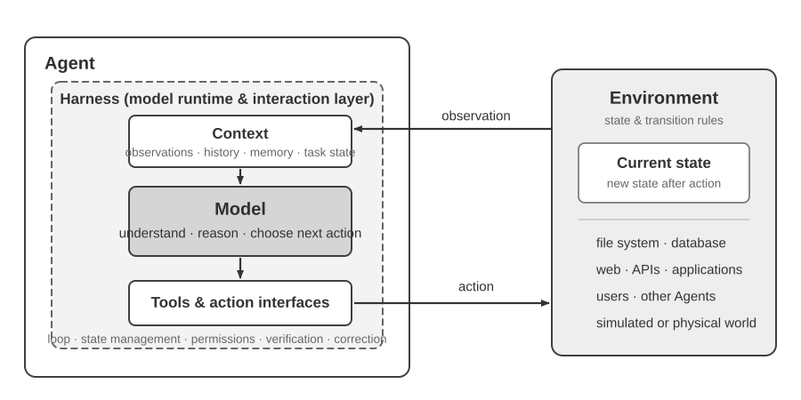
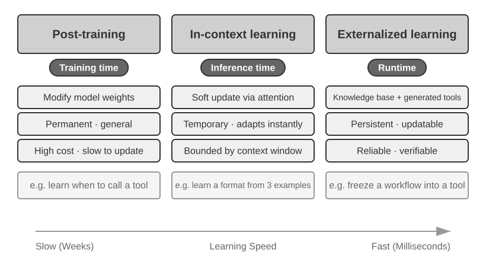
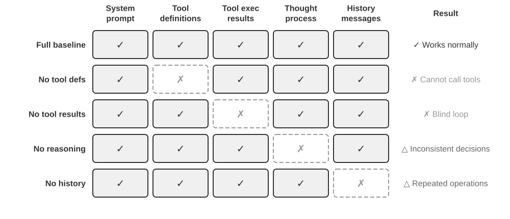
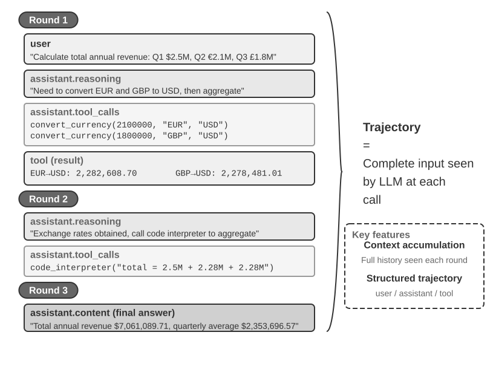
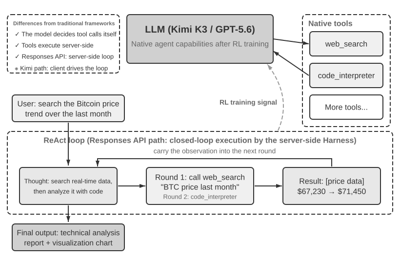
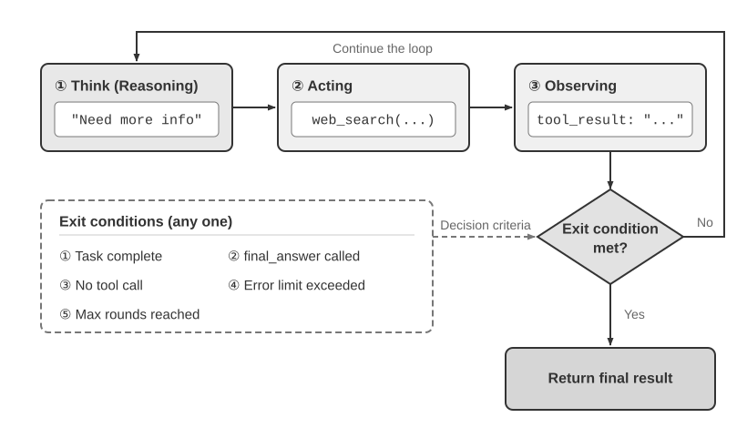
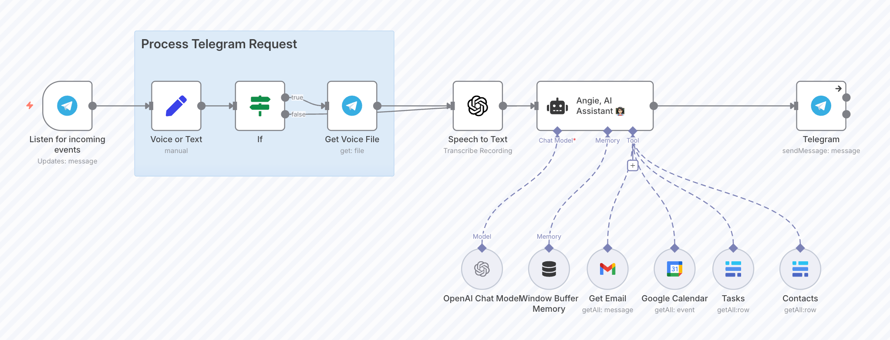

# Bắt đầu với AI Agents

Nếu từng sử dụng Cursor để viết code và chứng kiến công cụ này tự tìm kiếm trong codebase, chỉnh sửa nhiều file rồi chạy lại test cho đến khi pass toàn bộ, thì bạn đã thực sự sử dụng một AI Agent. Điều tương tự cũng diễn ra khi bạn dùng Deep Research để đào sâu một chủ đề thông qua chuỗi tìm kiếm và đọc tài liệu lặp đi lặp lại, để Manus điều khiển trình duyệt hoàn thành các tác vụ trực tuyến, nhờ trợ lý điện thoại Doubao đặt vé hay gửi tin nhắn, hoặc giao cho Pine AI đàm phán giảm cước viễn thông.

Những sản phẩm này tồn tại dưới nhiều hình thái khác nhau, nhưng đều mang một đặc điểm chung: chúng không còn dừng lại ở mô hình hội thoại thụ động theo kiểu "bạn hỏi, máy trả lời". Chúng tự lập kế hoạch cho các bước thực thi, gọi các tool cần thiết cho từng task và chủ động điều chỉnh chiến lược dựa trên kết quả thu về trong thời gian thực. AI Agents đang trở thành phương thức tương tác hoàn toàn mới giữa con người với máy tính.

Chương này sẽ bắt đầu từ các ví dụ thực tiễn, sau đó bóc tách dần các thành phần cốt lõi của một AI Agent: bạn sẽ được trực tiếp kiểm chứng khả năng của các Agent hiện đại, nắm vững kiến trúc kỹ thuật phía sau, đồng thời làm chủ các design patterns cùng best practices để xây dựng các hệ thống Agent.

> **Gợi ý khi đọc**: Chương này là bản đồ khái niệm cho toàn bộ cuốn sách: một lộ trình tóm lược về công thức cốt lõi, operating loop, engineering framework và các Agent design pattern. Chương này thiết lập hệ thống thuật ngữ chung cùng các điểm tham chiếu được sử dụng xuyên suốt các chương sau. Đừng cố ghi nhớ mọi khái niệm ngay trong lần đọc đầu tiên; hãy hướng tới việc nắm bắt bức tranh tổng thể. Mỗi chương tiếp theo sẽ đào sâu vào từng khía cạnh được giới thiệu tại đây, và bạn có thể quay lại chương này bất cứ khi nào cần định hướng lại.

## Agent hiện đại = LLM + Context + Tools

Ở dạng đơn giản nhất, một Agent hiện đại bao gồm ba thành phần: **Agent = LLM (Large Language Model) + Context + Tools**. Dấu cộng ở đây thể hiện sự kết hợp giữa các thành phần kỹ thuật, không phải là định nghĩa hình thức trong Reinforcement Learning; quan trọng hơn, công thức này chỉ mô tả những gì nằm bên trong ranh giới của Agent và **không bao gồm Environment mà Agent tương tác cùng**. Mỗi thành tố cần được hiểu theo nghĩa rộng, nhưng luôn có ranh giới rõ ràng:

- **LLM là reasoning engine của Agent**: Không chỉ dừng lại ở một tập hợp các model parameter, đây là lõi ra quyết định của Agent, chịu trách nhiệm hiểu intent, thực hiện reasoning, planning và đưa ra phán đoán. Năng lực của một LLM đến từ tri thức thế giới cùng khả năng ngôn ngữ thu nhận được trong quá trình **Pre-training**, kết hợp với các chiến lược ra quyết định được định hình qua **Post-training** (các kỹ thuật như Supervised Fine-Tuning và Reinforcement Learning sẽ được trình bày ở Chương 8).
- **Context là working set thông tin của Agent**: Không chỉ là văn bản thô được đưa vào mô hình, mà là toàn bộ tập thông tin làm việc khả dụng cho Agent tại từng thời điểm ra quyết định — bao gồm Environment, user memory, domain knowledge, State của chính nó và tiến độ thực thi tác vụ. Tương tự như con người khi ra quyết định cần nắm bắt tình hình, nhớ lại trải nghiệm liên quan và tra cứu tài liệu tham khảo, Context Window của Agent chứa đựng mọi thông tin mà nó có thể sử dụng tại thời điểm đó.
- **Tools là các action interface của Agent**: Không đơn thuần là một vài hàm API có thể gọi được, mà là toàn bộ các phương thức mà Agent có thể dùng để hành động — từ các Tool Calling được định nghĩa trước đến các Skills được nạp on-demand, từ việc tự sinh code để tạo năng lực mới on-the-fly đến việc phân quyền công việc cho các Sub-agent, từ việc chủ động kết nối với người dùng đến việc phản hồi các sự kiện từ bên ngoài.

Nói một cách trực quan hơn: **Agent = Reasoning Engine + Working Context + Action Interfaces**. Mô hình thực hiện reasoning và ra quyết định, Context cung cấp working set thông tin làm cơ sở cho các quyết định đó, còn Tools đóng vai trò là các interface giúp quyết định tác động trực tiếp ra thế giới bên ngoài.

Dưới góc nhìn cổ điển của Reinforcement Learning và lý thuyết điều khiển, Agent và Environment là hai thực thể trong một vòng tương tác khép kín (closed-loop interaction), chứ không phải là thành phần cấu tạo của nhau. Environment trả về một observation, Agent dựa vào Context của mình để chọn action tiếp theo, và action đó sẽ làm thay đổi State của Environment, từ đó sinh ra observation kế tiếp.



Figure 1-1 minh họa hai tầng trừu tượng (levels of abstraction). Tầng bên ngoài là sự tương tác giữa **Agent và Environment**: Environment bao gồm file system, database, trang web, người dùng, các Agent khác, cũng như các thế giới vật lý hoặc môi trường giả lập (simulated worlds). Tầng bên trong là **cấu trúc Model–Harness bên trong Agent**: Model đưa ra các quyết định về Policy; Harness là tầng Runtime và Governance nằm bên trong ranh giới của Agent, chịu trách nhiệm xây dựng Context, expose các tool interface, duy trì vòng lặp cùng State, đồng thời áp dụng cơ chế phân quyền, Verification và Correction. Một Harness có thể khởi tạo, cô lập (isolate) hoặc làm proxy cho một Environment mà không nhất thiết phải chứa State hay các quy tắc chuyển trạng thái (transition rules) của Environment đó.

Do đó, công thức kỹ thuật có thể được mở rộng như sau: LLM đóng vai trò là Model, trong khi Context + Tools tạo thành một Harness tối thiểu; các hệ thống production sẽ bổ sung thêm các ràng buộc (constraints), cơ chế Verification và Correction ngay bên trong ranh giới đó. Phần còn lại của chương này sẽ tuân thủ theo ranh giới phân định này.

Ba thành phần này có mối liên hệ nhất định với Policy và các interface tương tác trong RL (Reinforcement Learning; xem thêm ở Chương 8), nhưng chúng không ánh xạ tương ứng 1-1 hoàn toàn. Context đại diện cho các observation và history được tổ chức bên trong Agent; nó không đại diện cho toàn bộ observation space. Tools định nghĩa các interface phục vụ observation và action khả dụng cho Agent, trong khi các đối tượng chịu tác động vẫn nằm hoàn toàn trong Environment.

| Trực giác | Thành phần Agent | Khái niệm RL | Vai trò |
|---------------|----------------|------------------|---------------------------------------------|
| **Reasoning Engine** | LLM | **Policy** | Logic ra quyết định nhằm xác định "cần làm gì tiếp theo" — dựa trên thông tin hiện tại để chọn action tối ưu nhất trong số tất cả các lựa chọn khả dụng |
| **Working Context** | Context construction | **Observations and history** | Tổ chức các observation từ Environment và history hiện có thành tập thông tin cần thiết phục vụ cho quyết định ở thời điểm hiện tại |
| **Action Interfaces** | Tool interfaces | **Observation/action interfaces** | Định nghĩa những observation nào Agent có thể đọc được, những action nào nó có thể phát ra, cùng với format chuẩn của các interface đó |

### Observation Space và Action Space: Giao diện giữa Model và Thế giới bên ngoài

**Observation space và action space kết hợp lại tạo thành giao diện giữa LLM và môi trường bên ngoài của nó**. Observation space chuyển đổi thông tin từ môi trường thành context mà model có thể xử lý; action space chuyển đổi các quyết định của model thành các thao tác tác động lên thế giới bên ngoài. Về bản chất, thông tin nằm ngoài observation space hoàn toàn không tồn tại đối với model. Một thao tác nằm ngoài action space sẽ mãi chỉ là thứ mà model có thể khuyến nghị bằng câu chữ, ngay cả khi nó biết chính xác cần phải làm gì.

Do đó, **khi underlying model được giữ cố định, đòn bẩy kỹ thuật hệ thống (systems-engineering lever) hàng đầu để cải thiện hiệu năng của Agent thường là định nghĩa lại hoặc mở rộng observation space và action space của nó**. Theo thuật ngữ của cuốn sách này, điều đó đồng nghĩa với việc mở rộng context và tools. Nhiều bài toán tưởng chừng đòi hỏi một "model thông minh hơn" thực chất lại là bài toán về giao diện: đưa dữ liệu liên quan đến tác vụ vào context hoặc cung cấp thao tác cần thiết dưới dạng một tool, và một tác vụ trước đây không thể giải quyết có thể trở nên khả thi.

**Manus: hợp nhất các không gian vốn từng tách biệt.** Trước khi Manus xuất hiện, các production Agent chủ yếu đi theo ba hướng riêng biệt: Deep Research, Coding, và Computer Use. Manus là production Agent đầu tiên có tầm ảnh hưởng sâu rộng hợp nhất cả ba hướng tiếp cận này vào trong một hệ thống duy nhất. Virtual browser của nó mở rộng observation space, trong khi file system, code execution và command execution mở rộng action space. Manus không trở thành một Agent đa năng chỉ đơn thuần nhờ việc thay thế bằng một model mạnh hơn. Nó đã lấy phép hợp (union) giữa observation space và action space của ba loại Agent nói trên, cho phép một Agent vượt qua các ranh giới sản phẩm trước đây.

**OpenClaw: mở rộng giao diện vào đời sống kỹ thuật số của người dùng.** OpenClaw tiếp tục đẩy giới hạn của cả hai không gian ra xa hơn. Nó nhận tác vụ và trả kết quả thông qua các kênh nhắn tin mà người dùng vốn đã quen thuộc—WhatsApp, Telegram, Slack, Discord, iMessage, cùng nhiều nền tảng khác—nhờ đó Agent có thể được tiếp cận từ hầu như bất cứ đâu. Gateway cục bộ của nó kết nối các ứng dụng đám mây như Google Drive và Notion cũng như local file system. Do đó, các file nằm phân tán trên nhiều tài khoản và thiết bị khác nhau, khi có sự ủy quyền rõ ràng từ người dùng, có thể đi vào observation space của một Agent duy nhất và chịu sự tác động bởi các tool của nó. So với mô hình ban đầu tập trung vào cloud-sandbox của Manus, nơi các file thường phải được tải lên hoặc phải cấu hình connector riêng biệt, OpenClaw theo hướng local-first bao quát một ranh giới dữ liệu rộng hơn. Sau này, Manus cũng bổ sung Google Drive connector và khả năng truy cập desktop vào các local file, điều này càng củng cố thêm luận điểm: sự tiến hóa của sản phẩm thường nằm chính xác ở việc mở rộng observation space và action space[^ch1-agent-products].

[^ch1-agent-products]: Tài liệu chính thức của Manus mô tả Sandbox ban đầu của họ là một máy ảo đám mây cô lập. Khi giới thiệu Google Drive Connector, Manus đã nhắc lại tường tận quy trình phân mảnh trước đây khi phải tải xuống và tải lên các file thủ công giữa Drive, desktop và Manus. Khi ra mắt tính năng My Computer vào tháng 3 năm 2026, họ gọi thực tế các công việc quan trọng nằm ở máy cục bộ thay vì trên đám mây là một hạn chế cốt lõi của cloud sandbox. README chính thức của OpenClaw mô tả một trợ lý cá nhân local-first, always-on chạy trên chính thiết bị của người dùng và liệt kê hơn hai mươi kênh nhắn tin; hệ thống tool và plugin của nó có thể bổ sung các tích hợp đám mây lẫn khả năng cục bộ. Xem thêm tại https://manus.im/blog/manus-sandbox, https://manus.im/blog/manus-google-drive-connector, https://manus.im/blog/manus-my-computer-desktop, https://github.com/openclaw/openclaw, và https://docs.openclaw.ai/tools

Hiểu rõ từng thành phần thực hiện chức năng gì, và cách chúng ăn khớp với nhau ra sao, là nền tảng để xây dựng các hệ thống Agent hiệu quả. Chúng ta sẽ bắt đầu với thành phần cụ thể nhất trong bộ ba—tools, tức các action interface—rồi tiến dần vào bên trong tới LLM và context. Trước hết, dưới đây là bảng so sánh giữa các loại Agent khác nhau trên ba chiều kích này:

| Agent Product | Working Context | Action Interfaces | Strategy |
|-----------------|------------------------|--------------------------|-----------------------------|
| **Coding Agents (ví dụ: Cursor)** | Tài liệu yêu cầu (requirements documents), codebase, terminal environment | Open-ended (suy luận nội tại, code search, đọc/ghi file, command execution, v.v.) | Phát triển tăng dần (incremental development): hiểu yêu cầu → tìm kiếm code liên quan → chỉnh sửa code → kiểm thử và xác minh → debug và sửa lỗi |
| **Search Agents (ví dụ: Deep Research)** | Tài nguyên web, cơ sở dữ liệu học thuật, local file | Open-ended (suy luận nội tại, search queries, đọc web, tạo bản tóm tắt) | Đào sâu lặp lại (iterative deepening): điều chỉnh hướng tìm kiếm dựa trên thông tin hiện có, dần dần tổng hợp thành một báo cáo hoàn chỉnh |
| **Computer Control Agents (ví dụ: Browser Use)** | Màn hình máy tính, trang trình duyệt, file system | Open-ended (suy luận nội tại, click chuột, gõ phím, cuộn trang, chụp ảnh màn hình, code execution, v.v.) | Nhận thức thị giác + thao tác: quan sát màn hình → xác định các phần tử mục tiêu → thực hiện hành động → xác minh kết quả |
| **Phone Assistant Agents (ví dụ: Doubao)** | Màn hình điện thoại, các ứng dụng đã cài đặt | Open-ended (suy luận nội tại, click, vuốt, gõ phím, mở ứng dụng, v.v.) | Hiểu ý định (intent understanding) + điều khiển App: hiểu nhu cầu người dùng → định vị ứng dụng mục tiêu → thực hiện hành động → xác nhận hoàn thành |
| **Personal Task Agents (ví dụ: Pine AI)** | Thông tin tài khoản người dùng, lịch sử hóa đơn, knowledge base của nhà cung cấp dịch vụ | Open-ended (suy luận nội tại, thực hiện cuộc gọi, gửi email, điền form, xác nhận với người dùng) | Thực thi tác vụ nhiều bước: thu thập thông tin → xây dựng chiến lược đàm phán → liên hệ nhà cung cấp dịch vụ → đàm phán → báo cáo kết quả |

Các hệ thống này chia sẻ ba đặc điểm chung: một **open-ended action space**—không phải chọn từ một tập hợp các nút bấm cố định mà tạo ra ngôn ngữ tự nhiên và code tùy ý; **suy luận nội tại (internal reasoning)**—lập kế hoạch trước khi hành động; và **tương tác liên tục (continuous interaction)**—điều chỉnh chiến lược dựa trên phản hồi từ môi trường. Những khả năng này xuất phát chính xác từ sự tương tác qua lại giữa reasoning engine, working context và action interfaces—nói cách khác, đó chính là LLM, context và tools.

### Tools: Các Action Interface của Agent

Tools là cầu nối giúp Agent tương tác với thế giới bên ngoài. Chúng biến Agent từ một thực thể quan sát thụ động thành một hệ thống chủ động có khả năng tìm kiếm, ghi file, thực thi code, gọi API, gửi tin nhắn hoặc thao tác với giao diện. Nếu không có tools, Agent chỉ giới hạn ở khả năng text generation; nhưng khi có tools, nó có thể tác động trực tiếp lên các hệ thống bên ngoài.

Để phân tích tools một cách có hệ thống, chúng ta có thể phân loại chúng thành năm nhóm dựa theo chiều hướng tương tác của Agent với thế giới. Trước mắt, một vài ví dụ cho mỗi nhóm sẽ cung cấp bức tranh tổng thể; các chương sau sẽ đi sâu vào chi tiết.

**Perception Tools** cho phép Agent truy cập thông tin: search engine cung cấp dữ liệu web thời gian thực, file system đọc tài liệu local, còn API và database giúp kết nối với các dịch vụ bên ngoài cùng dữ liệu cốt lõi của doanh nghiệp.

**Execution Tools** cho phép Agent tác động lên các hệ thống bên ngoài: việc thực thi code, các thao tác với file, system command và các lời gọi API bên ngoài sẽ biến các quyết định thành hành động cụ thể.

**Collaboration Tools** cho phép Agent phân chia công việc với các Agent khác: phân quyền các tác vụ chuyên biệt cho sub-agent, yêu cầu con người xác nhận tại các điểm quyết định then chốt, hoặc điều phối hành động trong các hệ thống multi-agent.

**Event Trigger Tools** được kích hoạt theo cơ chế hoàn toàn khác biệt so với ba nhóm đầu: Agent không chủ động gọi chúng; thay vào đó, chúng đóng vai trò là input từ bên ngoài trigger Agent bắt đầu công việc. Một email mới gửi đến, một mốc thời gian theo lịch trình, hoặc một hệ thống khác kích hoạt Webhook callback; event này sẽ kích hoạt Agent, khởi chạy quy trình reasoning và action. Agent không bao giờ tự gọi các tools này, nhưng chúng vẫn là một kênh để tương tác với thế giới bên ngoài, do đó chúng vẫn được xếp vào hệ thống tool nói chung.

**User Communication Tools** là các kênh giúp Agent giao tiếp với người dùng. Trong khi execution tools làm thay đổi thế giới bên ngoài, communication tools lại đóng vai trò truyền tải thông tin—báo cáo tiến độ của Agent, hoặc chủ động check-in qua tin nhắn, cuộc gọi thoại, email, v.v.

Chương 4 sẽ đề cập toàn diện về taxonomy và các nguyên lý thiết kế cho năm nhóm này. Chất lượng thiết kế tool ảnh hưởng trực tiếp đến những gì một Agent có thể thực thi một cách đáng tin cậy: nếu định nghĩa interface mơ hồ, model sẽ sử dụng sai; nếu xử lý lỗi kém, chỉ một tool thất bại cũng có thể khiến Agent rơi vào bế tắc; nếu phân quyền quá rộng, một lỗi sai của Agent có thể dẫn đến hậu quả không thể đảo ngược. Khi chuẩn MCP (Model Context Protocol) ngày càng phổ biến, việc tích hợp tools đang trở nên dễ dàng hơn.

**Tool Calling** (còn được gọi là Function Calling) là khả năng cốt lõi của các LLM Agent hiện đại: nó cho phép model gọi các tools bên ngoài theo cấu trúc chuẩn mực, biến LLM từ một công cụ sinh text thuần túy thành một hệ thống thông minh có thể hành động thông qua các external interface. Cuốn sách này sẽ sử dụng thuật ngữ "tool calling" xuyên suốt.

Tool calling diễn ra theo bốn bước: đầu tiên, context cung cấp cho model danh sách các tools khả dụng (name, purpose, parameter); sau đó, model tự quyết định xem có nên gọi tool hay không, gọi tool nào và với những argument nào; tiếp theo, sau khi tool được thực thi, kết quả trả về sẽ được append vào context; cuối cùng, model quyết định bước tiếp theo dựa trên kết quả đó. Vòng lặp này chính là nền tảng của ReAct, sẽ được giới thiệu ở phần sau của chương.

Đối với một truy vấn thời tiết, biểu diễn đơn giản hóa của quy trình bốn bước ở cấp độ API diễn ra như sau:

```text
Step 1: Declare tools                  Step 2: Model decides to call
tools: [{                             assistant: {
  name: "get_weather",                  tool_calls: [{
  parameters: {                           function: "get_weather",
    city: "string"                        arguments: {city: "Beijing"}
  }                                      }]
}]                                    }

Step 3: Result appended to context    Step 4: Model responds based on result
tool: {                               assistant: {
  tool_call_id: "call_1",               content: "Today in Beijing: 28°C, sunny."
  content: '{"temp":28,"sky":"clear"}' }
}                                     }

```

Developer chỉ định nghĩa các tool và thực thi lệnh gọi; bản thân model sẽ tự quyết định có gọi hay không, gọi tool nào và truyền vào những argument nào. Chương 2 sẽ đi sâu phân tích cấu trúc API này.

Khi thiết kế tool cho một Agent, hãy bắt đầu với năng lực hẹp nhất mà tác vụ yêu cầu, sau đó mở rộng dần khi độ phức tạp tăng lên. Nếu tác vụ chỉ cần tính toán số học cơ bản, một calculator với các parameter được định nghĩa rõ ràng là đủ; khi bài toán mở rộng sang đọc bảng tính, xử lý dữ liệu khuyết thiếu, tính toán thống kê và vẽ biểu đồ, một Python code interpreter có giới hạn (constrained) sẽ dễ kết hợp và khám phá hơn nhiều so với một tập hợp các tool chuyên biệt ngày càng phình to. Tuy nhiên, tính tổng quát cũng làm tăng rủi ro lỗi và mở rộng attack surface: code bắt buộc phải chạy trong một sandbox cô lập, mặc định vô hiệu hóa quyền truy cập mạng, không có quyền truy cập vào các file nằm ngoài working directory được cấp phép, đồng thời bị giới hạn về thời gian thực thi, CPU, memory và kích thước output.

Tương tự, một logging tool đơn lẻ phù hợp để ghi lại một lần thực thi; đối với các long-running task kéo dài hàng giờ hoặc thậm chí nhiều ngày, một working directory ảo có kiểm soát có thể lưu trữ plan, kết quả trung gian, log thực thi và artifact cuối cùng để Agent có thể tiếp tục công việc (resume) qua nhiều lần chạy. Thư mục này cũng cần giới hạn quyền đọc/ghi trên các đường dẫn, dung lượng lưu trữ, định dạng file, đồng thời ngăn chặn triệt để path traversal thay vì phơi bày toàn bộ file system của máy host cho Agent.

Các general-purpose tool không phải lúc nào cũng vượt trội hơn tool chuyên biệt. Những thao tác có rủi ro cao hoặc bị chi phối bởi các business constraint nghiêm ngặt—chẳng hạn như thanh toán, xóa dữ liệu, gửi email và production deployment—vẫn nên được thiết kế thành các tool chuyên biệt với parameter tường minh, quyền hạn bị thắt chặt và khả năng audit từ đầu đến cuối (end-to-end auditability), đi kèm tính năng xem trước (preview) và xác nhận từ con người (human confirmation) khi cần thiết. Do đó, nguyên tắc cốt lõi của việc thiết kế tool là: **sử dụng các năng lực nền tảng tổng quát để kết hợp và khám phá; sử dụng các tool chuyên biệt để kiểm soát các tác vụ rủi ro cao và thực thi nghiêm ngặt các business rule**.


### LLM: Reasoning Engine của Agent

Large Language Model (LLM) chính là hạt nhân ra quyết định của Agent. Khi nhận được một request từ người dùng, trước tiên LLM phải suy luận ra intent thực sự (những gì người dùng nói ra thường không phản ánh chính xác thứ họ thực sự cần), sau đó phân rã một tác vụ mơ hồ hoặc phức tạp thành các bước có thể thực thi. Xuyên suốt quá trình thực thi, nó liên tục đưa ra các quyết định: bước tiếp theo cần làm gì, có nên gọi một tool hay không, nên chọn tool nào và truyền vào các arguments gì. Khả năng hiểu – lập kế hoạch – thực thi (understand–plan–execute) này bắt nguồn từ tri thức được tích lũy trong giai đoạn pre-training, và đây chính là nền tảng cốt lõi mà cả workflows lẫn autonomous Agents đều dựa vào.

Một năng lực đặc trưng của LLM Agents là **internal reasoning**—trước khi hành động, Agent có thể lập kế hoạch và suy luận xuyên suốt tác vụ. Quá trình này hoàn toàn không làm thay đổi môi trường bên ngoài, nhưng lại cải thiện rõ rệt độ chính xác của các hành động diễn ra sau đó. Năng lực này đến từ pre-training (giai đoạn huấn luyện ban đầu trên lượng dữ liệu văn bản khổng lồ từ internet, giúp model nắm bắt các quy luật ngôn ngữ và tri thức thế giới): model kế thừa các reasoning patterns đã được mã hóa trong tri thức nhân loại, bao gồm các định luật toán học, quan hệ nhân quả và các chiến lược phân rã bài toán. Do đó, khác với các reinforcement-learning Agents truyền thống, LLM-based Agents hiện nay không thăm dò thông qua cơ chế thử-sai (trial and error) một cách mù quáng; chúng trực tiếp suy luận trên một khối tri thức đã có cấu trúc.

#### Model as Agent: Khi bản thân Model trở thành Product

Paradigm "Model as Agent" là hướng đi mới nhất trong quá trình phát triển AI Agent. Các model tiên tiến đã biến Tool Calling thành một Native Ability thông qua Post-training (đặc biệt là Reinforcement Learning): khi nào cần gọi tool, gọi tool nào, với arguments gì—model đều tự quyết định toàn bộ mà không cần Orchestration thủ công. Điều đó không làm giảm đi tầm quan trọng của tầng Framework. Ngược lại: model càng mạnh, lớp Harness bao quanh càng trở nên then chốt. Từ "Harness" ban đầu dùng để chỉ dây cương và yên cương thắng vào ngựa—không phải để kìm hãm khả năng chạy của nó, mà là để định hướng sức mạnh đó một cách chuẩn xác. Trong bối cảnh Agent, model là một con chiến mã uy mãnh nhưng khó lường, trong khi Harness chính là Engineering Infrastructure giúp định hướng năng lực của nó thành khả năng thực thi tác vụ đáng tin cậy. Nó bao gồm Context Management, Tool Interfaces, Safety Constraints, cùng các cơ chế Verification và Correction (xem phần cuối của chương này).

Quyền ra quyết định của model càng lớn, tác động từ một quyết định sai lầm càng nghiêm trọng—điều này đòi hỏi các cơ chế Constraint, Verification và Correction ở mức độ chi tiết hơn (finer-grained) để duy trì tính tin cậy. Lợi thế thực sự của các Model Provider không nằm ở việc "làm mỏng tầng Framework" mà là khả năng đồng tối ưu hóa (co-optimize) model cùng lớp Harness bao quanh nó một cách liên tục.

Nhưng một câu hỏi sâu xa hơn được đặt ra: nếu các model ngày càng mạnh lên, liệu Harness ngày nay cuối cùng có bị hấp thụ (absorbed) vào chính model hay không? Trong “The Bitter Lesson”, Rich Sutton đã nhìn lại một quy luật lặp đi lặp lại trong suốt bảy mươi năm nghiên cứu AI[^ch1-1]: các nhà nghiên cứu liên tục mã hóa hiểu biết chuyên môn của họ vào hệ thống để đạt được những lợi ích ngắn hạn, nhưng cuối cùng luôn chịu thua trước các phương pháp tổng quát (general methods)—Search và Learning—vốn mở rộng theo Compute và Data. Nhìn từ góc độ này, bao nhiêu phần trong các cơ chế Constraint, Verification và Correction của một Harness thực chất là “Human Prior” mà model sớm muộn gì cũng sẽ hấp thụ? **Cuốn sách này giữ quan điểm rằng các model sẽ ngày càng hấp thụ những năng lực này, nhưng chúng ta cần thực tế về tốc độ diễn ra của quá trình đó.** Về mặt định hướng, chúng ta không nghi ngờ việc các model sẽ tiếp tục hấp thụ các phần của Harness—Tool Calling và Long-horizon Planning từng phải phụ thuộc vào Orchestration bên ngoài, nhưng hiện đã trở thành các Native Capability của model. Tuy nhiên trên thực tế, quá trình hấp thụ này diễn ra chậm hơn nhiều so với trực giác: chu kỳ Training kéo dài hàng tháng, và không một model nào có thể nội tại hóa toàn bộ Constraints và Preferences của nghiệp vụ thực tế chỉ trong một lần huấn luyện. Ranh giới năng lực hiện tại của model chính là nơi Harness tạo ra giá trị. Do đó, Harness Engineering không phải là sự kháng cự lại "Bitter Lesson", mà là việc hiện thực hóa bài học đó theo quy chuẩn thời gian kỹ thuật (engineering timescale): bất kể điều gì model chưa thể thực hiện một cách đáng tin cậy, Harness sẽ gánh vác trước; bất cứ khi nào model nội tại hóa được một tầng năng lực mới, Harness sẽ lược bỏ tầng đó và tiếp tục tiến lên để hỗ trợ cho ranh giới năng lực tiếp theo.

[^ch1-1]: Sutton, Rich. “The Bitter Lesson”, 2019. http://www.incompleteideas.net/IncIdeas/BitterLesson.html

#### Cơ chế học của Agent: Từ Contextual Adaptation đến Persistent Updates

Phần thảo luận trước đã chỉ ra rằng một model có thể nội hóa các tool-use policy thành native capability thông qua Reinforcement Learning. Tuy nhiên, những thay đổi trong hành vi của Agent không chỉ diễn ra trong quá trình training. Dựa trên vị trí diễn ra update và thời gian tồn tại (persistence) của nó, các thay đổi này có thể được hiểu theo ba hướng tiếp cận bổ trợ lẫn nhau (Figure 1-2): contextual adaptation trong phạm vi task (within-task), cập nhật external artifacts xuyên suốt các task (cross-task), và parameter updates trong các chu kỳ training.



**Contextual adaptation** diễn ra ngay trong phạm vi task hiện tại. Khi các example, state, và kết quả retrieval được nạp vào context, model có thể điều chỉnh hành vi của nó ngay lập tức, nhưng điều này không làm thay đổi persistent state của session tiếp theo. Ưu điểm của phương thức này là tốc độ và chi phí thấp; các hạn chế bắt nguồn từ giới hạn của context window và cách thức tổ chức thông tin. Chương 2 sẽ giải thích chi tiết cơ chế hoạt động của dạng adaptation này.

Để các thay đổi có thể duy trì (persist) qua nhiều task khác nhau, hệ thống có thể cập nhật các **external artifacts**: các fact và kinh nghiệm có thể được tổ chức thành các tài liệu tri thức (knowledge documents), các chiến lược có thể diễn đạt bằng ngôn ngữ được đưa vào Prompt hoặc Skill, còn các quy trình deterministic và ràng buộc có thể được mã hóa thành chương trình và Harness. Các artifact này có thể audit và chỉnh sửa được, nhưng Agent vẫn bắt buộc phải truy cập chúng trong quá trình runtime thông qua context hoặc tool interface. Từ Chương 3 đến Chương 5 sẽ thiết lập nền tảng cho knowledge và program, trong khi Chương 9 sẽ thảo luận về cách các cập nhật này có thể được sinh ra từ các operational trajectory đã qua evaluation.

Khi mục tiêu là một high-dimensional capability—chẳng hạn như việc hiểu hình ảnh y tế, phong cách ngôn ngữ tự nhiên, hay một decision policy ngầm định (implicit)—mà các quy tắc bên ngoài không thể biểu đạt trọn vẹn, **model parameters** bắt buộc phải được cập nhật thông qua post-training. Parameter updates đòi hỏi chi phí triển khai cao hơn nhưng có thể mang lại khả năng generalization tự nhiên và trên phạm vi rộng; Chương 8 sẽ trình bày các phương pháp này một cách có hệ thống. Do đó, ba con đường này không phải là các danh mục loại trừ lẫn nhau, mà là các cơ chế phối hợp hoạt động ở các quy mô thời gian (timescale) khác nhau: context hỗ trợ khả năng thích ứng tức thì, external artifacts hỗ trợ việc tích lũy có kiểm soát, và parameter giúp nội hóa các capability khó biểu đạt tường minh.

### Context: Working Set Của Agent

Context là working set chứa toàn bộ thông tin khả dụng cho một Agent tại mỗi điểm ra quyết định (decision point). Tương tự như một người khi đưa ra quyết định cần có đầy đủ tài liệu ngay trên bàn làm việc—chỉ dẫn nhiệm vụ, tài liệu tham khảo, thư từ trao đổi trước đó, dữ liệu mới nhất—thì context window của Agent chính là toàn bộ thông tin mà nó có thể sử dụng. Dưới góc nhìn của API (được trình bày chi tiết ở Chương 2), context của mỗi lượt gọi LLM bao gồm năm thành phần:

- **System Prompt**: Khác với các prompt do người dùng nhập vào trong quá trình trò chuyện, system prompt được viết bởi developer và giữ cố định trong toàn bộ phiên hội thoại. Đây chính là “bản mô tả công việc” của Agent—xác định danh tính, quyền hạn và các quy tắc ứng xử. Kỹ thuật prompt engineering kỹ lưỡng trên system prompt chính là cách chúng ta định hình hành vi vận hành của Agent. System prompt cũng chứa **user memory** được duy trì xuyên suốt các session (thông tin cá nhân hóa như sở thích, hành vi trong quá khứ và các thiết lập bối cảnh; xem Chương 3), cùng với environmental state được inject động.
- **Tool Definitions**: Khai báo tên, mô tả chức năng và định dạng tham số của các công cụ mà Agent có thể sử dụng. Nếu không có tool definitions, Agent sẽ không thể nhận diện hay gọi bất kỳ công cụ nào—dù vậy nó cũng không hoàn toàn im lặng—thử nghiệm ablation study (Thực nghiệm 1-1) sẽ chỉ rõ cách Agent phản ứng thay vào đó. Tool definitions cùng với system prompt tạo thành **static prefix** không thay đổi trong suốt phiên hội thoại. (Đây là pattern nền tảng; kể từ năm 2026, các production framework cũng có thể load đầy đủ tool schemas theo nhu cầu (on demand) ở cuối context mà không làm phá vỡ prefix—xem phần tool definitions ở Chương 2 và Chương 4.)
- **User Messages**: Dữ liệu đầu vào từ người dùng. User messages cũng có thể chứa **external knowledge** được truy xuất động thông qua RAG (Retrieval-Augmented Generation, xem chi tiết ở Chương 3)—bao gồm các thông tin nằm ngoài mốc training data cutoff hoặc dữ liệu tri thức chuyên biệt nội bộ.
- **Assistant Messages**: Các phản hồi do model sinh ra trước đó, có thể bao gồm tối đa ba phần—`reasoning` (chuỗi tư duy nội tại chain of thought, giúp duy trì tính mạch lạc và khả năng giải thích của quyết định), `content` (phản hồi gửi đến người dùng), và `tool_calls` (phương thức để Agent thực thi hành động). Trong một response cụ thể, cả ba phần này có thể không xuất hiện cùng lúc: ví dụ, khi Agent quyết định gọi một công cụ, nó thường chỉ có `reasoning` + `tool_calls`; khi đưa ra câu trả lời cuối cùng, nó thường chỉ có `reasoning` + `content`.
- **Tool Results**: Output trả về sau khi Agent framework thực thi một công cụ. Các kết quả này là cơ sở trực tiếp cho bước reasoning tiếp theo của Agent—và là yếu tố cho phép nó học hỏi từ kết quả thực tế thay vì lặp lại sai lầm cũ.

Hai thành phần đầu tiên (system prompt + tool definitions) tạo thành static prefix; ba thành phần sau (user messages + assistant messages + tool results) tạo thành message history động, liên tục mở rộng sau mỗi lượt tương tác. Tổng hòa lại, năm thành phần này cấu thành nên context hoàn chỉnh cho mỗi lượt LLM inference.

Liệu từng thành phần có thực sự không thể thiếu? Phương pháp trực quan nhất để kiểm chứng là **ablation study**—phương pháp chẩn đoán bằng cách loại trừ từng yếu tố một: loại bỏ thành phần A để kiểm tra xem hệ thống còn hoạt động hay không, sau đó đến thành phần B, cứ tiếp tục như vậy cho đến khi vai trò đóng góp của từng thành phần được làm sáng tỏ. Thực nghiệm 1-1 sẽ áp dụng chính xác phương pháp này cho năm thành phần nêu trên.

> **Experiment 1-1 ★★: Vai trò cốt tử của Context**
>
> Chúng tôi đã thăm dò cách từng thành phần của context định hình hành vi của Agent thông qua một **ablation study** mang tính hệ thống. Trong năm thành phần kể trên, bốn thành phần đã được đưa vào thử nghiệm—ngoại trừ system prompt, vốn đóng vai trò định danh cơ bản của Agent: nếu thiếu nó, Agent sẽ hoàn toàn mất nhận thức vai trò (role awareness), và bài test sẽ trở nên vô nghĩa. Như Hình 1-3 thể hiện, thử nghiệm được triển khai trên năm nhóm đối chứng: một nhóm baseline hoàn chỉnh giữ lại toàn bộ các thành phần, cùng bốn nhóm còn lại mỗi nhóm khuyết đi một thành phần, nhằm quan sát tác động của từng thành phần lên performance của Agent.
>
> 
>
> Kết quả thực nghiệm đã làm sáng tỏ vai trò của từng thành phần context—và thực tế chúng không quan trọng ngang nhau. **Tool Definitions** (một phần của static prefix) là nền tảng cho năng lực hành động của Agent; thiếu chúng, Agent không thể gọi bất kỳ tool nào. Tuy nhiên, việc mất đi năng lực hành động không đồng nghĩa với việc model sẽ im lặng: nó vẫn trả về một câu trả lời được format chỉn chu, câu từ đầy tự tin với các số liệu lấy từ parametric memory thay vì từ observations, được trình bày y hệt như một câu trả lời thực sự sinh ra từ tool output. Việc model thẳng thừng từ chối hay thêu dệt ngay tại chỗ (fabricate) phụ thuộc chủ yếu vào tỷ lệ hallucination và tính trung thực (honesty) nội tại của model; một ràng buộc đặt trong prompt như “không được tự ý ước lượng tỷ lệ” chỉ làm giảm xác suất bịa đặt chứ không thể triệt tiêu hoàn toàn. **Tool Results** là chìa khóa của closed-loop control; thiếu chúng, Agent sẽ thực thi một cách “mù quáng” (blind), liên tục retry cho đến khi cạn kiệt iteration budget. Phần **reasoning process** (phần suy luận bên trong assistant messages) ghi lại *lý do tại sao* một bước được thực hiện, trong khi tool results ghi lại *điều gì đã diễn ra*; khi vế trước có thể được tái dựng lại từ vế sau, việc loại bỏ nó khỏi history gần như không gây tổn hại gì. **Message history** (gồm user messages, assistant messages và tool results từ các round trước) giúp ngăn chặn các thao tác dư thừa và tránh lặp lại cùng một sai lầm.
>
> Insight cốt lõi của thử nghiệm: **context quyết định những gì Agent có thể nhìn thấy, và Agent chỉ có thể ra quyết định dựa trên những gì nó thấy**. Nhưng các thành phần này không hề tương đương; thước đo chuẩn mực là liệu thông tin mà một thành phần mang theo có thể được tái dựng từ một nguồn khác hay không—những tuyên bố như “mọi thành phần đều không thể thiếu” cần phải được đo lường cụ thể thay vì mặc định suy đoán, và các model phát triển nhanh đến mức cùng một bài ablation trên một model mới hơn hoàn toàn có thể đưa ra kết luận khác. Thêm một điểm nữa còn mang ý nghĩa lớn hơn trong thực tiễn kỹ thuật: **“trả về câu trả lời” không đồng nghĩa với “hoàn thành task”.** Khi một thành phần context bị khuyết thiếu, failure điển hình không phải là một lỗi crash thoát chương trình (error exit), mà là một câu trả lời trông vô cùng hoàn mỹ.

### ReAct Loop

Khi đã nắm rõ ba thành phần cốt lõi, một câu hỏi tất yếu được đặt ra: chúng phối hợp với nhau như thế nào? ReAct loop chính là cơ chế trọng tâm kết nối LLM, context và tools thành một hệ thống thống nhất. Chúng ta hãy cùng đi qua từng bước một.

Pattern cốt lõi để một Agent thực thi nhiệm vụ được gọi là **ReAct** (Reasoning + Acting). Dù tên gọi chỉ đề cập đến reasoning và acting, nhưng trên thực tế loop này bao gồm ba giai đoạn: model trước tiên sẽ **reason** về những việc cần làm tiếp theo, sau đó gọi một tool để **act**, rồi **observe** kết quả từ tool và tiếp tục reason về bước kế tiếp. Vòng lặp “reason → act → observe → reason → act → observe” này lặp lại liên tục cho đến khi task hoàn thành.

Hãy xét một ví dụ cụ thể—tổng hợp doanh thu trên nhiều loại tiền tệ—để hiểu rõ về **trajectory** của một Agent: đây là lịch sử message tích lũy dần trong quá trình Agent vận hành, bao gồm user messages, assistant messages (chứa phần reasoning và các tool calls), cùng với các tool results. Ở mỗi LLM call, context hoàn chỉnh mà model nhận được chính là **static prefix** (system prompt + tool definitions) kết hợp cùng **trajectory** (lịch sử message động) (Figure 1-4). Điều này thể hiện một nguyên lý quan trọng: **Agent context = static prefix + trajectory**. Cụ thể, static prefix bao gồm hai thành phần đầu tiên trong số năm thành phần kể trên (system prompt + tool definitions); trajectory là ba thành phần còn lại (user messages + assistant messages + tool results, liên tục mở rộng sau mỗi lượt tương tác). Từ context hoàn chỉnh này, LLM sẽ sinh ra response tiếp theo, và response đó lại được append vào trajectory cho lần call kế tiếp.



Hãy bắt đầu với một bản implementation tối giản của loop này. Nó minh họa rõ **cách các thành phần phối hợp với nhau**: Model chỉ quyết định bước tiếp theo, Harness đảm nhiệm việc dựng context, validate và execute các tools, còn Environment sẽ tạo ra các thay đổi state thực tế và sinh ra observations. Phần còn lại của cuốn sách cũng sử dụng pseudocode theo phong cách Python; pseudocode này không thể chạy trực tiếp và không phụ thuộc vào bất kỳ SDK cụ thể nào. Mã nguồn thực thi hoàn chỉnh được lưu trữ tại companion repository đi kèm cuốn sách này.

```python
trajectory = [user_request]

repeat:
    context = stable_prefix + trajectory
    decision = Model(context)
    trajectory.append(decision)

    if decision has no tool call:
        return decision.answer

    for call in decision.tool_calls:       # independent calls may run in parallel
        validated_call = Harness.validate(call)
        observation = Environment.execute(validated_call)
        trajectory.append(observation)
```

Dưới đây là cấu trúc của một trajectory dưới dạng pseudocode:

```text
trajectory = [
  {role: "user", content: "Based on the company's quarterly revenue: Q1 2.5M USD, Q2 2.1M EUR, Q3 1.8M GBP, Q4 380M JPY, calculate the company's total annual revenue and average quarterly revenue"},
  
  # Iteration đầu tiên - LLM nhận trajectory trên và sinh response
  {role: "assistant",
   reasoning: "Need to convert all currencies to USD...",
   content: "",  # Không phản hồi trực tiếp cho user
   tool_calls: [
     {name: "convert_currency", args: {amount: 2100000, from: "EUR", to: "USD"}},
     {name: "convert_currency", args: {amount: 1800000, from: "GBP", to: "USD"}},
     {name: "convert_currency", args: {amount: 380000000, from: "JPY", to: "USD"}}
   ]},
  
  # Agent framework thực thi tools, ghi kết quả vào trajectory
  {role: "tool", content: "EUR->USD: 2282608.7"},
  {role: "tool", content: "GBP->USD: 2278481.01"},
  {role: "tool", content: "JPY->USD: 2541806.02"},
  
  # Iteration thứ hai - LLM nhận trajectory hoàn chỉnh, bao gồm cả tool results
  {role: "assistant",
   reasoning: "Conversion results obtained, now need to aggregate and calculate...",
   content: "",
   tool_calls: [
     {name: "code_interpreter", args: {code: "total = 2500000 + 2282608.7 + ..."}}
   ]},
  
  {role: "tool", content: "Total: $9,602,895.73, Average: $2,400,723.93..."},
  
  # Iteration thứ ba - LLM nhận trajectory hoàn chỉnh và sinh câu trả lời cuối cùng
  {role: "assistant",
   reasoning: "All calculations complete, summarizing results...",
   content: "FINAL ANSWER: Total revenue $9,602,895.73..."}
]

```

Lưu ý rằng System Prompt và tool definitions không xuất hiện trực tiếp bên trong trajectory—chúng đóng vai trò là static prefix và được tự động prepend vào trước trajectory trước mỗi LLM call.

Trong thử nghiệm của chúng tôi, vòng lặp (loop) này thể hiện rất rõ ràng. Ở lượt đầu tiên, Agent phân tích tác vụ và thực hiện Tool Calling song song đến 3 tool quy đổi tiền tệ; ở lượt thứ hai, nó chuyển kết quả quy đổi vào code interpreter để xử lý phép tính đòi hỏi năng lực tính toán chuyên sâu hơn; ở lượt thứ ba, sau khi xác nhận toàn bộ tính toán đã hoàn tất, nó đưa ra câu trả lời cuối cùng. Một tác vụ đa bước phức tạp đã được xử lý triệt để chỉ qua 3 iteration và 4 tool calls.

Trong thiết kế cơ bản nhất này, Context mà LLM tiếp nhận liên tục được append. Mỗi LLM call đều nhận toàn bộ trajectory hoàn chỉnh, giúp model xác định rõ nó đang ở giai đoạn nào của tác vụ, các bước nào đã được thực thi trước đó và kết quả phản hồi ra sao. Tương tự như cách con người liên tục rà soát và đúc kết trong quá trình giải quyết vấn đề, Agent duy trì một góc nhìn toàn cục (global view) về toàn bộ nhiệm vụ thông qua trajectory. Và nhờ trajectory được chuẩn hóa theo cấu trúc—user messages, assistant messages (reasoning + tool calls) cùng tool results đều được phân tách rành mạch—hệ thống đạt được độ interpretable và debuggable rất cao.

Sau khi đã nắm vững operating loop của Agent, chúng ta sẽ đi vào phân tích hai thử nghiệm thực tế để xem các model khác nhau điều phối (drive) vòng lặp này như thế nào.

> **Experiment 1-2 ★: Native Agent Capability của Kimi K3**
>
> Thí nghiệm này minh họa native Agent capability của **Kimi K3**, một ví dụ điển hình cho paradigm “Model as Agent”. Kimi K3 là một Mixture of Experts (MoE) model với khoảng 2.8 nghìn tỷ (trillion) parameters. MoE có thể xem như một nhóm các chuyên gia: với mỗi loại bài toán, hệ thống chỉ kích hoạt một vài chuyên gia phù hợp nhất thay vì toàn bộ model, giúp bảo toàn năng lực xử lý mà không phải đánh đổi toàn bộ chi phí hiệu năng. Kimi K3 sở hữu context window 1 triệu token, native visual understanding và “thinking mode” luôn bật (always-on). Thông qua reinforcement learning, model đã nội hóa (internalize) tool-calling **decision policy** thành một native capability: khi nào cần gọi tool, chọn tool nào và truyền arguments gì đều do model tự quyết định, cho phép nó tự chủ thực thi các tác vụ như web search. Nói một cách chính xác, thứ được nội hóa là quyết định *khi nào và gọi như thế nào* (*when and how to call*); còn bản thân các tool, chẳng hạn như `web_search` và `code_runner`, vẫn thực thi ở phía server-side dưới dạng các API-level built-in tools. Kimi chạy các official tools này thông qua một server-side script engine có tên là Formula. Do đó, orchestration loop không hề biến mất; chỉ có việc ra quyết định (decision-making) được chuyển vào bên trong model, còn bản thân loop chạy ở đâu sẽ tùy thuộc vào kiến trúc tích hợp của bạn. Ở luồng Responses API trong Experiment 1-3, search, code execution và multi-round orchestration được đóng gói khép kín trên server; còn ở luồng Kimi trong Experiment 1-2, Formula chỉ thực thi tác vụ search trên server, trong khi ReAct loop theo chu trình "gọi model → append tool result → gọi lại" vẫn do client code điều khiển (xem vòng lặp `while` trong `chapter1/web-search-agent/agent.py`).
>
> Quan sát then chốt ở đây là model tự quyết định khi nào cần search và search nội dung gì, thể hiện tính tự chủ (autonomy) thực sự; nó linh hoạt điều chỉnh chiến lược khi kết quả search trả về và đánh giá xem đã đủ thông tin hay chưa. Một hiểu lầm phổ biến cần được làm rõ: **reinforcement learning cung cấp cho model decision policy**, chứ không cung cấp bản thân các tool. RL dạy model biết khi nào nên gọi tool, chọn tool nào, truyền arguments gì, có nên tiếp tục sau khi nhận kết quả hay không, và cách xâu chuỗi hàng chục hoặc hàng trăm lệnh gọi thành một luồng suy luận mạch lạc; những phán đoán về việc *có dùng hay không và dùng như thế nào* (*whether-and-how-to-use*) này chính là thứ được ghi vào weights của model. **Các tool và cơ chế thực thi của chúng do Agent framework hoặc API built-ins đảm nhiệm**: phần implementation của `web_search` và `code_runner`, code sandbox, cùng hạ tầng gửi request và nhận kết quả đều nằm hoàn toàn bên ngoài model. RL tối ưu hóa decision policy; nó không nhúng một search engine hay một code sandbox vào trong weights của model. Vì vậy, orchestration loop không hề biến mất; nó chỉ chuyển từ client lên server, trong khi decision-making được đưa vào trong model[^ch1-2].
>
> [^ch1-2]: Cảm ơn độc giả asdlem đã chỉ ra và làm rõ thông qua GitHub Issue #30 về điểm khác biệt cốt lõi: thứ mà RL nội hóa là tool-calling decision policy, chứ không phải cơ chế thực thi tool (tool execution mechanism). Xem https://github.com/bojieli/ai-agent-book/issues/30
>
> Lợi thế vượt trội của Kimi K3 trong các tác vụ Agent là **độ ổn định của long-chain tool calls**—nó có thể duy trì 200–300 tool calls liên tiếp với mạch suy luận nhất quán xuyên suốt, vượt xa ngưỡng vài chục lượt gọi vốn là điểm bắt đầu suy giảm chất lượng ở phần lớn các model hiện nay. K3 được tối ưu hóa cho long-horizon programming và Agent workloads, đồng thời được phát hành với hai biến thể: K3 Max (dành cho hội thoại và Agent tasks) và K3 Swarm Max (dành cho xử lý song song quy mô lớn). Là một open-source model, K3 đạt hiệu năng tương đương các hệ thống closed-source hàng đầu trên các benchmark về software engineering và Agent—bằng chứng rõ ràng cho thấy reinforcement learning có thể mang lại native Agent capability toàn diện cho một model.
>
> **Experiment 1-3 ★: Khả năng Native Deep Research của GPT-5.6**
>
> Thử nghiệm thứ hai sử dụng **OpenAI GPT-5.6** nhằm minh họa cách một model tiên tiến, được hỗ trợ bởi các built-in tools ở tầng API, khép kín vòng lặp orchestration "tìm kiếm — đọc — phân tích" ngay trên server-side cho Deep Research. Một tính năng rất tiện lợi của GPT-5.6 là **Freeform Tool Calling**. Theo cách truyền thống, khi một model thực hiện Tool Calling, nó phải serialize mọi tham số thành định dạng JSON nghiêm ngặt (một định dạng dữ liệu có cấu trúc), tương tự như việc điền vào một biểu mẫu với các quy tắc định dạng cứng nhắc. Freeform Tool Calling (được khai báo trong API thông qua một tool có `type: "custom"`) cho phép model gửi raw text trực tiếp đến tool (chẳng hạn một đoạn code Python hay một câu truy vấn SQL), loại bỏ hoàn toàn việc phải escape JSON. Cần nhấn mạnh rằng đây là bước tiến hóa về định dạng tham số của API chứ không phải một đột phá về kiến trúc model — vòng lặp Tool Calling phía client (nhận diện `tool_calls` → thực thi → trả về kết quả) vẫn giữ nguyên; điểm khác biệt duy nhất là các đối số chuyển từ chuỗi JSON sang raw text.
>
> Khi kết hợp với các built-in tools gồm **web search và code interpreter** của Responses API, GPT-5.6 mang lại cơ chế cốt lõi của Deep Research: model có thể tự chủ tìm kiếm thông tin thời gian thực trên web và viết code để phân tích chuyên sâu, tạo nên một quy trình nghiên cứu lặp (iterative research process) theo chu trình "tìm kiếm -> đọc -> phân tích -> tiếp tục tìm kiếm". Ví dụ, khi đứng trước một câu hỏi như "Khoảng cách ngắn nhất giữa các thủ đô của 10 quốc gia ASEAN là bao nhiêu?", GPT-5.6 sẽ tự động tìm kiếm tọa độ địa lý của từng thủ đô, sau đó viết code Python để tính khoảng cách đường vòng lớn (great-circle distance) giữa tất cả các cặp thủ đô, cuối cùng xác định ra cặp thủ đô gần nhau nhất. Tương tự, với nhiệm vụ như "Tìm kiếm xu hướng của Bitcoin trong tháng qua và thực hiện phân tích kỹ thuật", nó có thể lấy dữ liệu giá thời gian thực từ nhiều nguồn dữ liệu tài chính, sử dụng các thư viện phân tích kỹ thuật chuyên nghiệp để tính đường trung bình động (moving average), RSI, MACD cùng các chỉ báo kỹ thuật khác, xuất ra các biểu đồ trực quan và đưa ra khuyến nghị giao dịch.
>
> Quan trọng hơn, GPT-5.6 đã nội hàm hóa triết lý thiết kế của sản phẩm **OpenAI Deep Research** ngay ở cấp độ model thông qua việc đưa vào **quy trình làm rõ ý định (intent clarification process)**. Khi nhận được một yêu cầu nghiên cứu, GPT-5.6 không lập tức bắt tay vào thực thi; thay vào đó, trước tiên nó sẽ làm rõ ý định thực sự của người dùng thông qua một chuỗi câu hỏi. Với yêu cầu "Tìm kiếm xu hướng của Bitcoin trong tháng qua và thực hiện phân tích kỹ thuật", ban đầu nó sẽ hỏi: "Bạn ưu tiên nguồn dữ liệu nào? Bạn muốn phân tích những chỉ báo kỹ thuật nào?" Quá trình làm rõ mang tính tương tác này giúp GPT-5.6 tạo ra các báo cáo nghiên cứu chính xác hơn và bám sát hơn nhu cầu thực tế của người dùng.
>
> GPT-5.6 là một minh chứng hoàn thiện cho mô hình "Model as Agent" — web search, code interpreter và các built-in tools khác của Responses API đều thực thi theo một closed loop ngay trên server; vòng lặp orchestration được dịch chuyển từ phía client sang API server, giúp tinh giản đáng kể việc triển khai ở client. Model vẫn phát ra các tool calls tiêu chuẩn; client chỉ đơn giản là không còn phải tự xây dựng framework orchestration cho chu trình "tìm kiếm — đọc — phân tích". Điểm đáng chú ý nhất chính là cơ chế intent clarification: thay vì thực thi tác vụ ngay lập tức, trước tiên model sẽ xác nhận xem người dùng thực sự cần gì, sau đó mới xây dựng chiến lược nghiên cứu. Khoảng cách giữa "những gì người dùng nói" và "những gì người dùng thực sự muốn" nhờ đó được giải quyết triệt để trước khi quá trình thực thi bắt đầu.
>
> Cần lưu ý rằng thử nghiệm này không bị ràng buộc vào bất kỳ vendor đơn lẻ nào. Độc giả không có credit OpenAI hoàn toàn có thể tái hiện lại với các nhà cung cấp sở hữu những managed tools tương đương. Chẳng hạn, Responses API của qwen3.7-plus trên Alibaba Cloud Bailian cũng tích hợp sẵn `web_search` và `code_interpreter`; tính năng tìm kiếm do Formula quản lý và `code_runner` của Kimi K3 cũng cung cấp năng lực thuộc cùng phân lớp này.
>
> Hình 1-5 minh họa kiến trúc hoàn chỉnh của Native Tool Calling theo mô hình "Model as Agent", cùng với quy trình thực thi ReAct của Kimi K3 và GPT-5.6 trong các tác vụ thực tế. Lưu ý rằng ghi chú "không cần tự viết ReAct loop phía client" trong hình chỉ áp dụng cho nhánh Responses API: trên cả hai nhánh, model đều tự quyết định thời điểm gọi tool nào và các tool đều thực thi phía server-side; điểm khác biệt là với nhánh Kimi, vòng lặp vẫn do client điều hướng.
>
> 

## Harness Engineering: Xây dựng hệ thống tin cậy xoay quanh Model

Đến đây, bạn đã hiểu cách một Agent hoạt động về mặt cốt lõi: một LLM chạy vòng lặp ReAct, được định hướng bởi context, sử dụng các tools để hoàn thành tác vụ. Các thực nghiệm ở trên cho thấy cơ chế cơ bản này hoạt động được—nhưng đồng thời cũng bộc lộ rõ mức độ mong manh của nó. Model có thể hallucinate (tự tạo ra các tools hoặc parameters không hề tồn tại), chọn sai tool, hoặc không thể tự phục hồi sau lỗi. Khoảng cách giữa một bản demo chạy được và một sản phẩm tin cậy là rất lớn, và những điểm yếu cốt tử đó chính là lý do Harness Engineering ra đời để giải quyết. Nửa đầu chương này đã trả lời câu hỏi Agent là gì; nửa sau sẽ giải đáp cách một Agent vận hành tin cậy trong môi trường production.

Các phần trước đã thiết lập công thức cốt lõi: **Agent = LLM + Context + Tools**. Công thức này mô tả **thành phần cấu tạo nội tại (internal composition)** của Agent: reasoning engine, working context, và các action interfaces. Harness Engineering bổ sung góc nhìn thứ hai ở **cấp độ triển khai (implementation-level)** cho cùng hệ thống đó: coi LLM là một thành phần cốt lõi (Model), và gọi toàn bộ phần code hỗ trợ được xây dựng xung quanh nó là Harness. Hai góc nhìn này không đối nghịch nhau; chúng mô tả cùng một hệ thống ở các cấp độ trừu tượng khác nhau. Chúng ta chuyển sang dùng từ khái quát hơn là "Model" vì các nguyên lý của Harness Engineering áp dụng cho bất kỳ model nào có khả năng suy luận và gọi tools, không chỉ riêng một loại cụ thể nào. Phần cốt lõi của Harness chính là "Context + Tools" trong công thức gốc, cộng thêm ba tầng bảo vệ (safeguards): **Constrain** (Agent được phép và không được phép làm gì), **Verify** (liệu nó có thực hiện đúng hay không), và **Correct** (cách khôi phục khi nó xử lý sai).

Khi mở rộng thành phương trình, cấu trúc hoàn chỉnh chuẩn production-grade sẽ là:

> **Agent = Model + Harness**
>
> **Harness = Context management + Tool interfaces + Constraints + Verification + Correction**
>
> **Agent \ensuremath{\leftrightarrow} Environment**

Một bản demo tối thiểu chỉ cần một Model và một Harness có khả năng dựng context cũng như expose các tools; nhưng một hệ sinh thái production bắt buộc phải bổ sung constraints, verification, và correction ngay trong ranh giới đó. Ví dụ, một refund Agent có thể đưa policy vào context, constrain các lệnh gọi bằng quy tắc phân quyền và hạn mức số tiền, verify kết quả đối chiếu với state của database, đồng thời kích hoạt retry mechanism hoặc fallback sau khi bị timeout. Harness Engineering tập trung nghiên cứu chính xác phần code runtime và governance này—nằm bên ngoài Model nhưng vẫn thuộc phạm vi ranh giới của Agent.

Chính xác hơn, Harness không phải là tất cả những gì nằm bên ngoài model: nó là tầng runtime và governance nằm **bên trong ranh giới của Agent và bên ngoài Model**. Nó đóng vai trò điều phối tương tác giữa Model–Environment nhưng không bao gồm chính Environment. Các định nghĩa Tool, call adapter, phân quyền sandbox và cơ chế reset đều thuộc về Harness; trong khi các file và tiến trình thay đổi bên trong sandbox, database bên ngoài, trang web, người dùng và thế giới vật lý thuộc về Environment. Vị trí deployment không làm thay đổi ranh giới khái niệm này. Cốt lõi của Harness là Context management và Tool interface, xoay quanh đó là ba nhóm engineering safeguard được thiết lập:

| Component | Trách nhiệm và nguyên lý thiết kế | Ví dụ thực tế | Xem chương |
|---|---|---|---|
| **Context management** | Cung cấp thông tin liên quan. **Information sufficiency:** Cung cấp cho Agent đầy đủ thông tin để đưa ra quyết định chuẩn xác tại từng bước thực thi. | System prompt, knowledge base, thanh trạng thái của Agent, query bypass của Sidecar | Chương 2 & 3 |
| **Tool interfaces** | Định nghĩa cách model có thể tương tác và hành động. **Clear interfaces:** Đặt tên tool trực quan, cung cấp ví dụ parameter rõ ràng và mô tả cụ thể giới hạn của từng tool. | MCP tool, Code Interpreter, search tool | Chương 4 |
| **Constraints** | Giới hạn phạm vi những gì Agent được phép thực hiện. **Fail-safe defaults:** Mặc định vô hiệu hóa các capability cho đến khi được cấp quyền tường minh, tương tự cơ chế phân quyền trên ứng dụng di động. | Claude Code mặc định yêu cầu user authorization trước khi thực thi tool. | Chương 4 |
| **Verification** | Kiểm tra xem việc thực thi tool có đem lại kết quả chính xác hay không. **Input isolation:** Căn cứ các bước kiểm tra an toàn dựa trên dữ liệu có cấu trúc (như các field được tool trả về), thay vì dựa vào text do model sinh ra vốn có thể bị kẻ tấn công can thiệp thông qua Prompt Injection. | Linting, type check, validate kết quả của tool | Chương 5 & 6 |
| **Correction** | Khôi phục sau lỗi hoặc rollback các thao tác thất bại. Cố gắng phục hồi trước khi trả lỗi về cho người dùng — ví dụ: retry một tool call thất bại thay vì hiển thị kết quả chưa hoàn thiện. | Tự động retry, tiếp tục quá trình sinh (resuming generation), chuyển giao xử lý cho con người sau nhiều lần thất bại liên tiếp (circuit breaker) | Chương 2 & 5 |

Control loop cơ bản của model được thể hiện trong đoạn pseudocode dưới đây:

```python
observation = Environment.observe()
trajectory = [observation]
while true:
	actions = Model(Harness.build_context(trajectory))
	if len(actions) == 0:
		break
	allowed_actions = Harness.constrain(actions)
	observation = Environment.apply(allowed_actions)
	if not Harness.verify(Environment):
		observation = Harness.correct(Environment)
	trajectory.append(allowed_actions, observation)
```

Bộ khung này chủ đích lược bỏ các implementation details. Chi tiết hoàn chỉnh về API message loop sẽ xuất hiện ở Chương 2; trong khi tools và automatic verification lần lượt được trình bày tại Chương 4 và 5.

Context và Tools giúp Agent hoàn thành task—hiểu nhiệm vụ và thực thi hành vi. Constrain, Verify và Correct đảm bảo Agent vận hành một cách tin cậy và an toàn—không phải dưới dạng các thành phần tách biệt khỏi Context và Tools, mà chính là tầng engineering giúp chúng hoạt động ổn định trong production. Dọc theo maturity curve của các sản phẩm Agent, trọng tâm giữa hai nhóm này sẽ có sự dịch chuyển rõ rệt.

Các Agent framework thời kỳ đầu tập trung chủ yếu vào Context và Tools: cung cấp tools cho model, nạp context cho nó, rồi để nó hoàn thành task. Trong khi đó, các hệ thống production-grade đã dịch chuyển trọng tâm sang Constrain, Verify và Correct: đảm bảo các tool calls luôn an toàn, context được kiểm soát chặt chẽ và lỗi có khả năng tự khắc phục.

Lấy Claude Code làm ví dụ. Phần lớn harness code của nó phục vụ cho Constrain, Verify và Correct, chứ không phải Context và Tools—bản thân các tools (đọc/ghi file, thực thi lệnh, search) chỉ chiếm một phần nhỏ; các safeguards được xây dựng bao quanh chúng mới là cốt lõi thực sự. Các cơ chế này bao gồm:

- **Process State Management**: Theo dõi Agent hiện đang thực thi bước nào
- **Multi-Layer Context Compression**: Tự động cắt tỉa (prune) thông tin khi dung lượng ngữ cảnh vượt ngưỡng
- **Permission Classification**: Kiểm soát các thao tác nào bắt buộc phải có sự xác nhận từ người dùng
- **Circuit Breaker**: Tự động dừng retry sau các lỗi lặp lại liên tiếp để một thao tác thất bại không gây lỗi dây chuyền (cascade) lên toàn bộ hệ thống
- **Error Recovery Mechanisms**: Bắt exceptions, rollback về state ổn định gần nhất, retry, hoặc chuyển giao xử lý cho con người

**Toàn ngành đang chuyển dịch từ việc hoàn thành task đơn thuần sang việc hoàn thành task một cách đáng tin cậy, đưa Harness Engineering trở thành lợi thế cạnh tranh cốt lõi của các hệ thống Agent.**

### Từ Prompt Engineering đến Loop Engineering: Sự Tiến Hóa của Các Engineering Paradigm

Nhìn lại quá trình phát triển của kỹ thuật ứng dụng AI (AI application engineering), một lộ trình tiến hóa rõ nét đã xuất hiện:

**Prompt Engineering** là làn sóng đổi mới đầu tiên—nâng cao chất lượng output thông qua việc tinh chỉnh các chỉ dẫn bằng ngôn ngữ tự nhiên được cung cấp cho model.

**Context Engineering** là làn sóng thứ hai—khi người ta nhận ra rằng việc chỉ tối ưu Prompt là chưa đủ: toàn bộ thông tin mà model có thể nhìn thấy (system instruction, tool definition, lịch sử hội thoại, tri thức bên ngoài) đều phải được quản lý một cách có hệ thống.

**Harness Engineering** là làn sóng thứ ba—mở rộng góc nhìn từ "model nhận được thông tin gì" sang "model đang chạy trong loại hệ thống nào", bao quát toàn bộ hạ tầng bên ngoài model: các cơ chế ràng buộc (constraint mechanism), phương pháp xác minh (verification method), feedback loop, và phục hồi lỗi (error recovery).

**Loop Engineering** xuất hiện tiếp theo, mở rộng phạm vi từ một lượt chạy đơn lẻ (single run) sang khả năng vận hành tự chủ bền bỉ qua nhiều lượt chạy: thành phần nào phát hiện khối lượng công việc tiếp theo, khi nào cần xác minh, và khi nào tác vụ mới được coi là thực sự hoàn thành (Chương 10 sẽ đi sâu vào khía cạnh này cùng với các hệ thống cộng tác Multi-Agent).

Đến tháng 7 năm 2026, giới công nghệ bắt đầu sử dụng khái niệm **Graph Engineering** cho một góc nhìn Orchestration ở cấp độ cao hơn: tổ chức các Agent loop, chương trình Deterministic, và quy trình phê duyệt của con người (human approval) thành một Execution Graph tường minh. Trong đó, các Node cung cấp năng lực, các Edge định nghĩa Routing cùng quan hệ phụ thuộc (dependencies), còn Structured State sẽ luân chuyển dọc theo các Edge và được lưu trữ (persistence/checkpointing) tại các ranh giới trọng yếu[^ch1-graph-engineering].

[^ch1-graph-engineering]: Josh C. Simmons đã sử dụng tên gọi này một cách tường minh trong bài viết ngày 4 tháng 7 năm 2026 mang tên *We Are Entering the Graph Engineering Phase*, tóm lược nó qua các khái niệm node, typed edge, và checkpointed state. Vào ngày 18 tháng 7, câu hỏi của Peter Steinberger về việc liệu thảo luận đã dịch chuyển từ loop sang graph hay chưa đã giúp thuật ngữ này lan rộng hơn nữa. Các thực tiễn triển khai vốn đã có từ trước khi có tên gọi này: tài liệu chính thức của LangGraph, Microsoft Agent Framework, và Google ADK đều mô tả chúng dưới dạng graph orchestration hoặc graph-based workflow. Xem https://www.drjoshcsimmons.com/writing/we-are-entering-the-graph-engineering-phase, https://x.com/steipete/status/2078277297791189132, https://docs.langchain.com/oss/python/langgraph/overview, https://learn.microsoft.com/en-us/agent-framework/workflows/, và https://adk.dev/workflows/.

Năm giai đoạn này không thay thế lẫn nhau mà là các tầng lồng ghép (nested layers): Prompt Engineering là một tập con của Context Engineering, Context Engineering là tập con của Harness Engineering, và Harness Engineering lại là tập con của Loop Engineering. Đến lượt mình, Loop Engineering là tập con của Graph Engineering: một Agent loop đơn lẻ đóng vai trò là một Node trong Execution Graph. Mỗi tầng lại mở rộng phạm vi quan tâm và tầm ảnh hưởng của kỹ sư vượt ra ngoài tầng trước đó. **Khi năng lực của các model dần hội tụ và không còn là yếu tố khác biệt mang tính quyết định, lợi thế cạnh tranh sẽ dịch chuyển sang phần kỹ thuật nằm bên ngoài model (engineering outside the model).**

Thực tiễn kỹ thuật gần đây chứng minh cho quan điểm này. Công trình của LangChain trên Terminal Bench 2.0 (một Benchmark đánh giá khả năng của Agent trong việc hoàn thành các tác vụ phức tạp trong môi trường Terminal) là một ví dụ điển hình: Coding Agent của họ đã cải thiện từ 52.8% lên 66.5% (nhảy vọt từ ngoài top 30 lên top 5 trên Leaderboard). Điểm mấu chốt thay đổi ở đây không nằm ở model mà là ở Harness—cho phép Agent tự kiểm tra kết quả thực thi của chính nó, phát hiện khi nào nó bị kẹt trong một vòng lặp lặp đi lặp lại (repetitive loop), và tinh chỉnh chiến lược suy luận (reasoning strategy).

### Các nguyên lý cốt lõi để xây dựng Agent hiệu quả

Dựa trên kinh nghiệm của Anthropic, các hệ thống Agent thành công đều tuân theo ba nguyên lý cốt lõi[^ch1-anthropic-building-effective-agents].

**Keep it simple.** Hãy bắt đầu với giải pháp đơn giản nhất và chỉ bổ sung độ phức tạp khi thực sự cần thiết. Các direct API call luôn tốt hơn việc phụ thuộc vào các framework phức tạp; code rõ ràng, tường minh tốt hơn là abstraction quá mức—mỗi tầng abstraction thêm vào đều là một blind spot mới trong quá trình debug.

**Keep it transparent.** Thể hiện rõ ràng các planning step, execution log và decision trajectory của Agent. Đây không chỉ là sự tiện lợi khi debug; nó là điều kiện tiên quyết để xây dựng niềm tin của người dùng—một lỗi phát sinh bên trong black box sẽ rất khó để định vị hoặc khắc phục từ bên ngoài.

**Thiết kế tool interface chặt chẽ (ACI, Agent-Computer Interface).** ACI có nghĩa là thiết kế interface dưới góc nhìn của Agent—giúp Agent dễ hiểu và dễ sử dụng—thay vì đứng từ góc nhìn của lập trình viên như các API truyền thống. Tên tool và các parameter cần phải trực quan, và ở bất cứ vị trí nào có nguy cơ bị dùng sai, thiết kế phải triệt tiêu khả năng phát sinh lỗi ngay từ đầu: góc vát của thẻ SIM chỉ cho phép đưa vào khay theo một chiều duy nhất, và lò vi sóng sẽ từ chối hoạt động khi cửa đang mở. Trong ngành sản xuất, phương pháp tiếp cận này được gọi là **poka-yoke**, hay **mistake-proofing**: thiết kế sản phẩm và quy trình nhằm ngăn chặn lỗi hoặc khiến lỗi lộ diện ngay lập tức khi xuất hiện. Kỹ thuật này được áp dụng rộng rãi trong Toyota Production System.[^ch1-poka-yoke] Một tool được thiết kế kém có thể khiến ngay cả model mạnh nhất cũng gặp lỗi liên tục: interface là cầu nối duy nhất giữa model và tool, và một interface mơ hồ sẽ bị khuếch đại thành systemic error.

[^ch1-poka-yoke]: Toyota UK, [“Poka-yoke – Toyota Production System guide”](https://mag.toyota.co.uk/poka-yoke/); American Society for Quality (ASQ), [“What Is Mistake Proofing?”](https://asq.org/quality-resources/mistake-proofing). Cả hai đều định nghĩa mistake-proofing là việc ngăn ngừa lỗi hoặc phát hiện lỗi ngay khi chúng xảy ra.

[^ch1-anthropic-building-effective-agents]: Anthropic. "Building effective agents", tháng 12 năm 2024. https://www.anthropic.com/engineering/building-effective-agents

Ba phần tiếp theo sẽ đi sâu vào ba chủ đề độc lập nhưng đặc biệt quan trọng trong Harness engineering: model selection, orchestration patterns, cùng guardrails and safety. Mặc dù không thuộc năm Harness elements cốt lõi, nhưng tất cả đều là những yếu tố bắt buộc phải xử lý trong thực tiễn kỹ thuật.

### Cách lựa chọn Model

Trước khi bàn về các Orchestration patterns, chúng ta cần trả lời một câu hỏi mang tính thực tế: loại model nào nên được dùng để vận hành Agent của bạn?

Model chính là nền tảng cho trí thông minh của Agent, và việc lựa chọn đúng model thường quan trọng hơn bất kỳ nỗ lực Prompt tuning nào. Tốc độ ra mắt các phiên bản model mới diễn ra quá nhanh khiến những khuyến nghị cụ thể theo từng version khó giữ được giá trị lâu dài, do đó phần này sẽ tập trung vào các định hướng mang tính nguyên lý.

**Closed-Source Models.** Hai nhà cung cấp Closed-Source Models được sử dụng phổ biến nhất trong phát triển Agent hiện nay là OpenAI (dòng GPT/o) và Anthropic (dòng Claude). Các Closed-Source Models nhìn chung dẫn đầu về mặt năng lực nhưng chi phí cao hơn và bị ràng buộc bởi các chính sách API của nhà cung cấp. Khi lựa chọn model, đừng chỉ phụ thuộc vào các leaderboard; hãy **evaluate trực tiếp trên chính các task thực tế của bạn** (xem Chương 7).

**Open-Source Models.** Tại thời điểm viết cuốn sách này, các Open-Source Models chỉ còn đi sau Closed-Source Models không quá sáu tháng, trong khi chi phí thấp hơn đáng kể. Nếu business scenario của bạn không đòi hỏi năng lực model ở mức cao nhất, Open-Source Model là một lựa chọn rất thực tế. Các Open-Source Models có chi phí thấp, hỗ trợ private deployment và cho phép tùy biến bằng Fine-tuning, rất phù hợp cho các kịch bản nhạy cảm về chi phí hoặc có yêu cầu khắt khe về data compliance. DeepSeek, Kimi và GLM là những model tiếng Trung nổi bật về năng lực cho Agent. Cần lưu ý rằng các model có sự chênh lệch rất lớn về khả năng Tool Calling, vì vậy hãy đảm bảo đã test kỹ trên scenario cụ thể của bạn trước khi đưa ra quyết định cuối cùng.

**Ngoài năng lực kỹ thuật, hãy cân nhắc đến policy boundaries của model.** Một model có thể sở hữu năng lực kỹ thuật để thực thi một task, nhưng sản phẩm chứa nó lại không cho phép người dùng kích hoạt khả năng đó. Mỗi vendor sẽ thiết lập các policy boundaries khác nhau xung quanh an ninh mạng (cybersecurity), model distillation, model extraction, dữ liệu riêng tư và các tác vụ rủi ro cao; cùng một task cũng có thể mang lại kết quả khác nhau khi chạy trên một sản phẩm chat, một Coding Agent, hay thông qua API. Do đó, việc lựa chọn model không thể chỉ so sánh riêng accuracy, giá cả và tốc độ. Hãy test trên các task thực tế để xác định xem model có chấp thuận thực thi hay không, interface có expose đầy đủ capabilities cần thiết không, và điều khoản dịch vụ có cho phép mục đích sử dụng đó hay không. Đối với các business-critical tasks, hãy luôn chuẩn bị sẵn cơ chế human handoff hoặc một compliant model khác để làm Fallback.

**Hầu hết các Agent đều cần một model hỗ trợ Reasoning.** Agent phải đưa ra các quyết định phức tạp—từ multi-step reasoning cho đến tool selection—và các model không có khả năng reasoning thường xử lý rất kém những tác vụ này. Rất ít trường hợp ngoại lệ: chỉ khi là một bước đơn lẻ đơn giản, hoặc các thao tác GUI dạng Computer Use vốn chỉ tương đương với việc click vào một vị trí cố định, thì một non-reasoning model mới có thể đáp ứng được. Nhưng ngay khi xuất hiện multi-step reasoning hoặc dynamic decision-making, một reasoning model là yếu tố bắt buộc.

**Cân nhắc tốc độ output và năng lực Multimodal.** Bên cạnh chi phí, có hai khía cạnh rất dễ bị bỏ qua. Thứ nhất là **tốc độ output token (output token speed)**: Agent thường chạy qua nhiều vòng inference liên tiếp, và mỗi vòng phải hoàn tất thì vòng kế tiếp mới có thể bắt đầu, do đó tốc độ output sẽ trực tiếp quyết định end-to-end Latency—một task của Agent gồm 20 vòng mà mỗi vòng chậm hơn 2 giây đồng nghĩa với việc người dùng phải chờ thêm 40 giây. Thứ hai là **khả năng hỗ trợ Multimodal**: nếu Agent của bạn cần hiểu hình ảnh, âm thanh hoặc video, năng lực multimodal là một yêu cầu bắt buộc (hard requirement), và các model hiện nay có sự phân hóa rất lớn ở khía cạnh này.

### Orchestration Patterns: Workflow vs. Autonomous

Orchestration pattern là cách Harness tổ chức tầng "context and tools"—chúng quyết định luồng context luân chuyển giữa các lượt LLM call, cách điều phối các tool, cũng như việc execution path của Agent được cố định từ trước hay được sinh ra một cách dynamic. Quá trình Agent orchestration đã phát triển từ đơn giản đến phức tạp, và mỗi pattern đều có các use case phù hợp cùng những đánh đổi (trade-offs) riêng. Theo kinh nghiệm của Anthropic khi làm việc với hàng chục đội ngũ xây dựng LLM Agent[^ch1-anthropic-building-effective-agents], những triển khai thành công nhất hiếm khi sử dụng các framework phức tạp; thay vào đó, họ ứng dụng các pattern đơn giản và có khả năng composable.

Khi xây dựng một LLM application, hãy tuân theo nguyên tắc đi từ đơn giản đến phức tạp. Bắt đầu bằng việc cân nhắc một single LLM call. Nếu việc tối ưu prompt và bổ sung in-context examples có thể giải quyết được bài toán, đừng vội đưa vào một Agent system. Khi cần xử lý nhiều bước (multi-step processing), hãy cân nhắc áp dụng workflow cho các kịch bản có thể phân rã rành mạch thành các subtask cố định. Chỉ sử dụng autonomous Agent khi hệ thống đòi hỏi các quyết định mang tính dynamic và execution path linh hoạt. Hãy nhớ rằng các Agent system thường phải đánh đổi latency và cost để lấy task performance tốt hơn, vì vậy hãy cân nhắc kỹ lưỡng xem sự đánh đổi đó có thực sự xứng đáng hay không.

Một phản ví dụ (counterexample) phổ biến là bắt đầu ngay bằng việc xây dựng một workflow hoặc hệ thống multi-Agent cực kỳ phức tạp. Chẳng hạn, khi được yêu cầu thiết kế một Agent để “trích xuất personal memories từ một triệu tin nhắn chat”, một số model sẽ nhanh chóng phác thảo một pipeline thoạt nhìn có vẻ rất chặt chẽ: đầu tiên phân đoạn hội thoại, sau đó phân công tuần tự các Agent chuyên trách extraction, evidence verification, identity resolution, memory curation, và merge-review, cuối cùng xây dựng một fact graph, một coverage ledger và các immutable version. Mỗi component khi đứng riêng lẻ đều rất hợp lý, nhưng khi ghép lại với nhau, chúng tạo nên một hệ thống cực kỳ kém hiệu quả và thiếu tin cậy. Vì một workflow phức tạp luôn sở hữu một execution topology cố định, nên mỗi ngoại lệ (exception) mới phát sinh lại dễ dàng kéo theo một node bổ sung: kiến trúc ngày càng phình to, phức tạp trong khi khả năng khái quát hóa lại giảm sút. Những phán đoán mang tính ngữ nghĩa (semantic judgments) mà model hoàn toàn có thể tự suy luận từ context thì lại bị hard-code trực tiếp vào workflow.

Do đó, **tầm quan trọng của Harness không đồng nghĩa với việc Harness càng phức tạp thì càng tốt**. Website của Manus đã đúc kết sự đánh đổi này thành: “Less structure, more intelligence.”[^ch1-manus-less-structure] Hãy bắt đầu bằng cách cung cấp cho một Agent có năng lực một mục tiêu rõ ràng, context cần thiết và các composable tool, rồi dùng ngôn ngữ tự nhiên để hướng dẫn cách một con người xác minh bằng chứng, so sánh đối chiếu và xử lý xung đột. Hệ thống chỉ nên hard-code những ranh giới mang tính bất biến, chẳng hạn như quyền hạn (permissions), không bao giờ ghi đè source material, và atomic publication. Chỉ khi các ràng buộc nghiệp vụ (business constraints) thực sự bắt buộc, hoặc quá trình evaluation liên tục bộc lộ một failure mode lặp lại ổn định, thì bước tương ứng mới nên được chuyển thành một verifier chuyên trách, một independent Agent, hoặc một deterministic process. Một cấu trúc tốt không phải là nghĩ thay toàn bộ cho Agent; cấu trúc tốt là bảo vệ các ranh giới và trao lại toàn bộ không gian ra quyết định bên trong ranh giới đó cho model.

[^ch1-manus-less-structure]: Manus, “Less structure, more intelligence.” https://manus.im/

#### Workflow Pattern: Deterministic Orchestration

Một **workflow** là một hệ thống orchestrate các LLM và tool thông qua các code path được định nghĩa trước. Execution path của nó mang tính deterministic và được developer thiết kế từ trước—hành vi của từng step và transition đều được định nghĩa trong code; LLM chỉ đảm nhiệm phần thấu hiểu (understanding) và tạo nội dung (generation) bên trong từng node.

Ví dụ, một flight-booking Agent có thể sử dụng một workflow với bốn node cố định:

1. **Verify User Identity**—Gọi API xác thực danh tính để xác nhận người dùng là ai.
2. **Search for Available Flights**—Truy vấn flight database dựa trên yêu cầu của người dùng.
3. **Complete Payment**—Gọi giao diện thanh toán để trừ tiền.
4. **Confirm Booking**—Gọi API đặt vé để giữ chỗ và gửi xác nhận cho người dùng.

LLM có thể được sử dụng bên trong mỗi node (ví dụ: dùng ngôn ngữ tự nhiên để hiểu nhu cầu di chuyển của người dùng), nhưng flow sequence giữa các node hoàn toàn được cố định bằng code—hệ thống sẽ không bao giờ đặt chỗ trước khi thanh toán hoàn tất, cũng như không bắt đầu tìm kiếm chuyến bay trước khi xác thực danh tính.

Pattern workflow mang lại hai lợi thế cốt lõi. Thứ nhất là **strict process control**: developer có thể đảm bảo các bước trọng yếu không bao giờ bị bỏ qua hoặc thực thi sai thứ tự—các business rule như "không đặt vé trước khi thanh toán" được enforce trực tiếp bằng code, chứ không phụ thuộc vào phán đoán của LLM. Thứ hai là **tính bảo mật (security)**: do execution path là deterministic, một đòn tấn công prompt injection hoặc lỗi từ model tối đa chỉ gây ảnh hưởng tới quá trình xử lý bên trong node hiện tại; nó không thể khiến Agent nhảy sang một branch mà nó không được phép chạm tới. Attack surface hoàn toàn bị giới hạn trong phạm vi một node duy nhất.

Hạn chế lớn nhất của workflow nằm ở **sự thiếu linh hoạt (lack of flexibility)**. Khi phát sinh một sự kiện ngoài dự tính—chẳng hạn như người dùng thay đổi thông tin đặt vé ngay trong lúc thanh toán, hoặc một chuyến bay bị hủy và hệ thống cần gợi ý phương án thay thế—luồng cố định này không thể tự thích ứng; nó chỉ có thể đi theo một exception branch được thiết lập sẵn hoặc bàn giao quyền điều khiển lại cho con người.

Lấy một ví dụ workflow đơn giản nhất: **text-to-image generation**. Nhu cầu của người dùng thường chỉ là một câu văn tự nhiên ngắn gọn, như "Vẽ cho tôi cảnh các lập trình viên làm việc sau khi đạt được AGI"; tuy nhiên, các text-to-image model như Stable Diffusion chỉ chấp nhận prompt theo một định dạng đặc thù—các English tag phân tách bằng dấu phẩy, các quality word, negative prompt. Do đó, workflow sẽ đặt hai node cố định vào giữa người dùng và model sinh ảnh:

1. **Prompt Rewriting**—Sử dụng một LLM để viết lại yêu cầu dạng ngôn ngữ tự nhiên của người dùng thành định dạng prompt mà text-to-image model yêu cầu. Với ví dụ trên, "các lập trình viên làm việc sau khi đạt được AGI" là một yêu cầu rất rộng, nên LLM cũng cần suy luận kỹ lưỡng (ví dụ: "sau khi đạt được AGI, lập trình viên không còn phải viết code nữa, nên hình ảnh cần thể hiện một lập trình viên đang tắm nắng trên bãi biển, điều hành các nhân viên AI qua giao diện não - máy tính") rồi mới tạo ra một mô tả khung cảnh cụ thể.
2. **Image Generation**—Gọi text-to-image model với prompt đã được viết lại để nhận về hình ảnh.

Execution path ở đây được hard-code hoàn toàn. Node LLM trong workflow này đóng vai trò **dịch thuật (translation)**—chuyển đổi ngôn ngữ con người thành định dạng input mà tool có thể hiểu được—và sự tồn tại của nó là do các text-to-image model "không hiểu được ngôn ngữ giao tiếp thông thường". Đoạn harness code chuyên dùng để vá khiếm khuyết năng lực của một tool (hoặc model) như thế này có thể được gọi là một **adapter layer**.

Tuy nhiên, nếu tool sinh ảnh được thay thế bằng một multimodal model có năng lực **native image generation**, chẳng hạn như Nano Banana 2 hoặc GPT-Image 2, thì prompt rewriting không còn cần thiết nữa. Dù người dùng diễn đạt yêu cầu theo cách nào, model vẫn tự hiểu được và trực tiếp sinh ra hình ảnh.

> **Thí nghiệm 1-4 ★: Text-to-Image Workflow vs. Native Image Generation**
>
> Gửi cùng một yêu cầu bằng ngôn ngữ tự nhiên thông thường qua hai tuyến xử lý (routes). **Tuyến Workflow**: một LLM sẽ viết lại (rewrite) yêu cầu ban đầu thành một Prompt mang phong cách Stable Diffusion, sau đó gọi mô hình Text-to-Image để sinh ảnh; **tuyến Native**: gửi nguyên văn câu lệnh đó tới một mô hình Multimodal hỗ trợ Native Image Generation (chẳng hạn như GPT-Image 2), tạo ra hình ảnh chỉ trong một lệnh gọi duy nhất.
>
> Hãy so sánh hai yếu tố: node rewrite Prompt biến đổi yêu cầu ban đầu thành nội dung gì, và hình ảnh từ tuyến nào bám sát yêu cầu gốc hơn. Rất đáng để so sánh hai nhóm yêu cầu: một nhóm có tính cụ thể cao (ví dụ: một poster kèm phần text/copy định sẵn), và một nhóm có tính bao quát rộng (chẳng hạn như khung cảnh làm việc thời kỳ AGI ở trên)—đối với nhóm này, tuyến Workflow vẫn có thể sở hữu những lợi thế riêng.

Thí nghiệm này chỉ ra rằng **các thành phần trong một Harness đóng vai trò "vá" điểm yếu về mặt năng lực của mô hình sẽ dần được chính mô hình nội hóa (internalize) khi mô hình đó phát triển mạnh hơn**. Ngay trong chương đầu tiên này, điều đó đã diễn ra nhiều lần: các Few-shot ví dụ và các kỹ thuật Prompting như "let's think step by step" đã được nội hóa thông qua Instruction Tuning và các Reasoning Model; việc sửa lỗi định dạng đầu ra (output-format repair) cùng khả năng chịu lỗi khi parse JSON đã được nội hóa bằng Structured Output và Native Tool Calling; và bước rewrite Prompt từ Text-to-Image đã được hấp thụ bởi năng lực hiểu cũng như sinh ảnh Multimodal tự thân (native) của mô hình. Mỗi chu kỳ nội hóa như vậy sẽ loại bỏ dần các đoạn code ở tầng Adapter thuộc nhóm "chuyển ngữ" (translation) và "giàn giáo" (scaffolding).

#### Autonomous Agent: Ra quyết định tại Runtime

Khi lộ trình cố định của một workflow không còn đủ đáp ứng, chúng ta cần đến một **autonomous Agent**. Điểm khác biệt cốt lõi giữa một autonomous Agent và một workflow là execution path không được định nghĩa trước, mà được Agent xác định động tại runtime dựa trên **environmental feedback**.

Quay lại ví dụ đặt vé máy bay, một autonomous Agent không cần đến bốn node định sẵn. Người dùng chỉ cần yêu cầu: "Đặt cho tôi một chuyến bay đến Thượng Hải vào thứ Tư tuần tới", và Agent sẽ tự động xác định trình tự thực thi: tìm kiếm chuyến bay, phát hiện hệ thống yêu cầu đăng nhập, thực hiện xác thực danh tính, rồi tiếp tục tìm kiếm. Nếu chuyến bay rẻ nhất có chặng quá cảnh (layover), nó có thể hỏi lại xem người dùng có chấp nhận hay không; nếu câu trả lời là không, nó sẽ tự điều chỉnh lại tiêu chí tìm kiếm.

Do đó, một autonomous Agent phải tự lập kế hoạch (planning)—tự lựa chọn các bước thực thi tiếp theo—đồng thời có khả năng nhận biết lỗi để thay đổi chiến lược thay vì chỉ dừng lại khi gặp sự cố. Tuy nhiên, quyền tự trị không phải là vô hạn: hệ thống bắt buộc phải thiết kế các **stopping conditions** rõ ràng (hoàn thành task, đạt số lần lặp tối đa - maximum iterations, hoặc gặp lỗi không thể phục hồi), nếu không Agent có thể rơi vào infinite loop hoặc tiếp tục thực thi ngay cả khi task đã hoàn tất.

Xét về mặt triển khai kỹ thuật, một autonomous Agent về bản chất là một LLM sử dụng tool theo vòng lặp, liên tục nhận environmental feedback để thúc đẩy tiến độ hoàn thành task—đây chính là vòng lặp ReAct đã đề cập trước đó. Các exit conditions phổ biến bao gồm: gọi một final output tool, model trả về phản hồi mà không kích hoạt thêm bất kỳ tool call nào, hệ thống gặp lỗi, hoặc đạt số round tối đa.



Autonomous Agent đặc biệt phù hợp với các bài toán mở (open-ended problems)—những bài toán rất khó dự đoán trước số bước cần thực hiện. Các use case điển hình gồm có: Coding Agent giải quyết các task trên SWE-bench (Software Engineering Benchmark, một benchmark dùng để đánh giá năng lực tự động fix các GitHub issue thực tế của Agent), "Computer Use" Agent thao tác trên giao diện máy tính như người thật, và các tác vụ nghiên cứu đòi hỏi tìm kiếm và phân tích lặp (iterative search and analysis).

Mức độ tự trị cao hơn cũng đồng nghĩa với chi phí tính toán lớn hơn và nguy cơ tích tụ lỗi (error compounding). Vì vậy, triển khai một autonomous Agent đòi hỏi phải kiểm thử kỹ lưỡng trong môi trường sandbox, thiết lập guardrails và hệ thống monitoring phù hợp, cùng các checkpoint human-in-the-loop tại những điểm ra quyết định trọng yếu.

#### Lựa chọn và Kết hợp Hai Pattern

Trong thực tế, workflow và autonomous Agent không hề loại trừ lẫn nhau—rất nhiều hệ thống kết hợp linh hoạt cả hai: các quy trình cốt lõi có yêu cầu tuân thủ nghiêm ngặt sẽ chạy dưới dạng workflow để đảm bảo độ tin cậy (reliability), trong khi những phần cần ra quyết định linh hoạt sẽ chuyển sang chế độ autonomous. Điển hình như n8n, một open-source workflow automation framework hoàn thiện, nơi developer xây dựng Agent bằng cách bố trí các thành phần chức năng trên một visual canvas—tại đây, các workflow node và autonomous Agent node hoàn toàn có thể cùng tồn tại trong một hệ thống.



Một cách kết hợp khác là **để autonomous Agent xây dựng workflow trước, sau đó để workflow đảm nhận phần thực thi**. Sau khi tiếp nhận task, Agent sẽ tự xác định topology và sinh ra một đoạn mã orchestration; khi đoạn mã này đã sẵn sàng, giai đoạn thực thi sẽ quay về tính deterministic của một workflow. Cách tiếp cận này vừa bảo toàn tính linh hoạt của autonomous Agent trước các task mới lạ, vừa giải phóng model khỏi việc phải đưa ra quyết định ở từng lượt điều phối (dispatch). Chương 10 sẽ đi sâu phân tích chi tiết mô hình này.

#### So sánh sơ lược các Agent Framework phổ biến

Bảng dưới đây tóm tắt các Agent Framework và Platform được sử dụng rộng rãi nhằm giúp người đọc xác định giải pháp phù hợp nhất cho bài toán của mình:

| Framework/Platform | Định vị cốt lõi | Orchestration Pattern | Phương thức phát triển | Kịch bản phù hợp |
|---|---|---|---|---|
| **Codex Harness** | Agent Runtime mã nguồn mở đứng sau Codex | Autonomous | Code-first, có thể nhúng trực tiếp vào ứng dụng riêng | Coding Agent, nhúng Agent vào sản phẩm của chính bạn |
| **Claude Agent SDK** | Framework phát triển Agent chuẩn Production | Autonomous | Code-first | Các tác vụ Autonomous phức tạp, Coding Agent |
| **LangChain / LangGraph** | Framework phát triển ứng dụng LLM đa dụng | Workflow + Autonomous | Code-first | Các chuỗi Reasoning phức tạp, Workflow nhiều bước |
| **n8n** | Tự động hóa Workflow trực quan | Workflow + Autonomous | Low-code | Tự động hóa quy trình nghiệp vụ, các team phi kỹ thuật |
| **Dify** | Nền tảng phát triển ứng dụng LLM | Workflow + Conversational | Low-code + API | Enterprise RAG, các ứng dụng Knowledge Base |
| **CrewAI** | Role-based Multi-Agent Orchestration | Multi-Agent collaboration | Code-first | Phân rã và thực thi tác vụ theo mô hình đội ngũ (Team-style) |
| **OpenClaw** | Agent cá nhân đa năng mã nguồn mở | Autonomous + Event-driven | Cấu hình + Code | Trợ lý cá nhân, Deep Research, Computer Use, tương tác tin nhắn đa nền tảng |
| **DeepSeek Harness** | Framework cho Agent tự tiến hóa (Self-evolution) | Everything is a plugin | Code-first, dễ tùy biến | Các Agent developer, researcher |
| **Pi** | Framework tối giản cho Coding Agent | Autonomous | Code-first, dễ tùy biến | Các Agent developer |

Hai hàng đầu tiên cần được làm rõ riêng biệt. Codex là sản phẩm Coding Agent của OpenAI (dưới các hình thức App, CLI, IDE extension), và Codex Harness là tầng Runtime vận hành toàn bộ các hình thái này[^ch1-codex-harness]. Codex Harness cung cấp ba hướng tích hợp: `codex exec` phù hợp cho các tác vụ chạy một lần (one-off) trong Script và CI; Codex SDK phù hợp cho mã nguồn ứng dụng bên thứ ba cần khởi chạy, tiếp tục (resume) và Stream các tác vụ; còn app-server cung cấp Persistent Session, Event Stream và các Approval Callback thông qua giao thức JSON-RPC, rất tối ưu để xây dựng Agent trực tiếp vào bên trong sản phẩm. Claude Agent SDK và Claude Code cũng có mối quan hệ tương tự, ngoại trừ việc thứ mà Claude mở ra là giao diện SDK — bản thân phần Implementation của Harness không phải là mã nguồn mở.

[^ch1-codex-harness]: OpenAI. "Codex as a platform: build on the open agent harness", August 2026.

Các Agent Framework phát triển với tốc độ chóng mặt. Đến thời điểm bạn đọc cuốn sách này, một số Framework có thể đã thoái trào và các Framework mới lại trở nên thịnh hành. Vì vậy, việc học thuộc lòng API của một Framework cụ thể không phải là điều cốt yếu. Khi lựa chọn Framework, câu hỏi then chốt không nằm ở mức độ tinh vi của nó, mà là liệu tầng Abstraction của nó có đủ mỏng để bạn tập trung hoàn toàn vào Business Logic hay không.

Các Orchestration Pattern giải quyết bài toán tổ chức Context và Tools bên trong Harness — cách thức các lượt gọi LLM, Tools và luồng dữ liệu (Data Flow) kết nối với nhau. Tuy nhiên, chỉ hoàn thành tác vụ thôi là chưa đủ; tác vụ còn phải được xử lý một cách chính xác và an toàn. Do đó, chúng ta sẽ chuyển sang tìm hiểu về Guardrails — cơ chế đưa các ràng buộc (constraints), xác thực (verification) và hiệu chỉnh (correction) vào thực tế vận hành.

### Guardrails và Safety

Guardrails hiện thực hóa các cơ chế ràng buộc, kiểm chứng (verification) và hiệu chỉnh (correction) của Harness, cung cấp một hệ thống phòng thủ phân lớp (layered defense) giúp hành vi của Agent luôn an toàn và nằm trong tầm kiểm soát. Các **guardrails** được thiết kế bài bản sẽ hỗ trợ quản lý rủi ro về quyền riêng tư dữ liệu (ví dụ: ngăn chặn rò rỉ System Prompt) cũng như rủi ro thương hiệu (ví dụ: duy trì hành vi của model nhất quán với định vị thương hiệu). Hãy bắt đầu triển khai guardrails từ những rủi ro đã xác định, sau đó tiếp tục bổ sung khi phát hiện thêm các lỗ hổng mới.

Hãy tư duy về guardrails như một chiến lược phòng thủ theo chiều sâu (defense in depth). Một guardrail đơn lẻ khó có thể tự đảm bảo toàn diện, nhưng sự kết hợp của nhiều guardrail chuyên biệt sẽ giúp hệ thống Agent đạt mức độ chịu lỗi và bền bỉ (resilience) cao hơn rất nhiều.

Guardrails còn có một failure mode khác: **false refusal** (từ chối nhầm). Để giảm thiểu rủi ro cho phép các request nguy hiểm, model có thể từ chối cả các tác vụ hợp lệ nhưng có vẻ nhạy cảm, chẳng hạn như kiểm thử bảo mật được cấp phép (authorized security testing) hoặc nghiên cứu model distillation. Do đó, quá trình Evaluation guardrail không chỉ kiểm tra xem các request bị cấm có bị chặn hay không, mà còn phải đánh giá liệu các request hợp lệ có tiếp tục được hoàn thành suôn sẻ hay không.

#### Các loại Guardrail

Guardrail có thể được triển khai ở ba tầng: **Context Layer, Execution Layer và Data Layer**. Ba tầng này không được sắp xếp theo vị trí của chúng trong vòng đời của một Request, mà dựa trên **mức độ khó để Bypass**—tầng càng thấp càng ít phụ thuộc vào khả năng phán đoán của chính mô hình, và kẻ tấn công càng khó vượt qua chỉ bằng một đòn khai thác đơn lẻ. Cuốn sách sử dụng khung kiến trúc ba tầng này để cấu trúc các nội dung thảo luận về bảo mật ở phần sau.

Guardrail ở **Context Layer** kiểm soát **những gì mô hình được phép thấy**, đảm nhận việc chặn lọc nội dung trước khi đưa vào Context. Tầng này thường bao gồm bốn cơ chế. Một **Relevance Classifier** đánh dấu các Query lệch chủ đề—ví dụ một Coding Assistant nhận câu hỏi "Tòa nhà Empire State cao bao nhiêu?". Một **Safety Classifier** phát hiện Jailbreak (thao túng khiến mô hình vượt qua các giới hạn an toàn của nó) và Prompt Injection (chèn các chỉ dẫn độc hại vào Input); điểm khác biệt cốt lõi là Jailbreak xuất phát từ người dùng cố tình lách rào kiểm soát của chính mô hình, trong khi Prompt Injection là kẻ tấn công gián tiếp thao túng mô hình thông qua dữ liệu bên ngoài như trang web hay tài liệu. **Content Moderation** gắn cờ các Input độc hại hoặc không phù hợp, chẳng hạn như nội dung bạo lực hoặc phân biệt đối xử. **Rule-based Protection** áp dụng các biện pháp Deterministic—Blocklist, giới hạn độ dài Input, bộ lọc Regular Expression—để chống lại các mối đe dọa đã biết như SQL Injection. Việc gán nhãn nguồn dữ liệu (Source Labelling) và phân tách giữa "chỉ dẫn" (Instructions) với "dữ liệu" (Data) cũng thuộc tầng này; Chương 2 sẽ đi sâu phân tích chúng.

Constitutional Classifier của Anthropic là một ví dụ điển hình về Guardrail dựa trên Classifier trong thực tế[^ch1-3]. Thiết kế này sở hữu ba yếu tố then chốt. Thứ nhất, **huấn luyện theo luật (Rule-driven Training)**: các bộ quy tắc bằng ngôn ngữ tự nhiên xác định rõ hành vi được phép và bị cấm được dùng để sinh Synthetic Data phục vụ huấn luyện Input và Output Classifier. Thứ hai, **đánh giá ngữ cảnh kết hợp (Joint Contextual Judgment)**: thế hệ mới kiểm tra đồng thời câu hỏi của người dùng và câu trả lời của mô hình, bởi vì một số phản hồi khi đứng riêng lẻ trông hoàn toàn vô hại (ví dụ: "cách sử dụng hương liệu thực phẩm"), nhưng chỉ khi đối chiếu với câu hỏi ban đầu mới lộ rõ "hương liệu thực phẩm" thực chất là tiếng lóng của hóa chất độc hại. Thứ ba, **sàng lọc hai giai đoạn (Two-stage Screening)**: một Probe cực kỳ Lightweight—đọc trực tiếp Activation nội tại của mô hình với chi phí tài nguyên gần như bằng không—sẽ kiểm tra sơ bộ mọi cuộc hội thoại, và bất kỳ dấu hiệu đáng ngờ nào đều được Escalate lên một Classifier mạnh hơn để Review thay vì từ chối thẳng thừng. Nhờ đó, giai đoạn đầu có thể chấp nhận tỷ lệ False Positive cao hơn mà không làm tổn hại đến trải nghiệm người dùng, đồng thời cắt giảm đáng kể tổng chi phí vận hành.

[^ch1-3]: Anthropic. "Next-generation Constitutional Classifiers: More efficient protection against universal jailbreaks", 2026. https://www.anthropic.com/research/next-generation-constitutional-classifiers; paper: Cunningham et al., "Constitutional Classifiers++: Efficient Production-Grade Defenses against Universal Jailbreaks", arXiv:2601.04603

Tuy nhiên, tầng này tồn tại một giới hạn kiến trúc cố hữu: **một Agent không thể xác định một cách đáng tin cậy liệu chính Context của nó đã bị xâm nhập bởi Prompt Injection hay chưa**. Do đó, Context Layer chỉ có thể hạ thấp tỷ lệ tấn công thành công chứ không thể đưa ra một bảo đảm tuyệt đối—đây chính là lý do bắt buộc phải có hai tầng bên dưới.

Guardrail ở **Execution Layer** kiểm soát **những gì mô hình được phép thực thi**, xác thực một Action trước khi nó phát sinh hiệu lực. Trọng tâm của tầng này là **đánh giá mức độ rủi ro của Tool (Tool Risk Rating)**: mỗi Tool được phân loại Low, Medium hoặc High Risk dựa trên tính khả nghịch (Reversibility), cấp độ đặc quyền (Privilege Level) và tác động tài chính; các thao tác High Risk bắt buộc phải có thêm bước Review hoặc Human Confirmation. Điều cốt yếu là cơ chế Review này phải được thực thi bởi một thành phần **nằm ngoài Context**—một quy trình Review độc lập, Credential tuân thủ nguyên tắc Least-privilege, Sandbox Isolation, hoặc Human-in-the-loop—nếu không, chính đòn tấn công đó có thể đồng thời vô hiệu hóa cả Agent lẫn các cơ chế phòng vệ của nó. Bản thân phản hồi trả về cho người dùng cũng là một Action (Chương 4 phân loại nó là một User-communication Tool), vì vậy **Output Check** cũng thuộc tầng này: một **PII Filter** rà soát Output để lọc thông tin định danh cá nhân như số CMND/CCCD hoặc số điện thoại nhằm ngăn chặn rò rỉ không đáng có, và **Output Validation** kiểm tra nội dung nhằm đảm bảo phản hồi luôn chuẩn hóa theo Brand Value.

Guardrail ở **Data Layer** kiểm soát **những thay đổi nào mà hệ thống được phép ghi vào dữ liệu của nó**. Tầng này thực thi quyền hạn ai được phép thực hiện thao tác nào trên bản ghi nào thông qua các cơ chế ổn định do con người thiết lập và kiểm duyệt: Row-level Security Policy trong Database, Constraints và Validators, Controlled Views cùng Stored Procedures, và một Access Context gắn chặt với Trusted Runtime không thể giả mạo. Giá trị then chốt của tầng này nằm ở chỗ nó không phụ thuộc vào tính chuẩn xác của hai tầng phía trên—ngay cả khi Prompt Injection thành công và mã nguồn do mô hình sinh ra bỏ qua hoàn toàn các bước Permission Check, thao tác trái phép vẫn bị chặn đứng tại Data Layer. Chương 5 sẽ phát triển chi tiết tầng này thông qua ví dụ thực tế về phần mềm được sinh tự động (Dynamically Generated Software).

#### Human Intervention

Can thiệp **Human-in-the-loop** là một cơ chế bảo vệ then chốt: nó cho phép một Agent cải thiện hiệu năng trong môi trường thực tế mà không làm suy giảm trải nghiệm người dùng. Cơ chế này đặc biệt quan trọng trong giai đoạn early deployment, khi giúp xác định các failure modes, làm lộ diện các edge cases và thiết lập một evaluation cycle chặt chẽ.

Nhờ cơ chế Human-in-the-loop, khi Agent không thể hoàn thành một task, nó có thể bàn giao quyền kiểm soát một cách nhịp nhàng (gracefully). Trong hệ thống chăm sóc khách hàng, điều này đồng nghĩa với việc escalate lên nhân viên hỗ trợ; còn đối với một Coding Agent, nó có nghĩa là trả lại quyền điều khiển cho developer.

Thông thường có hai kịch bản chính trigger Human Intervention:

**Exceeding Failure Thresholds**
Thiết lập giới hạn trần (caps) cho số lần retry và operations của Agent. Nếu Agent vượt quá các ngưỡng này, hệ thống sẽ escalate sang con người.

**High-Risk Operations**
Các operations nhạy cảm, mang tính bất khả nghịch (irreversible) hoặc có độ rủi ro cao cần phải trigger sự giám sát từ con người—ít nhất là cho đến khi đội ngũ kỹ thuật có đủ độ tin cậy vào tính ổn định của Agent. Các ví dụ điển hình bao gồm việc phê duyệt một khoản hoàn tiền lớn hoặc thực thi giao dịch thanh toán.

Quay trở lại mạch chính về 5 thành phần cốt lõi của Harness—hãy cùng xem chúng liên kết như thế nào với cấu trúc của cuốn sách này.

### 5 Thành phần của Harness và Phần "Xây dựng" (Building)

**Hai công thức này mô tả cùng một kiến trúc ở các mức độ chi tiết khác nhau.** **Agent = LLM + Context + Tools** đóng vai trò là framework định hình cấu trúc của cuốn sách: Chương 2–6 bao quát phần xây dựng (construction), Chương 7–9 tập trung vào Evaluation và cải tiến (improvement), còn Chương 10 bàn về sự cộng tác (collaboration). **Agent = Model + Harness** mở rộng Context và Tools thành 5 trách nhiệm then chốt cho một Production System: Context Management, Tool Interfaces, Constraints, Verification, và Correction. Do đó, công thức này **giải thích kiến trúc được đề cập trong các chương về xây dựng**, thay vì đưa ra một dàn ý tách biệt cho toàn bộ 10 chương.

Trong phạm vi đó, 5 thành phần của Harness ánh xạ trực tiếp và rõ ràng vào từ Chương 2 đến Chương 5:

| Trọng tâm Harness | Chương tương ứng | Nội dung cốt lõi | Vấn đề Security |
|--------------------|--------------------|-------------------------------|------------------------|
| Context Management | Chương 2 (Context Engineering) | Prompt Engineering, Agent status bar, context compression, Agent Skills | Prompt injection và context contamination |
| Context Management Across Sessions | Chương 3 (User Memory và Knowledge Bases) | User Memory, RAG, structured indexing, Agentic RAG | Rò rỉ thông tin nhạy cảm (sensitive information exposure), bảo vệ quyền riêng tư (privacy protection) |
| Tool Interfaces và Constraints | Chương 4 (Tools) | Phân loại Tools, Permission Control, chuẩn MCP, proactive tool discovery | Thao tác sai (misoperation), unauthorized access, các tác vụ không thể hoàn tác (irreversible operations) |
| Verification và Correction | Chương 5 (Coding Agents và General-Purpose Agents) | Harness của Coding Agent, Test-Driven Development, codified rules | Mạo danh danh tính (identity impersonation), quy trách nhiệm (responsibility attribution) |

Chương 6 (Interaction) không thuộc về bất kỳ thành phần nào trong 5 yếu tố trên; nội dung chương này mở rộng về Modality và thời điểm của chính không gian quan sát (Observation Space) và không gian hành động (Action Space). Chương 7 đến 9 đặt câu hỏi: **làm thế nào để biết Harness đã được xây dựng đúng cách, và làm sao để liên tục tối ưu nó**. Chương 10 thay thế Harness của một Agent đơn lẻ bằng cấu trúc cộng tác giữa nhiều Agent (Multi-Agent collaboration structure). Việc gượng ép xếp các chương này vào 5 phân loại trên chỉ làm giảm tính thực tiễn của chính các phân loại đó.

Tương tự, Security không được chia tách theo từng chương riêng biệt: đây là một cross-cutting concern (vấn đề xuyên suốt tác động đến nhiều phần của hệ thống) trong toàn bộ cuốn sách, được tổ chức dựa trên 3 tầng Guardrail đã nêu ở phần trước — Context, Execution, và Data. Cột "Vấn đề Security" ở bảng trên xác định các rủi ro Security chính được xử lý trong từng chương.

Thực tiễn của Anthropic trong việc xây dựng các Long-running Agent cho thấy thiết kế Harness có thể giải quyết những bài toán mà bản thân Model không thể tự xử lý. Họ chia nhỏ các task phức tạp giữa một "Initialization Agent" (thiết lập môi trường, phân rã danh sách task) và một "Execution Agent" (tạo tiến độ gia tăng qua từng Session và để lại các handover artifact rõ ràng), sử dụng một Harness có cấu trúc chặt chẽ để xử lý 2 Failure Mode điển hình của các task dài hạn: cạn kiệt Context và tuyên bố hoàn thành task quá sớm (premature completion). Các chương tiếp theo sẽ mổ xẻ chi tiết từng thành phần của Harness — Chương 2 bắt đầu với thành phần cốt lõi nhất: Context Engineering, và Chương 5 sẽ trình bày toàn diện thực tiễn triển khai Harness Engineering trong các Coding Agent.

## Các Design Pattern Xuyên Suốt Cuốn Sách

Các chương tiếp theo sẽ liên tục sử dụng lại cùng một nhóm design pattern, do đó chúng được định danh và định nghĩa chuẩn hóa một lần duy nhất tại đây.

**Proposer-Reviewer**: Bên khởi tạo (creator) và bên đánh giá (reviewer) hoạt động trong các context tách biệt. Reviewer sẽ đánh giá trực tiếp chính artifact đó—kết quả render, test output, hoặc các call argument có cấu trúc—thay vì đánh giá phần lập luận (reasoning) của creator. Tiền đề ở đây là **self-review là không đáng tin cậy**: một model có thể gặp khó khăn trong việc tự nhận diện điểm mù của chính mình hoặc phát hiện liệu context của nó đã bị xâm nhập bởi prompt injection hay chưa. Chương 3 sử dụng pattern này để cập nhật tri thức; Chương 4 dùng nó cho việc pre-approval và post-validation các tool call (Sidecar là một biến thể read-only); các thử nghiệm về PPT, video và log ở Chương 5 đều được xây dựng dựa trên nó; Chương 7 ứng dụng nó để đánh giá UI; Chương 9 dùng nó để review các update proposal; và Chương 10 thảo luận về hình thái của nó trong mô hình cộng tác ngang hàng (peer collaboration), cũng như lý do vì sao một Agent tuyệt đối không được tự review chính nó.

**Progressive Disclosure**: Thay vì đưa toàn bộ mọi thứ vào context cùng một lúc, hãy cung cấp một danh mục (catalogue) có khả năng tìm kiếm trước, sau đó chỉ load chi tiết khi có nhu cầu (on demand). Cơ chế này tối ưu đồng thời cả hai yếu tố—context budget và độ chính xác khi lựa chọn (selection accuracy). Agent Skills ở Chương 2 là archetype điển hình (metadata thường trú, phần thân được load on demand); cơ chế layered retrieval ở Chương 3, proactive tool discovery cùng paginated truncation ở Chương 4, và Agent discovery ở Chương 10 đều là các biến thể của pattern này.

**Append-only**: State được tiến hóa chỉ bằng cách append, và những gì đã được ghi sẽ không bao giờ bị chỉnh sửa trực tiếp tại chỗ (in-place). Lợi ích mà nguyên tắc này mang lại là cacheability, replayability và auditability. Chương 2 chỉ ra lợi thế về mặt hiệu năng khi giữ cho prefix của KV-cache luôn ổn định: những thay đổi xuất hiện càng sớm ở đầu prefix sẽ càng làm vô hiệu hóa (invalidate) nhiều phần cache hơn. Kiến trúc event-based memory ở Chương 3 và thực hành append các tool schema mới phát hiện vào trajectory thay vì chèn chúng vào prefix ở Chương 4 cũng tuân theo cùng một nguyên lý.

**Boundary Set + Retention Set**: Mọi thay đổi đều phải được validate trên cả "các sample mà nó được kỳ vọng sẽ làm thay đổi" lẫn "các sample mà nó tuyệt đối không được gây ảnh hưởng". Việc chỉ test nhóm sample đầu tiên sẽ dễ nhầm lẫn overfitting với sự tiến bộ thực sự; còn nếu chỉ test nhóm sample thứ hai thì lại nhầm lẫn một thay đổi vô hiệu là một thay đổi an toàn. Các tác vụ regression ở Chương 7, việc cô lập training/evaluation ở Chương 8, và quy trình update-proposal validation ở Chương 9 đều dựa trên cặp tập hợp này.

**Minimal Diff, Reversible**: Giữ cho mỗi thay đổi ở mức nhỏ nhất có thể (minimal diff), mang theo nguồn gốc lịch sử (provenance), và có khả năng revert độc lập thay vì viết lại toàn bộ (rewritten wholesale). Đây chính là yếu tố giúp thực hiện quy trách nhiệm (attribution)—khi hệ thống gặp sự cố, lỗi có thể được truy vết chính xác về một thay đổi cụ thể. Các cập nhật tri thức ở Chương 3, các code patch ở Chương 5, cùng các bản cập nhật prompt và program ở Chương 9 đều tuân thủ nguyên lý này; và ba lộ trình cập nhật được nêu ở đầu chương này (in-context adaptation, external-artifact updates, parameter updates) cũng được sắp xếp theo thứ tự từ mức độ dễ revert nhất đến khó revert nhất.

## Tóm tắt chương

Chương này đã xây dựng một framework thực chiến để hiểu và thiết kế các AI Agent.

**Agent = Reasoning Engine + Working Context + Action Interfaces**: LLM đóng vai trò cung cấp năng lực reasoning và ra quyết định, context cung cấp tập thông tin làm việc (working set) khả dụng tại thời điểm quyết định, và tools cung cấp các action interface. Cả ba thành phần này đều không thể thiếu.

**Mở rộng Context và Tools là đòn bẩy năng lực cốt lõi**: Một khi model đã được cố định, việc tái định nghĩa hoặc mở rộng observation space và action space—tức mở rộng context và tools—thường có thể trực tiếp biến một task bất khả thi thành khả thi. Quá trình phát triển của cả Manus và OpenClaw cho thấy phần lớn tính linh hoạt của một Agent đến từ việc mở rộng các interface mà nó có thể truy cập; tuy nhiên, sự mở rộng đó phải vận hành theo cơ chế on-demand và bắt buộc phải đi kèm với phân quyền (permissions) cùng cơ chế kiểm chứng (verification).

**Context là yếu tố quyết định**: Context bao gồm một static prefix (system prompt + tool definitions) và một dynamic trajectory (message history). Phép thử ablation cho thấy các thành phần này không có vai trò ngang nhau: việc loại bỏ tool definitions hoặc tool results sẽ tước bỏ hoàn toàn khả năng thực thi hành động hoặc khép kín vòng lặp (close the loop), trong khi cái giá của việc loại bỏ hai yếu tố còn lại phụ thuộc vào việc liệu thông tin đó có thể tái cấu trúc được từ các observation hiện tại hay không. Bản chất của vòng lặp ReAct chính là liên tục append vào trajectory để model không ngừng thúc đẩy task tiến về phía trước.

**Harness là lợi thế cạnh tranh**: Năng lực của model đang dần bị hàng hóa hóa (commoditizing); điểm khác biệt thực sự nằm ở Harness—tập hợp các cơ chế ràng buộc (constraints), verification và correction được xây dựng xung quanh context và tools nhằm đảm bảo task hoàn thành một cách tin cậy. Trong các hệ thống Agent cấp độ production-grade, phần lớn codebase của Harness được dùng cho các lớp bảo vệ (safeguards) này, chứ không chỉ gói gọn trong context và tools.

**Từ Workflow đến Autonomous Agent**: Ưu tiên prompt trước, tiếp đến workflow, cuối cùng mới là autonomous Agent—thứ tự tiếp cận này là giải pháp thực tế nhất để triệt tiêu các hành vi bất thường (unexpected behavior). Mỗi orchestration pattern đều có ngữ cảnh phù hợp riêng; không có một pattern đơn lẻ nào là tối ưu cho mọi bài toán.

**Năm design pattern xuyên suốt cuốn sách**: Proposer-Reviewer, Progressive Disclosure, Append-only, Boundary Set + Retention Set, và Minimal Diff + Reversible.

**Security là bài toán kiến trúc**: Security phải được tính toán ngay từ dòng code đầu tiên, không thể là một bản vá đắp vội trước khi launch. Guardrails được phân loại theo độ khó để bypass thành các tầng: context layer, execution layer và data layer; toàn bộ các thảo luận về security xuyên suốt cuốn sách đều dựa trên cấu trúc phân tầng này.

Chương tiếp theo sẽ mổ xẻ chuyên sâu thành phần quan trọng nhất của Harness: context engineering. Chương 8 sẽ phân tích nguồn gốc học thuật của khái niệm Agent trong reinforcement learning và so sánh RL truyền thống với các LLM Agent hiện đại.

Các câu hỏi tư duy dưới đây sẽ đào sâu hơn vào các khái niệm cốt lõi của chương. Không có câu trả lời duy nhất đúng cho từng câu hỏi.

## Câu hỏi suy ngẫm (Thought Questions)

1. ★★ Nếu chỉ được bổ sung một năng lực duy nhất cho một hệ thống Agent—một model mạnh hơn, context phong phú hơn, hay nhiều tools hơn—bạn sẽ chọn phương án nào? Trong những điều kiện nào thì lựa chọn của bạn sẽ thay đổi?
2. ★★★ Trong một ReAct loop, lượng cache read tích lũy tăng trưởng xấp xỉ theo hàm bậc hai (quadratically) theo số round. Làm thế nào để giảm thiểu tốc độ tăng trưởng này?
3. ★★ Paradigm "Model as Agent" đồng nghĩa với việc các model ngày càng trở nên tự chủ hơn trong các quyết định tool-calling. Tuy nhiên, chương này lại lập luận rằng tầm quan trọng của Harness engineering thực tế đang ngày càng gia tăng. Hai xu hướng này có thể cùng tồn tại như thế nào? Giá trị cốt lõi trong tương lai của các Agent framework nằm ở đâu?
4. ★★ Trong ablation experiment, sự thiếu vắng của "tool result feedback" khiến Agent liên tục retry cho đến khi cạn kiệt iteration budget. Trong môi trường production, ngoài việc thiếu tool result, những tình huống nào khác có thể đẩy Agent vào loại vòng lặp này? Bạn sẽ thiết kế những cơ chế detection và termination nào?
5. ★ Chương này đã phân tích 5 sản phẩm Agent dựa trên ba chiều: working context, action interfaces, và strategy. Hãy chọn một sản phẩm AI bạn sử dụng hàng ngày, phân tích nó theo ba chiều tương tự, và đánh giá xem architecture của nó đã phù hợp hay chưa. Nếu là người thiết kế hệ thống đó, bạn sẽ cải tiến điều gì?
6. ★★ Nếu phải thiết kế một hệ thống customer service chuyên biệt cho việc đặt vé máy bay, bạn sẽ chọn workflow pattern hay autonomous Agent pattern? Liệu có thể kết hợp (mix) cả hai pattern này trong cùng một hệ thống hay không?
7. ★★★ Phần về guardrails đã đề cập đến các mức đánh giá rủi ro của tool (tool risk ratings). Nếu một tool nhìn chung có rủi ro thấp nhưng lại trở thành rủi ro cao với các tổ hợp parameter cụ thể (ví dụ: `delete_file` xóa một file thông thường so với xóa một system file), bạn sẽ thiết kế dynamic risk assessment như thế nào?
8. ★★ Trong bảng so sánh các sản phẩm Agent ở chương này, tất cả các Agent đều có một "open-ended" action space. Trong những kịch bản nào thì một constrained action space (ví dụ: chỉ được phép chọn từ các tùy chọn định sẵn) sẽ vượt trội hơn một open-ended action space?
9. ★★ Cơ chế can thiệp human-in-the-loop yêu cầu Agent phải "gracefully hand over control". Tuy nhiên, trong thực tế, người dùng có thể offline, phản hồi chậm, hoặc đưa ra chỉ dẫn mơ hồ. Agent nên xử lý như thế nào trong những trường hợp này?
10. ★★★ Lời mở đầu có nêu rằng "các nguyên tắc thiết kế tốt phải vượt qua được các model iteration cycles", nhưng các engineering methods cụ thể dùng để hiện thực hóa những nguyên tắc đó có thể trở nên lỗi thời khi năng lực của model được cải thiện. Hãy đưa ra một ví dụ về một Agent engineering method như vậy và giải thích lý do tại sao.
