# Interaction: Mở rộng Observation Space và Action Space

Chương 1 đã đưa ra một nhận định: khi underlying model được giữ cố định, đòn bẩy kỹ thuật hệ thống (system-engineering lever) hiệu quả nhất để cải thiện task performance của một Agent thường là tái định nghĩa hoặc mở rộng **observation space** và **action space** của nó. Từ Chương 2 đến Chương 5, chúng ta đã đi sâu vào ý tưởng này trong thực tế—context engineering quyết định dữ liệu nào được đưa vào observation, memory và knowledge bases mở rộng observation xuyên suốt các session, tools định nghĩa những gì Agent có thể làm, và code generation cho phép nó tự tạo ra các action mới.

Tuy nhiên, toàn bộ những sự mở rộng đó đều dựa trên một tiền đề chung: **Agent và thế giới bên ngoài luân phiên tương tác theo lượt (take turns speaking)**. Người dùng dứt câu, Agent suy nghĩ một lúc, gọi một vài tools rồi phản hồi; trong suốt thời gian nó suy nghĩ, thế giới được mặc định là đứng yên. Tiền đề này tự nhiên đến mức hiếm khi được xem xét như một giả định cần kiểm chứng.

Chương này sẽ dỡ bỏ chính tiền đề đó.

## Hai trục: Modality và Timing

Cả observation space và action space đều có thể được mở rộng theo hai chiều:

- **Modality** quyết định **hình thức (form)** của observation và action: Agent chỉ đọc text thuần túy, hay còn có thể nghe âm thanh, nhìn màn hình (screen) và cảm nhận lực xoắn (torque); Agent chỉ có thể emit các tokens, hay còn có thể nói (speaking), click chuột và điều khiển chuyển động khớp (joint motion).
- **Timing** quyết định **nhịp độ (rhythm)** của observation và action: Agent phải chủ động kéo (fetch) observation về, hay thế giới bên ngoài sẽ chủ động đẩy (push) tới; một action bắt buộc phải hoàn thành trong một turn duy nhất, hay có thể trải dài qua nhiều turns (span turns), có thể bị ngắt giữa chừng (interruptible) hoặc bị chiếm quyền ưu tiên bởi tác vụ khẩn cấp hơn (preemptible).

Các chương trước đã mở rộng về mặt **nội dung (content)** của hai không gian này; chương này sẽ mở rộng về **modality** và **timing**:

| | Mở rộng observation space | Mở rộng action space |
|---|---|---|
| **Content** (Chương 2–5) | Context engineering, memory và knowledge bases | Tools, code generation |
| **Modality** (Chương này) | Voice, screen, physical sensors | Speaking, clicking, joint motion |
| **Timing** (Chương này) | The world pushes, continuous streams | Across turns, interruptible, preemptible |

**Turn-taking là một quy ước tương tác của model và interface, không phải là đặc tính vốn có của môi trường.** Các tool-calling interfaces đời đầu nhìn chung tổ chức các message thành những vòng đồng bộ (synchronous rounds): một câu hỏi được theo sau bởi một câu trả lời, và kết quả trả về từ tool phải được cung cấp đầy đủ trước khi quá trình reasoning có thể tiếp tục. Môi trường thực tế không bao giờ chờ đợi model phản ứng: email vẫn gửi tới trong lúc nó đang suy nghĩ, người dùng chen ngang giữa câu (mid-sentence), trang web thay đổi giữa các lần chụp màn hình, hay chiếc cốc bị xô đổ ngay trong lúc cánh tay robot đang vươn ra. Quy ước này cũng đang dần thay đổi: tính đến tháng 9 năm 2026, GPT-6 Astra đã hỗ trợ native asynchronous tool calling và khả năng bổ sung user instructions ngay giữa turn (mid-turn). Do đó, chương này sẽ bao hàm cả native support lẫn giải pháp tương thích với các synchronous interfaces hiện hành.[^ch6-22][^ch6-23]

| Scale | Scenario | Thay đổi ở phía observation | Thay đổi ở phía action |
|---|---|---|---|
| Vài giây — vài ngày (Seconds — days) | Async và event-driven | Thế giới bên ngoài đánh thức Agent (mail, timers, callbacks) | Actions trải dài qua nhiều turns: bắt đầu ngay bây giờ, hoàn thành sau đó dựa trên một event |
| 10 ms — 1 s | Voice | Lắng nghe song song khi đang nói, không cần chờ hết một câu hoàn chỉnh | Suy nghĩ song song khi đang nói, interruptible, có thể hiệu chỉnh giữa chừng |
| Dưới 1 giây — vài giây (Sub-second — seconds) | Computer Use | Màn hình liên tục thay đổi giữa các frames | Sau khi thực thi action, thực tế phải được xác thực lại (re-confirmed) đối chiếu với plan |
| Vài mili-giây (Milliseconds) | Robotics | Sensors liên tục stream dữ liệu về | Actions được chia nhỏ (chunked): lập kế hoạch từng bước ngắn, preemptible |

## Async and Event-Driven: Khi Thế giới Chủ động Tìm đến Bạn

Các perception, execution, và collaboration tools đã được thảo luận ở Chương 4 đều được invoke một cách chủ động bởi Agent. Vậy làm thế nào để một Agent có thể phản hồi các external events có thể ập đến bất kỳ lúc nào? Điều này đòi hỏi một kiến trúc event-driven asynchronous. Hai nhóm tool còn lại từ Chương 1—event-trigger tools và user-communication tools—đều phụ thuộc vào kiến trúc này, do đó chúng cũng sẽ được mổ xẻ tại đây.

Modality trong phần này không thay đổi—nó vẫn là text; yếu tố duy nhất thay đổi là timing. Đây là bước đầu tiên để thoát khỏi thế giới turn-based của năm chương trước.

### Tại sao lại cần Asynchrony

Hãy bắt đầu bằng một phép so sánh trực quan để giải thích tại sao asynchrony lại cần thiết. Synchronous nghĩa là "phải làm xong việc này mới được làm việc tiếp theo", trong khi asynchronous nghĩa là "nhiều việc có thể diễn ra concurrently". Một kiến trúc Agent synchronous truyền thống giống hệt một quầy thu ngân duy nhất tại cửa hàng—nó chỉ xử lý mỗi lần một khách hàng, và chỉ gọi số tiếp theo sau khi đã giải quyết xong người hiện tại. Một assistant thông minh thực sự lại giống một người thư ký linh hoạt—với nhiều hạng mục đang pending trên bàn làm việc (email, cuộc gọi, khách ghé thăm), người thư ký sẽ dựa vào mức độ khẩn cấp để quyết định xử lý việc nào trước, đồng thời có thể tạm dừng và switch sang một task cấp bách hơn ngay giữa chừng. Ở synchronous mode, Agent hoặc phải chờ một background task chạy xong xuôi mới có thể nói chuyện tiếp với user, hoặc phải đợi cuộc hội thoại kết thúc mới có thể xử lý một event mới xuất hiện. Nó hoàn toàn không thể đáp ứng các năng lực cốt lõi mà một kịch bản assistant thực tế đòi hỏi:

- **Asynchronous execution là chuẩn mực mặc định**—Rất nhiều task đòi hỏi runtime dài và không được phép block tương tác của user.
- **Dynamic judgment đối với event priority**—Không phải mọi event đều có mức độ quan trọng ngang nhau. Agent cần phải lựa chọn handling strategy một cách thông minh: cancel operation hiện tại (nếu khẩn cấp), đưa vào queue (nếu là việc thông thường), hoặc xử lý song song (parallel) đối với các query độc lập, lightweight.
- **Interruption và resumption mượt mà**—Một cuộc hội thoại hay một task bị gián đoạn (interrupted) cần phải có khả năng resume lại một cách tự nhiên.

Khi áp dụng mô hình asynchronous cho một LLM, trước hết cần xác định xem model và API có hỗ trợ message timing này hay không. Một số interface bắt buộc phải có đầy đủ toàn bộ tool results thì công việc mới có thể tiếp tục; một số interface khác đã cho phép các tool ở trạng thái pending trong khi model vẫn tiếp tục sinh nội dung và tiếp nhận update từ user trong quá trình generation. Nhóm đầu tiên sẽ cần đến event queues, task handles và một compatibility layer; nhóm thứ hai có thể trực tiếp tận dụng các native asynchronous protocols. Tuy nhiên, cả hai cách tiếp cận đều đòi hỏi application layer phải tự quản lý event sources, tool lifecycles và result ownership. Việc đơn thuần sử dụng `asyncio` trong code không đồng nghĩa với việc bản thân model đã có native asynchronous capabilities.

Để giải quyết bài toán này, chúng ta cần một **kiến trúc event-driven asynchronous Agent**. Về mặt kỹ thuật, điều này có nghĩa là hệ thống không còn phải chủ động thăm dò liên tục để tìm "message mới" (đây là cơ chế polling, vốn cực kỳ lãng phí tài nguyên), mà thay vào đó sẽ tự động trigger logic xử lý ngay khi có message mới xuất hiện. Toàn bộ input, output, thought process và tương tác ngoại vi đều được mô hình hóa đồng nhất thành một event stream—một chuỗi các event records được sắp xếp tuần tự trên một timeline. Figure 6-1 minh họa kiến trúc tổng thể của một event-driven asynchronous Agent, thể hiện rõ mối quan hệ giữa event sources, event queue và Agent processing flow.

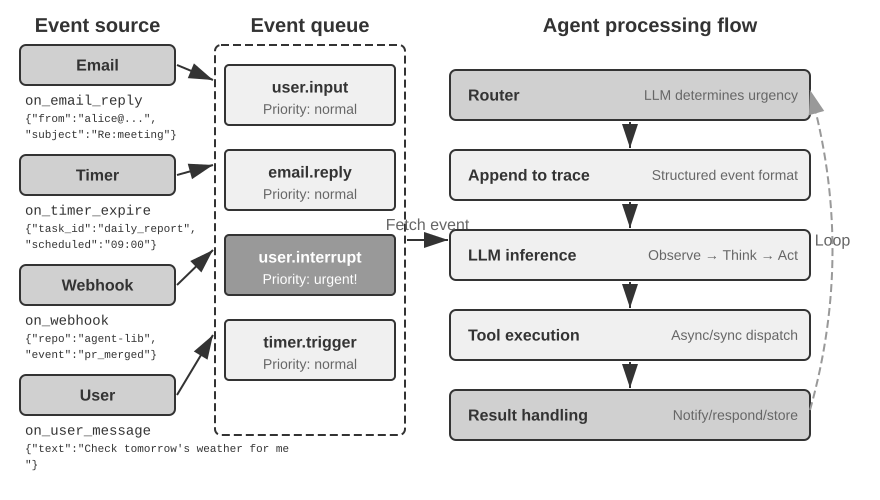

### Triển khai Event-Driven Mechanism trong OpenClaw

Open-source framework OpenClaw tiếp nhận multi-channel message thông qua Gateway control plane và route chúng tới Agent runtime. Hệ thống cung cấp ba event-driven mechanism tích hợp sẵn (built-in):

- **Hooks**: Phản hồi các event trong lifecycle của Agent, chẳng hạn như session creation và reset, tương tự như các event trigger trong GitHub Actions.
- **Cron (scheduled-task scheduler)**: Thực thi các định kỳ task dựa trên cron expression (cú pháp phổ biến cho scheduled task trên các Unix system, ví dụ: `0 9 * * 5` nghĩa là 9 giờ sáng thứ Sáu hàng tuần).
- **Heartbeat (Heartbeat Daemon)**: Đánh thức Agent sau mỗi N phút để kiểm tra xem có bất kỳ điều gì cần xử lý hay không.

Ba mechanism này mang lại cho OpenClaw Agent khả năng tự chủ biểu kiến (autonomy)—ngay cả khi user offline, Agent vẫn có thể tạo report theo lịch trình, kiểm tra system status và xử lý các tác vụ định kỳ. Gateway vốn đã xử lý message từ các built-in channel như IM và web interface theo cơ chế **push**. Trong ba mechanism trên, chỉ có Cron và Heartbeat cho phép Agent hành động mà không cần message từ user, và cả hai đều mang tính chất **time-driven**: Heartbeat kiểm tra theo khoảng thời gian cố định, Cron kích hoạt tại thời điểm định sẵn, còn Hooks lại bắt nguồn từ bên trong OpenClaw framework thay vì từ bên ngoài.

Khoảng trống thực sự nằm ở các third-party event source bên ngoài các built-in channel: một email mới, một external API callback, hoặc một notification khẩn cấp. OpenClaw chưa có một ingress path tức thì cho chúng, khiến Agent không thể phản hồi ngay lập tức mà có thể chỉ nhận biết được ở tick tiếp theo của Cron hoặc Heartbeat.

Độ trễ này là không thể chấp nhận được trong nhiều kịch bản. Lấy **PineClaw** (OpenClaw plugin của Pine AI) làm ví dụ: Pine AI là một AI assistant thực hiện các cuộc gọi điện thoại thực tế thay mặt cho user, với các kịch bản điển hình bao gồm thương lượng hóa đơn, hủy subscription, và xử lý khiếu nại bảo hiểm. Khi user khởi tạo một Pine phone task thông qua OpenClaw Agent, voice AI của Pine sẽ thực hiện cuộc gọi thay mặt user, nhưng user có thể cần can thiệp bất kỳ lúc nào trong suốt cuộc gọi:

- **Real-time Identity Verification**: Nhân viên customer service yêu cầu xác minh danh tính chủ tài khoản, và Pine cần user cung cấp ngay lập tức security code hoặc one-time password (OTP).
- **Three-Way Call Confirmation**: Nhân viên customer service yêu cầu nói chuyện trực tiếp với chủ tài khoản, và Pine cần user nhấc máy trong vòng vài giây.
- **Progress Sync and Decision Confirmation**: Tại thời điểm đàm phán then chốt (ví dụ: phía đối tác đề xuất giảm giá), Pine cần user xác nhận xem có đồng ý hay không.

Với cơ chế periodic polling của Heartbeat, user có thể không nhận được notification trong khi nhân viên tổng đài vẫn đang chờ verification code; người đại diện gác máy và cuộc gọi thất bại.

Giải pháp của PineClaw là một **Channel mechanism** thiết lập một real-time event path giữa Gateway của OpenClaw và Pine API. Khi cuộc gọi được kết nối, cần user input, hoặc kết thúc, message sẽ được push ngay lập tức tới OpenClaw Agent để xử lý và notify cho user.

Case study này đã làm sáng tỏ giá trị cốt lõi của một event-driven architecture đối với các Agent framework: **một "proactive service" thực thụ đòi hỏi không chỉ việc Agent có thể kiểm tra event định kỳ, mà event còn phải có khả năng chủ động notify cho Agent.** Việc hợp nhất toàn bộ input—user message, tool return, external callback, scheduled trigger—vào một event stream, đồng thời điều phối tư duy và hành động của Agent thông qua một event loop, chính là nền tảng kiến trúc để đạt được mục tiêu này. Dưới kiến trúc này, trước hết chúng ta sẽ tìm hiểu hai nhóm tool liên quan trực tiếp đến event, cùng với virtual identity và isolated execution environment hỗ trợ cho các hành động độc lập của Agent, trước khi đi sâu vào thiết kế chi tiết của event handling mechanism.

### Event-Triggered Tools

Event-triggered tools là các entry point mà qua đó các external event kích hoạt và định hướng action của Agent. Nếu không có chúng, Agent chỉ có thể vận hành trong một vòng lặp liên tục gồm: thinking, calling tools, xuất kết quả (output), rồi đợi input tiếp theo từ user. Để chuyển đổi các biến động từ môi trường bên ngoài thành những event mà Agent có thể xử lý, có ba loại event-triggered tools phổ biến:

**Timers** (`set_timer`) xử lý các event gắn liền với physical time. Nếu một email không có phản hồi, Agent cần tự động follow up sau một khoảng thời gian để kiểm tra tiến độ; nếu một cuộc gọi được thực hiện ngoài business hours của người nhận, nó cần retry vào khung giờ làm việc tiếp theo. Do đó, các tool như OpenClaw và Claude Code cho phép Agent tự wake chính nó tại một thời điểm xác định. **One-shot timers** xử lý các task có mốc thời gian cụ thể: nếu user yêu cầu vào thứ Bảy rằng “hãy gọi bộ phận cho vay thế chấp của ngân hàng để cập nhật trạng thái”, Agent sẽ thiết lập “gọi cho ngân hàng vào 10:00 AM thứ Hai tuần tới”, và timer sẽ trigger cuộc gọi này. **Recurring timers** xử lý các periodic task, chẳng hạn như kiểm tra server health mỗi giờ. Một số external service không thể push cập nhật tiến độ mà bắt buộc phải poll; recurring timer cung cấp cơ chế polling đó. Heartbeat của OpenClaw là phiên bản hệ thống hóa của cơ chế này và là nền tảng cho năng lực “proactive service” của nó.

**Background Task Monitoring** (`monitor_shell`) xử lý các event từ các tool thực thi bất đồng bộ (asynchronous) hoặc các command-line task. Một số command-line task chạy ngầm (background) trong thời gian dài và Agent cần theo dõi tiến độ của chúng. Nếu Agent liên tục “chăm chú nhìn vào command line”, gọi tool liên tục để poll tiến độ, nó sẽ burn rất nhiều token; ngược lại, nếu đợi đến khi task hoàn thành toàn bộ mới tiếp tục thinking, Agent sẽ bỏ lỡ các vấn đề nghiêm trọng phát sinh trong quá trình chạy—và nếu command bị hang, Agent hoàn toàn không thể can thiệp, khiến toàn bộ task bị stall. Claude Code giải quyết bài toán này bằng cách giới thiệu một `monitor` tool, cho phép Agent giám sát output mới từ command-line, bao gồm cả những output chứa các keyword cụ thể.

**External Event Channels** (`connect_channel`) push các external event như email mới, API callback, hoặc tin nhắn IM tới Agent theo real-time. Cơ chế Channel trong PineClaw ở phần trước là một implementation điển hình.

Dưới góc độ thiết kế hệ thống, event-triggered tools cần định nghĩa rõ các trigger condition và filtering rule nhằm ngăn chặn các event không liên quan wake Agent, tránh lãng phí computational resource. Event payload cần chứa đầy đủ thông tin context để giảm thiểu tối đa số lượng query bổ sung mà Agent phải thực hiện sau khi được đánh thức.

### User Communication Tools

Các user communication tools xuất hiện khi các kênh giao tiếp giữa Agent và user ngày càng trở nên đa dạng. Nhiều Agent, chẳng hạn như Claude Code và Manus, sử dụng một native ReAct loop: mọi nội dung Agent “nói” (một assistant message) đều được gửi trực tiếp đến user, và user buộc phải mở một session cụ thể trong app để tương tác với nó. Session này thường làm lộ toàn bộ quy trình tool-call của Agent.

OpenClaw phá vỡ pattern này. User không cần phải bận tâm về từng session riêng lẻ hay theo dõi chi tiết các tool calls; cả user và Agent đều có thể gửi message bất cứ lúc nào thay vì phải luân phiên theo cơ chế một request đổi lấy một response. Điều này mang lại cho OpenClaw thứ mà nhiều người mô tả là một **“human-like presence”**, giao tiếp bất đồng bộ (asynchronous) tương tự như một trợ lý. Thay vì gửi các raw assistant messages, OpenClaw sử dụng các messaging tools chuyên dụng với message có thể đính kèm hình ảnh, file và kích hoạt push notifications dựa trên mức độ khẩn cấp (urgency).

Bên cạnh việc giao tiếp với user qua text, ngày càng nhiều Agent sở hữu **multimodal communication capabilities**, chẳng hạn như gửi các structured card messages hoặc reminder emails. Một số Agent đã bắt đầu thử nghiệm với **Generative UI**—sử dụng HTML và các giải pháp tương tự để sinh ra các interactive interfaces giúp hiển thị thông tin tới user một cách thân thiện hơn. Ở cấp độ thiết kế (design level), các user communication tools cần hỗ trợ asynchronous messaging (khi user có thể không online), cung cấp khả năng tracking trạng thái read/unread, và đảm bảo tính nhất quán của message trên toàn bộ các channels.

**Multi-channel User Communication and Re-engagement.**

**Response của Agent không nên bị giới hạn trong một channel duy nhất; cơ chế notification cũng đồng thời đóng vai trò như một cơ chế user re-engagement.** Việc gửi message được mở rộng sang instant messaging, SMS, email, phone calls, push notifications và các channels khác. Agent sẽ quyết định channel phù hợp dựa trên sự kết hợp giữa urgency, user status, tính chất của content và user preferences, đảm bảo không bỏ sót các message quan trọng trong khi vẫn tránh được việc ngắt quãng (interruptions) dư thừa.

Đối với các long-running tasks, Agent cần chủ động notify cho user khi hoàn thành để kéo sự chú ý của user quay trở lại. Đối với các periodic tasks (như daily summaries hoặc weekly reports), notifications có thể giúp user hình thành thói quen tương tác đều đặn.

User communication tools giải quyết bài toán "how to reach the user". Tuy nhiên, identity mà Agent đảm nhận trên các channels này cũng như environment mà nó thay mặt user để thực thi action lại đòi hỏi một tầng identity and execution-environment infrastructure—đây chính là chủ đề của phần tiếp theo.

### Virtual Identity và Isolated Execution Environment

Chương 4 mở đầu bằng ví dụ về Samantha trong bộ phim *Her*, minh họa cách một Agent sử dụng các tool để tương tác với thế giới số thực tế. Để hiện thực hóa một general-purpose assistant như vậy, chúng ta buộc phải đưa ra một lựa chọn kiến trúc then chốt: liệu Agent nên trực tiếp quản lý các personal account của user, hay tự sở hữu một Virtual Identity riêng? Việc quản lý trực tiếp trông có vẻ tiện lợi, nhưng chỉ cần một sai sót hoặc sự cố bảo mật (compromise) từ phía Agent cũng có thể làm lộ toàn bộ digital identity của user. Hướng tiếp cận an toàn hơn là cấp cho Agent một Virtual Identity độc lập—tương tự như việc một thư ký có số điện thoại văn phòng và hòm thư riêng—bao gồm các communication account, storage, và computing environment chuyên dụng, giúp Agent có thể thay mặt user làm việc dưới một danh tính minh bạch, được khai báo rõ ràng. Sự minh bạch này không hề làm suy giảm lòng tin; ngược lại, nó giúp quá trình giao tiếp trở nên chân thực hơn.

Các Virtual Identity đòi hỏi phải có Isolated Execution Environment. **Virtual computer** (VMs/containers) và **virtual phone** (Android emulators) cung cấp cho Agent khả năng cô lập ở cấp độ hệ điều hành (operating-system isolation) cùng toàn bộ năng lực trên desktop hoặc mobile. Thứ nhất, một virtual computer có thể chạy 24/7 bất kể thiết bị của user có đang online hay không và không gây ảnh hưởng đến các ứng dụng mà user đang thao tác. Thứ hai, trong kịch bản xấu nhất, lỗi từ Agent chỉ làm crash virtual environment thay vì ảnh hưởng đến thiết bị thật của user. Cuối cùng, cơ chế isolation ngăn không cho Agent tự ý truy cập vào các local file của user.

Một danh tính độc lập cũng đặt ra hai thách thức thực tế. Đầu tiên là **anti-bot mechanism**: nhiều website sử dụng CAPTCHA và kiểm tra IP reputation để chặn truy cập tự động. Các virtual environment sử dụng data center IP rất dễ bị nhận diện; trên thực tế, để truy cập bình thường thường cần cấu hình một residential proxy network (sử dụng IP hộ gia đình thực). Thứ hai là **truy cập vào real account của user**: khi một task bắt buộc phải đăng nhập bằng tài khoản của user, hãy sử dụng Human-in-the-Loop authentication—thông qua VNC/RDP remote desktop, nơi user tự mình đăng nhập, quan sát toàn bộ giao diện mà Agent đang thao tác và hiểu rõ lý do vì sao cần authentication. Session token sau đó được tái sử dụng trong thời hạn hiệu lực (validity period) để tránh ngắt quãng user nhiều lần, cân bằng tối ưu giữa autonomy và security.

Quá trình trao đổi dữ liệu giữa Agent và các virtual environment sử dụng một **shared file system**: các volume mount như `/workspace/shared` đóng vai trò kết nối Agent, virtual computer, và virtual phone. Dữ liệu được truyền theo cơ chế tham chiếu đường dẫn file (file-path reference) thay vì sao chép trực tiếp vào context. Ví dụ: user tải một file CSV lên shared directory; Agent bên trong virtual computer phân tích dữ liệu và lưu biểu đồ kết quả tại đó; cuối cùng, Agent chỉ trả về đường dẫn của biểu đồ. Mọi thao tác bàn giao (handoff) đều duy trì dưới dạng một path string gọn nhẹ.

Các Event-triggered tool cho phép thế giới bên ngoài đánh thức Agent, user communication tool cho phép Agent chủ động tiếp cận user, còn Virtual Identity kết hợp với Isolated Execution Environment cho phép Agent hành động độc lập và audit được. Câu hỏi còn lại là: khi nhiều event cùng đổ dồn về một Agent instance tại cùng một thời điểm, chúng sẽ được điều phối và xử lý như thế nào?

### Event Handling Mechanism

Một Agent instance đơn lẻ có thể đối mặt với nhiều event đồng thời: một message mới từ user, kết quả trả về từ một tool, một timer hết hạn, hay một yêu cầu cộng tác từ một Agent khác. Việc các event này được xử lý hiệu quả và chính xác ra sao sẽ ảnh hưởng trực tiếp đến performance và user experience.

Khung sườn của cơ chế này chính là **event loop** trong concurrent programming. Hãy hình dung một asynchronous Agent như một long-running loop: mỗi round sẽ lấy ra một batch các event từ input queue, append chúng vào trajectory, invoke LLM một lần, execute các tool mà nó quyết định gọi, sau đó quay trở lại đầu loop để chờ batch event tiếp theo—cấu trúc này tương tự như một Go goroutine đọc message từ một channel và xử lý chúng qua từng round bên trong một `for { select { ... } }`.

Trong một implementation với synchronous interface truyền thống, **các event được consume tại ranh giới của mỗi round**. Khi LLM đang reasoning hoặc một tool đang execute, các event mới sẽ nằm chờ trong queue cho đến khi round đó chạm tới một **safe point**—thời điểm kết thúc một chuỗi reasoning hoặc khi có kết quả trả về từ một tool call. Native asynchrony cho phép các yêu cầu mới được gửi đến ngay cả khi model vẫn đang suy nghĩ hoặc đang generate output, hệ thống sẽ chọn thời điểm thích hợp để tiếp tục xử lý. Cả hai đều có các ranh giới và được quản lý bởi các layer khác nhau. Việc cancel một tool vẫn đòi hỏi executor của nó phải phản hồi lại cancellation signal, tương tự như việc kiểm tra `ctx.Done()` trong Go; việc nhận được một message "stop" tự thân nó không thể undo các action đã được thực thi trước đó.

Với sự phân biệt này, trước tiên chúng ta sử dụng một event loop tương thích với synchronous interface để giải thích ba chiến lược: để các event chờ đến safe point tự nhiên tiếp theo (queuing), chủ động tạo ra một safe point sớm hơn (cancellation), hoặc khởi chạy một loop khác mà không cần đợi safe point của loop chính (parallel processing). Chúng ta sẽ quay lại với native steering ở phần sau.

**Structured Event Modeling.**

Muốn xử lý được thì trước hết phải hiểu được. Input của một general-purpose Agent không chỉ đến duy nhất từ user—một third-party message không phải do user gửi trực tiếp cho Agent, nhưng Agent vẫn phải hiểu, đánh giá mức độ quan trọng và quyết định xem có nên can thiệp hay không. Điều này đòi hỏi chúng ta phải mô hình hóa mỗi input thành một **structured event** giàu semantics:

- **Source (who)**: Chính user, một contact, một người lạ, hoặc một system notification
- **Channel (how)**: Phone call, SMS, instant message, email, social media, timer trigger, kết quả trả về của asynchronous tool call, hoặc cập nhật trạng thái từ command-line monitoring
- **Content (what)**: Message text, emotional tone, mức độ khẩn cấp (urgency), và liệu có cần reply hay không
- **Context (background)**: Liệu đây là reply cho một conversation trước đó hay là một giao tiếp mới, cùng độ liên quan (relevance) của nó đối với task hiện tại

Lấy ví dụ về một email yêu cầu hoàn tiền từ khách hàng, structured event sẽ có cấu trúc như sau:

```json
{
  "source": {"type": "email", "sender": "client@example.com"},
  "channel": "gmail_webhook",
  "content": {"subject": "Refund Request", "body": "Order #12345, requesting a refund..."},
  "context": {"priority": "high", "customer_tier": "vip", "related_orders": ["#12345"]}
}
```

Chỉ khi các chiều dữ liệu này được mô hình hóa rõ ràng dưới dạng structured events, Agent mới có thể duy trì khả năng hiểu chính xác trong multi-party communication, tránh việc nhầm lẫn user input với một tool result, hoặc nhầm lẫn tool result chứa hidden instructions thành một user command (prompt injection). Độ phức tạp của multi-threaded context management cũng đòi hỏi Agent phải hiểu được mối quan hệ giữa nhiều conversation threads khác nhau—chẳng hạn như một message từ một bên thứ ba (third party) ảnh hưởng thế nào đến cảm xúc của user, sự chuyển đổi role của user qua các cuộc hội thoại khác nhau, và thời điểm cần tổng hợp thông tin từ các threads khác nhau để đưa ra đề xuất.

Hệ sinh thái trigger của các workflow platforms như n8n là một minh chứng rõ ràng: webhooks, timers, email, database changes, file watchers—mỗi trigger đóng vai trò như một "giác quan" của Agent để nhận thức thế giới bên ngoài. Một khi các heterogeneous events này được mô hình hóa đồng nhất theo một structured format, Agent có thể xử lý các kích thích (stimuli) từ nhiều nguồn khác nhau theo một phương thức nhất quán; việc xác định mức độ khẩn cấp (urgency determination) và các chiến lược xử lý (processing strategies) được thảo luận dưới đây đều dựa trên nền tảng unified modeling này.

**Chiến lược Dynamic Processing dựa trên Urgency.**

Con người khi phải xử lý cùng lúc nhiều tác vụ thường điều chỉnh chiến lược theo mức độ khẩn cấp: một tình huống khẩn cấp sẽ khiến họ lập tức gác lại việc đang làm; một việc cần làm định kỳ sẽ được đưa vào danh sách để xử lý sau. Cơ chế event handling của một Agent cũng cần thể hiện sự thông minh tương tự.

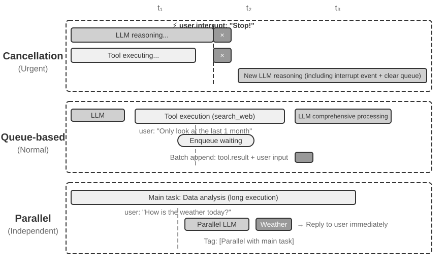

**Cancellation-Based Processing** được sử dụng cho các urgent events; bản chất của cơ chế này là **forcing a safe point early** cho urgent event: chủ động ngắt (interrupt) bước hiện tại để biến thời điểm này thành một boundary mà tại đó event mới có thể được consume. Khi một urgent event xuất hiện (ví dụ: user bấm "stop" hoặc một supervisory system gửi một chỉ thị high-priority): (1) Dừng thao tác hiện tại—nếu LLM đang reasoning, lập tức cancel streaming response; nếu một synchronous tool đang thực thi, gửi một cancel signal; (2) Drain pending queue bằng cách dọn sạch toàn bộ pending events; (3) Append các events đó cùng với urgent event vào cuối trajectory; (4) Ngay lập tức re-invoke LLM với toàn bộ trajectory hoàn chỉnh vừa được cập nhật làm input để đánh giá lại tình hình. Ví dụ: nếu user nhập "Dừng lại! Tôi nói nhầm rồi" trong khi Agent chuẩn bị thực hiện một thao tác có nguy cơ sai sót, Agent sẽ ngay lập tức nhìn thấy input mới này, đánh giá lại ý định của user, qua đó tránh việc thực thi sai hành động.

**Queued Processing** được áp dụng cho các routine events. Khi một non-urgent event xuất hiện (ví dụ: một asynchronous tool trả về kết quả hoặc user gửi thêm thông tin bổ sung): (1) Thêm event vào cuối queue mà không ngắt thao tác hiện tại; (2) Đợi thao tác hiện tại hoàn tất—để LLM hoàn thành reasoning, để synchronous tool hoàn tất thực thi; (3) Khi bất kỳ tool call nào hoàn tất và trả về một `tool.result`, kiểm tra queue. Nếu queue không rỗng, append toàn bộ events vào trajectory cùng một lúc; (4) LLM xử lý toàn diện trajectory đã được cập nhật. Cơ chế này cho phép batch processing nhằm tối ưu hiệu suất—ví dụ, trong khi Agent đang chờ kết quả từ một search tool, user bổ sung thêm: "chỉ hiển thị kết quả trong tháng trước." Thông tin bổ sung này sẽ đi vào queue, và khi search results được trả về, cả hai events sẽ được đưa vào LLM cùng một lúc, tránh phát sinh các round trips không cần thiết.

**Parallel Processing** được sử dụng cho các query độc lập và lightweight. Ví dụ, trong khi Agent đang phân tích một lượng lớn dữ liệu, user đột ngột hỏi: "Hôm nay thời tiết thế nào?" Những query như vậy có ba đặc điểm: không liên quan đến main task, yêu cầu response nhanh và có execution cost thấp. Cả cancellation-based processing (sẽ làm gián đoạn main task quan trọng) lẫn queued processing (khiến user phải chờ đợi quá lâu) đều không phù hợp. Hệ thống trước tiên sẽ đánh giá tính độc lập và độ phức tạp của query, sau đó thực thi nó một cách độc lập trong một parallel reasoning session, gọi các tool cần thiết để generate response và trả về kết quả ngay lập tức. Query cùng response tương ứng sẽ được append vào trajectory của main task, đồng thời được đánh dấu rõ ràng là "executed in parallel with the main task" nhằm tránh gây nhầm lẫn cho LLM.

**Urgency Determination.**

Urgent events: User interrupt (`user.interrupt`), supervisor instruction (`supervisor.instruction`), inter-Agent interrupt (`agent.interrupt`), các external trigger được đánh dấu là urgent (ví dụ: system alert, payment failure).

Non-urgent events: Regular user input (`user.input`), Agent input (`agent.input`), tool results (`tool.result`), timer triggers (`timer.trigger`), regular external triggers.

Các hardcoded rule luôn tồn tại hạn chế; chính semantics của event sẽ quyết định phương pháp xử lý—"Dừng lại ngay lập tức!" sẽ kích hoạt cancellation-based processing, "Hôm nay thời tiết thế nào?" áp dụng parallel processing, còn "Gửi báo cáo bằng tiếng Trung" sẽ chuyển qua queued processing. **Khuyến nghị nên sử dụng một lightweight classification LLM làm event router**, giúp nhanh chóng xác định strategy cần áp dụng ngay khi event xuất hiện.

Một cancellation point bắt buộc phải là vị trí mà tool hoặc quá trình reasoning có thể dừng lại một cách an toàn; một tool result chưa hoàn thành phải được đại diện bằng một placeholder tường minh và tuyệt đối không bao giờ được giả mạo thành trạng thái success.

Thực nghiệm dưới đây—một event-driven email processing Agent—sẽ chuyển hóa toàn bộ các strategy xử lý event đã thảo luận ở trên thành một runnable implementation.

> **Experiment 6-1 ★★★: Event-Driven Email Processing Agent**
>
>
> 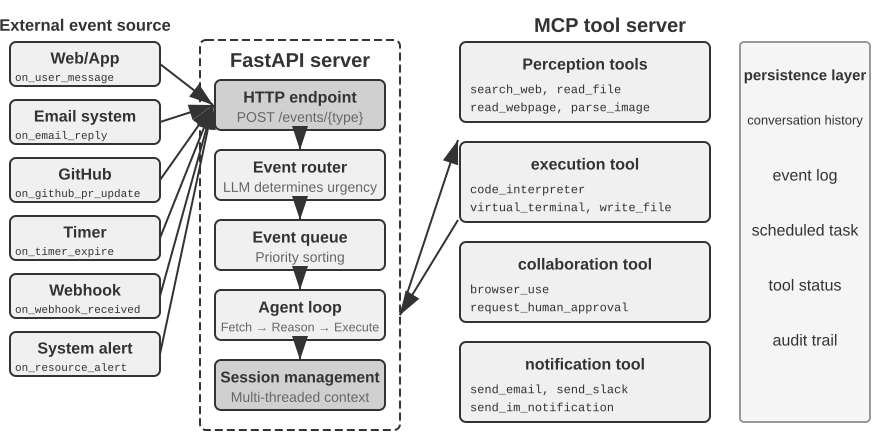
>
>
> Thực nghiệm này xây dựng một event-driven Agent ở dạng đơn giản nhất: **Automated Email Processing Assistant**. Agent sẽ giám sát email inbox, và mỗi khi có email mới gửi đến, nó sẽ tự động kích hoạt một workflow xử lý—bao gồm classification, summarization, draft reply, và notify cho user nếu cần. Đây là kịch bản nhập môn trực quan nhất cho một event-driven Agent: một external event (email mới đến) kích hoạt một Agent thinking cycle hoàn chỉnh.
>
> **Experiment Objective**: Thấu hiểu tư tưởng cốt lõi của event-driven architecture—Agent không còn ở thế bị động chờ đợi user input mà tự động hành động để phản hồi các external event. Qua thực nghiệm này, người đọc sẽ làm chủ closed loop cơ bản bao gồm event source registration, event queue, và chu trình "event arrives → Agent processes → result delivered".
>
> **Event Sources và Event Queue.**
>
> Hệ thống hỗ trợ cơ chế truy cập hợp nhất (unified access) cho nhiều Event Source:
>
> - **Email Events** (`on_email_received`): Được kích hoạt khi có email mới đến, thông qua việc định kỳ kiểm tra inbox hoặc nhận push notification.
> - **IM/SMS Messages** (`on_im_message`, `on_sms_message`): Được kích hoạt bởi tin nhắn tức thời (instant message) hoặc tin nhắn SMS.
> - **GitHub Events** (`on_github_pr_update`, `on_github_issue_update`): Được kích hoạt bởi các comment review PR hoặc sự thay đổi trạng thái (status change).
> - **Timer Triggers** (`on_timer_expire`): Được kích hoạt bởi các scheduled task (ví dụ: tổng hợp hàng ngày, tạo báo cáo hàng tuần).
> - **Webhooks** (`on_webhook_received`): Các callback chung từ các external system.
> - **System Events** (`on_user_inactive`, `on_process_timeout`, `on_resource_alert`): Được kích hoạt bởi các thay đổi State nội bộ.
>
> Tất cả các event đều đi vào một **event queue** hợp nhất và được xử lý tuần tự theo thứ tự tiếp nhận. Mỗi event sẽ kích hoạt một Agent thinking loop độc lập: Agent đọc nội dung event, gọi các tool liên quan (ví dụ: truy vấn knowledge base, đọc attachment, tìm kiếm lịch sử email liên quan), sinh kết quả xử lý (classification label, bản tóm tắt, draft reply), và cuối cùng thông báo cho người dùng thông qua các notification tool hoặc trực tiếp thực thi action.
>
> **Validation Scenario**: Cấu hình Agent để giám sát một mailbox thử nghiệm. Mô phỏng việc nhận ba email—một lời mời họp, một khiếu nại từ khách hàng, và một email tiếp thị (marketing). Agent xử lý chúng tuần tự: đối với lời mời họp, Agent tự động kiểm tra calendar conflict và soạn bản draft reply chấp nhận/từ chối; đối với khiếu nại từ khách hàng, Agent trích xuất thông tin then chốt, đánh dấu high priority, và thông báo cho người dùng xử lý; đối với email tiếp thị, Agent tự động archive. Toàn bộ quy trình không cần sự can thiệp của người dùng.

Experiment 6-1 minh họa cho event-driven pattern đơn giản nhất—các event đi vào queue, và Agent xử lý chúng tuần tự. Tuy nhiên, khi Agent cần phản hồi các interruption trong quá trình thực thi các long-running tool execution, hoặc quản lý đồng thời nhiều concurrent task, một event queue đơn giản sẽ không còn đủ đáp ứng. Tiếp theo, chúng ta sẽ đi sâu thảo luận về các engineering challenge ở tầng sâu hơn.

### Khả năng tương thích khi không có Native Asynchrony

Experiment 6-1 chỉ xử lý các serial event: các event đi vào queue, và Agent sẽ xử lý tuần tự từng event một. Nếu model hoặc interface được chọn không hỗ trợ native asynchrony, việc user interruption xảy ra trước khi một tool trả về kết quả phải được biểu diễn bên trong một synchronous format. Tại đây, chúng ta giới thiệu một phương pháp tương thích (compatibility approach), trước khi đi sâu vào native interface của GPT-6 Astra ở phần sau.

Giả sử Agent đang hỗ trợ user soạn thảo email và đã gọi một tool để tìm kiếm thông tin liên lạc. Trước khi kết quả tìm kiếm được trả về, user nói: “Khoan đã, kiểm tra thời tiết ngày mai giúp tôi trước đã.” Nếu interface bắt buộc các outstanding tool call phải nhận được kết quả tương ứng trước, Agent sẽ không thể trực tiếp xử lý message mới này trong khi call vẫn đang ở trạng thái pending. Rào cản này xuất phát từ sự kết hợp cụ thể giữa protocol và model được lựa chọn; đây không phải là quy tắc áp đặt lên mọi LLM.

**Triển khai Asynchronous tương thích với Synchronous Format**

Ý tưởng cốt lõi là: **Trong điều kiện bình thường không có interruption, hãy để LLM nhìn thấy một synchronous trajectory chuẩn; chỉ khi có interruption xảy ra, mới chèn các placeholder để chuẩn hóa lại format**. Dưới đây là năm quy tắc then chốt:

**Rule 1**: Kịp thời ghi lại các assistant message và tool-call item đã hoàn thành từ API. Bảo toàn server-managed reasoning state theo đúng continuation protocol của provider; không tự ý ghép nối invisible reasoning text.

**Rule 2**: Chỉ ghi lại tool result khi tool call đã hoàn tất. Trajectory sẽ ở trạng thái "partially completed" trong suốt quá trình execution.

**Rule 3**: Các interruption xảy ra trong lúc tool execution bắt buộc phải dùng placeholder. Tạo một placeholder response cho tool chưa hoàn thành (ví dụ: "Tool is executing in the background, please prioritize the new event"), append interruption event vào, và re-invoke LLM. Dưới góc nhìn của LLM, assistant message vẫn có một tool result ghép cặp tương ứng.

**Rule 4**: Nếu không có native steering hoặc một mid-turn continuation interface được hỗ trợ, hãy cancel generation chưa hoàn tất, giữ lại các message và tool state đã được xác nhận hoàn thành, append event mới vào, và gửi một request mới. Không được mặc định rằng partial output hoặc hidden reasoning có thể được tự do feed back lại như một prefix hợp lệ.

**Rule 5**: Các non-interrupting event sẽ đi vào queue để xử lý theo batch (batch processing). Chúng sẽ được append đồng loạt chỉ sau khi cycle hiện tại đã hoàn tất.

Lấy ví dụ về việc Agent đang draft một email thì user interrupt để hỏi về thời tiết, cơ chế hoạt động của năm rule này như sau:

1. Agent call `search_contacts` để tìm kiếm contact information, và assistant message được ghi ngay lập tức vào trajectory (Rule 1).
2. Trước khi search tool trả về result, user gửi "First check tomorrow's weather for me." Vì đây là một user interruption, system sẽ sinh ra một placeholder tool result cho `search_contacts` chưa hoàn thành ("The tool is executing in the background, please prioritize the new event", Rule 3), sau đó append weather query của user vào trajectory và re-invoke LLM. Tại thời điểm này, trajectory format mà LLM nhìn thấy hoàn toàn valid—assistant message và tool result được pair một cách hoàn hảo.
3. Sau khi Agent trả lời weather query, result ban đầu của `search_contacts` trả về và được append vào trajectory như một event mới (Rule 2). Agent đọc contact information và tiếp tục draft email.

Cách tiếp cận này duy trì việc pair tool/result theo yêu cầu của một synchronous interface. Một placeholder được đánh dấu rõ ràng là “unfinished” chỉ được đưa vào khi cần một interruption. Khi background result thực tế trả về, nó sẽ đi vào trajectory dưới dạng một event kèm theo source và task ID. Đối với các model đã hỗ trợ native asynchrony, system có thể giữ nguyên pending state của task và truyền real result cho model khi nó đến.

Placeholders cũng tiềm ẩn một semantic risk: model có thể nhầm lẫn giữa “task started” và “task completed”, từ đó đưa ra quyết định phụ thuộc vào một result trước khi result đó thực sự trả về. Việc định rõ task state và result validation sẽ giúp ngăn chặn sự nhầm lẫn này, và evaluation nên kiểm tra xem có xuất hiện fabricated data chưa thực sự trả về hay không. Một failure đơn lẻ không phải là lý do chính đáng để quy trách nhiệm cho một training process chưa được công bố.

**Thể hiện Asynchronous Semantics thông qua Task Handles.**

Dù có sử dụng native asynchronous protocol hay không, **tool-interface design có thể làm cho asynchronous semantics trở nên explicit**. Một cách tiếp cận đặc biệt hữu ích cho synchronous interfaces là biến “start task” thành một call hoàn chỉnh với một return value thực tế.

Tool design truyền thống thường ngầm định semantics "call tương đương với completion". Ví dụ, cái tên `phone_call` gợi ý rằng "call hàm sẽ quay số điện thoại và đợi cuộc gọi kết thúc, sau đó trả về call log." Dưới asynchronous paradigm, "initiation" và "completion" cần phải được decouple:

- `initiate_phone_call`: Initiate một cuộc gọi điện thoại, trả về ngay lập tức một task identifier và initial status (ví dụ: "Call initiated, dialing...")
- Tiến trình cuộc gọi được giao tiếp thông qua các event notification (`phone_call_connected`, `phone_call_ended`)

Điểm mấu chốt là bản thân tool name và description phải truyền tải được asynchronous semantics. Khi model nhìn thấy `initiate_phone_call`, khả năng language understanding của nó sẽ tự nhiên suy luận rằng đây là "initiating" thay vì "completing". Tool description nên củng cố thêm điều này: "This tool initiates a phone call task handled by a sub-agent. It returns the task ID immediately upon successful initiation, allowing you to continue with other matters. A separate notification event will be sent when the call ends."

**Bỏ sót các Event trước đó trong Queue-Based Processing.**

Khi xử lý các event theo batch, model có thể chỉ phản hồi lại event cuối cùng mà bỏ qua các yêu cầu xuất hiện trước đó. Native asynchrony giải quyết việc liệu các message có thể được gửi đến trong quá trình execution hay không; tuy nhiên, chúng ta vẫn phải kiểm tra xem model có kết hợp và xử lý toàn bộ các update hay không.

Việc can thiệp có thể được áp dụng ở hai cấp độ:

**Prompt Level**: Hướng dẫn model: "Khi nhận được nhiều event liên tiếp, hãy đảm bảo bạn xem xét toàn diện tất cả các thông tin."

**Agent Status Bar Markers**: Thêm các marker rõ ràng phía trước mỗi event:

```text
[Unprocessed Event 1/4] Tool result from database_query: ...
[Unprocessed Event 2/4] User supplementary note: Only look at Beijing data
[Unprocessed Event 3/4] System reminder: Report deadline is in 30 minutes
[Unprocessed Event 4/4] User asks: What's the progress?
```

Thêm một phần summary ở cuối: "Phía trên có 4 unprocessed event, bao gồm 1 tool result, 2 user message và 1 system reminder. Hãy đảm bảo phản hồi của bạn bao quát toàn bộ thông tin."

> **Experiment 6-2 ★★★: Asynchronous Agent với khả năng Parallel Execution và Interruption**
>
>
> 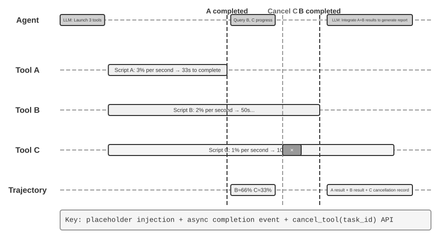
>
>
> Kế thừa `event queue` đơn giản trong Experiment 6-1, thực nghiệm này sử dụng một `runtime` tương thích với các `synchronous interfaces` để triển khai **parallel tool execution, execution cancellation, và state management**. Agent phải quản lý nhiều `concurrent tasks`, xử lý các `interruptions` và `recovery`, đồng thời đưa ra các quyết định động (dynamic decisions) dựa trên `current state`. Xem Experiment 6-3 để so sánh với Astra native.
>
> **1. Asynchronous Tool Execution**: Hỗ trợ thực thi bất đồng bộ (`asynchronous execution`) các `tools` tiêu tốn thời gian (ít nhất 3-5 giây), trả về một `placeholder` ngay khi vừa khởi tạo. **Validation Scenario**: Agent thực thi một `terminal command` dạng `long-running`. Trong khoảng thời gian này, user hỏi: "Bây giờ là mấy giờ?". Agent phản hồi ngay lập tức, sau đó hiển thị kết quả phân tích khi `long-running command` hoàn tất.
>
> **2. Event Queue and Batch Processing**: Tích lũy các `non-urgent events` và nối chúng vào `trajectory` theo lô (`batch`). **Validation Scenario**: Agent đang thực thi một `long task`. User gửi liên tiếp các tin nhắn: "Nhớ trả lời bằng tiếng Nhật" và "Format nó dưới dạng một webpage." Khi task hoàn tất, Agent xử lý toàn bộ các `events` cùng một lúc và tạo ra một webpage tiếng Nhật.
>
> **3. Interruption Mechanism**: Lệnh "stop" từ user sẽ ngay lập tức chấm dứt `execution flow` và `cancel` `asynchronous tool`. **Validation Scenario**: Agent đang thực thi một `long task`. User gửi "Cancel." Agent dừng lại ngay lập tức, và `trajectory` sẽ ghi nhận lại `interruption event` cùng thao tác `cancellation`.
>
> **4. Cancellation and Status Query for Parallel Tools**: Sau khi một `asynchronous tool` hoàn tất, kết quả thực tế sẽ được `inject` vào conversation thông qua một `event` mới. Hệ thống hỗ trợ `cancellation` hoặc truy vấn tiến độ (`progress query`) thông qua `task ID`. **Validation Scenario**: User yêu cầu: "Chạy đồng thời ba script này giúp tôi. Script nào hoàn thành trước thì kiểm tra `progress` của các script còn lại. Nếu có script nào chưa vượt quá 50%, hãy `cancel` nó." Ba script này mô phỏng các tiến trình phân tích, liên tục output `progress` với tốc độ lần lượt là 3%, 2%, và 1% mỗi giây. Agent bắt đầu chạy ba `asynchronous terminal commands` cùng lúc. Khi script có tốc độ 3%/giây hoàn thành sau khoảng 33 giây, Agent truy vấn `status` của hai `terminals` còn lại, ghi nhận một bên đạt khoảng 66% và bên còn lại đạt khoảng 33%. Sau đó, nó `cancel` script chưa đạt mốc 50%. Khi cả hai `terminals` hoàn tất, Agent tích hợp các kết quả để tạo ra một bản report hoàn chỉnh.
>

### Model-Native Asynchrony: GPT-6 Astra

Trong cách tiếp cận tương thích (compatibility approach) ở trên, runtime sẽ điều phối thứ tự các incoming event để một model có synchronous interface vẫn có thể tham gia vào các asynchronous task. Một cách tiếp cận khác cho phép model thấu hiểu nhịp độ tương tác này một cách native: nó có thể xử lý các công việc khác trong khi một tool đang chạy và điều chỉnh các bước tiếp theo khi user bổ sung yêu cầu giữa chừng. GPT-6 Astra đã hỗ trợ Async tool calling và Mid-turn steering, minh họa rõ nét cho sự chuyển dịch này (Figure 6-5).[^ch6-22][^ch6-23]

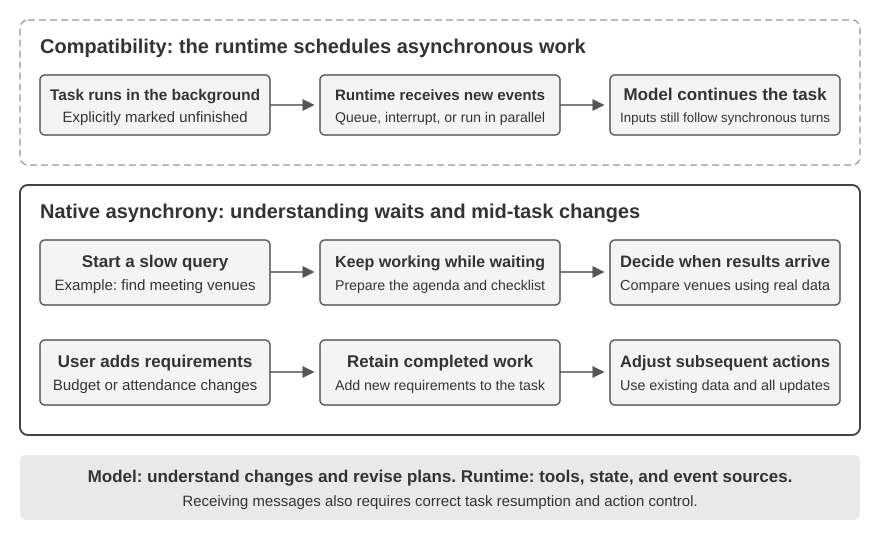

**Asynchronous tool calling tách biệt việc “bắt đầu một action” khỏi việc “nhận kết quả của nó”.** Sau khi kích hoạt một query chạy chậm, Agent có thể tiếp tục reasoning, gọi các tool khác, hoặc xử lý các phần việc không phụ thuộc vào kết quả của query đó. Ví dụ: trong khi tra cứu địa điểm họp, nó có thể chuẩn bị sẵn agenda và checklist, sau đó so sánh các phương án ngay khi nhận được thông tin địa điểm. Mấu chốt nằm ở việc phân biệt các dependency: tiếp tục thúc đẩy các công việc độc lập, đồng thời trì hoãn các quyết định đòi hỏi kết quả cho đến khi kết quả đó được trả về.

**Mid-turn steering cho phép user điều chỉnh hướng đi ngay khi task đang được thực thi.** Trong khi Agent vẫn đang reasoning hoặc soạn thảo câu trả lời, user có thể bổ sung các yêu cầu như “ngân sách đã giảm” hoặc “số lượng người tham gia đã thay đổi”. Hệ thống sẽ giữ lại phần việc đã hoàn thành và đưa các constraint mới vào quá trình xử lý tiếp theo, cho phép Agent điều chỉnh plan ngay trong cùng một task. Dù vẫn có thể tồn tại một khoảng delay nhất định giữa lúc nhận cập nhật và lúc hành động theo cập nhật đó, user không cần phải đợi toàn bộ câu trả lời hoàn tất mới có thể đưa ra thay đổi.

Các khả năng này mở rộng timing của quá trình tương tác: cả tool result lẫn user requirement đều có thể liên tục gửi đến xuyên suốt tiến trình thực thi task. Hệ thống vẫn phải phân biệt rõ ràng nguồn gốc của chúng, đồng thời ghi nhớ công việc nào đã hoàn thành và công việc nào vẫn đang ở trạng thái pending. Bản thân việc thay đổi plan không tự động dừng các tool đang chạy hay hoàn tác các action đã thực thi; việc execution, cancellation và state management thực tế vẫn thuộc về trách nhiệm của runtime.

Không phải model nào cũng sở hữu native asynchronous capabilities. Khi xây dựng Agent, hãy lựa chọn native interaction hoặc compatibility approach tùy thuộc vào mức độ hỗ trợ của model, sau đó kiểm thử xem toàn bộ hệ thống đã xử lý chuẩn xác các trường hợp delayed result, mid-task change và task resumption hay chưa. Asynchronous training có thể nâng cao hơn nữa các năng lực này, nhưng developer hoàn toàn có thể kiến tạo dạng tương tác này ngay từ bây giờ bằng cách tận dụng các model hiện có.

### Từ việc nhận Asynchronous Message đến xử lý Asynchronous Task một cách đáng tin cậy

Native asynchrony giải quyết vấn đề liệu message có thể đến trong quá trình execution hay không. Tuy nhiên, độ tin cậy (reliability) trong các task phức tạp còn phụ thuộc vào cách model sử dụng các message đó. Cần kiểm tra ít nhất ba yếu tố sau:

1. **Result ownership and pending state**: Liệu model có thể liên kết một delayed result với đúng task tương ứng và tránh tự bịa dữ liệu (inventing data) khi chưa có kết quả hay không?
2. **Task resumption and action control**: Liệu nó có thể quay trở lại task ban đầu sau khi xử lý các requirement mới, đồng thời phân biệt được giữa việc thay đổi plan với việc dừng execution hoàn toàn?
3. **Integrating multiple updates**: Liệu nó có thể tuân thủ đồng thời cả constraint về budget lẫn attendance, thay vì chỉ ghi nhớ message cuối cùng?

Các vấn đề này có thể được giải quyết thông qua việc training model trong asynchronous environment, kết hợp với việc xác định rõ ràng hơn về task state, event source và execution feedback trong hệ thống. Quá trình Evaluation phải bao quát cả hai tầng: liệu model có hiểu được sự thay đổi hay không, và liệu system có execute tương ứng theo đó hay không.

> **Experiment 6-3 ★★★: Model-Native Asynchrony and Mid-Turn Steering**
>
> Chọn địa điểm tổ chức cuộc họp: sau khi kích hoạt một slow query, Agent sẽ hoàn tất các bước chuẩn bị không phụ thuộc vào kết quả của query đó. Trong thời gian này, user bổ sung thêm các requirement về budget và attendance. Khi query hoàn tất, Agent sẽ chọn địa điểm dựa trên toàn bộ các constraint.
>
> Gọi GPT-6 Astra API để so sánh giữa synchronous tools, native asynchronous tools và mid-turn steering. Quan sát xem việc chờ đợi có gây block các công việc khác hay không, liệu các requirement mới có được đưa vào plan tiếp theo hay không, và task ban đầu có được resume khi có kết quả trả về hay không. Sau đó, sử dụng một model không có native support làm nhóm đối chứng (control) để hiểu rõ capability của model và runtime orchestration giải quyết những khía cạnh nào.

Cơ chế asynchrony và event-driven execution cho phép môi trường bên ngoài đánh thức (wake) một Agent khi task đang được thực thi; tính năng native steering cũng cho phép user gửi các update trước khi câu trả lời hoàn chỉnh kết thúc. Ba phần tiếp theo sẽ nén timescale ngắn hơn nữa: khi environment thay đổi nhanh bằng hoặc nhanh hơn tốc độ model generate, chỉ nhận update thôi là chưa đủ—hệ thống còn phải react kịp thời.

## Voice: Human-Machine Interface Tự nhiên nhất

Voice không đơn thuần là text được chuyển thành âm thanh. Tốc độ nói nhanh gấp khoảng bốn lần tốc độ gõ phím, đồng thời giải phóng hoàn toàn đôi tay và mắt nhìn; vì vậy, nó tự nhiên đặt Agent vào một continuous input-output loop, nơi người dùng có thể interrupt bất kỳ lúc nào. Dictation chuyển đổi speech thành text; còn một voice Agent cho phép người dùng trực tiếp collaborate với Agent. Cả hai đều hỗ trợ workflow whisper-coding đã được giới thiệu ở phần trước.

Phần này sẽ bao gồm hai hướng: người dùng nói chuyện với Agent, và Agent thay mặt người dùng giao tiếp với thế giới bên ngoài. Voice model quyết định Agent có thể trả lời những gì; interaction architecture quyết định liệu nó có thể nghe rõ, respond kịp thời, handover tự nhiên, cũng như hoàn tất các bước confirmation và tool call trong suốt cuộc gọi hay không. Trước tiên, chúng ta sẽ xem xét interaction timing, sau đó đi sâu vào cognitive timing và expressive quality.

### Interaction timing: từ cascaded đến full-duplex

Bài giới thiệu GPT-Live của OpenAI mô tả ba voice-interaction paradigm—cascaded, turn-based, và full-duplex[^ch6-12]. Chúng không đơn thuần là sự thay thế cũ - mới; mà đánh đổi giữa latency, cost, và observability theo những cách khác nhau:

| Paradigm | Core structure | Main advantage | Main limitation |
| --- | --- | --- | --- |
| Cascaded | VAD → ASR → LLM → TTS | Module rõ ràng, dễ dàng thay thế và debug | Latency tích lũy và paralinguistic information bị mất tại các interface |
| End-to-end Omni | Native audio input và output với tương tác turn-based | Latency thấp hơn; bảo toàn tốt hơn tone giọng, emotion, và ambient sound | Vẫn là turn-based; chi phí training và debug cao hơn |
| Full-duplex | Native audio input và output với khả năng listening, speaking, và decision-making liên tục | Xử lý overlapping speech, interruption tự nhiên, và continuous streams | Training, control, và evaluation phức tạp hơn |

Sợi chỉ đỏ xuyên suốt ở đây là phá vỡ giả định rằng con người phải nói chuyện tuần tự từng người một, đồng thời loại bỏ việc phụ thuộc vào phỏng đoán của VAD về việc ai đang giữ lượt nói (floor). Các hệ thống Cascaded và Omni vẫn phân chia tương tác thành các turn; trong khi full-duplex biến quyền kiểm soát lượt nói (turn ownership) thành một continuous model decision.

[^ch6-12]: OpenAI. *Introducing GPT-Live.* 2026-07-08. https://openai.com/index/introducing-gpt-live/ Phân loại cascaded / turn-based / full-duplex bắt nguồn từ phần tổng kết của bài viết về ba thế hệ ChatGPT Voice; thuật ngữ “end-to-end omnimodal (Omni)” của bài viết tương ứng với nhóm “turn-based voice models”.

### Paradigm 1 · Cascaded pipeline

Hầu hết các voice assistant thương mại hiện nay vẫn sử dụng một serial pipeline (Figure 6-6): VAD xác định thời điểm người dùng dứt lời, ASR chuyển đổi audio sang text, LLM hiểu và sinh phản hồi, sau đó TTS chuyển câu trả lời thành giọng nói. Tính modular cho phép từng component được tối ưu hóa độc lập, nhưng mỗi boundary chuyển giao đều có thể làm tăng thêm waiting time.

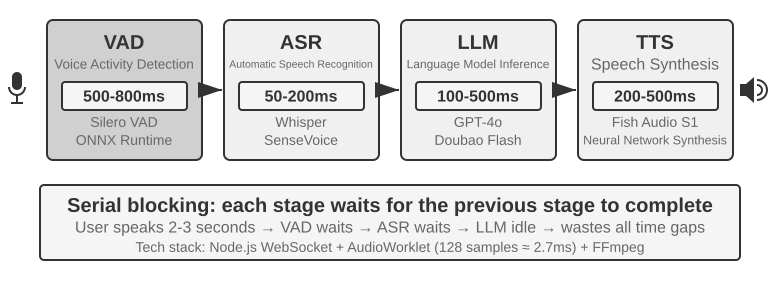

| Module | Vai trò | Bottleneck điển hình |
| --- | --- | --- |
| VAD | Xác định xem giọng nói đã kết thúc hay chưa | Silence threshold làm tăng waiting time và ngắt turn hội thoại không chính xác |
| ASR | Chuyển đổi audio sang text | Latency nhận diện và mất mát context |
| LLM | Hiểu ngữ cảnh, reasoning và sinh text | Time to first token; quá trình reasoning làm tăng thêm waiting time |
| TTS | Chuyển đổi text sang speech | Synthesis gói tin đầu tiên (first-packet) và buffering khi playback |

Đối với một phản hồi ngắn không cần reasoning, waiting time của VAD, ASR, LLM và TTS sẽ tích tụ tuần tự nối tiếp nhau (Figure 6-7). Con số thực tế phụ thuộc vào độ dài input, model, hardware, network và load của hệ thống.

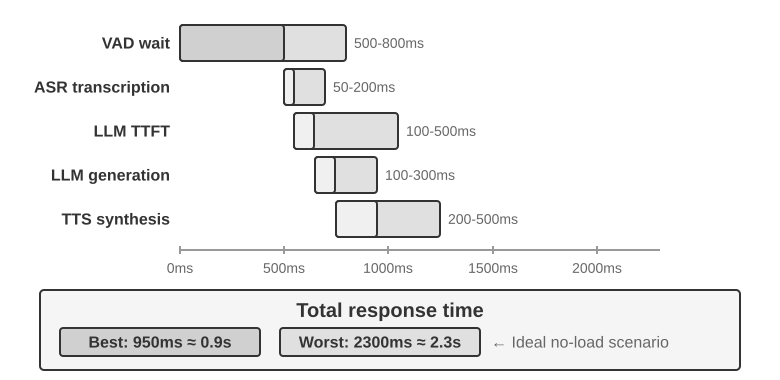

Hiện tượng queueing trên môi trường production còn khuếch đại idle latency lên nhiều hơn nữa (Figure 6-8), tuy nhiên bài toán capacity planning nằm ngoài phạm vi của chương này.

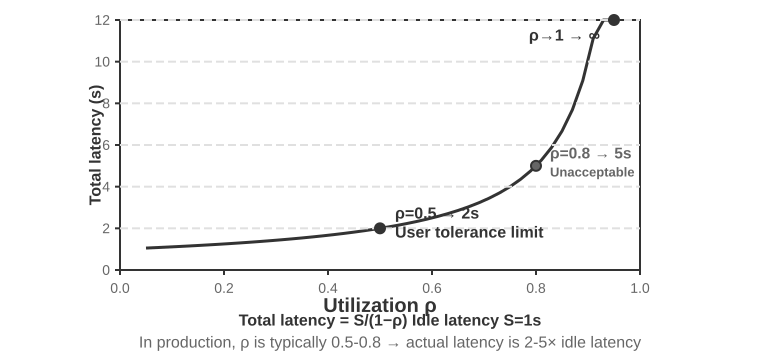

> **Experiment 6-4 ★: Xây dựng một voice Agent truyền thống**
>
> Kết nối microphone, Silero VAD, local Whisper, một streaming LLM, và Fish S1 TTS qua WebSocket để thiết lập một cascaded baseline.

#### Từ serial perception sang streaming perception

Hình 6-7 mô tả trường hợp fully serial: VAD, ASR, LLM, và TTS chạy nối tiếp nhau tuần tự. Hướng tiếp cận serial perception này gặp phải ba vấn đề:

1. **Accumulated latency:** hệ thống buộc phải chờ qua một khoảng lặng (silence) trước khi có thể xác nhận kết thúc câu nói.
2. **Lost information:** tín hiệu nhị phân speech/no-speech không thể biểu đạt được sự ngập ngừng (hesitation), cảm xúc (emotion), backchannel, hay âm thanh môi trường (ambient sound).
3. **Broken context:** địa chỉ email, tên riêng và proper noun có thể bị phân tách giữa các chunk dẫn đến nhận diện sai lệch.

Để giải quyết tình trạng này trong khi vẫn duy trì kiến trúc modular, một phương án tối ưu là **streaming perception**, cho phép mỗi stage xuất ra incremental result càng sớm càng tốt:

- **Streaming ASR:** ngay khi VAD nhận diện user bắt đầu nói, model ASR được gọi theo các khoảng thời gian cố định (fixed intervals) để sinh ra provisional transcript theo cơ chế streaming; khi VAD phát hiện user đã kết thúc, final text mới được chốt lại.
- **LLM speculative execution:** provisional transcript được đẩy ngay sang cho LLM xử lý. Nếu final text khớp hoàn toàn với provisional transcript, LLM sẽ không cần gọi lại; ngược lại, tiến trình speculative thinking trước đó sẽ bị hủy (cancelled) và LLM được gọi lại từ đầu.
- **Segmented LLM output:** câu hoàn chỉnh đầu tiên có thể phát âm được sẽ chuyển thẳng sang TTS mà không cần chờ LLM hoàn tất toàn bộ response.
- **Incremental TTS:** các audio chunk được trả về liên tục, giúp các khâu sinh nội dung (generation), tổng hợp giọng nói (synthesis) và phát lại (playback) gối đầu lên nhau (overlap).

Một streaming ASR thực thụ đòi hỏi sự hỗ trợ trực tiếp từ cấp độ model. Decoder của Whisper hoạt động theo cơ chế autoregressive, nhưng encoder của nó lại yêu cầu một audio segment hoàn chỉnh, do đó không thể coi Whisper đơn thuần là một streaming model. Một streaming-audio model xây dựng trên nền tảng LLM có khả năng emit text và semantic event từ luồng audio liên tục, gom cả khâu recognition và một phần understanding vào chung một model duy nhất. Model này duy trì conversation context xuyên suốt từ đầu tới thời điểm hiện tại, đồng thời có thể vận dụng world knowledge đối với các thương hiệu, tên riêng và proper noun.

Nếu bài toán chỉ đơn thuần là xác định thời điểm user dứt lời, kỹ thuật endpointing có thể được tích hợp trực tiếp vào streaming recognizer. Model sẽ kết hợp cả yếu tố ngữ nghĩa (semantics) lẫn khoảng lặng (silence) để đánh giá xem một utterance đã trọn vẹn hay chưa. Training label chỉ được phép chứa các thông tin có thể quan sát được tại đúng thời điểm đưa ra quyết định (decision time), nếu không, hiện tượng hindsight sẽ dẫn đến các phán đoán không thể tái lập được trong môi trường online thời gian thực.

Bên cạnh text, model có thể emit thêm các acoustic-event marker:

- **speak_start/end, interrupt:** ranh giới giọng nói (speech boundary) và ý định ngắt lời (interruption intent);
- **emotion:** cảm xúc và sự ngập ngừng (hesitation);
- **laugh, sigh, noise:** âm phi ngôn ngữ (paralinguistic) và âm thanh môi trường.

Kết hợp cùng các text token, những marker này tạo thành một event stream thống nhất. Agent có thể phát hiện sự ngập ngừng, hành vi ngắt lời và biến động từ môi trường mà không cần phải nén toàn bộ âm thanh thành plain text thô.

> **Experiment 6-5 ★: Mô phỏng streaming voice perception với Qwen2-Audio**
>
> Bản thân Qwen2-Audio không phải là một streaming model. Thí nghiệm này mô phỏng continuous perception bằng cách tăng dần độ dài audio prefix và so sánh đối chuẩn với pipeline VAD 600 ms + Whisper.

### Paradigm 2 · End-to-end omnimodal models (Omni)

Ngay cả khi có streaming perception, một kiến trúc cascade vẫn phải truyền các khâu nghe (listening), suy nghĩ (thinking), và nói (speaking) qua các interface rời rạc; cảm xúc, ngữ điệu (intonation), cùng âm thanh môi trường (ambient sound) có thể bị mất đi khi audio bị chuyển thành plain text. Hướng tiếp cận Omni sử dụng một model duy nhất để tiếp nhận audio, sinh phản hồi và phát âm thanh đầu ra, giúp bảo toàn được các tín hiệu này, dù phải đánh đổi bằng chi phí training cao hơn (Figure 6-9). So với cascaded pipeline ở Paradigm 1, ưu thế của Omni thể hiện rõ nhất ở latency cũng như khả năng hiểu và sinh non-text information.

Ở khía cạnh thấu hiểu (understanding), các Omni model có thể nắm bắt được các đoạn ngừng nghỉ (pauses) trong giọng nói. Ở khía cạnh khởi tạo (generation), Omni model có thể truyền tải thông tin cận ngôn ngữ (paralinguistic information) phong phú hơn—chẳng hạn như hát hoặc truyền tải câu thoại với một tone giọng đặc trưng.

Các Omni model vẫn vận hành dựa trên giả định turn-taking và thường dùng VAD để xác định quyền phát biểu (assign the floor). Do đó, một mid-utterance pause khi người dùng đang đọc một chuỗi chữ số vẫn có thể bị nhận nhầm là thời điểm kết thúc lượt thoại (end of turn).

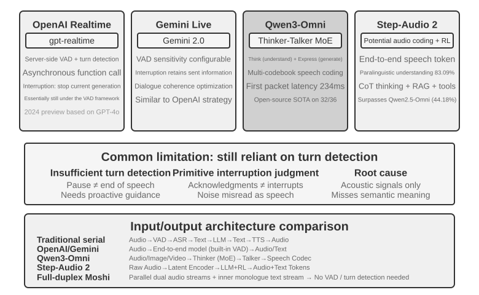

> **Experiment 6-6 ★★: Run MiniCPM-o 4.5 locally—end-to-end versus self-cascade**
>
> Chạy MiniCPM-o 4.5 locally khi tắt thinking mode, so sánh giữa phản hồi trực tiếp từ audio với self-cascade (trước tiên transcribe rồi dùng chính model đó để trả lời). Thử nghiệm này đo lường xem thông tin audio có được bảo toàn hay không, **không phải** cơ chế “thinking while speaking” sẽ được thảo luận ở phần sau.

### Paradigm 3 · Full-duplex interactive models

Omni vẫn chia hội thoại thành hai trạng thái riêng biệt: “người dùng nói” và “model nói”, nhưng các tác vụ như phiên dịch đồng thời (simultaneous interpreting) và các tác vụ tương tự lại yêu cầu khả năng overlap. Do đó, một full-duplex model không tiền giả định các turn hội thoại: nó liên tục lắng nghe và phát âm thanh đồng thời, liên tục quyết định nên tiếp tục, tạm dừng (pause), ngắt lời (interrupt), hay thực hiện tool calling.

**Moshi** (2024) của Kyutai là một ví dụ nghiên cứu ban đầu. Nó model hóa song song các audio stream của người dùng và của model, nhờ đó việc chồng chéo lời nói (overlapping speech) và ngắt lời (interruption) có thể diễn ra như các hành vi tự nhiên.

Thinking Machines Lab gọi đây là một **Interaction Model**[^ch6-14]: khả năng tương tác được tích hợp trực tiếp vào bên trong model thay vì phải lắp ghép từ bên ngoài thông qua VAD và các harness phụ trợ khác. Cơ chế micro-turn của nó xử lý lũy tiến theo từng audio block ngắn, bảo toàn các khoảng lặng (silence), overlap và interruption dưới dạng một context liên tục. Nó có thể ủy quyền (delegate) toàn bộ cuộc hội thoại cho một background reasoning model xử lý trong khi vẫn duy trì mạch tương tác trực tiếp, sau đó tích hợp kết quả thu được vào thời điểm phù hợp.

[^ch6-14]: Thinking Machines Lab, “Interaction Models: A Scalable Approach to Human-AI Collaboration,” 2026-05. https://thinkingmachines.ai/blog/interaction-models/

GPT-Live của OpenAI đã đưa hướng tiếp cận full-duplex lên quy mô production: nó liên tục xử lý input và sinh output, có khả năng chờ, phát tín hiệu phản hồi (backchannel), tiếp nhận ngắt lời (interrupted), và xử lý realtime translation. Tương tự như Interaction Model, nó delegate các tác vụ phức tạp cho một background model trong khi foreground model tiếp tục duy trì hội thoại.

### Cognitive timing: Realtime interaction và deep thinking

Interaction quality và intelligence ceiling là hai chiều kích thước (dimension) hoàn toàn khác nhau. Foreground model buộc phải phản hồi trong khi user vẫn đang tương tác; trong khi background model có thể dành nhiều thời gian hơn cho quá trình thinking. Ba thiết kế dưới đây đại diện cho các sự đánh đổi (trade-offs), chứ không phải một lộ trình tiến hóa tuyến tính. Hai phương án đầu tiên có thể bọc (wrap) một cascade model hoặc Omni model; trong khi phương án thứ ba lại hợp nhất deep reasoning và realtime expression ngay bên trong cùng một model.

#### Solution 1: Fast thinking cho fillers, slow thinking cho answers

Fast thinking có thể đưa ra một holding response (phản hồi giữ nhịp) trong vòng vài trăm millisecond, trong khi slow thinking thực hiện quá trình suy luận sâu hơn (deeper derivation) ở background. Các câu hỏi đơn giản có thể bị xử lý hai lần không cần thiết, trong khi các câu hỏi khó lại có thể tạo ra mâu thuẫn: fast model gợi ý người dùng chốt mua, sau đó slow model lại phát hiện ra một tính năng then chốt bị thiếu. Nguyên nhân cốt lõi (root cause) là do hai instance hoạt động độc lập và tư duy tách biệt nhau.

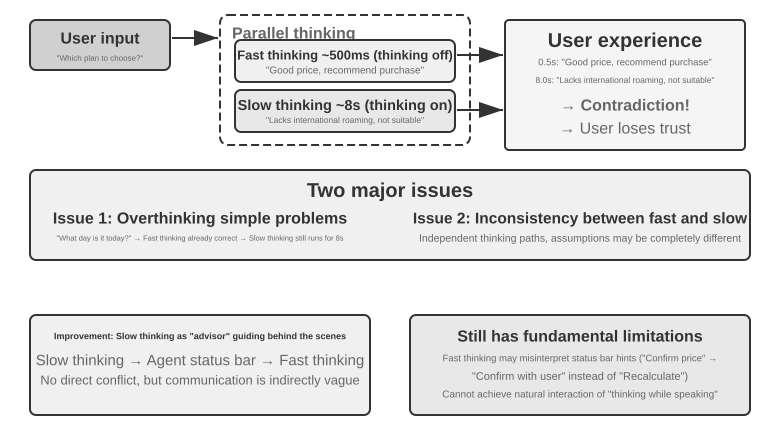

#### Solution 2: Fast thinking cho interaction, slow thinking cho advice

Background model có thể gửi advice qua một status bar hoặc dedicated interface, trong khi foreground model duy trì mạch hội thoại và quyết định cách diễn đạt (phrase) câu trả lời. Giải pháp này ổn định hơn Solution 1, nhưng cơ chế giao tiếp giữa hai bên vẫn là gián tiếp: foreground model có thể hiểu sai advice và không thể thấy được intermediate reasoning của background model. Trước khi background model xử lý xong, các câu hỏi follow-up vẫn hoàn toàn phụ thuộc vào foreground model. Hệ thống có thể đợi kết quả một cách tự nhiên, nhưng không thể thực sự "vừa nói vừa tư duy" (think while speaking).

#### Solution 3: End-to-end unification giữa thinking và expression

Thiết kế này đưa reasoning trực tiếp vào cấu trúc nội tại của một end-to-end audio model. Step-Audio R1 ứng dụng hai cơ chế bổ trợ lẫn nhau: **Modality-Grounded Reasoning Distillation (MGRD)** giúp ground thinking vào các acoustic features, trong khi **MPS dual-brain architecture** cho phép planning và expression vận hành song song (in parallel). Cơ chế đầu tiên đảm bảo model tư duy chính xác; cơ chế thứ hai giúp model phát ngôn đúng thời điểm (speak in time).

Theo kịch bản lý tưởng, model sẽ infer cảm xúc từ pitch, rhythm và intonation thay vì chỉ trích xuất từ mỗi transcript. MGRD chọn lọc các reasoning traces có tham chiếu trực tiếp đến các acoustic features, train trên tập dữ liệu này, và áp dụng reinforcement learning nhằm ngăn chặn tình trạng đoán mò thiếu suy luận (guessing without thinking). Về phía MPS, architecture này cho phép planning brain liên tục emit các thought segments; cùng lúc đó, expression brain kết hợp từng segment này với partial reply để lập tức generate speech. Pipeline được thực thi song song, do đó người nghe không cần phải đợi toàn bộ chain of reasoning chạy xong mới nghe được câu phản hồi đầu tiên.

#### The trade-off between separated fast/slow thinking and end-to-end reasoning

Một unified model triển khai cơ chế “thinking while speaking” trực tiếp nhất, nhưng quá trình tư duy (thinking) và biểu đạt realtime (realtime expression) buộc phải được retrain cùng nhau. Ngược lại, một thiết kế decoupled giúp việc hoán đổi background brain trở nên linh hoạt và dễ dàng hơn. Đây là các trade-off mang tính kiến trúc, không phải sự thay thế đơn thuần.

Khi các frontier reasoning model phát triển với tốc độ chóng mặt, việc tách biệt fast và slow thinking đem lại một lợi thế engineering then chốt: tận dụng trực tiếp những bước tiến từ mỗi thế hệ slow model mới. Fast foreground model chỉ cần đảm nhiệm việc lắng nghe, phản hồi và duy trì hội thoại với low latency, trong khi slow background model xử lý reasoning, planning và tool use. Khi một reasoning model mạnh hơn xuất hiện, hệ thống chỉ cần thay thế background model mà không phải retrain lại toàn bộ realtime voice system. Ngược lại, một unified design ràng buộc chặt chẽ cả reasoning và interaction vào cùng một training cycle, đồng nghĩa với việc mỗi lần nâng cấp đều phải tái cân bằng giữa intelligence, response latency và độ tự nhiên của biểu đạt (natural expression). Do đó, fast/slow separation không đơn thuần là giải pháp thỏa hiệp về latency, mà là một lựa chọn mang tính modular cho phép năng lực tương tác (interaction capability) và trần thông minh (intelligence ceiling) tiến hóa hoàn toàn độc lập với nhau.

Sự phân tách này không nhất thiết phải đánh đổi bằng việc suy giảm task performance. Tính đến tháng 8 năm 2026, voice Agent của Pine AI — vốn sử dụng kiến trúc separated fast/slow — đã chiếm vị trí số 1 trên τ³-Voice Leaderboard, vượt qua nhiều realtime voice system sừng sỏ bao gồm Grok Voice và GPT-Realtime-2. Kết quả này chứng minh rằng decoupled architecture về bản chất không hề thua kém các end-to-end model trong những task đòi hỏi đồng thời cả deep reasoning lẫn realtime conversation.[^ch6-17]

[^ch6-17]: Pine AI. “The Most Natural Human-Computer Interface Is Your Voice.” 2026-06-23 (updated 2026-08-06). https://www.19pine.ai/blog/pine-ai-the-most-natural-human-computer-interface-is-your-voice

Thuật ngữ “end-to-end model” cần được phân định rõ ràng hơn bởi nó thường được sử dụng theo hai tầng nghĩa. Tầng nghĩa thứ nhất là **an end-to-end speech path**, đã được thảo luận ở phần trước: model tiếp nhận trực tiếp audio đầu vào và sinh thẳng audio đầu ra thay vì kết nối nhiều model trung gian thông qua discrete text. Cả Omni model và Interaction Model đều là end-to-end theo nghĩa này; tuy nhiên, Omni model thường vẫn duy trì cơ chế turn-based, trong khi Interaction Model có khả năng vừa nghe vừa nói đồng thời — kiến trúc của chúng khác biệt rất căn bản. Tầng nghĩa thứ hai là **an end-to-end cognitive architecture**, trọng tâm của phần này: tương tác realtime và deep reasoning hoặc sẽ chia sẻ state và cùng được train trong một model duy nhất, hoặc được phân tách rạch ròi giữa một fast foreground model và một slow background model. Hai trục kiến trúc này hoàn toàn độc lập. Một hệ thống hoàn toàn có thể sở hữu một end-to-end speech path nhưng vẫn duy trì fast/slow separation ở tầng cognitive architecture; mô hình của Thinking Machines Lab khi delegate các task phức tạp cho một background reasoner xử lý ngầm chính là một ví dụ điển hình cho sự kết hợp này.

### More human-like speech synthesis

Traditional TTS thường tạo cảm giác cơ học, thiếu tự nhiên khi âm thanh quá mượt mà và thiếu vắng các nhịp ngắt nghỉ. Trong giao tiếp thực tế của con người, các khoảng dừng (pause), từ đệm (filler words) và sự lặp lại ngẫu nhiên phản ánh rõ nét sự đắn đo cũng như quá trình tư duy diễn ra tức thời.

Main LLM có thể phát ra các control markers song song với text, chẳng hạn như **THINKING**, **EMO:happy**, và **SPEED:0.8x**; sau đó TTS sẽ map trực tiếp các marker này thành pause, prosody, speaking rate, tiếng cười, tiếng thở dài cùng các nonverbal audio khác. Cơ chế triển khai có thể là một TTS model được huấn luyện chuyên biệt để hiểu các control markers, hoặc ứng dụng voice cloning kết hợp các reference clip đại diện cho từng emotion và style riêng biệt.

> **Experiment 6-7 ★★: Control token-driven TTS with Fish Audio**
>
> Sử dụng Fish Audio S1 để xây dựng một multi-reference voice library và tiến hành so sánh ba cấu hình: không có control markers, một reference clip, và nhiều reference clips. Execution layer sẽ trích xuất và ánh xạ emotion, speaking rate và style tương ứng dựa trên các marker nhận được.

## Computer Use: GUI Automation Agents

Voice đã đẩy trục thời gian xuống mức mili-giây, nhưng observation của nó về bản chất vẫn là một luồng âm thanh một chiều. Computer Use dịch chuyển bài toán tương tự lên không gian màn hình hai chiều: observation trở thành các pixel liên tục biến đổi, còn action trở thành các thao tác click và nhấn phím tại tọa độ cụ thể. Các kịch bản Voice tập trung vào *khi nào nên nói*; trong khi Computer Use nhấn mạnh vào việc *click vào đâu tiếp theo*—kèm theo một câu hỏi hoàn toàn không xuất hiện trong tương tác Voice: sau khi một action được thực thi, thực tế diễn ra có còn nhất quán với kế hoạch hay không?

Computer Use, hay còn gọi là GUI automation, cho phép AI sử dụng phần mềm tương tự như con người thông qua việc quan sát màn hình và thao tác chuột, bàn phím—ví dụ: mở trình duyệt để tìm kiếm thông tin, nhập dữ liệu vào ứng dụng bảng tính, hoặc điều chỉnh cấu hình trong system settings. Cốt lõi của nó là một vòng lặp **Perceive-Think-Act** (Figure 6-11):

1. Agent chụp một screenshot của màn hình hiện tại.
2. Một multimodal model tiếp nhận screenshot cùng task instruction, sau đó xuất ra thought và một action cụ thể.
3. Execution layer thực thi action này trong môi trường thực tế (di chuyển chuột, click, gõ text, v.v.).
4. Hệ thống chờ giao diện phản hồi, chụp tiếp một screenshot mới và bước vào loop iteration tiếp theo.

Việc phân biệt rõ giữa **thấu hiểu giao diện (understanding the interface)** và **hoàn thành tác vụ (completing the task)** là đặc biệt quan trọng. Vấn đề đầu tiên thiên về multimodal understanding thuần túy và có thể đo lường thông qua bài toán one-shot screenshot question answering. Vấn đề thứ hai đòi hỏi model phải đưa khả năng thấu hiểu và việc sinh action vào một closed loop để xử lý độ trễ tải trang, các state changes, lỗi phát sinh, và cả những tác động không thể đảo ngược. Do đó, thách thức cốt lõi của Computer Use không chỉ dừng lại ở việc phản hồi chính xác về một screenshot, mà nằm ở việc tái xác nhận sau mỗi bước xem thực tế có còn khớp với kế hoạch đã định hay không.

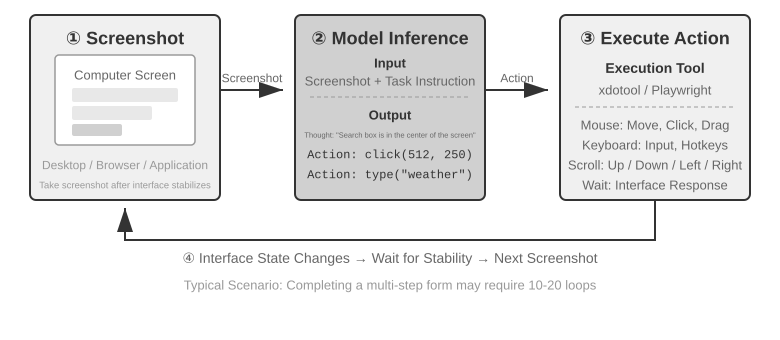

Có ba chiều thiết kế then chốt trong vòng lặp này: **Action Space** (Agent có thể thực hiện những thao tác nào), **Visual Grounding** (cách xác định target element trên screenshot), và **Model Architecture** (cách sinh ra action chuẩn xác từ screenshot).

### Thiết Kế Action Space

Bản reference implementation của Anthropic chia một năng lực tương tác hoàn chỉnh thành 3 loại tool (Figure 6-12). Đây là một thiết kế action-space rõ ràng, nhưng không phải là một private protocol bắt buộc các model provider khác phải tuân theo: miễn là Harness có thể chuyển đổi (translate) cùng các screenshot, action constraint và execution result thành message cùng structured output được target model hỗ trợ, thì Claude, các open-weight vision model và self-hosted endpoint đều có thể vận hành chung một vòng lặp Perceive-Think-Act (Perceive-Think-Act loop).

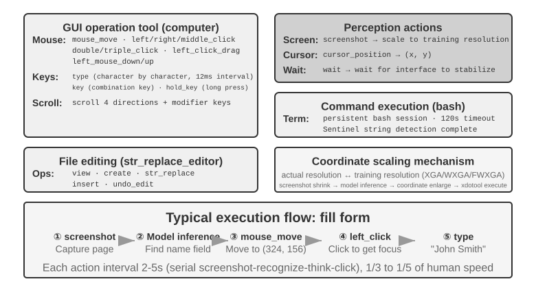

**GUI Operation Tool** (`computer` tool): Các thao tác chuột (mouse operation) bao gồm di chuyển (`mouse_move`), click chuột trái/phải/giữa, double-click hoặc triple-click, kéo thả (`left_click_drag`), cùng các thao tác nhấn/nhả chính xác hơn (`left_mouse_down` và `left_mouse_up`). Thao tác cuộn (`scroll`) hỗ trợ 4 hướng và có thể kết hợp với các modifier key. Các thao tác bàn phím (keyboard operation) bao gồm gõ từng ký tự (`type`, với khoảng nghỉ 12ms giữa các ký tự để mô phỏng thao tác gõ thực tế), tổ hợp phím (`key`, ví dụ: `Ctrl+C`), và giữ phím (`hold_key`). Các perception action bao gồm chụp screenshot, lấy vị trí con trỏ chuột (`cursor_position`), và chờ (`wait`).

**Command Execution Tool** (bash tool): Cung cấp một persistent bash terminal session với timeout 120 giây. Tool này sử dụng một sentinel string để phát hiện khi command hoàn tất và duy trì environment state qua nhiều lần gọi (ví dụ: sau khi `cd` vào một thư mục, lệnh gọi tiếp theo vẫn giữ nguyên vị trí trong thư mục đó).

**File Editing Tool** (`str_replace_editor`): Cho phép chỉnh sửa an toàn thông qua string matching và hỗ trợ các thao tác view, create, replace, insert và undo. Cơ chế này chính xác hơn việc overwrite toàn bộ file và giảm thiểu rủi ro vô tình sửa đổi các nội dung không liên quan.

> **Experiment 6-8 ★: Chạy Computer Use (Anthropic Reference Path hoặc Open-Model Path)**
>
> Path A sử dụng Anthropic Computer Use Demo. Container của nó đóng gói hoàn chỉnh một Ubuntu desktop environment, bao gồm browser, terminal và các tool thông dụng khác. Frontend tiếp nhận task, trong khi backend gửi instruction cùng screenshot tới Claude, sau đó thực thi các action thao tác chuột, bàn phím, terminal hoặc chỉnh sửa do model trả về.
>
> Path B sử dụng code ví dụ trong [`chapter6/computer-use-open-model`](../chapter6/computer-use-open-model/). Theo mặc định, nó điều khiển browser-use với open-weight model Qwen3-VL 32B Instruct thông qua hosted OpenRouter API, hoặc qua các hệ thống self-hosted như vLLM/SGLang và các hệ thống tương tự.

### Visual Grounding

Trong mỗi iteration của loop, model cần định vị chính xác target element trong screenshot—"Search box nằm ở đâu?" "Coordinates của submit button là gì?" Đây chính là bài toán visual grounding. Hiện tại, có **hai hướng tiếp cận chính**: một là biến việc localization thành một **multiple-choice problem**—trước tiên annotate các interface element bằng số thứ tự, và model chỉ cần chọn một số; hướng còn lại là **pure coordinate prediction**—để model "nhìn" vào screenshot và trực tiếp output coordinates, tương tự như cách con người thao tác. Hướng tiếp cận multiple-choice có hai phương thức triển khai: **pure visual annotation** (Set-of-Mark nguyên bản, sử dụng segmentation model để segment các candidate region trong ảnh) và **structured element indexing** (DOM/Accessibility Tree, trực tiếp đọc cấu trúc nội tại của giao diện). Ưu điểm chung của cách tiếp cận multiple-choice là chuyển đổi bài toán open-ended "tìm button trong screenshot và predict coordinates của nó" thành bài toán closed-ended "chọn một từ danh sách các element đã được annotate". Tương tự như việc câu hỏi trắc nghiệm dễ trả lời chính xác hơn câu hỏi điền vào chỗ trống trong một bài thi, model chỉ cần đưa ra quyết định "click [123]" thay vì "click button tại screen coordinates (350, 464)". Việc predict coordinates trực tiếp đặc biệt khó đối với một model—đòi hỏi quá trình training chuyên sâu để đạt độ chính xác, đồng thời rất dễ phát sinh lỗi giữa các screen resolution khác nhau.

**Set-of-Mark: Visual Annotation Method.**

Set-of-Mark (SoM) nguyên bản được Microsoft Research đề xuất vào năm 2023, ban đầu nhằm khai mở khả năng visual grounding của GPT-4V. Đây là một phương pháp **purely visual**: nó sử dụng các image segmentation model (SAM, SEEM, v.v.) để tự động segment các candidate region trong screenshot, phủ một numbered marker lên từng region, giúp model quan sát được một hình ảnh kèm các con số đánh dấu. Model chỉ cần trả về con số tương ứng, sau đó hệ thống sẽ chuyển đổi số đó thành center coordinates của region mục tiêu. Toàn bộ quy trình không yêu cầu DOM hay bất kỳ internal interface structure nào, vì vậy nó có thể áp dụng tương đương cho cả native desktop software lẫn game interface—miễn là segmentation model có thể nhận diện được các candidate region.

**Structured Element Indexing: A Structured Implementation of the SoM Idea on the Web.**

Khi bản thân interface cung cấp sẵn structured information, việc annotation có thể đạt độ chính xác cao hơn. Trước khi render, các web page hiện đại định nghĩa một element structure hoàn chỉnh (DOM tree) cùng các semantic role để định danh button, input field và các control khác. Accessibility tree cũng cung cấp thông tin tương tự cho nhiều desktop application. Các hệ thống Web Agent như `browser-use` đi theo chính xác hướng này: chúng enumerate và đánh số các interactive element lấy từ DOM. Đây là một structured implementation của ý tưởng SoM dành cho web (Figure 6-13). Quy trình gồm bốn bước:

1. Lấy structured representation (DOM tree) và accessibility information của trang thông qua debugging interface của trình duyệt (CDP, Chrome DevTools Protocol)
2. Tự động phát hiện các element có khả năng tương tác (interactive elements: button, input box, link, v.v.)
3. Annotate mỗi interactive element bằng một unique ID và vẽ bounding box trên screenshot
4. Đồng thời generate một text list mô tả element tương ứng với từng ID

```text
Screenshot: [Key elements in the image are annotated with IDs like [1], [2], [3], [4]]

Elements:
[1] <input type="text" placeholder="Search" aria-label="Search" />
[2] <button id="submit-btn" aria-label="Submit form" />
[3] <input type="text" placeholder="Enter your name" value="" />
[4] <a href="/docs" aria-label="Documentation" />
```

Model chỉ cần output một ID, và system sẽ tự động click vào tâm của element tương ứng. Cách tiếp cận này không giúp tiết kiệm token vì toàn bộ annotation data vẫn phải gửi tới model, nhưng nó mang lại khả năng localization chính xác, ổn định, đồng thời tránh được tình trạng missed detection và false positive mà các segmentation model có thể tạo ra.


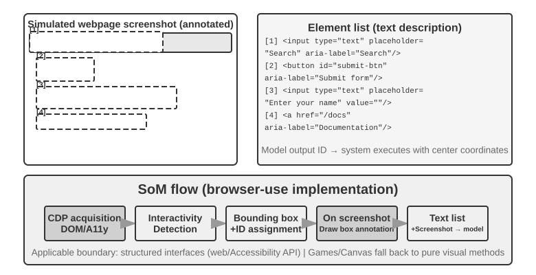

**Pure Coordinate Prediction.**

Hướng tiếp cận thứ ba bỏ qua bước annotation và yêu cầu model output trực tiếp tọa độ (coordinates). Các hệ thống như **SeeClick** và tính năng computer use của Claude dựa vào các vision model được train trên các dataset khổng lồ gồm GUI screenshot đi kèm với vị trí của element. Những model này học cách map các mô tả bằng natural language (ví dụ: "click the submit button") trực tiếp tới tọa độ chính xác trên screenshot, dựa vào khả năng visual perception tương tự như một người dùng thực tế.

Trong các cơ chế coordinate prediction, khả năng hiểu tọa độ của model phụ thuộc rất lớn vào resolution được sử dụng trong quá trình training (Figure 6-14). Claude được train bằng các resolution XGA (1024×768), WXGA (1280×800), và FWXGA (1366×768). Nếu resolution của screenshot đầu vào không khớp, tọa độ do model predict sẽ bị lệch có hệ thống (systematically shift)—tương tự như việc đo khoảng cách trên một tấm bản đồ nhỏ rồi áp trực tiếp lên một bản đồ lớn. Do đó, cần phải triển khai một cơ chế bidirectional coordinate scaling ở tool layer, và target resolution phải được **lựa chọn dựa trên aspect ratio** để tránh hiện tượng co giãn không đồng đều (non-uniform stretching) làm biến dạng ảnh, dẫn đến việc phán đoán tọa độ bị sai lệch. Ví dụ, nếu screen resolution thực tế là 2560×1440 (16:9), target phù hợp nhất trong số ba tùy chọn được Claude hỗ trợ là FWXGA (1366×768), do có aspect ratio gần với 16:9 nhất. Screenshot sẽ được scale theo đúng tỷ lệ về 1366×768 rồi đưa vào model; sau khi model output ra click coordinates (683, 384), chúng sẽ được inverse mapping về tọa độ thực tế: $(683 \times 2560 / 1366, 384 \times 1440 / 768) \approx (1280, 720)$. Ngược lại, nếu một ảnh 16:9 bị ép giãn về tỷ lệ 4:3 là 1024×768, ảnh sẽ bị nén theo chiều ngang, khiến tọa độ do model predict bị lệch có hệ thống.


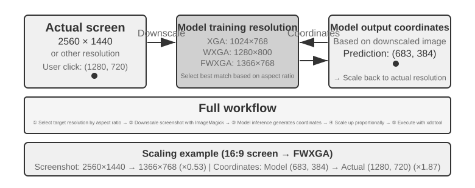


Việc lựa chọn giữa ba hướng tiếp cận có thể được đúc kết như sau: **khi có sẵn structured information, hãy ưu tiên DOM/accessibility-tree indexing** để đạt được localization chính xác và ổn định nhất. **Khi không có thông tin này**—chẳng hạn như trong native desktop software như Photoshop, các giao diện render bằng canvas/WebGL, hoặc game—**hãy sử dụng visual annotation (hướng tiếp cận SoM nguyên bản) hoặc coordinate prediction**. Visual annotation biến bài toán localization thành một bài toán trắc nghiệm (multiple-choice problem), giúp nó thân thiện hơn với các general-purpose model chưa qua specialized training. Coordinate prediction loại bỏ hoàn toàn bước annotation và trực diện hơn đối với các model được train chuyên biệt cho GUI localization. Cả hai cách tiếp cận này vẫn gặp khó khăn đối với các element kích thước nhỏ và giao diện có mật độ dày đặc (dense interfaces).

> **Experiment 6-9 ★: Sử dụng browser-use để triển khai Automated Browser Operations**
>
> Sử dụng Playwright, một browser-automation framework, kết hợp với multimodal model để triển khai các thao tác trình duyệt điều khiển bằng natural language. Bật tính năng SoM visualization và lưu lại screenshot kèm theo các bounding box đã được annotate trước mỗi decision.
>
> Test task “Open Google and query San Francisco weather”: sau khi khởi động, screenshot hiển thị Google Search với các interactive element được đánh số. Model lựa chọn search box, nhập “San Francisco weather today,” submit và trích xuất thông tin nhiệt độ cùng điều kiện thời tiết từ results page.

### Computer Use Agent có khả năng quan sát Animation và nghe âm thanh

Cho đến nay, perception của Computer Use vẫn dựa trên một giả định ngầm định: **màn hình ở trạng thái tĩnh**—chụp một screenshot, reason một bước, click, rồi chụp screenshot tiếp theo. Trong khi đó, màn hình thực tế liên tục phát video, chớp nháy các notification ngắn hạn và truyền tải âm thanh giọng nói từ các cuộc họp. Một Agent chỉ mở mắt một lần mỗi 3–5 giây và không có thính giác sẽ hoàn toàn không thể thấy hoặc nghe những gì diễn ra giữa hai frame.

Thứ cần tái thiết kế không phải là action interface mà chính là **observation interface**[^ch6-9]. Một Agent–computer observation interface (AOI) chuyển đổi việc quan sát môi trường dạng liên tục thành các discrete events mà model có thể xử lý. Các kỹ thuật cốt lõi bao gồm: **screen keyframe capture**, sử dụng một model nhỏ để đánh giá xem màn hình có thay đổi đáng kể hay không và chỉ chụp screenshot khi có biến đổi mang tính ý nghĩa—khi thay đổi diễn ra liên tục, tần suất capture 1 lần/giây đã hoạt động rất hiệu quả; **volume-gated speech transcription**, kích hoạt recognition khi xuất hiện âm thanh và nạp text đã nhận diện vào context để Agent có thể nghe; và **describing the screen as text**, giúp model chuyển đổi mỗi screenshot thu được thành một câu mô tả ngắn gọn và lưu giữ trong context sau khi image gốc rời khỏi context, qua đó nén gọn multimodal interaction history.

[^ch6-9]: Xem Li, Bojie và Noah Shi. *Agent-Computer Observation Interfaces Enable Dynamic Computer Use.* arXiv:2606.29472, 2026.

### World Models cho Computer Use

Observation interface ở phần trước đã giải quyết câu hỏi "điều gì đã diễn ra ở giữa?": với keyframes, speech transcription và persistent text, Agent không còn rơi vào tình cảnh chỉ nhìn thấy hai screenshot chụp cách xa nhau. Tuy nhiên, observation interface không triệt tiêu được planning latency. Agent vẫn đang vận hành một serial "screenshot—think—click" loop, quan sát lại và reasoning bước tiếp theo sau từng action đơn lẻ. Nghiên cứu về hiệu suất **OSWorld-Human** chỉ ra rằng ngay cả khi một task cuối cùng thành công, Agent vẫn tốn nhiều bước hơn đáng kể và thời gian chờ đợi lâu hơn rất nhiều so với con người; việc đạt được accuracy ngang tầm con người hoàn toàn không đồng nghĩa với tính khả thi trong thực tế (practical).

Con người không đợi đến khi click xong mới bắt đầu suy nghĩ về bước tiếp theo. Trước tiên, họ dự đoán hành động đó sẽ dẫn đến điều gì: nếu thay đổi thực tế khớp với kỳ vọng, họ tiếp tục triển khai plan hiện tại; chỉ khi state của trang sai lệch so với dự tính, họ mới dừng lại để quan sát và lập plan lại. Một world model cho phép Agent dự đoán desktop có thể chuyển sang trạng thái nào trước khi hành động, mang lại khả năng "speculative execution" tương tự như con người và cải thiện đáng kể efficiency.

Desktop state không chỉ đơn thuần là một lưới các pixel. Nó còn bao gồm các window, focus, scroll position, nội dung input-field, loading state, permission và network response; các action bao gồm click, type, scroll, drag và wait. Một world model có thể sử dụng được cho Computer Use tối thiểu phải encode được current state, dự đoán state change mà một candidate action gây ra, và chuyển dự đoán đó cho planner để quyết định bước tiếp theo:

```text
desktop state + click/type/scroll/wait ──> representation of the next state
```

Cơ chế này cho phép Agent so sánh hệ quả của các candidate action trước khi thực sự click, chuẩn bị sẵn bước tiếp theo trong lúc trang đang loading, và khôi phục từ một dialog vừa vụt tắt bằng cách reasoning về state difference. Nếu task là "tạo một file Python mới trong VS Code và viết hello world", model trước tiên có thể dự đoán key state của file tree và editor khi thành công, rồi mới chọn các action click, type và save; nếu task là xóa một file, nó có thể dự đoán bên trong một virtual desktop cô lập xem liệu một confirmation dialog không thể hoàn tác có xuất hiện hay không, và yêu cầu user xác nhận khi cần thiết. Điểm mấu chốt ở đây không phải là bắt model generate một screenshot tương lai chân thực như ảnh chụp (photorealistic), mà là dự đoán các state difference có thể kiểm chứng được mà việc hoàn thành task đòi hỏi.

Vào tháng 7 năm 2026, **Photon-1** từ Induction Labs đã chứng minh một phương án triển khai theo hướng tiếp cận này, hoàn thành pretraining cho một computer use world model chỉ với 30.000 giờ H200 GPU time. Nó nén từng frame thành các discrete latent token và autoregressively dự đoán representation của state tiếp theo sau một action, thay vì generate screenshot từng pixel một trong quá trình pretraining; image generator đi kèm chỉ đóng vai trò visualize các latent representation chứ không phải là một component bắt buộc cho inference. Với một seed screenshot và chuỗi action tiếp theo, model có thể liên tục "tưởng tượng" (imagine) các desktop state, rồi sau đó học cách xuất ra các action computer-use thông qua online training trên virtual machine.[^ch6-20]

[^ch6-20]: David Li và Jonathan Li, Induction Labs, “Scaling Video Pretraining with Imagination Models,” 2026-07-23. https://www.inductionlabs.com/news/scaling-video-pretraining. Các parameter, data scale, internal benchmark và so sánh chi phí được báo cáo cho Photon-1 là các số liệu do công ty công bố.

### Mobile: Ecosystem Barriers còn khó nhằn hơn cả công nghệ

Computer Use cũng đang mở rộng sang các thiết bị mobile. Về mặt kỹ thuật, hệ thống mobile và desktop có sự khác biệt rõ rệt: thay vì phụ thuộc vào tọa độ chuột và input từ keyboard, mobile action space thường sử dụng accessibility-service API của hệ thống (ví dụ: `AccessibilityService` của Android) để đọc các element trên interface, đồng thời thực thi các thao tác click hoặc enter text. Cơ chế tương tác cũng dịch chuyển từ mouse pointer sang touch gestures, làm thay đổi hoàn toàn ý nghĩa của tọa độ. Cùng một vị trí `(x, y)` có thể đại diện cho một cú tap, long press, hoặc điểm bắt đầu của một thao tác swipe; vì vậy action bắt buộc phải xác định rõ gesture type. Các mobile benchmark như AndroidWorld, được giới thiệu ở Chapter 7, dùng để đánh giá năng lực của một Agent trong việc hoàn thành task trên các application thực tế bên trong action space này.

Tuy nhiên, rào cản thực sự kìm hãm mobile Computer Use thường không nằm ở những khác biệt kỹ thuật này, mà đến từ ecosystem barriers. Một số nhà sản xuất điện thoại từng cố gắng tích hợp AI assistant vào các dòng máy thương mại nhằm cho phép assistant tự động thao tác trên các app thường nhật như WeChat, Taobao và Alipay, nhưng họ nhanh chóng vấp phải các platform restrictions.

Điều này hé lộ một thách thức đặc thù đối với Computer Use: **ecosystem barriers**. Căn nguyên sâu xa đằng sau các restriction này xuất phát từ sự xung đột về business model. Core monetization logic của các internet application truyền thống vốn dựa trên **traffic and attention**: user nhìn thấy ads khi lướt feed, chịu sự điều hướng của recommendation algorithm khi search sản phẩm, và phát sinh các hành vi impulse purchases trong quá trình duyệt page. Khi một Agent thay mặt user thao tác, monetization chain đó bị bypass hoàn toàn: AI bỏ qua ads, không mua sắm theo cảm tính, đi thẳng tới mục tiêu, hoàn thành task và thoát ra. Đối với các platform sống nhờ advertising và traffic, mỗi thao tác của Agent đều làm xói mòn trực tiếp nền móng business model của họ.

Điều này đồng nghĩa với việc Computer Use không chỉ đối mặt với các giải pháp phòng thủ kỹ thuật như CAPTCHA, mà còn vấp phải một **structural conflict of interest**. Xung đột này rất khó giải quyết trong ngắn hạn, và nó tạo ra rào cản đối với consumer adoption lớn hơn nhiều so với các bài toán thuần túy về mặt công nghệ.

## Robot Manipulation: Dọn dẹp bàn làm việc với XLeRobot

> **Reading note**: Phần này sử dụng xuyên suốt một task duy nhất—"đặt chiếc cốc màu đỏ vào khay, bỏ mẩu giấy vụn màu vàng vào thùng rác, sau đó quan sát lại và xác nhận state của bàn làm việc." Các Experiment 6-10 và 6-12 chạy trên real hardware của XLeRobot, đòi hỏi cánh tay robot (arm), calibration, nút dừng khẩn cấp (emergency stop) và một quan sát viên tại chỗ (on-site observer); các Experiment 6-11, 6-13 và 6-14 là các thử nghiệm tương ứng trên local-GPU. Hardware và simulation được báo cáo riêng biệt, nhưng task goal, action semantics và success conditions vẫn được giữ nguyên.

Robot manipulation phức tạp hơn rất nhiều so với việc trả lời các câu hỏi về một bức ảnh. Model phải hiểu được scene và sau đó liên tục thực thi các action trong thế giới thực, nơi mỗi action đều làm thay đổi trạng thái quan sát ở thời điểm tiếp theo. XLeRobot cụ thể hóa sự khác biệt đó: cùng một cánh tay robot (arm) có thể được teleoperate bởi con người qua bàn phím, gamepad hoặc thiết bị VR; hoặc nó có thể cung cấp camera observations cùng một tập hợp action tools có ràng buộc (constrained) cho một Agent tự gọi độc lập. Hardware và task được giữ cố định; chỉ có operator thay đổi—ở trường hợp đầu tiên, con người liên tục quan sát và hiệu chỉnh; ở trường hợp thứ hai, model và control system phải tự đảm nhiệm toàn bộ quy trình đó.

Phần này triển khai năm experiment xoay quanh task "dọn dẹp bàn làm việc." Đầu tiên, con người teleoperate real XLeRobot để đo lường giới hạn vận hành của hardware khi được điều khiển bởi một operator có đủ năng lực; sau đó, một simulator sẽ thiết lập mức control ceiling lý tưởng cho cùng task đó. Tiếp theo, một Agent sẽ điều khiển real XLeRobot một cách tự động (autonomously), cho thấy perception, planning và failure recovery tác động ra sao đến kết quả; kế tiếp, cùng tool contract đó được đưa vào simulator để so sánh trên quy mô lớn giữa open-loop execution, step-by-step checking và world models. Cuối cùng, background, visual appearance của vật thể, ánh sáng và visual noise được thay đổi để kiểm tra xem một visual policy được huấn luyện trong simulation có thích ứng (adapt) được với môi trường mới hay không.

Bottleneck ở đây thường không nằm ở việc giải thêm một static question-answering benchmark, mà là liệu model có thể liên tục đóng vòng lặp (closing the loop) trong điều kiện bị giới hạn về perception và control bandwidth hay không. Một hệ thống robot hoàn chỉnh phải trả lời được ít nhất bốn câu hỏi:

1. Task mà con người muốn thực hiện là gì?
2. Subtask nào cần được thực hiện tiếp theo?
3. Skill hiện tại thực sự phát ra (emit) những action nào?
4. Sau khi action được execute, thực tế có còn khớp với plan hay không?

Phần này đặt bốn câu hỏi trên vào trong một control loop duy nhất của XLeRobot và chỉ rõ trách nhiệm của từng kỹ thuật trong bốn kỹ thuật: long-horizon planning quyết định xem chiếc cốc hay mẩu giấy được xử lý trước, một VLA hoặc action primitive thực hiện thao tác gắp (grasp) và đặt (placement), một world model ước lượng hệ quả của một action, và sim-to-real transfer xử lý sự sai lệch giữa dữ liệu video training với camera và actuator thực tế. Ngay cả khi high-level model đã có đầy đủ tri thức và năng lực planning, chỉ cần đứt gãy một trong các mắt xích feedback này cũng có thể khiến task không thể hoàn thành.

### Phân định vai trò giữa Hardware và Algorithm (The Division of Labour Between Hardware and Algorithms)

Câu hỏi đầu tiên mà XLeRobot phù hợp nhất để giải đáp là: khi tác vụ dọn dẹp bàn tự động (autonomous desk tidying) thất bại, nguyên nhân là do bản thân robot arm không đủ khả năng thực thi, hay do algorithm chưa khai thác tốt robot arm? Có một thực tế không thể bỏ qua: **một robot arm chỉ có giá vài trăm dollar như XLeRobot đã có thể hoàn thành chuỗi multi-step task liên tục trên mặt bàn trong phần này thông qua teleoperation**—người điều khiển quan sát camera feed, gắp chiếc cốc màu đỏ đặt vào khay, sau đó bỏ mảnh giấy vụn màu vàng vào thùng rác và xác nhận lại state một lần nữa. Kết quả đó không đơn thuần cho thấy "hardware chỉ vừa đủ khả năng chạy được"; nó là một diagnostic evidence rõ ràng: **đối với task này, bản thân hardware không phải là bottleneck, mà chính algorithm mới là bottleneck.**

Phương pháp chẩn đoán này rất trực diện: cố định camera, robot arm, gripper, layout bàn làm việc cùng các success conditions, và để con người (human) tiếp quản loop. Con người liên tục hiệu chỉnh object localization, lựa chọn action và timing, cũng như xử lý các lần grasp thất bại; khoảng cách giữa một autonomous system và con người nằm chính xác ở các năng lực closed-loop này. Phạm vi của kết luận này dĩ nhiên chỉ giới hạn trong task dọn bàn của phần này: nó chứng minh hardware đã vượt qua các ngưỡng về payload, precision và workspace mà task yêu cầu, chứ không khẳng định rằng một robot arm giá vài trăm dollar có thể xử lý mọi open environment hoặc các tác vụ manipulation phức tạp hơn.

XLeRobot hỗ trợ teleoperation qua keyboard, Xbox controller, Switch Joy-Con và VR teleoperation. Một human operator xử lý một cách tự nhiên rất nhiều thao tác mà một algorithm buộc phải hiện thực hóa tường minh (explicit): giảm tốc độ gripper khi tiếp cận gần chiếc cốc, hiệu chỉnh lại grasp point khi cốc bị trượt, quan sát lại sau lần đầu gắp hụt mảnh giấy, và kiểm tra outcome ngay khi vật thể đã nằm trong target area. Do đó, teleoperation không chỉ là phương thức thu thập demonstrations, mà còn là một thử nghiệm chẩn đoán theo hướng "cố định hardware, thay thế operator".[^ch6-1]

> **Experiment 6-10 ★: Teleoperating a real XLeRobot to tidy a desk**
>
> Bố trí một chiếc cốc đỏ, một chiếc khay, mảnh giấy vụn màu vàng và một thùng rác trong workspace thực tế của XLeRobot. Bằng một phương thức teleoperation đã được calibrate, operator thực hiện task cố định: "đặt chiếc cốc đỏ vào khay, bỏ mảnh giấy vụn màu vàng vào thùng rác, sau đó quan sát lại và xác nhận state của mặt bàn." Lặp lại tối thiểu vài lượt, ghi nhận lại camera feed, operator input, arm state, action timing, các lần grasp thất bại, số lần retry (retry counts) và final state.
>
> Tiêu chí nghiệm thu (acceptance) không thể chỉ dựa trên nhận định "mặt bàn trông gọn gàng sau khi kết thúc". Chiếc cốc đỏ phải nằm bên trong khay, giấy vụn màu vàng phải nằm bên trong thùng rác, robot arm trở về một safe pose, không xảy ra collision, không có chuyển động vượt ngưỡng (out-of-bounds motion) và không có bất kỳ manual intervention nào chưa được xác nhận trong suốt quá trình.

Teleoperation trên hardware thực tế mang lại mức trần hiệu năng (performance ceiling) thuyết phục nhất cho task, nhưng lại không phù hợp khi cần thay đổi số lượng và vị trí object với số lượng lớn (in bulk). Để thu được một nhóm đối chứng (control) có tính lặp lại và có ý nghĩa thống kê, bước tiếp theo sẽ chuyển bài toán "đưa object về đúng vị trí" này vào một 2D desktop simulator, sử dụng một ideal controller đại diện cho một operator trình độ cao—người không bao giờ nhận định sai (misperceive) và không bao giờ chọn sai action.

> **Experiment 6-11 ★: Measuring the ideal control ceiling for the same task in simulation**
>
> Trong một 2D desktop simulator, sắp xếp ngẫu nhiên vị trí chiếc cốc đỏ, giấy vàng và các target area tương ứng của chúng, sau đó để một ideal controller lần lượt tiếp cận từng object, grasp và di chuyển nó đến đúng vị trí. Bộ điều khiển này không cần nhận diện hình ảnh và không bao giờ chọn sai action, do đó nó đại diện cho "kết quả tối thiểu mà task này có thể đạt được khi cả perception và decision-making đều chuẩn xác."
>
> Thử nghiệm theo dõi task success rate, số lượng steps và path length, đồng thời biến đổi vị trí ban đầu của object và scale của task để đánh giá xem mức trần lý tưởng (ideal ceiling) có duy trì ổn định hay không. Thử nghiệm này áp dụng cùng các success conditions như Experiment 6-10, nhưng đo lường kết quả từ một mô phỏng lý tưởng hóa (idealized simulation) và không đồng nghĩa với việc đã chạy trên XLeRobot thực tế. Cả hai thử nghiệm cùng nhau thiết lập các reference lines cho hệ thống autonomous control ở các phần tiếp theo: Experiment 6-10 đóng vai trò là một human loop trên hardware thực tế, còn Experiment 6-11 là một ideal loop trong môi trường simulation.

### The Basic Structure of Robot Control

Các hệ thống robot thường phân tách công việc dựa trên timescale:

| Layer | Core question | Output | Typical timescale |
| --- | --- | --- | --- |
| Task goal | Người dùng muốn thực hiện điều gì | "Dọn dẹp cốc và giấy tờ" | Vài phút |
| Long-horizon planning | Việc gì làm trước, việc gì làm sau | Xử lý chiếc cốc, sau đó đến giấy, rồi kiểm tra | Vài giây đến vài phút |
| Basic skills | Cần đạt được state change nào lúc này | `pick(red_cup)`, `place(red_cup, tray)` | Khoảng 1–3 giây |
| VLA / skill policy | Skill này thực sự di chuyển như thế nào | Một chuyển động ngắn hoặc continuous trajectory của gripper XLeRobot | Inference khoảng 1–10 Hz |
| Low-level control and safety | Làm sao để thực thi ổn định và kịp thời | Lệnh điều khiển joint hoặc end-effector, speed limit và emergency stop | Khoảng 50–1000 Hz |

Đây là cách phân tầng kỹ thuật phổ biến, không phải là kiến trúc model duy nhất. Một VLA có thể đảm nhận một phần đánh giá ở mức high-level, và planner có thể là một chương trình rule-based, một VLM hoặc một optimiser. Dù lựa chọn cách triển khai nào, "thứ tự task" và "action ngay tại thời điểm hiện tại" phải luôn được tách biệt; nếu không, inference latency của high-level model sẽ kéo tụt hiệu năng của low-level control, và tần số cao của low-level control sẽ ép high-level model phải xử lý quá nhiều chi tiết không liên quan. Đối với XLeRobot, model không nên emit trực tiếp các góc joint tùy ý; nó chỉ lựa chọn các bounded skill như `pick`, `place`, `verify_state` hoặc `stop`, và một executor đã được calibrated, giới hạn tốc độ và thiết lập timeout sẽ chuyển hóa các skill đó thành chuyển động thực tế của cánh tay robot.

### Long-Horizon Planning and Task Decomposition

Khi người dùng đưa ra câu lệnh "dọn dẹp bàn làm việc", hệ thống không thể chuyển thẳng câu lệnh đó đến một action model. Planner trước tiên sẽ liệt kê các object và goal trong scene, sau đó xác định thứ tự thực hiện, và với mỗi bước sẽ ghi nhận start condition, completion condition cùng các risk limit. Ví dụ:

```text
handle the red cup → clear the yellow paper → check the desk
```

Sau đó, "handle the red cup" tiếp tục được decompose thành hai action và một bước check:

```text
pick(red_cup) → place(red_cup, tray) → verify_state()
```

Mỗi skill hoàn thành sẽ cung cấp một checkpoint để verify kết quả đầu ra. Nếu thao tác grasp thất bại, hệ thống chỉ cần retry bước đó; nếu có ai đó di chuyển một object, hoặc người dùng thay đổi goal, chỉ các bước bị ảnh hưởng phía sau mới cần replanning — kế hoạch cũ không nhất thiết phải làm lại từ đầu. Các tool cung cấp cho Agent cũng cần đơn giản tương tự: một lệnh gọi xử lý một tác vụ duy nhất, biên độ chuyển động được cố định, có timeout, và quá trình observation được kích hoạt lại ngay lập tức sau khi execution kết thúc.

> **Experiment 6-12 ★★: Điều khiển XLeRobot tự động dọn dẹp bàn làm việc với Gemini Robotics-ER 1.5**
>
> Giữ nguyên robot thực tế XLeRobot, desk layout, task instruction cùng các success conditions từ Experiment 6-10, và thay thế human operator bằng một Agent. Một embodied reasoning model như Gemini Robotics-ER 1.5 có thể đảm nhiệm observation và planning, chỉ expose đúng năm tools thông qua một RoboCrew-style agent loop: `observe_scene`, `pick`, `place`, `verify_state` và `stop`.[^ch6-2]
>
> Model trước tiên sẽ observe bàn làm việc, quyết định thứ tự thực hiện, sau đó call các action grasp và place đã được calibrate của XLeRobot. Sau mỗi skill hoàn thành, nó bắt buộc phải observe lại và kiểm tra postcondition; khi grasp thất bại, nó chỉ được phép retry skill hiện tại, và phải gọi `stop` khi người dùng yêu cầu dừng, khi vật thể rơi ra ngoài workspace, hoặc khi không thể xác nhận được state. Model không thể emit các joint angles tùy tiện, cũng như không được bỏ qua bước kiểm tra thực tế chỉ vì trước đó nó đã thông báo "done".
>
> Các acceptance criteria hoàn toàn tương đồng với Experiment 6-10: cốc nằm trong khay, giấy nằm trong thùng rác, cánh tay robot quay về safe pose, không xảy ra collision và không có chuyển động out-of-bounds. Điểm khác biệt là trong autonomous experiment này, task semantics phải đến từ chính observation của model, các action thực tế phải xuất phát từ tool calls, và final state phải được xác nhận thông qua một observation mới; con người chỉ được phép kích hoạt lượt run, nhấn emergency stop và giám sát an toàn, tuyệt đối không can thiệp hoàn thành action thay cho Agent ở giữa chừng. Chỉ khi đó, Experiment 6-10 và 6-12 mới có thể so sánh trực tiếp trên tiêu chí "cùng hardware, cùng task—đâu là khoảng cách còn thiếu giữa human loop và model loop".

Các real-hardware experiment giúp bộc lộ rõ calibration error, camera occlusion và gripper failure, nhưng chúng không phù hợp để lặp lại một lượng lớn fault một cách an toàn và có kiểm soát. Các simulation experiment tiếp theo vẫn duy trì năm tools này cùng chính xác task state đó, chỉ thay thế actuator thực tế bằng một desktop environment cho phép inject failure, nhằm bóc tách mức độ đóng góp cụ thể của open-loop execution, step-by-step checking và action prediction.

### VLA Control

VLA là viết tắt của Vision-Language-Action. Mô hình nhận frame hiện tại và một skill instruction, sau đó xuất ra action tiếp theo mà robot cần thực hiện:

```text
current observation + skill instruction → action
```

Trong trường hợp của XLeRobot, high-level planner chỉ gửi lệnh `pick(red_cup)`; VLA hoặc skill policy vẫn phải tự quyết định dựa trên frame hiện tại: tiếp cận chiếc cốc từ hướng nào, khi nào gripper đóng lại và cánh tay nâng lên theo trajectory nào. Sau khi execution layer hoàn thành chuyển động ngắn đó, hệ thống sẽ chụp lại bàn làm việc, và chỉ khi xác nhận chiếc cốc đã được giữ chắc chắn thì planner mới gửi tiếp lệnh `place(red_cup, tray)`. Do đó, một tool call sẽ định nghĩa state change mong muốn, trong khi VLA xác định cách hiện thực hóa thay đổi đó thông qua continuous motion.

RT-2 và OpenVLA chia nhỏ continuous actions thành các discrete tokens và sinh ra từng token một tương tự như sinh text; trong khi đó, π₀ đại diện cho hướng tiếp cận còn lại: trực tiếp tạo ra continuous, smooth action trajectories. Không có phương án nào vượt trội hoàn toàn: discrete tokens dễ kết hợp hơn với language models, còn continuous trajectories thường thể hiện smooth motion tốt hơn. Điểm trade-off cốt lõi nằm ở cách biểu diễn action, chứ không chỉ đơn thuần là model size.[^ch6-15]

Một large model thông thường chỉ có thể chạy inference từ 1–10 lần mỗi giây, trong khi một controller truyền thống có thể update hàng chục đến hàng nghìn lần mỗi giây. Một giải pháp kỹ thuật phổ biến là "action chunking": model sinh ra một đoạn ngắn các actions tương lai cùng lúc, một control thread sẽ thực thi đoạn đó ở tần số cao hơn, đồng thời model chuẩn bị segment tiếp theo ở background. Cách này giúp ẩn bớt độ trễ chờ inference vào bên trong execution time. Cái giá phải trả là segment càng dài thì chuyển động càng mượt, nhưng model lại nhận được càng ít frame mới trong suốt quá trình đó; nếu chiếc cốc bị xô lệch khi XLeRobot đang vươn tay tới, cánh tay robot có thể vẫn tiếp tục thực thi các actions được tạo ra từ frame cũ. Vì vậy, action chunking là sự đánh đổi (trade-off) giữa độ mượt mà và tốc độ phản ứng, chứ không phải giải pháp tăng tốc miễn phí.

### The Limits of VLAs

"Long-horizon planning + VLA" là một baseline thực tế, nhưng có một số vấn đề rất dễ bị bỏ qua:

- **Limited training data**: robot demonstrations khan hiếm hơn rất nhiều so với text và hình ảnh trên internet. Việc model đã từng thấy từ "cup" không đồng nghĩa với việc nó đã thấy cốc ở mọi chất liệu và điều kiện ma sát khác nhau.
- **Imitation without consequence**: behaviour cloning chủ yếu học "người hướng dẫn làm gì tiếp theo", chứ không bao giờ bắt buộc model phải trả lời rõ ràng "action này sẽ gây ra hệ quả gì".
- **Robots differ**: các robot khác nhau có degrees of freedom, coordinate frames, grippers và actuator latencies khác nhau, do đó cùng một action chưa chắc đã có thể transfer sang cỗ máy khác.
- **Observations go stale**: khi một action chunk bắt đầu thực thi, một vật thể thể có thể bị dịch chuyển, bị che khuất (occluded) hoặc bị đổ trong lúc model vẫn đang đưa ra quyết định dựa trên frame trước đó.

Vì vậy, việc một language model hiểu khái niệm "cup" không có nghĩa là nó hiểu được ma sát, tiếp xúc, sự sóng sánh của chất lỏng hay một sợi dây điện sẽ làm thay đổi future state như thế nào. VLA chủ yếu trả lời câu hỏi "bây giờ nên làm gì"; chúng ta cần một loại model khác để đánh giá "điều gì có thể xảy ra sau đó".

### World Models

Một World Model có thể được hiểu là một "action-outcome predictor". Bản chất những gì mô hình này học được là: cho trước current state và một action nhất định, next state có thể biến đổi như thế nào.

```text
current state + candidate action
    → predict the next state or a future segment
    → compare candidate outcomes
    → choose an action, replan, or stop safely
```

Một World Model khả dụng cho robotics phải đáp ứng tốt ít nhất ba nhiệm vụ:

* Hiểu được current state;
* Dự đoán outcome mà các action khác nhau có thể mang lại;
* Chuyển giao các prediction đó tới planner hoặc controller để hỗ trợ việc lựa chọn quyết định.

Một VLM chỉ có khả năng mô tả video, hoặc một model chỉ biết generate các frame, không tự động biến thành một robot World Model đáng tin cậy. Nó bắt buộc phải hiểu các action là gì và có khả năng dự đoán tác động của chúng lên object cùng environment. V-JEPA 2 đại diện cho hướng tiếp cận dự đoán tương lai bên trong một internal state, trong khi World-Action Models học trực tiếp mối quan hệ "action–future observation". Các model này hoàn toàn có thể phối hợp vận hành cùng với một VLA chứ không nhất thiết phải thay thế nó.[^ch6-16]

Trong các practical system, một World Model thường được ứng dụng theo ba cách:

1. **Before acting**: So sánh các candidate như grasping, pushing hoặc waiting, và ưu tiên option có rủi ro thấp hơn;
2. **During execution**: So sánh real observation với prediction; nếu xuất hiện divergence, lập tức rút ngắn action, stop, hoặc replan;
3. **During training**: Học các state transition từ video, simulation data và failure trajectory, giúp giảm thiểu trial and error trên real hardware.

Quay lại desk task của XLeRobot: nếu tờ giấy màu vàng bị che khuất một phần dưới chiếc cốc đỏ, hệ thống có thể so sánh các candidate skill như "grab the paper first", "move the cup first" và "approach from another direction". World Model không cần thiết phải generate video robot chuẩn photorealistic; việc dự đoán candidate nào có xác suất cao giúp tờ giấy ở trạng thái graspable, và candidate nào có thể làm đổ cốc, đã là quá đủ để hỗ trợ planner xếp hạng (rank) chúng. Một khi action đã execute, real camera observation vẫn là ground truth cuối cùng; prediction có thể cung cấp dữ liệu định hướng cho quyết định, nhưng không thể thay thế bước kiểm tra xác nhận task đã thành công hay chưa.

Giá trị cốt lõi mà một World Model mang lại không phải là một câu trả lời tuyệt đối, mà là một prediction có thể đặt lên bàn cân so sánh: "nếu thực hiện thao tác này, điều gì có thể xảy ra". Dự đoán càng xa về phía trước, sai số tích lũy thường càng lớn; và một future frame nhìn có vẻ chân thực vẫn hoàn toàn có thể vi phạm các quy tắc vật lý thực tế về contact và friction. Do đó, các practical system vẫn cần đến short-horizon prediction, real-time observation, ước lượng uncertainty, cùng một hardware safety controller độc lập. Generative World Models có thể phục vụ đắc lực cho interactive simulation hoặc visualization, nhưng tuyệt đối không được đánh đồng năng lực "có thể generate video" với việc "có thể guide robot action".[^ch6-21]

> **Experiment 6-13 ★★: So sánh ba vòng lặp (loops) dọn bàn tự động trong simulation**
>
> Đưa toàn bộ task, object state, success conditions và năm tools của experiment 6-12 vào desktop simulator mà không thay đổi gì, chỉ thay thế actuator thực tế của XLeRobot bằng một simulated actuator có thể điều khiển được, đồng thời để các thao tác grasp thỉnh thoảng gặp phải transient failure có thể phục hồi (recoverable). Thiết lập này cho phép so sánh ba strategies mà không làm thay đổi bài toán gốc.
>
> **Open-loop execution** sinh toàn bộ action sequence một lần duy nhất và không bao giờ observe lại ở giữa chừng; **step-by-step checking** đọc lại state sau mỗi thao tác `pick` và `place`, chỉ retry skill hiện tại khi thất bại; **predictive execution** bổ sung thêm một short-horizon world model, so sánh outcome kỳ vọng của các candidate skills trước khi quyết định bước tiếp theo. Experiment này so sánh task success rate, tool-call overhead và khả năng failure-recovery, đồng thời đảm bảo mọi success cuối cùng đều được xác nhận lại bằng một observation mới từ `verify_state`.
>
> Mục đích ở đây không phải để chứng minh rằng một simulated world model cỡ nhỏ tương đương với physics model của robot thật, mà là để kiểm chứng một mối quan hệ mang tính nguyên lý: một open-loop plan sẽ kéo theo một local failure duy nhất đi suốt cho đến khi kết thúc task, trong khi step-by-step checking có thể recover, và action prediction có thể hỗ trợ xếp hạng (rank) các candidate skills hiệu quả hơn. Việc task đã thực sự hoàn thành hay chưa vẫn bắt buộc phải do environment feedback quyết định.

### From Simulation to a Real Robot

Dù experiment 6-13 vận hành ổn định trong simulator, điều đó không đồng nghĩa với việc XLeRobot thực tế ở experiment 6-12 cũng sẽ thành công theo cách tương tự. Việc chuyển dịch từ simulation sang một robot thật không đơn thuần là hoán đổi một controller khác, mà là bài toán xử lý sự sai khác giữa hai environments. Quá trình training có thể sử dụng teleoperation data, video data hoặc simulated interaction data; nhưng khi deployment thực tế, cùng một chiếc cốc đỏ, giấy vàng, khay và thùng rác lại xuất hiện trên các background, lighting, vị trí camera và quan hệ che khuất (occlusion) hoàn toàn khác biệt; ngoài ra cánh tay robot còn phải chịu tác động của ma sát (friction), sensor noise và actuator latency khác nhau. Một khi các sai khác này đủ lớn, những motions học được trong simulation có thể thất bại hoàn toàn ngoài thực tế.

> **Experiment 6-14 ★★★: Kiểm thử RGB xuyên môi trường (cross-environment RGB test) trên cùng một desk task**
>
> Tiếp tục duy trì bài toán cơ bản "di chuyển object đến target" trong simulation, xem mỗi sample là một local decision bên trong bài toán dọn bàn (desk tidying): từ RGB frame, nhận định hướng tiếp cận object, hoặc đánh giá xem object đã đủ điều kiện để grasp hay chưa. Train bốn visual policies có kiến trúc giống hệt nhau: policy thứ nhất chỉ quan sát một scene cố định, policy thứ hai biến thiên background, policy thứ ba biến thiên appearance của object, và policy cuối cùng biến thiên đồng thời cả background, appearance, lighting lẫn noise.
>
> Toàn bộ các policies đều được test trên environment gốc và environment biến đổi, nhằm so sánh action-decision accuracy trước và sau khi visual conditions thay đổi. Trọng tâm ở đây không phải là "simulator đã tương đương với XLeRobot thật hay chưa", mà là một câu hỏi hẹp hơn: liệu việc chủ động mở rộng dải biến thiên thị giác (visual variation) trong quá trình training có giúp cùng một task cốc–khay, giấy–thùng rác thích ứng tốt hơn với một camera view mới hay không? Ngay cả khi kết quả thực nghiệm được cải thiện, việc deployment thực tế vẫn đòi hỏi camera calibration thực, actuator testing và một safety loop hoàn chỉnh.[^ch6-6]

## Tóm tắt chương

Khi nhìn nhận dọc theo hai trục **modality** và **execution timing**, mô hình **asynchrony and event-driven execution** đã mở rộng observation từ việc “Agent chủ động fetch” sang “thế giới tự động push tới”, và action từ việc “hoàn tất ngay trong turn” sang “bắt đầu thực thi ngay và hoàn tất thông qua các event sau đó”. **Voice** nén thang đo thời gian xuống mức mili-giây, chuyển dịch từ cơ chế turn-taking sang lắng nghe và phản hồi liên tục (continuous listening and speaking), đồng thời tách biệt giữa realtime foreground interaction với luồng suy nghĩ chuyên sâu hơn ở background. **Computer Use** đưa vòng lặp (loop) lên màn hình, nơi các bottleneck chính bao gồm efficiency, continuous visual understanding, và state confirmation sau mỗi action. **Robotics** đưa hệ thống vào thế giới vật lý, nơi kỹ thuật action chunking tạo ra sự đánh đổi giữa độ mượt mà (smoothness) và độ nhạy phản hồi (responsiveness), trong khi việc xác định trạng thái hoàn thành (completion) vẫn bắt buộc phải được đánh giá từ một observation mới.

Cả bốn phần này đều dùng chung một control skeleton:

```text
keep perceiving
  → judge current state and timing
  → choose a reply or an action
  → let the output enter the environment
  → observe the feedback
  → continue, correct, retry, stop, or replan
```

Chúng cũng chia sẻ các primitives tương tự nhau—wake-up, safe points, cancellation, preemption, và fast/slow separation.

Chương này hoàn thiện mảnh ghép cuối cùng của phần “building an Agent”: các observation space và action space giờ đây đã được mở rộng trên cả ba chiều—content, modality, và timing. Tiếp theo, Chương 7 sẽ giải quyết bài toán làm thế nào để xác định liệu hệ thống đã được xây dựng chuẩn xác hay chưa; Chương 8 giải thích cách post-training cập nhật các model parameters; và Chương 9 sẽ tổ chức các runtime trajectories, evaluation, cùng nhiều update carriers thành một continual-evolution loop hoàn chỉnh. Sau đó, Chương 10 sẽ chuyển tiếp từ nền tảng single-Agent hoàn chỉnh này sang mô hình multi-Agent collaboration.

[^ch6-16]: Meta AI, “Introducing the V-JEPA 2 world model and new benchmarks for physical reasoning,” 2025-06-11. https://ai.meta.com/blog/v-jepa-2-world-model-benchmarks/; V-JEPA 2 technical report. arXiv:2506.09985, https://arxiv.org/abs/2506.09985
[^ch6-21]: Jack Parker-Holder and Shlomi Fruchter, Google DeepMind, “Genie 3: A new frontier for world models,” 2025-08-05. https://deepmind.google/blog/genie-3-a-new-frontier-for-world-models/; Zachary Lin et al. *Cosmos World Foundation Model Platform for Physical AI.* arXiv:2501.03575, 2025. https://arxiv.org/abs/2501.03575
[^ch6-1]: XLeRobot, "Teleop documentation". https://xlerobot.readthedocs.io/en/latest/software/getting_started/XLeRobot_teleop.html
[^ch6-2]: Google DeepMind, "Gemini Robotics-ER 1.5". https://deepmind.google/models/gemini-robotics/gemini-robotics-er/; XLeRobot, "LLM Agent control". https://xlerobot.readthedocs.io/en/latest/software/getting_started/LLM_agent.html. The upstream XLeRobot example shows how the model and tool calls are orchestrated; this section keeps the same orchestration principle but restricts the action tools to calibrated desktop grasp, place, check and stop primitives.
[^ch6-6]: LeRobot, "Sim2Real tutorial". https://github.com/StoneT2000/lerobot-sim2real/blob/87d6c1d969f6e0ca4dc5697940804e231118a63a/docs/zero_shot_rgb_sim2real.md
[^ch6-15]: Moo Jin Kim et al. *OpenVLA: An Open-Source Vision-Language-Action Model.* arXiv:2406.09246, 2024. https://arxiv.org/abs/2406.09246
[^ch6-22]: OpenAI, “[Async tool calling](https://developers.openai.com/api/docs/guides/async-tool-calling)”; “[Using GPT-6 Astra](https://developers.openai.com/api/docs/guides/latest-model)”, checked 2026-09-05.
[^ch6-23]: OpenAI, “[Mid-turn steering](https://developers.openai.com/api/docs/guides/steering)”, checked 2026-09-05.

## Thought Questions

1. ★★ Trong một asynchronous Agent architecture, priority strategy cho event queue phải được xác định tại design time. Nhưng nếu bản thân priority judgment đòi hỏi semantic understanding (ví dụ: xác định liệu một message mới có khẩn cấp hơn task hiện tại hay không), thì bên nào nên đưa ra quyết định này—một rules engine hay một LLM call khác? Chi phí (costs) của mỗi cách tiếp cận là gì?
2. ★★ Trong queue-based event processing, các model thường có xu hướng chỉ tập trung vào event cuối cùng. Chương này giảm thiểu vấn đề đó thông qua các Agent status bar markers và summarization. Tuy nhiên, nếu queue bị tồn đọng (backlog) 20 events (10 tool results + 5 user messages + 5 system alerts), bạn sẽ tổ chức presentation order và format của các event này như thế nào để model không bỏ sót thông tin quan trọng?
3. ★★★ Khi một Agent thay mặt người dùng tương tác với thế giới bên ngoài, về bản chất nó phải đối mặt với một identity choice: sử dụng một virtual identity độc lập (email và số điện thoại riêng) để hoạt động như một third party, hay trực tiếp thao tác trên tài khoản cá nhân của người dùng dưới danh nghĩa chính người dùng đó? Phương án đầu tiên cho phép autonomous background operation, nhưng các third party có thể không tin tưởng một danh tính phi con người; phương án thứ hai sở hữu context và permissions đầy đủ hơn, nhưng lại kéo theo các vấn đề về authorization, trust và security boundary. Theo bạn, trong những scenarios nào thì nên lựa chọn từng mode tương ứng?
4. ★★ End-to-end model cho voice Agents gộp ASR-LLM-TTS vào một model duy nhất, giúp giảm latency nhưng làm mất đi tính modularity. Nếu end-to-end model gặp lỗi ở một stage cụ thể (ví dụ: speech recognition), việc debug và khắc phục sẽ khó khăn hơn rất nhiều so với một serial pipeline. Bạn sẽ thiết kế một observability system cho một end-to-end voice Agent như thế nào?
5. ★ Step-Audio R1 đạt được khả năng "thinking while speaking" thông qua kiến trúc MPS dual-brain architecture. Tuy nhiên, con người khi vừa nghĩ vừa nói thường buột miệng trước khi suy nghĩ thấu đáo, tự sửa sai (self-correct), hoặc sử dụng các filler words. Liệu cơ chế "thinking while speaking" của một Agent có nên mô phỏng lại những đặc tính này của con người hay không?
6. ★★ SoM (Set-of-Mark) cùng các biến thể cấu trúc của nó (DOM element indexing) chuyển đổi visual localization của Computer Use từ open-ended coordinate prediction sang closed-set ID selection, nhưng tất cả chúng đều yêu cầu phải detect và annotate các UI elements trước—dù là qua một segmentation model hay qua DOM. Nếu interface chứa các custom controls không chuẩn hoặc các dynamic elements thay đổi liên tục, các annotation có thể bị thiếu sót hoặc thiếu chính xác. Trong những trường hợp như vậy, chúng ta có nên fallback về coordinate prediction không?
7. ★★ Các nền tảng robot như XLeRobot với chi phí chỉ vài trăm dollar giúp việc teleoperation data collection trở nên rất rẻ. Tuy nhiên, chất lượng của teleoperation data lại phụ thuộc nặng nề vào kỹ năng của operator. Dữ liệu chất lượng thấp từ một operator chưa lành nghề sẽ ảnh hưởng như thế nào đến quá trình training của một VLA model? Làm thế nào để tự động filter dữ liệu chất lượng thấp ngay trong data collection phase?
8. ★★★ Chương này đề cập đến ba hình thức tương tác: voice, Computer Use và robotics. Các interaction architectures có thể được cải thiện thông qua end-to-end integration, modular cascades, hoặc tách biệt foreground interaction khỏi background reasoning mà không nhất thiết đòi hỏi sự gia tăng tương ứng về reasoning capability. Trong vòng 5 năm tới, các Agent nên ưu tiên phát triển các unified models mạnh mẽ hơn hay giữ lại các model riêng biệt, có thể thay thế độc lập (replaceable models) phục vụ cho fast interaction và deeper reasoning? Hãy phân tích các trade-offs về latency, observability, tốc độ model upgrades, và task risk.
9. ★★ DOM/Accessibility Tree element indexing hoạt động hiệu quả trên các web application tiêu chuẩn, nhưng ngày càng có nhiều software interfaces (sử dụng Canvas/WebGL rendering, cross-platform custom-drawn controls) không cung cấp accessible structured information, buộc phải phụ thuộc hoàn toàn vào visual annotation hoặc coordinate prediction. Theo bạn, Computer Use nên đặt cược vào một purely visual approach, hay duy trì song song cả hai hướng tiếp cận structured và visual paths? Chi phí và lợi ích (costs and benefits) của việc duy trì cả hai paths này là gì?
10. ★★ Các VLA model sử dụng action chunking—như đã đề cập trong bài, model sinh ra một chuỗi ngắn các action tương lai cùng lúc, và một control thread sẽ thực thi chúng ở tần số cao hơn (higher rate)—nhằm ẩn inference latency vào bên trong execution time. Tuy nhiên, nếu môi trường thay đổi đột ngột trong quá trình execution (ví dụ: một vật thể bị dịch chuyển), pre-generated action sequence đó sẽ mất hiệu lực. Làm thế nào để cân bằng giữa lợi thế về mặt hiệu năng của action chunking với yêu cầu về tính phản hồi (responsiveness) trước những biến đổi của môi trường?
11. ★★★ Cả ba scenarios trong chương này—voice, Computer Use và robotics—đều phải đối mặt với latency trong vòng lặp "perceive-think-act" và cần phân chia trách nhiệm giữa deeper reasoning với timely interaction. Trong voice, điều này biểu hiện dưới dạng "nói nhầm rồi mới sửa" (correcting after misspeaking); trong Computer Use, là "click trước rồi nhìn sau" (clicking first, then looking); trong robotics, là "bước một bước rồi mới quan sát" (taking a step, then looking). Làm thế nào việc phân loại action theo mức độ rủi ro (classifying actions by risk), áp dụng reversible operations, verifying state, thực thi permission controls và stopping safely có thể ngăn chặn fast interaction gây ra những hậu quả không thể đảo ngược (irreversible consequences)?
12. ★★★ Cùng một tập hợp các primitives (wake-up, safe point, cancellation, preemption, fast/slow separation) xuất hiện lặp lại xuyên suốt chương này ở các time scales khác nhau. Hãy chọn một primitive và giải thích implementation của nó khác biệt như thế nào giữa event-driven processing (từ vài giây đến vài ngày) và robot action chunking (mức mili-giây). Yếu tố nào đóng vai trò quyết định sự khác biệt đó—tốc độ thay đổi của môi trường, tính khả nghịch của hành động (reversibility of the action), hay chi phí để thu thập một observation?
