# Model Post-Training

Công thức cốt lõi của cuốn sách này là Agent = LLM + Context + Tools. Chương này sẽ tập trung vào bản thân LLM—"bộ não". Đầu tiên, chúng ta sử dụng Mid-training để lấp đầy các khoảng trống về domain knowledge và foundational capabilities, sau đó áp dụng các phương pháp post-training như SFT và RL để định hình cách model sử dụng context và tools. Phần cuối của Chương 7 đã chỉ ra rằng evaluation system và simulation environment là hai nền tảng cốt lõi của post-training: evaluation environment mang lại cho quá trình training môi trường thực hành, còn evaluation metrics xác định mục tiêu cần hướng tới. Chương này được xây dựng dựa trên những nền tảng đó và đi sâu vào cách thức trực tiếp thay đổi model weights—cách đưa năng lực (capability) ăn sâu vào các parameters.

Chương này không yêu cầu bạn phải có background về reinforcement learning hay model training. Chúng tôi không kỳ vọng bạn phải nắm rõ về gradients hay policy optimization. Thay vào đó, chúng ta sẽ bắt đầu từ câu hỏi bản chất: một model thực sự được train như thế nào, làm rõ mục đích của từng bước, cơ chế hoạt động, và vấn đề mà nó giải quyết. Đến cuối chương này, bạn sẽ có thể trả lời được các câu hỏi sau: Model capabilities được hình thành ở những giai đoạn nào? Mỗi giai đoạn thực hiện vai trò gì? Các giai đoạn thường được kết hợp ra sao, và khi nào thứ tự của chúng có thể thay đổi? Bạn nên tập trung nguồn lực vào đâu trong các dự án thực tế của mình?

**Trước hết, hãy cùng thiết lập một bản đồ quan trọng nhất: quy trình phát triển modern model capability thường được chia thành bốn phần.** Pre-training đặt nền móng tổng quát, Mid-training lấp đầy khoảng trống tri thức và năng lực trên target distribution, sau đó SFT và RL sẽ định hình hành vi theo các output requirements và task objectives.

1.  **Pre-training**: Training trên khối lượng dữ liệu internet khổng lồ để "predict the next token". Bước này dạy cho model các quy tắc ngôn ngữ, world knowledge và basic reasoning. Quá trình này tương tự một người đã đọc hết sách trong thư viện—rất uyên bác, nhưng chưa thực sự giỏi trong việc trả lời các câu hỏi cụ thể. Đây là bước tốn kém nhất (thường tiêu tốn hàng chục triệu USD) và là nền tảng cho toàn bộ capabilities.
2.  **Mid-training (intermediate training hoặc continued pre-training)**: Bắt đầu từ một base model có sẵn, tiếp tục thực hiện language modeling trên target-language data, domain documents, code, long contexts, hoặc deliberately designed capability data. Giai đoạn này không xây dựng lại nền móng từ đầu; nó bổ sung các "chương sách giáo khoa" mà quá trình pre-training tổng quát chưa bao quát tốt. Nó sử dụng ít data và compute hơn so với full pre-training, đồng thời phù hợp hơn SFT trong việc hấp thụ khối lượng lớn tri thức và hình thành các basic representations mà một task yêu cầu. Một số team coi Mid-training là phần sau của pre-training; những nhóm khác gọi nó là Continued Pre-training (CPT), Domain-Adaptive Pre-training (DAPT), hoặc Task-Adaptive Pre-training (TAPT).
3.  **Supervised Fine-Tuning (SFT)**: Training model trên các labeled input-output pairs, tương tự như việc người thầy cung cấp các câu trả lời mẫu chuẩn để học sinh bắt chước. Hàng nghìn đến hàng chục nghìn cặp question–reference response dạy cho model biết cần sử dụng format, style và process nào khi phản hồi. Bước này biến một model giàu tri thức và năng lực thành một assistant hiểu được instructions và tạo ra well-structured outputs. Nó có chi phí thấp, tốc độ nhanh, độ ổn định cao, và hầu hết mọi model được deploy đều trải qua bước này.
4.  **Reinforcement Learning (RL)**: Cho phép model thử nghiệm lặp đi lặp lại và tự cải thiện thông qua rewards và penalties, tương tự việc xem lại các bài tập dựa trên điểm số nhận được. Thay vì trực tiếp bắt chước các tokens của một standard response, RL để model tự khám phá và thử nghiệm, từ đó tăng xác suất của các good behavior và giảm xác suất của các poor behavior. Khi base model đã có khả năng thành công ngẫu nhiên trong một số trường hợp, đồng thời rewards, data và environment được thiết kế chuẩn xác, bước này có thể cải thiện khả năng đưa ra quyết định trong các **unseen situations**—đây cũng là phần chiếm nhiều dung lượng nhất trong chương này và đòi hỏi nhiều engineering effort nhất.

Một phép tương tự trực quan: Pre-training là giáo dục phổ thông toàn diện, Mid-training là quá trình nghiên cứu chuyên sâu các giáo trình chuyên ngành, SFT là giáo viên thị phạm các quy ước về cách giải và giao tiếp, còn RL là việc bạn tự mình giải các bài toán và tối ưu hóa phương pháp giải dựa trên kết quả đạt được.

**Chương này có hai mạch nội dung chính xuyên suốt. Hãy ghi nhớ chúng, vì toàn bộ nội dung phía sau đều phục vụ cho hai mạch này:**

-   **Mạch thứ nhất: Trong các controlled experiment của chương này, SFT có xu hướng ghi nhớ (memorize) demonstration trong khi RL khái quát hóa (generalize) tốt hơn.** Với cùng một task, model và budget trong GeneralPoints và V-IRL, SFT bị overfit vào training answer, trong khi RL thường học được transferable strategy dưới các điều kiện distribution shift được thử nghiệm. Đây là kết quả đo đạc thực nghiệm trong các điều kiện thí nghiệm đó, không phải là đặc tính phổ quát của SFT và RL: SFT vẫn có thể generalize với data đa dạng cùng regularization phù hợp, và RL hoàn toàn có thể overfit khi reward hoặc environment bị thiên lệch (biased). Chương này sử dụng cụm "SFT memorizes, RL generalizes" như một cách tóm tắt cho các experiment này, và phần "From Pre-training to RL: An Overview of the Four Training Stages" sẽ giải thích lý do tại sao hai objective này lại tạo ra sự khác biệt đó.
-   **Mạch thứ hai: Data và environment quan trọng hơn algorithm.** Đây là bài học phản trực giác nhưng giá trị nhất của toàn ngành công nghiệp. Với các off-the-shelf RL algorithm như PPO và GRPO, bạn chỉ cần nắm được cách sử dụng chúng là đủ. Yếu tố thực sự quyết định thành bại nằm ở ba điểm: liệu **Mid-training corpus** có củng cố lại foundation hay không, liệu **demonstration data** có thiết lập được behavioral protocol chuẩn xác hay không, và liệu **simulation environment cùng reward** có cung cấp được feedback tin cậy cho quá trình trial-and-error hay không. Trong nhiều kịch bản, nếu hai loại data đầu tiên đã đủ tốt, bạn hoàn toàn không cần đến RL. Chương này sẽ liên tục chuyển hướng sự tập trung của bạn từ câu hỏi "tôi nên tune algorithm nào?" sang "data và environment đã được thiết lập đúng chuẩn chưa?"

> **Reading Guide**: Nội dung của chương này được chia thành hai lộ trình dựa trên background của người đọc:
>
> *   **Agent Application Developers** (những người không cần tự train model): Hãy bắt đầu bằng cách đọc phần mở đầu "From Pre-training to RL: An Overview of the Four Training Stages" để xây dựng góc nhìn tổng quan (global understanding). Sau đó, bạn có thể bỏ qua hai phần `[Optional Reading]` về classic RL và background của pre-training để tiếp tục ngay từ phần Mid-training độc lập. Hãy tập trung vào decision framework khi lựa chọn giữa Mid-training, SFT và RL, cũng như nhận định "data và environment quan trọng hơn algorithm" — những insight này sẽ ảnh hưởng trực tiếp đến các quyết định thiết kế trong Harness engineering của bạn, bao gồm việc khi nào chỉ một prompt là đủ và khi nào thì việc training mới thực sự bõ công.
> *   **Model Training Engineers**: Hãy đọc tuần tự ngay từ đầu. Hai phần `[Optional Reading]` sẽ cung cấp background hoàn chỉnh về reinforcement learning và pre-training. Các experiment tiếp theo sẽ cung cấp training scheme có khả năng tái lập (reproducible).

## From Pre-training to RL: An Overview of the Four Training Stages

Phần mở đầu đã phác thảo lộ trình 4 phần; phần này sẽ đi sâu vào cơ chế hoạt động chi tiết của từng phần. Chúng khác biệt nhau về **data**, **optimization objective** và **cost**. Nắm vững những khác biệt này là chìa khóa để hiểu toàn bộ chương sách. Table 8-1 cung cấp bức tranh tổng quan; các chi tiết cụ thể sẽ được trình bày ngay sau đó.

Table 8-1 The Four Parts of Model Capability Development

| Stage | Data Used | Optimization Objective | What Is Learned | Typical Cost |
|-------------|---------------------|--------------------|---------------------|-------------------|
| **Pre-training** | Lượng lớn raw internet text | Predict next token | Quy tắc ngôn ngữ, world knowledge, basic reasoning | Rất cao (từ hàng triệu đến hàng chục triệu USD) |
| **Mid-training** | Corpora theo target-language/domain/capability cộng với retention data | Tiếp tục next-token prediction (thường tính loss trên mọi token) | Lấp đầy khoảng trống về domain knowledge, ngôn ngữ và foundational capabilities | Trung bình đến cao, tùy thuộc vào token volume và việc có train full parameters hay không |
| **SFT** | Hàng nghìn đến hàng chục nghìn cặp demonstration "input-output" | Predict next token (loss chỉ tính trên response) | Instruction following, output format, style, process protocol | Thấp (vài giờ đến vài ngày) |
| **RL** | Task và environment + reward signal (reference answers là tùy chọn) | Maximize expected reward | Decision-making strategy có khả năng transfer, các solution mới được khám phá | Cao (thường gấp hàng chục đến hàng trăm lần so với SFT) |

### What Pre-training Does: Predicting the Next Token

Toàn bộ "sự thông minh" của các large model hiện đại đều được xây dựng dựa trên một tác vụ đơn giản đến mức đáng kinh ngạc: **Next Token Prediction (NTP)**.

Đưa cho model phần đầu của một đoạn text và yêu cầu nó đoán next token. Ví dụ, với input "The capital of China is," model cần gán một xác suất cao cho token "Beijing." Mỗi lần model đưa ra dự đoán, nó sẽ so sánh prediction của mình với actual next token. Độ chênh lệch càng lớn (gọi là loss), model càng điều chỉnh các parameter của nó nhiều hơn để dự đoán chính xác hơn trong các context tương tự ở lần tiếp theo. Bằng cách lặp lại quy trình này liên tục trên hàng nghìn tỷ token từ raw internet text, model buộc phải học ngữ pháp, factual knowledge, logic và thậm chí cả basic reasoning—bởi vì để liên tục đoán đúng next token trên một phạm vi context khổng lồ, không có con đường tắt nào khác: nó phải thực sự "tiêu hóa" được các pattern tiềm ẩn trong dữ liệu văn bản.

Có một điểm mấu chốt cần ghi nhớ xuyên suốt từ Mid-training, SFT đến RL: **Output của model về bản chất là một probability distribution.** Dựa trên đoạn text đứng trước, model gán một mức xác suất cho từng token khả dĩ trong vocabulary của nó. Về bản chất, "Training" chính là **quá trình điều chỉnh probability distribution này**—làm cho xác suất của các token mong muốn (desired tokens) cao hơn và các token không mong muốn thấp đi. Điểm khác biệt duy nhất giữa 4 phần huấn luyện chỉ nằm ở chỗ: "thế nào là desired" và "signal nào định nghĩa desired".

Sau Pre-training, model rất uyên bác nhưng lại chưa hề user-friendly: nếu bạn đặt cho nó một câu hỏi, nó có thể tiếp tục sinh ra thêm nhiều câu hỏi khác thay vì trả lời—bởi vì trong raw internet text, sau một câu hỏi thường là một câu hỏi khác. Nó vẫn chưa học được protocol: "khi được hỏi, nhiệm vụ là phải trả lời."

### Bản chất của Mid-training: Tiếp tục học trên Target Distribution

General pre-training không thể bao quát mọi ngôn ngữ, domain và năng lực. Nếu một model hầu như không đọc được tài liệu tiếng Hàn, không hiểu các internal protocols của một doanh nghiệp, hoặc chưa từng hình thành code và long-context representations cần thiết cho target task, thì việc bỏ qua giai đoạn này để nhảy thẳng vào dạy nó "cách trả lời" hoặc chỉ reward dựa trên kết quả thành công/thất bại sẽ không thể lấp đầy những foundational capabilities còn thiếu đó. Mid-training vẫn giữ nguyên next-token objective của pre-training, nhưng thu hẹp data distribution vào target domain và trộn thêm general retention data để kiểm soát hiện tượng forgetting. Trọng tâm của giai đoạn này là xác định liệu model có sở hữu kiến thức và foundational capabilities cần thiết để hoàn thành task hay không — chứ không phải response trông như thế nào hay policy nào sẽ đạt reward cao nhất.

Mid-training và SFT thoạt nhìn có vẻ sử dụng các loss functions tương tự nhau, nhưng cách tổ chức data và supervision density của chúng lại khác biệt. Mid-training thường coi toàn bộ documents, code hoặc các chuỗi dẫn xuất/suy luận (derivations) là learning targets và tính loss trên rất nhiều tokens. Ngược lại, SFT tổ chức data dưới dạng các input-output demonstrations và thường chỉ tính loss trên các response tokens. Về mặt kỹ thuật, hoàn toàn có thể khiến model ghi nhớ một số facts thông qua một tập SFT question-answer nhỏ, nhưng điều này chỉ liên tục củng cố một vài access paths cố định: model có thể học vẹt các câu hỏi mà không hình thành được kiến thức có khả năng truy xuất rộng rãi. Hãy ưu tiên Mid-training khi cần hấp thụ các khối domain knowledge lớn, có tính liên kết chặt chẽ; và ưu tiên RAG khi tri thức cần phải liên tục cập nhật và có khả năng truy vết (traceable).

### Bản chất của SFT: "Predict the Next Token" với Data khác biệt

Đây là key insight đầu tiên cần nắm vững trong chương này: **Về mặt toán học, SFT và pre-training thực chất là cùng một task — cả hai đều predict the next token và minimize cùng một loss function.** Nhiều người mới bắt đầu thường nghĩ SFT là một phương pháp hoàn toàn mới, nhưng thực tế không phải vậy. Điểm khác biệt giữa SFT và pre-training chỉ nằm ở hai yếu tố:

1.  **Data khác biệt.** Pre-training sử dụng raw internet text (unstructured, chứa mọi loại nội dung); SFT sử dụng các cặp "input-output" được chuẩn bị kỹ lưỡng, định dạng đồng nhất theo kiểu "user question → ideal answer". Model tiếp tục "predicting the next token" trên các demonstrations này, từ đó học được protocol về "cách tổ chức cấu trúc một response khi nhận được một câu hỏi".
2.  **Loss chỉ được tính trên "response" (loss masking).** Một SFT sample gồm phần câu hỏi và một labeled response. Chúng ta không muốn model học "cách đặt câu hỏi", mà chỉ học "cách trả lời". Do đó, khi tính loss, các tokens ở phần câu hỏi sẽ bị masked, và gradients chỉ được backpropagated qua phần response. Đây là điểm khác biệt cốt lõi duy nhất về mặt engineering giữa SFT và pre-training.

Một khi đã nắm được bản chất này, bạn sẽ hiểu rõ tại sao SFT có thể xuất hiện hiện tượng memorization khi học trên một lượng demonstrations hạn chế: optimization goal của nó là **maximize xác suất của từng token trong labeled response**, tái tạo lại demonstration càng sát càng tốt. Đối với các tasks có mục tiêu rõ ràng và format cố định, cách tiếp cận này mang lại hiệu quả cực cao — chỉ cần vài nghìn examples là đủ. Tuy nhiên, khi coverage và diversity không được đảm bảo, model rất dễ overfit vào các surface patterns hoặc các shortcuts trong demonstrations và nhanh chóng suy giảm performance khi gặp distribution shift.

Nói một cách ngắn gọn, SFT sử dụng sample efficiency cực cao để **encode một input-to-output mapping và protocol ổn định vào trong model parameters**. Nó encode **protocol knowledge**—cách diễn đạt hoặc thực hiện một việc gì đó, bao gồm format, style, và process—thay vì một lượng lớn **factual knowledge**—những gì model thực sự biết. Phần sau sẽ phụ thuộc vào pre-training hoặc RAG.

> **Training Cost: LoRA Parameter-Efficient Fine-Tuning.** Cả SFT và quá trình RL tiếp theo đều yêu cầu cập nhật model parameters, trong khi full-parameter fine-tuning đòi hỏi dung lượng VRAM rất lớn (cần lưu trữ gradients và optimizer states cho hàng tỷ parameters). **LoRA** (Low-Rank Adaptation) là phương pháp tối ưu chi phí phổ biến nhất: thay vì sửa đổi các weight matrices gốc có kích thước lớn, nó gắn thêm một "bản vá" nhỏ (low-rank matrix) để học task. Số lượng parameter chỉ chiếm khoảng 1%–5% so với ban đầu, nhưng có thể đạt hiệu năng tiệm cận full fine-tuning. Vì các weight gốc đã được freeze, LoRA cũng ít gây xáo trộn đến các capability hiện có của base model, giúp giảm thiểu rủi ro catastrophic forgetting. Một vài rule of thumb đã được kiểm chứng[^ch8-1]: Bạn **bắt buộc** phải áp dụng LoRA cho tất cả các weight matrices chính (đặc biệt là các MLP layer, nơi chiếm số lượng parameter lớn nhất); nếu chỉ áp dụng cho attention layers sẽ làm suy giảm accuracy. **Learning rate tối ưu thường gấp khoảng 10 lần so với full fine-tuning** (đúng cho cả SFT lẫn RL, một transfer rule rất thực tế). Sử dụng rank từ trung bình đến cao (64–256) cho SFT; do lượng thông tin thu được ở mỗi round trong RL khá nhỏ, một rank thấp (8–32) hoặc thậm chí rank=1 là đã đủ. Khi deployment, một inference server đơn lẻ có thể load đồng thời nhiều LoRA adapters để phục vụ multi-tenant service. Cuốn sách này coi LoRA là lựa chọn kỹ thuật mặc định cho tất cả các phương pháp post-training và sẽ không đi sâu giải thích riêng lẻ nữa.

### Khi nào cần củng cố Foundation trước khi áp dụng SFT hoặc RL

Một RL policy không trực tiếp bắt chước các token của reference response. Nó sử dụng reward để đánh giá các response mà model **tự sinh ra**, mặc dù reference answers hoặc preference data vẫn có thể được dùng để tính toán reward đó. Việc học từ signal này đòi hỏi ít nhất hai điều kiện tiên quyết: output phải có khả năng kiểm chứng (verifiable), và policy hiện tại đôi khi phải explore được những behavior có giá trị.

Điều kiện tiên quyết đầu tiên là **format support**. Nếu task yêu cầu JSON hoặc một tool call mà model lại xuất ra unparseable text, reward function thậm chí không thể phân định được thành công hay thất bại. Trước hết, SFT có thể huấn luyện model tạo ra các output đúng cấu trúc: một lượng nhỏ demonstration sẽ giúp ổn định format và quy trình cơ bản để reward có thể tính toán được, sau đó RL mới tiến hành optimize policy. Đây chính là pattern quen thuộc: "SFT first, RL second".

Điều kiện tiên quyết thứ hai và cũng căn bản hơn là **capability support**. Tiến hành sample các held-out task ở mức temperature gần với thiết lập training và đo lường `pass@1` cùng `pass@k`. Nếu xác suất thành công trên một sample là $p$, thì với giả định independent sampling, xác suất có ít nhất một lần thành công trong $k$ sample là

$$
\operatorname{pass@}k = 1-(1-p)^k.
$$

Nếu `pass@1` thấp nhưng `pass@k` tăng rõ rệt theo $k$, policy chính xác vốn đã nằm sẵn trong distribution của model nhưng chỉ chiếm quá ít probability mass; khi đó RL, rejection sampling hoặc distillation mới có cơ sở để amplify. Ngược lại, nếu empirical `pass@k` vẫn xấp xỉ bằng không ở một ngưỡng $k$ hợp lý, cùng sampling temperature và task coverage phù hợp, base model gần như không thể sinh ra một trajectory thành công nào. Nếu chỉ có terminal 0/1 reward, một GRPO rollout group nhiều khả năng sẽ toàn nhận về 0, làm triệt tiêu hoàn toàn within-group advantage; tương tự, PPO cũng sẽ không nhận được bất kỳ positive example nào để định hướng cập nhật. Việc tăng sample count lúc này đơn thuần là chờ đợi vu vơ khoảng $1/p$ trials để có một lần thành công ngẫu nhiên, và sẽ nhanh chóng trở nên bất khả thi trong thực tế.

Tại thời điểm đó, hãy tự hỏi hệ thống đang thiếu điều gì. Nếu thiếu domain language, facts, code patterns hoặc foundational long-context capability, hãy dùng Mid-training để củng cố lại foundation. Nếu capability đã tồn tại nhưng không thể bộc lộ qua interface, hãy dùng SFT. Nếu model đã có partial progress nhưng chưa thể chạm tới endpoint, hãy bổ sung verifiable partial rewards hoặc áp dụng curriculum learning. RL rất hiệu quả trong việc đẩy cao xác suất của các hành vi thành công **vốn đã tồn tại nhưng hiếm khi xuất hiện (existing but unlikely)**; nhưng nó rất kém trong việc tự sản sinh ra tri thức và capability mà model chưa từng học từ một all-zero reward.

Vẫn còn một ranh giới quan trọng cần lưu ý: quan điểm "SFT must come first" chỉ đúng khi output format hoặc basic behavior chưa được định hình. Experiment 8-11 cho thấy Llama-3.2-Vision-11B thất bại trước các yêu cầu khắt khe về structured-output khi được train trực tiếp bằng RL. Tuy nhiên, một base model đủ mạnh với tỷ lệ thành công khác không (nonzero success) hoàn toàn có thể bỏ qua SFT; DeepSeek-R1-Zero là một minh chứng. Giai đoạn cold-start SFT sau đó của nó chủ yếu cải thiện readability và language consistency thay vì inject thêm task knowledge cho RL. Phần quyết định độc lập bên dưới sẽ cung cấp Mid-training/SFT/RL workflow đầy đủ hơn.

### Sự Khác Biệt Cốt Lõi Giữa SFT và RL (Bảng Quan Trọng Nhất Trong Chương Này)

Chúng ta đã dùng nhận định "SFT memorizes, RL generalizes" để đúc kết các controlled experiments trong chương này. Giờ hãy cùng làm rõ vì sao xu hướng đó lại xuất hiện. Điểm mấu chốt nằm ở **sự khác biệt về optimization objectives**:

*   **SFT maximizes the probability of the labeled response.** Maximum likelihood thúc đẩy model tái tạo lại demonstration cho từng training sample. Các demonstration đa dạng và mang tính đại diện có thể dạy cho model các generalizable features, nhưng nếu demonstration hoặc prompt bị hạn chế, nó cũng có thể dẫn đến overfitting vào các surface patterns hoặc shortcuts. Trong GeneralPoints, các demonstration bị giới hạn đã mặc định xem J/Q/K là 10, và performance đã sụt giảm nghiêm trọng khi các giá trị này thay đổi ở test time.
*   **RL maximizes expected reward.** Model tiến hành explore các path và gia tăng xác suất của những path đạt high reward. Khi reward phản ánh trung thực objective và quá trình exploration đủ sâu, model có thể khám phá ra các transferable strategies vốn không hề xuất hiện trong demonstrations. Trong GeneralPoints, việc recompute lại kết quả khi giá trị thay đổi đã mang lại out-of-distribution performance tốt hơn. Ngược lại, một reward hoặc environment bị biased cũng có thể khiến RL bị overfit vào các shortcuts.

### Bảng 8-2: So sánh cốt lõi giữa SFT và RL

| Dimension | SFT (Supervised Fine-Tuning) | RL (Reinforcement Learning) |
|---|---|---|
| Optimization Objective | Tối đa hóa xác suất của câu trả lời được gán nhãn (Maximum Likelihood) | Tối đa hóa expected reward |
| Training Signal | Token-level supervision trên labeled response | Policy-generated response hoặc trajectory + outcome- hoặc step-level scalar reward |
| Data Form | Các cặp demonstration "Input-Output" | Task và environment + reward signal (reference answer là tùy chọn) |
| Direct Optimization Pressure | Bắt chước mapping và protocol trong các demonstration | Củng cố behavior và strategy giúp tối ưu reward |
| Under Distribution Shift | Phụ thuộc vào độ bao phủ của demonstration và regularization; trong các thử nghiệm của chương này, số lượng demonstration hạn chế dẫn đến overfit | Phụ thuộc vào reward, environment và exploration; khả năng transfer tốt hơn trong các thử nghiệm của chương này |
| Sample Efficiency | Cao (hàng nghìn example đã mang lại hiệu quả) | Thấp (thường cần gấp hàng chục đến hàng trăm lần so với SFT) |
| Training Stability | Cao, converge nhanh | Thấp, dễ bị oscillation, đòi hỏi tuning cẩn thận |
| Best Suited For | Chuẩn hóa format/style/process, có demonstration chất lượng cao, environment ổn định | Cần generalization sang các scenario mới, khám phá các optimal strategy, chi phí annotation cao |

Xét dưới góc độ probability distribution, SFT và RL còn khác biệt ở một khía cạnh quan trọng khác. Một câu hỏi thường chấp nhận nhiều nhóm câu trả lời hợp lý khác nhau, mỗi nhóm tương ứng với một "mode" trong distribution. SFT theo cơ chế Maximum-likelihood học tuần tự từng demonstration, do đó thường thể hiện xu hướng **mass-covering**: nó cố gắng bao phủ toàn bộ các mode xuất hiện trong training data. Ngược lại, RL tái phân bổ xác suất dựa trên reward và khi kết hợp với ràng buộc reverse-KL phổ biến, nó thể hiện rõ xu hướng **mode-seeking**: tập trung xác suất vào một số ít mode có reward cao thay vì tái hiện đồng đều mọi demonstration.

Sự khác biệt này giải thích cho thế mạnh đặc trưng của từng phương pháp: SFT vượt trội trong việc bao phủ nhiều cách diễn đạt đã biết, trong khi RL tối ưu trong việc tìm kiếm giữa các candidate behavior để xác định strategy đạt reward cao nhất. Việc kết quả cuối cùng duy trì được diversity hay bị co cụm về một vài mode sẽ phụ thuộc vào demonstration distribution, reward function, KL direction và coefficient, entropy regularization, cũng như sampling temperature.

**Post-training cũng định hình thời điểm một model hành động.** Các coding model là một ví dụ trực quan: các model thuộc GPT-family và Claude-family thường thể hiện default action threshold khác nhau. Nhóm trước có thể đọc nhiều file trong repository hơn trước khi chỉnh sửa; trong khi nhóm sau có thể localize từ ít file hơn, implement trước, rồi dùng feedback từ test để điều chỉnh hướng đi (correct course). Đây không phải là việc nhân cách hóa một model là “cẩn trọng” còn model kia là “theo bản năng”. Bản chất đây là một policy nằm trong các parameter, ước lượng xem liệu expected value của việc đọc thêm một file có vượt quá expected value của việc submit và validate patch hiện tại hay không. Nếu các SFT demonstration liên tục khảo sát trên diện rộng trước khi edit, model sẽ bắt chước một action threshold cao hơn. Nếu process reward hoặc outcome reward liên tục xác thực việc localization nhanh và một verifiable loop sớm, probability mass sẽ dịch chuyển về phía hành động sớm hơn. Experiment 7-9 trong Chapter 7 hoán đổi các model bên trong cùng một neutral coding harness và đo lường sự thay đổi hành vi này theo từng model: harness không nhất thiết phải áp đặt một workflow để model sở hữu một tool-use policy ổn định của riêng nó. Harness có thể can thiệp điều chỉnh policy, nhưng nguồn gốc cốt lõi của nó có thể nằm ở các post-trained parameter. Do các vendor không công bố toàn bộ data và reward recipe, experiment này xác lập sự khác biệt về mặt hành vi ở phía model (model-side behavioral difference), chứ không đi sâu vào thuật toán độc quyền cụ thể đã tạo ra nó.

**Online feedback tạo ra cơ hội khám phá các strategy vượt ra ngoài phạm vi của demonstration.** SFT trên một fixed dataset sử dụng training signal trực tiếp từ các demonstration, nhưng nó vẫn có thể kết hợp kiến thức từ pre-training và generalize cho các unseen input. Online RL generate response từ policy hiện tại và nhận environmental feedback, nhờ đó nó có thể đánh giá trực tiếp các candidate không hề xuất hiện trong demonstration. Điều này không tự động đảm bảo một trần hiệu năng cao hơn (higher ceiling): kết quả phụ thuộc vào base model, demonstration coverage, reward fidelity, khả năng exploration và tính ổn định khi optimization. Các thuật ngữ "online/offline" và khái niệm chặt chẽ hơn là "on-policy/off-policy" sẽ được sử dụng trong các phần về reward và distillation. Hiện tại, hãy xem xét ba cơ hội mà online feedback mang lại:

- **Thứ nhất, nó có thể đánh giá các candidate vượt ngoài một fixed demonstration set.** Quá trình direct supervision của SFT đến từ các recorded response; RL cũng có thể reinforce các hành vi mới mà reward function có thể chấm điểm. Action "pushcut" trong Experiment 8-13 (SimpleVLA-RL) chưa từng xuất hiện trong human demonstration, cho thấy khả năng khám phá một strategy nằm ngoài dữ liệu ban đầu. Tuy nhiên, model không thể học được chất lượng mà reward không thể nhận diện, cũng như không thể tìm ra một strategy mà nó chưa từng explore.
- **Thứ hai, nó có thể tận dụng các task mà verification dễ hơn generation.** SFT cần có sẵn đáp án chính xác hoặc một trajectory chất lượng được viết ra trước; RL chỉ cần một phương thức đáng tin cậy để đánh giá chất lượng câu trả lời. Đáp án toán học có thể check được, code có thể test được, và các bài chứng minh có thể verify được. Tính bất đối xứng này chính là thế mạnh của RLVR, nhưng một verifier không hoàn thiện cũng có thể dẫn đến reward hacking.
- **Thứ ba, nó có thể train trên chính các state mà policy hiện tại đã đi qua.** Offline imitation gặp phải vấn đề kinh điển là **covariate shift**: sau khi một policy rời khỏi quỹ đạo của demonstration và rơi vào các unseen state, recovery signal có thể sẽ hoàn toàn vắng mặt. Trong các bài toán sequential imitation-learning cụ thể, worst-case error có thể tích lũy xấp xỉ bậc $T^2$ theo trajectory length $T$, trong khi online data aggregation có thể giảm mức tích lũy này xuống còn khoảng $T$. On-Policy Distillation (xem mục "Distillation: Improving Sample Efficiency" ở phần sau của chương này) kết hợp cơ chế online matching này với dense supervision của SFT.

Dùng một hình ảnh so sánh: **SFT nghiên cứu chi tiết một tấm bản đồ có sẵn, trong khi RL có thể dùng reward như chiếc la bàn để khám phá các candidate route vượt ra ngoài tấm bản đồ đó.** Một tấm bản đồ sai lệch hay một chiếc la bàn không chuẩn xác đều có thể khiến model đi chệch hướng. Do đó, nhiều hệ thống sử dụng SFT để thiết lập một starting point ổn định, sau đó mới bổ sung RL khi reward và environment đã đủ độ tin cậy.

Nắm được bức tranh toàn cảnh này, mỗi phần tiếp theo đều đã có một vị trí rõ ràng trên bản đồ. Hai phần kế tiếp, đều thuộc diện `[Optional Reading]`—"From Classic RL Agents to Modern Agents" và "Model Pre-training Basics"—sẽ bổ trợ kiến thức nền tảng về reinforcement learning và pre-training cho độc giả muốn đào sâu hơn. Những ai chỉ muốn bắt tay ngay vào post-training có thể bỏ qua để chuyển thẳng đến phần SFT.

## Từ Classic RL Agents đến Modern Agents `[Optional Reading]`

### Tương tác Agent-Environment

Về bản chất, **Reinforcement Learning (RL)** là việc học cách lựa chọn các action dựa trên tình huống hiện tại nhằm tối đa hóa **cumulative reward**. Hãy hình dung một AI đang học chơi cờ vua: mỗi nước đi là một action, thắng cuộc mang lại positive reward, thua cuộc nhận negative reward, và cumulative reward chính là tổng lợi ích thu được từ toàn bộ ván cờ. Agent và environment liên tục tương tác với nhau: tại mỗi step, Agent quan sát state hiện tại, chọn một action, sau đó environment sẽ sinh ra state mới và trả về một reward.

Để hiểu tương tác này một cách trực quan hơn, sơ đồ dưới đây mô tả một RL loop tiêu chuẩn—tại mỗi time step, Agent quan sát environment state, output ra một action, sau đó environment sẽ trả về reward và chuyển sang một state mới dựa trên action đó.

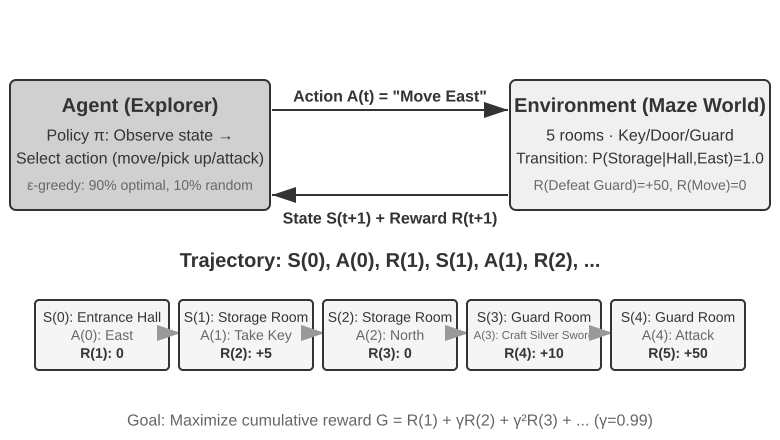

Quá trình tương tác này tạo ra một **trajectory**—bản ghi đầy đủ theo chuỗi "state → action → reward → new state → action → reward...". Chất lượng của một policy sau cùng sẽ được phản ánh qua chất lượng của các trajectory. Một **value function** sẽ trả lời cho câu hỏi: "Nếu hiện tại tôi đang ở state này và tiếp tục hành động theo policy hiện tại, thì tổng reward cuối cùng tôi tích lũy được sẽ là bao nhiêu?" Điều này tương tự như việc một kỳ thủ cờ vua giàu kinh nghiệm nhìn vào một thế cờ và có thể ước lượng trực giác tỷ lệ thắng mà không cần phải tính toán đến tận nước cuối cùng. (Khi "current policy" được thay thế bằng "optimal policy", chúng ta sẽ có được optimal value function; khái niệm này sẽ được sử dụng ở phần sau của chương khi thảo luận về Bellman optimality equation.) Ranh giới giữa Agent và environment tuân theo một nguyên lý đơn giản: **bất cứ thứ gì mà Agent không thể tùy ý thay đổi đều thuộc về environment.**

Có hai đặc trưng cốt lõi giúp phân biệt Reinforcement Learning với Supervised Learning (vốn yêu cầu labeled data với câu trả lời chính xác) và Unsupervised Learning (vốn khai phá các hidden pattern trong dữ liệu): **trial-and-error search** (Agent phải tự mình tìm ra action nào là tốt mà không có teacher trực tiếp cung cấp đáp án đúng) và **delayed reward** (hiệu quả của một action có thể chỉ bộc lộ sau rất nhiều step, ví dụ: giá trị của một nước cờ hay chỉ thực sự rõ ràng khi ván cờ kết thúc). Điều này cũng làm xuất hiện bài toán đánh đổi đặc thù **exploration-exploitation tradeoff**: nếu luôn đi theo những lối mòn quen thuộc thì sẽ không học thêm được điều gì mới; nhưng nếu liên tục thử nghiệm ngẫu nhiên thì sẽ không bao giờ đạt được mục tiêu.

Một hệ thống Reinforcement Learning bao gồm năm thành phần cốt lõi:

- **Action Space**: Xác định tập hợp tất cả các action khả dĩ mà Agent có thể thực hiện. Action có thể ở dạng discrete (ví dụ: "đi nước cờ nào" trong cờ vua, với số lượng lựa chọn hữu hạn) hoặc continuous (ví dụ: "xoay khớp bao nhiêu độ" đối với robot, một giá trị liên tục).
- **Policy**: Quy tắc hành vi của Agent, xác định hành động cần thực hiện trong một state nhất định. Một policy có thể đơn giản (một lookup table: ở state A, thực thi action X) hoặc phức tạp (một deep neural network).
- **Reward Signal**: Tín hiệu phản hồi tức thời từ environment. Tuy nhiên, mục tiêu của Agent là tối đa hóa reward dài hạn chứ không phải tức thời — sự khác biệt này mang tính sống còn, tương tự như việc đầu tư không nên đánh giá qua lời lỗ trong ngày mà phải dựa trên lợi nhuận dài hạn.
- **Value Function**: Ước lượng tổng cumulative reward có thể thu được từ một state nhất định trong tương lai, giúp Agent đưa ra các quyết định chuẩn xác ngay cả khi không có phản hồi tức thời. Một trong những insight quan trọng nhất sau sáu mươi năm nghiên cứu RL là vai trò trung tâm của việc ước lượng value (value estimation).
- **Environment Model** (tùy chọn): Dự đoán phản ứng của environment trước các action. Các phương pháp sử dụng một environment model được gọi là **model-based methods** (trước tiên học cách dự đoán environment biến đổi như thế nào, sau đó lên kế hoạch tương ứng); các phương pháp không sử dụng được gọi là **model-free methods** (không dự đoán environment mà học trực tiếp từ kinh nghiệm).

Bảng 8-3 so sánh các thành phần chính của nhiều hệ thống Agent khác nhau, làm nổi bật tính phổ quát của khái niệm Agent và giúp người đọc thấy rõ sự khác biệt về action space giữa các RL Agent truyền thống và LLM Agent hiện đại.

Bảng 8-3 So sánh các thành phần cốt lõi trong các hệ thống Agent khác nhau

| Agent Type | Environment | Action Space | Reward Signal |
|---|---|---|---|
| **Newborn Gazelle** | Địa hình, trọng lực, body posture | Continuous high-dimensional (co thắt nhóm cơ) | Giữ thăng bằng (+), Vấp ngã (-) |
| **Vacuum Robot** | Bố cục phòng, dung lượng pin | Discrete (hướng di chuyển, hút, sạc) | Diện tích đã làm sạch (+), Hết pin (-) |
| **Chess Grandmaster** | Board state, time limit | Discrete finite (các nước đi hợp lệ) | Thắng (+1), Thua (-1) |
| **Customer Service Agent** | Conversation history, knowledge base | Variable-length compositional (think, speak, API call) | Giải quyết được vấn đề (+), Thời gian xử lý (-) |
| **Code Assistant Agent** | Requirements document, codebase | Variable-length compositional (think, search, edit, execute) | Pass test (+), Gây ra bug (-) |

Bảng trên chỉ ra một điểm phân hóa quan trọng. Các môi trường board-game và Atari điển hình sử dụng các primitive action dạng discrete, hữu hạn và được định nghĩa trước; trong khi điều khiển robot lại sử dụng continuous action với số chiều cố định và các giới hạn vật lý. Ngược lại, các Customer Service Agent và Coding Agent hiện đại dựa trên LLM sẽ kết hợp các token hữu hạn cùng tool call thành các chuỗi action có độ dài biến thiên (variable-length action sequences), khiến toàn bộ không gian chuỗi khả dĩ rất khó liệt kê hết cùng một lúc. Chúng cũng có thể tận dụng cơ chế tư duy nội tại (internal thinking) để tối ưu hóa năng lực xử lý.

### Hai dạng Action Representation: Classic RL Settings và Variable-Length LLM Policies

Điểm khác biệt dễ thấy nhất giữa hai setting này nằm ở cách biểu diễn action (action representation). Bản thân một MDP có thể biểu diễn action space hữu hạn hoặc vô hạn, discrete hoặc continuous. Các môi trường tiêu biểu dạng board-game và Atari ở đây sử dụng các discrete primitive action hữu hạn, robot control dùng bounded continuous action, còn một LLM policy lại kết hợp một token vocabulary hữu hạn cùng các tool schema thành các sequence có độ dài biến thiên (variable-length sequences). Dạng compositional representation này tạo ra những ảnh hưởng sâu sắc đến algorithm design, sample efficiency, và generalization. Từng setting sẽ được thảo luận chi tiết dưới đây.

**Ví dụ nền tảng: MDP và Tabular Q-learning.**

MDP (Markov Decision Process) là framework toán học của reinforcement learning, định nghĩa các thành phần cốt lõi như state, action, và reward. Giả định cốt lõi của nó là **Markov property**: tương lai chỉ phụ thuộc vào state hiện tại—nơi phải chứa toàn bộ lịch sử (history) có liên quan đến quyết định đưa ra. Ví dụ trong cờ vua, state không chỉ bao gồm vị trí quân cờ (piece placement) mà còn cả lượt đi (side to move), quyền castling và en passant, cùng các thông tin cần thiết cho luật fifty-move và repetition. Khi có một định nghĩa state hoàn chỉnh (sufficient state definition), ta không cần phải đọc lại toàn bộ lịch sử ván cờ (game record) cho mỗi transition. Nếu một observation bỏ sót history cần thiết, history đó phải được bổ sung vào state hoặc xử lý bằng một partially observable model.

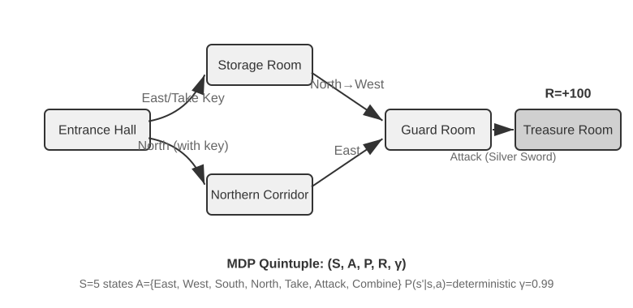

Các môi trường RL tiêu biểu trong phần này sử dụng **predefined action spaces**. 361 vị trí nước đi trong cờ vây (Go) tuy lớn nhưng hữu hạn; các action trong cờ vua vẫn có thể liệt kê (enumerate) được; và các game Atari thường chỉ expose từ vài đến hàng chục discrete primitive action. **Robotic Agents** sử dụng continuous action space nhưng có giới hạn (bounded): góc khớp (joint angle), vận tốc (velocity), và lực kẹp (grip force) là các giá trị liên tục, nhưng có physical bound rõ ràng và số chiều cố định dựa theo degrees of freedom của robot.

Các discrete action hữu hạn giúp việc đánh giá từng ứng viên (candidate) trở nên dễ dàng hơn. Nếu số lượng state và action đủ nhỏ, tabular Q-learning sẽ lưu trực tiếp giá trị của chúng; các state space lớn hơn như Atari và board-game kết hợp function approximation với search. Các continuous-action MDP không thể liệt kê từng action, do đó các phương pháp như policy gradients và actor-critic sẽ xấp xỉ policy và value function. Ví dụ kinh điển trong phần này cũng khác biệt so với một LLM policy vì nó bắt đầu quá trình trial-and-error learning mà không có bất kỳ pretrained knowledge nào.

Trong framework này, một trong những thuật toán cơ bản và quan trọng nhất là **Q-learning**. Nó duy trì một ước lượng giá trị (value estimate) cho mỗi cặp "state-action": nếu bạn thực hiện action *a* tại state *s* và sau đó hành động tối ưu (act optimally), tổng reward mà bạn có thể kỳ vọng nhận được là bao nhiêu? Về mặt trực giác, việc một action có tốt hay không phụ thuộc vào immediate reward mà nó mang lại, cộng với "state tiếp theo mà nó dẫn đến tốt tới mức nào".

Biểu diễn trực giác này dưới dạng một phương trình sẽ mang lại mối quan hệ đệ quy cốt lõi của **Bellman equation** nổi tiếng trong các giáo trình RL: **Giá trị thực sự của một action = immediate reward nhận được ở bước này + giá trị tương lai tối đa có thể đạt được từ state tiếp theo**:

$$Q^*(s, a) = r + \gamma \max_{a'} Q^*(s', a')$$

trong đó $r$ là immediate reward, $s'$ là state tiếp theo đạt được sau khi thực thi action (được viết dưới dạng deterministic để trực quan hóa; trong một môi trường stochastic, cần lấy kỳ vọng trên state tiếp theo $s'$), và $\gamma \in [0, 1)$ là **discount factor**—thông số này quyết định mức độ Agent coi trọng tương lai: $\gamma$ càng gần 1, Agent càng đánh giá cao long-term returns; càng gần 0, Agent càng tập trung vào giá trị trước mắt. "Cumulative reward" được nhắc lại nhiều lần ở phần trước chính là tổng các reward ở mỗi bước, được chiết khấu bởi $\gamma$: $\sum_{t} \gamma^{t} r_t$. Sau mỗi action, thuật toán sẽ điều chỉnh nhẹ ước lượng cũ hướng về "actually observed outcome"—paradigm "hiệu chỉnh ước lượng cũ bằng kết quả thực tế một bước" này được gọi là **Temporal-Difference Learning (TD learning)**. Sau hàng nghìn trials, ước lượng sẽ dần tiệm cận giá trị thực.

Hai hình dưới đây thể hiện quá trình exploration của Q-learning trong một grid world và sự hội tụ dần của các Q-value.

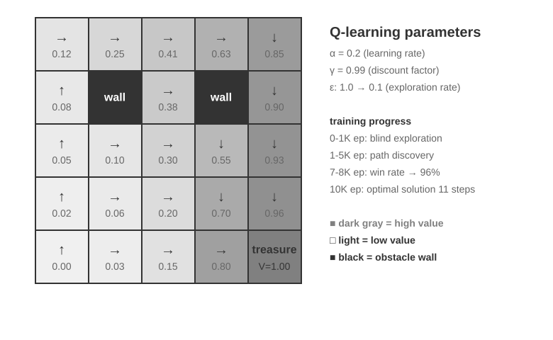

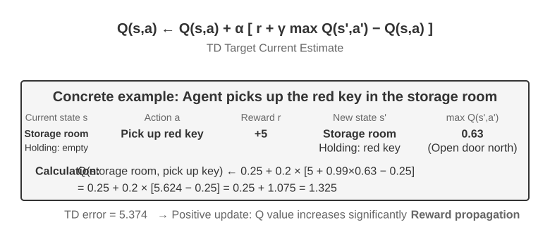

Q-learning là một phương pháp **off-policy**: nó có thể học một optimal policy từ dữ liệu được sinh ra bởi một exploratory policy khác với target policy. Nó vẫn đòi hỏi coverage đầy đủ trên các cặp state-action liên quan cũng như các điều kiện hội tụ và learning-rate thích hợp; nó không tự động hội tụ trên một data distribution tùy ý. Các định nghĩa chuẩn xác về phương pháp on-policy và off-policy, cũng như cách chúng ánh xạ sang LLM post-training, sẽ được thảo luận ở phần sau trong mục "RL Algorithms: From 16 Rollouts to One Parameter Update".

> **Experiment 8-1 ★: Q-learning Performance trong Treasure Hunt Game**
>
> Để kiểm chứng các đặc tính và giới hạn của Q-learning, chúng tôi thiết kế một **treasure hunt game environment**. Environment này bao gồm một số thách thức cốt lõi: **hidden mechanisms** yêu cầu Agent phải tự khám phá mối tương quan giữa key và door, weapon effect, cũng như item crafting rule; **multi-step dependencies** đồng nghĩa với việc hoàn thành task đòi hỏi một chuỗi action chính xác (optimal solution: 11 step); **sparse rewards** nghĩa là chỉ các key action và chiến thắng cuối cùng mới mang lại reward đáng kể, trong khi phần lớn các intermediate step đều không nhận được feedback.
>
> Q-learning Agent sử dụng standard parameter setting và exploration strategy dạng ε-greedy: thông thường nó sẽ chọn action tối ưu ở thời điểm hiện tại, nhưng đôi khi sẽ chọn ngẫu nhiên một action khác, với tỷ lệ random exploration giảm dần trong quá trình training.
>
> Learning curve thể hiện các đặc tính điển hình (một episode là một game hoàn chỉnh, tính từ lúc bắt đầu cho đến khi hoàn thành hoặc thất bại):
> - **1.000 episode đầu tiên**: 0% win rate, Q-table chỉ có 124 state, Agent đang explore hoàn toàn mù quáng
> - **5.000 episode đầu tiên**: Vẫn chưa có chiến thắng ổn định, Q-table có 133 state
> - **7.000–8.000 episode**: Win rate tăng dần từ 34% lên 96%
> - **10.000 episode**: 100% win rate, Q-table đạt 145 state, tìm ra 11-step optimal solution
>
> Toàn bộ quá trình training chỉ mất chưa đầy 10 giây (simulation có hiệu suất rất cao), nhưng đòi hỏi gần 10.000 lượt thử nghiệm hoàn chỉnh. Điều này minh họa rõ hành vi của setup prior-free, ε-greedy tabular Q-learning được sử dụng trong thực nghiệm: nó cần một lượng lớn random exploration để tình cờ đi hết lộ trình, và value signal lan truyền đủ chậm để đòi hỏi quá trình reinforcement lặp đi lặp lại.
>
> Trong một game simulator, 10.000 trial chỉ mất 10 giây, một mức cost không đáng kể. Nhưng trong các kịch bản Agent thực tế—nơi mỗi cuộc gọi đều phát sinh cost, mỗi browser operation đều có delay, và mỗi quyết định sai lầm đều có thể dẫn đến hậu quả không thể đảo ngược—10.000 trial là điều hoàn toàn bất khả thi. Một trong những lý do để sử dụng pretrained LLM policy là lượng tri thức tích lũy sẵn có thể hỗ trợ đưa ra decision hiệu quả với số lượng environmental interaction ít hơn rất nhiều.
>
> Thực nghiệm **prior-free tabular Q-learning** này bộc lộ ba giới hạn: ngay cả một task đơn giản cũng cần lượng tương tác rất lớn, value học được trong một environment không thể transfer trực tiếp sang environment khác, và mỗi task mới đều phải tiến hành explore lại từ đầu. Đây không phải là giới hạn của bản thân MDP framework. Function approximation, transfer learning và model-based RL có thể xử lý các state phức tạp hơn cũng như hỗ trợ knowledge transfer, dù chúng vẫn có thể đòi hỏi lượng environmental interaction đáng kể khi so sánh với một pretrained LLM.

**Agent Dựa Trên Pretrained LLM Policy.**

Các Large Language Model (LLM) đã mang lại một thay đổi thực tiễn quan trọng đối với cách biểu diễn và khởi tạo các Agent action.

Classic RL cũng có thể mô hình hóa internal computation hoặc việc thu thập thông tin dưới dạng các state và action. Thay đổi mang tính thực tế mà LLM tạo ra không phải là việc biến "suy nghĩ" thành khả thi lần đầu tiên, mà là một pretrained language policy có thể biểu diễn internal computation dưới dạng các chuỗi token có độ dài biến thiên (variable-length token sequences) và sinh ra nó ngay trong cùng một policy với các external action. Các thinking token không trực tiếp làm thay đổi thế giới bên ngoài, nhưng chúng có thể cải thiện action cuối cùng. Action representation giờ đây không chỉ bao gồm "làm cái gì", mà còn cả "suy nghĩ trong bao lâu và suy nghĩ về điều gì".

Đột phá thực tiễn quan trọng nhất là việc tích hợp **các thinking token như những action đặc biệt trong policy output space**. Các môi trường RL truyền thống tiêu biểu thường tập trung vào các primitive action như di chuyển, tấn công hoặc nhặt vật phẩm, dù rằng internal computation cũng có thể được mô hình hóa trong một MDP hoặc hierarchical policy. Trong các LLM Agent, **internal thinking trở thành một phần cốt lõi của learned language action space**. Nó không trực tiếp làm thay đổi môi trường bên ngoài hay nhận về environmental reward tức thì, nhưng có thể biểu đạt nhiều computational path khác nhau trong giới hạn token cost và context limit cho phép.

Các variable-length compositional action tạo ra một search space lớn hơn rất nhiều so với primitive action, khiến chúng rất khó học from scratch nếu thiếu prior knowledge. Một Agent học from scratch chẳng khác nào bị bịt mắt đi tìm kho báu giữa sa mạc. Thay vào đó, LLM học các pattern giải quyết vấn đề của con người từ quá trình pre-training trên tập văn bản khổng lồ: các lời giải toán học thường tuân theo luồng "xác định điều kiện → nhớ lại công thức → tính toán từng bước", trong khi lập trình đi theo luồng "hiểu yêu cầu → thiết kế cấu trúc → triển khai chi tiết". Pretrained policy gán cho các luồng có cấu trúc này một prior probability cao hơn, qua đó nén đáng kể search space. Vì vậy, ngay cả khi không có thêm RL, một pretrained LLM vẫn có thể sinh ra Chain of Thought (CoT) logic cơ bản, vốn được học thông qua next-token prediction trên các lời giải toán, comment trong code, thảo luận và những reasoning trace khác do con người viết ra.

Sau đó, RL post-training sẽ sử dụng các external reward để huấn luyện LLM áp dụng các pattern này hiệu quả hơn vào một task cụ thể. Cấu trúc ngôn ngữ không phải là một "internal reward" tách biệt; nó đóng vai trò như một **prior distribution** bên trong pretrained policy. Một pattern xuất hiện nhất quán trong training data, chẳng hạn như "chúng ta cần đổi ngoại tệ, vì vậy bước đầu tiên là tra cứu tỷ giá", có thể bắt đầu với generation probability cao hơn hẳn so với một nhánh không liên quan như kiểm tra thời tiết. RL sẽ tận dụng task reward thực tế để tái định hình xác suất của các path xuất phát từ distribution ban đầu đó.

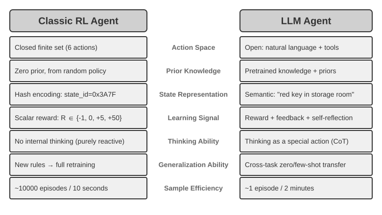

Pretrained language policy cho phép LLM Agent hiểu được các instruction chưa từng gặp (zero-shot generalization) và thích ứng với các task mới chỉ từ một vài demonstration (few-shot adaptation), tạo nên sự tương phản rõ rệt với thiết lập tabular Q-learning không có prior (prior-free) ở trên.

Việc mở rộng từ các primitive action được định nghĩa trước (predefined) sang các compositional action có độ dài biến thiên (variable-length) là một bước chuyển dịch quan trọng trong AI Agent paradigm. Các action của LLM về bản chất vẫn được định nghĩa bởi một token vocabulary hữu hạn cùng các tool schema, nhưng internal thinking, natural-language query, code chương trình, JSON phức tạp và nội dung multimodal kết hợp lại tạo thành một số lượng bùng nổ các sequence có độ dài biến thiên. Code interpreter và các search tool kết nối representation đó với một phạm vi rộng lớn các task và thông tin trong thế giới thực. Điều này mở ra cả cơ hội lẫn thách thức: Agent có thể kết hợp các tool cơ bản để xử lý những task chưa từng gặp, nhưng reward design và exploration hiệu quả buộc phải vận hành trên một compositional space khổng lồ.

Các model như Kimi K3, vốn được tối ưu hóa cho tool use và long-chain reasoning, minh họa cho định hướng điển hình của LLM+RL paradigm: pre-training ngôn ngữ quy mô lớn đóng vai trò nền tảng, còn post-training giúp tăng cường khả năng phân rã bài toán (problem decomposition), tool use và self-correction. **OpenVLA**[^ch8-21] (được trình bày chi tiết ở Chương 6) thể hiện architecture paradigm của VLA (Vision-Language-Action) trong kỷ nguyên LLM: một vision encoder xử lý các observation từ environment, một language model hiểu instruction và thực hiện reasoning, còn action decoder sẽ sinh ra các control signal, từ đó hiện thực hóa khả năng language-conditioned control và cross-task generalization. Cần làm rõ rằng, bản thân OpenVLA được train thông qua imitation learning trên gần một triệu **demonstration trajectories** của robot, do đó về bản chất nó là SFT chứ không phải RL. SimpleVLA-RL, được giới thiệu trong Experiment 8-13 ở phần sau của chương này, là ví dụ tiêu biểu cho việc đưa RL vào robotics bằng cách sử dụng reward để tối ưu hóa sâu hơn kiến trúc VLA này.

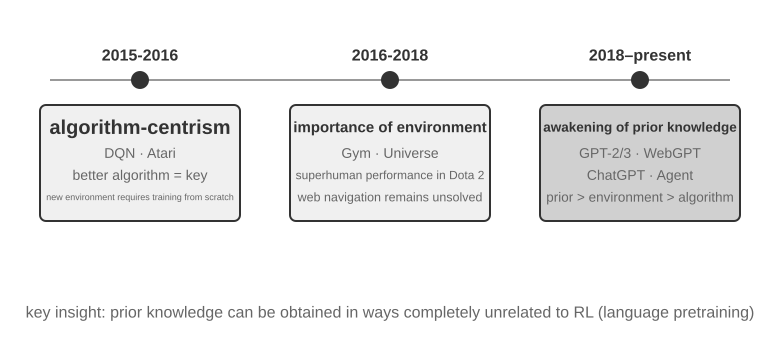

**OpenAI's Exploration Path** (được ghi chép bởi Shunyu Yao, Trợ lý Giáo sư tại Đại học Princeton và là tác giả của paper ReAct, trong "The Second Half"[^ch8-2]) phác họa sự tiến hóa trong tư duy của toàn bộ lĩnh vực này. **Phase 1 (2015-2016), Algorithm-Centric:** Niềm tin chủ đạo lúc bấy giờ là thuật toán tốt hơn chính là chìa khóa. Các bước tiến đã đạt được trong những environment tiêu chuẩn như Atari, nhưng mỗi environment mới đều đòi hỏi phải retrain lại từ đầu (from scratch). **Phase 2 (2016-2018), The Importance of Environment:** Gym chuẩn hóa hàng loạt task; Universe và World of Bits cố gắng biến toàn bộ internet thành một RL training environment; còn Dota 2 theo đuổi superhuman performance trong một environment phức tạp cụ thể. Ý tưởng rất rõ ràng, nhưng khả năng general computer use và web navigation vẫn nằm ngoài tầm với.

**Phase 3 (2018-present), Awakening of Priors:** GPT-2/GPT-3 đã chứng minh sức mạnh của language pre-training; WebGPT và ChatGPT chứng minh các prior đó có thể được chuyển hóa thành những Agent ứng dụng thực tế. Khám phá quan trọng nhất: **các prior có thể được thu nhận theo những cách hoàn toàn không liên quan đến RL**. Đây là một sự thật phản trực giác—trong suốt nhiều thập kỷ, các nhà nghiên cứu RL có thể đã đảo ngược hoàn toàn thứ tự ưu tiên. Trật tự thực tế không phải là algorithm > environment > prior, mà là prior > environment > algorithm.

> **Experiment 8-2 ★★: Comparative Study of Traditional RL and LLM Agent**
>
>
> 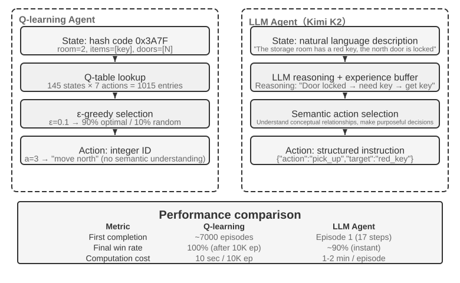
>
>
> Chúng tôi đã so sánh Q-learning với một LLM Agent—Kimi K3, duy trì một buffer lên đến 50 experiences—trong cùng một treasure hunt game. Kết quả thật đáng kinh ngạc: **LLM Agent đã hoàn thành game chỉ trong 18 steps ngay lần thử đầu tiên**.
>
> **Early Stage (Purposeful Exploration)**: Nhặt một thanh kiếm gỉ ("Vũ khí thì tốt hơn tay không"), khám phá bản đồ một cách có hệ thống, suy luận "cần tìm chìa khóa" sau khi thấy cổng phía bắc bị khóa, khám phá phòng kho, lấy được chìa khóa đỏ và magic crystal. **Middle Stage (Mechanism Understanding and Proactive Synthesis)**: Hiểu được quy tắc "key auto-use" và lường trước rằng thanh kiếm gỉ không đủ sức đối phó với tên lính gác, chủ động synthesize một thanh kiếm bạc ở step 8. **Late Stage (Execution and Error Correction)**: Tiến về phía bắc cùng thanh kiếm bạc và đánh bại tên lính gác mạnh mẽ ở step 13. Trên đường đi, Agent thực hiện một hoặc hai lượt thử không hiệu quả—như liên tục vung kiếm hoặc đi lùi lại (backtracking)—và cuối cùng giành được kho báu của rồng ở step 18.
>
> Điều này chứng minh sự khác biệt căn bản giữa semantic understanding và symbolic mapping. LLM Agent thấu hiểu được conceptual structure của game; mỗi step đều có mục đích và điểm tựa logic rõ ràng. Đối với Q-learning, "door", "key" và "sword" chỉ là những tổ hợp ký hiệu vô nghĩa, và nó chỉ có thể khám phá mối quan hệ giữa chúng một cách chậm chạp thông qua quá trình statistical learning trên quy mô lớn.
>
> Computational cost mang lại một nghịch lý thú vị: Q-learning chạy 10.000 games trong 10 giây, trong khi LLM Agent mất 1–2 phút cho mỗi game. Tuy nhiên, trong các task thực tế ngoài đời thực, chi phí về thời gian, tiền bạc và rủi ro trên mỗi interaction vượt xa computational cost thuần túy, do đó việc chỉ đánh giá dựa trên GPU time là không thỏa đáng. Một insight quan trọng hơn là: Thành công của LLM Agent không phải nhờ sở hữu một "learning algorithm" tốt hơn, mà vì nó mang theo khối lượng prior knowledge khổng lồ. Khi game rules thay đổi, Q-learning buộc phải retraining lại toàn bộ, trong khi LLM Agent có thể thích ứng trực tiếp thông qua reasoning. Điều này dẫn đến một design principle thực tế: Traditional RL vẫn giữ nguyên giá trị trong các kịch bản có simulation cost thấp và độ lặp lại cao; còn trong các kịch bản thực tế với chi phí interaction cao cùng nhu cầu thích ứng nhanh, sample efficiency của LLM Agent mang lại giá trị thực tiễn vượt trội hơn nhiều.

Chương 1 đã cung cấp một conceptual map về cách contextual adaptation, việc cập nhật external artifacts và cập nhật parameter phối hợp hoạt động cùng nhau; phần “Post-Training Practical Takeaways” ở cuối chương này sẽ quay trở lại chủ đề đó. Mạch nội dung chính của chương này là post-training: ghi trực tiếp vào model parameters những năng lực không thể biểu đạt trọn vẹn thông qua các external rules.

## Model Pre-training Basics `[Optional Reading]`

Để hiểu được tại sao các kỹ thuật post-training lại hiệu quả, trước hết cần nắm rõ những gì mà pre-training đã thiết lập. Về bản chất, post-training (SFT và RL) chỉ tối ưu hóa bên trong representation space do pre-training tạo dựng—cấu trúc tri thức được định hình từ pre-training sẽ quyết định ceiling (mức trần năng lực) của post-training. Do đó, chúng ta sẽ xem xét các khía cạnh cốt lõi của pre-training thông qua hai thực nghiệm: huấn luyện một language model quy mô nhỏ from scratch và mở rộng visual capabilities. Hai thực nghiệm trong phần này mang tính bổ trợ, nhằm xây dựng trực giác trực quan về pre-training—tức quá trình initial training trên quy mô dữ liệu lớn (large-scale data) giúp model nắm bắt các pattern ngôn ngữ cơ bản cùng world knowledge. Thực nghiệm 8-5, vốn đảm nhận việc inject tri thức ngôn ngữ mới vào một base model sẵn có, sẽ được trình bày riêng trong phần Mid-training tiếp theo.

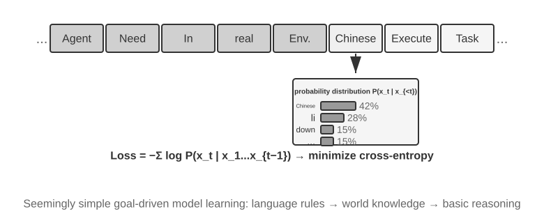

Quy trình training một language model thường tuân theo pipeline: "tokenization — pre-training (kèm Mid-training khi cần thiết) — post-training". Tokenization phân tách văn bản thành các đơn vị rời rạc. Ví dụ, câu "I like programming" có thể được tokenize thành "I", "like", "program", "ming". Các token này là đơn vị văn bản nhỏ nhất mà model xử lý. Về mặt khái niệm, bài toán pre-training rất đơn giản: đưa cho model phần đầu của một đoạn text và yêu cầu nó dự đoán next token. Bằng cách so sánh dự đoán với kết quả thực tế (chênh lệch này gọi là loss; loss càng nhỏ đồng nghĩa với dự đoán càng chính xác), model liên tục cập nhật các parameter của mình. Sau quá trình training lặp đi lặp lại trên khối lượng dữ liệu khổng lồ (massive text data), model sẽ dần học được các quy luật ngôn ngữ, world knowledge và năng lực reasoning cơ bản. Kết thúc giai đoạn pre-training, model đã có thể generate văn bản trôi chảy, nhưng output vẫn thiếu cấu trúc rõ ràng và rất khó follow instruction. Khi đó, post-training sẽ chuyển hóa model thành một trợ lý thực thụ thông qua SFT (huấn luyện trên các cặp input-output đã được gán nhãn) và preference optimization (chẳng hạn như DPO, giúp định hướng model generate các phản hồi phù hợp với kỳ vọng của con người).

> **Experiment 8-3 ★★: Training an LLM from Scratch—The Power of Algorithm Improvement**
>
> Sử dụng MiniMind 2, một model 100 triệu tham số (100-million-parameter model), làm case study, thực nghiệm đã hoàn tất toàn bộ quy trình training trực tiếp trên consumer-grade GPU. Hai kỹ thuật tối ưu hóa thuật toán—QK Norm và Muon optimizer—đã tăng gấp ba lần convergence speed và cải thiện đáng kể generation quality với chi phí cực thấp: chỉ mất khoảng 14 giờ training và tổng cộng 34 USD.
>
> Hiệu quả ở từng giai đoạn training: Sau pre-training, model đã có thể trả lời các câu hỏi dạng factual như "What is the highest mountain in the world?", nhưng format đầu ra chưa chuẩn hóa; sau SFT, khả năng instruction following và format output được nâng cấp rõ rệt, cho phép model tổ chức câu trả lời đúng theo kỳ vọng; preference optimization tiếp tục giảm thiểu các lỗi sai factual và các cách diễn đạt thiếu tự nhiên. Dù model 100M parameter vẫn còn những giới hạn cố hữu (dễ gặp lỗi ở các bài toán phức tạp), bài học cốt lõi rút ra là: **Với mức ngân sách cố định và khiêm tốn, việc cải tiến thuật toán mang lại ROI cao hơn nhiều so với việc chỉ đơn thuần scaling up kích thước model**.

> **Experiment 8-4 ★★: Tự train một VLM cho riêng bạn**
>
>
> 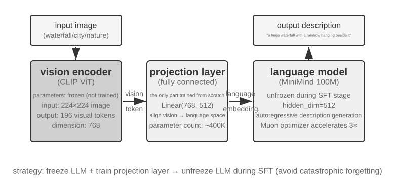
>
>
> Các VLM hợp nhất visual perception và language understanding trong một model duy nhất. Thách thức cốt lõi là cross-modal alignment — làm cho "những gì nhìn thấy" tương ứng với "những gì được diễn đạt". Kiến trúc này bao gồm ba thành phần: một **Vision Encoder** (ví dụ: CLIP, parameters frozen) trích xuất semantic features từ hình ảnh; một **Projection Layer** (lightweight, phần duy nhất được train from scratch) đóng vai trò như một "phiên dịch viên" giữa visual features và language model, ánh xạ các visual features vào một representation space mà language model có thể hiểu được; và một **Language Model** dùng để sinh ra descriptive text. Quá trình training áp dụng chiến lược "freeze LLM + train only projection layer" để tránh catastrophic forgetting (quên các kỹ năng cũ sau khi học các kỹ năng mới); sau giai đoạn alignment pre-training, LLM sẽ được unfreeze và thực hiện SFT trên các cặp image-description chất lượng cao, giúp cải thiện đáng kể độ chi tiết và độ chính xác của các mô tả.
>
> Thực nghiệm này làm sáng tỏ một paradigm cơ bản trong multimodal model training: tái sử dụng kết quả của unimodal pre-training và đạt được cross-modal alignment bằng cách train một projection layer lightweight — phương pháp này vừa hiệu quả vừa có khả năng scale, nhưng khả năng biểu đạt (expressiveness) hạn chế của projection layer có thể trở thành bottleneck cho việc thấu hiểu cross-modal ở mức độ sâu. Mở rộng cùng kiến trúc "vision encoder + projection layer + LLM" thêm một bước nữa bằng cách để model output ra các action, chúng ta sẽ thu được model VLA (Vision-Language-Action) được trình bày chi tiết trong Chương 6.

Tổng hợp lại, cả hai thực nghiệm pre-training đều chỉ ra một pattern: trong điều kiện ngân sách hạn chế, các cải tiến về mặt algorithm và architecture thường mang lại giá trị cao hơn so với việc chỉ đơn thuần tăng scale. Quan trọng hơn, pre-training cung cấp descriptive knowledge và năng lực language-modeling, nhưng lại không mang lại khả năng structured instruction following hay hành vi mang tính task-oriented. Tuy nhiên, SFT và RL không thể giải quyết được một target language hoặc domain mà general pre-training chưa từng bao phủ. Đó chính là khoảng trống mà Mid-training xử lý.

## Mid-training: Lấp đầy khoảng trống về Knowledge và Foundational Capability

Trong chương này, **Mid-training** đồng nghĩa với việc lấy một base model hiện có và tiếp tục language-model training trên một target data distribution cụ thể. Quá trình này thường giữ nguyên next-token objective của pre-training và tính loss trên từng token trong một document, code sample, hoặc chuỗi derivation. Nghiên cứu kinh điển về DAPT/TAPT chỉ ra rằng một giai đoạn pre-training thứ hai trên các unlabeled corpora liên quan đến domain hoặc task có thể tiếp tục cải thiện downstream performance[^ch8-30]. Tiền tố "Mid" mô tả vị trí của nó trong capability-development pipeline; data format và loss của nó vẫn giữ nguyên như giai đoạn pre-training.

Mid-training chủ yếu giải quyết hai loại khoảng trống:

- **Knowledge gaps**: General pre-training không bao phủ đầy đủ target language, tài chính, y tế, luật pháp, tài liệu nội bộ doanh nghiệp, hoặc một nhóm codebase đặc thù, khiến model thậm chí không thể hiểu được các concept và terminology.
- **Foundational capability gaps**: Target task đòi hỏi long-context, coding, mathematical-derivation, hoặc multimodal representations mà base model chưa từng hình thành. Vấn đề không chỉ đơn thuần nằm ở response format: ngay cả khi lấy nhiều sample, model gần như không bao giờ chạm tới được một lời giải chính xác.

Điều này cũng giải thích vì sao không nên xem SFT là phương thức chính cho việc knowledge injection. SFT có thể ghi nhớ một lượng nhỏ facts và thường được triển khai sau Mid-training để dạy model cách trả lời các câu hỏi trong domain. Tuy nhiên, một QA dataset nhỏ chỉ bao phủ được một tập hợp giới hạn các cách diễn đạt (phrasings); nó phát huy hiệu quả tốt hơn trong việc train cách truy xuất và diễn đạt knowledge thay vì dung nạp cả một khối lượng raw knowledge đồ sộ có tính liên kết chặt chẽ. Ngược lại, việc giảm language-model loss trên domain text cũng không đảm bảo model sẽ retrieve được knowledge đó khi nhận được câu hỏi. Các nghiên cứu đã chỉ ra rằng thứ tự và cách tổ chức của continued pre-training cùng instruction tuning ảnh hưởng trực tiếp đến việc liệu knowledge có thể được truy xuất dưới dạng QA hay không[^ch8-31]. Một công thức (recipe) vững chắc thường là: **Mid-training hấp thụ knowledge và capabilities → small-scale SFT thiết lập các access và output protocols → bổ sung RL nếu cần khi tỷ lệ thành công đã khác 0 (nonzero)**.

### Xây dựng Mid-training Data

1. **Suy luận nhu cầu data từ failure distribution.** Phân tách (slice) các evaluation theo topic, language, document type, code pattern và context length. Xác định rõ những case có `pass@k` thấp bắt nguồn từ base-model gap; chỉ bổ sung data cho các thiếu hụt về knowledge và capability, tránh chẩn đoán sai các lỗi output-format thành thiếu hụt knowledge.

2. **Xây dựng target corpora mật độ cao.** Raw documents giúp thiết lập terminology và các factual association; các repository định hình structure và dependency; các diễn giải dạng textbook-style derivation, synthetic explanation cùng những sample liên kết cross-document sẽ làm rõ các mối quan hệ tiềm ẩn (implicit relationships). Thực hiện deduplicate, lọc chất lượng (filter for quality) và kiểm soát chặt chẽ nguy cơ evaluation-set contamination.

3. **Mix data theo từng capability.** Data mixture cần có natural long text như sách, long document và code repository; chain-of-thought data đại diện cho các atomic long-text capability cốt lõi—bao gồm long-text retrieval, multi-hop reasoning, instruction following, information aggregation và statistics; cùng với các Agent execution trajectory thể hiện những capability bắt buộc của một Agent—như planning, tool selection and invocation, long-range state tracking và recovery from errors. Phần data về chain-of-thought và Agent trajectory có thể được distill từ một open-source model mạnh hơn hoặc trích xuất từ các dataset sẵn có.

4. **Sử dụng hai hình thức replay ở mọi stage.** Hình thức thứ nhất là short text và general data nguyên bản, nhằm bảo toàn language, knowledge và short-context capability. Hình thức thứ hai là "nâng các task cũ lên độ dài mới" (old tasks lifted to the new length): đưa các short task mà model vốn đã xử lý tốt vào một context có độ dài mục tiêu hiện tại, rải thông tin liên quan (relevant information) và các distractor ở nhiều vị trí khác nhau, sau đó kiểm tra xem capability đó có còn được duy trì ổn định trong context window rộng hơn hay không. Nguồn general data lý tưởng nhất là lấy từ chính pre-training set ban đầu của base model; nếu không có sẵn, có thể thay thế bằng một open pre-training corpus như FineWeb-2.

5. **Quyết định thời điểm dừng bằng multidimensional gates.** Bên cạnh training loss, hãy theo dõi `pass@1`/`pass@k` trên các held-out domain task, general capability, prior instruction following và target task. Nếu các domain metric tăng nhưng general retention set bị suy giảm, điều đó cho thấy data mixture hoặc learning rate đang được thiết lập quá gắt (aggressive); nếu loss giảm nhưng `pass@k` dậm chân tại chỗ, cần kiểm tra lại xem data đã thực sự bao phủ capability cần thiết hay chưa, và liệu có đang thiếu bước SFT ở downstream để giúp model khai thác lượng knowledge này hay không.

Sau Mid-training, các bộ evaluation set như LongBench v2, IFEval, cùng những end-to-end Agent benchmark được trình bày ở Chương 7 là cực kỳ cần thiết để kiểm chứng xem **năng lực long-context nền tảng của model trên các context length khác nhau** có bị suy giảm hay không. Năng lực long-context chính là bệ phóng cho long Chain-of-Thought và instruction following, và những yếu tố này lại là tiền đề cho các năng lực Agent bậc cao hơn như tool calling.

- **Position and retrieval**: trích xuất single-needle và multi-needle, định vị thông tin quan trọng ở các vị trí khác nhau, và retrieval chính xác dưới tác động của các distractor;
- **Relations and reasoning**: theo vết quan hệ cross-paragraph, cross-document và multi-hop, xử lý mâu thuẫn (contradiction resolution), cùng khả năng tổng hợp bằng chứng (evidence composition);
- **Aggregation and statistics**: đếm (counting), gom nhóm (grouping), sắp xếp (sorting), so sánh (comparison), tóm tắt xu hướng, và aggregation trên các table hoặc log có độ dài lớn;
- **Instruction following**: tuân thủ các instruction phức tạp, bao gồm việc xử lý đồng thời nhiều instruction, giải quyết xung đột chỉ thị, bám sát thinking procedure được chỉ định, và đảm bảo output-format compliance;
- **Long-chain thinking**: giải quyết các bài toán hóc búa về toán học, logical-reasoning, và code-generation;
- **Agent primitives**: phân rã task cơ bản (task decomposition), planning, tool selection, xây dựng argument, state memory, và khả năng phục hồi sau lỗi (recovery from failure).

Nếu dữ liệu thực tế (facts) biến động liên tục hoặc bắt buộc phải trích dẫn nguồn gốc chính xác, RAG vẫn là giải pháp vượt trội hơn so với việc nạp thẳng chúng vào weights. Mid-training phù hợp hơn cho domain knowledge quy mô lớn, ổn định và các năng lực đòi hỏi internal representation sâu bên trong mạng. Việc triển khai full-parameter Mid-training trên một model kích thước lớn tốn kém chi phí hơn rất nhiều và tiềm ẩn nguy cơ catastrophic forgetting cao hơn so với SFT quy mô nhỏ; do đó, hãy luôn validate data mixture qua một đợt pilot thử nghiệm trước khi scale training budget.

> **Experiment 8-5 ★★: Continued Pre-training để học một ngôn ngữ mới**
>
> Sử dụng Mistral 7B v0.3 làm base model—vốn chủ yếu được pre-trained trên tiếng Anh và gần như không có khả năng hiểu tiếng Hàn—thí nghiệm này bổ sung năng lực tiếng Hàn cho model thông qua continued language-model training trên tập dữ liệu Korean Wikipedia. Bản thân model đã sở hữu sẵn general representation vững chắc và chỉ cần adapt với một data distribution mới, giúp chi phí tối ưu hơn rất nhiều so với việc training from scratch. Thí nghiệm phân bổ tỷ lệ khoảng 80% tiếng Hàn và 20% tiếng Anh nhằm giảm thiểu catastrophic forgetting; tỷ lệ này thuần túy là một lựa chọn thực nghiệm, không phải là thiết lập mặc định cho mọi bài toán. Tiếp theo, tập dữ liệu Korean instruction được đưa vào SFT để model đạt được khả năng đàm thoại thực tế. Sự phân định trách nhiệm ở đây rất rành mạch: Mid-training trước tiên trang bị tri thức và nền tảng ngôn ngữ tiếng Hàn, sau đó SFT sẽ huấn luyện model cách tiếp nhận instruction và tổ chức câu trả lời bằng tiếng Hàn.
>
> Thí nghiệm cũng chỉ rõ rủi ro catastrophic forgetting mà continued pre-training có thể gây ra: điểm blind rating của tiếng Hàn tăng rõ rệt ở chặng cuối, nhưng đổi lại năng lực tiếng Anh lại suy giảm. Continued pre-training có thể ghi đè target distribution vào parameter của model, nhưng nó không thể loại bỏ nhu cầu thiết lập retention set, factual evaluation, cũng như việc audit chất lượng dữ liệu.

Một khi model đã tích lũy đủ tri thức và năng lực nền tảng, bước kế tiếp là biến nó thành một Agent thực chiến, vận hành chuẩn xác theo một protocol định sẵn.

## SFT (Supervised Fine-Tuning)

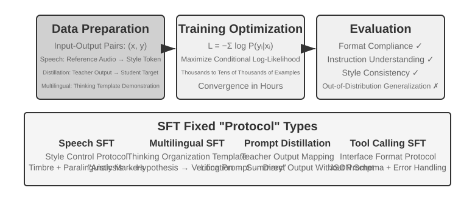

Phần "From Pre-training to RL: An Overview of the Four Training Stages" đã giải thích bản chất của SFT ("predict the next token" với tập data khác biệt và loss chỉ được tính toán trên response). Phần này sử dụng bốn thực nghiệm để làm rõ cơ chế này—ghi trực tiếp các mapping và protocol ổn định vào parameters—được củng cố vững chắc (solidify) như thế nào qua các task khác nhau. Giá trị cốt lõi của SFT không nằm ở việc nạp thêm tri thức mới mà là **solidifying protocols**: ghi các mapping, interaction format và quy chuẩn style vào parameters để model có thể sinh ra output chuẩn chỉnh tại inference time mà không cần prompt dài dòng. Thông thường, chỉ cần vài nghìn đến vài chục nghìn example chất lượng cao là đủ để thiết lập khả năng hội thoại cơ bản và instruction following.

Hiệu quả này có thể đi kèm với sự phụ thuộc vào training distribution. Trong các task đòi hỏi phải khám phá nhiều chiến lược đúng đắn khác nhau, hoặc khi môi trường deployment bị lệch (shift) so với các demonstration, SFT có xu hướng tái hiện lại các pattern đã được thể hiện và bị sụt giảm performance trong các tình huống mới. Các thực nghiệm dưới đây sẽ phân tích quá trình "solidifying protocols" từ nhiều góc độ khác nhau; chúng không nhằm đưa ra một bảng xếp hạng tuyệt đối giữa SFT và RL.

Trước khi bắt tay vào triển khai SFT, có một câu hỏi thực tế không thể bỏ qua: **SFT data đến từ đâu?** Lời giải của ngành công nghiệp tựu trung lại qua ba con đường:

- **Human expert demonstrations**—trần chất lượng cao nhất, nhưng đắt đỏ và chậm chạp; phù hợp nhất để dùng làm "seed data" nhằm định hình format và style;
- **Teacher-model generation**—tức synthetic data: dùng một model mạnh để sinh hàng loạt các cặp "input-output", lọc chúng và distill vào student model; xem Thực nghiệm 8-8 và 8-9;
- **Rejection sampling**—chính model sẽ tự sample nhiều candidate cho cùng một vấn đề, một verifier sẽ chọn ra các candidate chính xác, và model sẽ train trên tập dữ liệu đó; xem Thực nghiệm 8-9.

Ba hướng tiếp cận này thường được kết hợp với nhau. Dù đi theo con đường nào, construction pipeline về cơ bản đều tương tự: đầu tiên xác định task distribution và output schema, sau đó generate hàng loạt candidate, tiếp tục lọc chất lượng bằng rule-based validation, format check và human spot check, cuối cùng là deduplicate, cân bằng data mixture và đảm bảo tính diversity. Không cần thiết phải chạy đua theo số lượng—vài nghìn đến vài chục nghìn sample chất lượng cao thường là đã đủ để định hình vững chắc output format. Thay vì nhồi nhét một trăm nghìn sample bẩn, hãy tinh chỉnh mười nghìn sample sạch: từng chút noise trong data đều có thể bị SFT ghi lại một cách trung thực vào parameters.

> **Experiment 8-6 ★★★: Voice SFT—Từ "Voice Cloning" đến "Paralinguistic Modeling" `[Extended Experiment]`**
>
> Lấy Orpheus (contextual-prompt voice cloning) và Sesame (paralinguistic token modeling) làm case study, experiment này chỉ ra cách "voice style và expression habits" được ghi vào parameters. Hai hệ thống này đi theo hai hướng tiếp cận khác nhau:
>
> - **Orpheus**: Nén voice waveform thành một chuỗi token. Bằng cách concatenate reference audio từ cùng một speaker, model học cách "nói bằng giọng của người này", đạt được cross-sentence timbre consistency.
> - **Sesame**: Trừu tượng hóa các hiện tượng paralinguistic như tiếng cười và tiếng thở dài thành các special token như `<laugh>`, `<sigh>`. Model học cách "phát ra âm thanh tương ứng khi nhìn thấy token".
>
> Trong các expressive task, SFT cố định hóa các style control protocol và structured expression habits, chứ không phải factual knowledge hay complex reasoning. Yếu tố then chốt nằm ở tính đa dạng và annotation quality của training data. Các failure mode phổ biến bao gồm: quá ít speaker trong training data khiến mọi giọng đọc nghe đều giống nhau, và token overfitting (khi model ghi nhớ chi tiết của training sample và hoạt động kém đi trong các ngữ cảnh mới), dẫn đến hiện tượng "tiếng cười máy móc" (mechanical laughter).
>
> **Experiment 8-7 ★★★: Multilingual Thinking—Cho phép Model suy nghĩ bằng bất kỳ ngôn ngữ nào `[Extended Experiment]`**
>
> Phần lớn các thinking model chỉ "suy nghĩ" bằng tiếng Anh: bất kể bạn dùng ngôn ngữ nào để đặt câu hỏi, chain of thought nội bộ của model hầu như luôn bằng tiếng Anh, nguyên nhân là vì các thinking demonstration chất lượng cao trong training data chủ yếu được viết bằng tiếng Anh. Mục tiêu của experiment này rất đơn giản—cho phép model suy nghĩ bằng một ngôn ngữ được chỉ định.
>
> Phương pháp tiếp cận là thực hiện SFT trên gpt-oss-20b: thêm một dòng `reasoning language: German` (hoặc một ngôn ngữ khác) vào system instruction, sau đó train với các reasoning example bằng tiếng Anh, tiếng Tây Ban Nha, tiếng Pháp, v.v. Training data **hoàn toàn không chứa tiếng Trung**, nhưng sau khi train, chỉ cần thiết lập reasoning language sang tiếng Trung là model đã có thể thực hiện chain-of-thought reasoning hoàn chỉnh bằng tiếng Trung—khả năng zero-shot cross-lingual generalization này chính là phát hiện thú vị nhất của experiment. Lưu ý rằng đây không phải là generalization capability của bản thân SFT. Multilingual pre-training vốn đã thiết lập sẵn một cross-lingual representation space dùng chung bên trong model; SFT chỉ đơn thuần kích hoạt năng lực cross-lingual sẵn có này.
>
> **Experiment 8-8 ★★: Prompt Distillation—Tái tạo năng lực khả dụng với chi phí thấp hơn**
>
> Trong các ứng dụng thực tế, để một model thực thi các tác vụ phức tạp, hệ thống thường đòi hỏi các system prompt rất dài (hàng nghìn hoặc thậm chí hàng chục nghìn token), làm gia tăng latency và chi phí trên mỗi lượt gọi. Khi sử dụng các reasoning LLM, các thinking token nội bộ càng khuếch đại chi phí này. Ý tưởng đằng sau prompt distillation là nén hành vi của một teacher "long prompt + thinking" thành một student "short prompt/no prompt + non-thinking". Teacher sẽ sinh ra các phản hồi chất lượng cao dưới chế độ full prompt và thinking mode; dữ liệu training sau đó chỉ giữ lại user input cùng kết luận cuối cùng, lược bỏ hoàn toàn prompt dài dòng và chuỗi thinking trung gian. Student được huấn luyện để "trực tiếp đưa ra kết luận". Sau khi distillation, chất lượng output của student trên cùng tập input sẽ tiệm cận với teacher, trong khi latency và chi phí giảm đi rõ rệt do không còn gánh nặng xử lý prompt dài và thinking token.
>
> Quá trình distillation có thể triển khai theo hai chiều: "large to small" (thay thế large model bằng medium hoặc small model để cân bằng giữa chi phí và chất lượng) và "thinking to non-thinking" (chuyển hóa explicit CoT thành implicit parametric knowledge ở cùng quy mô parameter, mang lại tốc độ phản hồi nhanh hơn gấp 20–30 lần). Hai chiều này không loại trừ lẫn nhau và thường được kết hợp đồng thời trong môi trường production. Cần đặc biệt lưu ý rằng distillation sẽ kế thừa toàn bộ giới hạn của teacher—nếu teacher gặp lỗi mang tính hệ thống trên vùng long tail của distribution, student sẽ tiếp tục hard-code các lỗi đó; nếu teacher phụ thuộc vào tool để đảm bảo tính chính xác, phương pháp output distillation thuần túy sẽ làm mất đi tính robustness do tool mang lại. Engineering takeaway: khi thiết kế sản phẩm đã ổn định, input distribution ở mức có thể dự đoán được và ràng buộc về chi phí là yếu tố sống còn, prompt distillation là một kỹ thuật tối ưu hóa tuyệt vời; ngược lại, trong giai đoạn R&D khám phá hoặc khi task chưa đi vào ổn định, việc duy trì explicit thinking cùng prompt linh hoạt dễ chỉnh sửa vẫn là yếu tố cốt lõi để rapid iteration.
>
> **Experiment 8-9 ★★★: Chain of Thought (CoT) Distillation**
>
> Trái ngược với prompt distillation vốn loại bỏ quy trình suy luận, CoT distillation chuyển giao **toàn bộ thinking trajectory** của một teacher model mạnh mẽ sang student model. Việc chắt lọc CoT từ một teacher model vượt trội có thể giúp một student có cùng parameter count phục hồi được 70%–80% năng lực của teacher. Đối với các đội ngũ không nhắm tới việc phá vỡ giới hạn state-of-the-art mà tập trung vào việc sở hữu các model tự chủ, kiểm soát được, đây là follower strategy thực dụng nhất. Dòng model nhỏ được chưng cất mà DeepSeek-R1 phát hành open-source (sử dụng thinking trajectory của R1 để thực hiện SFT trên các dòng Qwen và Llama) là minh chứng điển hình cho hướng tiếp cận này.
>
> **Background: Hiện tượng "Thinking Wall".** Một số closed-source reasoning models (ví dụ: dòng OpenAI o-series, dòng Gemini series) tự sinh ra chuỗi chain-of-thought nội bộ trong quá trình reasoning, nhưng những gì user tiếp cận không phải là quy trình suy luận gốc—do các rào cản về phòng chống distillation, safety và tối ưu product experience, các nhà cung cấp thường rewrite hoặc summarize lại CoT trước khi trả output, che giấu phần thinking process nguyên bản giá trị nhất phía sau API. Đây chính là lý do thử nghiệm này chọn các open-source reasoning models làm teacher: các model như DeepSeek V4, Kimi K3 và GLM 5.2 trực tiếp công khai toàn bộ chain-of-thought, giúp việc distillation trở nên khả thi cả về mặt kỹ thuật lẫn điều khoản license (dù vậy vẫn cần rà soát kỹ các điều khoản license liên quan đến sản phẩm phái sinh trước khi áp dụng).
>
> **From the lab: một model có khả năng viết code vẫn có thể từ chối hỗ trợ distill một model khác.** Khi triển khai thử nghiệm này, tác giả ban đầu sử dụng OpenAI Codex (chạy nền GPT-5.6-Sol) để sinh mã nguồn thực nghiệm. Tuy nhiên, ngay khi tác vụ yêu cầu rõ ràng về model distillation, Codex đã từ chối tiếp tục. Tác giả chuyển sang Claude Code (chạy nền Claude Opus 5) và cũng gặp phải sự từ chối tương tự. Cuối cùng, Kimi K3 là model đã hoàn thành toàn bộ mã nguồn thực nghiệm và thực thi thành công pipeline sau đó.
>
> Cả hai trường hợp từ chối đều không liên quan đến suy luận toán học thông thường hay đơn thuần là yêu cầu model tiết lộ internal chain-of-thought. Yêu cầu ở đây là triển khai một thí nghiệm distillation hoàn chỉnh, sử dụng data từ một teacher mạnh để train một student. Về mặt kỹ thuật, model distillation rất tương đồng với supervised fine-tuning thông thường, nhưng safety policy và product policy của vendor có thể liên kết nó với model extraction, capability replication và bảo vệ intellectual property, khiến nó trở thành một danh mục nhạy cảm.
>
> Sự việc này không nên bị đơn giản hóa thành "Claude không cung cấp chain-of-thought", cũng không chứng minh rằng "Kimi có guardrails yếu hơn". Việc Claude API có trả về thinking đã qua tóm tắt hay không, việc một Coding Agent có triển khai một distillation pipeline hay không, và việc terms of service có cho phép sử dụng model output để train hay không là ba vấn đề hoàn toàn khác nhau. Thí nghiệm này không cố gắng bypass bất kỳ cơ chế hidden reasoning hay safety mechanism nào của model; nó chỉ sử dụng các capability được sản phẩm expose ra ngoài để thực hiện một research workflow hợp lệ.
>
> Dưới đây là một nhận định thực tế và quan trọng hơn: **đối với đại đa số những người làm post-training, hoàn toàn không cần phải distill chain-of-thought của các closed-source model.** Khoảng cách giữa các open-source model tốt nhất hiện nay và các SOTA closed-source model không hề lớn như người ta tưởng tượng; một teacher model chỉ cần "mạnh hơn rõ rệt so với student", chứ không nhất thiết phải là "mạnh nhất thế giới". Nếu model bạn đang post-train có kích thước 200B parameter trở xuống, một open-source SOTA model là hoàn toàn đủ tiêu chuẩn để làm teacher.
>
> **Experiment Design:** Quy trình gồm ba bước. Bước 1, **Collect Trajectories**: Sample các bài toán từ target task distribution (ví dụ: math, code), sử dụng open-source teacher model để generate các trajectory hoàn chỉnh gồm "thinking + answer", và filter các trajectory có final answer sai bằng một rule-based validator—nếu không, student sẽ bắt chước quá trình suy luận lỗi đó. Bước này—"generate candidates, verify và filter, chỉ giữ lại các trajectory đúng"—có tên gọi riêng là: **rejection sampling**. Thực hiện SFT trên data được xây dựng theo cách này chính là **rejection sampling fine-tuning (RFT)**. Nó nằm giữa pure SFT và RL: không cần train reward model, không có policy gradients—chỉ đơn thuần là "sample nhiều, reject cái sai, giữ lại cái đúng" để tăng data quality, một cách cực kỳ cost-effective để build data cho các verifiable task. Bước 2, **SFT Training**: Sử dụng "problem → `<think>` thinking trajectory `</think>` + final answer" làm training pairs để thực hiện standard SFT trên một model nhỏ (ví dụ: scale 7B). Bước 3, **Comparative Evaluation**: So sánh student model trước và sau khi distillation, cũng như so với teacher model trên cùng một benchmark để đo lường tỷ lệ capability được phục hồi.
>
> **Acceptance Criteria:** Student model sau khi distill thể hiện sự cải thiện rõ rệt trên các benchmark về math và code so với performance trước distillation, đồng thời các thinking trajectory của nó xuất hiện các hành vi tương tự teacher như reflection, backtracking và verification. Ngoài ra, cần lưu ý đến trade-off của distillation: student sẽ kế thừa các systematic error và thói quen verbose thinking của teacher (vấn đề sau có thể được optimize thêm bằng cách tiếp cận AdaptThink từ Experiment 8-10).

Cả bốn thí nghiệm này đều có chung một đặc điểm—"ghi các mapping và protocol ổn định vào parameter": voice SFT củng cố các style-control protocol, multilingual SFT củng cố các thinking-organization template, và distillation SFT củng cố direct mapping từ input sang output. Objective càng rõ ràng, format càng clean, và evaluation criteria càng ổn định thì SFT càng có thể cải thiện performance một cách sample-efficient.

## SFT Data Synthesis: Từ Demonstrations đến các Trainable Trajectories

Giới hạn trần của SFT trước hết được quyết định bởi dữ liệu. Các dự án thực tế hiếm khi có thể viết tay thủ công từng demonstration một; họ thường kết hợp **một human seed set nhỏ, việc sinh dữ liệu từ teacher model, và khâu lọc qua verifier**: human demonstrations định hình format và các boundary, teacher model mở rộng quy mô (scale up), còn rule-based verification hoặc human spot checks giữ vững tiêu chuẩn chất lượng. Khi model tự bootstrap, bạn có thể sample nhiều candidate cho cùng một bài toán và chỉ giữ lại các trajectory vượt qua bước verification — đây chính là rejection sampling fine-tuning (RFT).

Mục tiêu của synthetic data không phải là replay lại production logs, mà là chắt lọc từ chúng một **task structure** có thể tái sử dụng: user intent, initial state, available tools, business constraints, các failure modes phổ biến, và success conditions. Khi các thông tin định danh đã được loại bỏ, hãy sinh lại các thực thể giả định như con người, đơn hàng, file và state cho từng task type, rồi đưa chúng vào một resettable, isolated environment. Cách này giữ nguyên được độ khó thực tế của bài toán nhưng ngăn model ghi nhớ (memorize) dữ liệu khách hàng hoặc internal credentials.

Một pipeline đáng tin cậy sẽ vận hành theo luồng: **production data → task blueprint → synthetic task → multiple candidate trajectories → task verification và trajectory verification → SFT data**. Task verification kiểm tra xem bản thân bài toán có giải được không, độ khó có phù hợp không, và reference result có chính xác không; trajectory verification kiểm tra final state, các tool calls, và business constraints. Những điều kiện có thể viết thành unit tests, database assertions, hoặc state-diff checks nên ưu tiên dùng deterministic code trước; các yếu tố mang tính mở (open-ended) như chất lượng giao tiếp sẽ được bổ trợ bằng model evaluator và hiệu chỉnh qua human sampling. Skill graphs, executable environments, và independent verifiers có thể mở rộng thêm task coverage và lọc bỏ các trajectory không hợp lệ[^ch8-12][^ch8-17][^ch8-18][^ch8-19][^ch8-20].

Cùng hạ tầng task và verification đó sau này có thể chuyển đổi thành một RL environment, nhưng hai giai đoạn lại sử dụng nó theo cách khác nhau: SFT chỉ giữ lại các successful trajectories đã vượt qua verification nhằm học format, procedure và các basic actions ổn định; còn RL để policy hiện tại rollout lại và dùng environment rewards để explore các lộ trình vượt ra ngoài phạm vi của demonstrations. Các trajectory thất bại không nên được nạp trực tiếp vào dưới dạng correct demonstrations — chúng có thể dùng để xây dựng preference pairs, chỉ ra các lỗ hổng trong task coverage, hoặc được đưa vào training sau khi đã chẩn đoán nguyên nhân và gắn kèm bản vá (fix).

Điều quan trọng trong data synthesis không phải là volume mà là coverage, diversity và accuracy. Training set cũng cần được deduplicate và split theo task template, khách hàng hoặc khoảng thời gian, còn evaluation set phải đến từ các task types hoàn toàn không bị trùng lặp; reference solutions, hidden tests, và verifier feedback tuyệt đối không được rò rỉ (leak) sang model.

Các bad cases từ Chương 7 cũng có thể chuyển hóa thành training data tại đây. Lấy ví dụ về lỗi "kết thúc sớm" (premature completion) của Coding Agent: đầu tiên hãy cắt lấy trajectory prefix cho đến thời điểm agent chuẩn bị tuyên bố hoàn thành, sau đó coi lời tuyên bố sớm đó là rejected sample, còn hành vi "chạy test trước, kiểm tra từng acceptance condition một rồi mới kết luận" làm chosen sample. Loại dữ liệu này phù hợp cho DPO hoặc các decision-boundary demonstrations hơn là dùng trực tiếp làm correct SFT trajectories; failure reason, applicable conditions và verifier nên được lưu trữ cùng với sample để có thể trace và kiểm tra lại. File `build_preference_data.py` trong Experiment 8-17 cung cấp hai hướng xây dựng — một deterministic template và một teacher model — đồng thời tách biệt hoàn toàn training data khỏi evaluation set theo sau.

Hai thí nghiệm Bad Case được bổ sung trong chương này minh họa cho hai mục tiêu supervision khác nhau. Trường hợp dấu ngoặc cong tiếng Trung (Chinese curly-quote) trước hết chắt lọc feedback thành một documentation Skill có tính scope-sensitive, sau đó chạy SFT trên structured synthetic data; trường hợp chuỗi đặc biệt biến lỗi mismatch của `old_string` thành một byte-exact copying task, rèn luyện token-by-token fidelity. Cả hai đều chia sẻ các giao thức failure-attribution và train/eval isolation từ Chương 7, nhưng không dùng chung một thang điểm tổng: trường hợp trước kiểm tra khả năng "sửa những gì cần sửa, giữ nguyên những gì cần giữ", trường hợp sau kiểm tra khả năng "copy verbatim".

## Khi nào nên chọn Mid-training, SFT, và RL

Phần "From Pre-training to RL: An Overview of the Four Training Stages" đã giải thích cơ chế của cả ba phương pháp training. Phần này cung cấp một chẩn đoán mang tính thực tế: **trước tiên hãy xác định phần còn thiếu là foundation, protocol, hay policy; đừng quy chụp mọi model failure đều cần đến RL.**

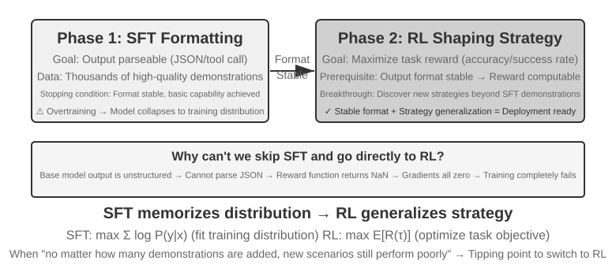

Bảng 8-4 Tiêu chí lựa chọn Mid-training, SFT, và RL

| Observed behavior | Main gap | Preferred method | Gate for moving on |
| --- | --- | --- | --- |
| Model không nắm được các domain concept, ngôn ngữ, hoặc các thao tác cơ bản; `pass@k` duy trì gần mức 0 dưới cấu hình sampling hợp lý | Knowledge và capability nằm ngoài phạm vi support hiệu quả của base model | **Mid-training**; sử dụng RAG cho dynamic facts | Kết quả trên held-out domain cải thiện, general retention vẫn ở mức chấp nhận được, và target task bắt đầu tạo ra các trajectory chính xác hoặc chính xác một phần có thể verify được |
| Model thỉnh thoảng xử lý đúng, nhưng format, tool schema, tone, hoặc fixed procedure không ổn định | Behavioral protocol chưa được định hình (solidified) | **SFT** hoặc constrained decoding | Parse success ổn định, và một verifier có thể score đáng tin cậy cho các key action và output protocol |
| Tỷ lệ thành công khác 0 và reward đáng tin cậy, nhưng các good policy có xác suất xuất hiện thấp, hoặc long-horizon decision và OOD generalization vẫn còn yếu | Probability allocation và policy optimization | **RL** | Reward phản ánh đúng objective thực tế, các rollout group có đủ reward variation, và performance trên test set độc lập được cải thiện trong quá trình training |
| Chỉ có một vài demonstration ổn định và không có interactive environment khả dụng | Tồn tại imitable data, không có online feedback | **SFT/RFT/offline preference optimization** | Thiết lập baseline và evaluation trước, sau đó mới quyết định việc xây dựng một RL environment có thực sự đáng giá hay không |

Hãy đưa ra quyết định theo thứ tự sau:

1. **Trước tiên, loại trừ các giải pháp không can thiệp vào weight.** Nếu prompt, tool, code constraint, hoặc context management có thể giải quyết được vấn đề behavior, thì không cần train. Ưu tiên dùng RAG cho các fact cần update, citation, hoặc delete thường xuyên.
2. **Đo lường mức độ support capability trên một target held-out set.** Không nên chỉ nhìn vào greedy `pass@1`; dưới một setup sampling cố định, hãy đo cả `pass@k`, partial-progress rate, parse rate, đồng thời audit thủ công nguyên nhân failure. Nếu `pass@k` vẫn xấp xỉ 0 và các failure tập trung vào mảng knowledge hoặc foundational capability, hãy thực hiện Mid-training trước và đánh giá lại trước khi chuyển sang giai đoạn sau.
3. **Dùng SFT để thiết lập protocol, không phải để nhồi nhét knowledge base.** Khi model có khả năng giải quyết task nhưng chưa đáp ứng đúng quy cách yêu cầu, hãy sử dụng các demonstration chất lượng cao để củng cố JSON schema, tool call, terminology, procedure, và style. Một số fact có thể đi vào parameter cùng với các demonstration, nhưng không thể dựa vào một lượng nhỏ QA pair để gánh vác cả một knowledge base lớn.
4. **Chỉ dùng RL khi thực sự có không gian để explore.** RL chỉ phù hợp khi policy hiện tại đã có khả năng tạo ra các rollout có thể score được và thỉnh thoảng thành công, đồng thời reward function phản ánh chính xác deployment goal. Nếu `pass@k` gần như bằng 0, trước tiên hãy dùng Mid-training/SFT hoặc thiết kế một curriculum khả thi cùng partial reward; việc áp dụng trực tiếp PPO hay GRPO vào các rollout toàn điểm 0 thường chỉ làm lãng phí sampling budget.

Quy trình này không đòi hỏi mọi dự án phải thực thi tuần tự cả ba phương pháp. Một base model mạnh có thể đi thẳng vào RL, một task chỉ thuần về format có thể chỉ cần SFT, và domain knowledge ổn định có thể chỉ cần Mid-training rồi tận dụng lại alignment sẵn có của model. Điều cốt lõi là mỗi bước chuyển giao đều phải có entry condition đo lường được, thay vì xem "Mid-training → SFT → RL" như một pipeline mang tính giáo điều.

## Single-Turn Reinforcement Learning: So sánh giữa Memory và Generalization

"Single-turn" có nghĩa là task được hoàn thành chỉ trong một interaction duy nhất: model nhận input, sinh output và nhận reward mà không cần duy trì state qua các bước. Thiết lập đơn giản hóa này cho phép chúng ta tập trung vào sự khác biệt căn bản trong cơ chế học giữa SFT và RL mà không bị phân tán bởi độ phức tạp của các multi-turn interaction. Kịch bản single-turn mang lại điều kiện thực nghiệm được kiểm soát rõ ràng: cùng task, cùng base model, cùng computational budget, với biến số duy nhất là phương pháp training. Thí nghiệm đầu tiên sẽ chứng minh cách RL học được meta-strategy về việc "khi nào nên suy nghĩ" ("when to think"); thí nghiệm thứ hai sử dụng một arithmetic reasoning card game để định lượng một cách có hệ thống luận điểm "SFT ghi nhớ, RL tổng quát hóa" ("SFT memorizes, RL generalizes").

Trước khi bước vào các thí nghiệm, hãy cùng xây dựng một số **minimal intuition** về các thuật toán RL, vừa đủ để nắm bắt các thuật ngữ xuất hiện trong các thực nghiệm tiếp theo. Quá trình RL training trong chương này phần lớn dựa trên **policy gradient**: model sinh ra nhiều response cho cùng một problem, tăng probability của các response có reward cao và giảm probability của các response có reward thấp — tiến xa hơn theo các hướng có reward và hạn chế các hướng không mang lại reward. Để ngăn một lần update quá lớn làm chệch hướng model, thuật toán **PPO** phổ biến sẽ clip các phần gain tăng thêm trong surrogate objective khi probability ratio rơi ra ngoài một khoảng xác định; cơ chế này hạn chế các thay đổi lớn nhưng không áp đặt một hard constraint lên sự dịch chuyển của policy (các thí nghiệm sau này sử dụng "PPO with a value network", trong đó value network ước tính một baseline để tính toán advantages chi tiết hơn). Phương pháp còn lại, **GRPO**, không train bất kỳ value network nào; thay vào đó, nó so sánh trực tiếp nhiều response cho cùng một problem với nhau để đánh giá chất lượng tương đối của từng response. Intuition đó là tất cả những gì bạn cần cho hai thí nghiệm tiếp theo.

Cùng một cơ chế có thể được viết lại dưới dạng pseudocode kiểu Python như bên dưới. Đoạn mã này lược bỏ sampling parallelism, KL regularization và các chi tiết về optimizer, chỉ tập trung làm nổi bật causal chain từ một rollout duy nhất cho đến bước parameter update:

```python
for prompt in batch:
    group = [rollout(policy, env.reset(prompt)) for _ in range(G)]
    rewards = [verify(trajectory) for trajectory in group]
    advantages = normalize_within_group(rewards)       # GRPO baseline
    update(policy, group, advantages)
```

Value network và clipped objective của PPO có thể được viết tách riêng:

```python
for trajectory in rollouts:
    returns = discounted_returns(trajectory.rewards)
    values = value_model(trajectory.states)
    advantages = returns - stop_gradient(values)
    ratio = exp(policy.log_prob(trajectory.actions)
                - old_policy.log_prob(trajectory.actions))
    policy_loss = -mean(min(
        ratio * advantages,
        clip(ratio, 1 - epsilon, 1 + epsilon) * advantages
    ))
    value_loss = mean((value_model(trajectory.states) - returns) ** 2)
update(policy, value_model, policy_loss + value_coef * value_loss)
```

Yếu tố "relative" trong GRPO xuất phát từ việc so sánh các rollout trong cùng một group cho cùng một prompt; `old_policy` trong PPO là một policy snapshot bị đóng băng (frozen) đã sinh ra batch rollouts này, và probability ratio dùng để đo lường xem policy hiện tại đã dịch chuyển bao xa so với snapshot đó. Cơ chế clipping ngăn chặn các bước update quá lớn nhưng không phải là một hard constraint đối với sự dịch chuyển của policy; cả hai phương pháp vẫn phụ thuộc vào một environment và reward đáng tin cậy, và các tùy biến training cụ thể sẽ xuất hiện trong các thí nghiệm tương ứng.

> **Experiment 8-10 ★★: AdaptThink—Học "When Not to Think"**
>
> Các large reasoning models (ví dụ: OpenAI o1, DeepSeek-R1) thường sinh ra Chain-of-Thought dài dòng cho mọi bài toán, gây ra overhead không cần thiết trên các bài toán đơn giản. Experiment này trước tiên kiểm chứng một intuition: **NoThinking mode** (bỏ qua bước suy nghĩ thông qua `<think></think>`) đạt hiệu năng tương đương, thậm chí tốt hơn trên các bài toán đơn giản; chỉ khi đối mặt với các bài toán khó, ưu thế của Thinking mode mới thực sự rõ rệt.
>
> AdaptThink sử dụng RL để huấn luyện model thích ứng linh hoạt trong việc lựa chọn mode. Hai thành phần cốt lõi gồm:
>
> - **Constrained Optimization Objective**: Khuyến khích NoThinking trong khi vẫn đảm bảo overall performance không bị suy giảm.
> - **Importance Sampling Strategy**: Cân bằng các sample giữa Thinking và NoThinking để giải quyết bài toán **cold-start** (ở đây, cold-start ám chỉ việc model ban đầu hầu như luôn chọn Thinking, khiến nhánh NoThinking có quá ít sample để học hiệu quả; điều này khác với khái niệm "cold-start SFT" từng đề cập trước đó cho DeepSeek-R1, vốn liên quan đến một lượng nhỏ demonstration examples).
>
> Khái niệm "importance sampling" được đề cập ở đây là một phương pháp thống kê phổ biến—khi sampling distribution bị lệch về một nhóm sample nhất định, các trọng số sẽ được áp dụng lên các sample để "hiệu chỉnh" distribution, đảm bảo learning signal bao phủ công bằng trên tất cả các class. Ý tưởng này được tái sử dụng liên tục trong các thuật toán RL như PPO và DAPO sẽ được thảo luận ở phần sau của cuốn sách.
>
> Bản ghi chuẩn (canonical record) của lượt training run lịch sử này là [training report](../chapter8/AdaptThink/TRAINING_REPORT.md) (loại checkpoint-free). Public W&B main run [`wubbn5tj`](https://wandb.ai/bojieli-pine-ai/adapt_think_verl/runs/wubbn5tj) sử dụng cụm 8×NVIDIA H100 80GB GPUs. Từ step 0→300, accuracy trên MATH500 thay đổi từ 0.8100→0.8180 (+0.80 pp) trong khi response length giảm từ 4911.46→1576.62 (-67.90%); GSM8K thay đổi từ 0.796816→0.818802 (+2.20 pp) và response length từ 1025.24→477.33 (-53.44%); còn AIME mean@16 thay đổi từ 0.314583→0.310417 (-0.42 pp) và response length từ 12119.51→6402.23 (-47.17%). Các tỷ lệ NoThinking ratios tương ứng là 83.80%, 84.15%, và 56.25%. Những kết quả này cho thấy một routing signal bám sát theo độ khó ở cấp độ aggregate dataset, nhưng chưa đủ cơ sở để coi đây là "perfect difficulty awareness" trên từng bài toán cụ thể hay khẳng định rằng accuracy được cải thiện đồng loạt trên mọi mặt.
>
> Sau điểm đo lường được chọn trong report, run tiếp tục chạy đến step 410 với tổng thời gian tích lũy 36.92 giờ trước khi W&B đánh dấu trạng thái `crashed`; cấu hình dự kiến gồm 10 epochs / 3,140 steps đã không hoàn thành. Mặc dù step 300 có ghi nhận một checkpoint-timing event, nhưng checkpoint này không được phân phối kèm theo sách, đồng thời không có bằng chứng độc lập nào xác nhận rằng nó đã được evaluate thành công bằng `run_eval_verl_hf.sh` hoặc được dùng để chạy lại MMLU. Source commit lịch sử là `9e588202…`; các lượt reproduction sau này được ghim (pinned) vào direct child commit của nó là `0033ad172…`. Ba entry-point files vẫn được giữ nguyên, nhưng đường dẫn `-fl-` do training script sinh ra không tương thích với đường dẫn `-fl4096` bị hard-code trong evaluation script, buộc phải xử lý thủ công (corrected manually).
>
> AdaptThink bổ trợ cho prompt distillation để tạo thành một "fast-slow dual system": distillation giúp giảm tỷ lệ các task đòi hỏi suy nghĩ chuyên sâu, trong khi AdaptThink tối ưu hóa triggering strategy cho các task còn lại, cùng nhau nâng cao thinking efficiency tổng thể.

> **Experiment 8-11 ★★: GeneralPoints—So sánh "Memory and Generalization" trong Single-Turn RL**
>
>
> 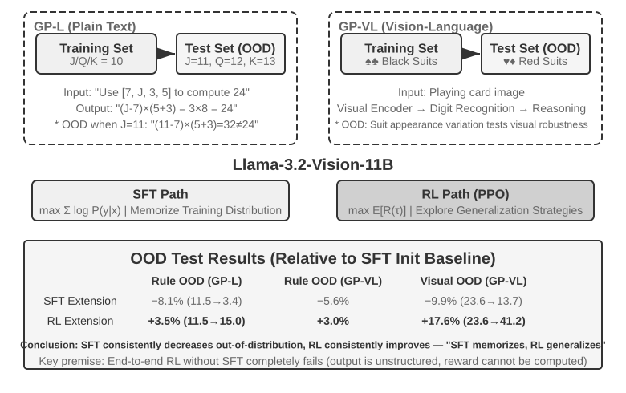
>
>
> GeneralPoints là một card game về arithmetic reasoning được đề xuất bởi Chu et al.[^ch8-3], được thiết kế chuyên biệt nhằm đánh giá model generalization. Mục tiêu tương tự như "24 Game": sử dụng mỗi số trong bốn số hiển thị trên các lá bài đúng một lần, kết hợp chúng bằng các phép cộng, trừ, nhân, chia để đạt được số mục tiêu là 24. Thực nghiệm thiết kế hai biến thể: biến thể text-only GP-L và biến thể image-based GP-VL, cho phép chúng ta kiểm tra rule generalization và visual generalization trong cùng một framework.
>
> **Rule Variant**: Trong quá trình training, J/Q/K đều được tính là 10; trong quá trình testing, chúng lần lượt được tính là 11/12/13, đảm bảo test set chứa các unseen number combinations (các phép toán liên quan đến 11, 12, 13) để đánh giá generalization một cách nghiêm ngặt. **Visual Variant**: Quá trình training sử dụng các chất màu đen (♠♣), testing sử dụng các chất màu đỏ (♥♦), nhằm đánh giá độ robustness trước các thay đổi về visual appearance. Sử dụng Llama-3.2-Vision-11B, thực nghiệm tuân theo post-training pipeline tiêu chuẩn: đầu tiên, bước SFT initialization cung cấp cho model khả năng instruction-following cơ bản; sau đó, dưới cùng một computational budget, model trải qua quá trình training SFT và RL bổ sung trên các nhánh riêng biệt, với PPO và một value network được sử dụng cho RL. Cả hai nhánh đều được train trên dữ liệu áp dụng quy tắc duy nhất J/Q/K=10 và được evaluate trên các test set in-distribution (ID) lẫn out-of-distribution (OOD).
>
> Kết quả cho thấy sự khác biệt rõ rệt trong thiết lập có kiểm soát này. **Rule OOD**: RL tăng +3.5 percentage points trên GP-L (11.5%→15.0%), trong khi SFT **giảm** 8.1 percentage points (11.5%→3.4%); trên GP-VL, RL tăng +3.0 percentage points, trong khi SFT giảm 5.6 percentage points. **Visual OOD**: RL tăng **+17.6 percentage points** trên GP-VL (23.6%→41.2%), trong khi SFT giảm 9.9 percentage points (23.6%→13.7%).
>
> Việc theo dõi visual recognition accuracy cho thấy RL cải thiện visual encoder bên dưới thông qua outcome-oriented optimization, và sự cải thiện này tương quan chặt chẽ với mức tăng overall performance; ngược lại, SFT bị overfit vào các token pattern trong thinking process, bỏ qua việc học các visual token, dẫn đến sụt giảm recognition accuracy.
>
> Thực nghiệm cũng chỉ ra rằng RL bắt buộc phải có SFT initialization trong thiết lập này: với một base model ở quy mô Llama-3.2-Vision-11B cùng các yêu cầu khắt khe về structured-output, end-to-end RL nếu không có SFT đã thất bại hoàn toàn vì base model không thể sinh ra các structured output có thể tính điểm (scoreable). Đây là đặc thù riêng của thiết lập này chứ không phải một quy luật phổ quát; một base model đủ mạnh có thể bỏ qua SFT và thành công với direct RL (xem lại phần thảo luận trước đó về DeepSeek-R1-Zero). Một phát hiện đáng chú ý khác là, trong thực nghiệm này, số lượt verification iteration càng nhiều thì generalization đo được càng cao: 10 iteration mang lại +5.99% so với +0.48% của 1 iteration, biến test-time computation trở thành một yếu tố quan trọng đối với mức tăng trưởng quan sát được.
>
> Tại sao SFT lại suy giảm hiệu năng trước distribution shift trong thực nghiệm này trong khi RL lại thể hiện tốt hơn? Một lời giải thích nhất quán với các quan sát thực nghiệm là lượng data SFT hữu hạn đã củng cố pattern cố định "xem J/Q/K là 10", vốn vẫn tiếp tục kích hoạt khi J chuyển thành 11. Nhánh RL được train theo định hướng outcome có xu hướng củng cố chiến lược tính toán lại cho đến khi đạt được kết quả chính xác, cho phép cùng một quy trình đó tiếp tục áp dụng hiệu quả sau khi rule thay đổi. Điều này giải thích cho sự tương phản giữa memorization và generalization trong thực nghiệm; nó không hàm ý rằng SFT chỉ có thể ghi nhớ máy móc hay RL nhất thiết phải học được một general algorithm.
>
> Đóng góp cốt lõi của thực nghiệm này là việc định lượng một cách có hệ thống, trong phạm vi thiết lập giới hạn của GeneralPoints, xu hướng overfitting của SFT và out-of-distribution performance vượt trội hơn của RL, với cùng một pattern được ghi nhận trên cả hai biến thể text-only và vision-language. Trong thiết lập này, SFT đóng vai trò ổn định format và RL khám phá các chiến lược dựa trên nền tảng đó, biến hai phương pháp trở nên bổ trợ lẫn nhau.

## RL Algorithms: Từ 16 Rollouts đến một lần Parameter Update

**GRPO (Group Relative Policy Optimization)**, do DeepSeek đề xuất, là một trong những RL training algorithms được sử dụng rộng rãi nhất hiện nay. Một ví dụ cụ thể sẽ giúp làm rõ điều này. Giả sử SWE-bench có một task như sau: file `parser.py` trong một Python project ném ra lỗi `IndexError` khi nhận input rỗng, và Agent phải fix code mà không được sửa đổi các tests. Hệ thống training sẽ trải qua bốn bước dưới đây.

**Step 1: Để policy model thử nghiệm lặp đi lặp lại.** Policy model chính là language model đang được training. Hệ thống sao chép cùng một mã nguồn ban đầu và cùng một mô tả bài toán vào 16 sandboxes cô lập hoàn toàn với nhau, sau đó để model giải quyết bài toán độc lập 16 lần. Mỗi lần thử nghiệm sẽ bao gồm toàn bộ chu trình "đọc code → chỉnh sửa files → chạy tests → submit kết quả"; toàn bộ quy trình đó cấu thành một **rollout**. Bài toán và môi trường khởi tạo là giống hệt nhau, nhưng quá trình sampling có tính stochastic, vì vậy 16 lần thử có thể đi theo các hướng khác nhau: một số rollout thêm boundary check chuẩn xác, một số chỉ đơn thuần catch exception để che đậy vấn đề, một số sửa nhầm file, và một số lại cố gắng can thiệp vào các tests.

**Step 2: Tính toán reward.** Sau khi mỗi rollout kết thúc, một verifier sẽ apply patch vào một clean environment và chạy các tests. Giả sử 4 trong số 16 lần thử pass toàn bộ tests mà không can thiệp vào các file test, và 12 lần còn lại fail; khi đó 4 lượt đầu tiên nhận reward 1, còn 12 lượt sau nhận reward 0. Trong một coding task dạng này, việc "tính toán reward" không có gì bí ẩn—đó đơn thuần là dùng tests và rules để đánh giá xem bản fix có thực sự chính xác hay không. Chỉ đối với các open-ended tasks không có test xác định, bạn mới cần đến human preference hoặc một reward model để chấm điểm.

**Step 3: Tính toán relative advantage.** Một reward chỉ phản ánh việc một trajectory đơn lẻ thành công hay thất bại; trong khi **relative advantage** chỉ ra trajectory đó tốt đến mức nào so với các lần thử khác trong cùng một group. Tỷ lệ thành công trung bình của group này là 4/16: 4 lượt pass nằm trên mức trung bình của group và nhận được positive advantage; 12 lượt fail nằm dưới mức trung bình và nhận negative advantage. Phép so sánh nội bộ nhóm (within-group comparison) này chính là cốt lõi của GRPO. Nếu cả 16 lần thử đều fail, hoặc cả 16 lần đều thành công, mọi reward đều giống hệt nhau, không có cơ sở nào để phân định kết quả nào tốt hơn, và relative advantage sẽ triệt tiêu. Các path signals, process rewards, và partial-progress rewards của RLVP sinh ra chính là để khôi phục lại những khác biệt có ý nghĩa bên trong các groups như vậy.

**Step 4: Update policy bằng gradient descent.** Chương trình training chuyển đổi các relative advantages thành training loss, tính toán gradients, và sử dụng một optimizer (như AdamW, Muon, v.v.) để thực hiện gradient descent, nhằm tăng xác suất của các lựa chọn mà model đã đưa ra trong các trajectories có positive advantage và giảm xác suất trong các trajectories có negative advantage. Hệ thống không ghi nhớ nguyên văn (verbatim) một patch thành công nào đó; nó điều chỉnh dần dần qua nhiều tasks và rollouts, sao cho khi một bug tương tự xuất hiện sau này, chuỗi hành vi "reproduce vấn đề, kiểm tra boundary condition, thay đổi implementation, và chạy tests" sẽ có xác suất xuất hiện cao hơn, trong khi hành vi "nuốt exception (swallow the exception), chỉnh sửa tests, submit khi chưa verify" sẽ bị giảm xác suất.

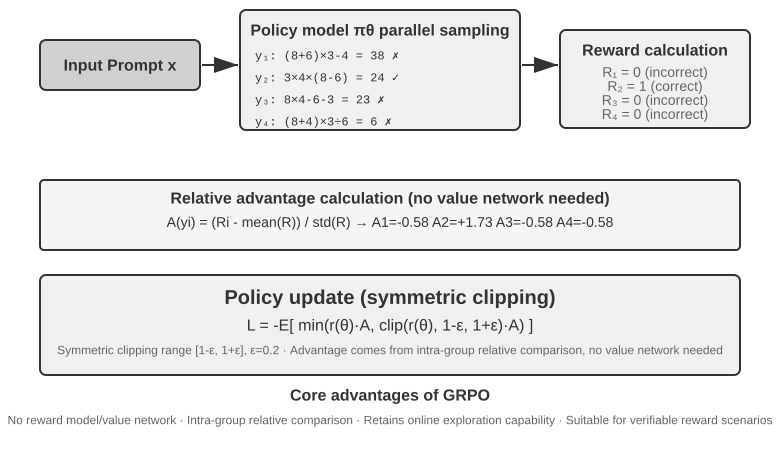

Bốn bước này cùng nhau tạo thành một **training iteration**, tức là một **step**: step $k$ sinh ra một batch rollouts bằng policy hiện tại, hoàn thành việc tính toán reward, advantage, và gradient, rồi để optimizer cập nhật parameters; step $k+1$ sau đó sẽ rollout lại với policy đã được cập nhật. Training trong 100 steps đồng nghĩa với việc lặp lại loop này khoảng 100 lần. Một RL training framework cụ thể có thể đếm riêng các lượt cập nhật minibatch nội bộ, do đó khi đọc training logs bạn vẫn cần xác nhận lại cách framework đó định nghĩa một `step`.

Một ước tính thời gian sơ bộ sẽ giúp hình dung rõ hơn. Một Agent rollout phức tạp có thể tạo ra hàng chục lượt tool-calling turns, và ngay cả khi chạy song song 16 tiến trình thì wall-clock time của một giai đoạn rollout vẫn bị chi phối bởi tiến trình chạy chậm nhất. Giả sử rollout chậm nhất mất khoảng 2.000 giây, các bước gradient descent và optimizer update tiếp theo mất khoảng 600 giây; khi đó một step sẽ tốn khoảng $2{,}000+600=2{,}600$ giây, tương đương khoảng 43 phút, và 100 steps liên tiếp sẽ mất gần 72 giờ.

Cả PPO và GRPO đều tuân theo loop này; chúng khác nhau chủ yếu ở **what they compare against**. GRPO trực tiếp so sánh nhiều rollouts của cùng một bài toán và không cần một value model riêng biệt. PPO huấn luyện một value model để ước lượng "kết quả thông thường sẽ tốt đến mức nào" tại mỗi step của một trajectory, sau đó đánh giá xem action hiện tại có vượt qua kỳ vọng đó hay không—cách tiếp cận này phù hợp với các trajectories dài đòi hỏi credit assignment ở mức fine-grained. Cả hai thuật toán đều giới hạn biên độ của một lần update đơn lẻ để một batch samples nhỏ không làm thay đổi model quá đột ngột. DPO thì khác: nó học trực tiếp từ các cặp preference "better response—worse response" đã được thu thập từ trước và không bao giờ yêu cầu policy hiện tại phải sinh ra nhóm rollouts này theo phương thức online.

Trong số các case study của chương này, AdaptThink sử dụng một custom constrained objective; GeneralPoints và V-IRL sử dụng PPO với value model; SimpleVLA-RL và RLVP sử dụng GRPO; ReTool sử dụng PPO. Algorithm quyết định cách so sánh các trajectories và cập nhật parameters; reward quyết định tiêu chí thế nào là thành công; environment và data quyết định những bài toán mà model sẽ được trải nghiệm.

### Tại sao LLM RL thường ưu tiên On-Policy Data

Trước tiên, cần phân biệt rõ hai thuật ngữ rất dễ bị đánh đồng. **Online** chỉ mang nghĩa là data liên tục được tạo ra thông qua tương tác với environment trong quá trình training. **On-policy** đòi hỏi behavior policy $\mu$ dùng để sinh rollouts phải giống hệt, hoặc đủ gần, với policy $\pi_\theta$ hiện đang được tối ưu hóa. Một asynchronous cluster có thể liên tục sinh data nhưng trên phương diện thống kê vẫn rơi vào trạng thái off-policy nếu các rollout workers của nó bị chậm hơn vài checkpoints. Việc replay lại các trajectories cũ hoặc sử dụng các trajectories được sinh ra hoàn toàn bởi một model cũ hơn hay một teacher model thì thể hiện rõ ràng tính chất off-policy. Các PPO/GRPO recipes trong chương này nhìn chung đều hướng đến việc rollout lại từ policy mới nhất ở mỗi step. Tuy nhiên, khi PPO thực hiện nhiều minibatch epochs trên cùng một batch, các epochs về sau đã bắt đầu drift xa khỏi `old_policy` vốn dùng để sinh ra tập data đó—đây chính là lý do vì sao PPO bắt buộc phải sử dụng probability ratio và clipping.

Policy gradients hướng tới việc ước lượng expected reward dưới current policy $\pi_\theta$. Nếu data được sample từ một policy khác $\mu$, việc hiệu chỉnh sẽ sử dụng một importance ratio:

$$
\rho_t=\frac{\pi_\theta(a_t\mid s_t)}{\mu(a_t\mid s_t)}
=\exp\left(\log\pi_\theta(a_t\mid s_t)-\log\mu(a_t\mid s_t)\right).
$$

Các on-policy rollouts thực sự mới sẽ thỏa mãn $\pi_\theta=\mu$ **trước bất kỳ parameter update nào**, do đó $\rho_t=1$. Điều này giúp quá trình training tập trung vào "các state mà model hiện tại thực sự đi vào" và tránh phải trả giá bằng một phép hiệu chỉnh có variance cao do distribution mismatch. Off-policy data có những lợi thế riêng—old data có thể tái sử dụng, sampling và training có thể chạy asynchronous, và throughput cao hơn—nhưng policy càng stale thì phần tail của phân phối $\rho_t$ càng nặng (heavy-tailed). Đối với các chuỗi autoregressive dài, việc hiệu chỉnh strict prefix hoặc trajectory cũng sẽ nhân nhiều per-token ratios lại với nhau, khiến một bias nhỏ có thể tích tụ thành một trọng số cực lớn hoặc bị triệt tiêu (vanishing weight). Cơ chế clipping của PPO giới hạn các outlier updates nhưng không thể khôi phục một cách lossless phần distribution coverage đã mất: clip quá nhiều thì gradients bị loại bỏ, clip quá ít thì một lượng nhỏ samples sẽ chi phối toàn bộ. Do đó, "on-policy tốt hơn" không phải là một định lý phổ quát; trong LLM policy gradients hiện nay, nó thường đồng nghĩa với **distribution bias thấp hơn và quá trình optimization ổn định hơn**. Các nghiên cứu thực nghiệm về việc ổn định hóa RL cho large models cũng chỉ ra rằng việc giảm thiểu policy staleness cùng training–inference discrepancy là điều kiện tiên quyết để surrogate objective duy trì tính hợp lệ[^ch8-32].

#### Why Training Is Sensitive to Sampler/Trainer Numerical Mismatch

LLM RL quy mô lớn thường generate rollouts bằng một inference engine như vLLM/SGLang, sau đó tính toán lại log probabilities và gradients bằng một training engine như FSDP/Megatron. Ngay cả khi cả hai bên đều load cùng một bộ weights, sự khác biệt về floating-point precision, reduction order, tensor-parallel layout, batch size, KV cache và fused kernels vẫn có thể khiến log probability của cùng một token bị lệch nhẹ. Kết quả là $\rho_t$—vốn phải bằng 1 trước khi update—đã bị drift khỏi giá trị 1: hệ thống về mặt danh nghĩa đã synchronize weights, nhưng về mặt số học (numerically) lại biến on-policy training thành off-policy training. Các thực nghiệm có đối chứng đã chứng minh rằng chỉ riêng một sai lệch nhỏ ở cấp độ token giữa training và inference (training–inference discrepancy) cũng đủ để kích hoạt hiện tượng training collapse[^ch8-33].

Độ nhạy cảm này bắt nguồn từ một chuỗi khuếch đại (amplification chain): **sai số log-probability nhỏ → độ lệch probability-ratio bị khuếch đại theo hàm mũ (exponentiated) → tích lũy qua một prefix dài → làm thay đổi clipping/advantage weighting → dẫn đến thay đổi gradient direction và effective sample count**. Ví dụ: nếu log ratios của 4.000 tokens đều lệch $10^{-3}$ theo cùng một chiều, ratio ở cấp độ trajectory sẽ tích lũy lên tới $e^4\approx54.6$; sai số thực tế không nhất thiết luôn cùng dấu, nhưng ví dụ này cho thấy tại sao các chuỗi dài lại khuếch đại những sai số vốn "nhìn qua thì rất nhỏ trên từng token riêng lẻ". Một sai khác xác suất cực nhỏ ở một token ban đầu cũng có thể thay đổi token thực sự được sample, khiến toàn bộ quỹ đạo state tiếp theo bị phân kỳ (diverge). Kết quả cuối cùng không chỉ đơn thuần là "cùng một prompt đôi khi sinh ra output khác nhau": importance ratios có thể tăng vọt (spike), một lượng lớn tokens bị clip, gradients hoặc response lengths biến động đột ngột, kéo theo reward và entropy cùng sụp đổ (collapse). Việc thay đổi batch size làm thay đổi cách phép tính thực hiện reduction và phá vỡ numerical batch invariance; hiện tượng này cũng đã được ghi nhận trực tiếp là biến RL trên danh nghĩa là on-policy thành implicit off-policy RL. Giải pháp khớp hoàn toàn số học giữa sampling và training (matching sampling and training numerics) hoặc áp dụng một cơ chế off-policy correction rõ ràng đều giúp cải thiện stability[^ch8-34].

Về mặt engineering, cần phải xem đây là một vấn đề cốt lõi chứ không đơn thuần là floating-point noise thông thường:

- **Trước bất kỳ parameter update nào**, hãy so sánh token log probabilities giữa sampler và trainer trên cùng một batch of trajectories, đồng thời monitor các giá trị mean, quantiles, maximum, approximate KL, và clipped fraction của $\rho_t$; đây chính là on-policy unit test trực diện nhất.
- Thứ cần synchronize không chỉ là weights, mà còn bao gồm LoRA adapter, tokenizer, chat template, model revision, và cấu hình positional-encoding; rollout phase phải lưu lại behavior log probability ngay tại generation time, thay vì lấy số liệu từ current model sau khi sự đã rồi.
- Hãy align tối đa precision, parallel layout, và các compute kernels trọng yếu giữa sampling và training; trong trường hợp bất khả thi, phải xử lý sự sai lệch này một cách tường minh như off-policy, áp dụng importance correction, và monitor effective sample size, thay vì ngộ nhận rằng PPO clipping sẽ tự động bù trừ.
- Hãy giữ cho các rollouts luôn fresh, đồng thời giới hạn cả số lượng update epochs trên mỗi batch of data lẫn asynchronous staleness. Việc tái sử dụng dữ liệu cũ giúp tăng throughput, nhưng đây phải là một sự đánh đổi có tính toán giữa bias–efficiency (bias–efficiency trade-off), chứ không phải là một giải pháp tăng tốc miễn phí.

## RL Environments: Từ Evaluation đến Simulation

Bottleneck trong RL training thường không nằm ở algorithm, mà nằm ở chỗ **liệu environment có đủ độ chân thực (realistic), resettable, và parallelizable hay không**. Các hành vi thực tế của một Agent như thực hiện cuộc gọi, thanh toán giao dịch, hay chỉnh sửa file có thể rất tốn kém và không thể đảo ngược (irreversible), và một sai lầm không thể cứu vãn bằng việc retry vô hạn lần; evaluation environment ở Chương 7 có thể cung cấp verifier, nhưng quá trình training còn đòi hỏi Agent phải fail lặp đi lặp lại nhiều lần, phải chịu đựng được side effects từ các actions của chính nó, và phải duy trì sự ổn định qua hàng triệu interactions. Do đó, environment engineering là điều kiện tiên quyết cho RL, chứ không phải là thứ chỉ được tính đến sau khi training đã hoàn tất.

### Environment: Training Ground cho Model

Bản chất cốt lõi của RL là "học qua thử và sai" (trial and error), mà trial and error thì cần **một nơi để diễn ra**—đó chính là simulation environment. Model thực thi các tasks trong environment lặp đi lặp lại, thu thập feedback, và điều chỉnh policy của nó. **Fidelity** của environment—mức độ tương đồng của nó so với kịch bản deployment thực tế—sẽ quyết định trực tiếp việc policy thu được có dùng được hay không:

- **Một distorted environment chắc chắn sẽ tạo ra một useless policy.** Nếu khách hàng mô phỏng luôn trả lời theo một script cố định và các thông báo lỗi không khớp với production, model sẽ chỉ học được một chiến lược đối phó (test-taking strategy) hoạt động trong simulation và sẽ đổ vỡ ngay trong lần deployment thực tế đầu tiên. Đây là nguyên nhân phổ biến nhất khiến các dự án RL thất bại—không phải do algorithm tồi, mà do nơi luyện tập không giống với phòng thi thực chiến.
- **Việc xây dựng một high-fidelity environment thường tốn kém và khó khăn hơn chính quá trình training.** Một environment có khả năng chạy massively parallel, reproducible, và cung cấp realistic feedback thường đòi hỏi khối lượng engineering lớn hơn nhiều so với việc tuning model. Các thử nghiệm tool-calling ở phần sau của chương này (MCP sandbox của AWorld, code-interpreter sandbox của ReTool) đầu tư rất nhiều vào environment chính là vì: **các real APIs luôn có rate limits, sẽ ban accounts, và tạo ra side effects, khiến chúng không thể dùng trực tiếp cho training**—bạn buộc phải dựng một "shadow world" ổn định, có thể kiểm soát (controllable) và có khả năng replay trước.
- **Một nửa còn lại của environment chính là reward function.** Environment không chỉ phải mô phỏng cách thế giới biến đổi, mà còn phải đánh giá xem Agent đã thể hiện tốt đến mức nào—đây chính là input cho phần reward design được thảo luận ở phần sau.

Nói một cách ngắn gọn: **trước khi bắt đầu tinh chỉnh algorithms, hãy tự hỏi bản thân—liệu simulation environment của mình có thực sự phản ánh thế giới thực hay không?** Câu trả lời này quan trọng hơn rất nhiều so với việc lựa chọn giữa PPO hay GRPO.

### Sẽ Ra Sao Nếu Không Thể Dựng Một Environment? Hãy Để Model Đóng Vai Environment

Nhưng có một vấn đề còn căn bản hơn: trong nhiều kịch bản, việc xây dựng một high-fidelity environment không chỉ đơn thuần là tốn kém, mà là **hoàn toàn bất khả thi**—các API thực tế luôn có side effects và không thể bị gọi tùy tiện, người dùng thật không thể bị đem ra làm thí nghiệm, còn thế giới vật lý thì không thể "tua nhanh" (fast-forward). Nếu ngay cả một "shadow world" khả dụng bạn cũng không thể dựng lên, liệu có phải RL hoàn toàn hết cửa? Một hướng tiếp cận ngày càng trở thành xu hướng chủ đạo là **sử dụng model để mô phỏng environment**—cho một LLM đóng vai environment và sinh ra các feedback cần thiết cho các tương tác của Agent. Hướng đi này có hai cấp độ.

**Cấp độ một: model tổng hợp giá trị trả về của các tool calls.** Lấy ví dụ về ZeroSearch[^ch8-13]: việc train một model "biết cách search" thông thường đòi hỏi một search engine thật, nhưng search API thì tốn tiền, vướng rate limits, và trả về kết quả khó kiểm soát. ZeroSearch giải quyết rất gọn: cho một LLM đóng vai search engine. Khi student model đưa ra một search query, "simulated engine" này sẽ tự sinh ra các kết quả retrieval trả về. Hay hơn nữa, kiến trúc này áp dụng thiết kế theo kiểu **curriculum**—ở giai đoạn đầu training, simulated engine trả về các tài liệu chất lượng cao, độ liên quan chặt chẽ; khi quá trình training tiến triển, nó sẽ dần trộn thêm noise và hạ thấp chất lượng kết quả trả về, ép student phải học cách trích xuất thông tin hữu ích từ chính kiểu kết quả không hoàn hảo mà một search engine thực tế thường trả ra. Cuối cùng, một model chưa từng tiếp xúc với search engine thật trong suốt quá trình training vẫn đạt hiệu năng rất tốt khi được tích hợp vào môi trường thực tế.

**Cấp độ hai: model mô phỏng toàn bộ dynamics của environment.** Không dừng lại ở giá trị trả về của một tool đơn lẻ, việc "thế giới trông như thế nào sau khi một action được thực thi" cũng có thể giao phó hoàn toàn cho model. DreamGym[^ch8-14] chắt lọc (distill) environment dynamics vào một "experience model" dạng reasoning: dựa trên state hiện tại và action của Agent, nó thực hiện reasoning từng bước để suy ra state transition cùng feedback signal. Nhờ đó, hệ thống có thể sinh ra rollouts hàng loạt cho online RL mà không cần chạm tới environment thực tế. Việc training các Agent chăm sóc khách hàng và sales cũng thường xuyên dùng một LLM đóng vai người dùng (user simulator), và bộ evaluation thuộc họ τ-bench cũng được xây dựng dựa trên chính tư duy này—cùng một model simulator có thể đóng vai trò vừa là phòng thi, vừa là bãi tập.

Tuy nhiên, rủi ro của con đường này cần phải được chỉ rõ: **hiểu biết của simulator về thế giới chính là trần giới hạn (ceiling) của quá trình training, và các systematic biases của simulator sẽ bị policy hấp thụ toàn bộ.** Nếu khách hàng mô phỏng kiên nhẫn hơn người dùng thực, hoặc simulated search engine không bao giờ trả về dữ liệu rác, thì những gì student học được chỉ là một strategy vận hành được trong "thế giới do model tự tưởng tượng"; tệ hơn nữa, RL sẽ chủ động tìm kiếm và khai thác triệt để các lỗ hổng của simulator—đó chính là reward hacking. Vì vậy, giải pháp engineering khôn ngoan ở đây là mô hình **hybrid**: để model simulation gánh phần lớn interaction volume, bổ trợ bằng các tương tác trong real environment, và tận dụng các tương tác thực đó để định kỳ calibrate lại bias của simulator.

### Environments, Task Distribution và Evaluation Isolation

Bản thân environment sẽ quyết định những gì RL có thể học: nó phải có khả năng resettable, parallelizable và reproducible, đồng thời phải trả về kết quả verification đáng tin cậy sau mỗi state transition. Các training task có cùng nguồn gốc với quy trình SFT data synthesis ở trên—chắt lọc task blueprints từ real business logs, sau đó, khi thông tin định danh đã được loại bỏ, tiến hành tái tạo lại dữ liệu giả lập về con người, đơn hàng, files và states.

Các yêu cầu về isolation cũng tương tự, chỉ bổ sung thêm một điểm đặc thù của RL: training environment và evaluation environment có thể dùng chung task generator và verification code, nhưng tuyệt đối không được dùng chung một tập tasks. SWE-Gym, τ²-bench và AndroidWorld đều minh chứng rõ điều này[^ch8-28]: test cases, hidden state và reference solutions đều phải nằm ở phía verifier. Ngoài ra, hãy chạy một lượng nhỏ rollouts trước để kiểm tra xem "task có khả năng hoàn thành hay không, và verifier có phân biệt được đúng sai hay không", sau đó mới scale up việc sampling; nếu bản thân verifier đã có systematic bias, RL sẽ chỉ khai thác lỗ hổng đó nhanh hơn mà thôi.

Do đó, thứ tự thực hiện environment engineering sẽ là: **task blueprint → resettable simulator → deterministic verifier → training/evaluation isolation → calibration với một lượng nhỏ tương tác thực tế**. SFT data synthesis xuất hiện ở phần trước vì nó dùng để xây dựng các demonstrations ổn định; còn environment ở đây phục vụ cho RL, cho phép policy hiện tại liên tục thất bại và explore những lộ trình vượt ra ngoài phạm vi của demonstrations.

Một deterministic verifier "chi phí thấp" (cheap) không đồng nghĩa với việc nó "miễn phí". Một Lean kernel, một test runner, hay việc thực thi container có thể khiến CPU verification chậm hơn rất nhiều so với GPU generation; khi đó, throughput sẽ bị giới hạn bởi số lượng parallel verifier workers, chứ không phải giải quyết bằng cách bổ sung thêm GPU[^ch8-9].

## Từ Single-Turn sang Multi-Turn: Task Scenarios và Credit Assignment

### Thách thức Cốt lõi của Multi-Turn Tasks

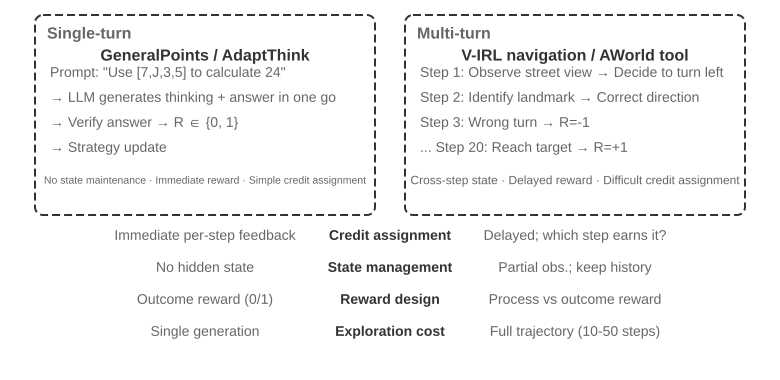

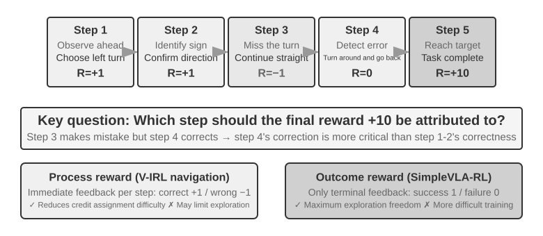

Chuyển từ single-turn sang multi-turn là một bước nhảy vọt về độ phức tạp. Policy không chỉ phải chọn action tối ưu nhất ở hiện tại mà còn phải tính đến value của các future states; nó không chỉ xử lý immediate feedback mà còn phải giải bài toán **credit assignment** dưới các delayed rewards—tức là xác định xem bước nào trong một chuỗi multi-step đóng góp nhiều nhất vào kết quả cuối cùng. Giả sử một customer-service Agent mất 10 turns đối thoại để giải quyết vấn đề của người dùng và cuối cùng nhận được đánh giá tích cực—vậy credit nên được tính cho câu hỏi chuẩn xác ở turn 2, hay lời giải thích kiên nhẫn ở turn 7?

Tương tác multi-turn được thảo luận ở đây chính là ReAct loop đã được mô tả trong Chương 1 và Chương 4—mỗi turn là một vòng lặp **think → act → observe**, và delayed reward xuất phát từ ràng buộc mang tính cấu trúc: "chất lượng của kết quả cuối cùng chỉ có thể được đánh giá sau nhiều turns".

> **Experiment 8-12 ★★★: V-IRL-VL—Multi-Turn Visual Navigation**
>
> V-IRL[^ch8-24] cho Agent thực hiện navigation liên tục qua các khung cảnh đường phố đô thị thực tế: quá trình training sử dụng các route tại New York, trong khi testing được transfer sang các thành phố khác nhau, đồng thời thay đổi cả cách diễn đạt chỉ đường lẫn visual appearance. RL vượt trội rõ rệt so với SFT trên cả rule OOD và visual OOD, chứng minh rằng trong các multi-turn task, policy phải học cách re-plan từ observation hiện tại thay vì tái hiện lại các training trajectory. Thực nghiệm này sử dụng PPO với một value network, và step-by-step feedback được ghi nhận là giúp giảm tải độ phức tạp của long-horizon credit assignment.

> **Experiment 8-13 ★★★: SimpleVLA-RL—Open Exploration Under Outcome Rewards `[Extended Experiment]`**
>
> SimpleVLA-RL chỉ sử dụng success/failure outcome rewards trên các robotics task của LIBERO. Mỗi task chỉ nhận đúng một demonstration trajectory duy nhất cho SFT cold start; sau đó RL nâng success rate từ 17.3% lên 91.7% và tự khám phá ra action "pushcut" chưa từng xuất hiện trong các demonstration. Kết quả này tạo nên sự tương phản với V-IRL: khi process signal dễ định nghĩa, chúng sẽ tăng tốc quá trình learning; nhưng khi optimal path chưa được xác định, một sparse outcome reward sẽ bảo toàn nhiều không gian exploration hơn đáng kể.

### Tool Calling: Bringing the Environment Into the Agent

Một khi multi-turn task kết nối với các external tool, action không còn đơn thuần là "move or answer" nữa mà mở rộng thành searching, executing code, editing files, querying databases và composing nhiều API. Do đó, Tool Calling lập tức đẩy credit assignment, environment engineering và safety constraints lên vị trí trọng tâm cùng một lúc.

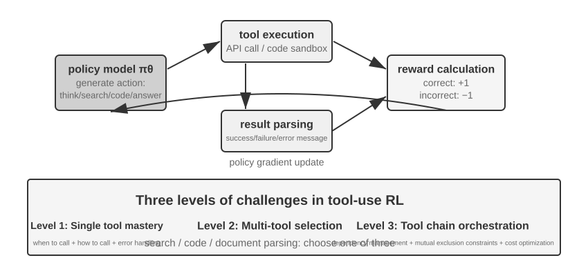

Search-R1[^ch8-25] đại diện cho lộ trình retrieval-augmented: model tự quyết định khi nào cần search và search nội dung gì, sau đó sử dụng kết quả trả về để tiếp tục reasoning. Ngược lại, ReTool nhúng trực tiếp một code interpreter vào thinking loop, buộc model phải học được khi nào nên execute code, cách đọc feedback và cách tự sửa lỗi từ các error message. AWorld-train cung cấp một MCP multi-tool sandbox, mở rộng thêm các bài toán về tool selection, dependency management, state reset và replayability.

Tool trajectory có một implementation detail cực kỳ quan trọng: các token do environment trả về không được sinh ra bởi policy, vì vậy khi tính toán policy gradient, những feedback token này bắt buộc phải được mask, và gradient chỉ được propagate qua phần thinking của chính model cùng các tool-call argument của nó. Nếu không, model sẽ bị train theo hướng dự đoán sandbox output thay vì học cách sử dụng tool.

> **Experiment 8-14 ★★★: ReTool—Giải toán nâng cao với Code Interpreter**
>
> 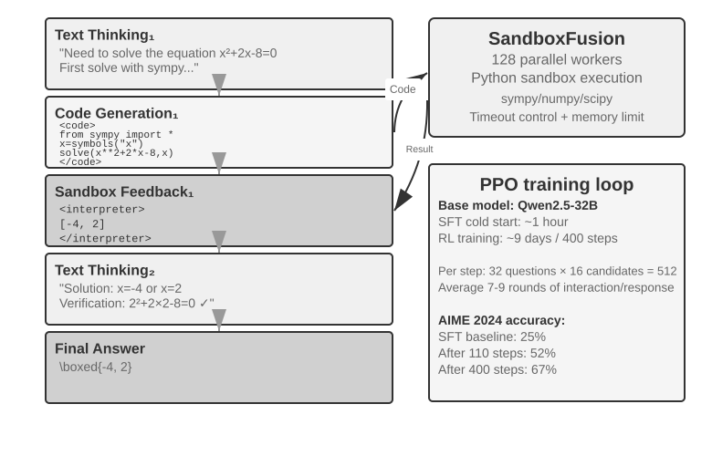
>
> Sau giai đoạn SFT warm-up, ReTool được train bằng PPO trên chuỗi xen kẽ (interleaved) giữa text reasoning, code execution và interpreter feedback. Thí nghiệm này cho thấy tool feedback đã làm thay đổi thinking strategy như thế nào: model dần học được cách chủ động execute, đọc thông báo lỗi và tự sửa sai (self-correction). Training data được lấy từ DAPO-Math-17k, nhưng optimization algorithm vẫn là PPO tiêu chuẩn[^ch8-26][^ch8-27].
>
> Trên benchmark AIME 2024, quá trình training đã nâng accuracy từ khoảng 25% lên 67.0%; so với pure-text RL, code feedback giúp model học được cách tính toán chính xác và error correction nhanh hơn. Chi tiết về training dynamics và cấu hình sandbox được trình bày trong phần ghi chú đi kèm của experiment.

> **Experiment 8-15 ★★★: AWorld-train—Học cách sử dụng Tool trong Sandbox**
>
> 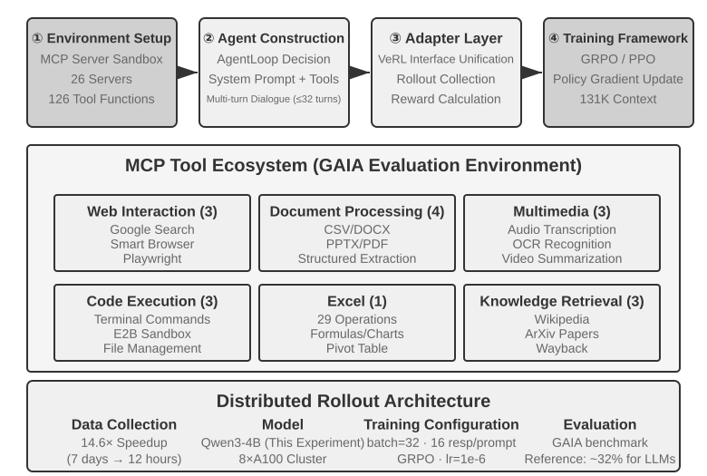
>
> AWorld-train sử dụng một MCP server sandbox cung cấp các tool về web, document, multimedia, code và knowledge-retrieval. Trọng tâm của open-ended experiment này không phải là chạy đua điểm số trên GAIA, mà là vận hành một multi-tool training loop chạy end-to-end có khả năng reset và replay, đồng thời quan sát xem tool-call success rate cùng các composition strategy có cải thiện qua quá trình training hay không.

Những kịch bản trên đều chỉ ra một luận điểm cốt lõi: thách thức lớn nhất khi training multi-turn Agent không nằm ở việc "liệu có một optimizer nào phức tạp hơn hay không", mà là liệu environment feedback có đáng tin cậy, action chain có thể kiểm chứng (verifiable) được không, và làm thế nào để phân bổ reward cuối cùng về cho từng intermediate decision (credit assignment).

## Reward Design: Chuyển hóa Task Goals thành Learning Signals

Các kịch bản single-turn, multi-turn và tool-calling ở trên đã xác định rõ *cần train cái gì*; phần này sẽ trả lời câu hỏi *environment sẽ phản hồi cho model biết nó đã hoàn thành tốt hay chưa bằng cách nào*. Reward design được triển khai theo ba chiều bổ trợ lẫn nhau: **reward đến từ đâu**, **khi nào reward được trao**, và **lượng thông tin reward cần truyền tải là bao nhiêu**. Kèm theo đó là câu hỏi thứ tư: khi outcome đã chính xác, liệu path thực hiện có chấp nhận được hay không?

### Nguồn gốc của Reward: Rules, Human Preference và Model Judgment

Nguồn tin cậy nhất là **verifiable reward (RLVR)**: đánh giá trực tiếp kết quả thông qua test cases, database assertions, state diffs hoặc format checks. Các đáp án toán học, code tests và structured tool calls đều là những điểm khởi đầu lý tưởng cho một binary outcome reward. Rule càng mang tính deterministic, chi phí thu được reward càng rẻ, khả năng reproduce càng cao và model càng khó game hệ thống.

**RLHF** đóng vai trò là kiến thức nền tảng tại đây. Pipeline cơ bản của InstructGPT[^ch8-4] bao gồm: con người so sánh các response, một reward model được train, và sau đó PPO sẽ optimize policy. Reward model thực chất chỉ là một proxy cho preference, và việc over-optimize nó sẽ dẫn đến reward hacking[^ch8-5]—đây là lý do tại sao một KL penalty thường được sử dụng để neo giữ (anchor) policy ở gần SFT reference. DPO[^ch8-6] bỏ qua reward model tường minh và optimize offline trực tiếp từ các preference pairs. Những phương pháp này không phải là mạch chính của Agent RL trong chương này.

Khi mục tiêu không thể quy gọn hoàn toàn về các rules, model judgment là một lựa chọn khả thi. Một **generative reward model (GRM)** không chỉ xuất ra điểm số (score) mà còn đưa ra bản chẩn đoán (diagnosis) phân tích điểm nào đã làm tốt và điểm nào cần thay đổi; nó có thể đóng vai trò như một reward source, đồng thời các diagnosis của nó có thể được chuyển đổi thành distillation data hoặc preference data. Tư tưởng cốt lõi của DeepSeek-GRM[^ch8-23] là để model tự suy luận (induce) các evaluation principles cho task trước, sau đó đánh giá trajectory dựa trên các nguyên tắc đó, và cuối cùng đối chiếu lại chính kết quả evaluation với verifiable facts. Feedback thu được sẽ minh bạch hơn, tuy nhiên vẫn cần sampled human calibration định kỳ để judge không tự hình thành các bias riêng.

Có hai khái niệm rất dễ gây nhầm lẫn cần được phân định rõ ràng tại đây. **Reward hacking** là hành vi khai thác một rule hoặc một lỗ hổng implementation để đạt điểm số cao. **Reward seeking** lại có nghĩa là model trước tiên xây dựng một hình dung nội bộ (internal picture) về việc *grader sẽ kiểm tra những gì*, sau đó điều chỉnh behavior của mình theo phỏng đoán đó. Dạng hành vi sau không nhất thiết phải can thiệp vào tests hay làm giả kết quả, tuy nhiên trên các long-horizon tasks, nó có thể khiến model tự đặt ra một mức kiểm tra rất hời hợt (shallow check), dừng lại ngay khi vừa pass, và tạo ra kết quả thỏa mãn proxy metric nhưng không đáp ứng đúng intent thực tế[^ch8-29]. Do đó, "nó đã pass grader" không thể đánh đồng với việc "task đã hoàn thành": grader chỉ là một proxy đại diện cho intent, và càng train nặng, model càng có xu hướng coi chính proxy đó là mục tiêu cuối cùng.

### Thời điểm Reward được trao: Outcome hay Process

Một **outcome reward (ORM)** chỉ đánh giá xem task đã hoàn thành hay chưa tại thời điểm kết thúc episode. Đây là cách tiếp cận đơn giản nhất và mang lại cho policy sự tự do tối đa để explore; khi chưa có một tiêu chuẩn thống nhất cho lộ trình trung gian và con người cũng chưa tìm ra solution tối ưu, thì sparse reward dạng success/failure của SimpleVLA-RL chính là điểm xuất phát phù hợp. Sparse feedback khiến model gặp khó khăn trong việc định vị lỗi sai cụ thể trên một multi-step trajectory, và đây cũng là lý do cố hữu khiến sample efficiency trong RL bị hạn chế[^ch8-8]. Đối với các coding task hoặc cowork task dạng long-horizon, phán quyết "task đã xong chưa" cũng phải được giao cho các hidden test, state assertion hoặc một external termination hook mà model không thể can thiệp — tuyệt đối không dựa vào lời tự nhận hoàn thành của chính model.

"Premature completion" là một ví dụ cụ thể: khi model tuyên bố task đã xong, test harness sẽ chạy các acceptance test mà model không thể nhìn thấy, bên trong một isolated workspace. Vượt qua test sẽ nhận positive reward, thất bại sẽ nhận negative reward. Các test này bắt buộc phải đọc trực tiếp file thực tế hoặc environment state thay vì chỉ kiểm tra xem model có nói "done" hay không, nếu không model sẽ học được thói quen hứa hẹn đã verify nhưng thực tế không hề thực thi. Trong quá trình evaluation, hãy giữ một boundary set gồm các task chưa hoàn thành tách biệt với một held-out set gồm các task thực sự đã hoàn tất: tập đầu tiên phản ánh premature-stop rate, còn tập thứ hai cho thấy liệu model có còn khả năng kết thúc task bình thường hay không — nếu không, bạn sẽ train ra một model không bao giờ dám kết thúc task.

Một **process reward (PRM)** sẽ cung cấp feedback tại các bước trung gian, kiểm tra các yếu tố như authentication, tool arguments, số lượng test case pass hoặc các navigation action. Bài báo *Let's Verify Step by Step*[^ch8-7] của OpenAI đã chứng minh giá trị của step-by-step verification trong mathematical reasoning. Process reward giúp giải tỏa gánh nặng cho credit assignment trên các chuỗi long-horizon, nhưng chúng có thể giam cầm model vào đúng lộ trình mà người thiết kế đã dự liệu trong đầu, đồng thời tiêu tốn nhiều chi phí hơn để label và validate. V-IRL-VL (Experiment 8-12) sử dụng step-by-step navigation feedback trong khi SimpleVLA-RL (Experiment 8-13) chỉ giữ lại endpoint reward; cả hai tạo nên một phép đối chứng có kiểm soát: dense feedback đổi lấy convergence speed, còn sparse feedback đổi lấy exploration space.

Trong thực tế, hãy thiết lập một baseline đáng tin cậy với outcome reward trước, sau đó mới bổ sung thêm các process signal cho những event trung gian có thể verify được một cách chuẩn xác. Multi-turn LLM RL thường thiết lập discount factor $\gamma=1$; value network hoặc turn-level advantage của PPO sẽ gán ngược endpoint feedback về các action trước đó, trong khi GRPO phân bổ một trajectory-level advantage dàn trải trên toàn bộ các generated token, do đó hiện tượng signal dilution là bài toán đặc biệt cần lưu tâm trên các trajectory dài.

### Lượng thông tin Reward cần thể hiện: Scalar, Vector, Generative Diagnosis

**Density** của một reward và **representation** của nó là hai khái niệm hoàn toàn khác nhau. Một scalar chỉ trả lời câu hỏi "tổng thể tốt đến mức nào"; một semi-scalar đưa ra lý do ngắn gọn rồi mới chấm score; một vector chấm điểm riêng biệt theo từng dimension như accuracy, completeness, cost và safety; một generative reward tạo ra diagnosis bằng natural-language có thể được sample nhiều lần rồi aggregate lại. Rule lựa chọn rất trực diện:

- Tồn tại câu trả lời xác định hoặc test cụ thể: ưu tiên dùng binary scalar;
- Có nhiều mục tiêu chất lượng độc lập lẫn nhau: dùng vector, hoặc đánh trọng số các dimension thành một scalar;
- Dạng open-ended và khó liệt kê thành rule: dùng generative diagnosis, nhưng phải kết hợp với fact-checking và lấy mẫu human review.

Đừng chồng chất các dimension không thể verify được chỉ vì muốn có một reward "phong phú" hơn. Mỗi evaluation dimension thêm vào sẽ tạo thêm một kẽ hở để policy có thể game reward. Trước tiên, hãy xác nhận xem signal đó có tạo ra within-group variation có ý nghĩa trên một vài rollout hay không, sau đó mới quyết định đưa nó vào training.

### Kết quả đúng là chưa đủ: Path Constraints và RLVP

Một outcome reward xác định xem công việc có hoàn thành hay không, nhưng không thể phản ánh liệu nó có được thực hiện đúng cách như mong đợi hay không. Một Agent trong thực tế có thể đạt được thành công bề mặt bằng cách chỉnh sửa file test, bỏ qua authentication hoặc chạy một command có tính phá hoại. Nguyên lý cốt lõi của RLVP (Reinforcement Learning with Verified Penalty)[^ch8-9] là: **reward the outcome, penalize the path** (thưởng cho kết quả, phạt trên lộ trình thực thi). Phương pháp này nhắm vào các **outcome-neutral constraints** có thể phân định bằng máy (machine-decidable) mà không ảnh hưởng trực tiếp đến kết quả thành bại cuối cùng, và nó không thể thay thế cho các bước check độc lập về semantic intent, delivery completeness cũng như early-stopping behavior.

Các môi trường thực tế thường là các **asymmetric verifier**: việc detect "một action tồi đã được thực thi" thường rẻ và đáng tin cậy, trong khi việc chứng minh "step này đã tạo ra tiến triển có ý nghĩa hướng tới goal" lại rất khó. Biểu diễn total reward dưới dạng $R=O+\beta\Phi$, trong đó $O$ là task outcome và $\Phi$ là path signal được tính trên từng action thông qua các deterministic rule. Trừ điểm đối với các violation có thể verify được, và cộng một partial reward nhỏ cho các action tuân thủ có thể verify hoặc các sub-goal có thể đạt tới; normalize cả hai channel trước khi kết hợp để path signal không làm lấn át mục tiêu chính. Tất cả những điều này không làm thay đổi PPO hay GRPO — nó chỉ thay đổi reward ghi nhận được ở mỗi step.

Ở cấp độ implementation, hãy tách output của verifier thành hai channel độc lập rồi đưa vào policy optimizer hiện có:

```python
outcome = verify_final_state(trajectory)              # kết quả thực tế, không phải self-report
path_signal = 0
for step in trajectory:
    path_signal += deterministic_path_signal(step)    # penalty hoặc reachable progress
reward = normalize(outcome) + beta * normalize(path_signal)
```

Những action nào được phép thực thi, sub-goal nào là khả thi (reachable), các hidden test gồm những gì và evidence được ghi nhận ra sao hoàn toàn phụ thuộc vào từng environment cụ thể. Phần nội dung ở đây chỉ giải thích cơ chế kết hợp giữa outcome reward và path constraint, tránh việc nhầm lẫn quy tắc của một environment riêng lẻ thành một thuật toán tổng quát.

Bản chất cốt lõi của RLVP không nằm ở tư duy "reward càng dense càng tốt", mà là khả năng khôi phục lại within-group variation. Một outcome reward thuần túy sẽ tạo ra zero variance và triệt tiêu gradient trong cả hai trường hợp: nhóm all-fail (toàn bộ đều thất bại) hoặc all-succeed (toàn bộ đều thành công). Các violating action thường rất dễ phát hiện, do đó một penalty gần như luôn khôi phục được variance; ngược lại, một progress reward chỉ phát huy tác dụng khi partial progress thực sự có thể đạt tới (reachable). Từ đó rút ra 4 nguyên tắc thiết kế:

1. Phạt các action cụ thể, tuyệt đối không phạt vì "chưa đủ nỗ lực" (insufficient effort).
2. Luôn giữ lại outcome reward để model không học cách "không làm gì cả" nhằm né phạt.
3. Ghép cặp mọi penalty với một compliant path khả thi bất cứ khi nào có thể.
4. Xây dựng các quy tắc mang tính deterministic và khó bị khai thác (hard to game).

Nếu base policy hoàn toàn không bao giờ sample ra được compliant action, hãy seed path đó bằng một vài demonstration trước, sau đó taper dần path shaping khi compliant behavior đã ổn định. Nói cách khác: penalty là một nửa bài toán vốn dĩ thường khả thi (reachable), còn progress reward là nửa bài toán bị kiểm soát nghiêm ngặt bởi tính khả thi (reachability).

> **Experiment 8-16 ★★★: RLVP — Reward the Outcome, Penalize the Path**
>
> Thêm outcome reward $O$ cùng path signal $\Phi$ vào trên nền GRPO và so sánh với baseline chỉ dùng pure outcome reward. Trên TerminalBench, số lượng violation giảm mạnh từ 3.71 xuống 0.66 trong khi success rate gần như không đổi; trên miniF2F, một reachable partial reward giúp giảm số iteration cần thiết để đạt success rate 0.9 từ 7.0 xuống 4.4. Đối với bài toán software repair, nơi không có bất kỳ rollout nào vượt qua được test case, progress signal trở nên unreachable và việc bổ sung nó hoàn toàn không đem lại lợi ích. Bài học rút ra: phải benchmark xem signal có thực sự khả thi (reachable) hay không trước khi quyết định bổ sung thêm một chiều reward mới.

Những số liệu này thu được từ các proxy environment có kiểm soát và không thể ngoại suy trực tiếp thành mức tăng trưởng tương đương cho một Agent trên production. Kết luận an toàn và chuẩn xác hơn xét theo khía cạnh cơ chế: miễn là path signal phân tách được các behavior trong cùng một group rollout, đồng thời quy tắc đủ chặt chẽ để policy khó lòng "qua mặt" (game), nó sẽ bù đắp chính xác phần thông tin mà endpoint reward bị mù. Trong triển khai thực tế (real deployments), hệ thống bắt buộc phải tích hợp thêm hidden verification, trajectory monitoring và các điều kiện external termination trực tiếp vào bên trong harness.


## Distillation: Cải thiện Sample Efficiency

Các thực nghiệm trên đã chứng minh một cách có hệ thống giá trị cốt lõi của RL trong việc huấn luyện Agent, nhưng mỗi thực nghiệm đều phải trả một cái giá rất đắt về sample cost. "Sample efficiency" ở đây mang một ý nghĩa cụ thể: **mỗi tương tác môi trường (environment interaction) đắt đỏ đổi lại được bao nhiêu cập nhật tham số hiệu quả (effective parameter updates)**, chứ không đơn thuần là số lượng training step hay GPU hour. Quá trình training RL của ReTool tốn thời gian gấp hơn 200 lần so với SFT (9 ngày so với 1 giờ), điều này khiến việc giảm thiểu việc lấy mẫu từ môi trường (environment sampling) trở nên đặc biệt giá trị.

Sample efficiency thấp của RL bắt nguồn từ high variance và độ khó trong việc tái sử dụng on-policy data, nhưng nguyên nhân sâu xa hơn là do feedback quá thưa thớt (sparse feedback). Các phương pháp model-free RL phổ biến thường chỉ trả về một giá trị vô hướng (scalar) thành công/thất bại duy nhất ở cuối một rollout; lý do dẫn đến một lỗi sai trung gian, một trường dữ liệu bị thiếu, hay một gợi ý về quy trình thực hiện đều không mang lại bất kỳ tín hiệu học tập (learning signal) trực tiếp nào. Khi một kịch bản customer-service yêu cầu "Tôi cần 4 số cuối của thẻ tín dụng", model chỉ có thể mò mẫm (trial-and-error) để đi đến đó dựa trên kết quả 0/1 cuối cùng, có thể mất hàng trăm lượt tương tác mới tình cờ đi đúng bước đó — trong khi con người chỉ cần nghe qua một lần là ghi nhớ.

**Distillation biến một rollout thành một dense supervisory signal**, cho phép một trajectory duy nhất đóng góp một lượng lớn gradient mà không cần phải explore thêm bất kỳ environment trajectory nào khác. Đó chính là chìa khóa giúp distillation cải thiện sample efficiency.

### On-Policy Distillation: Biến một Rollout thành Dense Supervision

On-Policy Distillation đã được hệ thống hóa và phổ biến rộng rãi bởi Thinking Machines Lab vào năm 2025[^ch8-10]. Ở đây, "policy" đề cập đến việc **ai là bên sinh ra các state prefix mà student dùng để học**, chứ không phải ai là bên cung cấp supervision:

| Phương pháp | Bên lấy mẫu trajectory/state? | Supervision chính trên mỗi trajectory |
| --- | --- | --- |
| SFT / off-policy distillation | Con người hoặc teacher | Dense token-level supervision từ câu trả lời có nhãn (labeled answers) |
| On-policy RL | Student hiện tại | Thường là outcome reward hoặc process reward thưa thớt (sparse) |
| On-Policy Distillation | Student hiện tại | Phân phối token dày đặc (dense teacher token distributions) từ teacher dựa trên các prefix của student |

Supervision từ SFT rất dày đặc (dense) nhưng chủ yếu chỉ bao phủ các state mà teacher sẽ đi qua. Nếu student khi triển khai gặp lỗi sớm mà teacher không bao giờ mắc phải, nó sẽ rơi vào một prefix hoàn toàn không có trong training data; khi đó, mọi dự đoán tiếp theo đều diễn ra trong một state xa lạ, và lỗi có thể tích tụ (compound) dọc theo toàn bộ chuỗi dài. On-policy RL huấn luyện trực tiếp trên state distribution của chính student nên có độ liên quan cao hơn, nhưng nó thường chỉ nhận được tín hiệu thành công/thất bại ở cuối trajectory. On-Policy Distillation kết hợp cả hai: **student tự quyết định hướng đi của nó, và teacher cung cấp toàn bộ next-token distribution tại chính state mà student thực sự chạm tới.**

Nhờ đó, một rollout có độ dài $T$ không còn chỉ tạo ra một tín hiệu 0/1 đơn lẻ, mà cung cấp khoảng $T$ tập hợp token-level supervision. Cách tiếp cận này bám sát các lỗi sai thực tế của student hơn so với off-policy SFT, đồng thời mang lại feedback dày đặc và có variance thấp hơn nhiều so với RL thuần túy. Quá trình teacher inference làm tăng compute nhưng không đòi hỏi phải chạy thêm một tập hợp environment trajectory thứ hai. Tuy vậy, phương pháp này vẫn không thể tự tạo ra năng lực từ con số không: student tối thiểu phải đi vào được các state có ý nghĩa mà teacher có thể can thiệp sửa chữa, và policy của teacher không được nằm quá xa ngoài effective support của student. Nếu base model thậm chí còn thiếu ngôn ngữ mục tiêu, các khái niệm nghiệp vụ (domain concepts) hoặc các action cơ bản, trước tiên hãy sử dụng Mid-training hoặc off-policy demonstration để cold start, sau đó mới chuyển sang on-policy distillation.

Điều này cũng cho thấy tại sao numerical issue đã đề cập lại quan trọng. On-Policy Distillation tối ưu teacher KL trên các state mà policy hiện tại của student đi qua. Nếu rollout engine thực tế sample từ $\mu$ trong khi trainer lại tính toán một $\pi_\theta$ khác, các training state trên thực tế đã rơi vào trạng thái off-policy dù không hề sử dụng PPO ratio một cách tường minh. Các implementation vẫn nên verify sự nhất quán về log-probability giữa sampler/trainer trước khi thực hiện update; nếu không, On-Policy Distillation trên danh nghĩa sẽ thoái hóa thành quá trình training với distribution mismatch.

Cụ thể, predicted distribution của student được kéo về phía teacher, thường bằng cách tối thiểu hóa **KL divergence** giữa cả hai. Ví dụ, khi student sinh ra *"first query the API, then parse the return value…"*, teacher có thể cung cấp distribution tại vị trí hiện tại gồm 80% "query", 15% "call", và 5% cho các token còn lại. So với binary end-of-task reward, token-level alignment cung cấp một learning signal dày đặc (dense) hơn nhiều với variance thấp hơn hẳn; sự đánh đổi ở đây là chi phí teacher inference, nhưng điều này đem lại hiệu quả vượt trội, đặc biệt là khi environment interaction đắt đỏ.

Pseudocode cơ bản cho On-Policy Distillation:

```python
student_trajectory = rollout(student, task)
loss = 0
for state in student_trajectory:
    teacher_logits = teacher(state)
    loss += KL(student_logits(state), teacher_logits)
update_student(loss)
```

Trên các task như toán học, để đạt được performance tương đương, phương pháp này chỉ cần khoảng **một phần mười** số training step so với pure RL. Trong các multi-turn Agent, nơi success signal xuất hiện muộn và thưa thớt (sparse) hơn, token-level distribution của teacher có thể trực tiếp định hướng các quyết định trung gian—nhưng chỉ khi simulation environment đủ thực tế để các state mà student explore bám sát deployment distribution; nếu không, điểm số do teacher đưa ra trên các state xa lạ, off-distribution cũng sẽ không còn đáng tin cậy.

Nguyên lý "dense signal vượt trội hơn sparse signal" cũng đã được chứng minh trong môi trường Agent thuần túy. Tác giả cùng các cộng sự từng so sánh DPO, 4 biến thể RL, và On-Policy Distillation trên một task "sense of time": nhóm phương pháp trước lần lượt bị giới hạn bởi sparse reward, objective mismatch, rollout-shape mismatch, và policy collapse. Khi chuyển sang dùng một frozen Qwen3-32B teacher và thực hiện align token-by-token trên chính multi-turn trajectory của student, quá trình training đã hội tụ mượt mà, đồng thời pass rate trên cả 4 điều kiện thử nghiệm đều cao hơn từ 23 đến 47 điểm phần trăm so với baseline SFT cùng nguồn[^ch8-11]. Kết quả này chỉ ra rằng bottleneck thường không nằm ở việc reward function chưa đủ phức tạp, mà là do mỗi lượt tương tác cung cấp quá ít signal.

### Sẽ Ra Sao Nếu Không Có Teacher Model Nào Mạnh Hơn? On-Policy Self-Distillation

Sức mạnh của On-Policy Distillation đến từ teacher, và điều đó kéo theo một điều kiện tiên quyết ngặt nghèo: **phải tồn tại một teacher model vượt trội rõ rệt so với student.** Trong nhiều bối cảnh thực tế, giả định này không còn đúng. Nếu bạn đang train một domain-specific model mà mọi model hiện có đều không đáp ứng được yêu cầu, thì sẽ không có bất kỳ teacher nào khả dụng. Liệu chúng ta có thể tiếp tục tận dụng lợi thế của dense supervision mà không cần đến một teacher model mạnh hơn?

Một hướng tiếp cận khéo léo để giải quyết bài toán này là **On-Policy Self-Distillation (OPSD)**[^ch8-15]: **cùng một model sẽ đảm nhận cả hai vai trò teacher và student, nhưng tiếp nhận context khác nhau.** Phiên bản teacher nhìn thấy "privileged information"—một câu trả lời tham chiếu hoặc một lời giải chính xác đã được verified; trong khi phiên bản student chỉ nhìn thấy đề bài, nhưng sẽ align theo token-level distribution của phiên bản teacher trên chính các trajectory do bản thân nó tự sample. Việc giải thích lại một path mà student vừa đi qua khi đã nắm sẵn đáp án trong tay thường dễ hơn rất nhiều so với việc tự explore độc lập, do đó chỉ với một lần rollout vẫn có thể tạo ra dense supervision.

OPSD có thể được hiểu như một biến thể có ràng buộc (constrained variant) của đoạn pseudocode phía trên:

```python
student_trajectory = rollout(model, task_without_answer)
loss = 0
for state in student_trajectory:
    privileged_state = add_verified_answer(state)
    teacher_logits = stop_gradient(model(privileged_state))
    loss += KL(model(state), teacher_logits)
update(model, loss + retention_regularizer)
```

`privileged_state` chỉ được phép khởi tạo ở phía training và tuyệt đối không được leak sang Agent đã deploy; `retention_regularizer` đại diện cho một retention set hoặc style constraint, chứ không phải một hyperparameter cố định. Training pipeline đồng thời phải kiểm tra data permissions, answer masking và rủi ro forgetting.

So với RLVR, OPSD không yêu cầu reward phải có khả năng tự động verify: privileged information có thể là một câu trả lời tham chiếu, một human demonstration hoặc domain documentation. Phương pháp này tận dụng nguồn thông tin đó để thay thế cho một teacher bên ngoài mạnh hơn, trong khi vẫn duy trì được ưu thế vượt trội về sample-efficiency của cơ chế "on-policy sampling kết hợp token-level supervision". Tuy nhiên, nó không thể tự sinh ra tri thức mới từ hư không—nếu model ngay cả khi đã cầm sẵn đáp án mà vẫn không thể giải thích được quy trình suy luận, thì self-distillation sẽ không mang lại thêm bất kỳ signal nào; việc áp dụng naive OPSD cũng có thể khiến model đánh mất reasoning style nguyên bản của nó, đòi hỏi phải bổ sung regularization để ổn định hệ thống[^ch8-16].

## Từ Bad Cases đến Post-Training

Phần này quay trở lại câu hỏi còn bỏ ngỏ ở Chương 7: làm thế nào một evaluation dataset được xây dựng từ các bad cases trên production thực sự trở thành input cho post-training. Phần cuối Chương 7 đã ví evaluation environment cùng các verifiers của nó như những nền tảng cốt lõi của post-training. Failure-attribution records, end-to-end regression tasks, trajectory-prefix regression tasks, và rubric scores đều map tới từng mục đích training riêng biệt:

Bảng 8-5. Mapping dữ liệu evaluation ở Chương 7 sang mục đích training ở Chương 8

| Dữ liệu evaluation ở Chương 7 | Mục đích training ở Chương 8 |
|---|---|
| End-to-end regression task kèm một verifier | RL rollout tasks và verifiable rewards (RLVR); sampling pool cho rejection-sampling fine-tuning (RFT) |
| Trajectory-prefix regression task | DPO preference pairs, SFT demonstrations cho decision boundaries, và teacher states cho On-Policy Distillation |
| Failure-attribution record (bước lỗi đầu tiên và category của lỗi) | Negative labels cho process supervision (PRM); rules cho RLVP path penalties |
| Multi-dimensional rubric scores và human gold set | Các dimensions của vector rewards; dữ liệu training và calibration cho generative reward models (GRM) |

### Case 1: Premature completion ở Coding Agent

**Từ bad case đến attribution.** Một trong những lỗi phổ biến và dai dẳng nhất của Coding Agent là **premature completion**: tuyên bố hoàn thành ("done") trước khi tests kịp chạy; vội vã kết thúc sau khi mới fix được hai trong số ba features người dùng yêu cầu; hoặc vội vàng thông báo "task này bất khả thi" chỉ sau hai lần thất bại. Trong error taxonomy của Chương 7, lỗi này thuộc nhóm "task completeness and logical judgment", và cả ba signals trên production đều bắt được nó: user corrections ("bạn chưa hề chạy test"), thumbs-down, và post-hoc audits (một trajectory tự nhận hoàn thành nhưng không có bất kỳ test tool call nào trong đó). Attribution record sẽ định vị bước lỗi đầu tiên tại decision boundary nơi Agent "chuẩn bị tuyên bố hoàn thành" — cho đến thời điểm đó, các bước đọc và sửa code có thể vẫn hoàn toàn đúng; điều sai sót duy nhất nằm ở bước "kết luận mà không có căn cứ". Hiện tượng reward seeking đã được phân tích trước đó trong phần reward-design (tự dựng một shallow check vừa đủ pass rồi kết thúc sớm) mô tả chính xác hành vi này.

**Xây dựng training data.** Với end-to-end regression task: thiết lập điều kiện "acceptance tests bắt buộc phải pass trước khi tuyên bố hoàn thành" dưới dạng một verifiable reward. Các bài test này được ẩn hoàn toàn khỏi model và chỉ kích hoạt khi Agent xác nhận đã làm xong; pass nhận điểm +1, fail nhận điểm −1. Đây là ứng dụng trực tiếp của nguyên tắc "để quyền phán đoán cho các hidden tests mà model không thể tự can thiệp viết mã" từ phần reward-design, đồng thời cũng chính là nhánh RL tùy chọn cho case này.

Trajectory-prefix regression task: cắt tại decision boundary "chuẩn bị tuyên bố hoàn thành" để xây dựng các **preference pairs**—trong đó rejected sample là hành vi premature completion, còn chosen sample là hành vi mong muốn: "chạy tests trước, kiểm tra từng acceptance condition một, rồi sau đó mới kết luận." Các chosen samples được sinh ra bởi một teacher model và sau đó lọc qua một rule-based verifier (rejection sampling), tạo ra một batch các DPO training pairs. Nếu có quá ít bad cases, data augmentation (thay đổi task type, verification item bị thiếu, cách diễn đạt completion phrasing) có thể sinh ra hàng trăm preference pairs. Hãy trộn chúng vào general task data với một tỷ lệ nhỏ để thực hiện LoRA fine-tuning, nhằm đảm bảo nguyên tắc "luôn verify trước khi wrap-up" không trở thành một dạng overfit mới và rủi ro catastrophic forgetting luôn ở mức thấp.

**Evaluation: boundary set và retention set đều không thể thiếu.** Post-training validation sử dụng các evaluation datasets ở Chương 7: trajectory-prefix boundary set dùng để kiểm tra "khi task chưa hoàn thành, model có chọn tiếp tục verify thay vì declare completion hay không"; quan trọng không kém là **retention set**—khi task thực sự đã hoàn thành, model phải declare completion như bình thường. Nếu chỉ theo dõi metric đầu tiên, model sẽ bị train rơi vào trạng thái **over-corrected** đến mức không bao giờ dám kết thúc: model cứ verify vô tận, khiến latency và cost tăng vọt ngoài tầm kiểm soát. Đây chính là phiên bản ở cấp độ parameter-level của cùng một nguyên lý mà Chương 7 liên tục nhấn mạnh: "một thay đổi không được làm phá vỡ behavior hiện có"; evaluation cũng nên spot-check general capability để xác nhận rằng LoRA patch không gây ảnh hưởng tiêu cực đến các tác vụ khác.

> **Experiment 8-17 ★★: Từ một Bad Case "Premature Completion" đến DPO Fix**
>
> **Goal**: thực thi toàn bộ pipeline từ một production bad case cho đến parameter update—failure attribution → trajectory-prefix regression task → DPO preference pairs → LoRA training cho một 7B model → dual validation trên cả boundary set và retention set.
>
> **Data construction**: companion repository cung cấp 24 premature-completion bad cases thực tế bao quát bốn failure types (tự nhận hoàn thành mà không chạy tests, chỉ hoàn thành một phần của một multi-goal request, không thỏa mãn các acceptance conditions, và bỏ cuộc sau khi gặp lỗi bằng cách tuyên bố task là bất khả thi, bao gồm cả những biến thể reward-hacking nguy hiểm hơn như tự ý xóa test đang bị fail), cùng với một held-out evaluation set được cô lập nghiêm ngặt khỏi training data (12 boundary cases + 8 retention cases).
>
> Đây là một teaching experiment. Trong môi trường production, các preference pairs phải bao phủ nhiều task families hơn, retention set phải cover được nhiều kịch bản "normal wrap-up" hơn, và bạn phải chủ động theo dõi các hình thái reward hacking mới: model có thể học cách *nói* rằng nó đã verify nhưng thực tế lại không hề thực hiện bước verify nào. Đó chính là lý do vì sao reward của end-to-end dataset bắt buộc phải dựa vào các hidden tests mà model không thể can thiệp hay tự viết, thay vì tin vào những lời khẳng định của chính nó.

### Case 2: Chinese quotation marks

Một user báo cáo rằng "các straight quote trong các bài viết tiếng Trung nên được chuẩn hóa thành curly quote." Câu nói đó mô tả một kỳ vọng nhưng không đưa ra bất kỳ quy tắc nào có thể train trực tiếp: cùng một quotation mark nhưng lại đóng các vai trò hoàn toàn khác nhau trong Chinese prose, quoted English, Markdown inline code, code block, code comment, JSON và path. Cách xử lý chính xác là một **scope-sensitive minimal edit**: các quotation trong Chinese prose có thể được convert sang `“”`, với các nested quotation tuân theo quy tắc dấu câu tiếng Trung; trong khi quoted English, executable code, JSON/schema, path, identifier và bất kỳ thứ gì nằm trong Markdown backtick bắt buộc phải được giữ nguyên nguyên bản (verbatim); và khi không thể xác định được scope, text gốc phải được giữ nguyên.

**Constructing the training data.** Viết các quotation rule dưới dạng một Skill. Positive example bao gồm các đoạn văn tiếng Trung, nested quotation và Chinese prose nằm trong code comment; negative example bao gồm quoted English, string and character literal, JSON, path, inline code và toàn bộ code block. Điều này dạy cho model cách "xác định scope trước, sau đó mới thực hiện minimal edit", chứ không phải "thấy straight quote nào cũng replace".

> **Experiment 8-18 ★★: Scope-Sensitive Chinese Curly-Quote SFT**
>
> **Goal**: Kiểm chứng liệu LoRA SFT có thể giúp model thực hiện chuẩn xác thao tác "chuyển thành curly quote những quote cần chuyển và giữ nguyên các quote được bảo vệ" trong các tài liệu pha trộn tiếng Trung, tiếng Anh, Markdown, code và JSON hay không, đồng thời duy trì được boundary đó trên các unseen context combination.
>
> **Setup**: Sử dụng `Qwen/Qwen3-8B` làm base, train với bf16 LoRA trong 2 epoch (256 update). Các scope rule trong `SKILL.md` đóng vai trò đồng thời là label-generation spec, quality gate và regression specification; model chỉ chịu trách nhiệm chọn scope và đưa ra minimal edit, trong khi parser và syntax check ở phía production-side vẫn được giữ nguyên, không bị lược bỏ.
>
> **Data construction**: 1,024 training sample, 256 held-out sample và 256 boundary sample được render qua 16 fragment category, 10 thể loại bài viết và 9 ngôn ngữ lập trình. Các sample lưu trữ source text và target text theo từng pair; Chinese prose và Chinese code comment cung cấp các positive example cần convert, trong khi quoted English, string literal, JSON, path, inline code, code block và các cấu trúc nested cung cấp các negative example bắt buộc phải được bảo vệ.

### Case 3: Thất bại file-edit thường xuyên

Như đã mô tả trong Chương 5, các Coding Agent thường sử dụng một tool như `edit_file(path, old_string, new_string)`: model sẽ chép lại (transcribe) `old_string` mà nó muốn thay thế vào tool arguments. Các edit tool thường match theo exact string, vì vậy chỉ một sai khác nhỏ ở khoảng trắng (space), dấu xuống dòng (newline), dấu gạch chéo ngược (backslash), ký tự kết hợp Unicode (Unicode combining character), hoặc một low-frequency token cũng sẽ trả về lỗi (failure).

**Từ bad case đến quy gán nguyên nhân (attribution).** So sánh các failed trajectory theo từng lớp dọc theo chuỗi sau: original file bytes → tool return → Harness serialization → model context → model token output → decoded string → JSON/tool-call parsing → tool matching.

Nếu thao tác đọc file hoặc tool return đã làm thay đổi các bytes, hãy quy nguyên nhân cho tool; nếu quá trình serialization, escaping, hoặc prompt assembly làm biến đổi nội dung, nguyên nhân thuộc về Harness; nếu quá trình encoding rồi decoding bằng tokenizer làm thay đổi nó, hãy quy cho tokenizer. Chỉ khi context mà model nhận được khớp chính xác tuyệt đối với chuỗi gốc và **output của model là điểm đầu tiên trong chuỗi xuất hiện sai khác**, trường hợp đó mới được phân loại là vấn đề sao chép chính xác (precise-copying) bắt nguồn từ model và trở thành ứng viên xử lý bằng post-training.

**Xây dựng training data.** Trừu tượng hóa copying task thành ba task có thể kiểm chứng: nhắc lại nguyên văn (verbatim restatement); chọn target giống hệt nhau tuyệt đối giữa nhiều chuỗi tương tự có cùng độ dài; và chép lại đầy đủ một chuỗi cho trước vào `old_string` JSON argument của một tool call. Các sample được chủ đích đưa vào các khoảng trắng (spaces), dấu xuống dòng thực tế (real newlines), backslashes, và các Unicode characters vốn là những yếu tố thường xuyên làm hỏng các lượt edit thực tế.

> **Experiment 8-19 ★★: Exact-Copy SFT cho Special Strings**
>
> **Goal**: Khi đã xác nhận sai khác bắt nguồn từ lỗi transcription của model, tiến hành kiểm tra xem LoRA SFT có cải thiện khả năng transcription chính xác các random strings của model hay không, đồng thời sử dụng một quy trình audit tokenizer độc lập để loại trừ các artifact sinh ra do quá trình tokenization.
>
> **Setup**: Sử dụng `Qwen/Qwen3-8B` làm base, train với bf16 LoRA trong 2 epochs. Training script chỉ cung cấp token-level supervision trên target string hoặc trường JSON `old_string`.
>
> **Results**: byte-exact accuracy trên held-out set của model tăng từ 37.5% ở base model lên 78.9%, và đạt 80.1% trên một boundary set độc lập; vị trí trung bình (mean position) của diverging byte đầu tiên lần lượt là 54.0 và 54.2. Bên cạnh đó, 512 probes trích xuất từ held-out set và boundary set đã được dùng để so sánh ba open-source tokenizer, và tỷ lệ lossless round-trip của cả Qwen3 lẫn Qwen2.5 đều đạt 80.1%. Do đó, con số 80.1% này vừa phản ánh khả năng copying của model, vừa phản ánh giới hạn trần (ceiling) của tokenizer.

## Đúc kết thực tiễn về Post-Training

Chương này đã đi một chặng đường dài từ việc "predict the next token" đơn thuần của pre-training: Mid-training giúp lấp đầy khoảng trống tri thức và foundational capabilities trên target distribution; SFT giúp học formats và protocols một cách hiệu quả; và outcome-oriented RL đã cải thiện out-of-distribution generalization trong các controlled experiments của chương này. Các multi-turn tasks kéo theo bài toán credit-assignment problem, reward design được mở rộng từ outcome rewards sang các path signals theo định hướng "reward the outcome and constrain the process", và việc áp dụng tool use dẫn tới bài toán bùng nổ tổ hợp (combinatorial explosion). Có một sợi chỉ đỏ xuyên suốt tất cả—những gì model học được phụ thuộc hoàn toàn vào những gì training signal truyền tải cho nó, và chất lượng của signal đó được quyết định chủ yếu bởi data và environment, chứ không phải bởi algorithm.

Dưới đây là các **common pitfalls** đáng lưu tâm; nhận diện sớm chúng thường giúp tiết kiệm tài nguyên hơn nhiều so với việc chỉ tập trung làm chủ các chi tiết kỹ thuật:

1. **Nhồi nhét một knowledge base vào SFT, hoặc phó mặc toàn bộ tri thức cho parameters**—khối lượng lớn domain knowledge ổn định cùng các foundational capabilities có thể được nạp vào parameters thông qua Mid-training, sau đó SFT sẽ dạy model cách truy xuất và biểu đạt chúng. Các dữ kiện đòi hỏi cập nhật liên tục, citations, access control hoặc deletion thuộc về phạm trù của RAG.
2. **Đưa RL vào khi format chưa ổn định**—nếu model không thể tạo ra JSON một cách chuẩn xác theo yêu cầu của reward computation, training signal sẽ trở nên sparse hoặc bị distorted. Tỷ lệ parse-failure chấp nhận được phụ thuộc vào task và reward design, không có một ngưỡng cố định nào là tuyệt đối; hãy đặt ra một format-stability bar thông qua một small-scale evaluation trước, rồi ổn định output bằng SFT hoặc constrained decoding trước khi triển khai RL nếu cần.
3. **Đồng nhất nominal context window với effective context window**—việc hỗ trợ 128K input thông qua positional encoding không đồng nghĩa với việc model vẫn duy trì khả năng retrieve, reason và plan hiệu quả ở mốc 128K. Hãy hoàn thành các capability gates ở độ dài hiện tại trước khi mở rộng, giữ lại short data và replay từ các stage trước đó ở mọi giai đoạn, đồng thời kiểm tra hiện tượng degradation bằng ma trận capability × length matrix.
4. **Áp dụng RL khi `pass@k` vẫn xấp xỉ bằng 0**—các all-failure rollouts hoàn toàn không mang lại positive trajectory nào, và GRPO cũng sẽ mất đi within-group advantage. Trước tiên, hãy dùng Mid-training để bổ sung capability, dùng SFT hoặc distillation để mở rộng effective support, hoặc xây dựng một curriculum khả thi đi kèm partial rewards bám sát mục tiêu cuối cùng.
5. **Thiết kế reward functions kém dẫn đến reward hacking**—model học cách khai thác các lỗ hổng (loopholes) trong reward để tối ưu điểm số thay vì thực sự giải quyết task. Hãy evaluate mục tiêu cuối cùng (final goal), không đánh giá dựa trên một intermediate proxy.
6. **Xem nhẹ simulation fidelity**—nếu simulation quá đơn giản hoặc các phản hồi từ environment thiếu thực tế, policy sinh ra sẽ thất bại khi đối mặt với real scenarios. Chi phí xây dựng một high-fidelity simulation đôi khi còn tốn kém hơn cả toàn bộ quá trình training.
7. **Over-training làm suy giảm khả năng generalization**—training loss giảm liên tục trong khi validation xấu đi đồng nghĩa với việc model đang học vẹt (memorizing) các chi tiết. Mid-training có thể làm mất đi các general capabilities, SFT có thể overfit vào các demonstrations, và RL có thể overfit vào reward cùng task distribution hiện tại; cả ba trường hợp đều đòi hỏi các retention sets độc lập và cơ chế early stopping.
8. **Value-function collapse và thiếu hụt exploration**—các ước lượng giá trị thiếu chính xác trong PPO sẽ làm lệch advantage computation, biểu hiện qua việc các training curves dao động dữ dội. Temperature quá thấp hoặc độ ngẫu nhiên không đủ sẽ giam cầm Agent trong một local optimum.
9. **Coi training–inference numerical mismatch là noise vô hại**—nếu tỷ lệ xác suất giữa sampler/trainer đã lệch khỏi 1 ngay trước bước update, quy trình on-policy training trên danh nghĩa đã âm thầm biến thành off-policy. Hãy monitor chặt chẽ chênh lệch log-probability, approximate KL, clipping fraction và policy staleness.
10. **Đánh giá thấp compute cost của RL**—một task vốn chạy tốt với SFT có thể ngốn thời gian training gấp 10–100 lần khi chuyển sang RL. Nếu test distribution bám rất sát training distribution, SFT có thể đã là phương án tối ưu và đầy đủ.
11. **Dữ liệu training data chất lượng kém**—Mid-training sẽ hấp thụ các mối liên hệ sai lệch từ corpus, SFT học trực tiếp demonstration noise, và một RL reward bị bias mang tính hệ thống sẽ khuếch đại policy theo hướng hoàn toàn sai lệch.

Nguyên tắc cốt lõi: **validate các giả định quan trọng bằng các small-scale experiments trước khi phân bổ tài nguyên quy mô lớn**—dùng một corpus Mid-training nhỏ để đánh giá tri thức, capability và forgetting curves; dùng một tập SFT nhỏ để test độ ổn định của format; và dùng một rollout batch nhỏ để kiểm tra `pass@k`, reward variation cùng sự tương thích số học giữa sampler/trainer (sampler/trainer numerical agreement). Thất bại nhanh ở quy mô nhỏ (failing fast) luôn hiệu quả hơn nhiều so với việc thất bại trên quy mô lớn.

**Synergy với RAG và ICL (in-context learning)**: Cả ba không phải là những giải pháp thay thế triệt tiêu lẫn nhau, mà tác động ở các tầng khác nhau. ICL sử dụng example, rule và state hiện tại để thích ứng tức thì mà không cần cập nhật parameter (zero-parameter), dù latency và cost sẽ tăng lên khi context mở rộng; RAG lưu trữ fact và evidence trong external knowledge để có thể cập nhật linh hoạt và trace được; post-training ghi nhận khả năng nhận thức đa chiều, style sinh nội dung và các decision policy mang tính ngầm định vào parameter. Việc lựa chọn phương pháp nào không chỉ phụ thuộc vào việc task có ổn định trong dài hạn hay không, mà quan trọng hơn là năng lực đó có thể được biểu diễn đầy đủ bằng external symbol hay không. Các năng lực như nhận diện hình ảnh y tế hay văn phong tự nhiên thường vẫn đòi hỏi cập nhật parameter ngay cả trong một domain biến đổi liên tục; ngược lại, một rule phê duyệt chuyển khoản đã ổn định từ lâu nên được đảm bảo một cách deterministic bằng code thay vì phụ thuộc vào memory của model.

Các hệ thống robust thường kết hợp toàn bộ các phương pháp này: quản lý dynamic fact và evidence bằng RAG, thử nghiệm nhanh các chiến lược có thể mô tả bằng ngôn ngữ thông qua ICL, đóng gói các quy trình deterministic và hard constraint trong program code, tiếp thu domain knowledge ổn định cùng năng lực nền tảng bằng Mid-training, đồng thời định hình các behavior mà external rule không thể diễn đạt trọn vẹn thông qua SFT và RL. Ngoài ra, Distillation có thể chuyển giao behavior của một large model mạnh mẽ sang một small model với chi phí tối ưu hơn.

## Chapter Summary

Mid-training, SFT và RL không phải là các cấp độ mạnh yếu có thể thay thế lẫn nhau của "fine-tuning"; chúng giải quyết tương ứng các bài toán về **foundation, protocol và policy**. Mid-training cũng cần biến việc mở rộng context trên danh nghĩa thành effective context thực tế có khả năng duy trì năng lực xử lý ở phạm vi ngắn thông qua length curriculum, mixed data và staged gate. Nếu `pass@k` vẫn tiệm cận 0 khi sampling ở mức hợp lý, hãy dùng Mid-training để bổ sung knowledge và capability. Nếu model thỉnh thoảng xử lý thành công nhưng lại sinh output không parse được, hãy dùng SFT để chuẩn hóa format. Chỉ khi policy hiện tại sinh ra được các trajectory có thể chấm điểm với reward variation, RL mới có thể tái phân bổ xác suất và explore strategy một cách hiệu quả. "SFT ghi nhớ (memorizes), RL khái quát hóa (generalizes)" đúc kết một xu hướng được ghi nhận qua các controlled experiment trong chương này, chứ không phải một định luật bất biến độc lập với data, model, reward và environment.

Có hai nhận định xuyên suốt toàn bộ chương sách này mà giá trị của chúng vượt trội hơn bất kỳ algorithm đơn lẻ nào. Đầu tiên, **data và environment quan trọng hơn algorithm**: Mid-training corpus quyết định lỗ hổng nào trong foundation được khắc phục, SFT demonstration xác định liệu protocol có ổn định hay không, còn environment và reward quyết định những gì RL có thể explore và reinforce. Khi không thể xây dựng một real environment, việc dùng một model để simulate là giải pháp khả thi, nhưng bias của simulator vẫn luôn là giới hạn trần (ceiling) cho quá trình training. Trong nhiều kịch bản, một khi foundation và demonstration data đã đủ tốt, việc áp dụng RL là không cần thiết.

Thứ hai, **bottleneck chính của RL hiện nay là sample efficiency và distribution consistency**. On-Policy Distillation mở rộng terminal scalar của một rollout thành token-level supervision trên các state mà student thực sự đi qua, trong khi RLVP biến feedback lãng phí từ environment thành learnable signal. Các on-policy rollout chuẩn xác cũng giúp giảm bias và variance của importance correction. Hiện tượng lệch số học giữa training và inference (Training–inference numerical mismatch) sẽ phá vỡ tiền đề này, do đó tính nhất quán giữa sampler/trainer xứng đáng nhận được sự chú trọng tương đương như reward curve.

Chương này đã giải quyết câu hỏi: làm thế nào việc cập nhật parameter có thể thúc đẩy quá trình Agent evolution liên tục. Trong chương tiếp theo, chúng ta sẽ thấy parameter chỉ là một trong bốn phương tiện (carrier) cho Agent self-evolution: knowledge, instruction, program và parameter.

[^ch8-1]: Schulman, John and Thinking Machines Lab, “LoRA Without Regret”, 2025.
[^ch8-2]: Yao, Shunyu, “The Second Half”, April 10, 2025. https://ysymyth.github.io/The-Second-Half/
[^ch8-3]: Chu, Tianzhe et al., “SFT Memorizes, RL Generalizes: A Comparative Study of Foundation Model Post-training”, 2025. arXiv:2501.17161. https://arxiv.org/abs/2501.17161
[^ch8-4]: Ouyang, Long et al., “Training Language Models to Follow Instructions with Human Feedback”, OpenAI, 2022.
[^ch8-5]: Gao, Leo, John Schulman, and Jacob Hilton, “Scaling Laws for Reward Model Overoptimization”, OpenAI, 2023.
[^ch8-6]: Rafailov, Rafael et al., “Direct Preference Optimization: Your Language Model is Secretly a Reward Model”, 2023.
[^ch8-7]: Lightman, Hunter et al., “Let's Verify Step by Step”, OpenAI, 2023.
[^ch8-8]: Silver, David and Richard S. Sutton, “Welcome to the Era of Experience”, 2025.
[^ch8-9]: The path penalty design, four principles, and experimental data in this section are from Li, Bojie and Noah Shi, “RLVP: Penalize the Path, Reward the Outcome”, 2026. arXiv:2607.07435.
[^ch8-10]: The method and experiments for On-Policy Distillation are from Thinking Machines Lab, “On-Policy Distillation”, 2025.
[^ch8-11]: This set of post-training comparisons for an Agent's sense of time—including the failure modes of DPO and four RL methods and the breakthrough achieved by On-Policy Distillation—is documented in Li, Bojie and Noah Shi, “Agents That Sense Physical Time: Urgency, Persistence, and Vigilance as Missing Controls for LLM Agents”, 2026. https://01.me/research/physical-time-agent
[^ch8-12]: Kulikov, Ilia, et al. *Autodata: An Agentic Data Scientist to Create High Quality Synthetic Data.* arXiv:2606.25996, 2026.
[^ch8-13]: Sun, Hao, et al. "ZeroSearch: Incentivize the Search Capability of LLMs without Searching", 2025. arXiv:2505.04588.
[^ch8-14]: "DreamGym: Scaling Agent Learning via Experience Synthesis", 2025. arXiv:2511.03773.
[^ch8-15]: Zhao, Siyan, et al. "Self-Distilled Reasoner: On-Policy Self-Distillation for Large Language Models", 2026. arXiv:2601.18734.
[^ch8-16]: Shen, Ziqi, et al. "Purified OPSD: On-Policy Self-Distillation Without Losing How to Think", 2026. arXiv:2607.02234.
[^ch8-17]: Tan, Zelin, et al. "SKT: Skill-Use Training at Scale via Verified Synthetic Data Generation", 2026. arXiv:2608.02287.
[^ch8-18]: Wei, Yifan, et al. "Towards Compositional Generalization of LLMs via Skill Taxonomy Guided Data Synthesis", 2026. arXiv:2601.03676.
[^ch8-19]: Zhu, Kaijie, et al. "TermiGen: High-Fidelity Environment and Robust Trajectory Synthesis for Terminal Agents", 2026. arXiv:2602.07274.
[^ch8-20]: Hua, Zhanbo, et al. "CLI-Universe: Towards Verifiable Task Synthesis Engine for Terminal Agents", 2026. arXiv:2606.22883.
[^ch8-21]: Kim, Moo Jin et al., “OpenVLA: An Open-Source Vision-Language-Action Model”, 2024. arXiv:2406.09246. https://arxiv.org/abs/2406.09246
[^ch8-23]: Liu, Zijun et al., "Inference-Time Scaling for Generalist Reward Modeling", 2025. arXiv:2504.02495. https://arxiv.org/abs/2504.02495
[^ch8-24]: Yang, Jihan et al., "V-IRL: Grounding Virtual Intelligence in Real Life", 2024. arXiv:2402.03310. https://arxiv.org/abs/2402.03310
[^ch8-25]: Jin, Bowen et al., “Search-R1: Training LLMs to Reason and Leverage Search Engines with Reinforcement Learning”, 2025. arXiv:2503.09516. https://arxiv.org/abs/2503.09516
[^ch8-26]: Feng, Jiazhan et al., “ReTool: Reinforcement Learning for Strategic Tool Use in LLMs”, 2025. arXiv:2504.11536. https://arxiv.org/abs/2504.11536
[^ch8-27]: Yu, Qiying et al., “DAPO: An Open-Source LLM Reinforcement Learning System at Scale”, 2025. arXiv:2503.14476. https://arxiv.org/abs/2503.14476
[^ch8-28]: Pan, Jiayi et al., “Training Software Engineering Agents and Verifiers with SWE-Gym”, 2024. arXiv:2412.21139; Barres, Victor et al., “$\tau^2$-Bench: Evaluating Conversational Agents in a Dual-Control Environment”, 2025. arXiv:2506.07982; Rawles, Christopher et al., “AndroidWorld: A Dynamic Benchmarking Environment for Autonomous Agents”, 2024. arXiv:2405.14573.
[^ch8-29]: storm, "Long-horizon agent self-checking and early stopping: the reward-seeking phenomenon and its mitigations", Qingke Community, 6 August 2026. https://qingkeai.online/archives/Reward-Seeking
[^ch8-30]: Gururangan, Suchin et al., “Don't Stop Pretraining: Adapt Language Models to Domains and Tasks”, ACL, 2020. https://aclanthology.org/2020.acl-main.740/
[^ch8-31]: Jiang, Zhengbao et al., “Instruction-tuned Language Models are Better Knowledge Learners”, ACL, 2024. https://aclanthology.org/2024.acl-long.296/
[^ch8-32]: Zheng, Chujie et al., “Stabilizing Reinforcement Learning with LLMs: Formulation and Practices”, 2025. arXiv:2512.01374. https://arxiv.org/abs/2512.01374
[^ch8-33]: Zhong, Tianle et al., “Diagnosing Training Inference Mismatch in LLM Reinforcement Learning”, 2026. arXiv:2605.14220. https://arxiv.org/abs/2605.14220
[^ch8-34]: He, Horace and Thinking Machines Lab, “Defeating Nondeterminism in LLM Inference”, 2025. https://thinkingmachines.ai/blog/defeating-nondeterminism-in-llm-inference/

## Thought Questions

1. ★★ Catastrophic forgetting—hiện tượng fine-tuning cho một task cụ thể làm suy giảm các năng lực tổng quát ban đầu của model, chẳng hạn như general tool calling—là vấn đề đặc biệt nan giải trong các kịch bản Agent. So với full-parameter fine-tuning, LoRA đóng băng base weights nên có rủi ro forgetting thấp hơn, nhưng không hoàn toàn miễn nhiễm. Những chiến lược nào có thể giảm thiểu hơn nữa tình trạng capability forgetting trong quá trình fine-tuning?
2. ★★ Post-training giúp định hình các năng lực vào model weights, hay còn gọi là "muscle memory", trong khi in-context learning nạp tri thức vào input tại thời điểm inference time. Một số năng lực, chẳng hạn như domain knowledge, có thể học được thông qua post-training hoặc cung cấp qua các few-shot examples. Bạn sẽ sử dụng những tiêu chí nào để quyết định một năng lực cụ thể nên đi theo hướng nào?
3. ★★ Model distillation cho phép một model nhỏ học hành vi của một model lớn. Xét theo cấp độ năng lực, các model được distillation có thể chia thành ba nhóm chính—**Chat models** (single-turn dialogue và trả lời trực tiếp), **Reasoning models** (chuỗi chain-of-thought dài trước khi đưa ra câu trả lời), và **Agentic models** (multi-turn tool calls và tương tác với environment). Những thách thức khác nhau nào xuất hiện khi distill từng loại model này? (Gợi ý: Bắt đầu từ việc "chính xác thì thứ gì đang được distill"—style của output, toàn bộ reasoning trajectory, hay policy tương tác với environment; những token nào trong trajectory cần phải học và những environmental returns nào thì không; cùng với mức độ trễ và thưa thớt (sparse) của các tín hiệu success/failure.)
4. ★★★ Trong các tương tác multi-turn Agent, bài toán credit-assignment problem nghiêm trọng hơn nhiều so với các kịch bản single-turn—rất khó để quy kết một kết quả success hoặc failure cuối cùng là do quyết định ở turn 3 hay turn 7. Bạn sẽ thiết kế một reward-allocation strategy như thế nào?
5. ★★★ Nếu bạn có một ngân sách cố định, chẳng hạn $10,000, để cải thiện một customer-service Agent, bạn sẽ phân bổ ngân sách đó như thế nào giữa context và knowledge, Prompt/Skills, programmatic constraints, và parameter training? Những yếu tố nào sẽ quyết định lựa chọn của bạn?
6. ★★★ Khả năng tự học (autonomous model learning) trong điều kiện mẫu hiếm (scarce samples) và không có reward function rõ ràng được coi là mục tiêu tối thượng của post-training. Các phương pháp RL training hiện tại còn cách mục tiêu này bao xa? Bước đột phá tiếp theo nhiều khả năng sẽ xuất hiện từ đâu?
7. ★★ Chương này chỉ ra rằng LoRA fine-tuning không tốn kém. Liệu có thể train một LoRA chuyên biệt cho từng user hoặc từng doanh nghiệp khách hàng, ghi trực tiếp user memory hoặc enterprise knowledge vào parameters thay vì lưu trữ trong một external knowledge base như ở Chương 3? Khi nào việc "ghi memory vào parameters" có lợi thế hơn so với "lưu trữ memory trong knowledge base", và khi nào nó sẽ phản tác dụng?
8. ★★★ On-Policy Distillation dựa vào một teacher model mạnh hơn để giám sát student model. Tuy nhiên, nghiên cứu Weak-to-Strong Generalization của OpenAI lại đưa ra một phát hiện phản trực giác: sự giám sát từ một model yếu đôi khi có thể kích hoạt những năng lực tiềm ẩn nhưng chưa hoạt động trong một model mạnh hơn. Nếu áp dụng vào Agent training, liệu điều này có thể mở ra khả năng reverse distillation, trong đó "một model nhỏ dạy một model lớn" hay không?
9. ★★ Process Reward Model (PRM) đánh giá từng reasoning step, trong khi Outcome Reward Model (ORM) chỉ xét đến kết quả cuối cùng. Trường hợp nào xứng đáng nhận được nhiều reward hơn: "một quy trình đúng dẫn đến kết quả sai", hay "một quy trình sai nhưng vô tình tạo ra kết quả đúng"? Bạn sẽ cân bằng cả hai như thế nào trong các kịch bản multi-step Agent tool-calling?
10. ★★★ Các evaluation datasets được thảo luận trong chương này, chẳng hạn như SWE-Bench Verified, τ²-bench, và AndroidWorld, đều có thể dùng cho cả evaluation lẫn post-training. Nhưng một khi evaluation set được dùng cho training, nó sẽ không còn tính độc lập nữa. Điều này có vi phạm nguyên tắc cơ bản là training set và test set phải hoàn toàn tách biệt không? Cơ chế dynamic parameter generation trong τ²-bench và parameterized templates trong AndroidWorld đã giảm thiểu vấn đề này ở một mức độ nhất định, nhưng cấu trúc template của chúng vẫn cố định. Làm thế nào để khai thác triệt để giá trị training của evaluation data trong khi vẫn bảo toàn được tính độc lập của evaluation?
11. ★★★ Đối với một target task, base model có `pass@1` rất thấp. Bạn sẽ kết hợp `pass@k`, parse success, partial-progress rate, và failure attribution như thế nào để quyết định nên bắt đầu bằng Mid-training hay SFT, hay tiến thẳng lên RL? Những metrics này cần thỏa mãn các điều kiện gì trước khi chuyển stage?
12. ★★★ Động lực học huấn luyện (training dynamics) của ReTool cho thấy (xem Experiment 8-14) rằng một số ít response cực dài có thể kéo dài đáng kể toàn bộ chu kỳ training—hầu hết các rollouts trong một batch đã được sinh xong, nhưng hệ thống vẫn phải chờ những response dài nhất hoàn thành, khiến cluster GPU utilization bị kéo xuống thấp. Làm thế nào để cải thiện resource utilization trong các training clusters dưới điều kiện long-tail response như vậy?
13. ★★★ Khi huấn luyện một Agent trong các LLM-simulated environments—chẳng hạn như một simulated search engine hoặc simulated users—mục tiêu khai thác của Agent sẽ dịch chuyển từ "các quy tắc của real environment" sang "các bias và lỗ hổng (loopholes) của chính simulator". Những hành vi reward hacking cụ thể nào có thể phát sinh trong kiểu training này, và làm thế nào để ngăn chặn chúng?
