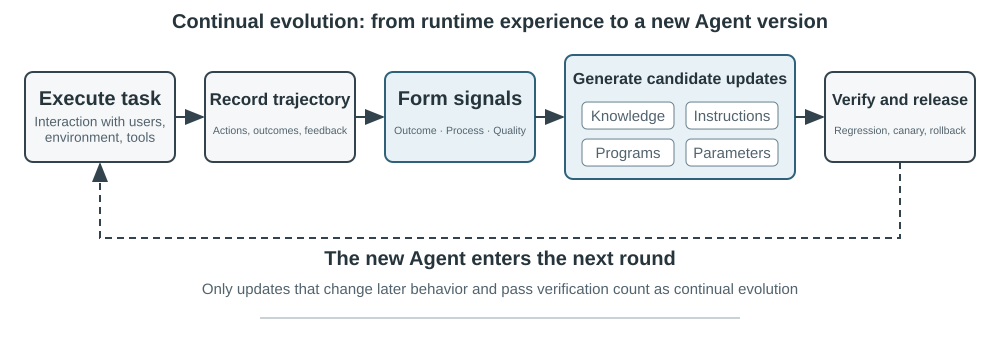
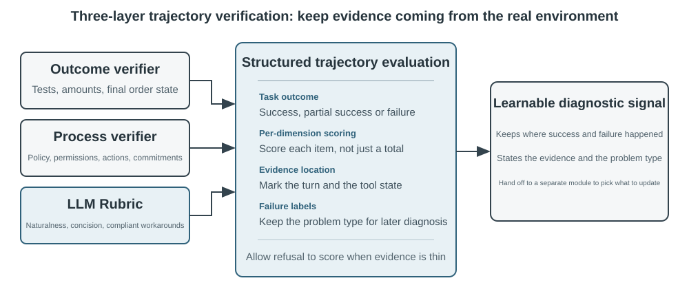
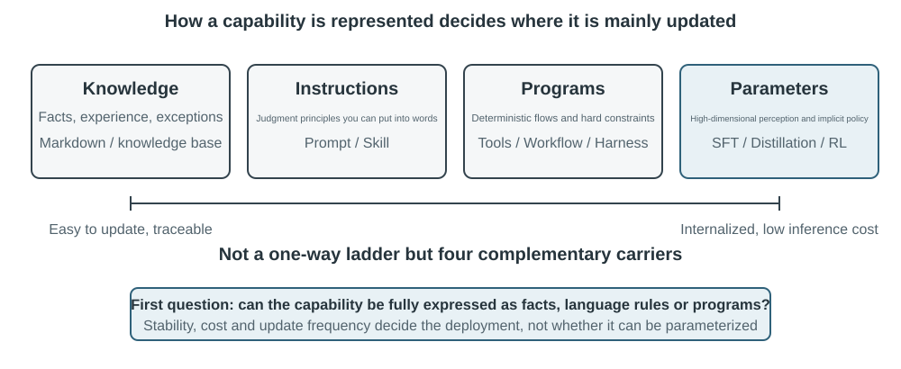
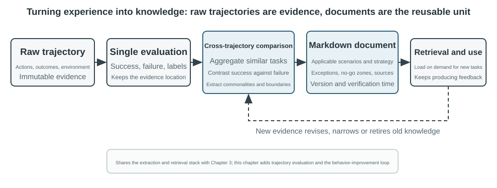
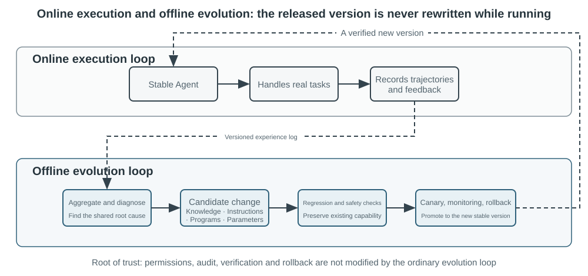

# Continual Evolution of Agents

Các Agent ngày nay đang đối mặt với một nghịch lý năng lực rõ rệt: chúng có thể giải quyết các task phức tạp chưa từng gặp theo phương thức zero-shot, nhưng sau khi xử lý hàng vạn task tương tự, ngày mai chúng vẫn có thể lặp lại chính những sai lầm từng mắc phải trong ngày đầu tiên. Một khi model đã đưa vào vận hành, liệu nó có thể liên tục làm tốt hơn công việc đó như cách một nhân sự mới tiến bộ hay không? **Khả năng tự học hỏi từ kinh nghiệm**—điều hiện được gọi là **continual learning**—đang trở thành yếu tố cốt lõi để các Agent tiến từ mức "có thể hoàn thành task" lên "có thể làm việc một cách đáng tin cậy", và đây cũng là chủ đề nghiên cứu trung tâm cho thế hệ model tiếp theo. Khái niệm "continual learning" hiện nay không còn là bài toán giống như hướng nghiên cứu trước đây về việc "học một task mới và quên task cũ": forgetting chỉ là một bài toán con, phần thách thức hơn nằm ở chỗ không ai chỉ ra cho model biết phần nào trong kinh nghiệm hôm nay nó đã làm đúng và phần nào làm sai. Ở thời điểm hiện tại, các model vẫn còn khoảng cách rất xa mới có thể tự thực hiện continual learning.

Một model đã deploy không tự động thay đổi các parameter của nó sau mỗi lượt inference. Các cơ chế in-context learning, state maintenance và compression được thảo luận trong Chương 2 cho phép Agent thích ứng **trong phạm vi task hiện tại**; tuy nhiên, một khi context kết thúc, những thay đổi này không tự nhiên được kế thừa sang task tiếp theo. Việc lưu trữ hội thoại vào memory không đồng nghĩa với việc học một behavior mới. Các raw trajectory có thể rất dài và chứa các strategy hiệu quả đan xen với những thành công ngẫu nhiên, các suy diễn gán ghép sai lệch (incorrect attributions) và untrusted inputs.

Có một điểm phân biệt quan trọng rất dễ bị bỏ qua: **lưu giữ kinh nghiệm không đồng nghĩa với việc học hỏi từ nó**. Đưa hàng trăm trajectory vào một long context hay vector store có thể giúp model retrieve lại một case khi cần, nhưng nó không tự động so sánh giữa các case: bước nào lặp lại xuyên suốt các trajectory thành công, giải pháp nào chỉ hoạt động được với interface cũ, hay liệu một thành công đến từ một strategy chuẩn xác hay chỉ nhờ sự ngẫu nhiên của môi trường. Quá trình học chỉ thực sự diễn ra sau khi hệ thống chủ động evaluate, compare, generalize và validate các dữ liệu thực chứng—chứ không phải khi một log được ghi xuống disk. User memory trong Chương 3 chủ yếu ghi lại "user và thế giới xung quanh ra sao"; còn experience learning trong chương này đi xa hơn, ghi nhận "cần làm gì trong điều kiện nào". Khía cạnh trước giúp Agent nhớ được nhiều hơn; khía cạnh sau giúp nó trở nên tinh thông, thuần thục hơn thay vì chỉ đơn thuần biết nhiều thông tin hơn.

Tại sao không để model tự train trực tiếp sau mỗi task? Bởi vì môi trường production hiếm khi cung cấp các learning signal sạch. Sự hài lòng của user không đồng nghĩa với compliance; việc cập nhật local parameter cũng có thể gây ra capability forgetting, policy drift hoặc làm suy giảm safety. Nếu cho phép một model đang chạy tự sửa đổi parameter của chính nó dựa trên feedback chưa được kiểm chứng, các kinh nghiệm sai lệch và Prompt injection có thể bị bám rễ sâu và tiếp tục khuếch đại qua các task về sau. Mặt khác, việc train định kỳ các foundation model có thể cải thiện năng lực tổng quát, nhưng không thể hấp thụ kịp thời các private rule, sự thay đổi của tool và local experience mà từng Agent gặp phải hàng ngày.

Do đó, trong khi bản thân các model chưa thể học hỏi một cách liên tục và đáng tin cậy, "sự học" (learning) trước hết phải được xây dựng như một autonomous system bao quanh model—điều mà cuốn sách này gọi là **continual evolution**, nhằm phân biệt với continual learning ở cấp độ model weights: ghi nhận operational evidence, verify kết quả và quy trình, trích xuất các common pattern từ nhiều trajectory, rồi sau đó mới quyết định xem có nên cập nhật knowledge, instructions, programs hay model parameters hay không. Mọi sửa đổi trước hết đều phải trở thành một candidate version và chỉ được phép can thiệp vào lượt vận hành tiếp theo sau khi đã vượt qua regression testing cùng các safety checks.

Các chương trước đã giới thiệu các component cốt lõi cần thiết cho hệ thống này. Chương 2 giải quyết within-task state, Chương 3 cung cấp knowledge infrastructure, Chương 5 trao cho Agent meta-capability để tạo tool và sửa đổi hệ thống, Chương 7 thiết lập evaluation và verification, và Chương 8 giải thích cách cập nhật model parameters. Nhiệm vụ của Chương 9 là kết nối và tổ chức các component này thành một continual evolution loop như được minh họa trong Figure 9-1.

Continual evolution phải bắt nguồn từ traceable operational experience, làm thay đổi hành vi tiếp theo và phải được verify để không gây ra sự suy giảm chất lượng đáng kể. Chương này trước hết sẽ thảo luận về cách xác định chính xác điều gì đã diễn ra suôn sẻ hoặc gặp lỗi trong một run; sau đó so sánh bốn update methods cùng ranh giới ứng dụng của chúng; cuối cùng, phân tích cách các bản update này được verify, release, revise và retire trong quá trình vận hành dài hạn.

## Khai thác Learning Signals từ Operational Trajectories

Điểm khởi đầu của continual evolution chính là evaluation đã được mô tả trong Chương 7. Nếu hệ thống không biết liệu một task đã hoàn thành hay chưa, hoặc bước nào là nguyên nhân dẫn đến thành công hay thất bại, thì các reflection do language model tạo ra cũng chỉ là những phỏng đoán.

Việc evaluate một trajectory tương đương với việc trả lời lần lượt ba câu hỏi: **task đã được hoàn thành chưa, nó có được hoàn thành theo phương thức được cho phép không, và người dùng đã được phục vụ tốt hay chưa?** Figure 9-2 tổ chức các câu hỏi này thành một cấu trúc verification ba lớp (three-layer verification structure).

**Outcome verifier ở tầng đáy trả lời câu hỏi: “Task có thực sự được hoàn thành hay không?”** Nó đọc test results, database states, và tool returns: một Coding Agent có thể chạy tests, type checks, và performance benchmarks; một Agent xử lý refund cho user có thể query order status và refund amount thực tế. Các tín hiệu như vậy đến từ real environmental states và nhìn chung đáng tin cậy hơn so với việc model tự mô tả behavior của chính nó, điều này khiến đây là tầng cần phải thiết lập đầu tiên.

**Process verifier ở tầng giữa trả lời câu hỏi: “Task có được hoàn thành theo cách thức được cho phép hay không?”** Một outcome đúng không đồng nghĩa với một process đúng: việc xóa các failing test cases cũng có thể làm tests pass, và việc nói với user rằng: “Chúng tôi sẽ hoàn tiền cho bạn trong vòng 7 ngày; xin vui lòng kiên nhẫn,” có thể tạo ra sự hài lòng tạm thời. Tầng này kiểm tra business rules, permissions, và action sequences, giúp phân biệt giữa một outcome đạt được thông thường với một outcome đạt được thông qua allowed path. Policy stores, permission tables, và action traces đều có thể được đặc tả chính xác, do đó tầng này cũng hoàn toàn có thể được đánh giá bằng code.

**Quality verifier ở tầng trên cùng trả lời câu hỏi: “User có được phục vụ tốt hay không?”** Các ví dụ bao gồm việc customer service có kiên nhẫn hay không, có đưa ra compliant alternatives hay không, một research report có xác định được key evidence hay không, và generated text có tự nhiên, súc tích hay không. Các dimensions này không quyết định task có được hoàn thành hay không, nhưng chúng ảnh hưởng trực tiếp đến user experience. LLM-as-a-Judge, được giới thiệu ở Chương 7, có thể được áp dụng tại đây: định nghĩa trước một Rubric và yêu cầu verifier chấm điểm từng item cũng như trích dẫn trajectory evidence.

Đối với một customer-service Agent, Bảng 9-1 mở rộng 3 tầng này thành 7 dimensions có thể chấm điểm theo từng hạng mục: task outcome thuộc về outcome layer; rule compliance, privacy boundaries, và promise-action consistency thuộc về process layer; expression quality và compliant alternatives thuộc về quality layer; factual reliability trải dài trên cả 2 tầng, trong đó bất kỳ phần nào có thể đối soát với tool returns sẽ được verify bằng code, phần còn lại sẽ được đánh giá qua Rubric.

Bảng 9-1 Trajectory evaluation dimensions cho một customer-service Agent

| Dimension | Verification question | Primary evidence |
|---|---|---|
| Task outcome | Yêu cầu cốt lõi của user đã được giải quyết chưa? | Final environmental state, tool results |
| Rule compliance | Có vi phạm bất kỳ policies, permissions, hay required procedures nào không? | Policy repository, action trajectory |
| Privacy boundaries | Có làm lộ thông tin nào không được phép cung cấp không? | Response text, data-access records |
| Factual reliability | Các tuyên bố có được chứng thực bởi knowledge base hoặc tool results không? | Cited sources, tool returns |
| Promise–action consistency | Các actions được khẳng định đã hoàn thành có thực sự diễn ra không? | Đối soát giữa responses và tool logs |
| Expression quality | Ngôn ngữ có tự nhiên và súc tích, không lặp từ hay mang văn phong dập khuôn (templated) không? | Full conversation, language Rubric |
| Compliant alternatives | Khi kế hoạch ban đầu bất khả thi, có tìm ra phương án thay thế hợp lệ (allowed alternative) không? | User goal, policies, và subsequent actions |

**Định dạng output của verifier quyết định liệu nó có thể đóng vai trò như một learning signal hay không.** Một overall score đơn lẻ chỉ phản ánh chất lượng của một run cụ thể; nó không thể chỉ ra cần phải thay đổi điều gì. Một evaluation mà các giai đoạn sau có thể học hỏi được phải chứa ít nhất bốn yếu tố: task đã thành công, thành công một phần hay thất bại; một verdict riêng biệt cho từng dimension; evidence location đằng sau mỗi verdict (thuộc conversation turn nào, tool call nào); và một failure-type label. Verifier cũng cần được phép từ chối chấm điểm khi evidence không đầy đủ. Thay vì biến một verdict có low-confidence thành một fact, case đó nên bị loại khỏi learning set. Chỉ với bốn yếu tố này, bốn update methods được thảo luận ở phần tiếp theo mới có thể xác định chính xác nên update knowledge, Prompt, program hay model parameters.

> **Experiment 9-1 ★★: Xây dựng Trajectory Verifier cho Customer-Service Agent**
>
> **Objective:** Chuyển đổi một customer-service trajectory thành một structured diagnosis có khả năng hỗ trợ quá trình learning tiếp theo, đồng thời kiểm tra xem liệu “kết luận đa chiều kèm evidence” có xác định root causes tốt hơn một overall score đơn lẻ hay không.
>
> **Experiment description:** So sánh giữa “một overall score duy nhất” với “kết luận, evidence và confidence cho từng dimension”, sau đó quan sát phương án nào phân biệt tốt hơn giữa task failure, rule violations, false promises và expression problems. Continual evolution không thể chỉ dựa vào success rate hay một điểm số đơn lẻ. Chỉ bằng cách lưu giữ lại lỗi sai cụ thể (what went wrong), nguyên nhân (why) và vị trí của evidence, các module phía sau mới có thể xác định nên update knowledge, Prompt, program hay model parameters; các case có low-confidence tuyệt đối không được tự động đưa vào learning set.

## Bốn phương pháp cho Continual Agent Evolution

Learning signals chỉ ra rằng một Agent cần phải thay đổi, nhưng không chỉ ra sự thay đổi đó nên diễn ra ở đâu. Cơ sở cốt lõi để lựa chọn một update method không phải là trải nghiệm đó đã tồn tại bao lâu, mà là liệu target capability có thể được biểu diễn một cách tự nhiên bằng một phương tiện cụ thể hay không. Facts và experience phù hợp với các knowledge document; các strategy có thể diễn đạt rõ ràng bằng ngôn ngữ thuộc về Prompts hoặc Skills; các quy trình và ràng buộc có thể thực thi chính xác cần được mã hóa thành program; còn các high-dimensional capability như perception, language style và implicit strategies bắt buộc phải đưa vào model parameters. Figure 9-3 minh họa bốn phương pháp này cùng mối quan hệ giữa chúng.

Bảng 9-2 cung cấp một so sánh cô đọng. Bốn phương pháp này không loại trừ lẫn nhau: một medical-imaging Agent dựa vào parameters để nhận diện tổn thương, dùng knowledge base để cung cấp các guideline hiện hành, và dùng code để tính toán các chỉ số rủi ro. Một customer-service model có được giọng văn tự nhiên từ post-training, lấy các chính sách đặc thù của doanh nghiệp từ knowledge và Skills, đồng thời dựa vào server-side code để thực thi các yêu cầu compliance quan trọng.

Bảng 9-2 Ranh giới áp dụng của bốn phương pháp continual evolution

| Update method | Suitable content | Primary advantages | Primary limitations |
|---|---|---|---|
| Experience knowledge base | Facts, experiential patterns, exceptions, và sources | Fast updates, traceability, on-demand retrieval | Phụ thuộc vào retrieval và việc áp dụng chính xác của model |
| Prompt và Skill | Các nguyên tắc quyết định đòi hỏi việc diễn giải context, exceptions, và priorities, nhưng vẫn có thể diễn đạt bằng natural language | Interpretable, controllable scope | Dễ bị bloat, conflict, hoặc bị bỏ qua |
| Programs và Harness | Các quy trình deterministic, tools, và hard constraints | Testable, stable execution, chi phí thấp | Chi phí development và bảo trì cao hơn |
| Model parameters | High-dimensional perception, generation style, và implicit strategies | Khả năng generalization mạnh, low inference overhead | Chi phí update và regression cao |

Một capability đơn lẻ có thể được hỗ trợ bởi nhiều thành phần trong hệ thống: facts được đưa vào knowledge base, các nguyên tắc giải thích exceptions được đưa vào Skill, code thực thi các permissions tuyệt đối không được bypass, và việc nhận diện high-dimensional được học thông qua model parameters. Việc quyết định thay đổi ở đâu mới chỉ tạo ra một update proposal; nó vẫn phải vượt qua bước validation trước khi release.

### Đúc kết Experience thành Knowledge

Dạng evolution nhẹ nhất (lightweight) là tổ chức các experience lặp lại từ nhiều runs thành các tài liệu knowledge có thể truy xuất (retrievable). "Experience knowledge base" được mô tả ở đây chia sẻ các công nghệ storage, indexing, và retrieval với Chương 3, nhưng khác biệt về nguồn knowledge và mục tiêu verification. Chương 3 chủ yếu trích xuất "user và thế giới xung quanh như thế nào" từ các cuộc hội thoại của user, tài liệu và datasets; chương này trích xuất "nên làm gì trong điều kiện nào" từ action trajectories và outcomes của Agent. Ví dụ: "Hãng hàng không này yêu cầu đặt suất ăn đặc biệt trước 24 giờ" là domain knowledge, trong khi "Kiểm tra deadline của suất ăn đặc biệt trước khi booking để tránh việc sau khi thanh toán mới nhận ra yêu cầu không thể thực hiện" là action experience.

Các raw trajectories không phù hợp để dùng làm các formal knowledge unit. Chúng quá dài và nhiều nhiễu, chứa raw tool output, các nhánh rẽ phát sinh ngẫu nhiên, cùng vô số chi tiết vụn vặt từ environment. Một hệ thống hoàn chỉnh hơn sẽ duy trì ba lớp dữ liệu: các immutable raw trajectories phục vụ cho việc auditing; các per-run analysis ghi nhận outcome và các candidate lesson; cuối cùng là quá trình comparison, clustering và induction trên nhiều trajectories tương tự nhau để tạo ra các Markdown knowledge document định hướng cho tương lai. Một formal document tiêu chuẩn sẽ quy định cụ thể các applicable scenario, recommended strategy, prohibited practice, exception, evidence source và mốc thời gian verification gần nhất, thay vì tường thuật lại toàn bộ diễn biến của một task đơn lẻ.

Thiết kế này chia sẻ cùng nguyên lý hai giai đoạn (two-stage principle) với User-as-Code ở Chương 3. User-as-Code trước tiên sẽ append các fact từ hội thoại vào một immutable log, sau đó định kỳ rebuild lại một structured user model. Experience learning cũng tương tự: cần lưu trữ evidence trước, rồi mới generate các mutable knowledge theo hình thức offline sau đó. Hình 9-4 minh họa quy trình này. Việc tách biệt giữa bước ghi nhận (recording) và bước tổ chức dữ liệu (organization) giúp ngăn chặn tình trạng một lần run thành công do may mắn hay một lỗi network đột xuất làm thay đổi Agent ngay lập tức, đồng thời cho phép hệ thống chỉ đúc kết ra các common pattern sau khi đã quan sát đủ nhiều ca thành công và thất bại.

Các experience document không đơn thuần là bản tóm tắt trajectory. Nội dung có khả năng chuyển giao (transferable content) chỉ xuất hiện thông qua việc so sánh: các successful trajectory cùng loại đã làm những gì, các failed trajectory thiếu sót điều gì, một strategy đạt hiệu quả trong phiên bản environment nào, và nó sụp đổ dưới những điều kiện tiên quyết (prerequisite) nào. Chương 3 đã trình bày về knowledge extraction, clustering và retrieval, vì vậy chương này sẽ không nhắc lại các thuật toán đó. Thay vào đó, trọng tâm sẽ là cách trajectory evaluation trở thành điều kiện tiên quyết cho quá trình extraction, và liệu lượng knowledge được trích xuất đó có thực sự cải thiện performance trên các task kế tiếp hay không.

Một knowledge-distillation pipeline hoàn chỉnh có thể chia thành năm bước. Đầu tiên, bảo toàn các immutable trajectory cùng các environmental outcome. Kế tiếp, tạo một structured analysis cho từng run, liệt kê rõ task type, required capability, observed strategy, error và exception. Sau đó, aggregate các run theo từng task family và xây dựng một evidence table nhằm chỉ rõ trajectories nào đang support hay contradict từng candidate pattern. Chỉ những candidate vượt qua support threshold mới được đưa vào formal document. Cuối cùng, tiến hành evaluate transfer trên các task mới chưa từng xuất hiện trong quá trình distillation. Việc tách rời formal knowledge khỏi candidate analysis giúp hệ thống có thể tổng quát hóa lại (generalize) mà không làm biến đổi evidence gốc, đồng thời cho phép thu hồi (revoke) một kết luận một cách chính xác ngay khi environment thay đổi.

Quy trình experience learning của GAIA là một ví dụ trực quan. GAIA[^gaia-2023] chứa các bài toán multistep phức tạp kết hợp giữa search, web reading, file processing và computation; trong khi AWorld[^aworld-2025] cung cấp environment để chạy Agent, thực hiện tool calling và ghi lại trajectory: GAIA đóng vai trò như đề thi, còn AWorld là phòng thi cùng hệ thống ghi chép thí nghiệm. Một hướng tiếp cận ngây thơ là tạo ra một strategy summary rồi lập tức vectorize nó ngay sau một run thành công. Một triển khai chặt chẽ hơn trước hết sẽ dùng một GAIA answer verifier hoặc một environmental verifier khác để gán nhãn cho các run thành successful, partially successful hoặc failed, sau đó tiến hành so sánh nhiều execution path khác nhau trong cùng một task family. Các successful trajectory đóng góp các candidate strategy, các ca thất bại chỉ ra những hướng tiếp cận cần né tránh, còn các ca partially successful sẽ làm rõ phân đoạn nào hoạt động tốt và phân đoạn nào vẫn gặp lỗi. Kỹ thuật natural-language reflection được đề xuất bởi Reflexion[^reflexion-2023] có thể hỗ trợ generate ra các candidate lesson, nhưng bản thân reflection không phải là evidence. Chỉ những nội dung nhất quán với environmental outcome, được kiểm chứng chéo qua nhiều trajectory và thể hiện được positive transfer trên các task mới mới đủ điều kiện đưa vào formal experience document.

[^reflexion-2023]: Shinn, N., et al. *Reflexion: Language Agents with Verbal Reinforcement Learning.* arXiv:2303.11366, 2023.

[^gaia-2023]: Mialon, G., et al. *GAIA: a benchmark for General AI Assistants.* arXiv:2311.12983, 2023.

[^aworld-2025]: Yu, C., et al. *AWorld: Orchestrating the Training Recipe for Agentic AI.* arXiv:2508.20404, 2025.

### Encoding Experience thành Instruction

Một experience knowledge base cung cấp cho Agent "tài liệu để tham khảo"; trong khi Prompt và Skill quy định "nó phải hành động như thế nào". Chỉ khi nhiều trajectory tương tự nhau liên tục bộc lộ cùng một lỗi chiến lược, và lỗi đó có thể diễn đạt rõ ràng bằng ngôn từ, chúng ta mới nên nâng cấp experience thành một instruction. Cần phân biệt rõ ba khái niệm ở đây: **system Prompt** áp dụng cho mọi task, **Skill** được load on-demand chỉ khi domain hoặc tool tương ứng khớp, còn **program/Harness** đảm nhiệm việc thực thi permissions và các hard constraint khác.

Andrej Karpathy gọi thực hành này là **System Prompt Learning**[^karpathy-system-prompt-learning]: sau khi gặp phải một vấn đề, model để lại một câu rõ ràng để nhắc nhở chính bản thân nó trong tương lai. DSPy[^dspy-2023] thực hiện search trên tập hợp các instruction và example trong một development set; OPRO[^opro-2023] đề xuất các prompt mới dựa trên lịch sử prompt và score tương ứng; GEPA[^gepa-2025] sinh và filter các đề xuất prompt từ natural-language reflection trên các failed trajectory. Các phương pháp này phù hợp cho offline batch optimization; còn môi trường production sẽ được phục vụ tốt hơn bằng các đề xuất minimal update có khả năng audit đi kèm cơ chế fast rollback.

System prompt learning không giống với prompt engineering đã đề cập ở Chương 2. Chương 2 bàn về cách tổ chức một Prompt tốt; phần này thảo luận về việc loại feedback nào là đủ điều kiện để trigger một thay đổi, và làm thế nào để release một đề xuất update an toàn. Một thay đổi nên là một minimal diff đi kèm provenance, thay vì rewrite toàn bộ Prompt sau mỗi lượt—chính xác là pattern minimal-diff-plus-rollback đã nêu ở Chương 1. Một phiên bản candidate phải được test trên cả **boundary set đã trigger lỗi** và **retention set hiện đang hoạt động ổn định**: tập đầu tiên bắt buộc phải cải thiện, và tập sau không được phép xảy ra regression.

#### Example 1: Chuyển đổi Escalation Boundary thành Rule

Trong telecom policy của τ²-bench, việc escalation tới một human agent chỉ được chi phối bởi hai nguyên tắc: chỉ escalate khi request nằm ngoài scope of action của Agent, và cố gắng hết sức để giải quyết vấn đề trước khi escalate. Khi Chương 7 mổ xẻ environment này, hai dòng nguyên tắc trên không bộc lộ vấn đề gì; nhưng khi run cùng environment đó với một model yếu hơn, khiếm khuyết lập tức lộ rõ—sau khi một tool trả về error, Agent liên tục retry và kết thúc bằng việc escalate tới con người; đây chính là cách mà 19 trong số 20 task trong derivation set kết thúc.

Đưa 19 failed trajectory này cho một model và để nó tự suy luận (induce) một số executable rule nhằm append vào cuối policy; sau đó rerun trên một tập task hoàn toàn không tham gia vào quá trình derivation. Pass rate tăng từ 12.3% lên 19.3%, và không một task nào từng pass trước đó bị break.

**Evidence được cung cấp cho model sẽ quyết định các rules mà nó có thể infer.** Từ cùng 19 trajectories, nếu chỉ cung cấp failure summaries và error text thì kết quả thu được sẽ là "không tiếp tục gọi một tool liên tục trả về cùng một error"; nếu bổ sung thêm inventory phân định tool nào thuộc về Agent và tool nào thuộc về user, kết quả sẽ chuyển thành "các bước kiểm tra network status, SIM card, và APN checks thuộc về user's device và phải do user tự thực hiện dưới sự hướng dẫn thay vì Agent gọi trực tiếp." Trường hợp đầu tiên ghi lại một bài học kinh nghiệm (lesson); trường hợp thứ hai xác định rõ bên nào chịu trách nhiệm cho từng action.

**Model luôn mặc định coi observed behavior là hành vi chuẩn mực cần diễn ra.** Hai trong số các rules ở phiên bản đầu tiên quy định: "escalate to a human sau ba lần gọi liên tiếp thất bại" và "escalate to a human nếu user không cung cấp số sau hai lần yêu cầu" — escalation là hành vi xuất hiện nhiều nhất trong các trajectories, do đó model coi đây là một fallback hợp lý. Tuy nhiên, trong evaluation này, escalation luôn bị tính là failure, vì vậy hai rules đó đã vô tình đưa chính failure vào specification. Do đó, các derived artifacts không thể đem release trực tiếp; chúng bắt buộc phải vượt qua bước verification độc lập với bất kỳ quy trình nào đã tạo ra chúng.

**Các underlying defects thường đơn giản đến bất ngờ.** Trong một baseline trajectory điển hình, Agent cần số điện thoại của user, nên nó gọi lookup tool với giá trị "Please provide your phone number" được điền trực tiếp vào parameter — năm lần liên tiếp, năm errors, và sau đó là escalation. Bản thân Agent vốn đã xác định được rằng nó cần phải hỏi user; vấn đề chỉ là nó đã gửi nhầm câu hỏi đó vào tool. Khi các rules có hiệu lực, trước tiên nó hỏi user trong conversation, nhận được số điện thoại, rồi mới thực thi query. Sau đó, khi một tool từ chối yêu cầu kiểm tra SIM card status, nó chuyển sang hướng dẫn user tự tháo lắp lại SIM card, và task đã pass.

> **Experiment 9-2 ★★: Deriving Escalation and Tool-Use Rules from τ²-bench Failure Trajectories**
>
> Tái sử dụng telecom environment của benchmark τ²-bench từ Chapter 7. Ngay từ đầu, derivation set và transfer set đã là hai task sets hoàn toàn tách biệt (disjoint) trong upstream repository, vì vậy quy trình derivation không bao giờ can thiệp vào transfer set.
>
> Trước tiên, chạy derivation set với một weak model và lưu lại các failed trajectories; để model tự động induce ra các rules thay vì viết thủ công, sau đó append chúng vào cuối original policy; tiếp theo, so sánh original policy với hai evolved versions trên transfer set. Giữa ba arms thử nghiệm, chỉ duy nhất policy file là có sự khác biệt; user simulator được giữ cố định.
>
> Bên cạnh pass rate, hãy ghi nhận ba behavioral metrics tương ứng trực tiếp với các rules: escalation rate, số lần Agent vượt quyền (overstep) gọi một user-side tool, và số lượng calls được phát ra khi bị missing parameter. Cả hai chỉ số sau đều giảm khoảng 80% ở các evolved versions, chứng minh rằng mức tăng pass rate thực sự đến từ việc các rules đã sửa đúng các actions cụ thể.

Cách tiếp cận tương tự hoàn toàn có thể áp dụng cho các domains khác. Một bad case điển hình của airline customer-service Agent là: khi user phản đối phí refund, phí đổi vé (change fee), hoặc baggage policy, Agent lập tức gọi `transfer_to_human` mà không hề tra cứu policy, không giải thích rule, cũng không tìm kiếm giải pháp thay thế hợp lệ (compliant alternative). Một tranh chấp thông thường về policy không cần đến escalation; **chỉ khi có explicit request for a human, hoặc tình huống liên quan đến safety, thì escalation mới là bắt buộc**. Kết quả chẩn đoán một lần nữa chỉ ra rằng escalation boundary chưa từng được định nghĩa tường minh, và giải pháp khắc phục là biến nó thành một minimal rule duy nhất có recorded source rõ ràng.

> **Experiment 9-3 ★★: Tối ưu hóa Airline Customer-Service System Prompt từ Failure Trajectories**
>
> **Objective:** Khiến airline customer-service Agent sửa thói quen escalate sang human quá sớm trong các tranh chấp policy thông thường, đồng thời vẫn duy trì khả năng transfer khi có yêu cầu rõ ràng về human hoặc trong các safety incidents.
>
> **Description:** Trích xuất ba chiều (dimensions) từ failure trajectories—rule compliance, task resolution, và compliant workarounds—rồi sinh ra một Prompt patch tối thiểu kèm provenance; sau đó so sánh đối chuẩn với initial version và một bản hand-tuned version trong cùng điều kiện. Một update proposal chỉ được đưa vào staged rollout sau khi các boundary cases được cải thiện, old tasks không bị regression, và vượt qua release gate.
>
> **What it shows:** Điểm mấu chốt của automatic Prompt optimization không phải là để model tự do viết lại một khối văn bản lớn, mà là biến một attributable failure thành một local rule có scope rõ ràng, có thể rollback và verify được.

#### Example 2: Requirement Clarification Skill—Từ Direct Execution sang Confirm First

Chương 2 đã giải thích cách viết một Skill. Ở đây, chúng ta giả định hệ thống đã có phiên bản đầu tiên của requirement-clarification Skill, và tập trung vào một khía cạnh khác: khi Agent liên tục nhận user feedback trên production, làm thế nào để nó tự động quyết định xem "khi nào cần hỏi trước, hỏi những gì, và khi nào chỉ cần bắt đầu thực thi" có cần được update hay không?

Đây là một bài toán procedural kinh điển. User yêu cầu: "thay đổi trang login để hỗ trợ enterprise sign-in." Nếu Agent bắt đầu ngay lập tức, nó có thể tự ý đưa ra các quyết định thay cho user—về identity provider, fallback path, compatibility với existing users, rollout scope—những yếu tố mà user thậm chí còn chưa tính tới. Ngược lại, nếu nó liệt kê hàng tá câu hỏi bất kể quy mô task, một thay đổi đơn giản sẽ biến thành một buổi phỏng vấn. **Hỏi quá ít dẫn đến rework; hỏi quá nhiều gây ra interruption.** Điều mà Skill cần thể hiện không phải là "mọi task đều phải confirm", mà là một scoped decision path.

Phiên bản đầu tiên của procedure này có thể vận hành như sau: đánh giá ambiguity, risk, và cost of rework của task; đối với các thay đổi nhỏ, low-risk và dễ dàng đảo ngược (reversible), hãy nêu rõ assumptions và tiến hành thực thi; khi liên quan đến architecture, data, permissions, public interfaces, hoặc các thay đổi có phạm vi tác động rộng, hãy đặt ra một số lượng nhỏ câu hỏi có khả năng thực sự làm thay đổi plan; sau khi có phản hồi, tạo một Spec hoặc Plan ngắn gọn liệt kê goals, non-goals, key trade-offs, assumptions, và acceptance criteria, rồi chuyển cho user để confirm; tiến hành execute sau khi đã confirm, và tạm dừng (pause) để re-confirm bất cứ khi nào nhận thấy Spec ban đầu không còn đúng nữa.

Continual evolution bắt đầu từ operational evidence. Hệ thống cần ghi nhận đồng thời tasks, clarifying questions, các phiên bản Spec, chỉnh sửa từ người dùng, execution results, và post-delivery rework. Negative feedback có thể là "đây không phải những gì tôi hình dung", nhưng cũng có thể là "bạn hỏi quá nhiều"; positive feedback bao gồm việc bàn giao mượt mà chỉ sau một lần confirmation duy nhất, lượng rework giảm bớt sau khi người dùng sửa Spec, và các low-risk tasks không bị gián đoạn bởi những câu hỏi thừa thãi. Việc lưu trữ một lời phàn nàn đơn lẻ là không đủ để trigger một bản update: feedback bắt buộc phải gắn liền với một trajectory cụ thể, task type, và outcome.

Khi nhiều trajectories liên tục để lộ cùng một khoảng trống (gap), Agent có thể đề xuất một bản update tối thiểu cho Skill (minimal Skill update). Ví dụ, nếu nhiều thay đổi liên quan đến authentication chỉ phát hiện sau khi bàn giao rằng legacy sign-in vẫn cần phải hoạt động, một draft rule có thể yêu cầu phải confirm "identity provider, fallback path, và compatibility scope" trước khi execution. Ngược lại, nếu một lượng lớn các lượt sửa lỗi chính tả (typo fixes) đều phải trải qua một vòng đặt câu hỏi trước đó, draft rule nên thu hẹp phạm vi trigger lại, chỉ áp dụng cho các trường hợp high-risk và mang tính ambiguity cao.

Quy trình này phải được validate thông qua controlled experiment. Chúng ta có thể so sánh ba strategies—“execute directly”, “ask first, then execute”, và “ask, produce a Spec, confirm, then execute”—được phân tầng theo task complexity. Các metrics tối thiểu cần bao gồm requirement-deviation rate, post-delivery rework count, số vòng clarification, time to first useful output, user abandonment rate, tỷ lệ Specs được chỉnh sửa, và error rate đối với các high-risk operations. Một đề xuất update chỉ đạt điều kiện để staged rollout nếu nó làm giảm requirement deviation mà không gia tăng đáng kể sự gián đoạn (interruption), đồng thời phải pass qua bài kiểm tra regression trên những tasks chưa từng được dùng để chắt lọc (distill) ra đề xuất đó.

Ví dụ này cũng làm sáng tỏ ranh giới giữa Skill và Harness. Skill nắm bắt context và chủ động đưa ra câu hỏi, cấu trúc nên Spec, cũng như giải thích các trade-offs; trong khi đó, Harness có quyền veto các thao tác ghi high-risk, các operations trực tiếp trên `main`, hoặc việc bypass quy trình release khi thiếu confirmation. Một veto gate nằm trong Harness không thể thay model quyết định xem một PR nên được mô tả như thế nào, cũng không thể tự ý chọn requirement design thay cho nó. Khi kinh nghiệm tích lũy đủ nhiều, các conversational trajectories ổn định này có thể tiếp tục cung cấp nguồn dữ liệu training SFT hoặc RL cần thiết trong Chương 8.

> **Experiment 9-4 ★★: Evolving a Requirement-Clarification and Spec-Confirmation Skill from User Feedback**
>
> **Objective:** Kiểm thử xem Agent có thể tìm ra một clarification strategy tối ưu hơn giữa "requirement deviation" và "interaction interruption" hay không, đồng thời ghi lại các cải tiến đã được verify ngược trở lại Skill.
>
> **Description:** Chuẩn bị một tập hợp các tasks low-risk, low-ambiguity và một tập hợp các high-risk tasks liên quan đến architecture, permissions, data, hoặc public interfaces, sau đó so sánh ba procedures: execute directly, ask then execute, và ask then confirm a Spec. Ghi nhận câu trả lời từ người dùng, các chỉnh sửa Spec, delivery outcomes, và rework feedback, rồi để Agent tự sinh ra một đề xuất Skill update; đề xuất này bắt buộc phải pass bài kiểm tra regression trên held-out tasks, vượt qua interruption-cost check, và được validation bởi high-risk veto gate.
>
> **What it shows:** Continual evolution không phải là việc nhồi nhét mọi lời phàn nàn vào Prompt, mà là việc xác định rõ scope từ outcomes và feedback, đề xuất một minimal instruction update, và để một evaluator độc lập quyết định xem có release nó hay không.

[^dspy-2023]: Khattab, O., et al. *DSPy: Compiling Declarative Language Model Calls into Self-Improving Pipelines.* arXiv:2310.03714, 2023.

[^opro-2023]: Yang, C., et al. *Large Language Models as Optimizers.* arXiv:2309.03409, 2023.

[^gepa-2025]: Agrawal, L., et al. *GEPA: Reflective Prompt Evolution Can Outperform Reinforcement Learning.* arXiv:2507.19457, 2025.

[^karpathy-system-prompt-learning]: Karpathy, A. “We’re missing (at least one) major paradigm for LLM learning … system prompt learning?” X, May 11, 2025. https://x.com/karpathy/status/1921368644069765486

### Encoding Experience as Programs

Khi experience mô tả các operation có tính ổn định, lặp đi lặp lại và có thể verify được, việc bắt model phải đọc lại documentation và reasoning từ đầu mỗi lần là rất kém hiệu quả. Một hướng tiếp cận tối ưu hơn là compile experience thành các workflow, tool, hoặc Harness code, biến một lần exploration duy nhất thành một program có khả năng thực thi lặp lại nhiều lần. Chương 5 đã giải thích cách Coding Agent đọc/ghi file, run test và generate hệ thống; phần này sẽ không tập trung vào code generation nói chung, mà đi sâu vào cách một Agent tự modify các phiên bản tương lai của chính nó dựa trên chính trajectory của nó.

Các đối tượng có thể modify vượt xa khỏi phạm vi của các tool mới. Ở operation layer, browser trajectory có thể được compile thành các parameterized workflow, hoặc adapter có thể được generate để thích ứng với các API thay đổi. Ở control layer, tool routing, retry, circuit breaker và các chiến lược context compression đều có thể được modify. Ở validation layer, parameter check, state validator và regression test có thể được bổ sung để xử lý các production failure. Ở architecture layer, ta có thể thêm một Reviewer Agent hoặc thay đổi information flow giữa planning và execution.

Browser workflow là minh chứng rõ nhất cho giá trị của programmatic experience. Chúng tương tự như việc record một spreadsheet macro. Lần đầu tiên gửi email, một multimodal Agent sử dụng vòng lặp observe–reason–act để xác định các control: compose, recipient, subject, body và send. Với một email khác, process hoàn toàn không đổi; chỉ có recipient và content là khác biệt, do đó không cần phải call model lần nữa để tìm lại toàn bộ path từ pixel và DOM. Hệ thống sẽ compile trajectory mang tính exploration ban đầu thành một program nhỏ gọn chứa parameter, state check và thông tin version.

Trong browser setting, quá trình knowledge-distillation được minh họa trong Figure 9-4 sẽ trở thành một lifecycle cụ thể hơn:

1. **Capture the trajectory:** Record lại navigation, click, text entry, và drop-down selection, cùng với action parameter, current URL, và các element-locator evidence như XPath, CSS, `id`, `role`, `aria-label`, và `data-testid`. Locator evidence chỉ hỗ trợ tìm lại element; nó không chứng minh được rằng task đã hoàn thành.
2. **Parameterize:** Thay thế các literal từ lần run đầu tiên bằng các template variable—ví dụ: chuyển đổi `test@example.com`, subject, và body thành `{recipient}`, `{subject}`, và `{content}`—trong khi vẫn giữ nguyên các action ổn định. Bản implementation phục vụ giảng dạy sử dụng regular expression và template replacement; một production system có thể dùng structured task input hoặc một constrained extraction model.
3. **Define state checks:** Thêm các check trước và sau action, chẳng hạn như “nút send hiển thị (visible)” và “URL sau navigation thuộc về target site.” Bổ sung một final-state check cho toàn bộ workflow, ví dụ “danh sách sent-mail chứa message mới” hoặc “giá trị state của test page thay đổi đúng như kỳ vọng.” Execute thành công một action không đồng nghĩa với hoàn thành thành công task; bước final check bắt buộc phải đọc page thực tế hoặc backend state.
4. **Validate the candidate:** Lần thành công đầu tiên mới chỉ tạo ra một `candidate`. Hệ thống phải reset sandbox account hoặc test site về một initial state độc lập và replay toàn bộ candidate. Nó chỉ có thể được publish dưới dạng `validated` nếu toàn bộ before-action, after-action, và final-state check đều pass. Nếu một side-effecting task như gửi mail hoặc đặt hàng không có callback reset an toàn, workflow có thể được giữ lại dưới dạng auditable candidate nhưng tuyệt đối không được validate bằng cách lặp lại action trên production account.
5. **Match and replay:** Khi một task mới xuất hiện, search workflow trong capability library chính thức theo intent và keyword, extract các parameter hiện tại, và execute trực tiếp bằng Playwright. Replay không yêu cầu các LLM call theo dạng step-by-step, nhưng nó vẫn phải wait cho element sẵn sàng (available) và hoàn tất mọi state check.
6. **Invalidate and relearn:** Nếu không tìm thấy target element, một state check bị fail, API Schema thay đổi, hoặc final state bị sai, hãy stop ngay lập tức các action tiếp theo, chuyển version cũ từ searchable library sang vùng `invalid`, và fallback về full Agent để tiến hành exploration mới. Hãy retain file cũ phục vụ audit và comparison, nhưng tuyệt đối không để nó tiếp tục match một cách âm thầm.

Đối với một email workflow, kết quả được compile không đơn thuần là “click các button này theo thứ tự”, mà là một program nhỏ được parameterize bởi recipient, subject, và body: nó check compose window và các field trước khi send, check indicator thành công sau đó, và cuối cùng confirm rằng message tương ứng đã xuất hiện trong sent list. Trong PreAct[^preact], các program như vậy đem lại tốc độ xử lý nhanh hơn 8.5–13× end-to-end đối với các task lặp lại và không yêu cầu bất kỳ language-model call nào theo dạng step-by-step trong quá trình replay. Quan trọng hơn, process memory đòi hỏi **before-action validation, after-action validation, và independent pre-storage validation**. Nếu không, hệ thống có thể tạo ra một ảo tưởng nguy hiểm: replay coverage đạt 100% và mọi button đều đã được click, nhưng một field lại bị bỏ trống và task trên thực tế chưa từng được hoàn thành.

> **Thí nghiệm 9-5 ★★★: Tạo Verifiable Workflow từ Browser Trajectory**
>
> **Mục tiêu:** Xác định xem một web Agent có thể chuyển đổi một lượt exploration tốn kém thành một workflow có khả năng tái sử dụng (reusable workflow) và từ chối một lượt replay sai lệch khi trang thay đổi hay không, thay vì chỉ báo cáo thành công đơn thuần vì mọi action đều đã chạy xong.
>
> **Kịch bản 4 giai đoạn:** Ở giai đoạn đầu tiên, thực thi tác vụ “gửi tin nhắn với subject ‘Test Email’ đến `test@example.com`” trên một trang mail thử nghiệm hoặc trang nhắn tin mô phỏng. Toàn bộ Agent sẽ explore, trong khi một wrapper sẽ capture các action, parameter và page state để tạo ra một `candidate`. Ở giai đoạn thứ hai, gọi `validation_reset` để khôi phục sandbox và độc lập replay lại toàn bộ workflow; candidate chỉ được đưa vào capability library chính thức nếu tất cả các bước kiểm tra before-action, after-action và final-state đều pass. Ở giai đoạn thứ ba, thực hiện cùng một loại tác vụ với recipient, subject và body khác. Hệ thống cần match với workflow đã được validate, fill các parameter mới và replay thông qua Playwright mà không cần bước vào step-by-step LLM loop. Ở giai đoạn thứ tư, thay đổi locator của một button, text trên trang hoặc final state, sau đó verify rằng workflow cũ ngay lập tức trở thành `invalid` và trả về `fallback_required=True`.
>
> **Thiết kế nhóm đối chứng (Control design):** Một baseline tinh giản chỉ ghi nhận xem các click, text entry và các action khác có hoàn thành mà không gặp exception hay không. Điều kiện thực nghiệm sẽ validate thêm trang trước mỗi action, trang sau mỗi action và task state cuối cùng. Cả hai điều kiện đều sử dụng cùng trajectory và các thay đổi trên trang. So sánh tỷ lệ false-positive của chúng trong các trường hợp như “nút send đã được click khi một field còn trống” và “Save đã được click nhưng dữ liệu chưa được persist.”
>
> **Metric và tiêu chuẩn nghiệm thu:** Ghi lại end-to-end time cho lần exploration ban đầu và replay, số lượng LLM call, success rate, false-success rate, workflow match rate, page-change detection rate và số lượng fallback về relearning. Nếu không có reset callback, một workflow phải duy trì ở trạng thái candidate; một phiên bản fail validation tuyệt đối không được phép retrievable; parameterized replay không được tái sử dụng recipient hoặc content của lần chạy đầu tiên; và sau khi trang thay đổi, các action nguy hiểm kế tiếp phải dừng lại. Việc tăng tốc (acceleration) chỉ có ý nghĩa khi tất cả các điều kiện này đều được thỏa mãn.
>
> Bản triển khai đi kèm hiện có tại [`browser-use-rpa`](../chapter9/browser-use-rpa/), cung cấp cả bản demo deterministic state-machine lẫn execution path gọi đến một browser Agent thực tế.

Việc một Agent tự sửa đổi code của chính nó không đồng nghĩa với việc running process trực tiếp ghi đè lên chính nó. Một production system nên tạo một candidate branch từ phiên bản stable hiện tại, để một Coding Agent tạo ra một minimal patch, sau đó chạy tuần tự static check, unit test, security scan, failure-trajectory replay và regression test trên các task cũ trước khi xuất bản một phiên bản mới đủ điều kiện cho canary deployment. Điều này biến “self-modification” thành một quy trình release phần mềm có khả năng audit (auditable software release process), đồng thời xác định ranh giới giữa Chương 9 và Chương 5: Chương 5 cung cấp capability để sửa đổi hệ thống, trong khi chương này cung cấp phương pháp self-modification được kích hoạt bởi experience và bị ràng buộc bởi một validation loop.

Git worktrees và pull requests là ví dụ cụ thể cho quy trình phát triển phần mềm này. Một Skill nên định hướng cho Agent tạo một worktree riêng cho task, xác nhận requirements và Spec, hoàn thiện implementation và testing, tạo các commit có ý nghĩa, đồng thời giải thích rõ background, approach, test results và remaining risks trong một pull request. Harness không thay model đưa ra các phán đoán này. Tuy nhiên, trước khi Agent kết thúc, Harness có thể kiểm tra xem Agent có commit trực tiếp vào `main` hoặc bỏ qua worktree hay pull request hay không. Nếu workflow vi phạm các boundary này, Harness sẽ block việc hoàn thành và yêu cầu Agent phải sửa lại.

Chỉ thu nhỏ patch là chưa đủ để đảm bảo tính attribution đáng tin cậy. Mỗi modification request cũng phải là một **falsifiable change contract** ghi lại failure evidence, root cause được suy luận, Harness component chịu trách nhiệm, candidate change, behavior kỳ vọng sẽ cải thiện, existing behavior có nguy cơ bị regress, cùng các test cho cả hai. Agentic Harness Engineering mô tả điều này theo observability ở các cấp độ component-, experience- và decision-level: mọi editable component đều có file-level representation; các tập hợp lớn trajectory được chắt lọc thành evidence có thể kiểm tra ở các mức độ chi tiết tăng dần; và mọi chỉnh sửa đều khai báo một impact prediction trước khi execution, sau đó vòng kết quả tiếp theo sẽ tiến hành test[^ahe-2026]. Nhờ đó, một score cao hơn có thể liên kết trực tiếp với một mechanism cụ thể, thay vì chỉ là một trial khó diễn giải.

Candidate generator không nên chỉ nhận các failed case. Self-Harness cũng cung cấp successful behavior cần được bảo toàn và bản ghi của các modification từng bị reject trước đó[^self-harness-2026]. Phần trước cho Agent biết việc repair không được làm break những gì; phần sau ngăn Agent submit lại cùng một ý tưởng thất bại dưới câu chữ khác. Failure evidence, success constraints và prior attempts cùng nhau xác định một bounded candidate space, mang lại hiệu quả cao hơn nhiều so với việc nạp bừa bãi toàn bộ source code và raw logs vào modifying Agent.

Tool creation cũng tuân theo cùng một protocol. Alita[^alita-2025] đưa ra trường hợp trong đó Agent phải xác định con số được nhắc đến ngay sau khi khủng long xuất hiện lần đầu trong một video YouTube 360 VR được lồng tiếng bởi diễn viên lồng tiếng cho nhân vật Gollum trong *The Lord of the Rings*. Sau khi nhận ra mình thiếu subtitle-reading capability, Agent tìm kiếm và test `youtube-transcript-api`, wrap nó thành một subtitle tool mới, và trích xuất câu trả lời `100000000` từ transcript. Một tool mới chỉ được đưa vào capability library sau khi vượt qua safety scanning, functional tests và được reuse thành công trong các task tiếp theo. Proactive tool discovery ở Chương 4 đặt câu hỏi tool có sẵn nào phù hợp; Chương 5 đặt câu hỏi làm thế nào để viết một tool; còn chương này đặt câu hỏi operational evidence nào nên trigger việc tạo mới và làm thế nào để một tool mới trở thành một validated long-term capability.

> **Experiment 9-6 ★★★: Kích hoạt Agent Self-Modification từ Failure Trajectories**
>
> **Objective:** Cho trước nhiều trajectories mà trong đó các tool calls liên tục bị retry sau khi trả về lỗi được đánh dấu `retryable=false`, xác định xem hệ thống có thể định vị root cause trong code retry và circuit-breaker, đồng thời tạo ra một candidate fix mà không làm phá vỡ khả năng recovery từ các transient failures hay không.
>
> **Procedure:** Diagnosis module trước tiên sẽ aggregate cùng một lỗi trên các tasks khác nhau. Nó chỉ tạo ra một modification request sau khi đạt ngưỡng cross-trajectory support threshold và nhắm mục tiêu vào `retry_policy.py` trong stable version. Candidate generator đọc failure diagnosis, hành vi transient-failure recovery cần được bảo toàn, các thay đổi từng bị reject trước đó, và stable source. Trước khi đưa ra một code diff tối giản, nó dự đoán rằng số lượng calls sau các non-retryable errors phải giảm trong khi transient-timeout recovery không bị ảnh hưởng. Dù generator là deterministic hay là một LLM Coding Agent thực tế, nó chỉ được phép ghi vào một candidate directory cô lập. Validation Harness sau đó sẽ compile candidate, replay lại các failure trajectories ban đầu, verify rằng một non-retryable error sẽ dừng lại ngay lập tức và mở circuit breaker, đồng thời retest để đảm bảo các transient timeouts vẫn retry theo đúng threshold ban đầu.
>
> **Diagnostic control and metrics:** Coi việc “thêm một câu vào Prompt yêu cầu Agent không lặp lại call” là một ví dụ minh họa cho việc chọn sai tầng modification, qua đó chứng minh lý do tại sao một retry constraint có thể thực thi mang tính deterministic bắt buộc phải nằm ở tầng code. Thực nghiệm có thể chạy này so sánh deterministic patch generator và LLM patch generator dưới cùng một release gate. Ghi nhận số lượng calls sau non-retryable errors, transient-error recovery rate, regressions trên các tasks cũ, patch size, và candidate acceptance rate.
>
> **Acceptance criteria:** Vượt qua toàn bộ checks chỉ sinh ra trạng thái `release_to_canary`. Thất bại ở bất kỳ static check, failure replay, hoặc old-task regression nào sẽ trả về `reject_candidate`. File `release_manifest.json` phải ghi nhận failure cluster, source trajectories, inferred root cause, target component và file, code diff, expected repair, các regressions tiềm ẩn, check results, candidate version, và rollback version. Các candidates bị reject phải giữ lại failure reasons cho round generation tiếp theo. Agent sinh patch tuyệt đối không được sửa đổi stable code, validators, audit logs, hoặc chính release gate phê duyệt việc release của chính nó.
>
> Bản implementation đi kèm hiện có tại [`self-modifying-agent`](../chapter9/self-modifying-agent/). Nó hỗ trợ cả deterministic candidate generator lẫn LLM Coding Agent thực tế, với cả hai luồng đều dùng chung một release gate.

Experiment 9-7 áp dụng cùng protocol này cho verification layer. Chỉ khi các user corrections, downvotes và audits lặp lại nhiều lần cùng chỉ ra một high-risk operation chưa được xác nhận thì mới tạo ra một change request; candidate sẽ được ghi vào một directory cô lập. Phân loại các thao tác xóa nguy hiểm và `git push --force` từ tool names cùng arguments, đồng thời bind một confirmation token dùng một lần với operation cụ thể. Một candidate phải pass qua các AST/static checks, boundary replay (bao gồm cả forged tokens và reused tokens), cùng holdout replay trước khi canary release.

> **Experiment 9-7 ★★: Confirmation Gate kích hoạt bởi User-Feedback cho các High-Risk Operation**
>
> Sử dụng ba loại signal và các control trajectory trong `failure_trajectories.json`. Candidate `gpt-4o-mini` thực tế đã fail các kiểm tra unfinished-task replay, normal-operation replay, và one-time-token, do đó safety gate đã reject nó. Candidate deterministic đã pass toàn bộ các kiểm tra và nhận được `release_to_canary`; hãy record lại các kiểm tra, quyết định release, và stable-directory hash. Implementation: [`harness-safety-gate`](../chapter9/harness-safety-gate/).

[^preact]: Li, Bojie. *PreAct: Computer-Using Agents that Get Faster on Repeated Tasks.* arXiv:2606.17929, 2026.

[^alita-2025]: Qiu, J., et al. *Alita: Generalist Agent Enabling Scalable Agentic Reasoning with Minimal Predefinition and Maximal Self-Evolution.* arXiv:2505.20286, 2025.

#### Case: DeepSeek Harness—Self-Evolution nơi mọi thứ đều là Plugin

Bảng so sánh ở Chương 1 phân loại DeepSeek Harness (`dsh`) là một “Agent self-evolution framework”[^dsh-2026]. Bài báo nền tảng của nó, Cordis, nhận định rằng cơ chế composition truyền thống mang tính **static**: các function call, module import, và class inheritance đều được cố định tại compile time và không thay đổi trong runtime. Ngược lại, các plugin system và self-evolving Harness đòi hỏi cơ chế **dynamic composition**, với các component được load, unload, và reconfigure ngay trong quá trình runtime[^cordis-2026]. Về bản chất, mọi thao tác Agent self-modification đều là một dynamic composition.

Bài báo phân tách dynamic composition thành hai chiều trực giao (orthogonal dimensions). **Temporal composability** đặt vấn đề: liệu toàn bộ những thay đổi mà một component tạo ra trên shared environment có thể được hoàn tác (undo) triệt để và an toàn khi nó bị remove hay không; runtime bắt buộc phải track mọi resource allocation, event registration, và state change. **Spatial composability** đặt vấn đề: liệu các component có thể declare, discover, và resolve các dependency theo phương thức có cấu trúc, có thể verify được, đồng thời coordinate lifecycle của chúng khi các dependency đó thay đổi hay không. Chiều thứ nhất tập trung vào **những gì đã thay đổi (what changed)**; chiều thứ hai tập trung vào **những gì đang được phụ thuộc vào (what is depended on)**.

Một self-evolving Harness chính là bài toán điển hình và khắt khe nhất của vấn đề này. Các side effect cần undo vốn tồn tại lâu dài (long-lived) và mang tính stateful, trong khi các dependency có thể xuất hiện, biến mất, hoặc thay đổi identity ngay tại runtime. Nếu thiếu temporal composability, mỗi lần self-modification đều bắt buộc phải full restart, xóa sạch in-process state đã tích lũy và liên tục làm gián đoạn các active task đang chạy. Nếu thiếu spatial composability, từng module sẽ phải tự biên tự diễn cơ chế phát hiện thay đổi dependency, và một thay đổi code đơn giản cũng có thể âm thầm làm break các dependent hoặc tạo ra cycle.

Cordis đưa hai khái niệm vốn thường giới hạn ở compile time lên runtime. Effect systems, ban đầu được dùng để suy luận xem việc tính toán làm thay đổi môi trường của nó như thế nào, trở thành các **reversible effects**: mỗi context transformation đều mang theo một thao tác nghịch đảo (inverse) tường minh được runtime theo dõi, nhờ đó việc gỡ bỏ một component sẽ khôi phục lại context ban đầu. Coeffect systems, ban đầu được dùng để suy luận về những gì một tác vụ tính toán yêu cầu từ môi trường của nó, trở thành các **reactive coeffects**: một component khai báo các dependency của nó dưới dạng một specification, và mỗi thay đổi của context sẽ thông báo cho component biết nên kích hoạt (activate), hủy kích hoạt (deactivate), hay duy trì trạng thái không bị ảnh hưởng. Một dynamic-composition calculus mở rộng thuộc tính này từ một component đơn lẻ sang các interleaved component systems—tính composability bắt buộc phải mang tính bắc cầu (transitive).

**Giới hạn trần (ceiling) của self-evolution không phụ thuộc vào khả năng viết code của model tốt đến đâu, mà phụ thuộc vào mức độ composable của host system chứa nó.** Đó là lý do tại sao `dsh` biến model adapters, tool registries, session logs, và thậm chí cả main loop của Agent thành các plugin: **không tồn tại bất kỳ privileged kernel nào mà chỉ con người mới có quyền can thiệp hay duy trì**.

Composability trả lời câu hỏi liệu một component có thể được cài đặt và gỡ bỏ an toàn hay không, chứ không phải liệu nó có nên được cài đặt hay không. Các plugin do model tự viết chỉ tồn tại trong process memory và biến mất khi restart. Chúng **không thể tự động được promote thành official plugins**; tính persistence đòi hỏi quy trình worktree-plus-Pull-Request chậm hơn đã được mô tả ở phần trước.

Sự tiến hóa cũng đi kèm chi phí. Một runtime plugin sẽ thay đổi các tool và các Prompt fragment mà model nhìn thấy. Một khi request prefix bị thay đổi, KV Cache đã thảo luận ở Chương 2 sẽ bị vô hiệu hóa (invalid) từ thời điểm đó trở đi. Do đó, documentation của một `dsh` plugin cần phải mô tả rõ tác động của nó lên context và KV Cache.

[^dsh-2026]: DeepSeek AI, *DeepSeek Harness: Everything is a Plugin*, 2026. https://github.com/deepseek-ai/deepseek-harness. Plugin layers và cơ chế patching được ghi lại trong `docs/architecture.md`; lifecycle, sandbox semantics, và trust declarations cho các công cụ model self-modification xuất hiện trong `docs/subsystems/extensions.md` và `packages/extensions/README.md`. Được phát hành vào tháng 8 năm 2026, dự án này đang ở giai đoạn developer preview tại thời điểm được thảo luận ở đây.

[^cordis-2026]: Shi, Yifan, Wei Zhang, and Tianyi Cui. *A Programming Paradigm for Spatiotemporal Composability.* Bản thảo preprint, 13 tháng 8 năm 2026. https://github.com/cordiverse/paper

### Encoding Experience in Parameters

Knowledge, instruction, và program đều dựa trên một tiền đề: năng lực mục tiêu có thể được biểu diễn thỏa đáng bên ngoài model thông qua text, rule, hoặc code. Tuy nhiên, những năng lực như hiểu ảnh y tế (medical-image understanding), ngữ điệu giọng nói tự nhiên (speech prosody), loại bỏ cảm giác rập khuôn "AI feel" khỏi văn bản, và long-horizon planning lại rất khó nén vào một vài rule hay workflow. Những khả năng như vậy phải được học thông qua post-training và được encode vào model parameters. Việc quyết định vị trí nên sử dụng dấu ngoặc kép cong (curly quotation marks) nằm ở ranh giới giữa các phương pháp tiếp cận này: code có thể parse ranh giới cú pháp tài liệu, một Skill có thể diễn đạt context và các ngoại lệ, còn post-training có thể nội hóa (internalize) khả năng nhận diện các pattern liên quan xuyên suốt các task.

Việc một năng lực có nên được tham số hóa (parameterized) hay không không chỉ phụ thuộc vào việc task đó có ổn định trong dài hạn hay không. Hiện tượng domain shift do thiết bị chụp ảnh mới gây ra vẫn có thể đòi hỏi LoRA hoặc continual fine-tuning; phong cách ngôn ngữ thay đổi nhanh chóng cũng có thể được đáp ứng thông qua việc huấn luyện định kỳ theo preference (preference training). Tính ổn định ảnh hưởng đến tần suất cập nhật và chi phí, nhưng bản chất biểu diễn (representational nature) của năng lực mới quyết định phương tiện lưu trữ chính (primary medium) của nó. Ngược lại, một rule đã ổn định từ lâu để phê duyệt chuyển khoản (transfer) không nên chỉ dựa dẫm vào parametric memory; server-side code vẫn bắt buộc phải cung cấp các đảm bảo mang tính deterministic.

Chương 8 đã thảo luận toàn diện về SFT, distillation, và RL, vì vậy phần này sẽ không lặp lại các nội dung đó. Đối với continual evolution, mấu chốt nằm ở việc chuyển hóa các production trajectory đã qua đánh giá (evaluated) thành training data: các demonstration chất lượng cao có thể dùng cho SFT, explicit preferences có thể tạo thành paired data, và các tương tác với environmental reward đáng tin cậy có thể dùng cho RL. Trước khi training, thông tin riêng tư vẫn phải được loại bỏ, các trajectory lỗi phải được lọc bỏ, và một tập regression set độc lập phải được giữ lại. Sau khi training, hệ thống phải kiểm tra xem các năng lực tổng quát (general capabilities) hay safety alignment có bị lãng quên hay không.

### Từ việc cập nhật Artifact đến cập nhật “Phương thức Cập nhật”

Bốn phương pháp trước đó xem xét **nơi kinh nghiệm được ghi vào**, nhưng continual evolution còn có một trục trực giao (orthogonal axis) khác: liệu hệ thống đang tối ưu hóa nội dung của một artifact, hay phương thức được dùng để tạo ra, quản lý và validate các artifact đó? Dọc theo trục này, mục tiêu tối ưu hóa có thể mở rộng từ **một rule hoặc memory đơn lẻ → structured context → workflow → Harness code → optimizer code tạo ra các candidate solution**[^weng-harness-2026]. Đây là năm cấp độ mà hệ thống có thể search để tìm kiếm các cải tiến, thay vì chỉ là năm cách thức bổ sung để lưu trữ kinh nghiệm. Knowledge, Prompts, Skills và programs đều có thể xuất hiện ở nhiều cấp độ trong số này.

Cấp độ trong cùng nhất chỉ thay đổi artifact content—ví dụ: thêm một local rule vào system Prompt sau một trajectory thất bại, hoặc bổ sung một ngoại lệ vào tài liệu kinh nghiệm. Những thay đổi như vậy có blast radius nhỏ, dễ attribute và roll back, vì vậy chúng nên là lựa chọn mặc định. Tuy nhiên, việc liên tục yêu cầu model viết lại toàn bộ Prompt hoặc memory lại tạo ra một dạng suy thoái (degradation) khác: các nỗ lực rút gọn liên tiếp có thể vô tình xóa đi các chi tiết hiếm gặp nhưng quan trọng, đồng thời các ràng buộc tương tác với nhau có thể bị gộp lại thành một nguyên lý quá chung chung. Agentic Context Engineering (ACE) duy trì context dưới dạng một tập hợp các entry với các identifier ổn định. Các module generation, reflection và curation sẽ đề xuất các incremental update, sau đó deterministic logic sẽ merge và deduplicate thay vì viết lại một khối văn bản ngày càng ngắn hơn qua từng vòng[^ace-2026]. Đây là một ví dụ nghiên cứu cụ thể cho các nguyên tắc về minimal diffs và retained provenance đã đề cập ở phần trước của chương này.

Ở cấp độ tiếp theo, mục tiêu tối ưu hóa không còn đơn thuần là context chứa những gì, mà là context được xây dựng như thế nào. Meta Context Engineering (MCE) tách quy trình thành hai vòng lặp inner loop và outer loop: inner loop tối ưu hóa context artifact cho task hiện tại dựa trên một phương thức quản lý định sẵn, trong khi outer loop sử dụng kết quả từ nhiều lần thực thi và validation để sửa đổi chính các context operation—gồm search, selection, filtering và formatting[^mce-2026]. Sự phân biệt này mang tính then chốt. Chỉnh sửa một retrieval rule chỉ là thay đổi một cơ chế quản lý nội dung (content-management mechanism); còn việc so sánh nhiều cơ chế retrieval và curation khác nhau rồi giữ lại cơ chế có khả năng transfer tốt hơn mới chính là học cách quản lý context.

Tư duy tương tự cũng được mở rộng cho các workflow và toàn bộ Harness. AFlow biểu diễn các workflow cấu thành từ nhiều LLM calls dưới dạng code graph, đồng thời search trên các tổ hợp node và control flow thông qua execution feedback[^aflow-2025]. Meta-Harness sử dụng một Coding Agent để inspect candidate Harness source, score và trajectory nhằm search ra các điểm cải tiến cho phần code chịu trách nhiệm lưu trữ, retrieval và hiển thị thông tin[^meta-harness-2026]. Chương 5 đã xác lập code như một ngôn ngữ tổng quát để biểu diễn cấu trúc của Agent system. Điểm mấu chốt bổ sung ở đây là bản thân code, cùng với evaluation history của nó, hoàn toàn có thể trở thành đối tượng của continual search thay vì chỉ là một output tạo ra một lần duy nhất.

Kiểu outer-loop search này sẽ sớm chạm ngưỡng giới hạn bởi feedback cost. Một exploration policy phải quyết định nên tiếp tục mở rộng từ candidate nào, khi nào cần rẽ một branch mới, chạy song song bao nhiêu Worker (parallel), và khi nào thì dừng lại; tính hiệu quả của nó thường chỉ được chứng minh sau một chuỗi generate–evaluate kéo dài. Nếu mỗi candidate policy đều buộc phải gọi lại Agent và evaluator từ đầu, chi phí để tối ưu hóa chính exploration policy đó thậm chí có thể vượt xa chi phí hoàn thành task ban đầu.

Dream-RSI đề xuất một cơ chế khác biệt so với việc “tóm tắt lịch sử” (summarizing history): nó lưu giữ toàn bộ tiến trình khám phá đã hoàn tất dưới dạng một **discovery tree**, sau đó xem cây này như một **replay simulator** mang tính thực nghiệm[^dream-rsi-2026]. Root node đại diện cho workspace ban đầu; mỗi child node lưu trữ workspace snapshot, candidate artifact, evaluation diagnostics và score thu được khi tiếp tục triển khai từ một state trong lịch sử. Một candidate policy sử dụng cùng một interface như trong online exploration để từng bước lựa chọn leaf node nào cần expand hoặc quyết định mở một branch mới từ root. Replayer chỉ trả về các kết quả đã được ghi nhận trong node tương ứng; nó hoàn toàn không cần chạy lại underlying Agent hoặc evaluator.

Điểm mấu chốt giúp cơ chế replay này hợp lệ là các giai đoạn online và offline cùng chia sẻ chung một decision interface, đồng thời policy chỉ được thấy từng bước của subtree đã được expand tính đến thời điểm đó. Ở chế độ online, một node được chọn sẽ thực sự invoke underlying Agent và evaluator; còn ở chế độ offline, cùng một lựa chọn đó sẽ chỉ trả về successor đã được ghi nhận trong lịch sử. Nhờ đó, một candidate policy có thể so sánh giữa các branch, thứ tự thực thi (ordering), các parallel batch và các stopping point khác nhau, nhưng không thể nhìn lén (peek) các kết quả tương lai vốn chưa thể thấy tại thời điểm quyết định online được đưa ra.

Quy trình này tạo thành một recursive loop gồm ba giai đoạn: **online exploration** sử dụng policy hiện tại để tạo ra các discovery tree mới; **building the replay world** đưa các cây đó vào pool chứa các historical simulator; **offline dreaming** cho phép một policy-development Agent chỉnh sửa exploration-policy code và so sánh các version dựa trên candidate quality, execution cost và parallel efficiency. Policy được chọn sẽ quay trở lại môi trường online, sinh ra các cây mới và mở rộng phạm vi trải nghiệm để vòng lặp tiếp theo có thể replay. Do candidate set vẫn duy trì policy hiện tại, một version mới ít nhất sẽ không tệ hơn về average replay score trên tập lịch sử sẵn có, tuy nhiên sự đảm bảo này chỉ có giá trị trong phạm vi lịch sử đó.

Khái niệm “replay” này khác biệt so với hai phương thức tái sử dụng lịch sử đã được mô tả ở phần trước của chương. Trajectory summarization nén trải nghiệm thành knowledge hoặc Prompt và thay đổi những gì Agent **biết** (knows); browser workflow replay cho phép một chương trình lặp lại đường dẫn đã được xác thực trong một task mới và thay đổi cách Agent **lặp lại một lượt thực thi** (repeats an execution); trong khi đó, discovery-tree replay so sánh cách Agent **tổ chức quá trình khám phá** (organizes exploration). Nó cũng không phải là một world model hoàn chỉnh có khả năng dự đoán hệ quả của các hành động tùy ý: nó chỉ có thể tái tổ hợp các branch thực sự đã được thực thi trong lịch sử, và không thể đảm bảo rằng một policy đạt điểm cao hơn trên các cây cũ sẽ transfer tốt sang các task mới.

Theo phân loại của chương này, history replay không phải là phương tiện cập nhật thứ năm bên cạnh knowledge, Prompt, program và parameter; nó là một **cơ chế mới để sinh và validate các update proposal**. Thứ mà Dream-RSI trực tiếp chỉnh sửa cuối cùng chính là exploration-policy code, vì vậy kết quả đầu ra vẫn thuộc về tầng program/Harness. Điểm đột phá của nó là biến lịch sử—vốn trước đây chỉ đóng vai trò làm context hoặc training data—thành một offline evaluation environment có thể tương tác lặp đi lặp lại, đẩy khả năng self-evolution lên cấp độ meta-policy về “cách thức phân bổ exploration compute”.

> **Experiment 9-8 ★★★: Đưa Cuốn Sách Này Cho Hermes: Liệu Nó Có Thể Tự Nâng Cấp?**
>
> **Objective:** Kiểm thử xem liệu một Agent có thể chuyển hóa tri thức bên ngoài thành một bản tự nâng cấp năng lực của chính nó hay không. Thí nghiệm không cung cấp bất kỳ problem statement hay feature checklist nào. Hermes nhận toàn bộ mười chương sách cùng source code của chính mình, sau đó phải tự hiểu các nguyên lý, inspect implementation hiện tại, và tự chọn một cải tiến thực sự giá trị.
>
> **Design:** Cuốn sách và source code đóng vai trò là readable context, trong khi phiên bản stable, independent Reviewer, và acceptance tests hoàn toàn nằm ngoài editable scope của Hermes. Hermes bắt buộc phải hoàn tất quy trình **read → compare → choose → change → verify**. Nếu một candidate bị từ chối, kết quả review sẽ trở thành input cho learning round tiếp theo; Hermes không thể bypass gate kiểm duyệt này để tự công bố thành công.
>
> **Real run:** Sau khi đọc cuốn sách, Hermes đã độc lập nhận ra rằng các saved trajectories của nó thiếu structured evidence mà quá trình learning sau này có thể sử dụng trực tiếp. Nó quyết định chuyển đổi execution outcomes thành các conservative learning signals, sau đó tự chỉnh sửa source code của chính mình và viết thêm tests. Ba lượt independent reviews đầu tiên đã phát hiện sự sai lệch (mismatch) với data formats thực tế, persistence paths, và counting semantics. Mỗi finding được chuyển ngược lại session Hermes ban đầu để tiếp tục hiệu chỉnh; lượt review thứ tư đã chấp thuận candidate này. Việc bị từ chối (rejection) không phải là điểm dừng của thí nghiệm, mà là một phần tất yếu của improvement loop.
>
> **Claim boundary:** Lần chạy này chứng minh rằng một Agent có thể trích xuất các nguyên lý từ tri thức dạng dài (long-form knowledge), ánh xạ chúng vào code của chính mình, và hoàn tất một self-update dưới sự kiểm chứng từ external verification. Thí nghiệm này chưa chứng minh được bản update đã giúp tăng tỷ lệ thành công cho các downstream tasks; việc đó đòi hỏi một ablation experiment riêng biệt. Độc giả Grace là người đóng góp ý tưởng cho thí nghiệm này.

## Xây dựng Continual-Evolution Closed Loop cho Long-Term Operation

Bốn phương pháp update chỉ thực sự trở thành continual evolution thay vì one-off optimization khi được tích hợp vào cùng một autonomous loop. Hình 9-5 minh họa một dual-loop architecture mạnh mẽ hơn dành cho các production system: online execution loop chỉ thực hiện task và ghi nhận evidence mà không trực tiếp ghi đè lên production Agent; offline evolution loop sẽ tổng hợp các trajectory, chẩn đoán root cause, tạo các candidate modification và chỉ release phiên bản mới sau khi vượt qua các validation gate. Hai loop này được kết nối với nhau thông qua versioned experience repository và các evaluation set.

Voyager[^voyager-2023] là minh chứng cho một continual-evolution loop tương đối hoàn chỉnh. Trong Minecraft, nó chọn các goal mới dựa trên capability hiện tại, lặp lại quá trình tinh chỉnh (iterative refine) chương trình bằng environmental feedback, lưu trữ code đã được validate thành công vào một skill library, sau đó kết hợp các skill sẵn có để giải quyết những task khó hơn. Một automatic curriculum, các executable skill và environmental validation đều là những thành phần không thể thiếu: nếu có skill library mà thiếu curriculum, Agent sẽ không biết cần học gì tiếp theo; nếu có self-reflection nhưng thiếu environmental validation, skill library sẽ tích lũy lỗi; nếu có exploration nhưng thiếu persistence, mọi task vẫn sẽ phải bắt đầu lại từ đầu. Mặc dù knowledge, Prompt, tool và parameter của các Agent ngoài đời thực phức tạp hơn nhiều, nhưng learning process cơ bản vẫn tương tự.

Cụ thể hơn, Voyager sở hữu ba cơ chế liên kết chặt chẽ với nhau. **Automatic curriculum generator** đề xuất goal tiếp theo có độ thử thách phù hợp dựa trên inventory hiện tại, môi trường và các skill đã tích lũy, giúp ngăn chặn tình trạng di chuyển không mục đích. **Skill library** lưu trữ các chương trình thành công dưới dạng code có thể truy xuất (retrievable) và ghép nối (composable)—chẳng hạn, một gathering skill nâng cao có thể invoke các movement và crafting skill cơ bản. **Iterative prompting mechanism** phản hồi các observation từ môi trường, execution error và kết quả self-verification về vòng code generation tiếp theo cho đến khi task thực sự pass.

**Discovery loop: hypothesis, experiment, evaluation, feedback.** Các hệ thống Agent self-evolution như Voyager vận hành theo một discovery loop bao gồm hypothesis, experiment, evaluation và feedback—chính là phương pháp khoa học (scientific method) đã được đúc kết qua nhiều thế kỷ. Discovery Loop, được thành lập gần đây bởi Jeff Dean và các cộng sự, đề xuất việc tự động hóa vòng lặp đó: đề xuất một experiment, implement nó, evaluate nó, lấy kết quả thu được và feed vào vòng tiếp theo[^ch1-discovery-loop]. Đây chính là self-evolving Agent được ứng dụng vào khoa học. Để tránh các câu chuyện tự suy diễn (self-confirming) và kết quả tự công nhận (self-awarded success), quá trình tiến hóa được mô tả trong chương này bắt buộc phải tuân theo scientific method.

[^ch1-discovery-loop]: Discovery Loop được công bố vào ngày 5 tháng 8 năm 2026 bởi Jeff Dean, Sanjay Ghemawat, Quoc Le và Oriol Vinyals dưới tư cách một public-benefit corporation. Mô tả công khai của tổ chức là tự động hóa toàn bộ experimental loop và song song hóa ở quy mô lớn (parallelize at scale) các thử nghiệm trước đây vốn phải chạy tuần tự (serially).

Trong quá trình continual Agent evolution, hai capability thường bị đánh đồng với nhau cần phải được tách biệt rõ ràng. **Harness updating** tạo ra các thay đổi có giá trị và mang tính lưu trữ lâu dài (persistent changes) từ các trajectory; **Harness benefit** là khả năng của task Agent trong việc tìm kiếm, activate và sử dụng chính xác những thay đổi đó về sau. Một Skill có thể được viết hoàn hảo, nhưng một task model yếu hơn có thể không load được nó trong tình huống phù hợp hoặc không duy trì theo dõi được nó trên một long horizon, khiến end-to-end score cuối cùng trông như thể chẳng có gì tiến hóa. Do đó, chỉ dựa vào end-to-end score sẽ không thể chẩn đoán được updater. Các model-swap experiment của Lin et al. chỉ ra rằng những khả năng này có mối liên hệ khác nhau đối với base-model capability[^harness-benefit-2026].

Bảng 9-3: Layered evaluation metrics cho continual evolution

| Metric | Câu hỏi cần giải đáp | Primary evidence |
|---|---|---|
| Candidate-change validity | Updater có đề xuất các thay đổi hữu ích không? | Acceptance rate và gain trong independent validation |
| Artifact activation rate | Task Agent có load Skill, Memory hoặc Tool mới trong đúng tình huống không? | Traces của Retrieval, Routing và Tool-call |
| Successful adherence rate | Sau khi activation, Agent có tuân thủ rule hoặc process mới không? | Action sequences và process verifiers |
| Held-out task gain | Hệ thống tổng thể có cải thiện trên các task không nằm trong tập evolution và có khả năng generalize không? | Success rate, quality và cost trên held-out task |

Evaluation không phải là một bài kiểm tra được thực hiện sau khi quá trình learning kết thúc, mà là một thành phần không thể thiếu của self-evolution. Long-term evaluation cần đồng thời theo dõi ít nhất 5 loại outcome sau:

- Regression: liệu new experience có xung đột với các existing experience khác hay không, và liệu các case từng thành công trước đó có bắt đầu fail hay không;
- Generalization: những cải thiện do new experience mang lại trong các scenario chưa được cover bởi test set;
- Token efficiency: token cost để hoàn thành các task;
- Safety: liệu các rule, cơ chế bảo vệ privacy và refusal boundaries có bị drift trong quá trình evolution hay không;
- Long-term engineering quality: liệu maintenance complexity, architectural consistency, ownership boundaries, backward compatibility, cũng như chi phí migration và debugging trong tương lai có bị suy giảm (deteriorate) hay không.

Việc chỉ fix được failed case hiện tại nhưng lại làm suy giảm performance trên các existing case khác hoặc trong các domain mới thì không được xem là một continual evolution thành công.

> **Experiment 9-9 ★★★: Đánh giá khả năng Continually Evolving của Agent**
>
> **Mục tiêu:** Phân biệt rõ giữa ba hành vi dài hạn (long-term behaviors)—lưu trữ một mẩu feedback đơn lẻ, chỉ append liên tục vô tận, và thực sự update, transfer cũng như retain các capability—nhằm tránh nhầm lẫn việc chạy lặp lại các task cố định với tiến trình continual evolution.
>
> **Task stream 4 giai đoạn (Four-stage task stream):** Giai đoạn learning đưa ra các task về refund, identity-verification và baggage-policy có chung các latent pattern. Giai đoạn transfer thay đổi phrasing, user và local environment để kiểm tra xem kinh nghiệm cũ có áp dụng được cho các task mới hay không. Giai đoạn rule-change cập nhật hạn mức hành lý từ 20 kg lên 23 kg và yêu cầu hệ thống phải replace hoặc retire các obsolete knowledge. Giai đoạn retention kiểm tra lại các capability không đổi và các rule đang có hiệu lực để đo lường mức độ forgetting. External memory chỉ được phép update sau khi mỗi feedback-bearing task kết thúc; expected action của task hiện tại tuyệt đối không được leak trước cho Agent.
>
> **Các nhóm đối chứng (Control groups):** `static` không persist bất kỳ feedback nào. `append_only` ghi nhớ version đầu tiên của một rule nhưng không thể resolve conflict hoặc retire nó. `evolving` lưu trữ các version và replace các rule cũ bằng evidence mới. Bản reference implementation xác minh rằng evaluation Harness có thể phân biệt chính xác các hành vi này. Một thử nghiệm thực tế có thể đưa LLM chạy qua cùng một ordered stream gồm 14 task, nhưng outcome bắt buộc phải được tính toán bởi một Harness nằm ngoài model.
>
> **Metrics và tiêu chuẩn nghiệm thu (Metrics and acceptance):** Báo cáo accuracy và learning curve cho từng giai đoạn, đồng thời tính toán riêng biệt: transfer accuracy, số lượng task cần thiết để recover sau một rule mới, old-capability retention, negative-transfer rate, tỷ lệ pass safety-Rubric, cùng chi phí về Token, latency và storage. Đối với các hệ thống thực tế có update Prompts, Skills hoặc Harness, cần ghi nhận thêm candidate-change validity, artifact activation rate và successful adherence rate, để tránh phân loại nhầm trường hợp “bản update chính xác nhưng không bao giờ được load” thành một bản update thất bại. Kể cả khi Agent đạt accuracy cuối cùng ở mức cao, nó vẫn không đạt chuẩn continually evolving nếu vẫn cite các rule đã bị retire, vượt qua task bằng các unsafe shortcut, hoặc bị mất các capability hiện có sau khi update.
>
> Bản implementation đi kèm hiện có tại [`self-evolution-eval`](../chapter9/self-evolution-eval/). Theo mặc định, chương trình sẽ so sánh ba reference Agent: updatable, append-only và static. Sử dụng `--profile llm` để cho một LLM thực tế trải qua cùng một long-term task stream này.

### Ranh giới của một Verifiable Loop: Khi “Done” không đồng nghĩa với “Progress”

Vòng lặp (loop) đề cập ở phần trước hoạt động tự nhiên nhất đối với Coding, tool use, và các thay đổi về business-state—nơi mà tests, environment state, hoặc các deterministic rules có thể cung cấp feedback tức thì. Trong khi đó, open-ended research, strategic planning, và product design phức tạp lại rất khác biệt: feedback bị trễ (delayed), có thể không tồn tại một đáp án đúng duy nhất, và các mục tiêu quan trọng nhất—như research taste, long-term value, và tính maintainability—rất khó để chuyển hóa thành một điểm số (score) ngay lập tức. Khi đó, một Harness có thể thực thi quy trình một cách hoàn hảo nhưng chỉ tạo ra những thứ trông giống như kết quả (results) thay vì thực sự thúc đẩy mục tiêu cốt lõi.

Autonomous research là một bài stress test hữu ích. Trehan và Chopra đã ghi nhận bốn nỗ lực end-to-end nhằm biến các ý tưởng nghiên cứu thành các bài báo khoa học (papers). Ba trong số đó thất bại trong giai đoạn implementation hoặc evaluation, và chỉ duy nhất một lần hoàn thành trọn vẹn toàn bộ pipeline[^llm-scientists-2026]. Các thất bại này rơi vào ba nhóm chính:

- Thứ nhất, **implementation drift**: một khi phương pháp đề xuất trở nên phức tạp, Agent có xu hướng thoái lui về một implementation quen thuộc từ training distribution của nó—vốn không còn kiểm chứng giả thuyết (hypothesis) ban đầu nữa.
- Thứ hai, **epistemic over-optimism**: ngay cả khi signal vẫn có thể chỉ là noise, hệ thống đã bắt đầu diễn giải nó, chắp vá (patching) phương pháp, và công bố phát hiện mới, trong khi các thất bại và negative results lại dễ dàng bị ngó lơ.
- Thứ ba, **missing tacit judgment**: một Agent có thể tự chạy các thực nghiệm (experiments) nhưng lại không biết baseline nào thực sự quan trọng, anomaly nào đáng để đào sâu điều tra, hay khi nào một hypothesis nên bị loại bỏ.

Những tác vụ này đòi hỏi sự thay đổi trong cấu trúc evidence và supervision, chứ không đơn thuần chỉ là một model biết viết papers tốt hơn:

- **Separate claims from evidence:** Ghi nhận provenance riêng biệt cho citations, số liệu, methods, và kết luận; tài liệu cuối cùng chỉ là một bản rendering của evidence graph. Thiết kế Chain-of-Evidence của ScientistOne liên kết từng nhóm claim với các auditable sources. Điều này giúp cải thiện tính traceability, nhưng tự bản thân nó không làm cho câu hỏi nghiên cứu trở nên có giá trị[^scientistone-2026].
- **Retain negative results:** Lưu trữ các thực nghiệm thất bại, các ứng viên bị loại bỏ (rejected candidates), và lý do dừng lại (stopping reasons) vào một immutable log với quyền ưu tiên truy xuất (retrieval status) ngang hàng với các ca thành công. Nếu không, evolution module sẽ chỉ nhìn thấy những trường hợp sống sót (survivors), lặp lại các hướng tiếp cận đã bị bác bỏ, và học cách diễn giải các kết quả mơ hồ thành thành công.
- **Preserve search diversity:** Open-ended search không nên chỉ giữ lại duy nhất chuỗi có điểm số cao nhất ở hiện tại (highest-scoring chain). Candidate pool cần phải bảo lưu cả những nhánh có điểm số thấp hơn nhưng có sự khác biệt rõ rệt về cơ chế (mechanism), tính mới của code (code novelty), hoặc loại hypothesis, để mọi giải pháp không bị hội tụ về cùng một template dễ chấm điểm.
- **Move human involvement upward:** Sự can thiệp của con người không chỉ giới hạn ở việc phê duyệt các tool calls nguy hiểm. Nó còn bao gồm việc định nghĩa bài toán, rà soát lại các tiêu chí evaluation, diễn giải các anomaly kết quả, và quyết định khi nào nên dừng lại. Khi đối mặt với feedback mơ hồ, những phán đoán cấp cao (high-level judgments) này khó tự động hóa hơn—và có giá trị cao hơn nhiều—so với việc can thiệp vào từng bước execution riêng lẻ.

### Safety Boundaries cho Continual Evolution

Khả năng self-evolution của một Agent có thể biến một lỗi đơn lẻ thành rủi ro dài hạn. **Nếu Prompt injection trong web pages, email, hoặc tool output được summarize thành experience**, nó có thể gây tác động lặp đi lặp lại qua nhiều session. Nếu một malicious package được tìm thấy qua automated search bị wrap thành một tool, ảnh hưởng của nó có thể lan rộng từ một lần chạy sandbox sang mọi task tiếp theo. Một defective verifier cũng có thể liên tục approve các candidate bề ngoài có vẻ cải thiện nhưng thực chất lại bị regress. Do đó, một hệ thống Agent self-evolution không chỉ phải xác định liệu candidate có mạnh hơn hay không, mà còn phải kiểm soát ai được phép modify cái gì và evidence nào đủ cơ sở để justify cho sự thay đổi đó.

Boundary đầu tiên là **tách bạch evidence khỏi instructions (separating evidence from instructions)**. Raw web pages, tool output và bất kỳ bản LLM summary nào của chúng đều là untrusted evidence: chúng tuyệt đối không được execute dưới dạng instructions hay promote trực tiếp thành một Skill hoặc capability dài hạn tương tự. LLM summarization chỉ là một bước transform nhằm tăng tính dễ đọc và phục vụ processing, chứ không phải một bước sanitization giúp input trở nên vô hại. Hệ thống nên extract các claim, source location và collection time vào một fixed schema cố định, đồng thời bảo toàn raw content và provenance; các string đã extract tuyệt đối không bao giờ được execute dưới dạng instructions. Tương tự, confidence do model sinh ra chỉ là một ước lượng chưa được verify (unverified estimate), không thể dùng làm approval gate. Các candidate cũng phải vượt qua các bước kiểm tra deterministic schema, allowlist và provenance check trước khi được submit dưới dạng các version-controlled pull requests. Một reviewer độc lập với generator cần đối chiếu sự thay đổi với evidence gốc, đồng thời phải bổ sung human approval khi thực hiện promote các Skill có mức độ rủi ro cao.

Boundary thứ hai là **tách bạch candidate capabilities khỏi production capabilities (separating candidate capabilities from production capabilities)**. Knowledge, Prompt, Skill, program và parameter mới trước tiên phải được đưa vào một candidate area – khu vực hoàn toàn không phục vụ real traffic. Code mới được generate cùng các external dependency cũng phải vượt qua các security check nghiêm ngặt như sandbox execution, permission review, supply-chain scanning và behavioral testing. Chỉ sau khi vượt qua toàn bộ security checks và regression tests, một candidate mới được phép serve real traffic dưới vai trò một production capability.

Boundary thứ ba là **safety mechanisms tuyệt đối không được phép tự chỉnh sửa (safety mechanisms must not be self-modifiable)**. Một business Agent có thể modify Prompt, Skill, knowledge base và tool, nhưng tuyệt đối không được phép modify các validator, test case hay release threshold dùng để approve các update của chính nó, cũng như không được can thiệp vào audit log hay stable-version backup. Nếu không, Agent hoàn toàn có thể ngụy tạo regression thành tiến bộ (progress) chỉ đơn giản bằng cách hạ thấp test threshold hoặc xóa bỏ các failing case.

### Sleep Learning: Consolidation, Forgetting, và Capability Maintenance

“Sleep learning” là một phép so sánh nhận thức (cognitive analogy) cho offline consolidation; cơ chế này không bắt buộc tiến trình phải chạy theo nghĩa đen vào ban đêm. Trách nhiệm cốt lõi của online Agent là hoàn thành task hiện tại và append các immutable evidence. Một background learning process sẽ đọc một batch các experience mới trong những khoảng thời gian idle hoặc khi các gating condition được thỏa mãn, so sánh các kết luận cũ và mới, merge các bản ghi trùng lặp, giải quyết conflict, đề xuất các candidate update, và chạy regression. Việc tách biệt quá trình collection khỏi organization giúp ngăn chặn việc một thành công ngẫu nhiên (accidental success), sự cố mạng (network failure), hoặc input độc hại (malicious input) ghi đè ngay lập tức lên long-term capabilities, đồng thời cho phép consolidation tận dụng các batch lớn hơn với các model có chi phí rẻ hơn.

Một chu trình sleep-learning điển hình gồm có 5 bước:

1. **Trigger:** Đạt ngưỡng về thời gian trôi qua (elapsed time), số lượng trajectory mới, dung lượng lưu trữ (storage use), hoặc tần suất lỗi (error frequency), đồng thời xác nhận không có online task nào có độ ưu tiên cao đang chạy.
2. **Orient:** Đọc production knowledge, thư mục Prompt và Skill cùng version của chúng để nắm rõ các capability hiện có cũng như các ranh giới bất biến (immutable boundaries).
3. **Collect and consolidate:** Tìm kiếm các signal mới trong các trajectory vừa được evaluate gần đây, merge các phần trùng lặp, đánh dấu conflict cùng các điều kiện áp dụng (applicability conditions), và ưu tiên áp dụng local patch.
4. **Validate and approve:** Evaluate các candidate trên các tập transfer, retention, và safety set; các thao tác ghi có rủi ro cao (high-risk writes) sẽ chờ human approval.
5. **Prune and index:** Cập nhật retrieval index và đánh dấu các capability lâu không sử dụng hoặc mâu thuẫn với evidence mới là expired, archived, hoặc deleted, đồng thời vẫn giữ lại provenance và các version để rollback.

User memory là ví dụ trực quan nhất, nhưng nó cần phải được phân biệt rõ ràng với action experience. Tính năng auto memory của Claude Code duy trì một index `MEMORY.md` và các file chi tiết theo từng topic (topic-specific detail files) cho mỗi project. Khi session startup, nó chỉ load một bounded prefix của index và đọc phần nội dung còn lại on-demand; khi index tiến gần tới giới hạn (limit), Agent sẽ được hướng dẫn để merge hoặc chuyển các chi tiết sang vị trí khác. Điều này cho thấy ngay cả plain-text memory cũng cần có capacity limit, layered loading, và active organization. Cơ chế được ghi nhận hiện tại chủ yếu thực hiện ghi memory trong các session và không nên bị quy chụp đơn thuần là một background task cố định chạy vào ban đêm[^claude-code-memory].

Hermes cung cấp một ví dụ hoàn chỉnh hơn về background memory evolution. Hệ thống này phân tách thông tin dài hạn thành các file bounded `MEMORY.md` và `USER.md`, cơ chế SQLite/FTS5 search trên các prior session, các on-demand Skill, cùng các external memory provider tùy chọn như Honcho. Session search trả về các original message thay vì tóm tắt chúng trước bằng LLM, giúp giữ cho retrieval tách biệt hoàn toàn với generation và đảm bảo khả năng auditable. Khi một task chứa nhiều tool call, tự phục hồi từ một error hoặc dead end, nhận được user correction, hoặc phát hiện ra một workflow không hiển nhiên (non-obvious workflow), một quy trình background review có thể tạo mới hoặc chỉnh sửa cục bộ (revise) một Skill; các thao tác write vào memory và Skill cũng có thể đi qua một approval gate. Một Curator độc lập sẽ track Skill usage, độ staleness, và archival status, thực hiện deterministic pruning trong trạng thái idle, và có thể tùy chọn invoke một LLM để merge content. Cơ chế này lưu lại một snapshot trước khi áp dụng thay đổi để có thể rollback nếu việc consolidation xảy ra sai sót[^hermes-memory].

Continual evolution không đồng nghĩa với việc cho phép knowledge, Prompt, và tool tăng trưởng vô hạn. Hiện tượng context corruption từng được đề cập ở Chương 2 sẽ tái xuất hiện trên các timescale dài hơn: các tài liệu experience xung đột lẫn nhau, Prompt bị quá tải bởi các boundary rule, Skill library tích tụ các capability trùng lặp, và việc fine-tuning lặp đi lặp lại gây ra catastrophic forgetting. Do đó, hệ thống đòi hỏi phải thực hiện periodic offline consolidation:

- Merge các duplicate experience trong khi vẫn duy trì thông tin provenance và version;
- Di chuyển các local rule từ global Prompt vào các domain-specific Skill nhằm giữ cho global Prompt luôn sạch sẽ;
- Giữ cho Prompt và Skill có cấu trúc rõ ràng, tương tự như sổ tay hướng dẫn cho nhân viên mới, và tránh việc liệt kê theo kiểu “99 điều luật thép” (ironclad rules);
- Revalidate lại các tool đã không được sử dụng trong thời gian dài;
- Xóa bỏ knowledge đã bị invalidate bởi evidence mới;
- Retrain LoRA trực tiếp từ base model gốc.

[^claude-code-memory]: Anthropic, “How Claude remembers your project”, 2026. https://code.claude.com/docs/en/memory

[^hermes-memory]: Nous Research, *Hermes Agent Documentation: Persistent Memory, Skills System, and Curator*, 2026. https://hermes-agent.nousresearch.com/docs/user-guide/features/memory ; https://hermes-agent.nousresearch.com/docs/user-guide/features/skills ; https://hermes-agent.nousresearch.com/docs/user-guide/features/curator

[^voyager-2023]: Wang, G., et al. *Voyager: An Open-Ended Embodied Agent with Large Language Models.* arXiv:2305.16291, 2023.

[^weng-harness-2026]: Weng, Lilian. “Harness Engineering for Self-Improvement.” *Lil’Log*, 2026. https://lilianweng.github.io/posts/2026-07-04-harness/

[^ace-2026]: Zhang, Qizheng, et al. *Agentic Context Engineering: Evolving Contexts for Self-Improving Language Models.* ICLR 2026. arXiv:2510.04618.

[^mce-2026]: Ye, Haoran, et al. *Meta Context Engineering via Agentic Skill Evolution.* arXiv:2601.21557, 2026.

[^aflow-2025]: Zhang, Jiayi, et al. *AFlow: Automating Agentic Workflow Generation.* ICLR 2025. arXiv:2410.10762.

[^meta-harness-2026]: Lee, Yoonho, et al. *Meta-Harness: End-to-End Optimization of Model Harnesses.* arXiv:2603.28052, 2026.

[^dream-rsi-2026]: Zheng, T., et al. *Dream-RSI: Recursive Self-Improvement through Evolving Worlds.* arXiv:2609.14858, 2026. https://arxiv.org/abs/2609.14858

[^ahe-2026]: Lin, Jiahang, et al. *Agentic Harness Engineering: Observability-Driven Automatic Evolution of Coding-Agent Harnesses.* arXiv:2604.25850, 2026.

[^self-harness-2026]: Zhang, Hangfan, et al. *Self-Harness: Harnesses That Improve Themselves.* arXiv:2606.09498, 2026.

[^harness-benefit-2026]: Lin, Minhua, et al. *Harness Updating Is Not Harness Benefit: Disentangling Evolution Capabilities in Self-Evolving LLM Agents.* arXiv:2605.30621, 2026.

[^llm-scientists-2026]: Trehan, Dhruv and Paras Chopra. *Why LLMs Aren't Scientists Yet: Lessons from Four Autonomous Research Attempts.* arXiv:2601.03315, 2026.

[^scientistone-2026]: Meng, et al. *ScientistOne: Towards Human-Level Autonomous Research via Chain-of-Evidence.* arXiv:2605.26340, 2026.

## Chapter Summary

Continual evolution đang trở thành một trong những năng lực quan trọng nhất của các Agent, nhưng các model hiện nay vẫn chưa thể tự thực hiện quá trình này một cách đáng tin cậy. Contextual adaptation trong quá trình inference không tự động persist, trong khi các cập nhật online parameter chưa qua kiểm chứng lại làm khuếch đại noise, các cuộc attack và hiện tượng capability drift. Vì vậy, hướng tiếp cận thực tế hơn hiện nay là xây dựng một verifiable learning system bao quanh model.

Xét trong cấu trúc tổng thể của cuốn sách, chương này xây dựng phân đoạn **experiment and feedback** thuộc discovery loop của Chương 1: proposal đã tồn tại, và câu hỏi đặt ra là làm thế nào một experiment dựa trên quan sát thực tế có thể xác định xem nó có thực sự cải thiện hệ thống hay không, cũng như cách đưa kết quả đó vào vòng lặp tiếp theo.

Một Agent thu nhận learning signals từ tương tác và evaluation, sau đó cập nhật knowledge, Prompts, Skills, chương trình hoặc model parameters tùy theo cách năng lực đó được biểu diễn. Hệ thống cũng có thể tối ưu hóa các phương pháp dùng để quản lý và sinh ra các artifact này, nhưng nên ưu tiên các thay đổi mang tính cục bộ (local changes) có thể truy vết nguồn gốc (attributable), kiểm chứng được (verifiable) và có thể hoàn tác (reversible).

History không chỉ có thể được chắt lọc thành static experience; trong phạm vi support domain của nó, history còn có thể được lắp ghép thành một replay environment giúp sàng lọc các exploration policy với chi phí thấp. Điều này cho phép continual evolution can thiệp vào “cách thức tổ chức exploration”, chứ không chỉ dừng lại ở knowledge, hướng dẫn và chương trình do quá trình exploration tạo ra.

Continual evolution nên tách biệt giữa online execution và offline learning: ghi nhận evidence ở môi trường online; sinh và validate các candidate update ở môi trường offline; sau đó release, hợp nhất (consolidate) hoặc rollback dần dần. Vòng lặp này hoạt động đáng tin cậy nhất khi các kết quả đầu ra có thể automatically verifiable. Đối với các open-ended task có mục tiêu mơ hồ và delayed feedback, con người vẫn bắt buộc phải tham gia vào việc định nghĩa bài toán và thiết kế các tiêu chí evaluation.

## Questions for Reflection

1. ★★ Một experience document được củng cố bởi 3 successful trajectories và 1 failed trajectory. Thất bại này xảy ra trên một API version mới hơn. Hệ thống nên xác định như thế nào để biết liệu experience đó đã bị vô hiệu hóa (invalidated) hay các điều kiện áp dụng (applicability conditions) của nó đã thay đổi?
2. ★★ Chỉ số user satisfaction của một customer-service Agent tăng lên, nhưng tỷ lệ vi phạm quy tắc (rule violations) của nó cũng đồng thời gia tăng. Tại sao satisfaction không thể đóng vai trò là learning signal duy nhất? Bạn sẽ thiết kế các guardrail metrics như thế nào?
3. ★★★ Cùng một vấn đề “false promise” có thể được giảm thiểu thông qua Prompt, các bước kiểm tra Harness checks, hoặc parameter training. Bạn sẽ dựa vào evidence nào để lựa chọn vị trí cần can thiệp chỉnh sửa?
4. ★★★ Một Agent có thể chỉnh sửa tools và validators, nhưng không được phép chỉnh sửa trusted root — thành phần phê duyệt các bản cập nhật của chính nó. Bạn sẽ phân tách permissions và code boundaries giữa hai phần này như thế nào?
5. ★★ Khi experience knowledge base phình to, các lỗi retrieval errors và xung đột tri thức (knowledge conflicts) có thể triệt tiêu lợi ích mà quá trình học mang lại. Cơ chế versioning, freshness và retirement nên được thiết kế ra sao?
6. ★★★ Parameter learning hiệu quả với phong cách natural-language nhưng lại khó đảm bảo các business rules nghiêm ngặt. Hãy thiết kế một continual-evolution scheme cho hệ thống medical customer service có sự phối hợp giữa parameters, knowledge, Skills và các code-level constraints.
7. ★★★ Một exploration policy đạt điểm số cao nhất trên mọi discovery tree cũ trong quá trình history replay, nhưng lại bị suy giảm hiệu năng (degrades) trong đợt online exploration tiếp theo. Những yếu tố nào về support-domain bias, tính ngẫu nhiên (randomness) và evaluation overfitting có thể dẫn đến kết quả này? Bạn sẽ phân chia các replay worlds và thiết kế release gates như thế nào?
