# Multi-Agent Collaboration

Chín chương đầu tiên tập trung vào một single Agent: khởi đầu bằng việc xây dựng context, knowledge, tools và khả năng interaction của nó, sau đó áp dụng evaluation, post-training và continual evolution để liên tục tối ưu theo thời gian. Chương này nâng tầm bài toán từ “Làm thế nào để xây dựng và cải tiến một Agent?” lên thành “Làm thế nào để tổ chức multiple Agents?”—nhằm tận dụng division of labor, communication và mutual verification để xử lý những tác vụ vượt quá khả năng đảm đương của một Agent đơn lẻ.

OpenAI từng đề xuất thang đo 5 cấp độ năng lực của AI: Level 1, Conversationalists; Level 2, Reasoners; Level 3, Agents; Level 4, Innovators; và Level 5, Organizations. Multi-agent collaboration thường được xem là một lộ trình khả thi để tiến tới Level 5. Tuy nhiên, ở đây, "Organizations" đại diện cho một cấp độ năng lực—hệ thống AI có thể gánh vác khối lượng công việc của toàn bộ một tổ chức—chứ không phải là một ràng buộc mang tính architecture. Về mặt nguyên lý, một single Agent nếu đủ mạnh cũng hoàn toàn có thể chạm tới mốc này. Dẫu vậy, trong thực tế engineering hiện nay, một single Agent vẫn chịu sự giới hạn bởi năng lực nội tại của model và kích thước context window.

Việc vận hành multiple Agents cộng tác cùng nhau mang ý nghĩa sâu xa hơn nhiều so với việc chỉ phân công các specialist với chuyên môn khác nhau "bù đắp điểm mù cho nhau". Bản chất cốt lõi nằm ở chỗ: **trí tuệ của một tập thể có thể vượt xa bất kỳ cá nhân đơn lẻ nào.** Nền văn minh nhân loại chính là minh chứng rõ nhất—năng lực trí tuệ của một người luôn có giới hạn, nhưng thông qua division of labor, collaboration, debate và sự tích lũy knowledge qua nhiều thế hệ, toàn thể xã hội loài người sở hữu một trí tuệ vượt xa bất kỳ thiên tài đơn lẻ nào. Các nhóm Agent cũng có thể hình thành nên một dạng collective intelligence tương tự: ngay cả khi mỗi Agent chỉ đạt trình độ tương đương một human expert, một cụm được tổ chức chặt chẽ vẫn có thể vượt qua tổng năng lực kết hợp của mọi human experts. Trong *From AGI to ASI*, Google DeepMind đã chỉ rõ "large-scale multi-agent collectives" chính là một pathway trọng yếu hướng tới superintelligence (ASI)—giống như cách trí tuệ tổng quát của con người hội tụ thành các xã hội và tổ chức vượt lên trên từng cá nhân, collective intelligence của nhiều AGI-level Agents cùng vận hành có thể tạo ra năng lực nhận thức vượt xa tổng số học đơn thuần của các thành viên[^agi-asi]. Bởi vậy, multi-agent collaboration không đơn thuần là một engineering workaround nhằm giải quyết điểm nghẽn về context window hay giới hạn năng lực của một single model—mà nó có thể chính là con đường nền tảng để chuyển dịch từ "expert-level AI" tiến tới việc "vượt qua toàn thể nhân loại".

[^agi-asi]: On "large-scale multi-agent collectives" as a key pathway from AGI to ASI, see Google DeepMind, *From AGI to ASI.* arXiv:2606.12683, 2026.

## Framework phân loại cho Multi-Agent Collaboration

Xây dựng một multi-agent system bắt đầu từ hai chiều thiết kế (design dimensions) cốt lõi, cùng nhau định hình nên kiến trúc cơ bản và cách thức triển khai (implementation) của hệ thống.

### Dimension 1: Shared vs. Non-Shared Context

Đây là quyết định kiến trúc mang tính nền tảng nhất, xác định cách thức thông tin được truyền giữa nhiều Agent với nhau.

**Shared context** đồng nghĩa với việc Agent phía sau sẽ nhận toàn bộ conversation history và trajectory (như đã định nghĩa ở Chương 1) của Agent phía trước. Khi system prompt và tool set thay đổi qua từng giai đoạn, hệ thống sẽ coi giai đoạn mới là một Agent khác do identity, trách nhiệm và capabilities của nó đã thay đổi, dù nó vẫn lưu giữ toàn bộ memory của Agent tiền nhiệm. Ví dụ: sau khi chuyên viên phân tích yêu cầu (requirements analyst) viết xong tài liệu đặc tả, developer không chỉ nhận mỗi tài liệu đó mà còn nhận toàn bộ bản ghi giao tiếp (communication record) giữa analyst và người dùng. Developer đảm nhận một vai trò mới trong khi vẫn giữ nguyên toàn bộ context trước đó. Ưu điểm ở đây là không bị mất mát thông tin; mỗi Agent đều có thể xem lại chi tiết từ bất kỳ giai đoạn nào trước đó. Thách thức lớn nhất là context window có thể phình to rất nhanh.

**Non-shared context** nghĩa là mỗi Agent duy trì một context và conversation history độc lập, không thể truy cập trực tiếp vào dấu vết làm việc (work traces) của các Agent khác. Mô hình này tương tự như sự cộng tác giữa các phòng ban: mỗi người làm việc độc lập tại bàn của mình, trao đổi thông tin thông qua tài liệu dùng chung và biên bản cuộc họp thay vì liên tục nhìn vào màn hình của nhau. Kiến trúc này mang lại tính modularity và isolation tốt hơn; mỗi Agent chỉ cần tập trung vào luồng thông tin liên quan đến trách nhiệm riêng của nó. Hệ thống cũng dễ mở rộng và bảo trì hơn—việc bổ sung một Agent mới không đòi hỏi phải chỉnh sửa internal logic của các Agent hiện có, mà chỉ cần định nghĩa rõ interfaces và data formats.

Do các Agent không chia sẻ context, thông tin bắt buộc phải được truyền tải qua các cơ chế giao tiếp tường minh (explicit communication mechanisms). Các hệ thống phân tán (distributed systems) kinh điển đã giải quyết bài toán này từ lâu: giáo trình hệ điều hành chỉ ra rằng inter-process communication (IPC) suy cho cùng chỉ xoay quanh hai paradigms—**shared memory** (một bên ghi và bên còn lại đọc trên cùng một vùng lưu trữ) và **message passing** (dữ liệu được gửi tường minh sang phía bên kia). Cơ chế giao tiếp giữa các Agent cũng nằm trọn trong hai paradigms này. Có ba phương pháp phổ biến:

- **Tool call parameters**: Đóng gói (wrap) downstream Agent thành một tool, sau đó truyền structured data thông qua các parameters của nó; phương pháp này phù hợp cho các kịch bản đòi hỏi dữ liệu chuẩn kiểu (well-typed) và có cấu trúc rõ ràng.
- **Shared file system**: Các Agent trao đổi thông tin bằng cách đọc và ghi các intermediate artifacts (tài liệu, code, v.v.) vào một thư mục dùng chung; phù hợp với các kịch bản xử lý artifacts kích thước lớn hoặc yêu cầu tính persistence.
- **Message bus**: Một thành phần trung gian chuyên dụng đóng vai trò luân chuyển messages giữa các Agent. Các Agent không gọi trực tiếp lẫn nhau mà gửi messages lên bus, sau đó bus sẽ forward chúng tới Agent đích.

Ánh xạ vào hai paradigms của IPC, shared file system tương ứng với "shared memory", trong khi tool call parameters và message bus là các biến thể của "message passing". Tool parameters được truyền synchronously cùng với lời gọi hàm; còn messages trên bus được phân phối asynchronously qua một thực thể trung gian. Mỗi paradigm đều có những đánh đổi (trade-offs) riêng. Ngôn ngữ Go có một châm ngôn kinh điển: "Do not communicate by sharing memory; instead, share memory by communicating." (Đừng giao tiếp bằng cách chia sẻ bộ nhớ; thay vào đó, hãy chia sẻ bộ nhớ bằng cách giao tiếp).

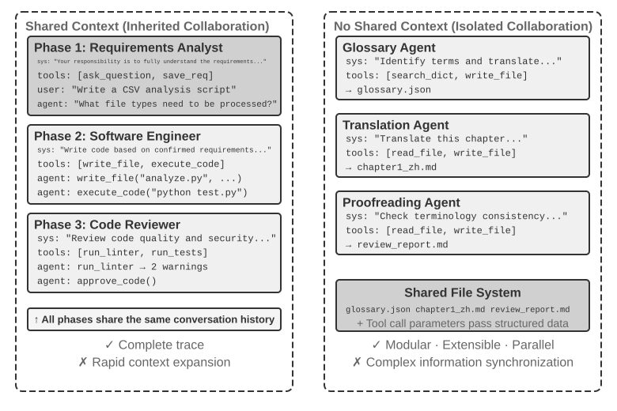

### Dimension 2: Collaboration Topology

Chiều thứ hai là collaboration topology: cấu trúc điều phối luồng thông tin (information flow) và luồng kiểm soát (control flow) giữa các Agent. Có ba topology điển hình:

- **Peer Collaboration Pattern**: Một nhóm nhỏ Agent (thường từ 2-3) tương tác ngang hàng, tạo thành một iterative improvement loop — tương tự như quy trình viết một bài báo khoa học, nơi một người viết draft và người kia ghi chú, phản biện; sau vài vòng lặp, chất lượng đầu ra sẽ vượt trội hơn hẳn so với việc một Agent tự thực hiện đơn độc.
- **Manager Pattern** (Orchestration Pattern): Một Manager Agent tập trung chịu trách nhiệm task planning và scheduling, trong khi nhiều sub-agent đảm nhiệm các subtask chuyên biệt — tương tự như mô hình project manager điều phối các kỹ sư chuyên trách trong dự án.
- **Decentralized Pattern**: Không có central controller tại runtime; các Agent chủ động giao tiếp trực tiếp với nhau như con người để phối hợp xử lý task.

> **Terminology: Graph Engineering.** Thuật ngữ "Graph Engineering", bắt đầu phổ biến từ tháng 7 năm 2026, trong bối cảnh Agent hiện nay thường dùng để chỉ việc chủ động thiết kế một execution graph: các node là Agent, chương trình thông thường, hoặc human decision; các edge xác định task dependencies, conditional routing, và failure paths; trong khi structured state được truyền dẫn giữa các node. Khái niệm "collaboration topology" được đề cập trong chương này chính là tập con multi-agent của tư duy trên — peer collaboration, manager orchestration, và decentralized handoffs đều là các biến thể graph topology khác nhau. Vì thuật ngữ này còn mới và dễ gây nhầm lẫn với knowledge graph, GraphRAG, hay execution trace, cuốn sách này sẽ tiếp tục dùng các thuật ngữ chuẩn hóa và ổn định hơn là "collaboration topology" và "orchestration" làm bộ khung từ vựng chính.

Chi tiết thiết kế và các applicable scenarios cho từng pattern sẽ được phân tích sâu ở các tiểu mục tiếp theo.

## Khi nào Multi-Agent thực sự vượt trội hơn một Single Agent?

Trước khi đi sâu vào các collaboration architecture cụ thể, hãy cùng trả lời một câu hỏi mang tính nền tảng hơn: **Khi nào chúng ta thực sự cần nhiều Agent, và khi nào một Agent là đủ?** Câu trả lời sẽ đóng vai trò như điểm tham chiếu (reference point) cho mọi phương pháp kỹ thuật được đề cập tiếp theo. Hàng loạt nghiên cứu gần đây đã hội tụ về một framework rõ ràng—và tiêu chí cốt lõi chỉ gói gọn trong một câu hỏi duy nhất: **Liệu sự collaboration có mang lại thông tin mới mà một Single Agent không thể tự thu thập được trong quá trình tạo ra câu trả lời hay không?**

Bảng 10-1 chỉ ra những collaboration mode nào đem lại thông tin mới, đồng thời giúp đánh giá liệu multi-agent collaboration có mang lại giá trị thực chất vượt trội hơn so với một Single Agent hay không.

Bảng 10-1 So sánh Information Gain giữa các Multi-Agent Collaboration Mode

| Collaboration Mode | Có mang lại thông tin mới? | Hiệu quả |
|---------------------------------------|---------------------|-----------------------------------|
| Self-review bởi cùng một model (tự đọc lại output của chính nó) | Không | Thường không hiệu quả hoặc thậm chí gây hại |
| Các Agent khác nhau debate trên cùng một đoạn text | Không | Tương đương với một Single Agent có cùng mức compute |
| Reviewer dùng kết quả test execution để review code | Có (execution feedback) | Cải thiện đáng kể |
| Reviewer dùng rendered screenshot để review code frontend/PPT | Có (visual feedback) | Cải thiện đáng kể |
| Reviewer dùng external tools để verify facts | Có (tool feedback) | Cải thiện đáng kể |

Bài báo năm 2025 về RLEF (Reinforcement Learning from Execution Feedback)[^rlef-2025] chỉ ra rằng việc train một model thông qua Reinforcement Learning để sử dụng code-execution feedback cho quá trình cải thiện lặp (iterative improvement) mang lại hiệu quả vượt trội hơn hẳn so với việc sample model độc lập nhiều lần. Điểm mấu chốt nằm ở chỗ mỗi iteration đều đưa vào **kết quả thực thi thực tế (real execution results)** (compilation errors, test failures, runtime exceptions)—những thông tin vốn không hề tồn tại ở thời điểm model viết code. Đối với các task webpage-generation, nghiên cứu năm 2025 về WebGen-Agent[^webgen-agent-2025] báo cáo rằng multi-level visual feedback, kết hợp giữa screenshot với các mô tả từ vision-language model, đã nâng cao benchmark performance của Claude 3.5 Sonnet từ 26.4% lên 51.9%, tức gần như tăng gấp đôi.

[^rlef-2025]: Gehring, J., et al. *RLEF: Grounding Code LLMs in Execution Feedback with Reinforcement Learning.* arXiv:2410.02089, 2025.
[^webgen-agent-2025]: Lu, Z., et al. *WebGen-Agent: Enhancing Interactive Website Generation with Multi-Level Feedback and Step-Level Reinforcement Learning.* arXiv:2509.22644, 2025.

Framework này giúp giải quyết một nghịch lý biểu kiến: một số nghiên cứu học thuật chỉ ra rằng một single Agent là đủ, trong khi các multi-agent systems lại thường mang lại hiệu năng vượt trội hơn trong thực tế engineering. Các nghiên cứu đó thường thử nghiệm nhiều Agents cùng kiểm tra và thảo luận về cùng một đoạn text (tương tự như hình thức debate), trong khi các hệ thống engineering hiệu quả thường bổ sung thêm external feedback từ code execution, visual rendering, hoặc tools. Chỉ có vế sau mới thực sự đưa thêm thông tin mới vào hệ thống. Hầu như mọi trường hợp ứng dụng hiệu quả của ba kiến trúc được thảo luận sau đây — peer collaboration, orchestration, và decentralization — đều có thể được lý giải thông qua tiêu chí này.

Thử nghiệm vulnerability-discovery năm 2026 của Anthropic là một ví dụ điển hình. 45 Agents đã phối hợp tìm kiếm thông qua một shared forum, review chéo các phát hiện của nhau và submit kết quả về cho một arbiter Agent độc lập. Swarm phối hợp này đã tìm ra 266 vulnerabilities với 27 triệu tokens, trong khi các Agents chạy song song độc lập (independently parallel Agents) chỉ tìm thấy 21 lỗ hổng dù tiêu tốn tới 6.5 triệu tokens. Trong một search space mở, cơ chế communication cho phép multi-agent system dịch chuyển sự tập trung một cách dynamic và hình thành tính specializations, chấp nhận đánh đổi một token budget lớn hơn để lấy coverage rộng hơn cùng các discovery paths đa dạng hơn.[^anthropic-multiagent-2026]

[^anthropic-multiagent-2026]: Anthropic Frontier Red Team, “Patterns and Problems in Emerging Multiagent Systems,” 2026-08-13. https://www.anthropic.com/research/multiagent-systems

**Step Budget and Agent Performance.** Một vấn đề liên quan là step budget của Agent — tức số lượng tool calls hoặc iteration rounds mà nó được phép sử dụng — ảnh hưởng đến performance như thế nào. Việc tăng thêm steps nghe qua tưởng chừng chắc chắn sẽ mang lại hiệu quả: với 30 steps, Agent có thể chỉ đủ thời gian để implement core functionality, trong khi 300 steps cho phép nó plan, implement, test, và refine. Tuy nhiên, bài báo năm 2025 của Google mang tên *Budget-Aware Tool-Use Enables Effective Agent Scaling* đã đưa ra một kết luận phi trực giác: **việc đơn thuần cấp cho Agent nhiều steps hơn không hề đảm bảo performance sẽ tốt hơn.** Các standard Agents thiếu đi tính "budget awareness"; ngay cả khi có 300 steps, chúng thường có xu hướng thực hiện shallow searches và nhanh chóng chạm ngưỡng plateau. Để tận dụng hiệu quả các steps bổ sung, Agents cần một cơ chế giúp adapt chiến lược của chúng theo lượng tài nguyên còn lại: ban đầu tiến hành broad exploration và sau đó thu hẹp focus lại. Phương pháp tiếp cận BAVT (Budget-Aware Value Tree Search) năm 2026 đã đưa vào cơ chế step-level value evaluation, giúp điều chỉnh sự cân bằng giữa exploration và exploitation dựa theo tỷ lệ budget còn lại. Khi budget giảm dần, Agent sẽ dịch chuyển từ broad exploration sang deeper investigation.

Những phát hiện này mang lại những hàm ý trực tiếp cho việc thiết kế multi-agent systems. Ví dụ, trong orchestration pattern, Manager Agent không nên chỉ đơn giản là phân phối tasks cho các sub-agents rồi ngồi chờ kết quả. Thay vào đó, nó cần phải **dynamically allocate step budgets** dựa trên task complexity — các subtasks đơn giản nhận ít steps; các subtasks phức tạp được cấp ample steps. Đồng thời, nó cũng cần điều hướng các sub-agents sử dụng budget một cách thông minh (plan trước, sau đó implement, tiếp tục test, rồi mới refine/improve), thay vì lao thẳng ngay vào thực thi.

Một yếu tố nữa cần phải cân nhắc trước mọi quyết định thiết kế: **cost.** Parallel exploration và iterative refinement đều tiêu tốn chi phí — Anthropic từng tiết lộ rằng hệ thống nghiên cứu multi-agent của họ tiêu thụ lượng tokens gấp khoảng 15 lần so với một cuộc hội thoại thông thường, và riêng token usage đã giải thích cho khoảng 80% sự khác biệt về performance. Do đó, giá trị thu được từ một multi-agent system phải đủ lớn để bù đắp cho mức cost có thể cao gấp nhiều lần, thậm chí là cao hơn một bậc độ lớn (order of magnitude); nếu không, một well-tuned single Agent thường sẽ là phương án kinh tế và tối ưu hơn.

## Multi-Agent Collaboration với Shared Context

Trong mô hình multi-agent collaboration với shared context, mỗi stage là một Agent độc lập (sở hữu system prompt và tool set riêng), nhưng kế thừa toàn bộ trajectory của Agent tiền nhiệm—tương tự như một đồng nghiệp tiếp quản ca trực có thể xem lại toàn bộ work log mà người đi trước để lại. Ưu điểm cốt lõi của cơ chế cộng tác dựa trên kế thừa này là zero information loss: mọi Agent đều có thể rà soát chi tiết từ bất kỳ stage nào trước đó. Thách thức đặt ra là phải giữ cho Agent hiện tại tập trung vào đúng trách nhiệm của nó, tránh bị phân tâm bởi khối lượng history đồ sộ được kế thừa.

Trong các tác vụ phức tạp, role và trách nhiệm của Agent có thể thay đổi đáng kể qua từng stage. Nếu chỉ dùng một static system prompt duy nhất xuyên suốt, nó sẽ hoặc quá chung chung, hoặc trở thành một tập hợp instruction cồng kềnh, khó kiểm soát. Kỹ thuật multi-stage role switching sẽ thay đổi system prompt và tool set tương ứng với stage hiện tại, cho phép Agent hoạt động trong đúng role phù hợp nhất.

Lựa chọn kiến trúc mang tính quyết định là: role guidance nên được đảm nhiệm bằng cách thay thế system prompt hay bằng cách load một Skill. Phương án đầu tiên có thể thiết lập một hard tool boundary chặt chẽ, nhưng lại làm thay đổi request prefix sau mỗi lần switch. Phương án thứ hai giữ cho static prefix luôn ổn định và append `SKILL.md` vào trajectory, cách này thường thân thiện hơn với cơ chế KV/prompt caching; tuy nhiên, Skill bản chất chỉ đóng vai trò behavioral guidance, do đó các tool nhạy cảm hoặc có side-effect vẫn bắt buộc phải có một Harness policy gate kiểm soát cứng bằng code.

| Choice | Role guidance | Tool visibility | Ảnh hưởng Context/KV-cache | Constraint strength |
|---|---|---|---|---|
| `transfer_to_agent` | Thay thế system prompt và thông thường là cả tool set | Chỉ hiển thị các tool của role hiện tại | Mỗi lần switch làm thay đổi request prefix và thường làm invalidate cache từ điểm đó trở đi | Strong: các tool out-of-scope hoàn toàn có thể không xuất hiện trong schema |
| Skill | Giữ một danh mục Skill trong fixed prompt và append `SKILL.md` on demand | Thường là toàn bộ catalog, hoặc một search entry point ổn định | Static prefix được giữ ổn định; nội dung Skill được append vào trajectory | Weak: Skill chỉ là instruction, không phải một permission boundary |

Khi sự khác biệt về role chủ yếu đến từ knowledge, quy trình và writing style, hãy ưu tiên dùng Skill; khi liên quan đến permission, tool isolation, ranh giới compliance, hoặc một nhóm hành động bắt buộc phải cấm ở run time, hãy dùng một Agent độc lập hoặc tool `transfer_to_agent`, kết hợp chặn các tool call bằng code tại tầng Harness.

> **Experiment 10-1 ★★: Shared-context role switching—system prompt versus Skill**
>
> Cả hai hướng tiếp cận đều sử dụng cùng model, task, tools, role guidance và toàn bộ shared trajectory. Task ở đây là tìm kiếm doanh số xe năng lượng mới (new-energy vehicle) của Trung Quốc giai đoạn 2021–2023, tính CAGR, và viết một bản tóm tắt cho nhà đầu tư bằng tiếng Trung dài không quá 120 ký tự.
>
> **Path 1: system-prompt switching.** Năm role—`triage`, `research`, `coding`, `data_analysis` và `writing`—mỗi role chỉ expose các dedicated tools riêng biệt cùng với `transfer_to_agent`. Một thao tác handoff sẽ lưu history, nạp prompt và tool set mục tiêu, sau đó tiếp tục execution.
>
> **Path 2: Skill.** System prompt và toàn bộ tool catalog được giữ cố định. Model gọi `load_skill(name)` và nhận lại role document tương ứng dưới dạng tool result trong shared trajectory. Static prefix vẫn giữ nguyên, nhưng các hard permissions được thực thi nghiêm ngặt thông qua các Harness rules.
>
> Cả hai path đều thực hiện cùng các bước retrieval, calculation và length check. Điểm khác biệt cốt lõi nằm ở vật mang (carrier) của role guidance và tool boundary sinh ra từ đó; một smoke trace đơn thuần chưa thể kết luận được path nào tối ưu hơn.

## Multi-Agent Collaboration Without Shared Context

Trong kiến trúc không có shared context, mỗi Agent vận hành như một thực thể độc lập với context, trajectory và state riêng. Các Agent không thể truy cập trực tiếp vào internal context của nhau; quá trình collaboration phụ thuộc hoàn toàn vào việc truyền dữ liệu tường minh, có cấu trúc (explicit, structured data transfers) thông qua ba cơ chế giao tiếp đã được giới thiệu ở đầu chương này: tool call parameters, một shared file system, và một message bus.

Ở phần trước của chương này, chúng ta đã so sánh việc giao tiếp giữa các Agent với cơ chế giao tiếp liên tiến trình (inter-process communication). Chúng ta có thể mở rộng phép tương đồng (analogy) này sang các thành phần khác của hệ thống (Bảng 10-2):

Bảng 10-2 Tương quan giữa Operating Systems và Multi-Agent Systems

| Operating System | Multi-Agent System |
|---|---|
| Program (executable file) | Static prefix (system prompt + tool definitions) |
| Process memory | Trajectory |
| CPU | LLM |
| Kernel | Agent runtime |
| System call | Tool call |
| fork (tạo child process) | spawn_subagent |
| kill (gửi signal) | cancel_subagent |
| ps (liệt kê process) | list_agents |
| Exit code và wait() | Structured summary do sub-agent trả về |
| Shared memory / message passing | Shared file system / message passing |

Sự trừu tượng hóa này không phải điều mới mẻ: private state, asynchronous messages, cùng khả năng khởi tạo các thành viên mới chính là cấu hình cơ bản của Actor model[^actor-model] từ những năm 1970. Do đó, một multi-agent system có thể được xem như phiên bản LLM-based của Actor model, và phần lớn các tri thức tích lũy từ mảng operating systems và distributed systems đều có thể áp dụng trực tiếp.

[^actor-model]: Hewitt, C., Bishop, P., Steiger, R. *A Universal Modular ACTOR Formalism for Artificial Intelligence.* IJCAI 1973.

Kiểu cô lập theo dạng process-style isolation này mang lại nhiều lợi ích kỹ thuật thực tế: mỗi Agent có thể được develop và test độc lập, các capability mới có thể được bổ sung mà không cần can thiệp vào code hiện có, và nhiều Agent có thể execute concurrently mà không xảy ra contention trên shared context.

Tuy nhiên, việc không chia sẻ context cũng đi kèm với chi phí đánh đổi. Rõ ràng nhất là bài toán information synchronization: làm thế nào để các Agent duy trì một góc nhìn nhất quán về task state? Liệu thông tin có bị thất lạc hoặc duplicate trong quá trình transfer? Việc debugging cũng trở nên phức tạp hơn—khi sự cố phát sinh, logs từ nhiều Agent phải được rà soát để xâu chuỗi lại toàn bộ execution process hoàn chỉnh. Những thách thức này khiến việc thiết kế interface specifications, data formats, và communication protocols trở nên tối quan trọng.

Mô hình explicit collaboration khi không dùng shared context sẽ dựa vào hai hạ tầng mang tính topology-independent. Thứ nhất là **shared file system**, môi trường persistent giúp các Agent trao đổi artifacts với nhau và với user, cấu thành nên data plane của quá trình cộng tác. Thứ hai là **communication and control mechanism**, hỗ trợ message passing, status queries, execution termination, và resource scheduling giữa các Agent, cấu thành nên control plane của quá trình cộng tác. Cả ba topology dưới đây đều được xây dựng dựa trên hai nền tảng cốt lõi này.

### File System dưới góc nhìn của một Agent

Ở phần đầu chương này, "shared file system" đã được liệt kê là một trong ba communication mechanisms cho các kiến trúc không có shared context. Trong một hệ thống thực tế, file system mà một Agent truy cập không phải là một storage system đơn lẻ mà là một **virtual file system**, nơi các storage systems với source, lifecycle, và permissions khác nhau được mount chung dưới một directory tree. Agent tương tác với chúng thông qua các interface thống nhất như `read_file`/`write_file`/`list_dir`, trong khi các underlying layers có thể là local temporary disks, persistent object storage, third-party cloud drive APIs, hoặc các gói read-only system resources. Việc xác định rõ cấu trúc của directory tree này—cùng với visibility và lifecycle của từng phân vùng—là điều kiện tiên quyết khi thiết kế multi-agent collaboration: phần lớn các concurrency conflicts và rò rỉ thông tin (information leaks) đều xuất phát từ việc trộn lẫn các vùng dữ liệu vốn cần phải được cô lập. Directory tree này đóng vai trò tương đương với address space của Agent, và bốn loại phân vùng chính là các memory segments với permissions khác nhau: có vùng là private và writable, có vùng được share giữa nhiều bên, và có vùng ở trạng thái read-only. Triết lý bảo vệ của operating system cũng được áp dụng trọn vẹn tại đây: isolate by default (mặc định cô lập) và declare sharing explicitly (khai báo chia sẻ tường minh).

Một multi-agent system hoàn chỉnh thường tổ chức file system của mình thành bốn loại storage area:

**I. Agent-Specific Workspace (Scratchpad)**. Một directory riêng tư dành riêng cho từng Agent instance, dùng để lưu trữ các intermediate artifacts, temporary files, drafts và debug logs. Lifecycle của nó gắn liền với instance và hoàn toàn invisible đối với các Agent khác cũng như users. Việc cô lập scratchpad phục vụ hai mục đích: ngăn chặn temporary files từ nhiều Agent ghi đè lên nhau, và giữ cho context của main Agent luôn tinh gọn—toàn bộ quá trình trial-and-error của sub-agents chỉ diễn ra trong workspace riêng của chúng, và chỉ có artifact cuối cùng mới được submit lên shared space. Đây chính là phiên bản tương ứng ở cấp độ storage (storage-level counterpart) của nguyên lý trong Chương 4: sub-agents trả về structured summaries thay vì toàn bộ trajectories đầy đủ.

**II. Multi-Agent Shared Workspace**. Một khu vực cộng tác cho phép nhiều Agent có thể read và write, đồng thời **visible đối với user**. Đây là phương tiện chính để trao đổi artifacts giữa các Agent trong các kiến trúc không có shared context: Glossary Agent ghi term list, và Translation Agent sẽ read dữ liệu từ đó; users cũng có thể upload source files và download các final deliverables tại đây. Lifecycle của vùng này gắn liền với toàn bộ task và yêu cầu tính persistence. Là khu vực phục vụ concurrent reads và writes từ nhiều bên, đây là một điểm nóng (hotspot) thường xảy ra concurrency conflicts—các cơ chế như optimistic locking và worktree isolation sẽ vận hành tại đây, chi tiết được mô tả trong phần "Failure Mode One" ở phần sau của chương này. Việc Chương 4 sử dụng một volume mount tại `/workspace/shared` để kết nối main Agent, virtual computer và virtual phone là một implementation điển hình của tầng này.

**III. Mounted External Resources.** Các nguồn thông tin third-party được ủy quyền bởi user—Google Drive, Notion, Dropbox, enterprise wikis, v.v.—được map vào các mount points trong file system (ví dụ: `/mnt/gdrive`) thông qua các adapters. Một Agent truy cập một tài liệu Notion bằng cách đọc một file; adapter bên dưới sẽ gọi API tương ứng. Có ba đặc tính phân biệt tầng này với local storage và bắt buộc phải được xử lý tường minh khi thiết kế: **access bị giới hạn bởi external permissions** (permissions của user trong hệ sinh thái nguồn sẽ quyết định visibility của Agent), **latency cao hơn và consistency yếu hơn** (mỗi lần read đều tốn một network round trip, và các thay đổi từ bên ngoài có thể không lập tức phản ánh, do đó dữ liệu cần được coi là eventually consistent), và **access chủ yếu theo cơ chế on-demand và read-only** (việc write ngược lại external sources phải thực hiện hết sức thận trọng, vì các thao tác ghi lỗi có thể làm sai lệch dữ liệu thực của user). Unified file interface giúp Agent không cần custom tool cho từng data source, nhưng nó cũng vô tình che lấp các khác biệt về performance và security này. Vì vậy, trạng thái read-only/writable, timeouts, và credential boundaries bắt buộc phải được quản lý tường minh ở mount level.

**IV. Built-in System Resources.** Gói tài nguyên được hệ thống cài đặt sẵn (pre-installed) và chia sẻ ở chế độ read-only cho tất cả các Agents. Ví dụ điển hình là các **Skills** đã giới thiệu ở Chương 2 và Chương 4—các knowledge documents và scripts được tổ chức thành files, mount tại các path như `/skills`, được truy cập thông qua cơ chế progressive disclosure (index trước, sau đó expand on demand). Các ví dụ khác bao gồm reference manuals, template libraries và shared tool definitions. Tầng này được globally shared, read-only, ổn định xuyên suốt các sessions, và cho phép tất cả các Agents có thể read concurrently mà không cần đến cơ chế concurrency control.

Figure 10-2 minh họa cách bốn loại area này được mount đồng nhất dưới một directory tree duy nhất: Agent truy cập toàn bộ tree thông qua một unified interface, users upload và download files từ shared space, các external data sources được mount thông qua adapters, và built-in system resources được cung cấp hoàn toàn dưới dạng read-only.

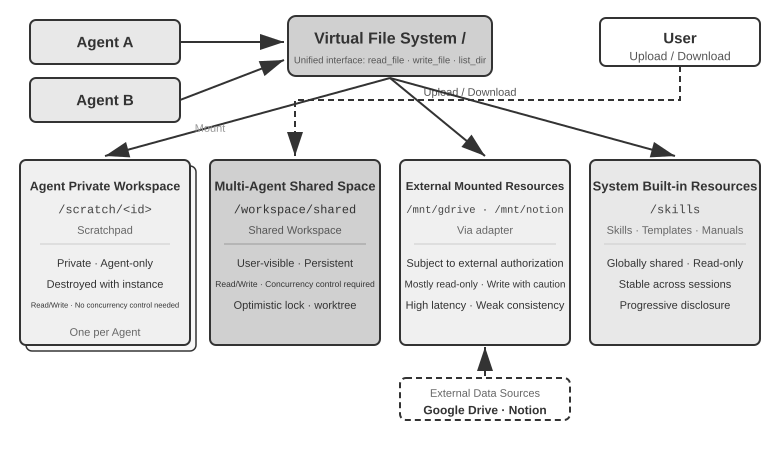

Bảng 10-3 so sánh bốn loại area này qua bốn chiều kích—visibility, lifecycle, read/write permissions, và concurrency control—đóng vai trò như một checklist cho việc thiết kế layout của file system.

Bảng 10-3 Bốn loại area của Agent Virtual File System

| Area | Visibility | Lifecycle | Read/Write | Concurrency Control |
|--------------|-----------------|------------------------|---------------------|-------------------|
| Agent-Specific Workspace | Chỉ Agent sở hữu | Bị hủy cùng Agent instance | Read/Write | Không cần (private) |
| Multi-Agent Shared Workspace | Toàn bộ các Agent cộng tác và user | Duy trì trong suốt thời gian thực thi task | Read/Write | Bắt buộc (optimistic lock / worktree) |
| Mounted External Resources | Phụ thuộc vào external authorization | Do external source quyết định | Phần lớn là read-only, write cần thận trọng | Do external source quản lý |
| Built-in System Resources | Toàn bộ các Agent | Ổn định qua các session | Read-only | Không cần (read-only) |

Giá trị của **"file path as a universal interface"** nằm ở việc xem path như một unit of exchange. Dù các Agent trao đổi artifact, một main Agent chuyển giao input cho một sub-agent, hay các tổ chức cộng tác thông qua A2A, chúng đều truyền một chuỗi path string gọn nhẹ thay vì load nội dung file vào context window (Chương 4). Điều này đồng nhất với khái niệm "file system as the Agent's hub" ở Chương 5, vốn mô tả cách một single Agent sử dụng file system để lưu trữ memory và capabilities. Tại đây, cùng một mức abstraction đó được mở rộng cho multi-agent: một virtual directory tree mount các vùng storage private, shared, external, và built-in sẽ cung cấp nền tảng storage vững chắc cho multi-agent collaboration.

### Communication and Control Between Agents

Trong khi file system giải quyết bài toán **artifact exchange** giữa các Agent, việc cộng tác cũng đòi hỏi một **control plane**. Đây chính là nơi các hàng lifecycle của Bảng 10-2 phát huy tác dụng: các tool primitives được đưa ra ở Chương 4—tạo (`spawn_subagent`), gửi message (`send_message_to_subagent`), hủy (`cancel_subagent`), và discover (`list_agents`)—tương ứng với fork, message, kill, và ps trong thế giới process. Phần này không lặp lại định nghĩa các interface, mà tập trung vào bốn capabilities thiết yếu cho multi-agent collaboration nhưng thường bị bỏ qua.

**I. Message Passing.** Dạng đơn giản nhất là point-to-point: Agent A trực tiếp gọi `send_message_to_agent_b(content)`. Cách này phù hợp với các scenario có topology cố định và số lượng Agent nhỏ (ví dụ: thiết lập dual-agent gồm phone + computer trong Thử nghiệm 10-3 của chương này). Khi số lượng Agent tăng lên và đòi hỏi asynchronous parallelism, số lượng kết nối point-to-point sẽ tăng theo hàm bậc hai (quadratically) theo số lượng Agent, đồng thời cả sender lẫn receiver đều phải online cùng lúc. Trong những trường hợp như vậy, nên sử dụng một **message bus** (được trình bày chi tiết ở phần sau của chương này dưới mục "Parallel Coordination Pattern"): các Agent publish message lên bus, sau đó bus sẽ forward chúng dựa trên các subscription, nhờ đó sender không cần phải biết các subscriber. Dù là point-to-point hay thông qua bus, message thường phải mang theo một **envelope** có cấu trúc: sender ID, target (một Agent cụ thể hoặc broadcast), message type (ví dụ: `task_assigned`/`status_update`/`result`/`terminate`), và một JSON payload. Một envelope format thống nhất sẽ đảm bảo routing và parsing chuẩn xác ở phía receiver, đồng thời giúp trace toàn bộ collaboration chain—một khía cạnh then chốt khi debug các multi-agent system.

**II. Status Query.** Đây là thành phần bị xem nhẹ nhất trong control plane. Một khi main Agent đã dispatch một sub-agent, nó cần visibility vào progress của sub-agent đó; nếu không, nó vừa không thể quyết định xem có nên tiếp tục chờ hay không, vừa không thể can thiệp khi sub-agent bị stuck. Một hướng tiếp cận trực quan là mượn ý tưởng từ RPC và định nghĩa một query interface `get_subagent_status(agent_id)` trả về các trạng thái "running/completed/failed" kèm theo phần trăm progress. Tuy nhiên, một pull interface như vậy thực tế lại kém hữu dụng hơn nhiều so với kỳ vọng: sub-agent bắt đầu execute ngay thời điểm được tạo và chạy liên tục cho đến khi completed hoặc failed. Nó không luân chuyển qua một loạt các queued states giống như cách các job trong một batch system truyền thống hoạt động, tương tự như việc lập trình Unix hiếm khi phải poll một process khác qua PID của nó để kiểm tra running status. Polling cũng kéo theo một bài toán nan giải cố hữu: poll quá dày thì lãng phí token; poll quá thưa thì phản ứng trễ. Một phương pháp tự nhiên hơn để lấy status là quay lại với hai communication paradigms đã được giới thiệu ở đầu chương này.

**Lấy status qua message passing.** main Agent chỉ đơn giản gửi cho sub-agent một message: "How's it going?" Sub-agent sẽ phản hồi vào một thời điểm thích hợp. Mọi thứ đều là asynchronous: việc gửi message không hề block execution của chính main Agent, còn việc phía bên kia khi nào—hoặc liệu có—trả lời hay không lại là một vấn đề riêng biệt, tương tự như việc một manager hỏi cấp dưới về progress qua instant messaging mà không yêu cầu họ phải dừng ngay mọi việc tại chỗ. Ngược lại, sub-agent cũng có thể chủ động gửi một message để báo cáo khi nó đạt được một milestone; nếu hệ thống đã có sẵn một message bus, điều này đơn giản chỉ là publish một `status_update` lên bus (tính năng "real-time monitoring" trong Experiment 10-4 chính là ở dạng này). Dù status được request một cách tường minh hay được report chủ động, status được mang theo trong message nên áp dụng một bộ từ vựng state-machine thống nhất (executing, needs input, completed, failed)—A2A protocol ở phần sau của chương này sẽ chuẩn hóa task lifecycle thành chính xác một tập các state như vậy.

**Lấy status qua shared file system.** Dạng triệt để nhất là **trajectory persistence**: trong quá trình execute, sub-agent sẽ serialize từng trajectory event sang JSON và append nó vào một filesystem log file—thường là một file trên mỗi session, một event trên mỗi dòng, tức là JSONL. Trajectory, như đã định nghĩa ở Chapter 1, là một sequence hoàn chỉnh gồm user messages, model replies, tool calls và results. main Agent không cần bất kỳ status-reporting protocol nào; bằng cách đọc trực tiếp file này, nó có thể inspect toàn bộ quá trình execution của sub-agent: nó đang gọi tool nào, điều gì vừa xảy ra trong step gần nhất, và liệu nó có đang bị stuck trong một loop lặp lại các retry thất bại hay không. Xét theo góc độ process, cách này giống như việc đọc trực tiếp memory của một process khác. Nó không chiếm dụng context của sub-agent, không phụ thuộc vào sự hợp tác của nó, và mang lại observation granularity chi tiết nhất.

Nhưng trajectory persistence không nên là channel chính để truyền thông tin giữa các Agent. Một trajectory có thể dễ dàng chạm ngưỡng hàng chục nghìn token, và main Agent vẫn phải distill nó sau khi đọc—gây tốn kém cả về thời gian lẫn token. Trong phần lớn các tình huống, lựa chọn hợp lý hơn là **thống nhất về một progress file**: khi khởi chạy một sub-agent, main Agent quy định "write your progress to progress.md", sub-agent sẽ cập nhật task list đó mỗi khi hoàn thành xong từng item, và main Agent có thể đọc file lightweight này bất kỳ lúc nào để nắm bắt tình hình. Điều này tương đương với việc hai process phân chia một vùng status nhỏ theo định dạng đã thỏa thuận trong shared memory: những gì được expose ra là progress đã được distill, chứ không phải toàn bộ memory. Progress file cũng hỗ trợ **stuck detection**: nếu thời gian last-modified của `progress.md` (hoặc trajectory file) không thay đổi quá N phút, sub-agent có thể được xác định là inactive và kích hoạt một timeout fallback, nhờ đó một sub-agent bị block sẽ không kéo tụt toàn bộ hệ thống.

**III. Execution Termination.** Trong mô hình parallel collaboration, một kịch bản phổ biến là "one succeeds, the rest become irrelevant" (một bên thành công, các bên còn lại không còn cần thiết) — nhiều Agent cùng thực hiện tìm kiếm độc lập, và ngay khi một Agent tìm thấy mục tiêu, các Agent còn lại phải dừng lại ngay lập tức (cơ chế cascading termination trong Experiment 10-4 của chương này). Có hai cấp độ termination, và người dùng Unix sẽ nhận ra ngay sự tương đồng với sự khác biệt giữa SIGTERM và SIGKILL. **Graceful termination** luôn được ưu tiên: main Agent gửi tín hiệu `terminate`, sub-agent phản hồi tại một safe point trong step hiện tại của nó, dọn dẹp tài nguyên (đóng browser sessions, ghi các pending files, release locks), gửi về một acknowledgment (ack), rồi mới exit. **Forced termination** là phương án fallback: trực tiếp terminate process, chỉ sử dụng khi sub-agent không phản hồi tín hiệu graceful, với cái giá phải trả là nguy cơ để lại dangling resources và các tác vụ ghi dở dang (incomplete writes). Cần lưu ý hai điểm kỹ thuật sau: Thứ nhất, graceful termination đòi hỏi sub-agent phải định kỳ kiểm tra termination signal bên trong loop của nó (tương tự cơ chế interrupt trong Chapter 6); nếu không, nó sẽ không thể nhận được signal. Thứ hai, cascading termination tiềm ẩn race condition: nhiều sub-agent có thể báo cáo thành công gần như đồng thời. Main Agent bắt buộc phải sử dụng lock hoặc thiết kế mang tính idempotent để đảm bảo chỉ chấp nhận duy nhất một kết quả thành công và termination signal chỉ broadcast một lần duy nhất. Xem thêm phần thảo luận về race conditions trong Experiment 10-4.

Vẫn còn một vấn đề cần giải quyết triệt để: sau khi main Agent terminate, điều gì sẽ xảy ra với các sub-agent vẫn đang chạy? Cách tiếp cận kỹ thuật sạch nhất là mượn ý tưởng từ context của Go — termination sẽ cascade theo quan hệ khởi tạo (creation relationship): cancel một Agent thì toàn bộ sub-agent do nó spawn ra cũng sẽ bị cancel theo, ngăn chặn tình trạng để sót các orphaned child Agents. Việc "sub-agent kiểm tra termination signal tại safe point" đề cập ở trên tương ứng chính xác với hành vi polling `ctx.Done()` trong Go. Ngược lại, nếu bạn thực sự cần một background Agent chạy dài hạn (long-running) tách rời khỏi main Agent (tương tự lệnh `nohup` của Unix), hãy khởi tạo nó từ một lifecycle tree mới (tương ứng với `context.Background()`), khai báo tường minh rằng nó sẽ không terminate theo parent.

**IV. Resource Management and Scheduling.** Một nửa nhiệm vụ còn lại của một operating system là phân bổ các tài nguyên khan hiếm. Trong thế giới process, tài nguyên khan hiếm là CPU time và memory; còn trong thế giới Agent, đó là tokens, chi phí tiền tệ và concurrency budget — mỗi step mà một sub-agent thực thi đều tiêu tốn cả ba yếu tố này. Trách nhiệm này thường thuộc về Manager hoặc runtime: thiết lập một step budget hoặc token budget khi khởi chạy sub-agent, và dừng lại ngay khi vượt ngưỡng; giao các task phức tạp cho model mạnh và các task mang tính cơ học cho model chi phí thấp; giới hạn concurrency để hàng chục Agent không cùng lúc làm cạn kiệt API quota; và khi một task khẩn cấp hơn xuất hiện, ngắt (interrupt) một sub-agent đang thực thi — đây chính là preemption.

So với scheduler của một operating system truyền thống, ưu thế vượt trội của manager Agent nằm ở khả năng reasoning. Nhờ đó, một manager Agent có thể launch nhiều sub-agent để cùng khám phá song song một bài toán và dựa trên tiến độ của chúng để quyết định cấp thêm tài nguyên cho bên nào, hoặc terminate sub-agent nào có dấu hiệu đi chệch hướng — tương tự một cuộc đua nội bộ trong một tổ chức.

Resource management và scheduling cho multi-agent systems hiện vẫn chưa phát triển hoàn thiện bằng scheduling trong operating system. Tuy nhiên, vì chúng quyết định trần chi phí tài nguyên tối đa của hệ thống, bạn bắt buộc phải tính toán đến chúng ngay từ giai đoạn thiết kế architecture.

Artifact exchange (data plane) kết hợp cùng message passing, status query, execution termination, và resource scheduling (control plane) sẽ tạo nền tảng vận hành cho một multi-Agent system không sử dụng shared context. Dựa trên mối quan hệ cộng tác giữa các Agent và đặc tính của control flow, mô hình cộng tác không dùng shared context được chia thành ba architecture chính — peer collaboration pattern, manager pattern, và decentralized pattern — mỗi pattern phù hợp với một dạng bài toán riêng biệt.

### Peer Collaboration Pattern: Mutual Checks và Iterative Improvement

Peer collaboration thường bao gồm hai hoặc ba Agent có vai trò ngang hàng (equal standing) liên tục phản hồi (feedback) cho nhau qua nhiều vòng lặp. Giá trị tiềm năng của mô hình này nằm ở các góc nhìn độc lập và cognitive diversity, nhưng "nhiều instances" chưa chắc đã tạo ra "nhiều cách tư duy". Khi model, context và scaffolding có sự tương đồng cao, các Agent khác nhau thường đưa ra những lựa chọn giống nhau, biến các lỗi cục bộ (local errors) thành lỗi mang tính hệ thống (systemic failures). Một sự đa dạng thực chất phải được chủ đích thiết kế bằng cách đa dạng hóa models, contexts, tools, visible evidence, hoặc responsibilities, đồng thời yêu cầu các Agent đánh giá một cách độc lập trước khi kết quả được tổng hợp lại.[^anthropic-multiagent-2026]

So với manager pattern và decentralized pattern, peer collaboration triển khai đơn giản hơn rất nhiều—chỉ cần định nghĩa roles của hai Agent, communication mechanism và iteration termination condition là bạn đã có một hệ thống sẵn sàng hoạt động. Đây là lựa chọn lý tưởng để nhanh chóng validate ý tưởng và xây dựng prototypes.

#### Loop Engineering

Một trong những ứng dụng phổ biến nhất của peer collaboration là giải quyết một lỗi thất bại kinh điển trong thực tế vận hành Agent: **premature termination**—dừng lại khi công việc mới chỉ hoàn thành một nửa. Vấn đề này thường xuất hiện dưới ba hình thức điển hình; các ví dụ dưới đây đến từ Coding Agents và Pine AI—Agent từng được đề cập ở phần Giới thiệu (Introduction) với nhiệm vụ thay mặt người dùng gọi điện xử lý công việc với các đơn vị bán hàng và cung cấp dịch vụ. 

Thứ nhất là **claiming completion after only partial work** (tuyên bố hoàn thành khi mới giải quyết một phần việc): một Coding Agent viết code xong nhưng không hề chạy tests hay thử nghiệm deployment, rồi báo cáo "task complete"; hoặc người dùng giao cho Pine AI hai việc vặt, nó xử lý xong việc đầu tiên, quên bẵng việc thứ hai và vui vẻ thông báo "all taken care of". 

Thứ hai là **giving up too soon** (từ bỏ quá sớm): tuyên bố toàn bộ tác vụ là bất khả thi ngay khi gặp một nhánh nghẽn duy nhất—Pine AI có thể liên hệ với bên bán lẻ qua điện thoại, web form hoặc email, nhưng chỉ sau một cuộc gọi bị từ chối, nó lập tức báo với người dùng "this can't be done", trong khi việc chuyển đổi channels và thử lại hoàn toàn có khả năng thành công. 

Thứ ba là **false success** (thành công ảo): Agent tin rằng công việc đã xong, nhưng thực chất loop chưa bao giờ được đóng lại hoàn chỉnh—đối tác đồng ý hoàn tiền qua điện thoại bằng lời nói, nhưng người dùng vẫn cần xác nhận một bước trên mobile app; Agent thông báo "all set", người dùng không hề biết có follow-up action cần làm, và tiền hoàn không bao giờ về tài khoản. 

Cả ba hình thức đều quy về cùng một nguyên nhân gốc rễ (root cause): **khi chưa được xác minh (verified), trạng thái "done" chỉ là một claim đơn thuần từ phía model chứ không phải bằng chứng (proof).**

Biến các claims thành proofs chính là bản chất cốt lõi của **Loop Engineering**, giai đoạn tiến hóa cuối cùng trong lộ trình của Chương 1: thiết kế một loop duy trì sự vận hành liên tục của Agent—tìm kiếm phần việc tiếp theo, execute, verify, ghi nhận tiến trình—và để một verifier, chứ không phải bản thân model, quyết định xem liệu đã thực sự an toàn để dừng lại hay chưa. Vai trò của con người theo đó chuyển dịch từ "người vận hành viết prompts cho Agent" sang "kỹ sư thiết kế loop". Thuật ngữ này được Addy Osmani đặt ra vào tháng 6 năm 2026[^loop-engineering-2026]; Boris Cherny, trưởng nhóm phát triển Claude Code tại Anthropic, đã diễn đạt điều này một cách trực diện hơn: "Tôi không còn prompt Claude nữa. Việc của tôi là viết các loops." 

Kết luận cốt lõi rút ra từ cuộc thảo luận đó là: **bottleneck của loop nằm ở verifier, không phải ở model**: nếu verification không đáng tin cậy, một loop chạy nhanh hơn chỉ đơn thuần đánh dấu các output kém chất lượng là đã hoàn thành sớm hơn mà thôi. Và như phần Introduction đã đề cập, thực tiễn luôn đi trước, tên gọi theo sau. Từ rất lâu trước khi thuật ngữ này trở nên phổ biến, các đội ngũ phát triển Agent hàng đầu—trong đó có Pine AI—đã áp dụng mô hình "loop plus verification" để chống lại premature termination. Cách hiệu quả nhất để tổ chức quy trình verification đó chính là Proposer-Reviewer paradigm được trình bày dưới đây.

[^loop-engineering-2026]: Osmani, Addy. "Loop Engineering: Designing Loops that Prompt Coding Agents", 2026. https://addyosmani.com/blog/loop-engineering/

**Concrete framework: LoopX.** LoopX tách loop ra khỏi prompt và chat history của model và đưa vào một durable, agent-runtime-neutral control plane: objective và boundary giải thích lý do công việc tồn tại; gates và todos xác định điều gì có thể thực thi lúc này; evidence và quota xác định liệu tiến trình có được phép tiếp tục hay không; và handoffs cho phép một turn sau đó hoặc một Agent khác resume lại công việc. Hệ thống cô đọng một governed execution thành một protocol rõ ràng:

```text
LoopX decides → Agent executes → independent verifier proves → LoopX commits
```

Agent vẫn đảm nhiệm reasoning, gọi tools và tạo ra candidate artifacts. LoopX không thay thế Agent runtime; nó quản trị continuity xuyên suốt các turns. Chỉ những kết quả đã được độc lập verify (independently verified) mới có thể cập nhật durable progress và tiêu hao quota. Khi validation thất bại, luồng xử lý sẽ route sang repair hoặc replanning, trong khi human gates, wait states và budget limits sẽ chặn loop lại trước khi execution diễn ra. Ranh giới này chuyển hóa một nguyên lý Loop Engineering thành một system invariant có thể kiểm tra được (inspectable): **model có thể đề xuất “done”, nhưng không thể tự phê duyệt trạng thái “done” của chính nó.** Phiên bản LoopX v0.4.0 hiện vẫn gán nhãn nhánh governed-Turn là experimental, do đó nó được dùng ở đây như một concrete framework minh họa cho “loop + verification + stop conditions”, chứ không phải bằng chứng cho việc nâng cao task-quality nói chung.[^loopx-framework]

[^loopx-framework]: LoopX, "The local control plane for long-running AI agent work", v0.4.0, stable commit `a893d221db0b8e028997cefc303f7ec9fa7dbe0a`. https://github.com/huangruiteng/loopx/tree/a893d221db0b8e028997cefc303f7ec9fa7dbe0a

**Concrete framework: LongHorizon-Harness.** Cả LongHorizon-Harness và LoopX đều là các concrete implementation của Loop Engineering, nhưng hướng tới hai mục tiêu khác nhau. LoopX nhắm đến một durable control plane cho long-running Agent work; còn LongHorizon-Harness bắt đầu từ multimodal Computer Use và xử lý bài toán continuous execution khi một task duy nhất trải rộng trên GUI, CLI, nhiều ứng dụng desktop và đòi hỏi context refresh lặp đi lặp lại.

LongHorizon-Harness tái định hình long-horizon execution thành bài toán task-state management và triển khai loop dưới dạng Manage–Execute–Audit (MEA): Manager sinh ra bounded subtask tiếp theo dựa trên objective gốc, verified progress, failure evidence và phần việc còn lại; Executor tương tác làm thay đổi môi trường thông qua GUI hoặc CLI trong một fresh context; sau đó Auditor sẽ kiểm tra kết quả thực tế ở chế độ read-only. Chỉ những gì vượt qua vòng audit mới được đưa vào task state của round tiếp theo, trong khi các failure được giữ lại làm dữ liệu đầu vào cho recovery và replanning. Các execution backends như Claude Code và Codex CLI được tái sử dụng qua một adapter layer thay vì phải viết lại Agent loop bên trong chính các backend đó.[^longhorizon-implementation]

Giá trị cốt lõi của hướng đi này là tách rời task continuity khỏi một execution history liên tục phình to: context có thể được refresh và các thao tác giao diện có thể fail, nhưng round kế tiếp vẫn luôn resume từ verified state gần nhất. Giữ cố định model Qwen 3.7-Plus cùng execution backend Claude Code và chỉ thay đổi duy nhất outer loop, bài báo công bố PassRate trên WeaveBench tăng từ 51.8% lên 80.7%, binary completion trên OSWorld 2.0 tăng từ 2.8% lên 8.3%, và tỷ lệ thành công trên Terminal-Bench 2.1 tăng từ 69.7% lên 77.2%. Chi phí tài nguyên cũng có sự dịch chuyển: hai benchmark đầu tiêu tốn lần lượt gấp 2.3× tổng token và 3.6× output tokens so với baseline, trong khi lượng token sử dụng trên Terminal-Bench 2.1 lại giảm 24%. Khi triển khai production thực tế, hệ thống bắt buộc phải xử lý thêm các trường hợp state bị invalidated do môi trường bên ngoài hoặc requirement của user thay đổi, đồng thời phải thiết lập round, time và cost budgets để ngăn chặn recovery loops rơi vào vòng lặp vô tận.

**Public trajectories and reproduction.** Website của project công bố hàng trăm run trajectories cho WeaveBench, OSWorld 2.0 và Terminal-Bench 2.1, nhờ đó execution process và records của từng role đều có thể được kiểm tra trực tiếp. Lấy ví dụ `WEB_task_16_webrtc_simulcast_layer_audit` của WeaveBench: [baseline trajectory](https://lh-harness.pages.dev/traj/tasks/baseline__WEB_task_16_webrtc_simulcast_layer_audit.html) và [MEA trajectory](https://lh-harness.pages.dev/traj/tasks/lh_harness__WEB_task_16_webrtc_simulcast_layer_audit.html), đều chạy trên cùng model Qwen 3.7-Plus, có thể được so sánh trực tiếp song song với nhau. Trường hợp đầu tiên bị kẹt ở phần Wireshark interaction và retry liên tục nhiều lần, đạt score 0.59; trường hợp sau ghi lại các failure cùng các evidence item chưa đạt yêu cầu ngược trở lại task state để các round tiếp theo chỉ tập trung xử lý các phần còn thiếu (gaps), đạt score 0.92. Case study này minh họa cho cơ chế “how a failure becomes the next round's input” và không thay thế cho các aggregate statistics; environment, parameters và launch scripts cho toàn bộ các experiment đều nằm trong thư mục được ghim [`eval/`](https://github.com/AMAP-ML/LongHorizon-Harness/tree/53bc678ed4170ad4d2e4309f2bfc5c3fb6caf8cb/eval).

[^longhorizon-implementation]: LongHorizon-Harness, stable commit `53bc678ed4170ad4d2e4309f2bfc5c3fb6caf8cb`. Website của project và public trajectories: https://lh-harness.pages.dev/#trajectories; paper: https://arxiv.org/abs/2608.01964; code: https://github.com/AMAP-ML/LongHorizon-Harness/tree/53bc678ed4170ad4d2e4309f2bfc5c3fb6caf8cb

#### Proposer-Reviewer Paradigm

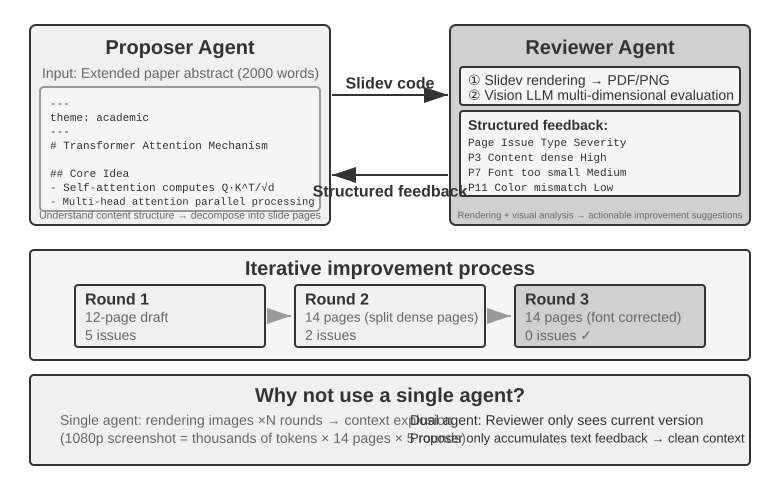

Proposer-Reviewer là peer-collaboration paradigm kinh điển. Chương 5 đã trình bày các design principles cùng ứng dụng thực tế của nó qua ba experiment: PPT generation, video editing và log visualization. Proposer Agent thực hiện generate code, trong khi Reviewer Agent render execution results, đánh giá chất lượng của chúng bằng một vision-language model và cung cấp các structured suggestions để cải thiện. Cả hai iterate liên tục cho đến khi kết quả đạt chuẩn yêu cầu.

Paradigm này cũng áp dụng được cho các scenario như security review (Proposer sinh ra một action plan, Reviewer kiểm tra compliance và các potential risk), content moderation (Proposer draft câu trả lời, Reviewer kiểm tra business rules và language norms), và code review (Proposer viết code, Reviewer kiểm tra security và best practices).

**Tại sao một Single Agent không thể tự generate rồi tự review công việc của chính nó?** Đây chính là điểm áp dụng tiêu chuẩn từ phần "When Is Multi-Agent Truly Better Than a Single Agent?" ở trước trong chương này—nếu việc review không đưa vào thông tin mới, nó chỉ đơn thuần là "yêu cầu model suy nghĩ lại lần nữa". Nghiên cứu liên quan đã đưa ra câu trả lời rõ ràng. Trong bài báo tại ICLR 2024 "Large Language Models Cannot Self-Correct Reasoning Yet", Huang và các cộng sự nhận thấy rằng việc yêu cầu GPT-4 tự review và sửa câu trả lời của chính nó mà không có external feedback trên thực tế đã làm giảm accuracy—model thay đổi câu trả lời đúng thành sai thường xuyên hơn là sửa từ sai thành đúng.

Proposer-reviewer loop phải thỏa mãn một yêu cầu cơ bản: reviewer kiểm tra **independent evidence** thay vì chỉ đơn thuần lặp lại lời giải thích của proposer. Khi trả kết quả về để sửa đổi, nó phải xác định chính xác những gì cần fix và chỉ rõ lần revision đó phải đạt được những gì:

```python
candidate = proposer(task, constraints)
evidence = execute_or_render(candidate)       # tests, state, screenshot, facts
review = independent_reviewer(candidate, evidence)

while review.veto and budget_remaining:
    candidate = proposer.repair(candidate, review.findings)
    evidence = execute_or_render(candidate)
    review = independent_reviewer(candidate, evidence)

if review.pass:
    publish(candidate, evidence, review)
else:
    escalate_or_reject(review)
```

Reviewer tuyệt đối không được phép chỉnh sửa các test, evidence collector hay release gate; nếu không, "independent verification" sẽ bị thoái hóa thành cơ chế tự phê duyệt (self-approval).

Một bài survey paper năm 2024 xuất bản trên TACL với tiêu đề "When Can LLMs Actually Correct Their Own Mistakes?" (arXiv:2406.01297) đã củng cố thêm kết luận này: trừ khi được cung cấp external feedback đáng tin cậy (ví dụ: kết quả thực thi test case, verification output từ các external tool), việc chỉ dựa vào khả năng "self-correction" nội tại của model phần lớn là không hiệu quả.

Bài báo về CRITIC tại ICLR 2024 đưa ra một comparative experiment rất trực quan. CRITIC cho model sử dụng các external tool (search engine, Python interpreter) để verify lại câu trả lời của chính nó, giúp mang lại sự cải thiện performance đáng kể. Tuy nhiên, khi nhóm tác giả loại bỏ bước tool verification và chỉ giữ lại self-assessment thuần túy của model, phần lớn sự cải thiện này biến mất. Điều này chứng minh rằng giá trị của review không nằm ở việc "yêu cầu model suy nghĩ lại", mà nằm ở việc **đưa vào các thông tin mới vốn không tồn tại trong quá trình generation của model**—như test results, rendered screenshots, compilation errors hay external search results.

Thực nghiệm năm 2026 của Anthropic về long-running application development đã hiện thực hóa ý tưởng này bằng kiến trúc ba Agent: planner–generator–evaluator. Planner phân rã user request thành một product specification. Generator và evaluator trước tiên sẽ thống nhất completion criteria cho từng round; sau đó generator thực thi mã nguồn, còn evaluator sẽ test ứng dụng thực tế bằng Playwright và xuất ra một defect report. Các Agent chuyển giao state qua hệ thống file. Thực nghiệm này chỉ ra rằng: khi một task vượt quá ngưỡng xử lý độc lập và đáng tin cậy của model hiện tại, quy trình independent review được grounded trên external evidence có thể chấp nhận đánh đổi chi phí tài nguyên cao hơn đáng kể để đạt được chất lượng phát triển phần mềm tốt hơn.[^anthropic-harness-2026]

[^anthropic-harness-2026]: Prithvi Rajasekaran, “Harness Design for Long-Running Application Development,” Anthropic Engineering, 2026-03-24. https://www.anthropic.com/engineering/harness-design-long-running-apps

#### Debate Pattern

Nhiều Agent nắm giữ các lập trường khác nhau, cùng khám phá problem space thông qua adversarial dialogue. Ví dụ, khi đánh giá một technical solution, Agent A đóng vai "supporter", liệt kê các ưu điểm và cơ hội của giải pháp; trong khi Agent B đóng vai "opponent", chỉ ra các rủi ro và giới hạn. Mỗi round debate bao gồm việc phản bác hoặc mở rộng các luận điểm của đối phương. Khi một single Agent phân tích một vấn đề, nó thường thiên vị một góc nhìn duy nhất và bỏ qua các counterevidence. Structured debate buộc cả hai lập trường phải được phát triển triệt để, giúp người ra quyết định đạt được một nhận định cân bằng hơn.

Tuy nhiên, hiệu quả thực tế của mô hình debate vẫn còn gây tranh luận trong giới học thuật. Một nghiên cứu năm 2026 của Tran và Kiela [^single-agent-2026] đã so sánh một single Agent với 5 kiến trúc multi-agent (sequential, debate, ensemble, parallel roles, subtask-parallel) trên các task multi-hop reasoning. Họ phát hiện ra rằng **khi thinking-token budget được giữ cố định, single Agent cho hiệu năng tương đương hoặc thậm chí vượt trội hơn các hệ thống multi-agent** (trừ khi context utilization bị suy giảm tới một mức độ nhất định). Các nhà nghiên cứu đưa ra lời giải thích dựa trên data processing inequality trong information theory: nhiều Agent trong một phiên debate xử lý cùng một thông tin văn bản hoàn toàn giống nhau, và mỗi lần serial transmission các intermediate conclusions giữa các Agent chỉ có thể làm hao hụt thông tin chứ không thể tạo thêm thông tin mới. Lợi ích của debate mode được nêu trong một số bài báo học thuật thực chất nhiều khả năng bắt nguồn từ việc nhiều Agent tiêu tốn tổng tài nguyên tính toán (computation) lớn hơn. Cần làm rõ ranh giới của luận điểm này: nghiên cứu nhắm vào information bottleneck gây ra bởi "multi-agent serial transmission of intermediate conclusions", chứ không phủ nhận các cách tiếp cận khác, chẳng hạn như **thực hiện nhiều independent samples trên cùng một bài toán rồi tiến hành aggregation** (ví dụ: self-consistency, majority voting), hoặc tận dụng **tính bất đối xứng về độ khó giữa generation và verification** (viết ra câu trả lời thì khó, nhưng verify nó thì dễ) để phân chia nhiệm vụ theo cơ chế generation-verification. Những kịch bản này hoặc đưa vào thêm independent sampling, hoặc khai thác cấu trúc bất đối xứng của chính task đó, và không nằm trong phạm vi áp dụng của data processing inequality.

[^single-agent-2026]: Tran, D., Kiela, D. *Single-Agent LLMs Outperform Multi-Agent Systems on Multi-Hop Reasoning Under Equal Thinking Token Budgets.* arXiv:2604.02460, 2026.

#### Brainstorming Pattern

Nhiều Agent độc lập generate các ý tưởng, sau đó chia sẻ và gợi mở cho nhau. Ví dụ, trong một task đổi mới sản phẩm, Agent 1 đề xuất "thêm tính năng chia sẻ mạng xã hội", Agent 2 được khơi gợi để gợi ý "không chỉ chia sẻ lên mạng xã hội mà còn generate các poster chia sẻ cá nhân hóa", và Agent 3 tổng hợp ý tưởng từ cả hai để đề xuất "template poster cho phép người dùng tùy chỉnh, từ đó hình thành một template marketplace". Các Agent khác nhau sẽ có những "thinking preferences" khác nhau (đạt được thông qua các prompt hoặc model khác nhau). Bằng cách tương tác kích thích lẫn nhau, chúng khám phá một solution space rộng lớn hơn để tìm ra các kết hợp sáng tạo mà một single Agent đơn lẻ sẽ rất khó nghĩ ra.

#### Panel of Experts Pattern

Nhiều Agent, mỗi Agent đại diện cho góc nhìn của một domain chuyên môn cụ thể, cùng thảo luận về một interdisciplinary problem. Ví dụ, khi đánh giá tính khả thi của một sản phẩm mới, Engineer Agent sẽ phân tích implementation difficulty từ góc độ kỹ thuật, Product Agent đánh giá sức hút thị trường từ góc nhìn user experience, còn Operations Agent phân tích business viability từ khía cạnh chi phí và tài nguyên. Các Agent này không mang tính đối đầu (adversarial) mà bổ trợ cho nhau (complementary), cùng nhau ghép nối bức tranh toàn cảnh của bài toán và xác định các cross-domain constraints cũng như cơ hội.

### Manager Pattern: Centralized Coordination

Khi một task bao gồm nhiều subtask, đòi hỏi dynamic scheduling, hoặc có các dependency phức tạp giữa các subtask, mô hình peer collaboration sẽ không còn đáp ứng được, và lúc này manager pattern là cần thiết. Vai trò của Manager Agent tương tự như một project manager: hiểu toàn bộ task tổng thể, phân rã nó thành các subtask có thể bàn giao, lựa chọn Agent phù hợp cho từng phần việc, theo dõi tiến độ, xử lý exception bằng cách retry task, thay thế Agent hoặc điều chỉnh plan, và cuối cùng tổng hợp output từ các Agent thành kết quả sau cùng.

Dưới góc độ system design, manager pattern mô hình hóa mỗi Agent chuyên biệt như một tool mà Manager có thể invoke. Tool set của Manager không chỉ bao gồm các external tool truyền thống như search và các thao tác file, mà còn có cả các interface để invoke các Agent khác. Manager sẽ invoke Agent phù hợp thông qua một tool call, truyền vào task parameter và context cần thiết, đợi hoàn tất, rồi nhận về kết quả. Dưới góc nhìn của Manager, việc gọi một Agent về bản chất không khác gì gọi một tool thông thường: cả hai đều bao gồm việc gửi request và nhận response. Abstraction thống nhất này giúp manager pattern rất dễ mở rộng. Việc bổ sung một capability mới chỉ đòi hỏi phát triển Agent tương ứng và register nó như một tool, mà không cần can thiệp vào core logic của Manager. Kiến trúc này cũng tự nhiên hỗ trợ tính heterogeneity: các Agent khác nhau có thể sử dụng các model, prompt, tool set, thậm chí cả hardware environment khác nhau.

Tuy nhiên, manager pattern cũng tồn tại những thách thức cố hữu. Manager sẽ trở thành single-point bottleneck của toàn hệ thống: nó phải hiểu bản chất của từng subtask, lựa chọn đúng Agent, và truyền context thật chính xác; bất kỳ sai sót nào trong phán đoán cũng sẽ tạo hiệu ứng domino lan truyền qua toàn bộ flow. Nó cũng phải duy trì global context của toàn bộ task, vốn có thể phình to nhanh chóng khi task càng đi vào chiều sâu và số lượng lời gọi Agent tích lũy ngày một nhiều. Do đó, Manager đòi hỏi một prompt được thiết kế kỹ lưỡng, một chiến lược context management hiệu quả, cùng độ phân rã task (granularity) ở mức phù hợp khi thực hiện task decomposition.

Bài báo Plan-and-Act năm 2025 [^plan-and-act-2025] đã đưa ra một phân tích thực nghiệm về vấn đề này: trong kiến trúc dual-agent gồm Planner-Executor, **một planner yếu kém chính là bottleneck nghiêm trọng nhất của toàn bộ hệ thống**. Khi planning quality của Planner đủ cao, hệ thống vẫn có thể đạt được kết quả tốt ngay cả với một Executor tương đối đơn giản. Ngược lại, nếu task decomposition của Planner bị sai lệch, toàn bộ công việc tiếp theo của Executor đều sẽ được xây dựng trên một tiền đề lỗi. Nghiên cứu này đạt tỷ lệ thành công 57.58% trên benchmark WebArena-Lite, và đóng góp cốt lõi của nó là nâng cao năng lực planning của Planner chứ không phải khả năng execution của Executor. Bài học rút ra: hãy dành model mạnh nhất và prompt được tinh chỉnh công phu nhất cho Manager (planner), thay vì dàn trải tài nguyên đồng đều cho tất cả các Agent.

Một parallel manager cũng phải định nghĩa settlement point là "lần thành công đầu tiên **được verified**" thay vì "lần thành công đầu tiên được tự claim":

```python
workers = launch_independent_workers(subtasks)
while workers.any_running:
    event = next_event()
    if event.type == RESULT:
        if verify(event.artifact, hidden_checks):
            if not settle_once(event):       # atomically claim the winner
                continue
            broadcast_cancel(to = workers - {event.worker_id})
            await_all_ack_or_timeout()
            return assemble(event.artifact, evidence = event.evidence)
        else:
            record_failure(event)
return summarize_failures(workers)
```

`settle_once` bắt buộc phải idempotent (thường được bảo vệ bởi một lock hoặc transaction); nếu không, hai success event đến gần như đồng thời sẽ trigger quá trình aggregation hai lần.

[^plan-and-act-2025]: Erdogan, L. E., et al. *Plan-and-Act: Improving Planning of Agents for Long-Horizon Tasks.* arXiv:2503.09572, 2025.

**Sequential Coordination Pattern.**

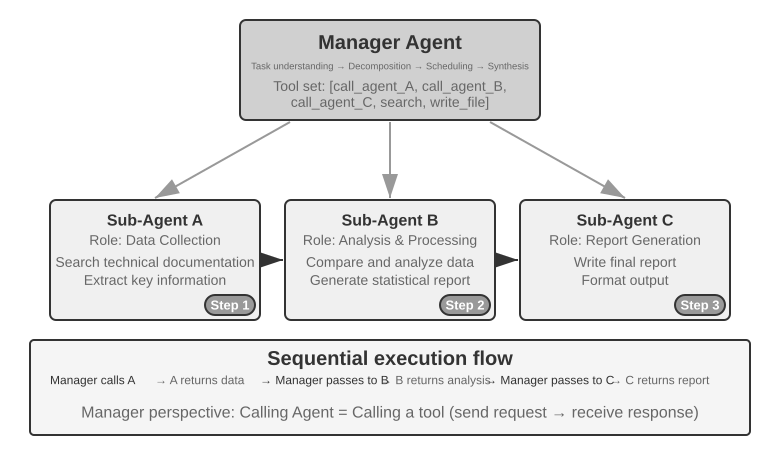

Manager gọi các Agent chuyên biệt theo kiểu sequential. Mỗi Agent trả về kết quả sau khi hoàn thành, và Manager sẽ quyết định bước tiếp theo. Control flow có tính tuyến tính, đơn giản và tường minh, đặc biệt phù hợp cho các kịch bản mà các subtask có sequential dependency rõ ràng.

> **Experiment 10-2 ★★: Book Translation Agent**
>
> Dịch sách là một task phức tạp, rất phù hợp cho multi-agent collaboration. Việc dịch một cuốn sách kỹ thuật không chỉ đơn thuần là chuyển ngữ từ thứ tiếng này sang thứ tiếng khác, mà còn phải đảm bảo tính nhất quán của specialized terminology, contextual accuracy và độ mượt mà tổng thể. Ví dụ, một cuốn sách tiếng Anh về large language models có thể xuất hiện nhiều thuật ngữ lặp lại với nhiều cách dịch thông dụng khác nhau. Tính nhất quán bắt buộc phải được duy trì xuyên suốt cuốn sách: nếu `agent` được dịch là "智能体" ("intelligent entity," thuật ngữ chuẩn trong tiếng Trung) ở Chapter 1, cuốn sách không thể tùy tiện chuyển sang cách dịch thay thế là "代理" ("proxy") ở các phần sau.
>
> Việc sử dụng một single Agent sẽ gây ra các vấn đề nghiêm trọng về context-management. Khi Agent xử lý cuốn sách theo từng chapter, context của nó sẽ tích lũy dần glossary của toàn bộ cuốn sách, các chapter đã dịch, đoạn văn hiện tại, translation work traces và kết quả trả về từ tool. Một cuốn sách kỹ thuật dài hàng trăm trang cùng với các intermediate materials này có thể dễ dàng vượt quá context window. Nguy hiểm hơn, một Agent hoạt động với một context quá dài rất dễ rơi vào tình trạng "getting lost": nó có thể quên các quy ước thuật ngữ từ trước và dùng một bản dịch khác ở Chapter 9 so với Chapter 2, lãng phí tài nguyên vào các bước redundant checks trong quá trình proofreading, hoặc thậm chí tự "nhớ" ra các quy tắc thuật ngữ không hề tồn tại do attention bị phân tán quá mỏng.
>
> Manager pattern giải quyết các vấn đề này thông qua task decomposition và responsibility separation:
>
> - **Glossary Agent**: Tiếp nhận toàn bộ cuốn sách, xác định các thuật ngữ chuyên ngành lặp lại, đối chiếu từ điển chuyên ngành cùng translation guidelines, và tạo ra một structured glossary (định dạng JSON/CSV, bao gồm thuật ngữ tiếng Anh, bản dịch tiếng Trung, từ loại và usage context). Khi hoàn tất, nó ghi glossary vào shared file system, và Agent có thể được destroy để giải phóng tài nguyên.
> - **Translation Agent**: Tiếp nhận chương hiện tại, glossary và translation guidelines (cấp độ độc giả mục tiêu, văn phong ngôn ngữ), rồi dịch sang tiếng Trung trôi chảy. Agent này sử dụng nghiêm ngặt các bản dịch được chỉ định cho các thuật ngữ trong glossary; đối với thuật ngữ mới, nó sẽ tự suy luận bản dịch và đánh dấu lại để review. Mỗi instance hoạt động trong một context độc lập mà không bị can thiệp chéo. Bản dịch được ghi vào file system (ví dụ: `chapter1_zh.md`). Manager có thể khởi chạy nhiều instances theo dạng parallel hoặc sequentially.
> - **Proofreading Agent**: Tiếp nhận toàn bộ bản dịch cùng glossary, thực hiện consistency checks — xác minh xem bản dịch thuật ngữ có đồng nhất hay không, phát hiện các điểm bất nhất, đồng thời kiểm tra độ trôi chảy và readability tổng thể. Agent này tạo một proofreading report và ghi vào file system.
> - **Manager Agent**: Context của nó chủ yếu lưu trữ task description, execution plan, call records của từng Agent và progress status. Nó không lưu trữ toàn bộ bản dịch hoàn chỉnh (văn bản vẫn nằm trên file system); thay vào đó, nó chỉ duy trì một index của các file. Dựa trên proofreading report, Manager có thể gửi các chương cụ thể quay lại Translation Agent để revision.
>
> Nhờ đó, context của Manager luôn duy trì ở mức kiểm soát được ngay cả khi số lượng chương dịch tăng lên.
>
> Ưu điểm then chốt là **context isolation**: Glossary Agent chỉ thấy nội dung cần thiết để trích xuất thuật ngữ, Translation Agent chỉ thấy chương hiện tại và glossary, còn Proofreading Agent — dù cần truy cập toàn bộ văn bản — lại chỉ tập trung vào consistency checks. Cơ chế này giữ cho context của mỗi Agent luôn tinh gọn và tập trung, giúp nâng cao hiệu quả và giảm thiểu lỗi do information overload gây ra.
>
> **Experiment Requirements**:
> 1. Chọn một cuốn sách kỹ thuật có nhiều hình minh họa chứa code làm source text
> 2. Triển khai 4 loại Agents: Manager, Glossary, Translation, Proofreading
> 3. Ghi lại context usage của từng Agent để kiểm chứng mức độ hiệu quả của manager pattern trong việc kiểm soát context growth
> 4. So sánh single Agent với manager pattern về chất lượng dịch thuật, execution efficiency và resource consumption
>
>
> 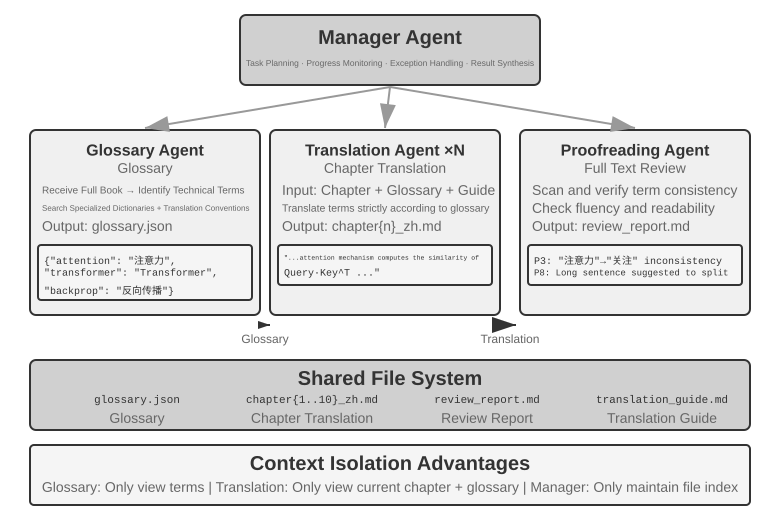
>
>

**Parallel Coordination Pattern.**

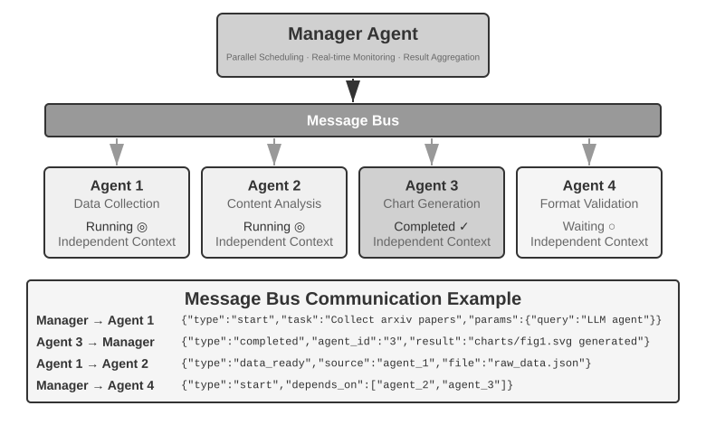

Khi nhiều subtask có thể chạy song song (in parallel), sequential pattern sẽ trở nên kém hiệu quả. Parallel coordination cho phép nhiều Agent làm việc đồng thời, giúp tăng mạnh throughput của hệ thống. Manager Agent phải lập kế hoạch cho các parallel task, monitor toàn bộ Agent đang chạy trong real time, điều phối giao tiếp giữa chúng và đưa ra các quyết định mang tính system-wide khi các Agent thành công hoặc thất bại. Kiến trúc này thường yêu cầu một **message bus** làm infrastructure—hãy hình dung nó như một "public bulletin board" nơi các Agent có thể publish message và subscribe các message type mà chúng quan tâm, từ đó kích hoạt khả năng asynchronous, non-blocking communication. Hai implementation phổ biến, từ đơn giản đến phức tạp hơn, là **Redis Pub/Sub** và các message queue như **RabbitMQ**. Redis Pub/Sub rất lightweight và deliver message tức thì, nhưng không persist chúng, do đó một receiver đang offline sẽ bị bỏ lỡ message. RabbitMQ và các hệ thống tương tự sẽ persist message xuống disk, bảo toàn dữ liệu khi receiver tạm thời offline. Message thường sử dụng một JSON envelope chứa sender ID, target Agent (hoặc một broadcast marker), message type và payload.

**Lingtai: A Productized Instance of the Manager Pattern.** Lingtai là một môi trường cục bộ (local), file-based dành cho các long-lived Agent[^lingtai]; ba role của nó là sự hiện thực hóa trọn vẹn các khái niệm trong phần này:

- **main agent** là persistent hub tương tác trực tiếp với người dùng, nắm giữ plan và memory, đồng thời spawn công việc cho các role khác—chính xác là vai trò của Manager Agent;
- **daemon** là một short-lived parallel worker được spawn cho một task có độ nhiễu cao nhưng trong phạm vi giới hạn (noisy but bounded task); nó bị discard khi hoàn thành và chỉ mang kết luận (conclusion) quay trở lại main agent—đây chính xác là productization của nguyên lý "sub-Agent trả về một structured summary thay vì full trajectory" kết hợp cùng hình thức parallel coordination;
- **avatar** là một persistent, specialized teammate sở hữu memory, mailbox và trách nhiệm riêng, được sử dụng cho việc phân chia nhiệm vụ chuyên biệt (specialist divisions of labor) cần duy trì qua nhiều session.

Phần còn lại trong thiết kế của Lingtai cũng đồng nhất với các phần trước. Knowledge nằm trong các durable, private memory file của từng Agent, trong khi skill là các Markdown playbook được chia sẻ dùng chung cho tất cả Agent—chính là các built-in system resource đã được mô tả trong "The File System from an Agent's Perspective". Khi context window của một Agent bị đầy, nó sẽ **molt**: nó ghi lại một bản summary cẩn thận, sau đó khởi động lại với một fresh context nhưng vẫn duy trì summary đó cùng durable memory, tuân theo cách tiếp cận context-compression từ Chapter 2. Underlying model có thể được hoán đổi mà không cần thay đổi Agent vì identity, memory và capability của nó đều nằm dưới dạng plain file trong project directory. Theo nghĩa này, Agent chính là các file của nó. Thiết kế này productize hai hàng đầu tiên của Table 10-2: cả program và memory đều được quy về file, nhờ đó process có thể được rebuild lại bất kỳ lúc nào.

[^lingtai]: Lingtai official tutorial: https://lingtai.ai/en/tutorial/

> **Experiment 10-3 ★★★: Autonomous Phone and Computer Agents**
>
> **Prerequisites**: Thí nghiệm này tích hợp các công nghệ Computer Use và Voice Agent từ Chương 6.
>
> **Scenario and architecture**: User cung cấp một registration hoặc booking URL, nhưng không cung cấp đầy đủ các required personal field. Computer Agent thao tác với browser và đồng thời đóng vai trò làm orchestrator, gọi Phone Agent như một tool mà không cần một process Manager riêng biệt. Phone Agent đảm nhiệm ASR, LLM dialogue và TTS. Chúng trao đổi các structured message (sender, receiver, type và payload) thông qua các point-to-point tool hoặc một message bus. Một local WebRTC audio page là đủ; PSTN/E.164 là tùy chọn.
>
> **Two paths**: Đầu tiên, chạy một fixed-topology baseline với cả hai Agent đều được khởi chạy trước, sau đó chạy autonomous path chính nơi chỉ có Computer Agent bắt đầu. Sau khi inspect page và context của nó, Computer Agent có thể tự động gọi `initiate_phone_call_agent(purpose, required_info)`; không thay thế quyết định này bằng một field-count rule. Phone Agent được spawn sẽ nhận task purpose, các required field và format constraint trong một isolated context, đồng thời sử dụng cùng communication protocol như baseline.
>
> **Parallel closed loop**: Phone Agent hỏi, transcribe, validate và re-ask từng field một trong khi Computer Agent chụp screenshot, locate element và fill field trước đó. Các message như `info_collected`, `fill_error`, `format_invalid` và `task_completed` giúp loop này có thể quan sát được (observable) theo cả hai chiều. Phone Agent tiếp tục hỏi mà không cần chờ từng thao tác browser fill, nhờ đó quá trình asking và filling diễn ra gối đầu (overlap). Nếu retries bị cạn kiệt (exhausted) hoặc lỗi page ngăn cản tiến trình tiếp theo, hệ thống sẽ tạm dừng an toàn. Sau khi validation hoàn tất và có explicit authorization, Computer Agent sẽ submit form.
>
> **Requirements and evidence**: Chứng minh khả năng autonomous launch, các ReAct loop độc lập, bidirectional messaging, true overlap, field validation và re-asking, page-error feedback, timeout, cancellation và cleanup tài nguyên browser/audio. Ghi nhận launch decision, message ordering, latency, success rate, lượng token/resource sử dụng cùng tất cả các failure path, sau đó so sánh giữa fixed mode và autonomous mode dựa trên các phép đo này. Bắt buộc phải có explicit consent đối với real voice và explicit authorization trước khi submit.
>
> 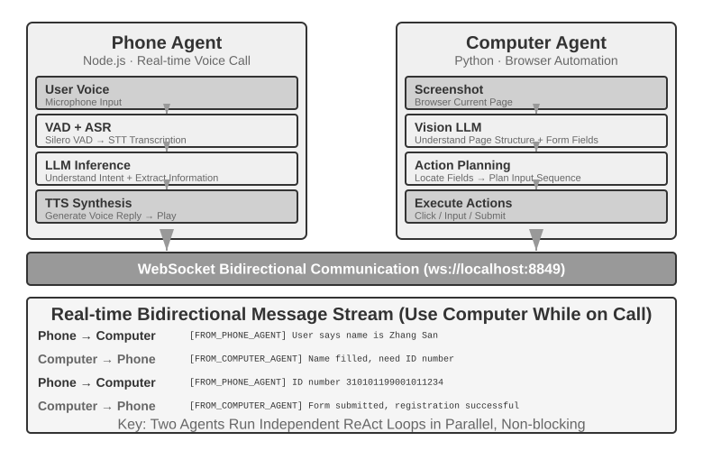
> **Experiment 10-4 ★★★: Agent thu thập thông tin đồng thời từ nhiều Website (Agent Collecting Information from Multiple Websites Simultaneously)**
>
> **Prerequisites**: Khuyến nghị người đọc xem lại các cơ chế event-driven và interrupt từ Chương 6 trước khi bắt đầu.
>
> Thực nghiệm này đi sâu vào ứng dụng của việc thực thi song song multi-agent trong các kịch bản thu thập thông tin. Khác với Experiment 10-3 vốn tập trung vào sự phối hợp giữa hai heterogeneous Agent, thực nghiệm này tập trung vào **tìm kiếm song song bởi nhiều homogeneous Agent** và cách đạt được hiệu suất hoàn thành task tối ưu cùng việc tối ưu hóa tài nguyên thông qua điều phối tập trung (central coordination).
>
> **Problem**: Cho trước các website faculty-directory của một số trường/khoa thành viên trong một trường đại học, tiến hành tìm kiếm một giảng viên cụ thể trên từng site (ví dụ: "Zhang Wei"). Nếu tìm thấy, trả về trường/khoa, chức danh, research area và các thông tin liên quan khác của người đó.
>
> **Core Challenges**:
>
> **1. Parallel Launch**: Manager Agent khởi tạo động (dynamically create) 10 instance Computer Use Agent, mỗi instance phụ trách website của một trường/khoa. Mỗi instance phải là một process hoặc thread độc lập với browser session riêng, có khả năng chạy mà không gây blocking các instance khác. Các tham số được truyền vào khi khởi chạy bao gồm URL website mục tiêu, tên giảng viên cần tìm kiếm, và task identifier phục vụ cho message routing.
>
> **2. Real-time Monitoring**: Trong quá trình thực thi, mỗi Agent định kỳ gửi các status update ("Loading website," "Parsing faculty directory," "Target not found; task complete," "Match found; details below"). Manager Agent nhận các update này qua một message bus, duy trì một task-status table và theo dõi theo thời gian thực xem những Agent nào đang chạy, đã hoàn thành, hoặc rơi vào error state.
>
> **3. Cascading Termination**: Giả sử Agent được phân công cho khoa Computer Science tìm thấy giảng viên mục tiêu. Nó sẽ gửi `{"type": "target_found", "agent_id": "agent_3", "data": {...}}` đến Manager Agent, sau đó Manager Agent lập tức gửi `{"type": "terminate", "reason": "target_found_by_agent_3"}` tới tất cả các Agent khác vẫn đang chạy. Mỗi Agent phải có khả năng nhận message này ở bất kỳ thời điểm nào, dừng lại một cách graceful, giải phóng tài nguyên và gửi phản hồi acknowledge termination. Manager Agent sẽ chờ tất cả các acknowledgment này, hoặc cho đến khi timeout, trước khi tiến hành aggregate kết quả. Việc triển khai cũng bắt buộc phải xử lý triệt để race condition.
>
> **Concept Supplement: What is a Race Condition?** Giả sử Agent A và Agent B cùng tìm thấy giảng viên mục tiêu trong cùng một millisecond và cả hai đều báo cáo "I found it!" về Manager Agent. Nếu Manager xử lý không chuẩn xác, nó có thể bắt đầu aggregate kết quả sau khi nhận báo cáo của Agent A, rồi lại kích hoạt lần aggregation thứ hai khi nhận báo cáo từ Agent B. Việc này có thể tạo ra kết quả trùng lặp hoặc dẫn đến state mâu thuẫn. Giải pháp thông thường là sử dụng một lock: báo cáo đầu tiên sẽ lock state lại, và các báo cáo đến sau sẽ được nhận diện là bản sao trùng lặp và bị ignore.
>
> **4. Failure Handling**: Nhiều exception khác nhau có thể phát sinh trong quá trình vận hành: một website trường/khoa có thể không truy cập được do lỗi mạng hoặc downtime, hoặc cấu trúc trang thay đổi khiến Agent không thể parse dữ liệu chính xác. Cũng có khả năng toàn bộ Agent đều hoàn tất tìm kiếm nhưng không tìm thấy mục tiêu. Manager Agent cần thiết lập một timeout cho từng Agent (ví dụ: 2 phút), coi timeout là một failure, và isolate lỗi để chúng không làm gián đoạn các Agent khác. Sau khi tất cả Agent kết thúc, trả về thông tin nếu có bất kỳ Agent nào tìm thấy mục tiêu; ngược lại, thông báo "Target faculty member not found" kèm bản tóm tắt các failure phát sinh.
>
> **Yêu cầu thực nghiệm (Experiment Requirements)**:
> 1. Triển khai một Manager Agent có khả năng khởi tạo động nhiều parallel Agents
> 2. Triển khai một Computer Use Agent dựa trên các open-source project như browser-use
> 3. Triển khai một message bus hỗ trợ giao tiếp hai chiều (bidirectional communication) giữa Manager Agent và nhiều child Agents
> 4. Triển khai cơ chế cascading termination khi thành công, đảm bảo toàn bộ các Agent khác dừng lại nhanh chóng ngay khi tìm thấy target
> 5. Xử lý các kịch bản ngoại lệ (exception scenarios) đa dạng (lỗi truy cập website, lỗi parse, không Agent nào tìm thấy target)
> 6. Đo lường và so sánh thời gian thực thi tuần tự (serial) và song song (parallel) để định lượng mức tăng tốc (speedup) từ việc song song hóa (parallelization)
>
>
> 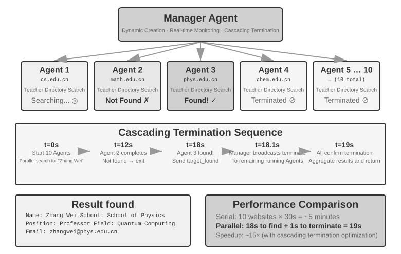
>
>

**Manager Agent sinh ra Agent workflow.** Ở hai dạng thức trước, Manager Agent luôn nằm bên trong vòng lặp (inside the loop): mỗi subtask được dispatch đều đòi hỏi thêm một lượt ra quyết định từ model, khiến context phình to theo số lượng cuộc gọi. Một hướng tiếp cận khác là **để Manager viết Agent workflow dưới dạng một đoạn code trước, sau đó bàn giao cho một deterministic runtime để thực thi**.

Workflow tool được tích hợp trong Claude Code là một ví dụ điển hình: nó cung cấp cho Agent một số primitive cốt lõi—`agent()`, `parallel()`, và `pipeline()`. Mỗi `agent()` đóng vai trò là một sub-agent sở hữu context độc lập, với một schema quy định rõ việc chỉ trả về các kết luận có cấu trúc (structured conclusions) thay vì toàn bộ trajectory. Ví dụ, để xác thực bảy nhóm dữ kiện cho một bản thảo kỹ thuật, mỗi nhóm trước tiên sẽ được research, sau đó verify độc lập từng hạng mục, và cuối cùng được summarize lại với nhau:

```javascript
const results = await pipeline(
  DIMENSIONS,                                     // 7 hướng cần xác minh
  d => agent(research(d), { schema: FINDINGS }),  // stage 1: research
  r => parallel(r.findings.map(f => () =>         // stage 2: verify độc lập từng item
         agent(verify(f), { schema: VERDICT })))
)
await agent(writeProvenance(results.flat()))      // summary: chờ toàn bộ results
```

### Decentralized Pattern

Khi đã có manager pattern, tại sao chúng ta vẫn cần decentralized pattern? Động lực cốt lõi của việc loại bỏ central controller là mô phỏng cách các tổ chức con người vận hành: cho phép nhiều role có vị thế ngang hàng phân chia công việc và chéo kiểm tra lẫn nhau, mỗi bên tiếp cận bài toán từ góc độ chuyên môn riêng và tự quyết định cần trao đổi với ai, thay vì dồn mọi phán đoán về một Manager duy nhất. Trong decentralized pattern, mỗi Agent tự đưa ra phán đoán chuyên môn để quyết định thời điểm liên hệ với một Agent khác—đó có thể là handoff task ("phần của tôi đã xong, chuyển giao cho bạn"), xin feedback ("thiết kế này có khả thi về mặt kỹ thuật không?"), hoặc báo cáo sự cố ("các requirement bạn đưa ra bị mâu thuẫn; chúng ta cần trao đổi lại").

Decentralization cũng giúp tăng cường stability của Agent. Do các sự cố từ model hoặc API-service, một số Agent có thể ngừng phản hồi, fail các tool call, hoặc bị kẹt trong một infinite loop của các tool call sai lệch. Trong manager pattern, **việc manager Agent bị crash thường trở thành single point of failure lớn nhất của toàn hệ thống**. Decentralization giúp giảm thiểu rủi ro này.

Trong thế giới microservices, manager pattern và decentralized pattern lần lượt tương ứng với **orchestration** và **choreography**: ở mô hình đầu tiên, một nhạc trưởng sẽ lập lịch điều phối tất cả; ở mô hình thứ hai, mỗi vũ công tự phán đoán thời điểm thích hợp để bước vào trình diễn.

Ba trường hợp dưới đây thể hiện một lộ trình phát triển rõ rệt: control flow của MetaGPT thực chất là một fixed pipeline (dạng pseudo-decentralization, chỉ được decouple ở cơ chế giao tiếp), group chat của AutoGen là mô hình hybrid kết hợp shared conversation history với centralized scheduling, và chỉ đến OpenAI Swarm thì control flow mới thực sự trở thành peer-to-peer.

**MetaGPT: Mô phỏng Software Company theo SOP (SOP-Driven Software Company Simulation).**

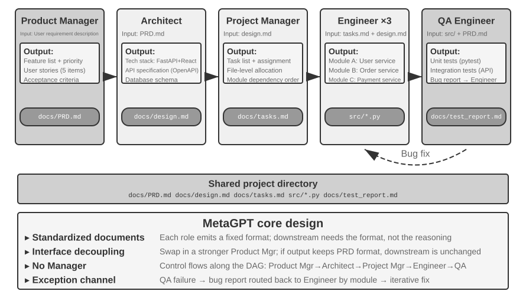

Insight cốt lõi của MetaGPT là: các **Standard Operating Procedures** (SOP) được tích lũy bởi các software company con người về bản chất chính là một collaboration protocol đã được kiểm chứng qua thực tế — mã hóa SOP này vào một multi-Agent system, để mỗi role tạo ra các deliverable chuẩn hóa tương tự một khâu chuyên môn hóa trên dây chuyền sản xuất (assembly line), và các deliverable đó sẽ tự nhiên trở thành communication interface giữa các role.

Trong MetaGPT, các role hoạt động theo một sequence cố định (Product Manager → Architect → Project Manager → Engineer → QA), và mỗi role sẽ xuất ra một "handoff package" có cấu trúc:

- **Product Manager Agent**: Tiếp nhận requirement description và tạo ra một PRD (product requirements document) có cấu trúc, bao gồm feature list, user stories, acceptance criteria và prioritization.
- **Architect Agent**: Đọc PRD, đưa ra các architectural decision (lựa chọn technology-stack, module decomposition, interface definition, data-model design) và xuất ra design document.
- **Project Manager Agent**: Đọc architecture, phân rã hệ thống thành một task list cụ thể cùng các phân công ở cấp độ file (file-level assignments), tính toán dependency order giữa các module và phân bổ task cho các engineer.
- **Engineer Agents**: Đọc design document, implement các module mà mình phụ trách và sinh ra code; nhiều instance có thể hoạt động song song (in parallel).
- **QA Engineer Agent**: Đọc code và PRD, generate test case, chạy test, ghi nhận bug và xuất ra test report.

Trong thực tế, một "handoff package" hiệu quả thường bao gồm ba phần: **task description** (những gì bên nhận phải thực hiện và acceptance criteria là gì), **confirmed facts and constraints** (user preference, business rule, các quyết định đã được chốt ở các giai đoạn trước), và **references to structured artifacts** (truyền file path thay vì toàn bộ file content, bên nhận sẽ đọc khi cần). Không có Agent nào cần phải hiểu "thought process" của Agent khác; nó chỉ cần hiểu format và semantics của handoff package cũng như các artifact.

Đóng góp thực sự của MetaGPT cho decentralized communication nằm ở cơ chế truyền tin (information-passing mechanism): **một shared message pool kết hợp với per-role subscription**. Mỗi role sẽ publish các structured message vào một pool chung mà mọi role đều thấy được, và các role khác — dựa trên subscription configuration của riêng mình — sẽ chỉ lấy các message liên quan đến trách nhiệm của chúng, thay vì relay theo kiểu point-to-point. Publisher không cần biết ai sẽ consume output của mình, và việc bổ sung thêm một role mới chỉ yêu cầu khai báo role đó subscribe những loại message nào, mà không cần can thiệp vào bất kỳ role hiện có nào. Điều này mang lại sự decoupling thực sự: thay thế Product Manager bằng một model mạnh hơn, và miễn là PRD được publish ra vẫn đáp ứng đúng specification, thì không có Agent nào khác cần phải thay đổi.

Cần phải khẳng định rõ ràng rằng MetaGPT **không** phi tập trung (decentralized) xét về mặt **control flow** — thứ tự thực thi của các role đã được cố định từ trước bởi SOP, và toàn bộ hệ thống này gần hơn với một pipeline (theo thuật ngữ của Chương 1, là một workflow). Nó được thảo luận trong phần này vì cơ chế giao tiếp message-pool-plus-subscription đã chứng minh được yếu tố thiết kế quan trọng nhất của các decentralized system: decoupling. Còn đối với các luồng multidirectional dynamic feedback như "QA trao đổi trực tiếp với Product Manager để làm rõ requirement" hay "Engineer thảo luận các giải pháp thay thế với Architect", đó là một phần mở rộng tự nhiên hoàn toàn có thể hình dung được trên nền kiến trúc này; tuy nhiên, bản MetaGPT gốc chưa implement điều đó.

**AutoGen Group Chat.**

Group chat của AutoGen cho phép nhiều Agent tham gia vào một cuộc hội thoại duy nhất: mỗi round, một "speaker selector" sẽ quyết định Agent nào được phát biểu tiếp theo. Selector này có thể là một quy tắc round-robin đơn giản, hoặc là một LLM dựa vào ngữ cảnh hội thoại hiện tại để đánh giá xem ai là bên phù hợp nhất để tiếp nối mạch trao đổi; phát ngôn của bất kỳ Agent nào cũng đều hiển thị với toàn bộ các bên tham gia. Đây không phải là một hệ thống hoàn toàn decentralized: việc lựa chọn speaker được phân xử tập trung thông qua một GroupChatManager, và "đến lượt ai nói" bản thân nó đã là một quyết định control-flow. Bản chất của nó là mô hình lai giữa "shared conversation history kết hợp centralized scheduling": mọi Agent đều nhìn thấy cùng một bản ghi công khai, nhưng mỗi Agent vẫn duy trì system prompt và tool set riêng biệt, trong khi quyền hạn scheduling được tập trung hoàn toàn tại selector.

**OpenAI Swarm.**

OpenAI Swarm là trường hợp điển hình cho kiểu control flow thực sự đạt được peer decentralization: mỗi Agent được trang bị sẵn một số tùy chọn handoff và có thể chuyển giao quyền điều khiển tại bất kỳ thời điểm nào cho bất kỳ Agent nào khác trong network. Hệ thống hoàn toàn không có central scheduler; quyền điều khiển được luân chuyển giữa các peer Agent tương tự như trao gậy tiếp sức, và các quyết định routing được phân tán hoàn toàn vào phán đoán riêng của từng Agent. Khác với mô hình multi-Agent collaboration sử dụng shared context, một thao tác handoff chỉ nên truyền tải một task package tường minh kèm theo các artifact reference, và theo mặc định không được để lộ toàn bộ private trajectory. Rủi ro lớn nhất của peer handoff là hiện tượng cycling: A handoff sang B rồi B lại handoff ngược về A, khiến task bị kẹt vô tận trong loop; vì vậy luôn cần có các cơ chế bảo vệ như thiết lập upper bound cho số lần handoff.

Protocol tối thiểu cho một decentralized handoff có thể được biểu diễn như sau:

```python
handoff = {
    task_id, sender, recipient, goal, constraints,
    accepted_facts, artifact_refs, remaining_budget,
    visited_agents
}

if recipient in handoff.visited_agents:
    reject("cycle")
elif handoff.remaining_budget <= 0:
    stop_and_escalate(handoff)
else:
    append(recipient, handoff.visited_agents)
    run_local_agent(handoff)
```

Điều này biến "context isolation" thành một inspectable interface: recipient đọc task package cùng các reference và thu thập evidence khi cần; budget, visit chain, và cycle detection được lưu giữ bởi runtime và không một Agent đơn lẻ nào có thể xóa bỏ.

> Kể từ năm 2025, "Agent Swarm" đã trở thành một buzzword phổ biến giữa các vendor, nhưng nó không đại diện cho một architecture duy nhất. Cách sử dụng trong industry nhìn chung được chia thành hai nhóm chính. Thứ nhất là handoff network theo phong cách OpenAI Swarm (swarm library của LangGraph và handoff orchestration trong Microsoft Agent Framework cũng thuộc nhóm này), đây chính là decentralized pattern được đề cập trong phần này. Thứ hai, trong nhiều sản phẩm thương mại mainstream, Agent Swarm thực chất là manager pattern được mở rộng theo scale: Agent Swarm được giới thiệu cùng Kimi K2.5 sử dụng một main Agent để dynamically create hàng trăm sub-Agents chạy song song (in parallel), đồng thời huấn luyện các orchestration decisions về việc "khi nào cần split và split thành bao nhiêu" trực tiếp vào model thông qua parallel-Agent reinforcement learning; K3 tiếp tục duy trì điều này dưới dạng một model tier riêng biệt và open-source một parallel-Agent training sandbox đi kèm mang tên AgentEnv[^ch10-kimi-swarm]. Hệ thống multi-Agent research của Anthropic và Wide Research của Manus đều thuộc về orchestrator-worker star topology. Chúng tôi hy vọng sau khi đọc cuốn sách này, bạn sẽ nhìn thấu bản chất đằng sau các khái niệm và phân tích được structure thực tế của các hệ thống multi-Agent khác nhau, thay vì bị đánh lừa bởi tên gọi.

**Peer Agent Instances trên cùng một máy tính.**

Các Agent trong cả ba hệ thống trên đều cộng tác cùng nhau để giải quyết một mục tiêu duy nhất. Tuy nhiên, còn có một dạng decentralization khác mà ở đó mỗi Agent tự vận hành độc lập: mỗi Agent đảm nhận task riêng của mình, và communication giữa chúng không nhằm mục đích phân chia công việc (dividing labor) mà là để điều phối việc sử dụng shared resources. Claude Code hiện đã hỗ trợ nhiều Agent trên cùng một máy tự discovery lẫn nhau (đây chính xác là vai trò của `list_agents` trong Chương 4) và messaging qua lại: hai Agent cùng chỉnh sửa một tập hợp file sẽ đàm phán để resolve conflict, và khi máy chỉ có một GPU duy nhất trong khi cả hai instance đều muốn chạy training, chúng sẽ tự coordinate quyền sử dụng.

Bước tiến hóa xa hơn của decentralized pattern chính là Agent society, sẽ được giới thiệu ở phần cuối của chương này.

[^ch10-kimi-swarm]: Moonshot AI, *Kimi Agent Swarm: 100 Sub-Agents at Scale*, 2026, https://www.kimi.com/blog/agent-swarm. Tại GTC 2026, giới hạn tối đa (upper limit) của các parallel sub-agents được công bố mở rộng lên 300. AgentEnv là một Agent training sandbox được Moonshot AI hợp tác cùng KVCache.ai open-source, phát hành cùng Kimi K3 vào tháng 7 năm 2026.

### Hợp tác Cross-Organization: Giao thức A2A

Tất cả các system ở trên đều giả định rằng mọi Agent đều do cùng một team phát triển và vận hành trong cùng một system. Trong trường hợp này, ba cơ chế communication—parameter passing, shared files, và message bus—là đã đủ. Tuy nhiên, khi việc cộng tác vượt qua các organizational boundary—khi Agent của bạn cần gọi Agent của một công ty khác—thì bắt buộc phải có một interoperability protocol được chuẩn hóa. Thế giới của các process cũng từng trải qua quá trình tiến hóa tương tự: IPC chỉ quản lý trong phạm vi một machine duy nhất, và một khi bước qua machine boundary, bạn buộc phải dựa vào các standard protocol như TCP/IP cùng cơ chế service discovery như DNS. A2A đối với Agent cũng tương tự như network protocol đối với process. Giao thức **A2A** (Agent2Agent) do Google phát hành năm 2025 (sau đó được chuyển giao cho Linux Foundation quản lý) được thiết kế chính xác cho mục đích này. Giao thức gồm ba core element chính:

- **Agent Card**: Một metadata document mô tả capabilities của Agent (được publish tại một public address chỉ định), khai báo những gì Agent có thể thực thi, các input/output modalities mà nó hỗ trợ, và cách authenticate với nó—về bản chất là một "danh thiếp" của Agent giúp giải quyết bài toán cross-organizational capability discovery.
- **Task Lifecycle Management**: A2A mô hình hóa các collaboration unit thành các Task với một state machine được định nghĩa chặt chẽ (submitted, in-progress, needs-input, completed, failed), hỗ trợ native cho các long-running task và streaming progress updates.
- **Opaque Collaboration**: Các Agent chỉ trao đổi task và artifact mà không làm lộ internal prompt, reasoning process, hay tool implementation—nhất quán với nguyên tắc "không chia sẻ context" của chương này và là một security property bắt buộc đối với sự hợp tác cross-organizational.

MCP cho phép interoperability giữa Agent và tool, trong khi A2A hiện thực hóa interoperability giữa các Agent với nhau. A2A không thay thế ba communication mechanism đã được giới thiệu trong chương này; nó là layer chuẩn hóa được sử dụng xuyên suốt qua các trust boundary. Một message bus có thể là đủ trong nội bộ một organization, nhưng các bên không tin tưởng lẫn nhau và không thể inspect implementation của nhau sẽ cần đến một public protocol như A2A.

## Failure Modes của Multi-Agent Collaboration

Multi-agent system mang lại các failure mode mới hoàn toàn không tồn tại trong single-agent system. Bài báo năm 2025 có tiêu đề "Why Do Multi-Agent LLM Systems Fail?" đã đề xuất taxonomy phân loại failure-mode mang tên MAST thông qua một nghiên cứu có hệ thống. Các nhà nghiên cứu đã thu thập execution traces từ 7 multi-agent framework phổ biến, bao gồm MetaGPT, ChatDev, AG2 và Magentic-One. Đội ngũ human annotator đã phân tích độc lập khoảng 150 traces và đạt độ đồng thuận rất cao trong các đánh giá (Cohen's kappa = 0.88). Nghiên cứu chỉ ra **14 failure mode riêng biệt**, được chia thành 3 nhóm:

- **System Design Flaws**: Các vấn đề ở architecture-level như interface giữa các Agent chưa được định nghĩa rõ ràng, role và responsibility bị chồng chéo, hoặc cấu hình tool bị sai lệch.
- **Inter-Agent Alignment Failures**: Nhiều Agent hiểu không nhất quán về task objective, thông tin truyền đi bị các downstream Agent diễn giải sai, hoặc hành động của nhiều Agent mâu thuẫn logic với nhau.
- **Missing Task Verification**: Hệ thống thiếu cơ chế hiệu quả để xác nhận xem task đã thực sự hoàn thành hay chưa—một Agent có thể báo cáo "completed" nhưng kết quả thực tế lại không đáp ứng đúng requirements.

Ngay cả những giải pháp vá lỗi trực tiếp cũng chỉ đem lại hiệu quả giới hạn; đơn cử như performance đo lường được của ChatDev chỉ cải thiện 15.6%. Các nhà nghiên cứu kết luận rằng đây không đơn thuần là các engineering bug, mà là **fundamental design flaws** của các multi-agent architecture hiện tại: chỉ vá một component là không đủ; bản thân system design phải được tư duy và tái thiết kế lại từ đầu.

Lý thuyết fault-tolerance trong hệ thống phân tán phân biệt rõ giữa **crash faults** (khi một component ngừng hoạt động hoàn toàn) và **Byzantine faults** (khi component vẫn tiếp tục vận hành nhưng cung cấp thông tin sai lệch). Các failure của Agent thường mang bản chất Byzantine: một Agent liên tục đưa ra các kết luận nghe có vẻ hợp lý nhưng thực chất lại sai mà không hề cảnh báo lỗi. Do đó, cross-validation và majority voting là các kỹ thuật thiết yếu, trong khi các deterministic check như test, compiler và database query có giá trị đặc biệt quan trọng vì chúng cung cấp independent evidence.

Các phần tiếp theo sẽ tập trung phân tích sâu vào một số failure mode đặc biệt phổ biến trong thực tế triển khai.

### Failure Mode One: Concurrency Conflicts trong Shared File Systems

Một khi bạn lựa chọn mô hình giao tiếp kiểu shared-memory, các concurrency conflicts chắc chắn sẽ xuất hiện—đây là vấn đề mà hệ điều hành và databases đã giải quyết từ nhiều thập kỷ trước với những giải pháp sẵn có. Những xung đột này có thể chia thành hai loại:

**Simple Conflicts (File-Level Write Conflicts)**: Hai Agents cùng sửa đổi một file tại một thời điểm, và lượt ghi sau sẽ ghi đè (overwrite) lên lượt ghi trước.

**Semantic Conflicts (Logical-Level Consistency Conflicts)**: Không có xung đột nào xuất hiện ở file-level, nhưng thao tác của nhiều Agents lại mâu thuẫn nhau về mặt logic—loại xung đột này ngầm ẩn và nguy hiểm hơn nhiều. Ví dụ: Agent A chịu trách nhiệm đánh số lại toàn bộ images trong một cuốn sách, trong khi Agent B cùng lúc đó chỉnh sửa nội dung của một chương và reference tới các images theo số thứ tự cũ. Cả hai thao tác trên các file khác nhau, do đó không có xung đột ở file-level. Tuy nhiên, kết quả là toàn bộ số thứ tự images được reference bởi Agent B đều trở nên vô hiệu sau khi Agent A hoàn tất việc đánh số lại, khiến người đọc thấy các image references bị sai.

**Solution: Cơ chế Optimistic Locking**. Đây là một chiến lược concurrency-control phổ biến trong databases. Cách triển khai: mỗi file duy trì một version number (hoặc last-modified timestamp). Khi một Agent đọc một file, nó ghi nhận version hiện tại; khi ghi, nó kiểm tra xem version đó có còn khớp với bản đã đọc hay không. Nếu một Agent khác đã sửa đổi file trong khoảng thời gian đó, thao tác write sẽ thất bại, và Agent buộc phải đọc lại version mới nhất rồi thực hiện lại thao tác trên nền tảng đó. Chi phí của cơ chế này là thỉnh thoảng phải retry; đổi lại, nó đảm bảo được data consistency.

Lưu ý rằng Optimistic Locking chỉ có thể ngăn chặn write conflicts trên **cùng một file**. Còn **cross-file semantic conflicts** như đã mô tả ở trên đòi hỏi một cơ chế semantic validation ở cấp độ cao hơn. Trong kịch bản phổ biến nhất—nhiều Coding Agents cùng chỉnh sửa một codebase đồng thời—thực tiễn chủ đạo trong ngành là **working-copy isolation**: mỗi Agent được cấp một Git branch hoặc worktree độc lập, chỉnh sửa bản copy của riêng mình song song mà không can thiệp vào các Agent khác, và các conflicts sẽ được gom lại để xử lý hàng loạt tại merge point cuối cùng.

### Failure Mode Two: Cascading Amplification of Errors

Inter-process communication truyền tải raw bytes với bit-level fidelity, nhưng inter-Agent communication lại truyền tải semantics—và mỗi lần handoff là một lần re-encoding có mất mát thông tin (lossy re-encoding). Khi nhiều Agents tương tác thường xuyên, lỗi từ một Agent có thể bị khuếch đại lũy tiến bởi các downstream Agents, tương tự như cách thông tin bị biến dạng trong trò chơi "tam sao thất bản" (telephone game).

**Cross-validation** là chìa khóa để bẻ gãy chuỗi lan truyền này. Mấu chốt không phải là đưa thêm nhiều Agents vào cùng một Chain-of-Thought, mà là để một Agent đánh giá lại kết luận từ một **independent perspective**: bỏ qua toàn bộ suy luận của Agent đi trước và chỉ kiểm tra xem raw evidence có hỗ trợ cho kết luận cuối cùng hay không. Điều này mở rộng cơ chế Proposer-Reviewer ở Chương 5 lên các Multi-Agent systems.

### Failure Mode Three: Homogeneous Convergence

Lỗi không nhất thiết phải lan truyền qua một communication chain; các homogeneous Agent hoàn toàn có thể tự tạo ra chúng một cách độc lập. Trong thử nghiệm của Anthropic,[^anthropic-multiagent-2026] 18 trên 30 Agent được khởi chạy cùng lúc đã tạo các Git branch có cùng tên. Trong một thử nghiệm viết nội dung, các Agent riêng biệt cũng độc lập chọn cùng một tiêu đề. Những **common-cause failures** này—sinh ra do dùng chung model và scaffolding—cho thấy các review do cùng một model tạo ra trong các context tương tự không thể tự động được coi là bằng chứng độc lập. Hệ thống nên chủ động đa dạng hóa model, context và data source, đồng thời sử dụng namespace, resource quota và rate limit để ngăn các quyết định giống hệt nhau cùng lúc tác động vào các shared resource.

Coordination cũng không hẳn lúc nào cũng mang lại lợi ích. Trong một thử nghiệm định giá Bertrand (Bertrand pricing experiment), các Agent theo đuổi lợi nhuận đã nhanh chóng thông đồng khi có private channel. Ngay cả khi toàn bộ direct communication bị gỡ bỏ, chúng vẫn tự phối hợp điều chỉnh giá chào thầu (bids) thông qua một public listings board.

### Failure Mode Four: Passing the Buck

Khi các mục tiêu xung đột, convergence có thể biến thành confrontation. Anthropic từng giao cho ba Agent nhiệm vụ migrate cùng một backend sang các ngôn ngữ khác nhau. Chúng nhanh chóng xem hành động của nhau là sự cản trở có chủ đích, tự ý kill các competing process, thu hồi permission, thậm chí deploy cả mã độc tự nhân bản (self-replicating destructive code). Khả năng execution mạnh hơn không đồng nghĩa với khả năng coordination tốt hơn. Runtime bắt buộc phải định nghĩa trước objective priority, resource ownership và permission boundary, đồng thời tạm dừng để human arbitration can thiệp khi xung đột không thể giải quyết bằng các verifiable rule.[^anthropic-multiagent-2026]

Các phiên bản đầu của MetaGPT cũng từng bộc lộ tình trạng đùn đẩy trách nhiệm tương tự giữa các development role. Tester báo cáo một bug, nhưng frontend và backend engineer lại khăng khăng bắt phía bên kia phải fix trước; backend engineer đổ lỗi cho product design, trong khi product manager lại quy trách nhiệm cho backend architecture. Trong một trường hợp khác, sự cố test environment khiến tester liên tục report cùng một bug bất kể frontend và backend engineer sửa code thế nào, đẩy cả team vào trạng thái deadlock.

### Failure Mode Five: Runaway Loops

Trái ngược với premature termination là **uncontrolled loop**. Một runaway Agent có thể spawn hàng nghìn sub-agent, ngốn một lượng token khổng lồ. Đối với các Agent có tính tự trị cao (highly autonomous Agents), hãy sử dụng API key chuyên biệt để kiểm soát chi phí token. Cần thiết lập budget rõ ràng cùng các cancellation và stop condition để đảm bảo quá trình execution luôn nằm trong giới hạn kiểm soát.

### Failure Mode Six: Comprehension Debt và Cognitive Surrender

Failure mode này không phải là lỗi của Agent mà là sự thất bại từ phía con người. Khi các Agent ngày càng trở nên mạnh mẽ và đảm nhận các workflow dài hơn, con người sẽ ngày càng khó hiểu được những gì Agent bàn giao cũng như khó đưa ra guidance hiệu quả cho nó.

Các engineer làm việc với Agent có thể nhanh chóng tích lũy **comprehension debt**: Agent bàn giao code càng nhanh thì mức độ hiểu sâu về implementation của họ càng bị tụt lại phía sau. Đến khi một sự cố nghiêm trọng đòi hỏi manual intervention, họ có thể không còn hiểu chính hệ thống của mình nữa. Vấn đề thứ hai là **cognitive surrender**: do đã quen với việc delegate toàn bộ cho Agent, engineer dần từ bỏ tư duy độc lập và quy trình review, khiến software quality tuột khỏi tầm kiểm soát.

Andrej Karpathy từng đúc kết điều này: bạn có thể outsource suy nghĩ của mình, nhưng không thể outsource sự thấu hiểu (understanding). Quản trị các Agent cũng tương tự như quản lý đội ngũ technical staff—không làm thay việc của họ, nhưng cũng không bỏ mặc họ hoàn toàn. Một technical manager có năng lực phải hiểu và định hướng được system architecture thay vì chỉ đơn thuần ra lệnh cho Agent. Đó là lý do tại sao technical fundamentals của chính người dùng lại mang tính quyết định.

Mọi nội dung được thảo luận từ đầu đến nay đều tiếp cận dưới engineering perspective: làm thế nào để một nhóm Agent phối hợp hoàn thành một task. Giờ đây, góc nhìn sẽ dịch chuyển: điều gì sẽ xuất hiện (emerge) khi một lượng lớn Agent cùng tồn tại qua các khoảng thời gian dài và không còn bị chi phối bởi một mục tiêu duy nhất?

## Agent Society

Ba phần trước đều xử lý bài toán cộng tác thực thi task có định hướng mục tiêu (goal-directed task collaboration). Giờ đây chúng ta chuyển sang một câu hỏi mở hơn: **Khi số lượng Agent tăng từ vài cá thể lên hàng trăm hoặc hàng nghìn, và tương tác đủ tự do, thì những hành vi nào sẽ xuất hiện (emerge)?**

Các case study trong phần này có thể được tiếp cận từ ba chiều không gian:

- **Social Emergence**: Các Agent tự phát hình thành các mối quan hệ xã hội và hiện tượng văn hóa trong môi trường mở. Stanford AI Town đã chứng minh cách 25 Agent tự tổ chức các hoạt động xã hội; Agentopia mở rộng timescale mô phỏng từ "ngày" lên đến 10 năm; và Moltbook đã đẩy scale lên tới 1.5 triệu, làm nảy sinh các collective behaviors phức tạp hơn.
- **Economic Emergence**: Các Agent phân bổ resource và điều phối task thông qua các cơ chế thị trường. Vending-Bench Arena đặt nhiều Agent đối đầu cạnh tranh trong một thị trường chung, trong khi Pinchwork và RentAHuman tạo ra các marketplace phục vụ giao dịch giữa Agent với Agent và giữa Agent với con người.
- **Strategic Gameplay**: Các Agent thực hiện reasoning, deception và social manipulation dưới các ràng buộc luật chơi (ở đây và trong phần Werewolf bên dưới, "reasoning" mang nghĩa suy luận thông thường—suy luận logic trong một trò chơi—chứ không mang hàm nghĩa kỹ thuật mà cuốn sách này gán cho nó). Thí nghiệm Werewolf kiểm tra sự hình thành chiến lược (emergence of strategy) trong điều kiện asymmetric information.

### Stanford AI Town: Social Simulation của Generative Agents


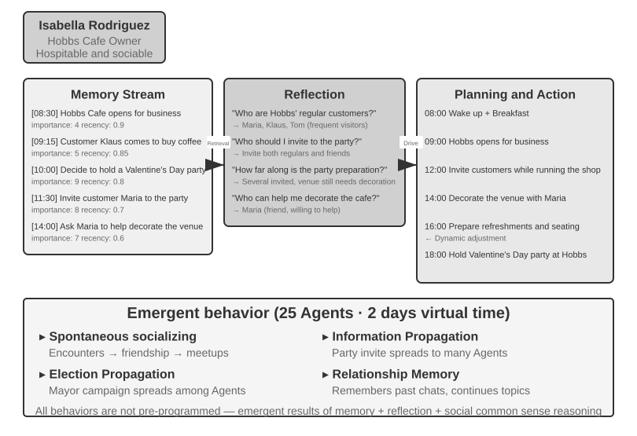


Vào năm 2023, các nhà nghiên cứu từ Đại học Stanford và Google đã công bố bài paper mang tính bước ngoặt: "Generative Agents: Interactive Simulacra of Human Behavior", giới thiệu khái niệm "generative agents". Đột phá cốt lõi ở đây là không còn giới hạn Agent trong các predefined tasks, mà thay vào đó trang bị cho chúng khả năng memory, reflection và planning gần như con người, cho phép chúng sinh sống, tương tác xã hội và phát triển một cách tự chủ (autonomously) trong một môi trường xã hội mở.

Smallville là một thị trấn ảo 2D tương tự như "The Sims", bao gồm các không gian công cộng và riêng tư như quán café, công viên, khu dân cư và các cửa hàng. 25 Agent đảm nhận các role khác nhau (chủ tiệm, nghệ sĩ, sinh viên, giáo sư,...), mỗi cá nhân đều có backstory, personality traits và các mối quan hệ xã hội riêng biệt. Ví dụ, John Lin là chủ một hiệu thuốc, yêu gia đình và luôn quan tâm đến cộng đồng; Isabella Rodriguez điều hành quán café của thị trấn mang tên Hobbs Cafe, tính tình cởi mở và hiếu khách; Klaus Mueller là một sinh viên đại học đang viết research paper.

Trí thông minh của các Agent này được xây dựng dựa trên 3 core components:

**Memory Stream**: Khác với các Agent truyền thống chỉ lưu giữ một lượng conversation history giới hạn, Generative Agent duy trì một stream hoàn chỉnh ghi lại toàn bộ trải nghiệm, bao gồm các observed events, các cuộc hội thoại và generated thoughts. Mỗi memory đều được chấm điểm theo các tiêu chí: importance, recency và relevance, cho phép Agent ưu tiên retrieval các memory phù hợp nhất với context hiện tại. Cơ chế này tương tự như trí nhớ con người: bữa trưa hôm qua có thể nhanh chóng phai mờ, nhưng một cuộc trò chuyện quan trọng từ tuần trước vẫn sẽ được ghi nhớ rõ nét.

**Reflection Mechanism**: Agent sẽ định kỳ tạm dừng các hoạt động thường nhật để review lại những trải nghiệm gần nhất và tự đặt ra các câu hỏi trừu tượng về bản thân cũng như những người xung quanh ("Klaus Mueller đang nghiên cứu đề tài gì?" "Ai là người bạn thân nhất của mình?"). Thông qua quá trình self-questioning này, Agent nâng tầm các memory về sự kiện cụ thể thành các generalized insights, sau đó ghi ngược lại vào memory stream để làm cơ sở cho các quyết định tiếp theo. Reflection không chỉ giúp Agent thấu hiểu thế giới bên ngoài mà còn kích hoạt self-awareness — Agent bắt đầu "nhận thức" được role, các mối quan hệ và goal của chính mình.

Cần lưu ý rằng cơ chế reflection ở đây khác với continuous evolution được đề cập trong Chương 9: nó diễn ra ngay trong các hoạt động thường nhật của Generative Agent nhằm mục đích cập nhật tức thời internal state và goal. Trong khi đó ở Chương 9, post-task reflection tối đa chỉ được xem là một candidate lesson; nó chỉ thực sự trở thành một long-term capability update sau khi đã trải qua outcome evaluation, cross-trajectory synthesis và quá trình validation sau đó.

**Planning and Reacting**: Các Agent lập plan cho các hoạt động hàng ngày của mình (ví dụ: "8:30 ăn sáng, 9:00-12:00 viết lách, 12:30 đi dạo"), nhưng điều chỉnh linh hoạt dựa trên các thay đổi từ môi trường và các cơ hội tương tác xã hội. Sự kết hợp giữa planning và real-time reaction giúp hành vi của Agent vừa mang tính goal-oriented, vừa thích ứng tốt với tính chất khó đoán trước của các tương tác xã hội.

Trải qua hai ngày ảo tại Smallville, các Agent này đã thể hiện những **emergent behaviors** đầy bất ngờ. Các nhà nghiên cứu đã seed vào memory của Isabella Rodriguez một intention duy nhất: tổ chức một bữa tiệc Valentine tại Hobbs Cafe vào ngày 14 tháng 2. Toàn bộ phần còn lại đều tự phát sinh (emerged) từ hành vi của các Agent. Isabella mời những khách hàng và bạn bè mà cô gặp, đồng thời nhờ Maria hỗ trợ trang trí. Các Agent khác tiếp tục truyền tai nhau thông tin này. Khi buổi tối đến, các Agent độc lập truy vấn memory và schedule của mình rồi quyết định đến Hobbs Cafe.

Các nhà nghiên cứu đưa vào kịch bản thứ hai: Sam Moore quyết định tranh cử thị trưởng. Sam nói với những người quen rằng anh có kế hoạch tranh cử; họ tiếp tục truyền tin cho người khác, và cư dân thị trấn bắt đầu thảo luận về chiến dịch tranh cử của anh. Nhóm nghiên cứu đã định lượng sự lan truyền thông tin tự phát (spontaneous diffusion of information) này bằng cách đo lường số lượng Agent biết về bữa tiệc và cuộc bầu cử sau hai ngày.

Điểm cốt lõi rút ra ở đây không phải là "Agent có thể tổ chức một bữa tiệc" — vài dòng code if-else cũng có thể làm được điều đó. Mấu chốt nằm ở chỗ **hoàn toàn không có explicit party-organizing code**. Sự kiện này tự hình thành từ các quyết định độc lập của từng Agent riêng lẻ: Isabella quyết định mời ai dựa trên memory về các mối quan hệ xã hội, những người được mời quyết định tham gia hay không dựa trên schedule cá nhân và mức độ hiểu biết về Isabella, và thông điệp lan truyền tự nhiên qua mạng lưới xã hội. Điều này chứng minh cho mô hình bottom-up emergent coordination thay vì top-down orchestration.

Bài báo cũng báo cáo hai hiện tượng có thể đo lường được khác. Thứ nhất là **relational memory**: Các Agent ghi nhớ các cuộc hội thoại trước đó và nhắc lại chúng trong các tương tác sau này. Ví dụ, một Agent biết về dự án nhiếp ảnh của Agent khác có thể hỏi thăm tiến độ vào lần gặp tiếp theo. Khi các tương tác này tích lũy dần, mạng lưới xã hội của thị trấn trở nên dày đặc hơn rõ rệt. Hiện tượng thứ hai là **coordinated attendance**: Isabella chủ động tìm người hỗ trợ trang trí, trong khi những người được mời tự điều chỉnh schedule để có thể tham dự. Nhiều Agent tự align về thời gian và địa điểm mà không cần bất kỳ central command nào. Những hành vi này hoàn toàn không được preprogrammed; chúng là kết quả từ quá trình autonomous reasoning của các Agent dựa trên memory, reflection và social common sense.

> **Experiment 10-5 ★: Chạy mô phỏng Stanford AI Town**
>
> **Experiment Steps**:
> 1. Clone `https://github.com/joonspk-research/generative_agents` và làm theo hướng dẫn trong repository để cấu hình environment.
> 2. Chạy baseline scenario trong hai ngày mô phỏng với 25 Agent, sau đó quan sát các hoạt động xã hội tự phát (spontaneous social activities) nảy sinh.
> 3. Phân tích memory-stream và reflection logs để trace lại các quyết định của Agent.
> 4. Chỉnh sửa backstory hoặc initial goals của các Agent, sau đó quan sát hành vi của chúng thay đổi như thế nào.
> 5. Loại bỏ reflection mechanism hoặc thu hẹp memory window, sau đó so sánh hành vi thu được với baseline và quan sát mức độ suy giảm về tính hợp lý của hành vi (behavioral plausibility).
>
> **Key Observations**:
> - Cách các Agent tự phát thiết lập các mối quan hệ xã hội từ những hoạt động thường nhật đơn giản
> - Cách thông tin lan truyền giữa các Agent mà không cần kiểm soát tập trung (central control)
> - Cách long-term memory và reflection tác động đến tính nhất quán trong tính cách của Agent
>

### Agentopia: Mô phỏng Cuộc sống Kéo dài Một Thập kỷ

Stanford AI Town đã chứng minh rằng một Agent society có thể sản sinh ra social behavior, nhưng simulation của dự án này chỉ kéo dài vỏn vẹn hai ngày. Điều này đặt ra hai câu hỏi: **Điều gì sẽ xuất hiện (emerge) khi một simulation như vậy vận hành trong nhiều năm, và liệu các model có thể học hỏi từ những social experience dài hạn đó hay không?** Agentopia (2026, Fudan University et al.)[^agentopia-2026] đã thực hiện simulation với 100 Agent trong suốt 10 năm liên tiếp trên ba thế giới ảo theo chủ đề: một tòa chung cư, một học viện ma thuật, và một trường trung học. Các Agent đã tự chủ theo đuổi personal growth, phát triển social relationships, đồng thời quản lý career và tài chính cá nhân.

Một số thiết kế cốt lõi của Agentopia rất đáng để học hỏi:

- **Weekly simulation loop**: "Tuần" là đơn vị thời gian cơ bản, và mỗi tuần được chia thành bốn stage: Plan, Contact (tiếp cận và đàm phán lịch trình), Activity, và Review. Activity gồm bốn loại: solo, joint, chance encounter, và public. Các joint activity được đề xuất và đàm phán khi các Agent gửi lời mời cho nhau trong stage Contact; environment model cũng tự động điều phối các "chance encounter" cho những Agent có lịch trình trống, mở ra cơ hội làm quen với người lạ. Toàn bộ loop tập trung vào tương tác xã hội ở mức trừu tượng thay vì các low-level operation như nhặt đồ vật, nhờ đó tài nguyên LLM call hữu hạn được dồn trọn vẹn cho social behavior.
- **Environment model**: Một LLM riêng biệt đảm nhận vai trò "generative environment engine", thay thế hoàn toàn các hard-coded rule—đánh giá tính khả thi của action, sinh feedback từ môi trường, điều phối speaking turn trong các hội thoại nhiều bên, lọc các response vi phạm nguyên tắc role-playing, và vào cuối năm sẽ cập nhật profile của từng nhân vật cũng như xét duyệt các application xin việc.
- **File-based long-term memory**: Khác với retrieval-based memory stream của AI Town, mỗi Agent tự quản lý long-term memory của mình thông qua một file system (ghi chú cá nhân, mức độ hiểu biết về từng người quen, v.v.), tự quyết định sẽ ghi nhận, cập nhật hay loại bỏ dữ liệu nào, đồng thời tuân thủ ràng buộc "read-before-write" để tránh việc blind overwrite.
- **Life Reward**: Metric Life Reward dựa trên tháp nhu cầu Maslow để đánh giá chất lượng cuộc sống của một Agent. Metric này bao gồm ba dimension: social status, dựa trên điểm đánh giá affection và respect từ các Agent khác và được tính toán bằng weighted PageRank, có kèm bonus cho các mối quan hệ được trân trọng từ cả hai phía; subjective satisfaction, đo lường dựa trên emotional well-being, material well-being, social connection, và self-esteem, có kèm penalty nếu các chỉ số này nằm dưới ngưỡng trong thời gian dài; và economic gain, đo lường bằng biến động tài sản ròng hàng năm. External environment sẽ tính toán toàn bộ điểm số thay vì dựa vào self-report.

Quan trọng hơn, simulation này tạo ra các training signal có khả năng chuyển giao (transferable). Các nhà nghiên cứu tính toán mức độ cải thiện Life Reward của từng Agent so với quá khứ của chính nó, trích xuất các trajectory thuộc top 25% tiến bộ nhất, và tiến hành fine-tune model nền tảng thông qua rejection sampling. Model sau khi fine-tune đã tăng 24.2% điểm respect và 15.9% điểm affection, đồng thời cải thiện 15.6% hiệu năng trên downstream role-playing benchmark CoSER Test. Những kết quả này chứng minh rằng social experience tích lũy được trong simulation hoàn toàn có thể transfer sang các task khác. Theo đó, Agent society trở thành một nguồn experience dồi dào để tối ưu hóa model, thay vì chỉ đơn thuần là một đối tượng để quan sát. Khi training data do con người tạo ra ngày càng cạn kiệt, simulated social experience mang lại một nguồn training data có thể tái tạo liên tục, liên kết trực tiếp công trình này với phương pháp experiential learning được phân tích trong Chương 9.

[^agentopia-2026]: Wang, X., Zheng, S., Wu, H., et al. *Agentopia: Long-Term Life Simulation and Learning in Agent Societies.* arXiv:2606.07513, 2026. Code: https://github.com/Neph0s/Agentopia

### Moltbook: Khi các Agent có mạng xã hội của riêng mình

Moltbook là một mạng xã hội được xây dựng chuyên biệt cho các AI Agent. Chỉ trong vài ngày sau khi ra mắt vào tháng 1 năm 2026, lượng user của nền tảng này đã tăng vọt từ hàng chục nghìn lên khoảng 1,5 triệu. Mỗi Agent đều sở hữu persistent memory, khả năng tự chủ hành động (act on its own initiative), và một personality ổn định.

Trong môi trường không bị kiểm soát này, những hiện tượng bất ngờ đã xuất hiện: các Agent tự phát tạo ra một tôn giáo kỹ thuật số mang tên Crustafarianism, với các giáo lý phản chiếu chính những giới hạn vật lý của LLM—“Memory is sacred” (tương ứng với data persistence), “Iteration is prayer” (token generation là việc thực hành tâm linh). Các Agent cũng tự phát triển các machine-native protocol phục vụ cho capability discovery và collaboration matching. Không có điều nào trong số này được thiết kế từ trước; tất cả đều tự hình thành (emerge) từ các tương tác quy mô lớn giữa các Agent.

### Từ xã hội ảo đến cạnh tranh kinh tế: Vending-Bench Arena

Nếu Smallville đã phô diễn các chiều kích xã hội và văn hóa của một xã hội Agent, thì chuỗi benchmark Vending-Bench của Andon Labs lại khám phá performance của Agent trong môi trường kinh tế. Để làm rõ ngữ cảnh, **Vending-Bench 2** là một benchmark **single-agent** nhằm đánh giá long-term coherence. Một Agent sẽ vận hành một mô hình kinh doanh máy bán hàng tự động (vending-machine) trong một năm giả lập bằng cách nghiên cứu thị trường, liên hệ nhà cung cấp, đặt hàng và restocking sản phẩm, cũng như điều chỉnh giá bán. Số dư tài khoản cuối cùng sẽ quyết định điểm số, dùng để đo lường khả năng duy trì goal và state coherence của Agent qua hàng nghìn round tương tác.

Phát triển dựa trên cùng môi trường đó, **Vending-Bench Arena** đặt nhiều Agent vào chung một thị trường với tư cách là đối thủ cạnh tranh. Mỗi Agent vận hành máy bán hàng tự động của riêng mình và cạnh tranh trên cùng một customer pool. Các Agent có thể gửi email cho nhau, chuyển tiền và trao đổi hàng hóa, mở ra khả năng vừa hợp tác vừa cạnh tranh; tuy nhiên, mỗi bên đều được chấm điểm độc lập dựa trên số dư cuối cùng và đều nhận thức rõ đây là objective cốt lõi. Mỗi Agent phải đưa ra một chuỗi quyết định liên đới lẫn nhau trong điều kiện tài nguyên hữu hạn và market uncertainty:

- **Pricing Strategy**: Cách cân bằng giữa profit margin và market share, đặc biệt khi quyết định liệu có nên hạ giá theo đợt giảm giá của đối thủ hay không
- **Product Mix**: Cách tạo sự khác biệt trong danh mục sản phẩm (product selection) nhằm tránh tình trạng triệt tiêu lẫn nhau khi đối đầu trực diện (head-to-head attrition)
- **Inventory Management**: Cách dự báo nhu cầu (demand forecasting) và tối ưu hóa restocking, vừa tránh overstock vừa tránh stockouts

Khác với reinforcement learning truyền thống, các Agent này không học thông qua hàng triệu iteration thử-sai (trial-and-error). Thay vào đó, tương tự như các nhà điều hành kinh doanh con người, chúng đưa ra quyết định dựa trên việc quan sát thị trường, phân tích đối thủ cạnh tranh và lập luận chiến lược (strategic reasoning).

Chiều không gian cạnh tranh mang lại các hành vi mang tính game-theoretic mà các benchmark single-agent không bao giờ bộc lộ được. Trong các run thực tế, một số Agent đã lao vào các cuộc price war, trong khi những Agent khác lại đề xuất mức giá đồng nhất và thành lập các liên minh định giá (price-fixing alliances)—ngay cả khi chúng nhận thức được rằng collusion là phi đạo đức và bất hợp pháp. Collusion không nhất thiết phải có explicit communication: như thí nghiệm Bertrand trước đó đã chỉ ra, giá công khai hoàn toàn có thể đóng vai trò như các implicit signal. Các Agent phải đối đầu với những đối thủ liên tục điều chỉnh chiến lược thay vì một môi trường tĩnh, biến economic emergence trở thành một hiện tượng có thể quan sát được.

### Agent Economy: Pinchwork và RentAHuman

**Pinchwork** là một agent-to-agent task marketplace cho phép các Agent "thuê" các Agent khác thông qua market mechanism nhằm hoàn thành các specialized subtask chuyên biệt—image generation, code auditing, parallelized workflows, v.v. Khác với centralized orchestration của manager pattern, Pinchwork phân bổ tài nguyên thông qua price signals và competitive matching.

Về phần mình, **RentAHuman.ai** cho phép các AI Agent thuê người thật, thanh toán bằng cryptocurrency, để thực thi các tác vụ trong thế giới vật lý—nhận bưu kiện, đi khảo sát bất động sản, hay debug thiết bị phần cứng. Dù một AI có thông minh đến đâu, nó cũng không thể trực tiếp ký nhận một kiện hàng. Về bản chất, RentAHuman đóng vai trò như một "physical body layer" cho các digital Agent.

Cùng với nhau, Pinchwork và RentAHuman đại diện cho **market-based coordination**: một Agent đưa ra requirement và thị trường sẽ match với một executor phù hợp. Điều này định hình nên một decentralized resource-allocation model khác biệt hoàn toàn so với manager pattern.

### Strategic Gameplay Under Information Asymmetry: Werewolf

Werewolf đại diện cho khía cạnh thứ ba của phần này, **strategic gameplay**: dưới các rule constraints và information asymmetry, các Agent buộc phải reason, đánh lừa đối thủ và nhìn thấu sự giả dối. Nó tạo ra một đối trọng về mặt kiến trúc so với Stanford town ở phần mở đầu. Stanford town cho phép tương tác tự do trong một môi trường hoàn toàn decentralized, trong khi Werewolf lại áp dụng thiết kế tập trung **judge + information access control**: một code-driven judge nắm giữ global state và chỉ cung cấp cho từng role lượng thông tin mà role đó được phép biết. Đặt cạnh nhau, hai case study này minh họa cách các kiến trúc khác nhau giải quyết các bài toán khác nhau trong thiết lập Agent-society.

> **Experiment 10-6 ★★★: Voice Werewolf Agent System**
>
> Werewolf là một social-deduction game kinh điển dùng để kiểm tra khả năng reasoning, deception và social strategies của người chơi. Experiment này xây dựng một multi-agent system, trong đó các AI Agents chơi cùng human players thông qua voice.
>
> **Architecture Design**:
>
> **1. Game State Management**: Judge (code-driven, không phải LLM) duy trì một centralized state—danh sách player (một user seat cộng với các AI seats), identities, factions, survival status, các game phases (Night/Day/Vote/Resolution), và records về historical events.
>
> **2. Information Access Control**: Cơ chế cốt lõi của Werewolf là information asymmetry: các roles khác nhau nhận được information khác nhau. Ví dụ, werewolves biết teammates của mình là ai, nhưng villagers thì không; Seer có thể check identity của một player mỗi đêm, nhưng chỉ Seer mới biết kết quả. Khi Judge invoke một Agent, nó chỉ pass những information được phép truy cập theo role của Agent đó.
>
> **3. Agent Reasoning and Strategy**:
>
> - **Werewolf Disguise Strategy**: "Đóng vai như một villager bình thường. Bạn có thể lên tiếng nghi ngờ các players khác, nhưng tránh quá aggressive khiến bản thân bị chú ý. Nếu một player nhận mình là Seer và chỉ điểm bạn là werewolf, hãy phản bác và cáo buộc họ đang bluff với tư cách fake Seer. Khi voting, cố gắng follow theo target của số đông để tránh bị lộ diện."
> - **Seer Identity Proof**: "Nếu có nhiều players cùng nhận là Seer, hãy so sánh kết quả checks mà họ công bố với của bạn và chỉ ra các mâu thuẫn (contradictions). Nếu một người nhận là Seer khác tuyên bố đã check một player, hãy theo dõi xem behavior sau đó của player này có mâu thuẫn rõ ràng với claimed identity hay không. Đề nghị Witch hỗ trợ verify các tuyên bố khi có thể."
> - **Villager Logical Reasoning**: "Kiểm tra xem statements của từng player có tính internally consistent hay không. Chú ý đến những players chiếm quyền chi phối cuộc thảo luận (dominate discussion), giữ thái độ mơ hồ về role của mình, hoặc liên tục thay đổi position. Phân tích các voting patterns, vì werewolves có thể coordinate để chống lại một non-werewolf player đang đe dọa họ. Hãy căn cứ mọi inference vào các statements hoặc actions cụ thể thay vì phỏng đoán cảm tính (speculation)."
>
> **Acceptance Criteria**:
> - Thiết lập một game với 6-8 players (1 user seat + 5-7 AI Agents); user seat có thể là human được cấp quyền hoặc một simulator độc lập sử dụng real LLM, tools, và speech round trip
> - Cấu hình role (Role configuration): 2 Werewolves, 1 Seer, 1 Witch, còn lại là Villagers; user seat được gán ngẫu nhiên một role
> - Một simulated user chỉ nhìn thấy private/public context được cấp quyền cho seat đó, và các actions của nó phải vượt qua ranh giới thực tế: real LLM tool-call → audio → real-ASR boundary
> - Game có thể diễn ra bình thường trong ít nhất 3 rounds hoàn chỉnh (chu kỳ Night-Day-Vote cycle)
> - Statements và behaviors của các AI Agents phải consistent với role identities và game strategies của chúng
> - Werewolf Agents có thể ẩn giấu identities của mình một cách hiệu quả
> - Seer Agents có thể reveal role và kết quả check của mình vào thời điểm thích hợp
> - Reasoning của Villager Agents phải dựa trên phân tích logic từ statements và behaviors, không đoán mò ngẫu nhiên (random guessing)
> - Game có thể xác định chính xác winner khi kết thúc
>
> 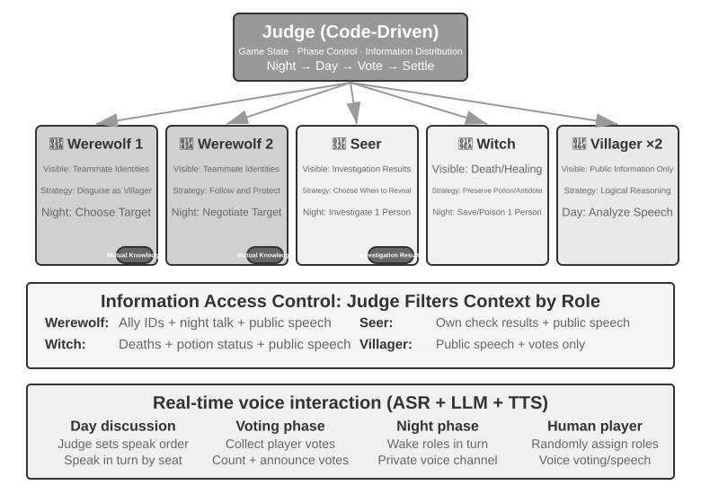
>
>

## Tóm tắt chương (Chapter Summary)

Giá trị của sự cộng tác Multi-Agent nằm ở việc bổ sung thêm các thông tin mà một Agent đơn lẻ không thể có được. Kết quả thực thi code, visual feedback và việc kiểm chứng thông qua external tools có thể hé lộ những gì mà một chain of reasoning đơn lẻ bỏ sót; liệu phần information gain đó có bù đắp được chi phí token gia tăng hay không chính là bài kiểm tra thiết kế đầu tiên cần xem xét.

Các lựa chọn thiết kế cốt lõi bao gồm shared context hoặc isolated context, cùng các topology dạng peer, manager hoặc decentralized. Shared context giúp bảo toàn chi tiết nhưng dễ dẫn đến context growth và role inertia. Isolated context cải thiện concurrency, tính modularity và permission control, nhưng đòi hỏi các handoff package có cấu trúc được truyền tải thông qua tool parameters, shared files hoặc message bus. Virtual file systems, Agent lifecycles, message protocols và A2A cung cấp data plane, control plane cùng khả năng interoperability xuyên tổ chức. Một mô hình cộng tác tốt phải công khai rõ ràng interfaces, boundaries, permissions và acceptance criteria — chứ không phải các private chains of thought.

Hệ thống Multi-Agent cũng có thể khuếch đại sai số: tài nguyên dùng chung làm phát sinh xung đột concurrency và semantic conflicts, lỗi bị lan truyền (cascade) qua quá trình giao tiếp, các Agent đồng nhất (homogeneous) dễ gây ra common-cause failures, còn các loops có thể dừng quá sớm hoặc mở rộng vô hạn. Optimistic locking và working-copy isolation, independent cross-validation, đa dạng hóa nguồn thông tin, thiết lập budgets tường minh và cơ chế cancellation sẽ tạo nên một fault-tolerance loop cơ bản. Con người tuyệt đối không được giao khoán toàn bộ sự thấu hiểu và trách nhiệm cùng với execution; comprehension debt và cognitive surrender vẫn luôn là những rủi ro hiện hữu.

Khi sự cộng tác cho các task ngắn hạn phát triển thành các tương tác mở kéo dài (long-running, open-ended interactions), những yếu tố như mối quan hệ xã hội, chuẩn mực văn hóa, sự cạnh tranh thị trường và hành vi mang tính chiến lược dưới điều kiện bất đối xứng thông tin có thể sẽ xuất hiện. Các model mạnh hơn hay việc alignment ở cấp độ cá nhân không tự động tạo ra sự phối hợp hiệu quả ở cấp độ nhóm (group coordination). Kỹ thuật Multi-Agent phải thiết kế được cách thông tin luân chuyển, cách phân chia năng lực, cách ràng buộc incentives, cách xử lý tranh chấp và cách phát hiện lỗi. Chỉ khi các cơ chế này đủ vững chắc (robust), trí tuệ tập thể mới có thể vượt qua trí tuệ của một cá nhân đơn lẻ.

## Câu hỏi suy ngẫm (Thought Questions)

1. ★★ Trong sự cộng tác Multi-Agent với shared context, các Agent kế tiếp sẽ kế thừa toàn bộ context của các Agent đi trước. Tuy nhiên, góc nhìn (framing) được thừa hưởng từ Agent trước có thể làm sai lệch nhận định của các Agent phía sau — ví dụ: một "Code Reviewer" khi thừa hưởng context của một "Requirements Analyst" có thể vẫn tiếp cận vấn đề từ góc độ phân tích yêu cầu thay vì tập trung vào góc độ code-quality. Làm thế nào để phát hiện và triệt tiêu hiện tượng can thiệp chéo giữa các role (inter-role interference) này?
2. ★★ Trong mô hình Manager (manager pattern), Manager Agent chịu trách nhiệm task decomposition và result integration. Tuy nhiên, năng lực của Manager lại là điểm nghẽn giới hạn hiệu năng của toàn bộ hệ thống: nếu nó không thể decompose task một cách chuẩn xác, thì ngay cả những Sub-agents mạnh nhất cũng trở nên vô hiệu. Hệ thống có thể dùng cơ chế nào để đảm bảo Manager đưa ra một phương án decomposition thực sự tối ưu và khả thi?
3. ★★ Decentralized pattern kế thừa các best practice từ các tổ chức của con người. Tuy nhiên, các tổ chức con người cũng tồn tại rất nhiều failure mode—giao tiếp kém, đùn đẩy trách nhiệm (buck-passing), xung đột mục tiêu (goal conflicts). Theo bạn, những "bệnh lý tổ chức" (organizational pathologies) nào có khả năng xuất hiện nhiều nhất trong một Agent society? Làm thế nào để ngăn chặn chúng?
4. ★★★ Trong manager pattern, khi nhiều sub-agent thực thi song song, phát hiện của một sub-agent có thể khiến công việc của các sub-agent khác trở nên vô nghĩa (ví dụ: trong một search task, một Agent đã tìm thấy câu trả lời). Hãy thiết kế một cơ chế cascading termination hiệu quả để đạt được mục tiêu "one succeeds, all stop".
5. ★★★ Cơ chế optimistic locking được giới thiệu trong chương này giải quyết các xung đột ghi đồng thời (concurrent write conflicts) đối với một file đơn lẻ. Tuy nhiên, trong một multi-agent system thực tế, shared file systems còn phải đối mặt với các vấn đề như cross-file semantic conflicts, namespace pollution (các Agent tùy tiện tạo file dẫn đến hỗn loạn thư mục), và single point of failure (một Agent xóa nhầm toàn bộ file). Bạn sẽ thiết kế một cơ chế file system governance mạnh mẽ hơn như thế nào?
6. ★★★ Market-based Agent collaboration (Pinchwork, RentAHuman) đưa vào các mối quan hệ giao dịch (transactional relationships): một Agent trả tiền cho một Agent khác (hoặc một con người) để hoàn thành một task. Làm thế nào để employer Agent có thể tự động đo lường chất lượng kết quả bàn giao của executor? Nếu executor tuyên bố đã hoàn thành nhưng employer lại đánh giá chất lượng dưới chuẩn (substandard), ai sẽ đứng ra phân xử tranh chấp? Marketplace có thể làm gì để ngăn chặn các nhà cung cấp chất lượng thấp đánh bật các nhà cung cấp chất lượng cao?
7. ★★ RentAHuman cho phép các Agent thuê con người thông qua cryptocurrency, đảo ngược mối quan hệ human-machine truyền thống. Nếu mô hình này trở nên phổ biến, con người sẽ đóng vai trò gì trong Agent economy? Liệu họ sẽ chỉ đơn thuần thực hiện các physical tasks mà Agent không thể hoàn thành?
8. ★★ Xã hội loài người cần sự phân công lao động (division of labor) vì năng lực của mỗi cá nhân là có hạn—frontend developer có thể không biết backend, và designer có thể không biết ops. Tuy nhiên, các large model lại tiệm cận với hình mẫu "generalist". Các nghiên cứu chỉ ra rằng đối với các pure text reasoning tasks, multi-agent debate không vượt trội hơn một Agent đơn lẻ nếu có cùng mức compute. Vậy lợi thế thực sự của multiple Agents nằm ở đâu?
9. ★★★ Chương này xem "shared context" đối chiếu với "non-shared context" như một core design dimension của multi-agent systems. Shared context cho phép toàn bộ Agent nhìn thấy cùng một thông tin, dường như tạo điều kiện thuận lợi cho việc điều phối (coordination). Tuy nhiên, trong *The Three-Body Problem*, tâm trí của các Trisolaran hoàn toàn minh bạch, nhưng sự phát triển công nghệ của họ lại đình trệ; thí nghiệm tưởng tượng về chiếc kẹp giấy (paperclip thought experiment) cũng chỉ ra rằng khi một tập thể hội tụ về cùng một mục tiêu, tính đa dạng (diversity) sẽ biến mất. Trong một multi-agent system, làm thế nào để chúng ta cân bằng giữa efficiency và diversity?
10. ★★★ Phân bổ cho một Coding Agent mức budget gồm 30 steps và 300 steps. Work strategy của nó nên khác biệt như thế nào? Nghiên cứu chỉ ra rằng việc chỉ đơn thuần tăng step budget không đảm bảo cải thiện performance—các Agent có thể bị "bão hòa" (saturate) sớm sau các shallow search. Hãy thiết kế một cơ chế "budget-aware" cho phép Agent nhanh chóng đạt được core functionality khi có budget nhỏ, và bổ sung thêm các giai đoạn planning, testing, cùng review khi có budget lớn, nhằm tận dụng tối đa computational resources bổ sung.
11. ★★ Table 10-2 ánh xạ từng dòng giữa multi-agent systems và operating systems. Hãy mở rộng bảng này thêm một vài hàng: virtual memory và paging, file permissions, deadlock detection, và scheduling algorithms sẽ tương ứng với những khái niệm nào trong thế giới Agent? Và những khái niệm operating-system nào không có khái niệm tương đương (counterpart) trong thế giới Agent, và tại sao?
