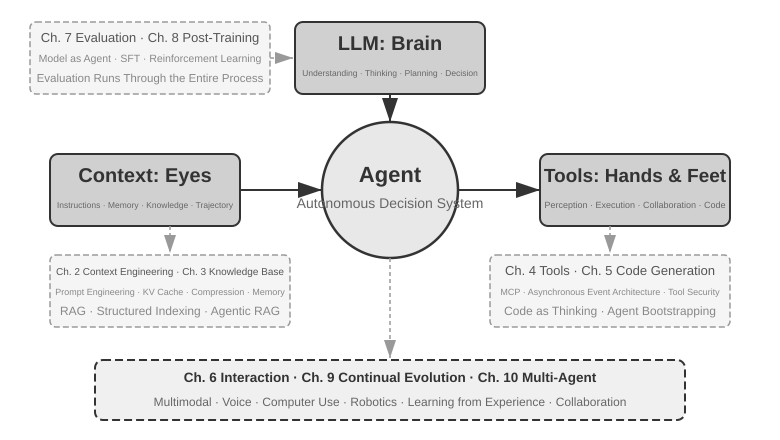
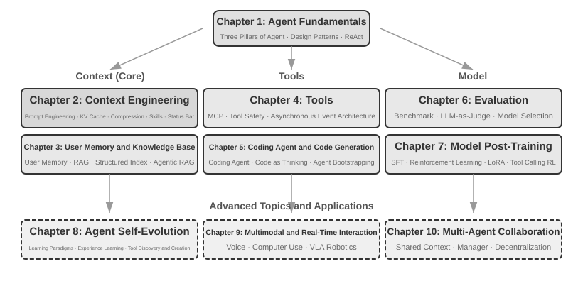

# Lời mở đầu {.unnumbered}

Từ tháng 8 đến tháng 10 năm 2025, tôi đã thực hiện một chuỗi bài giảng kỹ thuật tại chương trình "AI Agent Bootcamp" do Turing—nhà xuất bản công nghệ của Trung Quốc—tổ chức. Mục tiêu rất đơn giản: đưa việc thiết kế AI Agent từ chỗ dựa trên trực giác (intuition-driven) chuyển sang dựa trên nguyên tắc (principle-driven)—không chỉ dừng lại ở việc chạy được một bản demo, mà phải hiểu rõ *tại sao* một Agent lại được thiết kế theo cách đó và những trade-off nào ẩn sau mỗi quyết định kiến trúc. Cuốn sách này được biên soạn và mở rộng từ chính các ghi chép cùng các thực nghiệm trong chuỗi bài giảng đó.

Bản thân cuốn sách, từ ý tưởng sơ khởi cho đến bản thảo hoàn chỉnh, được tạo ra thông qua phương thức có thể gọi là **whisper coding** (cộng tác dựa trên giọng nói)—và công cụ tôi sử dụng để đọc chính tả là Pine, một voice Agent do chính chúng tôi phát triển. Để chuẩn bị cho mỗi bài giảng, tôi đọc một dàn ý sơ lược, để nó khảo sát chủ đề, rồi gom lại thành bản draft đầu tiên. Sau bài giảng, tôi chia sẻ feedback của các học viên Bootcamp với Pine; chúng tôi thảo luận và tinh chỉnh qua nhiều vòng; qua từng iteration, các ghi chép bài giảng dần phát triển thành cuốn sách bạn đang cầm trên tay. Suốt quá trình đó, tôi hiếm khi gõ phím—thay vào đó, tôi nói to những suy nghĩ của mình. Giọng nói có bandwidth cao hơn nhiều so với gõ phím (tốc độ nói thông thường nhanh gấp khoảng bốn lần tốc độ gõ), nhờ vậy vòng lặp "đọc—khảo sát—thảo luận—sửa đổi" diễn ra rất nhanh chóng. Theo một nghĩa nào đó, cuốn sách này không chỉ viết về Agent; nó còn là một tác phẩm được tạo ra với sự trợ giúp của một Agent.

Kể từ khi DeepSeek R1 ra mắt vào đầu năm 2025, lĩnh vực AI đã vượt qua giai đoạn thuần Foundation Model (tức các Large Language Model backbones đa dụng) để tiến sâu vào giai đoạn triển khai kỹ thuật hệ thống (engineering deployment). Tiến bộ ở tầng model thể hiện rõ rệt theo hai hướng. Thứ nhất, thông qua Agentic Reinforcement Learning, các model đã huấn luyện khả năng Tool Calling trực tiếp vào trọng số tham số, làm chủ các năng lực tổng quát trong các mảng như coding, toán học và computer use. Thứ hai, tốc độ iteration của model ngày càng tăng tốc—từ GPT-5.2 lên GPT-5.5, từ Claude Opus 4.5 lên 4.8, mỗi bước nhảy vọt chỉ mất nửa năm. Ở tầng sản phẩm, các general Agent như Manus, Claude Code và OpenClaw đã tái định nghĩa tương tác người-máy, đưa paradigm kiến trúc "code generation + file system" trở thành xu hướng chủ đạo.

Nhìn lại các nguyên tắc kiến trúc Agent mà tôi đã đúc kết trong khóa học gần một năm trước, tôi nhận ra một điều vừa đáng mừng vừa đáng ngạc nhiên: **các nguyên tắc này không hề lỗi thời; trái lại, chúng ngày càng trở nên canonical.** Những thuật ngữ mới—Skill, harness, loop engineering—kể từ đó đã càn quét khắp ngành công nghiệp Agent, nhưng trình tự thực tế lại diễn ra theo chiều ngược lại: các công ty như Anthropic không hề phát minh ra các khái niệm này rồi chứng kiến ngành công nghiệp áp dụng chúng; rất nhiều Agent đã và đang làm những điều đó trong thực tế, và Anthropic chỉ đơn giản là đúc kết lại các thực hành đó thành những nguyên tắc thiết kế có tên gọi cụ thể. Thực tiễn đi trước, tên gọi theo sau.

Sự tự tin đằng sau những nguyên tắc này đến từ việc đưa Agent vào giải quyết các tác vụ long-horizon, high-stakes trong thế giới thực. Với tư cách là Chief Scientist của Pine AI, tôi cùng đội ngũ của mình đã xây dựng nên Pine. Theo hiểu biết của tôi, đây là general Agent đầu tiên có thể tương tác tự chủ với người thật và tự mình xử lý một cách đáng tin cậy các tác vụ nhạy cảm, phức tạp, mang tính long-horizon liên quan đến tiền bạc: nó thay mặt người dùng gọi điện cho các nhà mạng để đàm phán cước phí, xử lý các yêu cầu hoàn tiền và khiếu nại với người bán, hay hủy đăng ký dịch vụ—tất cả đều không cần con người can thiệp. Những tác vụ như vậy thường kéo dài qua hàng chục vòng đàm phán, và chỉ một sai sót nhỏ cũng đồng nghĩa với thiệt hại tài chính thực tế. Chính đòi hỏi khắt khe đến mức không khoan nhượng về độ tin cậy đó đã từng bước tôi luyện nên các nguyên tắc kiến trúc mà cuốn sách này sẽ liên tục đề cập đến. Những ví dụ dưới đây đều xuất phát từ chính thực tiễn đó:

- Từ rất lâu trước khi Skill trở thành một buzzword, chúng tôi đã sử dụng dynamic prompt loading để kiểm soát sự phình to mất kiểm soát của Prompt, dùng command-line execution tools để kiềm chế danh sách Tool ngày càng dài, và dùng một system status bar nhằm giúp Agent nhận thức được môi trường thực thi, thời gian của người dùng cũng như trạng thái công việc của chính nó.
- Từ rất lâu trước khi harness trở thành một buzzword, chúng tôi đã áp dụng các phương pháp theo phong cách Claude Code để xử lý tình trạng Tool Calling không ổn định, Hallucination, các thao tác nguy hiểm, hành vi ngoài thẩm quyền và việc model phớt lờ chỉ dẫn.
- Từ rất lâu trước khi loop engineering trở thành một buzzword, chúng tôi đã sử dụng phương pháp mà cuốn sách này gọi là proposer-reviewer nhằm ngăn model tự ý tuyên bố hoàn thành tác vụ quá sớm.

Không có điều nào trong số này là phát minh độc quyền của chúng tôi: theo hiểu biết của tôi, phần lớn các công ty hàng đầu về model và Agent đều đã tự phát triển các phương pháp tương tự một cách độc lập. Đó là lý do tại sao tôi đã khởi xướng khóa học "AI Agent Bootcamp" tại Turing vào tháng 8 năm 2025 và liên tục giảng dạy một khóa học thực chiến về AI Agent tại University of Chinese Academy of Sciences từ năm 2024 đến năm 2026—và cũng là lý do tại sao tôi chọn phát hành cuốn sách này dưới dạng open source thay vì giữ kín để thu tiền bản quyền: tôi muốn lượng kiến thức này tiếp cận được nhiều người làm nghề thực tế hơn.

**Thực tiễn đi trước, tên gọi theo sau.** Trật tự này mang lại một bài học rất thực tế cho việc phát triển Agent trong doanh nghiệp: **nếu bạn đợi một buzzword về Agent trở nên phổ biến rồi mới đưa vào thực tiễn, bạn đã chậm chân một bước.** Đến khi một thuật ngữ trở thành xu hướng, các công ty dẫn đầu thường đã giải quyết xong bài toán mà thuật ngữ đó định danh. Vậy làm thế nào để bạn biết cần phải làm gì trước khi cái tên đó xuất hiện? Tôi tin rằng có hai yếu tố then chốt.

**Thứ nhất, phải có một bài toán kinh doanh (business) thực tế đặt ra những yêu cầu cực hạn lên trần năng lực của Agent, và liên tục thu thập feedback thực sự từ đó.** Lấy ví dụ về Pine. Một tác vụ đơn lẻ thường kéo dài hàng giờ hoặc thậm chí hàng tuần, đồng thời đòi hỏi phải trao đổi qua lại liên tục với nhiều bên liên quan: hàng giờ đàm thoại qua điện thoại, điền hàng trang biểu mẫu phức tạp trên máy tính, nhiều vòng trao đổi qua email. Xuyên suốt toàn bộ quá trình đó, không một con số nào được phép sai sót, và mọi tương tác đều phải cẩn trọng tuyệt đối để bảo vệ quyền lợi của người dùng. Chỉ khi bạn thực sự nhúng mình vào một kịch bản phức tạp đến mức này, thực tiễn mới tự nhiên thúc đẩy bạn xây dựng các harness—nhằm bù đắp cho những gì mà model chưa thể tự mình thực hiện nhưng business lại đòi hỏi. Ngược lại, nếu business đặt ra yêu cầu quá thấp đối với trần năng lực và chỉ cần một đợt nâng cấp model nhẹ là đủ giải quyết, bạn sẽ không bao giờ có lý do để mài giũa những nguyên tắc kiến trúc này.

**Thứ hai, bạn bắt buộc phải xây dựng cơ chế Evaluation.** Cuốn sách này sẽ liên tục nhấn mạnh lại luận điểm: không có evaluation thì không có tiến bộ. Evaluation giúp bạn xác định rõ một thay đổi là thực sự tốt hơn hay chỉ đơn thuần là do may mắn, từ đó hướng iteration của Agent sẽ không còn dựa vào cảm tính. Về bản chất, điều chúng tôi ủng hộ là áp dụng phương pháp khoa học để làm engineering và xây dựng Agent, và evaluation chính là nền móng của phương pháp đó. Chương 7 sẽ phân tích toàn diện vấn đề này.

Dù các model nền tảng có phát triển ra sao và hình thái sản phẩm có biến đổi thế nào, hầu hết mọi hệ thống Agent thành công đều tuân theo các pattern kiến trúc tương tự nhau. Đây hoàn toàn không phải sự trùng hợp ngẫu nhiên: **các nguyên tắc thiết kế tốt phải tồn tại lâu hơn các chu kỳ iteration của model**, bởi vì chúng không mô tả cách sử dụng một model cụ thể mà phản ánh những pattern cơ bản trong cách các hệ thống thông minh tương tác với thế giới.

Richard Sutton, người đoạt giải Turing và là cha đẻ của Reinforcement Learning, từng nhận định rằng sự tiến hóa của vũ trụ đã trải qua bốn giai đoạn: bụi vũ trụ, các vì sao, sự sống và các Agent (ban đầu được gọi là các designed entities). Tiến hóa sinh học mang tính mù quáng: đột biến ngẫu nhiên, chọn lọc tự nhiên. Hầu hết các sinh vật không hiểu được nguyên lý hoạt động của chính mình và không thể tự thiết kế hay tái tạo lại sự sống. Tuy nhiên, Agent lại là một thứ hoàn toàn mới mẻ trong lịch sử tiến hóa của vũ trụ: thông qua code generation, chúng có thể tự bootstrap và tiến hóa chính mình, tương tự như một lập trình viên viết ra một lập trình viên khác, rồi người đó lại viết tiếp người kế tiếp. Nói cách khác, một Agent có thể hiểu được cơ chế vận hành của bản thân và khi được giao một mục tiêu, nó có thể tạo ra các Agent hoàn toàn mới—thậm chí tự hoàn thiện chính mình. Sứ mệnh của cuốn sách này là giúp bạn thấu hiểu và làm chủ các nguyên tắc của sự sáng tạo đó.

Công thức cốt lõi của cuốn sách này chỉ gói gọn trong một câu: **Agent = LLM + Context + Tools**. Cả ba thành phần này đều không thể thiếu.



Một cách trực quan hơn, đó là **Bộ não + Đôi mắt + Tay chân**. Bộ não (LLM) chịu trách nhiệm tư duy và ra quyết định, đôi mắt (Context) quyết định thông tin mà Agent có thể nhìn thấy, và tay chân (Tools) quyết định những gì Agent có thể thực thi. (Nói một cách chặt chẽ, "đôi mắt" chỉ là một phép so sánh tương đối: Context không chỉ bao gồm thông tin môi trường và lịch sử hội thoại mà còn chứa cả định nghĩa về Tool, nghĩa là thông tin mà Agent "nhìn thấy" cũng bao gồm cả việc "có những tay chân nào đang sẵn sàng". Phép ẩn dụ này nhằm truyền tải trực giác cốt lõi: Context là toàn bộ thông tin mà model có thể tiếp nhận).

Với những độc giả đã quen thuộc với Reinforcement Learning, ba thành phần này cũng có thể được ánh xạ tương ứng vào ngôn ngữ hình thức của RL. Cụ thể, LLM tương ứng với Policy, Context tương ứng với Observation Space, và Tools tương ứng với Action Space. Cả ba cách biểu đạt đều quy về cùng một đối tượng, chỉ khác biệt ở mức độ trừu tượng hóa.


## Cấu trúc sách {.unnumbered}

Cuốn sách này gồm 10 chương được tổ chức theo 4 tầng (Figure 0-2). Chương 1 thiết lập framework nền tảng cho Agent; Chương 2 đến Chương 6 bàn về cách xây dựng Agent, tuần tự đi qua context, tri thức (knowledge), công cụ (tools), code generation và tương tác (interaction); Chương 7 đến Chương 9 phân tích cách đánh giá (evaluation) và liên tục cải tiến Agent, tiến trình từ hệ thống đo lường (measurement systems), model post-training cho đến sự tiến hóa liên tục được thúc đẩy bởi trải nghiệm vận hành thực tế; Chương 10 mở rộng phạm vi sang multi-agent collaboration.



- **Chương 1 (Agent Fundamentals)** khởi đầu với một số sản phẩm Agent thực tế nhằm xây dựng góc nhìn trực quan về Agent. Sau đó, chương sách mổ xẻ sâu công thức cốt lõi của Agent: từ tầng triển khai thực tế (implementation layer) gồm LLM + Context + Tools, đến tầng trực quan gồm Não bộ (Brain) + Mắt (Eyes) + Tay chân (Hands and Feet), và cuối cùng là tầng học thuật với Policy, Observation Space và Action Space. Các thực nghiệm phân tích chi tiết cách vận hành của vòng lặp ReAct — quy trình lặp “Think → Act → Observe” — đồng thời phân biệt rõ giữa contextual adaptation trong phạm vi task (within-task), cập nhật artifact ngoại vi giữa các task (cross-task), và cập nhật parameter trong các chu kỳ training. Chương kết lại bằng các orchestration design patterns trải dài từ workflow đến autonomous Agent, thiết lập một khung khái niệm thống nhất cho các chương tiếp theo.
- **Chương 2 (Context Engineering)** là chương quan trọng nhất của cuốn sách, giải thích một cách có hệ thống về Context — "đôi mắt" của Agent. Bắt đầu từ cấu trúc API message và vòng lặp cốt lõi của Agent, chương khẳng định nền tảng rằng “Context là một danh sách các message”, sau đó đi sâu vào nguyên lý tầng dưới của KV Cache — cơ chế tái sử dụng kết quả tính toán lịch sử trong quá trình LLM inference. Tiếp đó, nội dung bao quát Prompt Engineering, bao gồm thiết kế hướng quy trình (process-oriented design), mô tả tool và tinh chỉnh các business rules; các kỹ thuật tấn công và phòng thủ Prompt Injection; cơ chế on-demand loading của Agent Skills; công nghệ Agent status bar; cùng các chiến lược Context Compression. Định nghĩa hoàn chỉnh của các thuật ngữ này đều được cung cấp chi tiết ngay khi chúng xuất hiện lần đầu trong nội dung chính.
- **Chương 3 (User Memory and Knowledge Bases)** mở rộng việc quản trị context thành một hệ thống tri thức persistent xuyên suốt các session, cho phép Agent không chỉ ghi nhớ hội thoại hiện tại mà còn tích lũy và truy xuất tri thức qua nhiều phiên hội thoại khác nhau. Chương trình bày 4 chiến lược nâng cao dần cho user memory; toàn bộ tech stack của RAG (Retrieval-Augmented Generation, trong đó các tài liệu liên quan được truy xuất trước khi model sinh câu trả lời), bao gồm các phương pháp text search khác nhau và tối ưu hóa ranking; trích xuất thông tin multimodal; các phương pháp tổ chức tri thức nâng cao; và Agentic RAG — nơi Agent tự chủ quyết định thời điểm và nội dung cần truy xuất.
- **Chương 4 (Tools)** phân tích cầu nối giữa Agent và thế giới bên ngoài: tool đóng vai trò như "tay và chân" của Agent, cho phép nó tìm kiếm web, gọi API, thao tác database và hơn thế nữa. Chương giới thiệu tiêu chuẩn tương tác tool MCP (MCP tool-interoperability standard) và các nguyên lý thiết kế cho 5 nhóm tool — Perception, Execution, Collaboration, Event Triggering, và User Communication; đi sâu vào 3 phương pháp tiếp cận multimodal perception (xử lý native multimodal, chuyển đổi sang text, và phân tích multimodal dựa trên tool), đồng thời nhấn mạnh các cơ chế bảo mật cho execution tools. Các phần về Event triggering, User communication và Asynchronous Runtime sẽ được trình bày chi tiết ở Chương 6.
- **Chương 5 (Coding Agent and Code Generation)** đưa ra luận điểm rằng Coding Agent kết hợp cùng file system tạo nên nền tảng kỹ thuật cốt lõi của mọi general-purpose Agent. Lấy kiến trúc OpenClaw làm mạch dẫn dắt xuyên suốt, chương phân tích workflow và các kỹ thuật triển khai Coding Agent, đồng thời chứng minh giá trị sâu rộng của code generation vượt ra ngoài phạm vi lập trình thuần túy: từ hỗ trợ tư duy, xây dựng knowledge base, cho đến việc tạo mới tool một cách linh hoạt (dynamic) và Agent bootstrapping.
- **Chương 6 (Interaction: Expanding the Observation and Action Spaces)** xóa bỏ giả định giao tiếp lần lượt theo lượt (turn-taking) ở 5 chương trước, mở rộng khả năng tương tác của Agent với thế giới theo hai trục — **modality** và **timing**: xử lý async và event-driven cho phép thế giới bên ngoài đánh thức Agent (event-triggered tools, user communication tools, định danh ảo (virtual identities) và môi trường thực thi cô lập (isolated execution environments)); voice đẩy độ trễ tương tác xuống thang mili-giây (từ cascading pipelines đến các model end-to-end omnimodal và full-duplex); Computer Use cho phép Agent thao tác trên giao diện đồ họa (GUI) như con người; và điều khiển robot mở rộng hành động ra thế giới vật lý (VLA control và Sim2Real transfer). Cả 4 kịch bản này đều dùng chung một bộ primitives — wake-up, safe point, cancellation, preemption và phân tách luồng xử lý nhanh/chậm (fast/slow separation).
- **Chương 7 (Agent Evaluation)** xây dựng một phương pháp luận đánh giá (evaluation) mang tính khoa học. Chương bao quát các môi trường evaluation — hai mô thức cốt lõi là tool calling và tương tác người - máy (human-computer interaction), cùng các môi trường mô phỏng (simulation environments) được thảo luận riêng ở cuối chương — các nguyên lý thiết kế dataset, đánh giá tự động bằng LLM-as-a-Judge, lựa chọn model theo định hướng evaluation (evaluation-driven model selection), và vòng lặp khép kín hoàn chỉnh nhằm chuyển hóa kết quả evaluation thành các cải tiến hệ thống.
- **Chương 8 (Model Post-training)** mổ xẻ chuyên sâu hai kỹ thuật post-training: SFT (Supervised Fine-Tuning, sử dụng labeled data để huấn luyện model học theo các ví dụ mẫu) và RL (Reinforcement Learning, cho phép model tự cải thiện thông qua cơ chế thử-sai và reward feedback). Được cấu trúc xoay quanh các luận điểm cốt lõi “SFT ghi nhớ, RL tổng quát hóa” và “Dữ liệu và môi trường quan trọng hơn thuật toán”, chương bao quát bức tranh toàn cảnh pre-training/SFT/RL, lý thuyết RL cổ điển, thiết kế reward signal — từ binary rewards và process rewards cho đến verified path penalties nhằm “thưởng cho kết quả và kiểm soát quy trình” — các thuật toán reinforcement learning dạng single-turn và multi-turn, cùng các chủ đề tiên phong như tối ưu hóa sample efficiency.
- **Chương 9 (Continuous Agent Evolution)** nghiên cứu cách chuyển hóa kinh nghiệm vận hành thực tế của Agent thành năng lực cho phiên bản kế tiếp. Đầu tiên, chương thiết lập các learning signals bao gồm kết quả môi trường (environmental outcomes), quy tắc quy trình (process rules), và LLM Rubrics; sau đó so sánh 4 đối tượng mang bản cập nhật (update carriers) — tài liệu tri thức (knowledge documents), Prompt và Skill, chương trình và Harness, cùng parameter của model; cuối cùng thảo luận về việc kiểm thử phiên bản ứng viên (candidate-version validation), canary release, rollback và củng cố hệ thống lâu dài (long-term consolidation).
- **Chương 10 (Multi-Agent Collaboration)** bàn về hình thái tối thượng của hệ thống AI Agent: cách thức nhiều Agent phân chia công việc và phối hợp với nhau. Chương trình bày một cách có hệ thống framework phân loại cho multi-agent collaboration — shared/independent context × các cấu trúc peer/manager/decentralized — sử dụng các translation Agent và telephone-plus-computer Agent để minh họa cho thiết kế kiến trúc cộng tác, đồng thời khảo sát các hướng đi tiên phong về Agent societies và Agent economies.

## Hướng dẫn đọc cuốn sách này {.unnumbered}

Các chương trong cuốn sách này tương đối độc lập. Bạn có thể chọn các lộ trình đọc khác nhau tùy theo nhu cầu của mình:

- **Nếu bạn là một Agent developer**, hãy đọc tuần tự từ Chương 1 đến Chương 9: sáu chương đầu tiên trình bày các phương pháp xây dựng, Chương 7 thiết lập nền tảng về Evaluation, Chương 8 giải thích cách huấn luyện model, và Chương 9 tích hợp parameters cùng các cơ chế cập nhật khác thành một continuous-evolution loop hoàn chỉnh. Chương 10 có thể đọc chọn lọc tùy theo nhu cầu của bạn về Multi-Agent collaboration.
- **Nếu bạn có quỹ thời gian hạn chế**, hãy ưu tiên Chương 1 để nắm bức tranh tổng thể và Chương 2 cho Context Engineering — kỹ năng quan trọng nhất. Các nguyên lý nền tảng của KV Cache trong Chương 2 mang tính kỹ thuật khá sâu; trong lần đọc đầu tiên, bạn có thể bỏ qua cơ chế chi tiết và chỉ cần nắm vững ba kết luận cốt lõi được nêu ở phần đầu mà không ảnh hưởng đến việc tiếp thu các nội dung phía sau.
- **Nếu trọng tâm của bạn là huấn luyện model**, hãy đi thẳng tới Chương 8 (Model Post-training). Do các phương pháp Evaluation ở Chương 7 là điều kiện tiên quyết cho việc huấn luyện, bạn nên đọc song song hai chương này sau khi Chương 1 và Chương 2 đã định hình bức tranh tổng thể.

Mỗi chương đều chứa một số lượng lớn các **experiment** và **thought question**, được đánh số theo định dạng "Experiment X-Y" (X là số thứ tự chương, Y là số thứ tự trong chương). Tiêu đề của các experiment và thought question đi kèm đánh giá độ khó bằng số sao: ★ tương ứng với entry-level, phù hợp với mọi độc giả; ★★ là độ khó trung bình, đòi hỏi một số kinh nghiệm thực hành kỹ thuật; ★★★ là thử thách advanced, thường liên quan đến các câu hỏi mở hoặc bài toán system design phức tạp. Phần lớn các experiment đều đi kèm code hoàn chỉnh có thể chạy được, được tổ chức trong repository mã nguồn mở đi kèm:

> **Companion Code Repository**: [https://github.com/bojieli/ai-agent-book](https://github.com/bojieli/ai-agent-book)

Bạn có thể tải toàn bộ mã nguồn đi kèm bằng Git:

```bash
git clone https://github.com/bojieli/ai-agent-book.git
cd ai-agent-book
```

Nếu không sử dụng Git, bạn cũng có thể chọn **Code → Download ZIP** trên trang repository. Code của experiment được tổ chức theo từng chương từ `chapter1/` đến `chapter10/`. Để tìm “Experiment X-Y”, hãy mở file `chapterX/README.en.md` tương ứng, dùng số hiệu experiment để định vị project directory, sau đó làm theo file README của project đó để cài đặt dependencies và thực thi. Một số experiment được đánh dấu là reproduction guide phụ thuộc vào các repository bên ngoài; file README của chúng cũng hướng dẫn chi tiết cách lấy mã nguồn liên quan.

Tôi đặc biệt khuyến nghị bạn nên tự mình trực tiếp chạy các experiment này: AI Agents là một lĩnh vực đòi hỏi thực hành chuyên sâu, và nhiều tư duy thiết kế chỉ thực sự định hình trong quá trình bạn debug.

**Lưu ý về thuật ngữ**: Cuốn sách này phân biệt rạch ròi hai thuật ngữ thường bị nhầm lẫn trong cách dùng thông thường. **Reasoning** là quá trình tư duy từng bước của model — như trong reasoning models, Chain-of-Thought, và reasoning tokens. **Inference** là quá trình forward computation của model tại thời điểm deployment — như trong inference cost, inference stack, và inference-time scaling. (Bản tiếng Trung sử dụng hai từ tách biệt — 思考 cho reasoning, 推理 cho inference — chính là để phân định rõ ràng hai khái niệm này; case study về dịch thuật ở Chương 10 sẽ quy chiếu lại quy ước này.) Các thuật ngữ then chốt khác sẽ được định nghĩa ngay trong lần xuất hiện đầu tiên của chúng trong văn bản.

## Điều kiện tiên quyết {.unnumbered}

Cuốn sách này hướng đến độc giả đã có nền tảng kỹ thuật nhất định, nhưng không đòi hỏi bạn phải là chuyên gia chuyên sâu trong một lĩnh vực cụ thể. Các điều kiện tiên quyết được phân loại theo hai cấp độ: "Bắt buộc" (Required) và "Khuyến nghị" (Recommended), giúp bạn tự đánh giá mức độ sẵn sàng của mình.

**Required: Nền tảng để đọc toàn bộ cuốn sách**

- **Lập trình Python**: Hầu như toàn bộ các thử nghiệm trong sách đều được triển khai bằng Python. Bạn cần nắm vững cú pháp cơ bản của Python, các cấu trúc dữ liệu thông dụng, cách quản lý package (pip) cùng các khái niệm nền tảng khác. Không yêu cầu bạn phải quá xuất sắc, nhưng cần có khả năng đọc hiểu và tinh chỉnh source code Python có độ phức tạp trung bình.
- **Kinh nghiệm cơ bản với LLM**: Bạn nên từng sử dụng qua ChatGPT, Claude hoặc các sản phẩm tương tự, đồng thời hiểu rõ pattern tương tác cơ bản: "Prompt → Model Response".
- **Công cụ lập trình hỗ trợ bởi AI**: Hãy cài đặt và làm quen với ít nhất một công cụ lập trình AI-assisted, ví dụ như Claude Code, Codex, Cursor hoặc TRAE. Một mặt, các công cụ này sẽ đẩy nhanh đáng kể tiến độ thực nghiệm—vốn liên quan mật thiết đến việc viết code và debug liên tục. Mặt khác, bản thân chúng chính là những Coding Agent hoàn thiện: khi trực tiếp sử dụng, bạn sẽ nắm bắt sâu sắc các cơ chế cốt lõi mà cuốn sách này liên tục phân tích—vòng lặp ReAct, Tool Calling, context management. Trải nghiệm thực tế đó mang giá trị cực kỳ lớn để hiểu rõ các nguyên lý thiết kế Agent.
- **Kiến thức Software Engineering tổng quát**: Quen thuộc với các khái niệm cơ bản như thao tác dòng lệnh (CLI), quản lý phiên bản qua Git, định dạng dữ liệu JSON và REST API. Đây là nền tảng cốt lõi để khởi chạy các thử nghiệm cũng như hiểu được cơ chế Tool Calling của Agent.

**Recommended: Nâng cao trải nghiệm đọc cho các chương chuyên sâu**

- **Nền tảng Machine Learning** (Chương 8): Việc nắm được các khái niệm cơ bản như training vs. inference, loss function, gradient descent và overfitting sẽ giúp bạn dễ dàng tiếp cận nội dung model post-training.
- **Toán học cơ bản** (Chương 2-3, 8): Hiểu biết mang tính trực quan về đại số tuyến tính (ví dụ: vector biểu diễn hướng và độ lớn, ma trận dùng để xử lý batch operation) sẽ hỗ trợ bạn hiểu rõ về Embedding và cơ chế Attention. Kiến thức xác suất thống kê cơ bản sẽ giúp ích cho việc nắm bắt các evaluation metric và expected reward trong Reinforcement Learning. Phần toán trong sách không đi sâu vào biến đổi phức tạp mà tập trung vào bản chất trực quan.
- **Nền tảng Web Development** (Chương 6): Nắm bắt các khái niệm như HTTP, WebSocket và kiến trúc phân tách front-end/back-end sẽ giúp bạn làm chủ các kiến trúc Agent bất đồng bộ hướng sự kiện (event-driven asynchronous) cũng như các thử nghiệm giao tiếp real-time cho Voice Agent.
- **Hiểu biết cơ bản về kiến trúc Transformer** (Chương 2, 8): Transformer là kiến trúc nền tảng của hầu hết các mô hình ngôn ngữ lớn hiện nay. Độc giả muốn hệ thống hóa kiến thức nền tảng về mô hình lớn có thể tham khảo cuốn *Illustrating Large Models* (图解大模型, do Turing xuất bản bằng tiếng Trung)—cuốn sách sử dụng sơ đồ trực quan để làm sáng tỏ các khái niệm như kiến trúc Transformer, pre-training và fine-tuning, đóng vai trò là mảnh ghép bổ trợ hoàn hảo cho góc nhìn Agent engineering của cuốn sách này.

Nếu bạn chưa đáp ứng đủ một số điều kiện trên, đừng nản lòng. Giá trị cốt lõi của cuốn sách này nằm ở **các nguyên tắc thiết kế kiến trúc (architectural design principles) và phương pháp luận kỹ thuật (engineering methodology)**, chứ không phụ thuộc vào bất kỳ thuật toán hay thủ thuật cục bộ nào. Ngoài Chương 8 về post-training, cuốn sách đòi hỏi rất ít kiến thức toán học hay Machine Learning chuyên sâu, hoàn toàn phù hợp để làm điểm khởi đầu vững chắc.

Công nghệ Agent vẫn đang biến chuyển không ngừng, nhưng **những nguyên tắc thiết kế kiến trúc chuẩn mực luôn có sức sống trường tồn theo thời gian**. Khi đã làm chủ được bản chất "tại sao" đằng sau mỗi thiết kế, bạn sẽ giữ vững được sự tỉnh táo và tầm nhìn chiến lược trước mọi làn sóng công nghệ mới. Hy vọng cuốn sách này sẽ trở thành kim chỉ nam tin cậy trên hành trình xây dựng AI Agent của bạn.

## Lời cảm ơn {.unnumbered}

Tôi xin gửi lời cảm ơn chân thành đến hai biên tập viên Meng Ge và Liu Meiying tại Turing vì sự tận tâm trong công tác hiệu đính và nỗ lực tổ chức khóa học "AI Agent Bootcamp"; tôi cũng xin cảm ơn Giáo sư Liu Junming vì đã mở khóa học thực hành AI Agent tại University of Chinese Academy of Sciences (UCAS). Lời cảm ơn đặc biệt xin dành tặng toàn thể học viên của Turing "AI Agent Bootcamp" và khóa học AI Agent tại UCAS—chính quá trình giảng dạy các khóa học này đã đem lại cho tôi nguồn phản hồi và góp ý vô giá, đồng thời tôi luyện giúp tôi nhìn nhận các khái niệm này một cách sắc bén hơn.

Tôi xin cảm ơn toàn thể đồng nghiệp tại Pine AI. Nếu không có một sản phẩm xuất sắc như Pine AI cùng hàng loạt bài toán thách thức đi cùng, tôi sẽ không thể đào sâu cả về lý thuyết lẫn thực tế triển khai trong lĩnh vực Agent đến mức này; và qua từng phiên thảo luận chuyên sâu, các đồng nghiệp đã đóng góp rất nhiều góc nhìn kỹ thuật đắt giá.

Tôi cũng muốn gửi lời cảm ơn tới đông đảo bạn bè trong cộng đồng AI. Qua vô số buổi trao đổi thẳng thắn, các bạn đã phản biện quan điểm của tôi, chỉ ra những nhận định chưa chuẩn xác và giúp tôi nâng cao đáng kể nhận thức về model cũng như Agent.

Cuối cùng và quan trọng nhất, tôi xin dành sự tri ân sâu sắc tới gia đình, đặc biệt là vợ tôi, Meng Jiaying. Cô ấy đã luôn là hậu phương vững chắc trong suốt quá trình tôi hoàn thành cuốn sách và mang đến rất nhiều góc nhìn quý giá trên chặng đường này.
